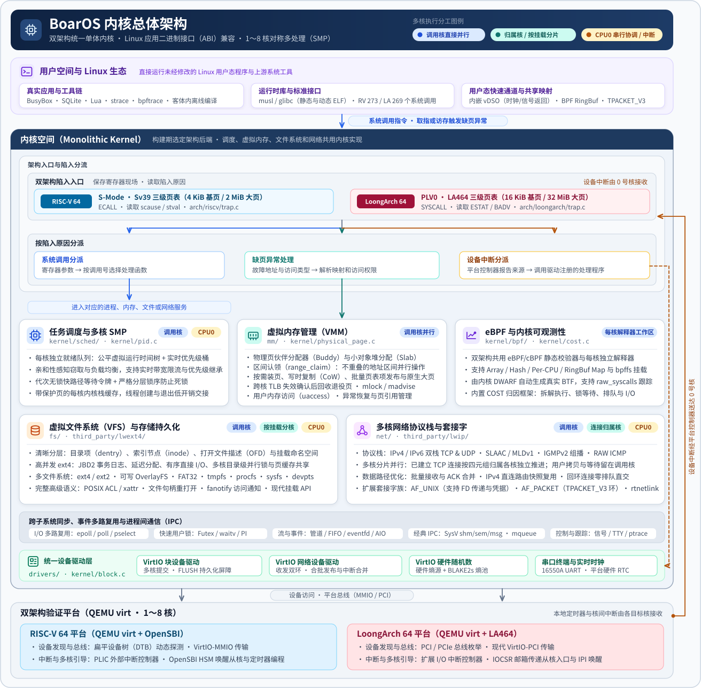

# BoarOS

<p align="center">
  
</p>

<p align="center">
  <a href="docs/modules/riscv-boot.md"></a>
  <a href="docs/modules/loongarch-boot.md"></a>
  <a href="docs/design.md"></a>
  <a href="docs/modules/kernel-syscall.md"></a>
  <a href="docs/modules/riscv-smp.md"></a>
  <a href="LICENSE"></a>
</p>

---

## 项目简介

**BoarOS** 是一个从零编写的、面向 **RISC-V 64** 与 **龙芯 LoongArch 64** 双架构的宏内核操作系统，以完整兼容 **Linux 应用二进制接口（Application Binary Interface，ABI）** 为设计目标。内核主体采用 GNU C11 编写，仅在启动引导、异常陷入与上下文切换等紧贴硬件的边界使用精简汇编，目前核心代码规模约 **14.6 万行**。

BoarOS 在 QEMU `virt` 虚拟平台上支持 **1～8 核对称多处理（Symmetric Multiprocessing，SMP）**，接入 **284 个（RISC-V）／280 个（LoongArch）** Linux 系统调用编号。内核无需修改用户态源码，即可直接运行基于 `musl` 或 `glibc` 的静态与动态链接可执行文件（Executable and Linkable Format，ELF），已跑通 **BusyBox、SQLite、Lua、`strace`、原版 `bpftool`/`bpftrace`**，并支持在 BoarOS 客体机内完成**离线 C 语言预处理、编译、汇编、链接与执行**全流程。

> [!NOTE]
> **推荐阅读路线**
> - 了解内核全局架构与多核并发模型：[系统总体架构设计](docs/design.md)
> - 了解性能瓶颈归因方法与核心数据路径优化：[性能工程与关键优化](docs/performance.md)
> - 了解内核兼容性与并发正确性的四层验证闭环：[正确性保证与验证体系](docs/verification.md)
> - 全国大学生计算机系统能力大赛（OSComp）评测构建与赛题适配独立维护在 `oscomp-compat` 分支；真实开发板（VisionFive 2 与龙芯 2K1000LA）移植为后续独立阶段工作。

---

## 核心技术亮点

| 亮点方向 | 设计思路与达成能力 |
| :--- | :--- |
| **双架构真统一** | 通过构建期静态绑定接口，将 RISC-V 64（4 KiB 页、Sv39、设备树、VirtIO-MMIO）与 LoongArch 64（16 KiB 页、LA464、PCI/PCIe、VirtIO-PCI）的差异收敛在 `arch/` 与 `platform/`，上层调度、虚拟内存、文件系统、网络与扩展伯克利包过滤器（Extended Berkeley Packet Filter，eBPF）共享同一套内核源码，且不引入运行期虚函数表开销。 |
| **真多核与分层锁序** | 采用“每核独立就绪队列 + 严格分层锁序 + 区间并发协调”的多核架构：虚拟内存支持不重叠区间的并发缺页与修改，ext4 支持多核目录级并行，传输控制协议（Transmission Control Protocol，TCP）已建立连接按四元组分片至归属核独立推进。 |
| **面向瓶颈的体系化优化** | 内置 `COST_DIAGNOSTICS` 成本观测框架，按“执行、锁等待、业务排队、设备等待、唤醒延迟”五类时间做量化归因；据此落地了批量页表项发布、确认报文（Acknowledgment，ACK）合并、直连路由快照复用、VirtIO 队列合批、带保护页的内核栈缓存等系统级优化。 |
| **现代 Linux 接口与原生 eBPF** | 除传统进程、信号与文件系统外，还实现了可写叠加文件系统（OverlayFS）、文件访问通知（`fanotify`）、挂载命名空间、原生大页、共享内存报文接收环（`TPACKET_V3`）以及 eBPF 校验器与解释器。内核构建时从自身调试信息生成 BPF 类型格式（BPF Type Format，BTF），供原版 `bpftool`、`libbpf` 与 `bpftrace` 使用。 |
| **工业级四层验证闭环** | 建立了覆盖“宿主确定性并发与故障注入 → 同 ELF 上游 Linux 差分测试（主清单 1,744 项）→ 229 个真实用户程序矩阵与客体内离线编译 → 原版上游工具链校验”的自动化验证体系，确保行为语义与并发生命周期可重复核验。 |

---

## 内核总体架构

下图展示了用户空间、架构入口、内核子系统、设备驱动与硬件平台。系统调用由用户程序执行专用指令触发，缺页异常由处理器执行取指或访存时触发，设备中断由平台中断控制器送到 0 号核。三条路径都由对应架构接收，再按原因分别交给系统调用分派器、虚拟内存管理子系统或设备驱动。



---

## 核心子系统概览

### 1. 双架构抽象与平台适配
- **RISC-V 64（RV64GC / Sv39）**：运行在监控模式（S-Mode），由 OpenSBI 固件提供定时器编程、从核启动（HSM）与远程页表缓存刷新（RFENCE）服务；采用 4 KiB 基页与 2 MiB 原生大页，支持双精度浮点（F/D）及向量扩展（RVV）上下文切换；通过扁平设备树（Flattened Device Tree，DTB）发现外设，VirtIO 使用内存映射输入输出（Memory-Mapped I/O，MMIO）传输。
- **LoongArch 64（LA464）**：运行在内核特权级（PLV0），采用 16 KiB 基页与 32 MiB 原生大页，提供软件转换后备缓冲器（Translation Lookaside Buffer，TLB）重填与核间中断（Inter-Processor Interrupt，IPI）同步；支持浮点及 LSX/LASX 向量扩展；通过 PCI/PCIe 总线枚举设备，VirtIO 使用现代 PCI 传输。
- **用户态加速通道（vDSO）**：双架构均内嵌虚拟动态共享对象（Virtual Dynamic Shared Object，vDSO），将高频时钟查询与信号处理返回蹦床（trampoline）直接映射到用户空间，减少不必要的内核态切换。

### 2. 任务调度、多核 SMP 与同步原语
- **每核独立就绪队列**：每个处理器核独立维护自己的就绪队列。普通任务（`SCHED_OTHER` / `SCHED_BATCH` / `SCHED_IDLE`）按虚拟运行时间组织在平衡树中保证公平调度，并结合亲和性子树位图实现快速跨核窃取；实时任务（`SCHED_FIFO` / `SCHED_RR`）按 1～99 优先级分桶实现常数时间选取，并支持全局实时带宽限流，防止实时任务饿死普通任务。
- **高效等待与同步机制**：引入基于全局单调代次的等待令牌，唤醒方在阻塞尚未提交时可通过原子状态跃迁直接完成通知（无锁快路径）；完整支持快速用户空间互斥锁（Fast Userspace Mutex，Futex）的等待、唤醒、队列重排、多地址等待（`futex_waitv`）以及优先级继承（Priority Inheritance，PI），满足标准多线程库（`pthread`）的互斥锁与条件变量需求。
- **完整进程与信号体系**：支持进程/线程创建（`fork` / `vfork` / `clone` / `clone3`）、凭据与能力集（Capabilities）、PID/IPC/UTS/挂载命名空间、POSIX 标准与实时信号、专用信号栈以及进程调试跟踪（`ptrace`）。

### 3. 现代虚拟内存管理（VMM）
- **两级内存分配**：底层使用页级伙伴分配器（Buddy Allocator）管理连续物理页帧，支持多阶大页分配；上层使用细粒度对象分配器（Slab）管理内核小对象，降低碎片与锁争用。
- **分层并发与区间认领**：同一地址空间内区分外层操作读写锁与内层虚拟内存区域（Virtual Memory Area，VMA）锁，并引入活动区间认领机制（`range_claim`），使互不重叠的匿名内存映射、缺页与解除映射能够在多核上真正并行。
- **按需调页、写时复制与原生大页**：程序代码段与文件映射按需装入页帧；`fork` 后父子进程共享私有只读页，仅在首次写入时触发写时复制（Copy-on-Write，CoW）建立私有副本；支持 2 MiB（RV64）/ 32 MiB（LA64）原生大页，以及批量页表项发布与完整的内存锁定（`mlock`）/ 内存使用建议（`madvise`）语义。
- **安全的跨核 TLB 一致性与用户内存访问**：解除映射或降权时，内核先确认所有可能缓存了旧地址映射的处理器核完成 TLB 失效，再延迟回收退役物理页与页表。RISC-V 在本核用户拷贝中直接访问用户虚拟地址并借助异常表精准恢复，省去逐页查软件页表的固定开销。
- **秘密内存**：`memfd_secret` 为进程提供按需分配的共享内存。秘密页从内核直接映射中逐页撤除，最后释放时清零并归还。

### 4. 虚拟文件系统（VFS）与存储持久化
- **清晰的对象分层**：VFS 严格分离目录项（dentry，负责路径名称）、索引节点（inode，负责文件元数据与数据本体）以及打开文件描述（Open File Description，OFD，负责读写偏移与打开状态）。因此文件被重命名或删除后，已打开的描述符仍可正常读写；通过 `dup` 或 `fork` 继承的描述符共享同一读写偏移。
- **高并发 ext4 与持久化保障**：文件读写与内存映射共用统一页缓存（Page Cache）；启用日志（JBD2）的 ext4 在写入文件空洞时采用延迟分配（先预留磁盘空间与元数据额度，写回时连续分配物理块以减少碎片）；多核下支持目录级并行读写锁，日志提交与检查点线程按挂载与在线核数选核执行；显式同步（`fsync`）严格等待对应事务与块设备 `FLUSH` 屏障落盘。
- **文件系统与挂载接口**。支持挂载 **ext4、ext3、ext2、可写叠加文件系统（OverlayFS）、FAT32/VFAT、内存文件系统（tmpfs）、进程信息文件系统（procfs）、系统属性文件系统（sysfs）、伪终端（devpts）、跟踪文件系统（tracefs）与 BPF 文件系统（bpffs）**。支持 POSIX 访问控制列表（Access Control List，ACL）、扩展属性（xattr）、按句柄打开文件（`name_to_handle_at`／`open_by_handle_at`）及文件访问监控（`fanotify`）。应用可用 `fsopen`／`fsconfig`／`fsmount` 创建挂载，也可用 `statmount`／`listmount` 查询挂载视图。
- **共享输入输出环**：`io_uring` 支持批量提交和收取结果、登记文件和缓冲区，以及文件读写、轮询和定时器等操作。高速非易失性存储设备（Non-Volatile Memory Express，NVMe）可通过该接口接收设备命令。支持范围见[系统调用模块说明](docs/modules/kernel-syscall.md)。

### 5. 多核网络协议栈、eBPF 与可观测性
- **双栈协议与多核 TCP 分片**：基于 lwIP 深度定制，提供完整 IPv4 与 IPv6 的 TCP/UDP、无状态地址自动配置（SLAAC）、组播（IGMPv2 / MLDv1）以及原始 ICMP 套接字。多核下，已建立的 TCP 连接按四元组分片至归属核独立推进状态机，用户数据拷贝与阻塞等待留在调用核完成；同时支持相邻纯确认报文（ACK）合并、IPv4 直连路由快照复用以及回环连接直交快路径。
- **套接字与共享报文环**。本地域套接字（`AF_UNIX`）支持传递文件描述符与进程凭据。链路层套接字（`AF_PACKET`）可将报文复制到共享内存接收环（`TPACKET_V3`），抓包程序映射该环后可直接读取整块报文，省去逐包接收系统调用和从环到用户缓冲区的复制。运行时网络配置使用 `rtnetlink`。
- **原生 eBPF 与内置性能归因**：双架构共用静态安全校验器与每核独立解释器，支持 `ARRAY` / `HASH` / `PERCPU` / `RINGBUF` 等映射类型、套接字包过滤与 `raw_syscalls` 系统调用跟踪点；构建期利用 `pahole` 从内核自身调试信息生成真实 BTF 并挂载于 `/sys/kernel/btf/vmlinux`。调试构建还可开启 `COST_DIAGNOSTICS`，通过 `/proc/boaros_cost` 输出精细的内核时间与计数归因快照。

---

## 双平台特性对比

| 特性维度 | RISC-V 64 平台 | LoongArch 64 平台 |
| :--- | :--- | :--- |
| **处理器架构** | RV64GC（Sv39） | LoongArch 64（LA464） |
| **内核特权级** | S-Mode（监管者模式） | PLV0（核心特权级） |
| **引导方式** | OpenSBI 固件引导 | QEMU `-kernel` 直接引导 |
| **页表与页大小** | 3 级页表 · 4 KiB 基页 / 2 MiB 大页 | 3 级页表 · 16 KiB 基页 / 32 MiB 大页 |
| **多核 SMP 支持** | 1～8 核（OpenSBI HSM + RFENCE） | 1～8 核（IOCSR 邮箱 + 核间中断） |
| **外设发现与总线** | 扁平设备树（DTB）· VirtIO-MMIO | PCI / PCIe 总线枚举 · VirtIO-PCI |
| **浮点与向量扩展** | RV64D 双精度浮点 + RVV 向量上下文 | LA464 浮点 + LSX / LASX 向量上下文 |
| **硬件时钟源** | 架构恒频计数器（SBI 编程定时器） | 片上恒频时钟 + 硬件实时时钟（RTC） |
| **验证环境** | QEMU `virt` + OpenSBI（实板待适配） | QEMU `virt` + LA464（实板待适配） |

---

## 快速上手

### 方式一：一键编译并启动交互式 Shell

在 Linux 宿主上准备好交叉编译器与 QEMU 后（环境安装见 [工具链与环境指南](docs/toolchain.md)），一条命令即可完成内核编译、根文件系统镜像制作与虚拟机启动：

```sh
# 编译并启动 RISC-V 64 交互式 Shell
make shell-riscv

# 编译并启动 LoongArch 64 交互式 Shell
make shell-loongarch QEMU_LOONGARCH64=qemu-system-loongarch64
```

> **提示**
> - 首次制作根盘时会自动下载静态 BusyBox 并用 `e2fsprogs` 生成 ext4 镜像，缓存在 `build/rootfs/` 中，后续启动直接复用盘内数据。
> - 内核构建默认离线编译仓库附带的 `pahole`（缓存于 `build/tools/pahole/`）以生成内核 BTF；若宿主机已安装 `pahole`，可追加 `PAHOLE=pahole` 直接调用系统版本。
> - 看到 `Please press Enter to activate this console.` 后按回车进入 `/ #`，可执行 `ls /`、`uname -a` 等命令，输入 `poweroff -f` 安全关机。

### 方式二：使用 Docker 容器零配置体验

仓库提供与本地开发环境完全一致的 [Dockerfile](Dockerfile)（已预装双架构交叉工具链、QEMU 与 `pahole`）：

```sh
# 1. 构建开发镜像
docker build --platform linux/amd64 -t boaros-dev .

# 2. 挂载仓库目录并启动 RISC-V 交互式 Shell（启动 LoongArch 将 shell-riscv 换为 shell-loongarch）
docker run --rm -it --user "$(id -u):$(id -g)" \
  --mount "type=bind,source=$PWD,target=/workspace" \
  boaros-dev make -j4 shell-riscv
```

### 方式三：仅编译内核或手动指定虚拟机参数

```sh
make            # 编译 RISC-V 64 内核 -> kernel-rv
make kernel-la  # 编译 LoongArch 64 内核 -> kernel-la
```

<details>
<summary>展开查看：手动指定工具链路径、构建多核内核与完整 QEMU 启动命令</summary>

在仓库根目录执行以下任一组命令，对象文件、内核与根盘均输出在独立的 `build/manual-*` 目录中，互不污染。

**RISC-V 64（单核默认；多核构建可追加 `SMP=1 USER_SMP=1 SMP_CPUS=4` 并同步调整 `-smp 4`）：**

```sh
cross=riscv64-elf-
rv_ld=riscv64-linux-gnu-ld
qemu=qemu-system-riscv64
out="$PWD/build/manual-riscv"

make -j"$(nproc)" CROSS_COMPILE="$cross" RV_VDSO_LD="$rv_ld" \
  INIT_CONFIG=config/init.json BUILD_DIR="$out/obj" KERNEL_RV="$out/kernel-rv" "$out/kernel-rv"
python3 -B tools/mkrootfs.py riscv64 "$out/root.img"

"$qemu" -machine virt -bios default -kernel "$out/kernel-rv" \
  -m 1G -smp 1 -nographic -no-reboot -nic none \
  -drive "file=$out/root.img,format=raw,if=none,id=root" \
  -device virtio-blk-device,drive=root
```

**LoongArch 64（单核默认；多核构建可追加 `LA_SMP=1 LA_SMP_CPUS=4` 并同步调整 `-smp 4`）：**

```sh
cross=loongarch64-unknown-linux-gnu-
qemu=qemu-system-loongarch64
out="$PWD/build/manual-loongarch"

make -j"$(nproc)" LA_CROSS_COMPILE="$cross" \
  INIT_CONFIG=config/init.json LA_BUILD="$out/obj" KERNEL_LA="$out/kernel-la" "$out/kernel-la"
python3 -B tools/mkrootfs.py loongarch64 "$out/root.img"

"$qemu" -machine virt -cpu la464 -kernel "$out/kernel-la" \
  -m 1G -smp 1 -nographic -no-reboot -nic none \
  -drive "file=$out/root.img,format=raw,if=none,id=root" \
  -device virtio-blk-pci,drive=root,disable-legacy=on
```

</details>

---

## 仓库目录结构

```text
BoarOS/
├── arch/            # 体系结构相关实现（启动汇编、陷入入口、上下文切换、MMU、向量现场）
│   ├── riscv/       # RISC-V 64 平台（Sv39、OpenSBI、PLIC、VirtIO-MMIO、直接用户拷贝）
│   └── loongarch/   # LoongArch 64 平台（16 KiB 三级页表、软件 TLB 重填、IPI、LSX/LASX）
├── kernel/          # 内核公共核心（启动、调度器、系统调用、BPF、信号、时钟、IPC、页帧分配）
│   ├── sched/       # SMP 抢占式调度器、每核就绪队列、分层锁、等待原语与 Futex
│   ├── syscall/     # Linux 系统调用统一分发与各接口族处理
│   └── bpf/         # eBPF/cBPF 校验器、解释器、Map、BTF 与 tracepoint 跟踪
├── mm/              # 虚拟地址空间、VMA、区间并发协调、缺页处理、原生大页与内核 Slab 堆
├── fs/              # 虚拟文件系统（VFS、页缓存、ext4/ext3/ext2、OverlayFS、FAT32、tmpfs、procfs 等）
├── net/             # 网络子系统（多核 TCP 分片、Socket 端点、TPACKET_V3、rtnetlink、lwIP 适配）
├── drivers/         # 外设与总线驱动（VirtIO 块设备 / 网卡 / RNG、PCI 总线、16550A 串口）
├── platform/        # 平台级硬件初始化与中断路由（RISC-V virt、LoongArch virt）
├── vdso/            # 内嵌用户态虚拟动态共享对象（时钟快路径与信号返回蹦床）
├── include/         # 内核公共头文件、架构抽象契约与 Linux UAPI 兼容定义
├── lib/             # 独立内核基础库函数
├── third_party/     # 第三方开源组件源码（lwext4、lwIP、离线 pahole/elfutils 归档）
├── tests/           # 四层验证套件（宿主并发测试、双架构启动测试、Linux 差分测试、性能实验）
├── tools/           # 根盘制作、BTF 嵌入、工具链构建脚本
└── docs/            # 系统架构设计、性能优化、验证体系与全子系统技术手册
```

---

## 文档导航

| 文档 | 核心内容 |
| :--- | :--- |
| **[系统总体架构设计](docs/design.md)** | 双架构解耦设计、两级分层锁序模型、多核执行分工、对象生命周期与持久化契约 |
| **[性能工程与关键优化](docs/performance.md)** | `COST_DIAGNOSTICS` 成本归因方法论与五大子系统核心优化的设计剖析 |
| **[正确性保证与验证体系](docs/verification.md)** | 宿主并发与故障注入、同 ELF Linux 差分验证（1,744 项）、229 真实程序与离线自编译 |
| **[完整文档中心](docs/README.md)** | 全仓库 60+ 篇子系统技术手册、机制专题与参考文档的分类索引 |
| **[工具链与环境指南](docs/toolchain.md)** | RISC-V / LoongArch 交叉编译环境、QEMU 模拟器与 Docker 镜像配置 |
| **[演进路线与待完成项](docs/goals.md)** | 当前边界说明、多核扩展规划、功能缺口与实板移植路线 |
| **[第三方组件与许可](docs/third-party.md)** | 第三方开源代码来源、版本、本地修改边界与开源协议清单 |
| **[参与贡献指南](CONTRIBUTING.md)** | 编码风格、测试规范、文档约定与 Git 提交格式 |
