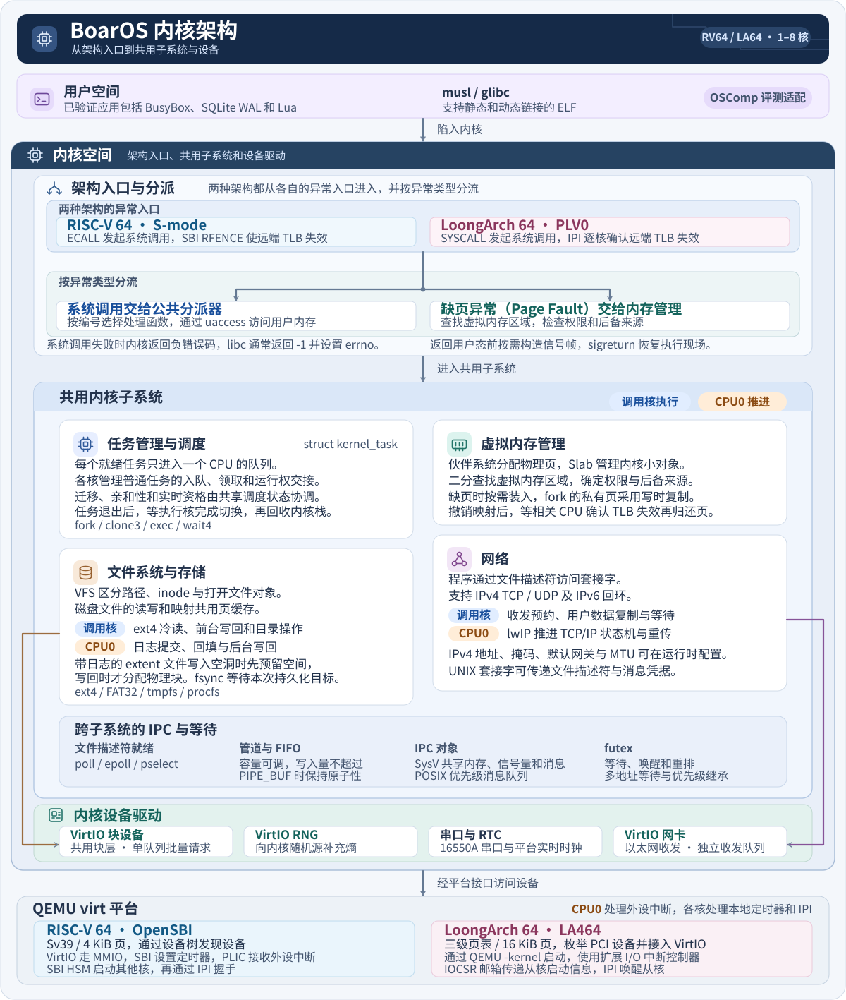

# BoarOS

<p align="center">
  
</p>


<p align="center">
  <a href="docs/modules/riscv-boot.md"></a>
  <a href="docs/modules/loongarch-boot.md"></a>
  <a href="docs/design.md"></a>
  <a href="docs/modules/kernel-syscall.md"></a>
  <a href="docs/modules/riscv-smp.md"></a>
  <a href="LICENSE"></a>
</p>

---

## 📖 项目简介

**BoarOS** 是面向 RISC-V 64 位与 LoongArch 64 位的单体内核，以兼容 Linux 用户态 ABI 为目标。内核主要用 C 编写，启动、异常入口和上下文切换使用架构汇编。

目前在 QEMU virt 上验证，两种架构默认单核，多核版本可启动至八核。已运行基于 musl 和 glibc 的静态与动态 ELF，以及 BusyBox、SQLite 和 Lua 等程序。各程序的验证范围见[用户程序记录](docs/learning/user-program-inventory.md)；当前分支为 `oscomp-compat`，从 main 单向集成通用实现，并维护官方双架构启动、原程序监督、判分及 LA 调度运行时适配；入口与适配边界见[兼容模块](docs/modules/oscomp-compat.md)。实板支持仍待验证。

---

## 🏛️ 内核架构

RISC-V 和 LoongArch 各自处理启动、异常入口、上下文切换和页表操作。系统调用进入内核后，由公共代码实现进程、内存、文件和网络接口。VirtIO 驱动通过各平台的传输接口访问设备；串口和 RTC 由平台代码接入。



---

## 🧩 核心设计与子系统实现

### 1. 双架构抽象与平台适配
- **RISC-V 64**：运行于 S-Mode（Supervisor Mode），由 OpenSBI 提供 SBI 服务。采用 4 KiB 页与 **Sv39** 三级页表；平台通过设备树发现设备，VirtIO 使用 MMIO 传输。
- **LoongArch 64**：在 QEMU virt 的 **LA464** CPU 模型上运行，采用 16 KiB 页和三级页表。VirtIO 使用 PCI 传输；串口和 RTC 由平台代码接入。
- **公共抽象层**：两种架构分别处理异常入口、寄存器切换、页表和硬件定时器，系统调用语义、调度、VFS 和网络由公共代码实现。

### 2. 任务调度与多核 SMP
- **Per-CPU 独立就绪队列**：每个 CPU 核心拥有独立的就绪任务队列，普通任务的入队、领取和运行权交接由所在 CPU 的队列保护；跨核控制仍协调共享状态。
- **多核负载均衡与亲和性**：唤醒时按亲和性选择队列；空闲 CPU 可领取其他队列中允许迁移的就绪任务。可用核数与具体负载的加速比是两回事。
- **Futex 与快速同步机制**：支持等待、唤醒、重排、多地址等待（`futex_waitv`）和优先级继承，供 pthread 互斥锁和条件变量等使用。
- **POSIX 信号体系**：支持实时信号与经典信号投递、专用信号栈 `sigaltstack` 以及通过 `sigreturn` 恢复被中断的执行现场。

### 3. 现代虚拟内存体系（VMM）
- **混合内存分配**：物理内存由页级伙伴系统（Buddy Allocator）统一管理，内核对象由细粒度 SLAB/堆分配器管理。
- **虚存管理（VMA）**：按起始地址排序保存虚拟内存区域，用二分查找定位范围；每个区域记录访问权限及后备对象。
- **按需调页与写时复制（CoW）**：ELF 和文件映射按需装页；`fork` 后，父子共享尚未修改的私有页，写入时再为写入方建立私有副本。
- **跨核 TLB 一致性**：在 SMP 多核环境下，当发生虚存撤回或权限降级时，RV 使用 SBI RFENCE，LA 使用核间中断；在相关 CPU 确认旧地址转换已失效后，才归还退休的页。

### 4. 虚拟文件系统（VFS）与存储持久化
- **标准分层抽象**：VFS 分开维护路径、inode 和打开文件对象。改名后，已打开的 FD 仍指向原文件；`dup` 得到的 FD 共享打开对象及其文件位置。
- **ext4 日志与页缓存**：文件数据经页缓存读写。带日志的 extent 文件在写入空洞时先预留空间，写回时再分配物理块。显式同步的数据写回可在调用核执行。多核时日志提交和 checkpoint 按在线核数选核，页缓存后台写回由 CPU0 推进；`fsync` 等待本次同步确定的持久化目标。
- **多文件系统与挂载**：支持同时挂载 ext4、FAT32/VFAT、内存文件系统 tmpfs、进程状态文件系统 procfs 以及伪终端 devpts；支持挂载、bind、延迟卸载和 `chroot`；私有挂载命名空间可以复制挂载视图并隔离挂载变化。

### 5. 网络与事件等待
- **网络协议**：使用 lwIP 处理 IPv4 TCP/UDP，并支持 IPv6 回环。用户数据复制和等待可在调用核执行。已建立的 TCP 连接由各归属核处理，UDP、监听和建连控制仍在 CPU0。IPv4 地址、掩码、MTU 和默认网关可在运行时配置。
- **Linux 兼容 Socket API**：提供常用 Linux 套接字接口。UNIX 套接字还支持文件描述符传递与消息凭据。
- **[BPF 过滤与跟踪](docs/modules/kernel-bpf.md)**：双架构共用校验器与解释器，提供 socket 过滤、map/bpffs/BTF、raw_syscalls tracepoint 和 ringbuf，供原版 bpftool、libbpf 与 bpftrace 使用。
- **事件驱动多路复用**：通过 `epoll`、`poll` 和 `pselect` 等接口等待套接字、管道及事件 FD 的就绪状态。

---

## 📊 平台支持

| 特性 | RISC-V 64 平台 | 龙芯 LoongArch 64 平台 |
| :--- | :--- | :--- |
| **处理器架构** | RV64GC (Sv39) | LoongArch 64 (LA464) |
| **运行级别** | S-Mode (Supervisor) | PLV0 (Kernel Privilege) |
| **固件 / 引导** | OpenSBI | QEMU `-kernel` 与启动固件 |
| **内存页大小** | 4 KiB | 16 KiB |
| **MMU 页表级数** | 3 级页表 (Sv39) | 3 级页表 (Direct Map + Page Walk) |
| **多核 SMP 支持** | 1 ~ 8 核 | 1 ~ 8 核 |
| **外设总线** | VirtIO-MMIO | PCI / PCIe 总线 |
| **浮点与 SIMD** | RV64D 双精度浮点 | LA464 FR / LSX / LASX 向量扩展 |
| **时钟源** | 架构计时器，期限由 SBI 设置 | 龙芯片上恒频时钟 + 硬件 RTC |
| **运行与验证环境** | QEMU virt + OpenSBI（当前未适配实板） | QEMU virt + LA464（当前未适配实板） |

---

## 🚀 快速上手

### 1. 环境准备

在宿主安装 GNU Make、Python 3、Git、目标架构的交叉 GCC 与 QEMU。编译器前缀、已验证版本和 LoongArch QEMU 的准备方式见[工具链指南](docs/toolchain.md)。

### 2. 编译内核

本分支默认 `make all` 生成官方流程使用的 `kernel-rv`、`kernel-la` 和第二盘，分别使用对应架构的评测启动配置。`INIT_CONFIG=...` 可统一覆盖两侧；通用回归使用 `INIT_CONFIG=config/init.json`，结束后用 `make all` 恢复兼容默认。

```bash
make all
make test-oscomp-host
make test-oscomp-compat      # 本地双架构诊断
make test-oscomp-official    # 固定官方容器与原 Harness

# 使用通用 PID 1 配置构建
make all INIT_CONFIG=config/init.json

# 独立构建八核容量内核
make kernel-rv-user-smp SMP_CPUS=8
make kernel-la LA_SMP=1 LA_SMP_CPUS=8
```

官方输入、运行参数、分数与未完成项目维护在[兼容记录](docs/learning/oscomp-compat-baseline.md)。主线功能记录不等同于原评测全部通过；本分支的 LA 调度适配 DSO 不属于 main 默认运行环境。

### 3. 一键运行与体验

下列启动目标不附加根盘。RISC-V 无盘时进入空闲循环；LoongArch 生产内核会报告缺少根盘。运行用户程序时，按 [RISC-V 根盘](docs/modules/riscv-root-boot.md)或 [LoongArch 根盘](docs/modules/loongarch-boot.md)的说明准备镜像。

```bash
# 启动 RISC-V 内核（单核，无根盘启动）
make run-riscv

# 启动 LoongArch 内核（单核模式）
make run-loongarch

# 调试模式（启动并等待 GDB 连接）
make debug-riscv
```

### 4. 运行架构回归

```bash
# 运行 RISC-V 内核单元测试与子系统测试
make test-riscv

# 运行 LoongArch 相关契约测试与内存测试
make test-loongarch

# 清理构建产物与临时镜像
make prune-build
```

---

## 📂 目录结构

```
BoarOS/
├── arch/            # 体系结构相关实现（启动汇编、Trap 陷入、上下文切换、MMU）
│   ├── riscv/       # RISC-V 64 专用源码（启动、异常入口、Sv39）
│   └── loongarch/   # LoongArch 64 专用源码 (boot.S, tlb_refill.S, mmu.c 等)
├── kernel/          # 通用启动、调度、系统调用、程序装载、信号、时钟、IPC 与物理页分配
│   ├── sched/       # SMP 抢占式调度器、就绪队列、Futex
│   └── syscall/     # Linux 系统调用统一分发与具体处理
├── mm/              # 地址空间、VMA、缺页处理、用户内存访问与内核堆
├── fs/              # 虚拟文件系统（VFS、ext4 事务日志实现、FAT32、tmpfs、procfs）
├── net/             # 网络子系统（Socket 接口、以太网适配、lwIP 移植接入）
├── drivers/         # 外设与总线驱动（VirtIO 块设备/网卡/RNG、PCI 总线、串口）
├── platform/        # 平台初始化（RISC-V virt 平台、LoongArch virt 平台）
├── include/         # 内核公共头文件与 Linux UAPI 兼容定义
├── lib/             # 独立通用的基础 C 运行库函数（字符串、排序等）
├── third_party/     # lwext4、lwIP 等第三方源码
├── tests/           # 单元测试、集成测试、差分对比测试套件
├── tools/           # 镜像制作、构建配置辅助脚本
├── references/      # 固定版本的参考资料与测试输入
└── docs/            # 系统设计文档、模块说明与技术记录
```

---

## 📚 文档索引

更深入的设计考量与实现细节，请参考以下专题文档：

- 📐 **架构与设计哲学**：[内核设计与工程原则](docs/design.md)
- 🧭 **文档中心与导航**：[完整文档索引目录](docs/README.md)
- 🛠️ **工具链与环境**：[交叉编译器与 QEMU 配置指南](docs/toolchain.md)
- 🎯 **开发规划与路线**：[能力路线图与进行中工作](docs/goals.md)
- 📦 **第三方组件授权**：[第三方开源组件说明](docs/third-party.md)
- 🤝 **参与贡献**：[贡献指南](CONTRIBUTING.md)
