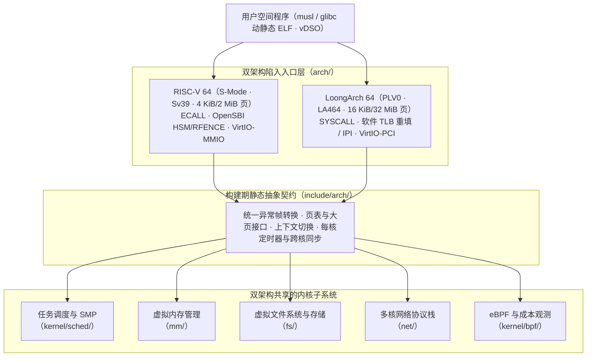
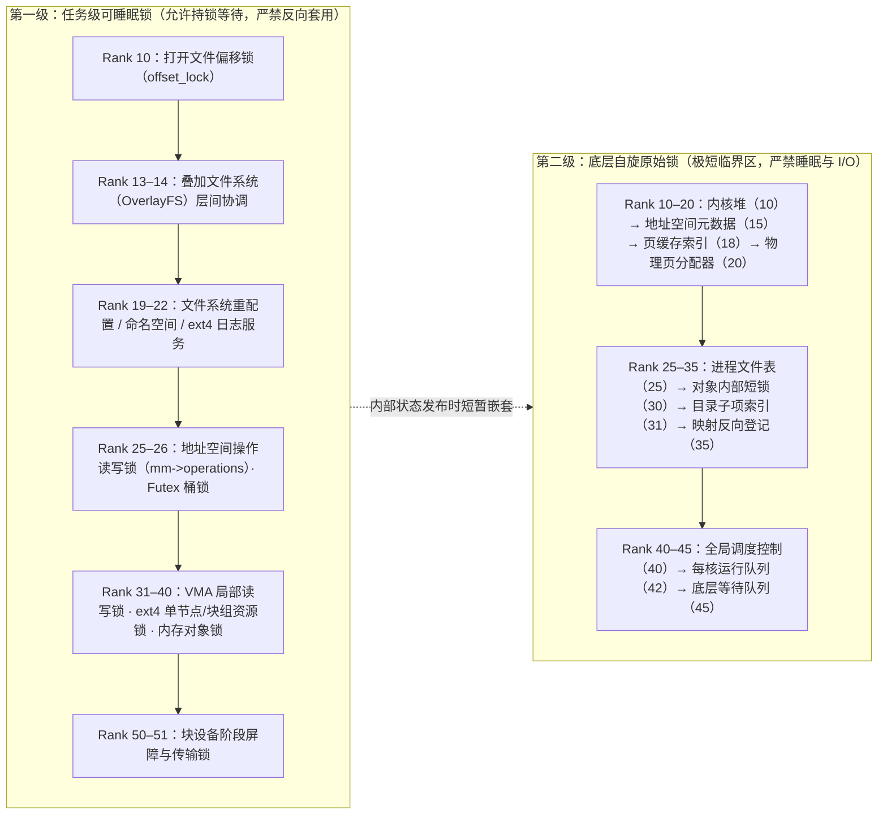
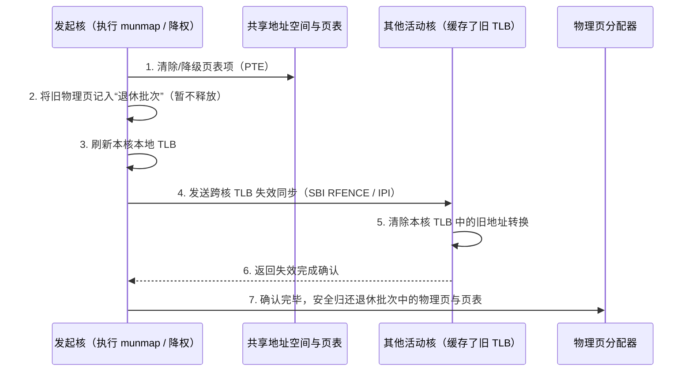

# BoarOS 系统总体架构与核心设计

本文从全局视角阐述 BoarOS 的架构组织、双架构解耦方式、多核并发与锁序模型、对象生命周期治理以及存储持久化契约。各子系统的深入实现细节见 [文档中心](README.md)，围绕性能瓶颈展开的专项剖析见 [性能工程与关键优化](performance.md)。

---

## 一、设计定位与总体原则

BoarOS 是一个面向 **RISC-V 64** 与 **龙芯 LoongArch 64** 的宏内核（Monolithic Kernel）操作系统，以完整兼容 **Linux 应用二进制接口（Application Binary Interface，ABI）** 为核心目标。系统在设计上坚持四条基本原则：

1. **双架构共享一套内核核心**：不在两套指令集间复制业务代码，而是通过编译期抽象边界将体系结构差异收敛到 `arch/` 与 `platform/`，让调度、虚拟内存、文件系统、网络和扩展伯克利包过滤器（Extended Berkeley Packet Filter，eBPF）在两种架构上保持完全一致的语义。
2. **所有权驱动的并发控制**：不使用掩盖问题的全局大内核锁，也不盲目堆砌无序细粒度锁；每个共享状态明确唯一的“状态所有者（Owner）”，同步粒度由实际状态归属决定，并用全局锁序从机制上消除死锁。
3. **清晰分离“逻辑撤销”与“物理回收”**：文件被删除、内存被解除映射、线程退出或网络连接关闭时，先撤下对外可见的索引以阻止新访问，待已有的异步借用、跨核页表缓存或旧执行栈全部安全归还后，再释放底层内存。
4. **以真实可观察语义验收兼容性**：系统调用的返回值、错误码判定顺序、部分读写完成前缀以及共享对象状态严格对标 Linux；未实现的特性明确返回 `ENOSYS`（系统调用未实现）或 `EOPNOTSUPP`（操作不支持），绝不通过返回伪造成功来绕过检查。

---

## 二、双架构统一抽象：构建期静态绑定

RISC-V 64 与 LoongArch 64 在底层硬件机制上差异显著——例如页大小不同（4 KiB 与 16 KiB）、页表与转换后备缓冲器（Translation Lookaside Buffer，TLB）填充机制不同（硬件页表遍历与软件 TLB 重填）、外设总线不同（设备树 + MMIO 与 PCI/PCIe）、多核固件接口也不同（OpenSBI 与片上 IOCSR 邮箱）。

为避免这些差异渗透到上层内核，同时又不引入传统微内核或面向对象虚函数表（vtable）在高频热路径上的间接调用开销，BoarOS 采用了 **构建期静态绑定（Compile-Time Binding）** 策略：公共子系统只依赖 `include/arch/` 中声明的统一语义契约（如 `mmu.h`、`task.h`、`timer.h`、`smp.h`），具体实现则在编译对应架构内核时直接静态链接到 `arch/riscv/` 或 `arch/loongarch/`。

地址对齐、缺页解析、写时复制、大页预留和页缓存使用架构定义的 `BOAROS_PAGE_SIZE`。需要检查当前映射时，公共代码使用统一的叶页表项快照 `struct kernel_mm_leaf`，由架构后端将硬件位域转换为读、写、执行和用户可访问等逻辑权限。

运行时的陷入入口见[内核总体架构图](../assets/kernel-architecture.svg)。两种架构都先保存现场，再根据原因分派。

- **系统调用**由用户程序执行 `ECALL`（RISC-V）或 `SYSCALL`（LoongArch）触发。架构入口从寄存器取出调用号和参数，公共分派器据此进入任务、文件、网络等子系统。
- **缺页异常**由处理器在取指、读取或写入时触发。虚拟内存管理子系统按照故障地址和访问类型检查映射，处理按需装页或写时复制。缺页解决后，处理器重新执行触发异常的指令。
- **设备中断**经平台中断控制器送入 0 号核。RISC-V 使用平台级中断控制器（Platform-Level Interrupt Controller，PLIC），LoongArch 使用扩展输入输出中断控制器（Extended I/O Interrupt Controller，ExtIOI）。平台分派程序识别中断来源并调用设备驱动注册的处理程序。本地定时器中断与核间中断（Inter-Processor Interrupt，IPI）由各目标核接收。

---

## 三、多核执行模型与两级分层锁序

### 3.1 多核执行分工

BoarOS 在对称多处理（Symmetric Multiprocessing，SMP）环境下，根据操作涉及的状态决定执行位置。任务自己的数据准备通常留在发起操作的核。已建立的传输控制协议（Transmission Control Protocol，TCP）连接和文件系统事务分别由其归属执行者推进。用户数据报协议（User Datagram Protocol，UDP）的部分发送可以留在调用核。外设中断和部分全局控制在 0 号核（CPU0）处理。

| 执行模式 | 适用子系统与核心操作 | 设计目的 |
| :--- | :--- | :--- |
| **调用核执行** | 系统调用分派、缺页处理、用户内存访问（`uaccess`）、`futex` 同步、管道与事件描述符读写、ext4 前台读写与目录操作、eBPF 解释执行、块设备请求提交，以及符合条件的 IPv4 单播 UDP 发送 | 让调用者就地准备数据和推进操作，共享对象仍由各自的锁或队列协调 |
| **归属核或按挂载实例选核** | 已建立的 TCP 连接按四元组选择归属核，ext4 日志提交和检查点线程按挂载实例和在线核数选核 | 同一连接的协议状态和同一日志流各自有序推进，不同连接或实例可以并行 |
| **CPU0 协调** | 外设硬件中断、文件系统挂载拓扑变更、页缓存后台全局写回、网络监听与建连控制、网络工作线程接收的回退请求，以及进程组退出与最终资源回收 | 集中处理平台中断和需要一处提交的控制状态 |

**UDP 的发送位置由快路径的条件决定。** 对符合条件的 IPv4 单播发送，调用核可以借用已解析的直连路由和邻居信息，在核对路径代次、目的端点和报文长度后直接提交。缺少可用快照时，部分发送仍可在调用核取得共享协议保护后处理。无法在调用核接纳的请求交给网络工作线程。具体条件见 [多核网络协议栈](modules/kernel-network.md)。

必须在 CPU0 上由调用者同步完成的操作使用**服务交接机制**。`kernel_scheduler_enter_user_service()` 将用户任务及其调用现场交给 CPU0，服务结束后由调度器送回。实时任务（`SCHED_FIFO` 或 `SCHED_RR`）在交接期间保留原核的逻辑实时资格。设备中断直接进入 CPU0 的中断处理程序，网络工作线程则从待处理队列领取请求。

### 3.2 两级分层锁序：从机制上杜绝死锁

多核内核里最隐蔽的缺陷是 **锁顺序反转导致的死锁**（例如核心 A 先拿内存锁再拿文件锁，核心 B 先拿文件锁再拿内存锁）以及 **持自旋锁期间意外睡眠**。BoarOS 在同步层严格区分两类锁，并为每一把锁赋予编译/初始化期确定的 **静态等级（Rank）**：

- **任务级可睡眠锁（`kernel_mutex` / `kernel_rwlock`）**：保护可能涉及阻塞等待、磁盘 I/O 或用户内存拷贝的长临界区。争用时按先入先出（First In, First Out，FIFO）顺序排队并让出处理器（多核下队首争用者会先做短暂有界自旋，避免持锁者很快释放时付出完整上下文切换成本）。
- **底层自旋原始锁（`kernel_raw_lock` / `kernel_raw_rwlock`）**：保护纯内存数据结构修改的极短临界区。持有原始锁期间**严禁调度、严禁分配内存、严禁发起 I/O 或拷贝用户内存**；在单核默认构建中，原始锁自动退化为禁止抢占或关闭本地中断，零原子总线开销。

在两个层级内部，嵌套加锁都必须严格遵守 **从低等级向高等级递增** 的偏序规则；开启 `LOCK_DEBUG=1` 后，内核会在每次加锁与解锁时实时审计锁序、归属权、递归加锁与上下文合法性，一旦违规立即触发诊断中止。

> **设计要点**：任务级可睡眠锁（`kernel_rwlock`）自身内部的等待队列由一把 `Rank 30` 的原始锁保护，登记阻塞时再向下嵌套 `Rank 40/42` 的调度锁，随后立即释放所有原始锁再进入真正的睡眠切换（`park`）。这一结构保证了调度器永远不会反向等待业务锁。

---

## 四、对象生命周期、引用计数与跨核安全回收

在并发操作系统中，“对象在逻辑上被删除或关闭”与“对象占用的物理内存可以安全释放”往往不在同一时刻发生。BoarOS 在进程、地址空间、虚拟文件系统（Virtual File System，VFS）、页缓存和网络套接字中统一贯彻三项生命周期铁律。

### 4.1 摘索引与销毁解耦

几乎所有内核核心对象（如进程标识符对象 `kernel_pid`、地址空间 `kernel_mm`、目录项 `dentry`、索引节点 `inode`、打开文件描述 `OFD`、网络端点等）均遵循统一的引用计数生命周期：

1. **受控查找与借用**：任何调用者在索引锁保护下查到对象后，必须先递增引用计数，退出锁后再使用对象。
2. **撤下发布（Unpublish）**：当用户调用 `unlink`（删除文件名）、`close`（关闭文件描述符）或 `munmap`（解除内存映射）时，内核先将对象从公开索引中摘除，阻止新请求找到它；但已经打开的文件、在途的磁盘直接内存访问（Direct Memory Access，DMA）或并发读请求仍可凭各自持有的引用继续完成。
3. **锁外最终回收**：当最后一份引用归还时，先在短锁内核对引用归零并摘除弱索引，随后在**锁外**执行可能耗时或需要睡眠的清理与内存归还操作。

### 4.2 固定物理页（Page Pinning）与状态代次（Generation）

当内核需要把数据写入用户态缓冲区，或让网卡/磁盘 DMA 直接读写用户页时，必须先将目标物理页**固定（Pin）**（递增该物理页帧的引用计数）。BoarOS 严格区分两个层次的保证：
- **固定物理页**只保证这块物理内存不会在借用期间被分配给其他进程，避免内存踩踏；
- **虚拟映射关系、读写权限与文件内容版本**仍由地址空间与文件对象分别维护。一旦发生睡眠、阻塞等待或并发缺页，调用者恢复后不能盲目沿用旧的查找结果，必须依据**单调递增的代次版本号（Generation）**重新核对当前虚拟内存区域（Virtual Memory Area，VMA）、页表项与文件长度。

### 4.3 跨核 TLB 失效与旧执行栈的安全交接

多核环境下有两类典型的“释放过早”陷阱：
1. **页表撤权后的过早释放**：核心 A 撤除了某页的页表映射，如果直接把该物理页还给分配器，核心 B 的处理器硬件 TLB 中可能仍残留旧映射，导致核心 B 读写到被其他进程复用的脏数据。
2. **任务退出或迁移时的栈踩踏**：任务 T 在核心 A 上即将切走或退出，如果核心 B 在核心 A 尚未切离 T 的内核栈之前就调度运行 T 或释放其内核栈，两颗核会同时破坏同一块栈内存。

BoarOS 对这两类问题均建立了严格的确认闭环：
- **批量延迟退页**：解除映射、降权或写时复制替换产生的旧物理页与旧页表先收集进**退休批次（Retirement Batch）**；修改方更新页表后，向所有可能缓存该地址空间映射的在线处理器核广播 TLB 失效请求（RISC-V 通过 OpenSBI `RFENCE`，LoongArch 通过核间中断 `IPI`），待全部目标核确认旧地址转换已清除，才批量归还物理页。
- **新栈确认交接**：调度切换时，旧任务直到目标核已经真正切换到新栈并执行 `kernel_scheduler_switch_finish()` 后，才正式归还“正在核上运行”的所有权标志，之后其他核才被允许领取该任务，或由回收线程安全释放其内核栈。

---

## 五、统一页缓存与存储持久化边界

普通文件的缓冲读写与共享内存映射通过**页缓存（Page Cache）**访问同一份文件数据。直接输入输出（Direct I/O，`O_DIRECT`）走独立的传输路径，并同页缓存和文件映射协调写回与失效。下面以**启用日志的 ext4 文件空洞写入**为例，说明接纳数据、写回、日志持久化和检查点回填的顺序。

1. **接纳范围与空间归还**。延迟分配先为本批写入准备数据块和区段树（Extent Tree）扩展可能需要的元数据块，再接纳能够覆盖的写入前缀。空间不足时，已经写入的前缀可作为短写返回，无法接纳数据时返回 `ENOSPC`。分配推迟到写回，未用的预留按实际接纳范围归还。
2. **共享映射与稳定版本**。写回准备时，内核利用反向映射找到指向该页的可写用户映射并撤销其写权限，随后取得供本批写回使用的稳定版本。用户再次写入时由写缺页异常重新登记脏状态并推进代次。本批完成时根据代次决定能否清除脏状态。
3. **调用返回与断电恢复**。普通缓冲写入在接纳后可以返回。`O_SYNC` 或 `O_DSYNC` 写入在已有数据被接纳后，还须同步实际写入的范围。`fsync` 与 `fdatasync` 则显式同步文件的数据及相应元数据。启用日志的 ext4 将同步请求关联到该次请求的持久化目标。目标完成涉及必要的数据写回和日志提交。块设备协商了缓存刷新能力时，内核等待设备完成相应的 `FLUSH` 请求。块设备采用直写缓存（Write-Through Cache）模式时，相应的设备写入完成即达到设备侧的持久化边界。
4. **日志提交与检查点回填**。事务持久化后可以通过日志重放恢复。检查点回填（Checkpoint）将该事务涉及的元数据写回文件系统原位，并在所需写入完成后回收日志空间。同步调用可以在自己的持久化目标完成后返回，检查点由后台执行者继续推进。

---

## 六、Linux ABI 兼容性与边界约定

Linux 生态中的用户态程序（尤其是 `glibc`、`musl`、`BusyBox`、`SQLite`、编译器与系统工具）高度依赖大量未写在教科书里、却真实存在的接口细节。BoarOS 在兼容设计上遵循四条可验证的工程准则：

- **错误码与检查顺序一致**：参数非法、权限不足、地址越界、文件类型不匹配与资源不足的判定顺序遵循 Linux 行为，不因内部重构而改变用户态可观察的 `errno`。
- **精确的部分完成语义**：例如向量读写（`readv` / `writev`）或套接字接收中，如果前半段缓冲区合法、后半段触及无效用户地址，内核返回已成功传输的字节数而非丢弃进度直接报 `EFAULT`；只有首个字节前失败才返回错误码。
- **权限与能力模型对齐**：统一通过不可变凭据对象（`kernel_credentials`）管理真实/有效/文件系统用户与组标识、补充组和 Linux 能力集（Capabilities，如 `CAP_SYS_ADMIN`、`CAP_NET_BIND_SERVICE`、`CAP_BPF`），路径查找、文件创建、套接字绑定和特权跟踪共享同一套权限判定逻辑。
- **失败原子回滚**：对象创建或资源分配在任一中间步骤失败时，按相反顺序完整归还已申请的物理页、文件描述符、引用计数与锁，不留下半成品对象或内存泄漏。

---

## 下一步阅读

- 了解我们如何量化定位内核瓶颈并实施五大子系统优化：阅读 **[性能工程与关键优化](performance.md)**
- 了解 BoarOS 如何通过 1,744 项 Linux 差分测试与 229 个真实程序验证上述设计：阅读 **[正确性保证与验证体系](verification.md)**
- 查阅具体子系统的详细数据结构与机制说明：进入 **[文档中心](README.md)**
