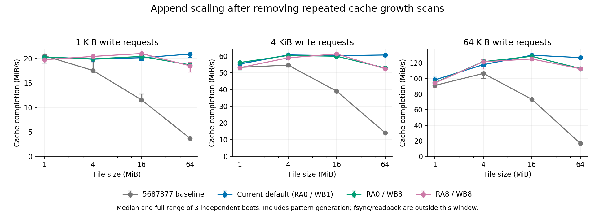
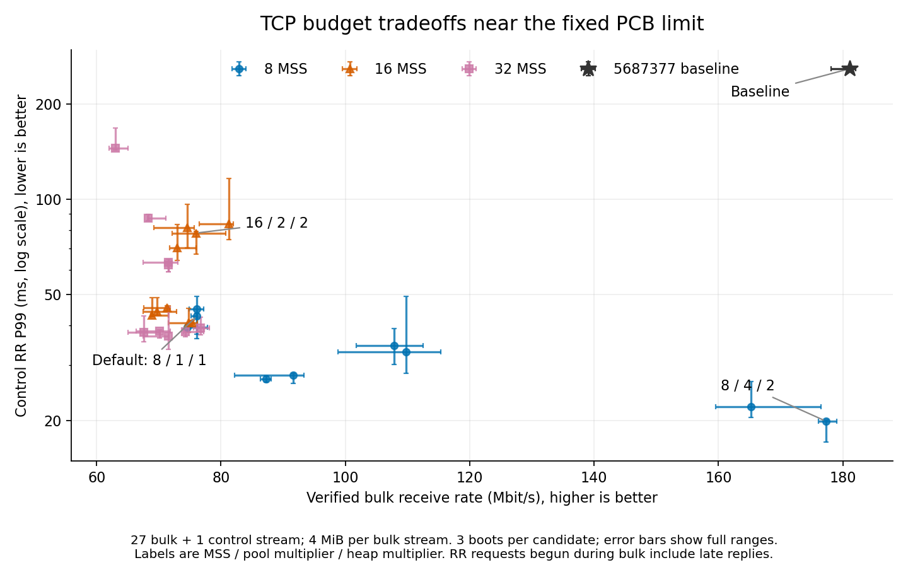

# 数据路径实验

各日期节的“当前”“最终”和“本轮”均指该节固定内核与工作负载；最新机制见模块文档，各轮性能结论不跨版本转移。

## 2026-10-27：RV／LA差距、libc路径与稳定版本复用（15:58提交）

比较**后台额度等待完成版（14:33提交）**与**稳定版本复用完成版（15:58提交）**。同规格原版iozone确认RV吞吐明显低于LA，且两种libc均如此；本次修正一处真实的重复分配策略，但架构间差距仍在。

### 相同工作量下，差距来自哪些实际工作

原ELF、动态加载器与libc保持原样。客机均为单核、512 MiB、ext4 4 KiB块；vCPU固定宿主P核CPU2，主线程／I/O固定CPU8，版本串行，保留真实FLUSH。基线按RV→LA→LA→RV运行，每次依次执行两种libc的16 MiB／4 KiB、16 MiB／64 KiB：`./iozone -i 0 -i 2 -r <记录大小> -s 16m -e`。四次均写盘203251712字节、288次FLUSH，FLUSH累计分别0.907／0.881／1.019／0.952秒。

基线64 KiB重写：RV的musl／glibc中值94.88／94.25 MiB/s，LA为150.20／143.53 MiB/s。RV两种libc接近，架构差距同时存在于两种libc，不能将其归为一个库的适配失败。

用QEMU现有hotblocks插件对原musl的16 MiB／64 KiB命令取样，只累计页缓存写入与fsync函数内的翻译块，不计启动、用户准备和退出；两架构均有768次页缓存写调用、10次fsync。下表是翻译块执行次数乘块内指令数得到的**客机指令量**，不是CPU周期，也不按iozone各方法拆分。

|区间，百万条客机指令|RV|LA|
|---|---:|---:|
|页缓存写入全部|77.26|35.68|
|其中载荷memmove|17.67|17.40|
|fsync全部|175.40|81.06|
|其中载荷memcpy|18.52|18.26|
|fsync内物理页owner_walk|22.82|4.90|
|fsync内短锁取得＋释放|17.50|4.96|

载荷复制的指令量相近，额外开销集中在逐页状态、用户页借用、物理页归属和短锁操作。RV的4 KiB页让这些管理动作更多，但应继续检查动作本身是否反复执行；“页大小不同”不能代替这一层分析。现有物理页非末次释放、已拥有页映射和引用取得已有快速路径，本次保留实际归属、损坏检查与最终释放规则。

### 修正：保留一组已用过的稳定版本，避免下一批重新分配

日志版本额度为内存的1/32、上限4 MiB，原稳定版本空闲池却固定只保留256 KiB。checkpoint归还一批后，大部分对象和物理页被释放，下一批又重新分配。当前按相同内存比例保留实际归还的空闲版本，范围256 KiB～4 MiB；不扩大初始预分配。内存压力仍先回收多余空闲版本，保留原128 KiB后台工作储备。回收每次短锁内最多摘64项，物理页和heap释放在锁外完成。版本仍由读者、journal、DMA等真实使用者持有，cache销毁后的晚归还者沿原池引用结束生命期。当前机制见[VFS/ext4](../modules/vfs-ext4.md#文件节点与页缓存)。

先用仅修改保留容量的原型确认原因，RV与LA所有函数入口地址均未变化。RV同一fsync取样区间，新建稳定版本11296→864次、物理页分配11707→1171次、owner_walk 57958→2000次，客机指令175.40→113.82百万条，减少35.1%。这是重复工作的直接变化，不作为最终吞吐提升幅度。原型首个RV样本反而变慢，整次FLUSH累计1.758秒，对应基线0.946秒；负面样本保留。随后定向复核两者FLUSH为0.943／0.972秒。

最终交付为随内存缩放、分批回收的实现。下表为**基线两次中值→最终一次**，单位MiB/s，均含方法内最终同步；只作本次小批观察，不称为稳定收益。

|16 MiB记录／libc|RV重写|RV随机写|LA重写|LA随机写|
|---|---:|---:|---:|---:|
|4 KiB／musl|71.49→80.37|69.21→76.20|103.17→113.95|97.17→106.98|
|4 KiB／glibc|73.82→75.70|67.33→69.72|102.97→114.73|97.67→104.86|
|64 KiB／musl|94.88→99.19|92.01→94.77|150.20→166.25|150.19→166.33|
|64 KiB／glibc|94.25→95.56|92.93→93.49|143.53→168.17|145.25→163.96|

RV重写提高1.39%～12.42%，随机写提高0.60%～10.10%；LA同样受益。**本次修正没有消除RV／LA差距，也没有持续缩小两者比值。**剩余的逐页MM／物理引用与短锁成本已有实际取样，尚未完成其总吞吐占比归因。

### glibc与musl：stdio调用不同，未发现本批ABI执行失败

最终版另外运行原`./iozone -a -r 1k -s 4m`，两架构、两种libc均完成13个方法。单位MiB/s：

|架构／libc|普通read|fread|fwrite|
|---|---:|---:|---:|
|RV／musl|118.36|72.16|48.49|
|RV／glibc|119.19|115.27|52.59|
|LA／musl|175.40|104.20|69.92|
|LA／glibc|173.97|167.54|75.78|

普通read相近，stdio读取差异在两架构都存在。实际原库反汇编确认：musl的`__stdio_read`通常建立两个iovec并调用readv；glibc的`_IO_file_read`进入普通read。BoarOS的向量导入、共享输出游标、批量源页及`read_pinned/disk_read`已复用共同实现；ext4的`st_blksize`也返回文件系统块大小4096。本次没有发现该批程序的libc专有错误返回、缺失调用或异常终止，但尚未量出stdio差值中库缓冲安排和内核向量路径各占多少；不把调用形式不同直接判定为ABI错误，也不把全部差值归给它。原ELF存在构建ABI差异，保留原输入，不替换库或重编iozone。

### 原1 GiB持续写核对及内存代价

沿用冻结ELF、原设备布局与三个前置窗口，仍执行原`stream-write fsync 1 1073741824 65536 120`，包括最终fsync及内容校验。以下为同规格的一对结果：

|指标|14:33完成版|15:58完成版|变化|
|---|---:|---:|---:|
|含同步吞吐MiB/s|54.30|56.44|+3.94%|
|写入线程CPU ms|7975.32|8054.98|+1.00%|
|write p95 ms|1.0291|1.0619|+3.19%|
|write p99 ms|32.3053|27.9665|-13.43%|
|write最大ms|58.9711|60.5537|+2.68%|

吞吐和p99改善，p95、前台CPU及最大等待仍有小幅代价。整次四窗口FLUSH1352→1356次、累计4.786→4.662秒；未删除同步或改变固定目标。空闲池最多比旧版多保留3.75 MiB载荷及少量描述符，每cache按实际使用增长，压力下可回收；heap峰值不包括这些物理载荷页，不能用heap变化冒充总内存代价。

### 验证、产物与剩余问题

旧256 KiB策略在实际保留量断言失败；新实现通过4／16 KiB页的复用、按内存缩放容量、压力回收、储备、OOM、已准备前缀／空前缀交错，以及cache销毁与最后借用归还交错。复用已有压力域、正常／盘满／EIO／OOM、无关inode错误归属及固定持久化目标短例。正常应用运行累计30个文件系统对象`e2fsck -fn`通过；诊断启动另计。最终RV原版iozone运行的最小内核栈余量2128字节。main与兼容分支默认双架构构建完成，宿主亲和性恢复，运行盘检查后删除，官方输入与评测策略保持原样。

原始输出、身份、原库反汇编、QMP／宿主记录及取样在忽略目录`build/iozone-rv-la-libc-20261027/`：`matched/`为两架构两次基线，`io-scope/`及`reuse-scope/`为独立诊断，`reuse-comparison/`与`reuse-recheck/`保留原型及负面样本，`complete/`为最终两架构iozone，`complete-stream/`为原1 GiB对照。`complete`批次在两架构完成后因下一项输入目录写错而停止，尚未启动的两项改到`complete-stream`执行，未重跑已完成项；不把原失败总状态改写为通过。最后两次追加原自动项，因此`complete`整次FLUSH不能与只含四条16 MiB命令的基线直接比较。

后续优化应继续减少每页重复管理，并量出stdio向量消费的成本；本次只交付已确认的复用策略修正，保留明显的架构吞吐差距和1 GiB尾延迟代价。

## 2026-10-27：后台额度等待与宿主同步波动（14:33提交）

本节比较原延迟分配交付版（12:13提交）、上次写回合并修正版（13:10提交）和本次后台额度等待完成版（14:33提交）。重点分别核对LA 16 MiB覆盖写和原RV 1 GiB持续写；后文保留此前负面结果。

### 先分清相同旧核的波动

此前原RV旧核复跑的宿主指令量只差0.07%，vCPU非自愿切换却从约225增至10371次；单看绑核和平均频率遗漏了实际排队情况。本次保留宿主保护，统一改用独立P核CPU2承载vCPU，CPU8承载主线程／I/O，并记录 `/proc/<tid>/schedstat`。没有改变QEMU磁盘缓存、设备或持久化规则。

LA原延迟分配版两次仍出现明显吞吐差异，但这次原因已缩到宿主I/O边界：相同四条原命令、270次附盘FLUSH，宿主指令量47.232／47.414十亿，平均有效频率4.405／4.401 GHz；FLUSH累计耗时0.816→1.676秒，命令总耗时3.795→4.707秒。约0.86秒额外同步等待对应约0.91秒总时长差，不能据此把旧核自身的变化归给BoarOS新增代码。

另一次短跟踪保留原ELF及QEMU的真实 `fdatasync`：同步工作由四个宿主线程执行，等待采样主要落在 `submit_bio_wait`（835个样本），其次为 `folio_wait_bit`（51个），同步调用可从几毫秒增至约30毫秒。固定Linux源码中的 [ext4同步](../../references/linux/fs/ext4/fsync.c) 与 [块设备FLUSH](../../references/linux/block/blk-flush.c) 对应这一实际等待路径。跟踪启动单列为诊断，不用于性能表；未修改宿主挂载、关闭FLUSH或扣除等待时间。此前一次strace包装没有启动客机，原始失败及暂停状态保留，随后按实际QEMU PID完成跟踪。

### LA 16 MiB：策略路径没有增加工作

单独诊断原四条命令前缀：两版均为62208次接纳检查、1090个写回批次、8706个写回页、142614528个快照字节、72次封组、49次checkpoint等待；前台额度推进和物理回收分支均为零。上次额度回收策略根本没有在这个工作量里执行，7%～12%的单次吞吐下降没有对应的新增策略工作。

原版musl iozone，`-i 0 -i 2 -e`，单位MiB/s。保留4 MiB／1 KiB两种libc的原前置命令，下面各列不混算不同服务条件的中值：

|16 MiB方法|原延迟分配，首测／相同核复跑|上次版，首两次|本次最终版，一次|
|---|---:|---:|---:|
|4 KiB重写|101.83／61.20|102.38／101.03|107.17|
|4 KiB随机写|95.77／54.50|97.06／95.84|101.93|
|64 KiB重写|148.75／72.01|151.23／151.16|159.86|
|64 KiB随机写|153.76／72.35|150.17／148.15|148.62|

原延迟分配复跑的FLUSH累计1.676秒；上次版首两次0.816／0.795秒，本次最终0.821秒。最后补核的上次版也降至4 KiB重写84.88、随机75.97，64 KiB重写112.90、随机105.13 MiB/s，FLUSH累计增到1.097秒；负面样本完整保留。最终64 KiB随机写比上次版首两次中值低0.36%，比原延迟分配首测低3.34%。本批不支持“新增策略稳定拖慢7%～12%”的结论，也不将表中正差值称为稳定内核加速。

### 1 GiB：反复前台接纳是真实策略成本

独立诊断中，两版写回均约1.076 GB，但前台接纳推进请求从511增至6303次。原因是quota仍被稳定版本占用，单批只把dirty转为version，并未归还额度；下一次write又插入小请求，反复打断原后台轮次。封组减少的同时，大量后台工作回到前台，增加调度、等待及前台CPU。

现在普通额度压力先在已有cache进度队列登记并通知后台；额度恢复后在下一批完成点唤醒。若一轮结束仍不足，再沿原有有界推进及错误处理；物理内存不足和执行者自身保留原路径。复用现有轮次、等待队列和worker，未增加水位、线程或载荷缓冲。只等整轮结束的首版虽将p95降到0.607 ms，却产生255／307 ms最大停顿，未作为最终方案；完成版提前唤醒。当前机制见[VFS/ext4](../modules/vfs-ext4.md#文件节点与页缓存)。

仍使用原冻结ELF、初始文件系统、前三个前置窗口和 `stream-write fsync 1 1073741824 65536 120`，包含同一末尾fsync及原内容校验。以下为相同宿主核的逐次值：

|工作阶段|含同步吞吐MiB/s|写入线程CPU秒|write p95 ms|p99 ms|最大ms|
|---|---:|---:|---:|---:|---:|
|原延迟分配，两次|46.68／46.66|8.604／8.608|1.111／1.121|27.160／26.869|40.892／42.273|
|上次版，两次及定向复跑|46.67／44.87／48.54|9.409／9.529／9.150|1.859／1.925／1.753|22.545／25.836／21.255|45.806／53.220／58.008|
|本次最终版，两次|49.61／53.73|8.168／8.216|1.033／1.061|37.363／34.824|78.582／54.266|

**p95和前台CPU增加已消除；p99仍较高，最大等待仍有代价。**前台CPU未包含后台worker，减少竞争请求也把部分持久化工作归回后台。整次四窗口的宿主vCPU指令量，上次定向复跑579.11十亿，本次562.68／562.80十亿，减少约2.83%，因此变化也包含实际执行开销下降，而非只变更CPU归属。这个计数包含前置窗口和验证，不冒充1 GiB写区间的独立总CPU。

最终RV三个连续启动的vCPU累计排队时间为0.756～0.835秒，频率4.26～4.28 GHz，实际绑核符合设置；原延迟分配两次吞吐差约0.05%。宿主同步服务时间仍如实记录，未归一化。最终版整次附盘FLUSH为1356／1352次，保留真实屏障及固定同步目标。

### 验证与产物

暂停真实后台写I/O、再让同域另一inode的写入者登记：旧路径新增竞争请求并触发断言，最终版等待原有进度；另一磁盘域的写入继续独立完成。4／16 KiB页、4 KiB文件系统块的相关检查通过，覆盖正常进度、盘满、EIO、OOM、无关inode错误归属和全部owner归还。正常RV／LA构建完成；生产对照及最终复核共43个运行文件系统对象的 `e2fsck -fn` 正常。RV最终真实运行的内核栈最小余量2272字节。

正式对照为6次LA短流程、6次原持续写；修正最大停顿后仅补2次LA、3次RV，未重跑矩阵。输入、原输出、宿主调度／PMU及QMP记录、失败诊断和磁盘检查保存在忽略目录 `build/write-pressure-tail-20261027/`：`final-small/`保留第一批，`final-confirm/`为实际交付版本复核，`policy-diagnostic*`与`host-fsync-valid/`仅用于原因分析。默认交付物和亲和性恢复，官方输入及评测策略沿用现状。

## 2026-10-27：LA 大文件回退与原 1 GiB 持续写复核

比较三个工作阶段：**只修旧回退版（12:02提交）**、**原延迟分配交付版（12:13提交）**、**写回合并修正版（12:50构建、13:10提交）**。本节修正共同的日志回收策略及覆盖写的重复处理，保留延迟分配的空间预留、回滚、稳定版本和最终同步。12:21交付记录中的随机写下降10.80%是原批次的真实观察，保留在后文。

### 源码原因和实际修改

1. `write_admission` 虽已从全挂载排空改为最旧日志目标，但在没有已封组／提交／checkpoint组时，`jbd_journal_reclaim_target` 仍退到正在合并的running组。普通写回额度检查因此提前结束合并，反复提交日志和FLUSH。修正版将普通额度与物理余量不足分开：前者等待已有关闭组，健康running组继续合并；物理余量低于回收目标线、journal自身额度不足、正常大小／到龄及显式同步仍推进实际持久化目标。没有撤掉所需屏障。
2. 延迟分配准备已持有实际inode的I/O写资格，却又取得挂载状态读保护查该inode的预留索引；没有退休预留的覆盖写也反复取得状态保护检查空链。现在前者复用inode资格，后者先作原子空检查；真正摘链仍在状态保护内完成。共享额度和接纳发布保留原保护。

独立128 MiB原版iozone诊断中，原延迟分配版186个日志组、340次checkpoint等待，修正版114组、130次；计数只存在于忽略目录的诊断源码，正式内核关闭诊断。真实旧路径反例分别暴露“普通额度结束健康running组”和“空链也取得状态保护”，修正版通过。当前协议见[VFS/ext4](../modules/vfs-ext4.md#文件节点与页缓存)。

### 原版 iozone：分别看重写与随机写

LA UP、512 MiB内存、16 KiB页、ext4 4 KiB块。完整沿用前批输入及五条命令的顺序：4 MiB／1 KiB原自动项（两种libc），16 MiB／4 KiB、16 MiB／64 KiB，最后512 MiB／64 KiB。后三条为原musl ELF的 `-i 0 -i 2 -e`，含方法末尾fsync。运行次序为只修旧回退→原延迟分配→修正版→修正版→原延迟分配→只修旧回退；各次从同一已同步模板复制，版本串行。

下表只比较512 MiB／64 KiB，单位MiB/s；保留两次原值，末列是两次中值相对只修旧回退版的变化。

|方法|只修旧回退，两次|原延迟分配，两次|修正版，两次|修正版中值及变化|
|---|---:|---:|---:|---:|
|重写|83.11／95.59|101.38／88.22|105.53／100.75|103.14（+15.44%）|
|随机写|88.37／92.81|84.56／90.12|101.56／80.64|91.10（+0.57%）|

修正版相对原延迟分配的两次中值，重写+8.80%、随机写+4.31%。随机写第二次仍低于对应旧版，不能把中值写成稳定加速。最后仅追加一次单项512 MiB／64 KiB复核，修正版／只修旧回退的重写为98.15／81.26、随机写90.31／70.40 MiB/s；单项与五条连跑分别报告，没有混算中值。更早四次单项旧版／原延迟分配复跑也未复现稳定的−10.80%，但这不改写原失败观察。

同批16 MiB覆盖写的中值仍下降，继续列为本批负面观察，单位同为MiB/s：

|项目|原延迟分配中值|修正版中值|变化|
|---|---:|---:|---:|
|16 MiB／4 KiB 重写|108.75|95.42|-12.26%|
|16 MiB／4 KiB 随机写|101.02|93.94|-7.02%|
|16 MiB／64 KiB 重写|154.70|143.97|-6.94%|
|16 MiB／64 KiB 随机写|156.78|137.48|-12.31%|

修正版第一次16 MiB／64 KiB重写154.63、随机写152.45 MiB/s，接近原延迟分配；第二次降到133.32、122.52，差值没有归一化。当前修正证明重复处理和提前提交已减少，尚未把各文件大小的吞吐都稳定在旧版以上。

QMP记录的是整次五条命令及正常卸载的实际附盘I/O：原延迟分配FLUSH为3376／3386次，修正版均2052次，减少约39%；写盘字节1777.45／1777.50→1767.86／1767.86 MB。修正版两次FLUSH累计耗时仍为7.16／9.27秒，命令总耗时19.47／21.67秒；几乎相同的请求数和写盘字节下，约2.11秒的FLUSH耗时变化对应约2.20秒总时长变化。这是本批波动的一个直接观测，不能逐方法扣除或归一化。

### 原 1 GiB 持续写，没有用其他窗口替代

RV沿用原冻结ELF、初始文件系统、设备布局及前三个前置窗口；报告的仍是原 `stream-write fsync 1 1073741824 65536 120`：共1 GiB、64 KiB记录、内容校验及同一末尾fsync。未用writev收益解释本项。

|工作阶段|含最终同步总秒|MiB/s|末尾fsync ms|write p95 ms|
|---|---:|---:|---:|---:|
|原写回策略，10月26日17:47提交|22.703|45.10|259.79|2.066|
|写回策略完成，10月26日22:30提交|23.624|43.34|275.30|1.252|
|只修旧回退，10月27日12:02提交|23.654|43.29|244.93|1.253|
|原延迟分配交付，10月27日12:13提交|21.909|46.74|249.80|1.088|
|写回合并修正版，10月27日12:50构建|23.092|44.34|258.81|2.333|
|与首行逐字节相同的基线复跑|24.374|42.01|262.55|2.481|

针对修正版首测总耗时比原延迟分配增加5.40%，最后补一次反向定向复核：修正版21.859秒、46.84 MiB/s；原延迟分配23.160秒、44.21 MiB/s。两次吞吐中值分别45.59／45.48 MiB/s，基本相当；首测回退没有被删掉。相同旧核复跑吞吐也下降6.85%，本批不足以确认几个百分点的净吞吐收益。

**持续写仍有代价：**修正版两次write p95为2.333／2.131 ms，原延迟分配为1.088／1.547 ms；工作线程CPU时间分别10.086／9.801秒和8.289／9.246秒。减少提前提交后，等待更集中、前台CPU更多，未完成尾延迟和CPU成本改善；这两项不以LA吞吐或FLUSH数量掩盖。整次四窗口附盘FLUSH约2212／2200→1360／1360次，属于请求数改善，不等于所有性能指标改善。

### 测量条件与验证范围

实际vCPU固定宿主独立P核CPU0，主线程／I/O在CPU8，其余同UID进程临时移离CPU0～8，批次后已恢复。每次复制原模板后fsync，再检查输入和内核身份；QEMU保持相同writeback缓存且真实执行FLUSH。正式期间没有其他构建或测试。LA各次有效平均频率4.34～4.37 GHz，RV4.25～4.28 GHz，亲和性记录符合设置。首个LA连跑在前置窗口出现较多宿主抢占，原值完整保留；后续版本和基线复跑同样没有按频率修正结果。绑定和频率相近仍未消除所有同步等待波动，没有将代码布局认定为根因。

相关宿主短例覆盖4／16 KiB页与1／4 KiB文件系统块的日志目标、预留借用、磁盘满、mmap接纳，以及内存紧张、EIO／ENOMEM的错误归属与资源归还；均通过。正常RV／LA内核构建完成。本批6次LA连跑、6次原持续写阶段比较及4次定向复核，共40个运行文件系统对象的 `e2fsck -fn` 正常，检查后清理运行副本；此前隔离复现和诊断单独保存。

整次root heap峰值LA约9.0 MiB，RV约35.2～35.4 MiB，不等于页缓存全部占用。输入、内核、原输出、QMP统计、宿主记录及磁盘检查集中在忽略目录 `build/la-overwrite-20261027/`：`final-la/`保留首个完成启动，`final-rest/`为后五次，`native/`为原1 GiB阶段比较，`targeted-check/`为最后四次复核。官方评测配置沿用现状。

## 2026-10-27：延迟分配与上轮过度日志回收的独立修正

以下保留12:21交付时的实现与首批结果；LA大文件及原1 GiB持续写的后续复核见上节。

本轮把新写入的物理块选择移到回写批次。缓存接纳只预留数据块额度；同一 inode 的多次写入共用逻辑块预留，回写接纳转换额度，abort 恢复，未使用准备在真实使用者结束后归还。mmap 在实际标脏且仍持 inode 资格时接纳；VMA 替换取消准备，旧 ticket 不接纳截断后重用的位。当前协议见 [VFS/ext4](../modules/vfs-ext4.md#文件节点与页缓存)。journal extent 文件启用延迟分配；legacy／无 journal 沿原立即分配清理。

上轮回退另有独立修正：`write_admission` 归还一批额度时使用整挂载 `group_drain`，把等待目标推进到其后无关的新日志组，提前结束合并。现在只选择最旧可回收组，正常 syncfs／卸载保留全部目标。暂停真实提交 DMA、再接纳新组的反例在旧路径失败，修正后通过。该修正于10月27日12:02独立提交，延迟分配于12:13提交；下面同时保留不含延迟分配的修正版本。

### 旧回退单独比较

同一原版 ELF、相同输入；表中前三列均没有延迟分配，单位 KiB/s。原起点为10月26日17:47版，上轮为22:30完成版。16／512 MiB 项使用 `-e` 含最终同步；4 MiB 自动项保留原参数，其单方法列沿原程序定义，命令结束另排空文件和目录。

|项目|原起点|上轮完成|只修最旧日志组目标|相对上轮|
|---|---:|---:|---:|---:|
|RV 16 MiB／64 KiB 重写|99799|77587|98729|+27.25%|
|RV 512 MiB／64 KiB 重写|65073|62107|75932|+22.26%|
|LA 原 glibc fwrite|49170|45907|52196|+13.70%|
|LA 原 glibc frewrite|44195|47411|52836|+11.44%|
|LA 512 MiB／64 KiB 重写|105519|93781|91817|-2.09%|

RV 16 MiB重写和 LA glibc fwrite 在独立修正版本恢复，保留同步语义和实际持久化屏障。LA 512 MiB重写在这一修正中仍慢于原起点；这项没有被后面的延迟分配收益抹去。另一次把后台水位／到龄恢复为旧值的筛选未普遍解决回退，未采用。

### 原版 iozone：包含最终同步的写吞吐

使用原盘 musl iozone，`-i 0 -i 2 -e`，顺序写、重写和随机写列均由原程序输出，单位 MiB/s（原 KiB/s ÷1024）。每个阶段各一次启动，不将单次观察称为稳定加速；实际数据量和记录大小相同。最终列为两项修复及 mmap 所有权修正后的交付内核。

|架构／文件／记录|方法|原起点|上轮完成|只修旧回退|最终延迟分配|相对原起点|
|---|---|---:|---:|---:|---:|---:|
|RV / 16 MiB / 4 KiB|顺序写|32.49|33.20|33.48|59.44|+82.96%|
|RV / 16 MiB / 4 KiB|重写|66.17|66.69|67.48|74.01|+11.84%|
|RV / 16 MiB / 4 KiB|随机写|62.09|63.02|63.09|69.99|+12.71%|
|RV / 16 MiB / 64 KiB|顺序写|69.27|72.33|72.91|78.81|+13.76%|
|RV / 16 MiB / 64 KiB|重写|97.46|75.77|96.42|95.49|-2.02%|
|RV / 16 MiB / 64 KiB|随机写|88.84|96.31|98.32|94.71|+6.61%|
|RV / 512 MiB / 64 KiB|顺序写|57.30|56.46|57.39|65.22|+13.82%|
|RV / 512 MiB / 64 KiB|重写|63.55|60.65|74.15|72.67|+14.35%|
|RV / 512 MiB / 64 KiB|随机写|54.92|50.77|57.17|59.63|+8.58%|
|LA / 16 MiB / 4 KiB|顺序写|43.54|39.38|44.45|79.86|+83.43%|
|LA / 16 MiB / 4 KiB|重写|90.29|83.79|87.75|99.70|+10.42%|
|LA / 16 MiB / 4 KiB|随机写|87.11|81.52|84.20|96.01|+10.23%|
|LA / 16 MiB / 64 KiB|顺序写|106.59|101.69|109.13|126.96|+19.11%|
|LA / 16 MiB / 64 KiB|重写|158.56|135.86|137.32|139.63|-11.94%|
|LA / 16 MiB / 64 KiB|随机写|162.10|140.06|135.88|144.62|-10.78%|
|LA / 512 MiB / 64 KiB|顺序写|87.69|79.11|81.36|90.77|+3.51%|
|LA / 512 MiB / 64 KiB|重写|103.05|91.58|89.67|94.38|-8.41%|
|LA / 512 MiB / 64 KiB|随机写|86.36|80.48|88.41|78.86|-8.68%|

**未达项继续保留：**LA 512 MiB重写、随机写相对原起点分别下降8.41%、8.68%。随机写相对“只修旧回退”也下降10.80%，属于本批最终组合的负面结果；未定位到独立代码原因，不以顺序写或小文件收益宣布解决。LA 16 MiB／64 KiB 重写和随机写也低于首个起点，但相同旧核复跑有较大漂移，按下表单列。上轮原生1 GiB持续写45.00→43.57 MiB/s仍保留为原窗口未复核项，本次原iozone512 MiB不替代那次测量。

### 原参数两种 libc 与最终同步耗时

原 `-a -r 1k -s 4m` 两种 libc 均完成13项；完整原输出在同批console中。以下单位KiB/s，只列此前关注的写入项。

|架构／libc|write：原起点→上轮→最终|fwrite：原起点→上轮→最终|frewrite：原起点→上轮→最终|命令＋末尾排空ms：原起点→最终|
|---|---:|---:|---:|---:|
|RV／musl|24189→24988→36008|36618→37137→48231|37204→37541→49238|1805.94→1571.79|
|RV／glibc|22636→22742→39237|39881→38914→53058|40465→39240→53946|2005.14→1777.54|
|LA／musl|35000→29954→49542|46692→42994→65784|47024→43795→65581|1282.70→1139.51|
|LA／glibc|35097→31105→50731|49170→45907→72155|44195→47411→71560|1486.06→1265.91|

### 相同旧核复跑与测量范围

基线复跑使用逐字节相同的原起点内核，不扣除或归一化差值。下表保留会影响上述结论的漂移，均为原iozone含同步吞吐。

|项目|第一次 KiB/s|相同旧核复跑 KiB/s|变化|
|---|---:|---:|---:|
|RV 512 MiB顺序写|58677|51005|-13.07%|
|RV 512 MiB随机写|56240|51398|-8.61%|
|LA 16 MiB／64 KiB重写|162365|96155|-40.78%|
|LA 16 MiB／64 KiB随机写|165988|97771|-41.10%|
|LA 512 MiB重写|105519|109722|+3.98%|
|LA 512 MiB随机写|88432|91551|+3.53%|

客机UP、512 MiB、ext4 4 KiB块；RV页4 KiB、LA页16 KiB。每架构同一原ELF／libc／loader、同一输入盘和case顺序。原自动项使用两种libc，扩展文件／记录大小使用原musl ELF。`-e`来自固定iozone3.506自带选项；正文新增的是调用参数，原程序、判分和官方输入未替换。独立宿主P核CPU0执行vCPU，CPU8执行主／I/O线程；版本串行、诊断关闭，使用现有宿主保护和实际频率／抢占记录，所有批次亲和性已恢复。

实际完成第一轮10次、独立回收修正4次、最终所有权版本2次，共16次启动、80条原iozone命令。所有命令正常完成，文件／目录末尾同步、root正常退出和两张附盘 e2fsck均通过；原生内容正确性另由直接短例验证。中间两次所有权缺口及fixture期望错误留在对应日志，没有用其结果作为交付成功。RV真实四核和LA的三个直接消费者窗口另作正确性检查，性能表没有用其并行运行时间。

最终整次启动root heap峰值RV 34320384 B、LA 9420800 B；该量不等于页缓存总内存。最终内核、原ELF／输入身份、逐命令原输出、fsck和宿主记录集中在主工作区忽略目录 `build/delalloc-20261027/`：`performance/`为初筛及基线复跑，`performance-final/`为独立旧回退修正，`performance-delivery/`为交付内核；所有正式运行盘已检查后删除，输入、缓存和ELF保留。

本轮没有运行整套LTP或完整官方iozone组分；默认单核、评测输入、跳过表和监督设置沿用现状。


## 2026-10-26：目标页写入整理与写回策略选择

本轮以10月26日17:47提交的冷缺失训练预读完成版为起点，保留此前读取收益，整理重复写入工作并比较后台写回策略。最终版为22:05构建的W75／T1／D0：提前后台写回启用、5秒到龄回写启用、细粒度脏块默认关闭。主要收益集中于同来源页的碎片writev；持续写的p95与角色CPU下降，但总持久化时间略增，不能概括为所有写负载都加速。

### 源码原因与采用的结构

旧writev按来源片段反复查找目标页、pin来源并发布脏状态。同一来源页的64×64 B片段因此重复64轮。当前以目标缓存页组织填充，在同一来源页内复用pin，不另建载荷拼接缓冲；页内填充后统一发布实际完成前缀，整页覆盖在可证明时避免读取旧页。直接反例的pin从64次降为1次；分散来源页仍按实际来源页处理，不能外推同等收益。写回选择批次贯穿准备、提交与完成，删除重复借用与描述符转换，journal／DMA／读者继续各自持有稳定版本。

同步写向下传递实际成功范围，覆盖O_APPEND的实际位置；文件保存data／full固定目标，文件、目录及挂载目标保留各自依赖，等待者复用已提交目标。真实日志组所需屏障保留，不按fsync调用数机械减少FLUSH。结构筛选后另删除首片段span求值与来源指针重建的重复处理。

### 策略取舍

|候选|筛选观察与最终决定|
|---|---|
|同步范围／inode目标|解决真实范围与持久化依赖；单次O_SYNC -7.07%、O_DSYNC -5.79%，每16次fsync +5.84%，不把单次差值当稳定收益。|
|7.5%提前后台写回|保留总高／低线10%／5%，以真实额度归还推进。筛选持续写p95下降40.6%；最终组合p95下降37.60%，总完成+3.28%，采用等待平滑与CPU下降的取舍。|
|空闲域份额借用|一忙一闲总时间+2.65%、双忙+0.74%，不采用，代码已删除。|
|服务次序调整|真实混合总时间+42.45%，读最大等待和同步也恶化，不采用，相关代码与未用配置已删除。|
|5秒到龄回写|4 MiB突发后空闲的末尾fsync 50.251→2.083 ms；热点6秒总窗口基本不变。采用，同时保留更早写回减少合并的代价。|
|脏块细分|同页首尾块修改的夹带写入减少；RV单次总完成+0.40%、末尾同步约+11%，保留可选，默认0；mmap未知细粒度仍保守覆盖整页。|

### RV最终三轮：15个原生窗口

起点／最终／同起点基线复跑各运行三次，表内为各次指标中位数。总时间包含负载要求的末尾同步。CPU仅为工作角色user＋system总和，未包含后台内核worker独立CPU；旧追加／读取窗口未输出角色CPU，记为—。

|工作量|总ms：起点→方案（变化）|MiB/s：起点→方案|CPU ms：起点→方案|同基线基线复跑总ms（漂移）|
|---|---:|---:|---:|---:|
|16 MiB writev／1段／热目标／同来源页|292.29→297.65（+1.83%）|54.74→53.76|198.34→196.55|300.81（+2.91%）|
|16 MiB writev／64段／热目标／同来源页|1553.72→324.45（-79.12%）|10.30→49.31|1439.22→221.05|1536.75（-1.09%）|
|16 MiB追加／4 KiB|607.06→622.79（+2.59%）|26.36→25.69|—→—|612.06（+0.82%）|
|1 GiB持续写＋末尾fsync|22756.05→23503.50（+3.28%）|45.00→43.57|10512.59→9691.97|22810.05（+0.24%）|
|1 MiB热点／16 MiB更新|211.90→216.98（+2.39%）|75.51→73.74|183.23→187.20|215.83（+1.85%）|
|4 MiB O_SYNC|7140.62→7307.78（+2.34%）|0.56→0.55|559.47→558.61|7058.88（-1.14%）|
|4 MiB O_DSYNC|7198.47→6948.25（-3.48%）|0.56→0.58|557.22→533.42|6970.38（-3.17%）|
|4 MiB／每16次fsync|672.42→693.16（+3.08%）|5.95→5.77|196.52→194.82|695.15（+3.38%）|
|4 MiB／每16次fdatasync|681.76→694.44（+1.86%）|5.87→5.76|196.91→201.34|702.10（+2.98%）|
|4写者／4 MiB／64次fsync|699.41→717.61（+2.60%）|5.72→5.57|255.55→256.72|730.21（+4.40%）|
|真实读写混合／合计24 MiB|968.61→988.30（+2.03%）|24.78→24.28|754.53→762.98|992.88（+2.51%）|
|mmap＋pwrite／16 MiB更新|826.49→835.90（+1.14%）|19.36→19.14|723.72→724.00|859.63（+4.01%）|
|16 MiB冷读／4 KiB|255.48→247.14（-3.27%）|62.63→64.74|—→—|252.20（-1.28%）|
|16 MiB冷读／64 KiB|132.93→129.21（-2.80%）|120.36→123.83|—→—|132.96（+0.02%）|
|16 MiB热读／4 KiB|121.75→118.90（-2.34%）|131.42→134.57|—→—|121.39（-0.29%）|

同页64段writev的写调用p95 0.391→0.036 ms，所有运行最大值1.953→0.414 ms。1 GiB持续写p95 2.036→1.270 ms（-37.60%），角色CPU 10512.59→9691.97 ms（-7.81%），但最大调用80.175→85.938 ms，总完成22756.05→23503.50 ms（+3.28%，基线复跑 +0.24%）；收益是常见等待更平滑，最大等待没有改善。

真实混合总完成968.61→988.30 ms（+2.03%，基线复跑 +2.51%）；读p95 1.227→1.245 ms、读最大值9.113→5.807 ms，同步p95 26.397→29.810 ms、同步最大值26.454→34.534 ms。与同步实际重叠的读样本数中位数127→143，读写并发确实发生。结果保留读最大值下降与同步等待增加两面。

首批64 KiB追加为294.94→307.21 ms（+4.16%，基线复跑 +0.70%）。删除首次span求值与指针重建的重复操作后，22:52使用同一结构输入做一次最终版复核，16窗均通过；64 KiB追加为298.4124 ms、53.617 MiB/s，相对首批起点中位数294.94395 ms为+1.18%。这是单次跨阶段复核，首批回退继续保留；结果支持重复处理已减少，不写成三轮稳定加速。

### LA最终单次：8个原生窗口

LA页16 KiB、稀疏组文件系统块4 KiB；每个版本只运行一次，以下为方向观察，不能替代RV三轮结论。

|工作量|总ms：起点→方案（变化）|MiB/s：起点→方案|CPU ms：起点→方案|同基线基线复跑总ms（漂移）|
|---|---:|---:|---:|---:|
|16 MiB writev／1段／热目标／同来源页|227.51→196.83（-13.49%）|70.33→81.29|132.20→129.29|238.32（+4.75%）|
|16 MiB writev／64段／热目标／同来源页|1063.66→237.57（-77.66%）|15.04→67.35|965.92→150.75|1105.60（+3.94%）|
|16 MiB追加／4 KiB|415.09→394.20（-5.03%）|38.55→40.59|—→—|429.45（+3.46%）|
|LA同页首尾4 KiB块|276.92→270.67（-2.26%）|115.56→118.23|228.60→229.61|287.40（+3.79%）|
|4 MiB O_DSYNC|7403.53→6609.33（-10.73%）|0.54→0.61|380.72→356.54|6880.82（-7.06%）|
|4 MiB／每16次fdatasync|589.44→617.63（+4.78%）|6.79→6.48|92.48→92.71|530.32（-10.03%）|
|4写者／4 MiB／64次fsync|608.31→589.41（-3.11%）|6.58→6.79|127.93→125.46|555.08（-8.75%）|
|mmap＋pwrite／16 MiB更新|347.38→333.62（-3.96%）|46.06→47.96|301.37→293.00|340.87（-1.87%）|

LA每16次fdatasync总完成+4.78%，同步p95 7.587→13.728 ms、最大值9.896→22.625 ms；周期同步总完成-3.11%，但同起点基线复跑为-8.75%。保留观察差值及较大的自对照波动，不报告稳定加速。

### 原iozone：两种libc的13项吞吐与总耗时

各版本复用同一原ELF与`-a -r 1k -s 4m`，保持实际4.15兼容profile。表中吞吐单位为原iozone的kB/s（按1024 B计），箭头为起点→最终，RV取三次中位数，LA为单次。

**RV**

|方法|musl kB/s|变化|glibc kB/s|变化|
|---|---:|---:|---:|---:|
|write|24497→24566|+0.28%|22700→23499|+3.52%|
|rewrite|41347→40734|-1.48%|41279→41529|+0.61%|
|read|120199→121662|+1.22%|119052→121698|+2.22%|
|reread|122483→123586|+0.90%|120438→122841|+2.00%|
|random read|78518→79741|+1.56%|79273→79048|-0.28%|
|random write|35133→34447|-1.95%|34693→34671|-0.06%|
|backward read|80864→80989|+0.15%|82315→82234|-0.10%|
|record rewrite|36048→35758|-0.80%|35773→35690|-0.23%|
|stride read|80263→81188|+1.15%|80276→81473|+1.49%|
|fwrite|37209→37220|+0.03%|40032→39720|-0.78%|
|frewrite|37764→37644|-0.32%|40822→40507|-0.77%|
|fread|73181→72441|-1.01%|116751→118402|+1.41%|
|freread|73983→73422|-0.76%|120608→120758|+0.12%|

**LA**

|方法|musl kB/s|变化|glibc kB/s|变化|
|---|---:|---:|---:|---:|
|write|34685→32342|-6.76%|35291→35236|-0.16%|
|rewrite|53985→52604|-2.56%|54712→53915|-1.46%|
|read|174914→175989|+0.61%|175771→177916|+1.22%|
|reread|179751→176376|-1.88%|180767→183652|+1.60%|
|random read|118313→118944|+0.53%|119660→124245|+3.83%|
|random write|46128→44656|-3.19%|46045→45526|-1.13%|
|backward read|115755→120018|+3.68%|119223→121992|+2.32%|
|record rewrite|46573→45581|-2.13%|47381→46377|-2.12%|
|stride read|118456→120142|+1.42%|118091→121626|+2.99%|
|fwrite|49478→48597|-1.78%|51417→47265|-8.08%|
|frewrite|49848→48961|-1.78%|52884→47559|-10.07%|
|fread|108832→109037|+0.19%|175192→173801|-0.79%|
|freread|110673→112347|+1.51%|176879→176134|-0.42%|

|架构／libc|程序总耗时ms：起点→最终|变化|退出后排空ms：起点→最终|同起点基线复跑程序总耗时漂移|
|---|---:|---:|---:|---:|
|RV／musl|1769.04→1753.41|-0.88%|8.96→8.51|-0.89%|
|RV／glibc|1998.80→2004.64|+0.29%|7.74→7.36|+0.74%|
|LA／musl|1244.59→1263.88|+1.55%|8.35→8.15|-0.99%|
|LA／glibc|1386.50→1400.64|+1.02%|7.01→7.30|-0.03%|

LA glibc fwrite、frewrite分别下降8.08%、10.07%，对应同起点基线复跑为+2.29%、+1.24%；这两项单次回退没有被程序总耗时约+1%掩盖。

### 同起点基线复跑波动

基线复跑使用与起点完全相同的内核和输入；不扣除基线复跑、不归一化结果。以下独立列出最终批次达到3%的自对照漂移。

**RV原生窗口**

|工作量|起点ms|基线复跑 ms|漂移|
|---|---:|---:|---:|
|final／4 MiB O_DSYNC|7198.47|6970.38|-3.17%|
|final／4 MiB／每16次fsync|672.42|695.15|+3.38%|
|final／4写者／4 MiB／64次fsync|699.41|730.21|+4.40%|
|final／mmap＋pwrite／16 MiB更新|826.49|859.63|+4.01%|

**LA原生窗口**

|工作量|起点ms|基线复跑 ms|漂移|
|---|---:|---:|---:|
|final／16 MiB writev／1段／热目标／同来源页|227.51|238.32|+4.75%|
|final／16 MiB writev／64段／热目标／同来源页|1063.66|1105.60|+3.94%|
|final／16 MiB追加／4 KiB|415.09|429.45|+3.46%|
|final／LA同页首尾4 KiB块|276.92|287.40|+3.79%|
|final／4 MiB O_DSYNC|7403.53|6880.82|-7.06%|
|final／4 MiB／每16次fdatasync|589.44|530.32|-10.03%|
|final／4写者／4 MiB／64次fsync|608.31|555.08|-8.75%|

原iozone吞吐达到3%的同起点漂移：

|架构／libc／方法|起点kB/s|基线复跑 kB/s|漂移|
|---|---:|---:|---:|
|RV／musl／write|24497|25493|+4.07%|
|RV／glibc／write|22700|23728|+4.53%|
|LA／musl／write|34685|33030|-4.77%|
|LA／musl／backward read|115755|120417|+4.03%|
|LA／glibc／write|35291|36483|+3.38%|

筛选批次另有共同基线每16次fsync -12.16%、周期同步 -4.22%等波动，所以单候选只用来选择用途，最终结论以固定三轮整体对照为主。首批结构单段同来源页冷writev的基线复跑漂移+13.83%，未用该项宣称冷写收益；64段同来源页的大幅下降与直接pin反例分别记录。

### 资源、栈与设备字节

**RV**

整次启动的root heap峰值（MiB）；它包含同次全部窗口，不归因于某一个窗口。

|版本|中位峰值|最小–最大|有效启动|
|---|---:|---:|---:|
|预读完成版|35.453|35.230–35.457|3|
|W75／T1／D0|35.355|35.316–35.379|3|
|同起点基线复跑|35.457|35.227–35.457|3|

**LA**

整次启动的root heap峰值（MiB）；它包含同次全部窗口，不归因于某一个窗口。

|版本|中位峰值|最小–最大|有效启动|
|---|---:|---:|---:|
|预读完成版|1.672|1.672–1.672|1|
|W75／T1／D0|1.672|1.672–1.672|1|
|同起点基线复跑|1.672|1.672–1.672|1|

RV整次启动的任务栈运行水位：

|版本|每次已释放任务栈数|最小剩余B（全部运行最小）|最大使用B（全部运行最大）|
|---|---:|---:|---:|
|预读完成版|167|2112|6064|
|W75／T1／D0|167|2056|6120|
|同起点基线复跑|167|2112|6064|

LA未输出同格式栈运行水位，未以RV值代替。root heap与任务栈是不同资源，均不等同于页缓存总内存峰值。

设备字节来自独立COST短诊断，正式计时不填入另次诊断的字节。100/T0/D0参照与75/T1/D1组合在客机干净shutdown后读取QMP，包含最终checkpoint：D组9.185→12.281 MB、T组6.296→7.369 MB、Q组53.236→53.264 MB。

D组增加属于D＋T在诊断慢负载中的组合：COST使稀疏写约14秒、mmap约7秒，跨5秒到龄点多次写回；稀疏稳定版本数据量4→6 MiB（三次各2 MiB），mmap 4→5 MiB。6秒热点稳定版本1→2 MiB，4 MiB空闲突发均只写一次，T组约多1 MiB。它说明到龄推进减少合并时间，不是D单独增大写放大，也不能外推约1秒完成的正式稀疏窗口。

### 方法、遗留项与验收范围

正式关闭COST与锁诊断，RV单核512 MiB，串行运行并固定宿主亲和性；各版本使用同架构相同ELF、输入盘与窗口顺序。各组独立fixture，各窗完成后同步、卸载／重新挂载；冷目标未在计时前读取，不宣称清空宿主缓存。原生程序检查实际内容和未修改区，严格解析检查完整工作量、协调结束及正常root退出，随后检查各盘。后台与文件同步仍保留稳定版本所有权及持久化要求。

结构6次、策略8次、RV最终9次、LA最终3次和最终结构复核1次，共27次正式启动中，326个原生窗口完成内容及未修改区检查，24个原iozone命令完成原程序及13项输出检查；全部正常退出并通过附盘fsck。另有两个有效诊断及一次采集器前端数量断言失败，测量相关启动合计30次。失败采样把空floppy0计入前端数量，客机和四盘fsck正常；修正后重采，保留该失败记录，不将其归为main内核失败。全部正式批次完成后已恢复宿主亲和性。

遗留取舍是持续写总时间+3.28%及最大等待未改善、LA glibc两项写吞吐单次回退、LA和部分短同步的基线复跑波动，以及64 KiB追加只有一次最终复核。root heap不代表页缓存总占用，未提供逐窗口设备字节、后台worker独立CPU和LA同格式栈水位；这些项保持缺失，不用模型或另次运行数值补齐。

本轮固定Linux同架构、同ELF三窗口复核未执行；已完成的是宿主Linux工作负载检查及BoarOS双架构验证。按收尾要求停止新增测试，保留这一验证缺口。


## 2026-10-26 17:47：读取策略选择

2026-10-26 完成的策略选择以整体收益为依据：当时采用实际冷缺失训练的16→64 KiB顺序预读，写回窗口128 KiB、闲置元数据块8个、到龄回写关闭；最新默认策略见上节。实现见 [VFS 与 ext4](../modules/vfs-ext4.md#按需求装入反馈的有界顺序预读)。小幅单项损失与显著收益一起记录，3% 检查线用于定位，综合取舍按实际负载决定。

读路径的两处重复工作已删除：用户一次大读的逐页复制只更新一次需求批次进度；纯热读直接使用已有页面，不启动预测。缓存将缺失／正在装入的观察随成功页面返回，各层复用这一结果。大批读取沿已有需求批读执行，连续小冷读才逐步扩大预读窗口。

普通 write 仍先接纳到页缓存。脏页、稳定数据版本和活跃日志内存按实际所有者计量，后台按额度与内存压力推进，写回在 128 KiB 窗口中形成批次；显式 fsync 等待固定的持久化目标。loop 进展继续豁免对自身上游数据的限流，并在归还后备锁后补发压力通知，避免原始块写入越过阈值后遗漏后台唤醒。

下表来自同一份工作负载、单个普通 QEMU 块设备、RV 单核、512 MiB 内存；固定宿主 vCPU／I/O 亲和性，计时关闭诊断。对照是本轮代码的关闭预读配置与最终按冷缺失训练的配置。每配置一次，另有逐字节相同的关闭配置 基线复跑。这里的 基线复跑 是重复基线：将关闭预读组的同一份内核、程序和输入再次运行，用来检查测量条件漂移；前一版预读实现另外记为 old。这是策略小批结果，不作为整轮所有改动相对最初内核的全面性能结论。

| 固定负载 | 关闭预读 ms | 最终策略 ms | 耗时变化 | 旧核 基线复跑 变化 |
|---|---:|---:|---:|---:|
| 16 MiB，4 KiB 冷读 | 630.23 | 252.74 | -59.90% | -1.49% |
| 16 MiB，64 KiB 冷读 | 133.66 | 130.07 | -2.68% | -0.07% |
| 16 MiB 追加＋最终 fsync | 612.96 | 609.93 | -0.49% | -0.01% |
| 固定总量混合读写 | 844.01 | 646.83 | -23.36% | +1.07% |
| 原始 iozone 自动测试 | 1755.22 | 1735.67 | -1.11% | -0.40% |

固定字节数的单项吞吐按“完成字节数／耗时”计算，单位为 MiB/s（1 MiB＝2²⁰ 字节）。混合任务的有效完成率以两个读取者合计 8 MiB 除以整个任务完成时间，包含 fsync 与打开／关闭的干扰。

| 固定负载 | 关闭预读 MiB/s | 最终策略 MiB/s | 含义 |
|---|---:|---:|---|
| 16 MiB，4 KiB 冷读 | 25.39 | 63.31 | 提升约 149%，2.49 倍 |
| 16 MiB，64 KiB 冷读 | 119.71 | 123.01 | 提升约 2.76% |
| 16 MiB 追加，数据接纳阶段 | 34.94 | 35.23 | 进入缓存的速度，提升约 0.84% |
| 16 MiB 追加，包含最终 fsync | 26.10 | 26.23 | 持久化完成率，提升约 0.50% |
| 混合任务的读取有效完成率 | 9.48 | 12.37 | 整体任务完成率，提升约 30.48% |

冷读指目标文件在客机页缓存中的首次数据读取；宿主文件缓存没有专门清空。追加从空文件开始，以 4 KiB 普通缓冲写入，末尾一次 fsync。最终比较中的四个进程共享一个客核，覆盖任务交错，未测四核扩展性。iozone 自动测试为 4 MiB 文件、1 KiB 记录，许多读取发生在写入后，属于缓存可容纳的小工作集。

覆盖足以比较上述负载的策略收益；长期稳定吞吐和更广泛的应用代表性仍需补充：工作集超过内存后的持续读写、不同 fsync／fdatasync 频率及 O_SYNC、更多并发读写组合、mmap 脏页性能，以及最终策略在 LA 和不同核数下的匹配性能对照。此前的内存压力短例和多架构功能确认分别保留其含义。

纯追加写的分段为：数据接纳 457.91→454.10 ms，最终 fsync 155.05→155.83 ms，整体基本持平。上表的混合负载包含两个各读 4 MiB 的读取者、一个对预先写入 4 MiB 执行 fsync 的写入者，以及 256 次打开／关闭；预先写入在计时区外。其总体完成时间下降，但同步等待和尾延迟增加，必须与总时间一起评估。

| 混合负载分项 | 关闭预读 | 最终策略 |
|---|---:|---:|
| 写入者 fsync | 119.10 ms | 288.17 ms |
| 读取延迟中位数 | 0.543 ms | 0.0167 ms |
| 读取 p95 | 0.933 ms | 3.592 ms |
| 读取最大值 | 6.282 ms | 18.184 ms |

相同关闭配置 基线复跑 的 fsync 为 128.63 ms、读取 p95 为 0.938 ms，最大值为 11.075 ms。上述为单次策略小批的实际观察；当前选择改善总体完成时间，同时保留混合场景的同步与尾等待问题。混合负载的 23% 总耗时收益不等同于写入加速。前期压力写入候选还曾出现总耗时增加 7.20%，后续计量／引用成本调整完成后没有重跑最终同负载对照，继续保留未复核状态。

iozone 自动测试保留原 ELF 和 `-a -r 1k -s 4m`。随机读细项为 80,863→77,740 KiB/s，吞吐下降 3.86%，同量耗时约增加 4.02%；相同旧核为 79,803 KiB/s。接受这一项取舍，保留冷读约 60%、混合负载约 23% 的耗时收益。小批堆峰值 5,824,512→5,828,608 字节，仅增加 4 KiB；最小空闲内核栈 2,320→2,112 字节，正常退出 heap-live 为零。最终默认 RV UP 的可装载二进制与这次测量候选逐字节相同。

原始四进程 iozone 的初筛同时保留 Max、Parent、Children、Min xfer 和整条命令耗时。固定脚本未使用 `-C`，所以日志没有每个进程的实际传输总量；部分顺序读的 Min xfer 为 0。最高单进程吞吐、进程提前停止后的完成量与最终 fsync／close 等待分别解释。相同旧核的个别 Max 指标漂移超过 3%，这批记录不用于宣称相应内核路径的稳定退化。首次使用 main 开发版本时，原 glibc 在装载阶段拒绝 `0.1.0-boaros-dev`，因而该初筛仅分析原 musl；这个构建配置差异不归为测例或文件系统故障。

兼容分支随后使用其原有 Linux release 配置，两架构并行作原始自动测试短确认。每次启动运行 musl、glibc 各一条原命令，均退出 0、无超时、各输出 13 项有效结果；这是功能确认，未作宿主隔离计时比较，也未重新计算完整 iozone 组分。

| 架构 | musl 命令总耗时 ms | glibc 命令总耗时 ms | 结果 |
|---|---:|---:|---|
| RV64 | 2883.72 | 2136.15 | 两条命令完成，13＋13 项结果，根盘检查正常 |
| LA64 | 1411.69 | 1479.45 | 两条命令完成，13＋13 项结果，根盘检查正常 |

最终 RV 四核及 LA 文件 I/O 短例、1/4 KiB ext4 预读、持有 DMA 时的取消、大需求批次、纯热读取、loop 无显式 fsync 的压力通知和 4/16 KiB 页资源归还均已检查。主线已单向合入兼容分支，默认单核交付物恢复；原输入、libc、judge、跳过表与监督设置保持原值。

前期分阶段记录仍保留：VFAT 合批、loop 整批交接、tmpfs 向量直接复制有明显收益；早期 TCP 碎片请求放大、压力份额下的追加／尾延迟、部分 基线复跑 漂移和未复测的多核性能项保持各自批次含义。用户将重点调整为读写策略并确认综合取舍后，停止余下的大矩阵和小损失调优。本轮共完成 52 次性能筛选启动，最终选择依据是上表的小批及相关短例。

本地主工作区原始记录集中在 `build/storage-policy-20261026/`：`stage1`～`stage5` 保留早期候选与历史失败，`policy-focus/cold-comparison` 是上表，`final/original-short` 是双架构／双 libc 短确认。正常运行盘在检查后清理，缓存、ELF、输入模板和必要日志保留。

## 实时信号与signalfd原程序短例（2026-10-23）

通用队列、载荷、SIGPENDING额度、发送接口和signalfd已从main单向合入。机制见[信号模块](../modules/kernel-signal.md)，固定27次性能对照及后续聚焦优化见[CPU成本文档](cpu-accounting-cost.md#实时信号队列与signalfd成本2026-10-23)。四核负加速已针对CPU0发送往返和共享队列无关唤醒修复，最终短批、单核影响及仍存尾延迟见[调用核发送与通知成本](cpu-accounting-cost.md#实时信号发送与-signalfd-通知成本)。本次只复核通用短例与聚焦性能，下面的原程序和judge记录保持原批次含义。

固定官方容器断网构建，沿原QEMU设备参数运行；RV与LA并行，每个架构内依次执行glibc和musl。只选择signalfd01、signalfd4_01、signalfd4_02、rt_sigqueueinfo01的原始ELF，参数、libc、judge、内部时限、跳过表及现有单程序监督保持原值。16次程序全部退出0，无超时、准备失败或未进入的主体步骤；累计24个细项TPASS。

每格依次为“成功细项；原judge得分；程序耗时ms”。

| 原程序 | RV glibc | RV musl | LA glibc | LA musl |
|---|---:|---:|---:|---:|
| signalfd01 | 2通过；0/0；83 | 2通过；0/0；41 | 2通过；0/0；83 | 2通过；0/0；42 |
| signalfd4_01 | 1通过；0/0；70 | 1通过；0/0；42 | 1通过；0/0；64 | 1通过；0/0；63 |
| signalfd4_02 | 1通过；0/0；42 | 1通过；0/0；41 | 1通过；0/0；43 | 1通过；0/0；42 |
| rt_sigqueueinfo01 | 2通过；2/2；105 | 2通过；2/2；63 | 2通过；2/2；88 | 2通过；2/2；63 |

signalfd01的两项分别检查创建和重新设置接收掩码；signalfd4_01检查CLOEXEC，signalfd4_02检查NONBLOCK，四种组合均成功。这三个程序只逐行打印TPASS，没有`Summary:`汇总；原judge仅从汇总读取passed，因而各记0/0。rt_sigqueueinfo01输出Summary，两项分别确认收到正确的信号与数据、发送调用成功，每种组合2/2，四组合合计8/8。功能成功数和judge计分范围在上表分开保留，索引见[测例问题](oscomp-test-issues.md#原脚本调用与判分差异)。

四个程序耗时之和，RV glibc/musl为300/187ms，LA为278/210ms；它们是各程序内部监督的总耗时之和，启动、准备及组间调度另计。rt_sigqueueinfo01提示缺少oom_score_adj，只跳过其OOM倾向调节，两个主体步骤均执行完成。

原程序没有覆盖的FIFO竞争、额度、fork/exec、故障消费和跨核生命周期由通用短例检查。正常退出后，两根盘及两张第二盘的工具ext4/VFAT/scratch ext4共8个对象只读检查均为0；启动种子槽已擦除。默认交付内核已恢复并与同次默认构建逐字节一致。原日志、细项、judge、内核和QEMU身份保留在`build/sigqueue/original/`，运行副本检查后清理。

## sigaltstack原程序短例（2026-10-22）

每线程备用栈、SA_ONSTACK、AUTODISARM与两架构sigreturn恢复已从main单向合入。实际机制和通用验证见[信号模块](../modules/kernel-signal.md#每线程备用栈)；固定18次普通路径及启用成本对照统一见[CPU成本文档](cpu-accounting-cost.md#备用信号栈普通路径与启用成本2026-10-22)。该批保留UP普通信号+3.80%、四核getpid+3.27%的超线项。

固定官方容器断网构建，沿原QEMU参数并行运行两架构，每个架构依次运行glibc、musl的原sigaltstack01/02；仅外层枚举选择这两项。原ELF、libc、参数、judge、300秒单程序监督、3600秒总体预算及跳过表保持原值。全部8次程序退出0，无超时，无准备失败。

下表分别列程序细项成功数、原judge得分／计分总数、整条程序耗时ms。

| 原程序 | RV glibc | RV musl | LA glibc | LA musl |
|---|---|---|---|---|
| sigaltstack01 | 1项成功；0/0分；84ms | 1项成功；0/0分；66ms | 1项成功；0/0分；85ms | 1项成功；0/0分；61ms |
| sigaltstack02 | 2项成功；2/2分；104ms | 2项成功；2/2分；62ms | 2项成功；2/2分；86ms | 2项成功；2/2分；64ms |

`sigaltstack01`实际输出`Functionality of sigaltstack() successful`及1条TPASS，未输出`Summary:`；原judge只从该汇总段读取passed，因此给0/0。`sigaltstack02`的两项分别是非法标志返回EINVAL、尺寸小于架构最小值返回ENOMEM，均进入Summary并各计1分。原脚本末尾的`FAIL LTP CASE … : 0`是统一结束行，末尾0为实际成功退出。判分差异统一索引见[测例问题](oscomp-test-issues.md#原脚本调用与判分差异)。

本次原程序只检查其自身包含的步骤；完整嵌套、AUTODISARM、坏栈、修改uc_stack、线程／exec及跨核构帧交错由通用短例覆盖。正常退出后，两架构各根盘及工具ext4／VFAT／scratch ext4三个分区共8个对象只读检查均为0，启动种子槽已擦除，默认交付内核恢复为同一次默认构建的相同字节。原记录、容器与内核身份保存在`build/sigaltstack/original/`；运行副本在检查后清理。

## eventfd与timerfd（2026-10-22）

### 能力、结果与剩余问题

eventfd2及MONOTONIC/REALTIME timerfd已进入main，并单向合入兼容分支。计数读写、设置、查询和等待在调用CPU执行；timerfd到期由CPU0发布。当前接口见[文件模块](../modules/kernel-files.md#eventfd计数对象)和[时间模块](../modules/kernel-time.md#timerfd期限)。

- 默认UP五项新增耗时均在3%内，最大ppoll +2.37%。旧核control有三项超线：UP单管道+3.24%、UP ppoll +3.34%、四核单管道+7.70%，这些窗口存在运行波动。
- 四核旧epoll负载104.38→107.86 ms，+3.34%，基线复跑 +2.00%；作为本轮新增回退保留。其p95略降，整次耗时和最大延迟分别记录。
- 同一最终SMP ELF的eventfd直接／epoll等待，双核加速比1.332×／1.427×，四核1.084×／1.371×。四核慢于双核，当前全局调度与共享等待保护仍存在；本批未进一步归因。
- 原始8程序中6项在RV/LA、glibc/musl均通过，各配置原judge为25分。eventfd01/02四配置均在Kconfig准备步骤TBROK，未进入主体，judge为0/0；它们没有计入通过。
- 既有TCP、追加写和管道/epoll尾延迟问题沿原节保留。BOOTTIME/ALARM、运行时调钟取消、signalfd和实时队列仍在能力目录。

### 输入与测量口径

前版为**管道/poll/epoll本地化完成版，10月22日19:17提交**；最终版为**事件FD多核及ABI修复版，20:22提交**。UP沿默认构建，SMP使用同一四核容量ELF。旧负载复用上一节逐字节相同的管道程序与模板；新负载使用单独固定ELF，两个输入各自保存身份。

固定27次启动于20:24:45开始、20:25:28结束，全部完成内容、根任务退出和磁盘检查，未追加正式批次。18次旧负载为UP/四核×前版/最终版/相同旧核control×三轮；9次新负载为最终SMP一/双/四核×三轮。QEMU11.1.2、固定OpenSBI、1 GiB、seed123；诊断关闭、版本串行，vCPU绑定独立P核CPU0/2/4/6，主线程及I/O绑定CPU8，宿主亲和性已恢复且恢复错误0。

eventfd四对端点固定4096次请求/响应，逐次校验计数内容；timerfd四个对象各读取128次，周期2 ms，直接读取和epoll分别测量。墙钟窗口覆盖实际传输、内容检查及双方结束，FD/线程创建和清理在窗口外。CPU时间为整个进程的组前后快照，包含线程启动/join，eventfd还包含FD关闭；它与上述墙钟窗口口径不同，不作为纯I/O CPU成本。RSS是程序累计高水位，根堆另列。

### 旧负载对照

下表为三轮中位数，时间ms；流量项速率MiB/s，ppoll/pselect为往返次数/s。

| 配置/负载 | 前→后 ms | 变化 | control变化 | 前→后速率 |
|---|---:|---:|---:|---:|
| 默认UP/单管道16MiB | 196.51→200.61 | +2.09% | +3.24% | 81.42→79.76 |
| 默认UP/四管道16MiB | 195.25→196.41 | +0.60% | +1.57% | 81.95→81.46 |
| 默认UP/ppoll四对端点 | 340.27→348.35 | +2.37% | +3.34% | 12037.44→11758.36 |
| 默认UP/pselect四对端点 | 368.39→371.89 | +0.95% | +0.81% | 11118.58→11013.90 |
| 默认UP/epoll四管道16MiB | 239.33→240.47 | +0.48% | +1.81% | 66.85→66.54 |
| SMP四核/单管道16MiB | 127.43→126.86 | -0.45% | +7.70% | 125.56→126.12 |
| SMP四核/四管道16MiB | 87.33→89.40 | +2.37% | +0.08% | 183.22→178.98 |
| SMP四核/ppoll四对端点 | 239.75→244.10 | +1.81% | +2.09% | 17084.61→16780.08 |
| SMP四核/pselect四对端点 | 248.28→245.11 | -1.28% | +0.34% | 16497.56→16711.08 |
| SMP四核/epoll四管道16MiB | 104.38→107.86 | +3.34% | +2.00% | 153.29→148.33 |

延迟单位µs：p50/p95为三轮分位数的中位，最大值为三次启动中的实际最大值。

| 配置/负载 | p50 前→后 | p95 前→后 | 最大 前→后 |
|---|---:|---:|---:|
| 默认UP/单管道16MiB | 21.40→21.60 | 274.90→277.10 | 2977.90→1466.30 |
| 默认UP/四管道16MiB | 21.60→21.60 | 2263.50→2292.60 | 4694.30→5054.40 |
| 默认UP/ppoll四对端点 | 286.20→289.90 | 532.50→547.70 | 2045.80→2065.10 |
| 默认UP/pselect四对端点 | 309.60→313.10 | 566.00→568.00 | 1059.30→2326.00 |
| 默认UP/epoll四管道16MiB | 28.60→28.10 | 2749.80→2740.30 | 5943.00→5816.40 |
| SMP四核/单管道16MiB | 24.30→24.20 | 29.50→29.50 | 1320.30→1188.90 |
| SMP四核/四管道16MiB | 33.40→33.30 | 51.90→51.80 | 9994.70→20580.10 |
| SMP四核/ppoll四对端点 | 196.70→199.80 | 401.90→397.60 | 943.20→1713.60 |
| SMP四核/pselect四对端点 | 192.00→190.30 | 420.00→422.40 | 1870.20→1770.90 |
| SMP四核/epoll四管道16MiB | 44.20→43.90 | 76.30→74.60 | 9929.00→10101.70 |

旧程序RSS各版为单管道204 KiB，其余248 KiB（前版四核四管道一轮244 KiB）；根堆峰值UP280 KiB、四核284 KiB，各版各轮一致。

### 新接口测量

| 负载 | 一核 ms | 双核 ms | 四核 ms | 双核加速比 | 四核加速比 |
|---|---:|---:|---:|---:|---:|
| eventfd-direct | 198.70 | 149.21 | 183.31 | 1.332× | 1.084× |
| eventfd-epoll | 301.19 | 211.05 | 219.71 | 1.427× | 1.371× |

eventfd吞吐单位为往返次数/s：

| 负载 | 一核 | 双核 | 四核 |
|---|---:|---:|---:|
| eventfd-direct | 20613.48 | 27452.14 | 22344.87 |
| eventfd-epoll | 13599.33 | 19407.90 | 18642.95 |

timerfd由固定周期决定持续时间，以下报告到期至读取返回的延迟。

| 核数/负载 | 总耗时 ms | p50 µs | p95 µs | 最大 µs | 累计到期次数 | 进程CPU ms | RSS KiB |
|---|---:|---:|---:|---:|---:|---:|---:|
| 1核/eventfd-direct | 198.70 | 163.60 | 323.10 | 4892.20 | — | 214.36 | 196 |
| 1核/eventfd-epoll | 301.19 | 252.10 | 469.80 | 2734.20 | — | 308.78 | 204 |
| 1核/timerfd-direct | 256.53 | 104.60 | 290.70 | 870.30 | 512 | 25.05 | 204 |
| 1核/timerfd-epoll | 256.71 | 263.30 | 508.30 | 974.80 | 512 | 30.82 | 204 |
| 2核/eventfd-direct | 149.21 | 113.80 | 261.20 | 3795.40 | — | 301.87 | 196 |
| 2核/eventfd-epoll | 211.05 | 166.50 | 381.70 | 1971.50 | — | 418.35 | 204 |
| 2核/timerfd-direct | 256.55 | 208.60 | 335.20 | 1067.30 | 512 | 41.23 | 204 |
| 2核/timerfd-epoll | 256.68 | 193.80 | 434.90 | 916.00 | 512 | 48.96 | 204 |
| 4核/eventfd-direct | 183.31 | 146.10 | 280.30 | 2581.80 | — | 571.75 | 196 |
| 4核/eventfd-epoll | 219.71 | 181.30 | 352.40 | 1357.60 | — | 729.58 | 204 |
| 4核/timerfd-direct | 255.92 | 245.00 | 455.40 | 819.00 | 512 | 58.00 | 204 |
| 4核/timerfd-epoll | 256.46 | 269.60 | 415.20 | 1804.80 | 512 | 66.65 | 204 |

timerfd每组512次读取，九次启动各组累计到期均为512，未出现漏期；最大返回延迟1.805 ms。新程序根堆峰值一核176 KiB、双/四核180 KiB。

### ABI与并发验证

短差分保留五个实际反例：pwrite越过不可定位检查并改变计数；数值地址范围未在消费前拒绝；读写共用无方向通知导致额外ET事件；单个空writev；timerfd写入拒绝晚于用户地址导入。修改前五组均FAIL，固定Linux与修复后的同一RV ELF五组均OK。eventfd使用读/写/组合队列按请求方向登记，共同I/O入口在消费之前处理原始范围及可写/定位资格。

真实阻塞短例另发现eventfd中断返回与现有重启tag不一致，已按共同ERESTARTSYS协议接入；已接纳向量前缀直接返回。最终RV四核静态/512 MiB和双核动态/1 GiB各8组通过，与固定Linux同ELF一致，包含真正COMMITTED等待、关闭复用、EINTR和SA_RESTART。观察构建检查I/O入口/出口、实际载荷pin及timerfd设置所在CPU；到期入口强制确认CPU0。返回字节数单独记为completed-bytes。

UP静态及LA/Linux共同8组通过；其EVENT_SMOKE省去需要线程等待观察器的关闭/信号强制交错，保留共同ABI、传输、周期及fork/exec。宿主4/16 KiB页ASAN/UBSAN验证计数、AVL、到期回调暂停期间的末次关闭；共同poll/epoll和122项文件I/O检查通过。最终UP/SMP CRC布局检查通过。初次完整程序误将raw sched_getaffinity的成功字节数8当成0，导致在接口主体之前退出；该测试错误的日志与最终运行分别保存。

### 原程序、准备问题与磁盘

指定8程序在固定官方离线容器、原QEMU参数下运行，RV/LA并行，保留原ELF、参数、内部时限及judge。格内为得分/耗时ms；全部无超时。

| 原程序 | RV glibc | RV musl | LA glibc | LA musl |
|---|---:|---:|---:|---:|
| eventfd01 | 准备TBROK/82 | 准备TBROK/62 | 准备TBROK/84 | 准备TBROK/43 |
| eventfd02 | 准备TBROK/47 | 准备TBROK/42 | 准备TBROK/42 | 准备TBROK/41 |
| eventfd2_01 | 2/2 · 85 | 2/2 · 42 | 2/2 · 63 | 2/2 · 41 |
| eventfd2_02 | 2/2 · 62 | 2/2 · 42 | 2/2 · 63 | 2/2 · 44 |
| timerfd01 | 12/12 · 1002 | 12/12 · 977 | 12/12 · 978 | 12/12 · 960 |
| timerfd_create01 | 2/2 · 65 | 2/2 · 44 | 2/2 · 42 | 2/2 · 45 |
| timerfd_gettime01 | 3/3 · 63 | 3/3 · 42 | 3/3 · 63 | 3/3 · 43 |
| timerfd_settime01 | 4/4 · 63 | 4/4 · 43 | 4/4 · 84 | 4/4 · 64 |

eventfd01/02的原RV ELF明确请求CONFIG_EVENTFD，准备函数tst_kconfig.c解析Linux .config失败，四配置均退出2，未产生可判分子项（原judge 0/0）。这是该原测试的Kconfig输入依赖，和已通过的eventfd接口差分、eventfd2测例分别记录；具体归因在[测例问题目录](oscomp-test-issues.md#运行库和原盘依赖)。

两架构根盘及第二盘p1/p2/p3共8个对象的e2fsck/fsck.fat均返回0；默认交付内核已恢复并与本次保存的默认构建逐字节一致。运行副本检查后清理，缓存、ELF和日志保留；原有交付文档修改保持原样。原始身份、27次窗口、基线复跑、亲和性、短例和原程序记录在`build/event-fds/`。

## 管道与事件等待在发起CPU执行（2026-10-22）

### 完成情况与剩余问题

普通用户的匿名管道、已打开FIFO的读写、定位之外的向量I/O和文件到管道的sendfile，以及poll/pselect、epoll等待已在发起CPU执行。继续使用原管道环、读写资格、端点短锁和等待队列；FD快照先取得真实OFD引用，再为设备集合选择CPU0执行位置。epoll创建、控制及最终销毁保留CPU0，扫描／查询／事件复制按实际对象执行。当前机制见[文件模块](../modules/kernel-files.md)。

- 默认UP五项耗时变化均在3%内，最大为ppoll的+2.80%；20个旧核control窗口均在±3%内。
- 同一最终SMP ELF的四管道双／四核加速比为1.515×／2.094×，epoll为1.411×／2.268×。
- **多流最大延迟仍有回退。**双核四管道1.84→13.48 ms、epoll 2.39→29.53 ms；四核四管道2.13→18.16 ms、epoll 2.85→9.82 ms。p95与总耗时同时改善，最大值单独保留。ppoll四核242.50 ms也略慢于双核236.97 ms；其四核扩展性有限。
- 本轮按固定36次结束测量。TCP四连接、旧追加写及其尾延迟未达项继续保留在原节；本批没有重新测这些负载。

前版为**TCP等待优化完成版，10月22日17:24提交，18:34固定**；最终计时代码为**管道／poll／epoll调用者执行及退役竞态修复版，19:09提交**。随后19:17的模块文档更新未改变运行代码。UP使用默认生产构建；SMP使用同一四核容量ELF分别开1/2/4个客核。

### 固定批次耗时与吞吐

每个配置三轮，前版／最终版／逐字节相同前版control轮换，共36次启动、180个窗口。使用同一静态musl ELF和磁盘模板，1 GiB、QEMU11.1.2、固定OpenSBI、seed123，关闭COST和锁诊断，版本串行。vCPU绑定宿主独立P核CPU0/2/4/6，主线程与I/O绑定CPU8；期间没有其他构建或测试。所有临时亲和性已恢复，恢复错误为0。

STREAM每项合计16 MiB、4 KiB逻辑块；ppoll/pselect每项四对端点合计4096次64字节请求／响应。线程按“连接编号＋收发角色”映射到在线CPU；计时包含接收内容检查及双方完成，创建和清理在计时区外。下表为三轮中位数；STREAM速率为MiB/s，ppoll/pselect为往返次数/s。

| 配置／负载 | 前→后耗时 ms | 耗时变化 | control变化 | 前→后速率 |
|---|---:|---:|---:|---:|
| 默认UP／单管道16 MiB | 185.67→186.47 | +0.43% | +0.78% | 86.18→85.81 |
| 默认UP／四管道合计16 MiB | 183.97→184.50 | +0.29% | +1.10% | 86.97→86.72 |
| 默认UP／ppoll四对端点 | 318.05→326.96 | +2.80% | +1.48% | 12878.63→12527.56 |
| 默认UP／pselect四对端点 | 349.36→350.23 | +0.25% | +0.43% | 11724.35→11695.09 |
| 默认UP／epoll四管道16 MiB | 229.12→226.96 | -0.94% | -0.97% | 69.83→70.50 |
| SMP开1核／单管道16 MiB | 215.34→189.43 | -12.03% | -2.05% | 74.30→84.46 |
| SMP开1核／四管道合计16 MiB | 210.66→187.57 | -10.96% | -0.99% | 75.95→85.30 |
| SMP开1核／ppoll四对端点 | 435.22→343.63 | -21.04% | +0.59% | 9411.43→11919.67 |
| SMP开1核／pselect四对端点 | 461.35→369.96 | -19.81% | +0.96% | 8878.38→11071.40 |
| SMP开1核／epoll四管道16 MiB | 266.30→231.79 | -12.96% | +0.34% | 60.08→69.03 |
| SMP开2核／单管道16 MiB | 582.83→131.81 | -77.38% | +1.20% | 27.45→121.39 |
| SMP开2核／四管道合计16 MiB | 263.58→123.82 | -53.03% | -0.24% | 60.70→129.22 |
| SMP开2核／ppoll四对端点 | 532.35→236.97 | -55.49% | -0.75% | 7694.22→17285.12 |
| SMP开2核／pselect四对端点 | 552.34→258.17 | -53.26% | -1.11% | 7415.71→15865.74 |
| SMP开2核／epoll四管道16 MiB | 414.38→164.25 | -60.36% | -1.14% | 38.61→97.41 |
| SMP开4核／单管道16 MiB | 592.17→130.72 | -77.92% | -1.34% | 27.02→122.40 |
| SMP开4核／四管道合计16 MiB | 258.27→89.58 | -65.31% | +2.25% | 61.95→178.61 |
| SMP开4核／ppoll四对端点 | 823.32→242.50 | -70.55% | -0.23% | 4974.96→16890.91 |
| SMP开4核／pselect四对端点 | 810.49→245.62 | -69.69% | +2.05% | 5053.73→16675.89 |
| SMP开4核／epoll四管道16 MiB | 408.57→102.18 | -74.99% | +1.45% | 39.16→156.58 |

首个启动于19:11:32开始，正常完成并通过内容、退出和磁盘检查后，打印阶段因变量遮蔽round()而退出。19:14:04从第二次继续，首个结果保留，总数仍为36；19:15:23全部完成。输入和内核未变，完整结果包含该首个有效启动。

### 相同SMP内核的扩展性

加速比为相同总工作量的最终一核中位耗时除以最终两／四核中位耗时，与版本优化百分比分开。

| 负载 | 1核 ms | 2核 ms | 4核 ms | 双核加速比 | 四核加速比 |
|---|---:|---:|---:|---:|---:|
| 单管道16 MiB | 189.43 | 131.81 | 130.72 | 1.437× | 1.449× |
| 四管道合计16 MiB | 187.57 | 123.82 | 89.58 | 1.515× | 2.094× |
| ppoll四对端点 | 343.63 | 236.97 | 242.50 | 1.450× | 1.417× |
| pselect四对端点 | 369.96 | 258.17 | 245.62 | 1.433× | 1.506× |
| epoll四管道16 MiB | 231.79 | 164.25 | 102.18 | 1.411× | 2.268× |

单管道只有一对生产者／消费者，四核没有增加传输角色；四条独立管道可分布到更多执行者。前版每次管道数据操作和等待都会进入CPU0；最终版使用已有对象保护直接执行，减少业务交接。SMP开一核也消除了这些进入／退出服务范围的工作，默认UP原本编译掉了服务迁移。最大延迟回退未在本批进一步归因。

### 延迟与资源

延迟单位µs，测完整4 KiB接收及验证，或一次64字节往返；p50/p95为三次对应分位数的中位，最大值为三次启动的实际最大值。

| 配置／负载 | p50 前→后 | p95 前→后 | 最大 前→后 |
|---|---:|---:|---:|
| 默认UP／单管道16 MiB | 21.30→21.40 | 275.20→275.30 | 1648.40→1894.00 |
| 默认UP／四管道合计16 MiB | 21.60→21.60 | 2260.40→2260.40 | 4132.70→4130.60 |
| 默认UP／ppoll四对端点 | 285.20→291.30 | 455.50→471.50 | 2177.70→2156.60 |
| 默认UP／pselect四对端点 | 313.00→314.50 | 496.30→493.60 | 2644.20→1650.30 |
| 默认UP／epoll四管道16 MiB | 28.90→28.50 | 2790.80→2743.50 | 5556.20→5855.70 |
| SMP开1核／单管道16 MiB | 24.00→21.80 | 324.30→279.00 | 3549.70→1945.90 |
| SMP开1核／四管道合计16 MiB | 23.90→21.70 | 2582.90→2293.40 | 4557.80→4449.30 |
| SMP开1核／ppoll四对端点 | 389.30→306.60 | 610.70→492.00 | 2137.60→2076.60 |
| SMP开1核／pselect四对端点 | 415.20→331.90 | 638.10→534.60 | 1956.40→1153.50 |
| SMP开1核／epoll四管道16 MiB | 33.70→29.40 | 3228.10→2822.30 | 7075.00→5811.90 |
| SMP开2核／单管道16 MiB | 114.60→24.40 | 215.20→38.20 | 3520.60→968.60 |
| SMP开2核／四管道合计16 MiB | 227.20→24.70 | 416.20→40.40 | 1836.00→13479.80 |
| SMP开2核／ppoll四对端点 | 492.50→186.80 | 758.80→426.00 | 1227.00→1255.30 |
| SMP开2核／pselect四对端点 | 510.10→206.10 | 784.90→438.00 | 1676.90→1823.70 |
| SMP开2核／epoll四管道16 MiB | 265.10→33.80 | 580.00→58.60 | 2391.90→29527.50 |
| SMP开4核／单管道16 MiB | 118.10→24.10 | 223.60→36.80 | 3709.30→959.20 |
| SMP开4核／四管道合计16 MiB | 220.70→32.90 | 366.80→49.90 | 2133.30→18161.10 |
| SMP开4核／ppoll四对端点 | 604.80→199.20 | 1037.90→397.30 | 2679.00→1345.10 |
| SMP开4核／pselect四对端点 | 595.70→195.20 | 1014.40→413.00 | 2072.30→1433.50 |
| SMP开4核／epoll四管道16 MiB | 292.10→43.70 | 567.40→74.40 | 2854.30→9818.80 |

程序RSS峰值各版一致：单管道窗口204 KiB，其余窗口248 KiB；整次启动根堆峰值UP／SMP一核280 KiB、SMP两／四核284 KiB，三个版本及各轮一致。窗口RSS是程序累计高水位，根堆为整次启动高水位，分别记录。

### 并发修复与直接验证

独立审查找到了关闭与扫描的正常交错：最后OFD引用先归零，CPU0随后才拆除epoll弱关联；远端扫描可能在两者之间看到linked。原实现取得引用失败即trap。现在扫描只在取得活引用后保存目标，归零则跳过查询；关闭者完成相同状态锁下的解绑后才释放存储，非零引用的异常仍fatal。宿主反例同时覆盖wait和poll：旧代码实际触发trap，修复后没有复活、没有目标查询，登记和资源全部归还；审查者复核了该修复。

旧管道执行位置观察另直接拒绝“CPU1发起、CPU0进入管道核心”。最终RV单／双／四核观察确认实际读写、就绪查询及epoll事件复制位于各发起CPU；固定Linux同ELF、RV单核静态／512 MiB、双核动态／1 GiB、四核静态／512 MiB通过。默认UP和LA使用明确的7项共同短套件，完整8项套件另包含线程关闭／复用及临时掩码中断握手；多核共享ONESHOT实际只有一个等待者取得事件。

4/16 KiB页的管道宿主检查通过，覆盖原子写、尾页合并、真实tmpfs缺页、撤映射、提前通知、部分EPIPE及用户末次关闭；122项共同文件I/O检查、poll和epoll宿主检查通过。宿主脚本原先缺少当前互斥路径需要的scheduler/clock模型定义，已补齐。LA最初的最简根盘缺少短例输入与设备节点，pipe短例已复用标准fixture，程序也显式建立自己的sendfile输入；准备错误与最终结果分别保留。最终RV CRC布局检查通过。

### 原程序与磁盘

合入oscomp-compat后，在固定官方容器和原QEMU设备参数下，仅选择原epoll_wait01及显式BusyBox多级管道。两架构并行进行应用验证，与前面的串行性能批次分开。原LTP ELF、参数、内部时限、judge及跳过策略沿用原值；BusyBox使用原ELF执行printf→cat→cat→wc，并核对12字节输出。

| 配置 | epoll_wait01 得分／耗时 | BusyBox管道耗时 | 超时 |
|---|---:|---:|---|
| rv-glibc | 3/3，170 ms | 149 ms | 无 |
| rv-musl | 3/3，83 ms | 47 ms | 无 |
| la-glibc | 3/3，168 ms | 130 ms | 无 |
| la-musl | 3/3，83 ms | 42 ms | 无 |

BusyBox管道是内容与进程完成检查，没有对应的独立官方评分项；上表只列其耗时。epoll_wait01每配置均3项通过、退出0。RV／LA整次应用验证分别8.361／5.700秒，两者并行，不能相加作为墙钟。

正常退出后，两架构根盘及第二盘p1/p2/p3共8个对象的e2fsck/fsck.fat返回均为0，种子槽已擦除。默认交付内核已恢复并与本次保存的默认构建逐字节一致，用户原有交付文档修改保持原样。检查完成的运行盘已清理，ELF、模板、缓存和必要日志保留。

重建与原始记录在`build/pipe-caller/`：`campaign/rows.json`、`performance-summary.json`、`kernels.json`、亲和性记录、观察短例及`original/results.json`／`disk-checks.json`。这些记录绑定本节版本与输入，不转用来关闭其他历史缺口。

## TCP 双核等待路径优化（2026-10-22）

### 原因与实际改动

双核的载荷复制可以并行，TCP 的 COPY、校验和、输入及 ACK 仍由 CPU0 串行处理。旧路径把整次 64 KiB 写交给 CPU0；调用者本地化后，每次按最多四页、并受发送额度限制的前缀交给 CPU0，等待实际接纳后才能准备下一批。四连接的协议交接密度因此高于单连接。这是本轮仍未消除的主要结构成本。

原成本程序按 `(连接编号＋收发角色) % 在线CPU数` 绑定线程：两核单连接的发送者在CPU0、接收者在CPU1；四连接则有两个发送者在CPU1。最终同一次COST诊断中，单／四连接分别排队297／2275次。这解释了单连接的接收／校验并行收益，与四连接大量远端COPY交接同时存在；不是把两类负载当成同一种多核扩展性。

本轮从实际调用链删去了以下重复工作：

- **私有状态反复取得全局端点锁。**lwIP 的池归还代次和 loopback 队列只由 CPU0 协议 owner 操作。池释放现在直接推进代次，存在真实 pool 等待者时才通知共享端点；已有 loopback 工作时合并通知。资源每次真实归还仍推进代次，保留多 segment 分配的重试条件。
- **COPY 成功产生无效回收任务。**纯 `tcp_write` 不改变连接生命周期，移除其 REAP 工作；输入、关闭和 timer 仍安排实际生命周期处理。
- **旧 OUTPUT 标记冲掉新批次。**worker 先处理捕获的旧 OUTPUT，再接纳新 IO_MORE 前缀。剩余的原包预算可以交付本批新产生的 loopback 数据，避免另等一次调度；总预算保持原值。
- **小包被完整包的 ACK 一起阻塞。**默认 Nagle 改用固定 Linux 同类 Minshall 规则：完整 MSS 包在途时允许第一个小包，已有未确认小包时继续合并后续小包。记录真实成功输出的小包结束序列，处理 ACK、重传、失败和32位回绕；程序的 NODELAY 设置、缓冲及 8/4/2 参数保持原值。

中途诊断候选与最终候选的同ELF COST 对照中，排队到返回的累计时间从2.674秒降为2.014秒；最终2275个请求对应2275次 park。最终入队到实际执行累计1.128秒、完成到调用者恢复0.662秒，约占排队总量的89%。这些是诊断构建的多任务累计量，含状态锁等待与调度；与关闭诊断的墙钟分开解释。发送额度不足仍有2590次，实际协议提交 EAGAIN 为0，说明剩余问题集中在 ACK 归还额度与逐批执行交接。没有把减少虚假工作写成已经消除了额度等待。

将包和 socket 完全交替、统一提高 TCP 可写低水位、另加接收通知批次，都未获得持续收益，已撤回这些试验实现。当前实现复用原 worker、请求和等待对象。

### 关闭诊断的定向对照

比较的是**上一轮定向修复版，10月22日15:35构建**与**本轮私有状态／发布顺序／Minshall修复版，17:07构建**。它们均已实现调用者本地收发；前者不指11:23～11:24的整次CPU0旧版。复用原ELF、fixture、16 MiB总量、四连接分摊、最终完成条件、QEMU11.1.2、OpenSBI、1 GiB及seed123。vCPU固定独立P核0/2，主线程与I/O固定CPU8；版本串行、反向轮换、临时隔离后恢复。

| 配置／TCP负载 | 前版→本轮耗时 ms | 变化 | 吞吐 MiB/s | p50 ms | p95 ms | 每轮最大值的中位数 ms |
|---|---:|---:|---:|---:|---:|---:|
| 默认UP，单连接，2次 | 564.77→516.07 | −8.62% | 28.33→31.00 | 2.104→1.907 | 2.731→2.502 | 6.801→6.479 |
| 默认UP，四连接，2次 | 445.28→413.21 | −7.20% | 35.93→38.72 | 6.932→6.439 | 8.259→7.590 | 9.838→8.236 |
| SMP两核，单连接，5次 | 384.24→348.67 | −9.26% | 41.64→45.89 | 1.427→1.249 | 2.090→2.004 | 5.950→4.577 |
| SMP两核，四连接，5次 | 550.97→526.13 | **−4.51%** | 29.04→30.41 | 7.912→7.787 | 9.989→9.710 | 11.031→10.502 |

表内均为跨启动中位数，UP两次为两值中点；吞吐按总量除耗时计算。双核四连接最坏单次延迟74.46→12.18 ms，但总耗时范围为前版520.53～584.77、本轮474.61～582.57 ms。

本轮有两个连续小批：17:08:54～17:09:09先做两组双核配对，四连接中位数552.65→477.81 ms；17:11:50～17:12:15补三组，550.97→527.23 ms。两批相同ELF与内核，仍出现批间波动，因此保留全部五次，采用总体−4.51%，没有用最初约14%的结果替代总体结果。没有重跑45次矩阵，也没有完成新一轮相同旧核control的五轮验收。

程序RSS峰值均为712 KiB；两核整次启动根堆峰值前版1584～2032、本轮1584～2032 KiB，UP均2032 KiB。附带负载中，双核UNIX STREAM单／四连接分别+1.12%／+2.31%，UDP四连接−9.57%，UNIX DGRAM四连接−0.47%。UP的UDP、UNIX DGRAM分别+4.05%／+6.61%，超出3%检查线；只有两次样本，按本轮短批的剩余回退观察保留，未进一步扩展调优。

### 多核扩展性与未达项

同一最终SMP ELF另开一核补查一次：

| 最终同一SMP内核 | 一客核 ms，1次 | 两客核 ms，5次中位数 | 一核／两核 |
|---|---:|---:|---:|
| TCP单连接16 MiB | 565.64 | 348.67 | 1.622× |
| TCP四连接合计16 MiB | 450.64 | 526.13 | **0.857×** |

这是不同样本数的定位补查，不能充当五轮扩展性验收。它直接说明四连接仍未获得正加速，单连接与四连接应分别分析。当前四连接约526 ms也仍高于原45次批次整次CPU0版的439.904 ms；跨批数据用于保留历史未达项，不用来精确分摊本轮改动的影响。原TCP四连接的性能目标仍未完成，后续若继续优化，应减少一次write的多次协议交接，或重新安排协议数据接纳的执行位置，而不是继续扩大就绪阈值或增加通知状态。

### 验证与交付

通用实现进入main后单向合入oscomp-compat；机制见[网络模块](../modules/kernel-network.md)。34项实际网络宿主场景通过ASAN/UBSAN，包括实际pbuf归还、剩余包预算、旧OUTPUT与新COPY、Minshall首小包／第二小包／ACK及序列回绕；4/16 KiB页共122项真实TCP/MM与文件I/O检查通过，运行盘e2fsck正常。RV四核静态musl/512 MiB、双核动态musl/1 GiB的执行位置及三项强制交错通过；LA接纳边界与sendfile短例通过。默认RV/LA构建、CRC布局检查通过，main默认RV的LOAD段与17:07计时UP内核相同。合入兼容分支后各跑一次相同通用init集成短例，UP的TCP单／四连接545.12／423.91 ms，两核342.74／525.64 ms；这两次只作内容、正常退出和磁盘检查，独立于上表统计。兼容分支默认交付物已按官方PID1和双盘配置恢复。

兼容分支的原版iperf3 BASIC_TCP、PARALLEL_TCP分别在musl/glibc执行，共4项通过：客户端wait=0、无超时，实际接收量／速率、wait status与后代清理符合原检查，两次启动正常退出、e2fsck正常。该消费者沿用其既有单核／512 MiB／legacy设备与默认固件，与上面的modern固定固件性能批次分开记录，未重跑完整iperf脚本或LTP。

原始日志、身份、反例、弃用试验与保留结果在`build/socket-caller/tcp-pipeline/`；正式汇总来自`minshall/rows.json`及`finish/rows.json`。初次最终COST构建混用了相对／绝对对象目录，旧memp尺寸未重编译，连接reset；统一依赖目标并重编译实际头文件消费者后通过。普通计时核的相关依赖对象已逐一核对为新版本。正常结束的磁盘均检查后删除运行副本，固定ELF、模板、缓存与日志保留。


## Socket 收发在发起 CPU：交付与固定性能批次（2026-10-22）

### 完成情况与性能未达项

端点预约、用户复制、发送额度和等待已在 RV 发起 CPU 执行；lwIP、网络控制、最终销毁以及 epoll 控制/等待继续在 CPU0。通用实现已进入 main 并单向合入兼容分支。默认单核、原输入、跳过表和监督配置沿用现状。

比较阶段为 **四核交付完成、socket 整次收发仍在 CPU0（10月22日11:23～11:24构建）** 与 **socket 调用者收发合入兼容分支（10月22日14:41构建）**。下列版本变化均以该前版为分母，双/四核与默认单核的比值另列。

- **确认的回退：双核 TCP 四连接 439.904→621.137 ms，+41.20%；旧核 基线复跑 −0.19%。**
- 默认单核 TCP 单/四连接分别 +12.99% / +38.04%，超过 +3% 检查线；对应 基线复跑 为 +3.36% / −3.24%，同时列为波动窗口。四核 TCP 四连接 +89.14%，基线复跑 +12.98%。这些数据保留，单核无新增回退的检查目标未达到。
- UNIX 四连接的最终耗时按默认单核/双核/四核为 84.324/56.559/35.432 ms；相同工作量比值为 1.491×/2.380×。UDP 最终双/四核仍略慢于最终默认单核，版本改进与多核扩展性分别判断。
- 根堆峰值双核1392→2032 KiB、四核1200→2032 KiB；进程RSS峰值均为712 KiB。整次启动峰值与单操作分配量分别解释。
- 18 个版本比较窗口中，10 个的旧核 基线复跑 中位差超过 ±3%；最大绝对差 13.76%。本批按约定结束，未追加诊断、性能调优或复测批次。

源码可以确认：TCP COPY 和协议推进仍归 CPU0，多个前台发送者通过 `protocol_request`/`service_write` 进入同一工作集合；UNIX 载荷可以在不同 CPU 复制并直接发布。此次正式批次关闭诊断；后续对请求交接、端点保护与额度等待的调查及定向修复见本文件前一节。

### 阶段时间

| 工作阶段 | 提交时间（北京时间） | 构建时间 |
|---|---|---|
| 四核交付后，整次 socket 收发在 CPU0 | 10月22日11:23:11 | 11:23～11:24 |
| socket 收发在发起 CPU | 10月22日14:40:13 | 14:41 |

### 三种入口的完整结果

耗时取五轮中位数，单位 ms。† 表示该窗口 基线复跑 超过 ±3%。速率：STREAM 为 MiB/s，DGRAM 为请求往返/s。延迟单位 µs，列为五轮 p50/p95 的中位数及五轮实际最大值；STREAM 测一个完整 64 KiB 逻辑块的接收与内容校验，DGRAM 测一次 64 字节请求/响应与校验，均非单次 syscall 延迟。

**默认单核**

| 负载 | 前→后 ms | 变化 | 基线复跑 | 速率 前→后 | p50/p95/最大 µs 前→后 |
|---|---:|---:|---:|---:|---|
| TCP 单连接 † | 537.531→607.374 | +12.99% | +3.36% | 29.77→26.34 | 1982.3/2830.5/209885.1→2294.3/3102.6/7723.0 |
| TCP 四连接 † | 435.844→601.648 | +38.04% | -3.24% | 36.71→26.59 | 6457.2/7834.7/35861.4→7423.8/9006.6/158006.2 |
| UNIX STREAM 单连接 | 82.982→78.755 | -5.09% | -0.98% | 192.81→203.16 | 186.4/731.9/1728.4→184.9/685.4/1701.2 |
| UNIX STREAM 四连接 † | 101.540→84.324 | -16.95% | -5.83% | 157.57→189.74 | 1431.0/2278.0/6951.3→189.1/4350.3/6288.3 |
| UDP 四对端点 | 988.114→705.202 | -28.63% | +0.55% | 4145.27→5808.26 | 858.9/1348.9/2729.8→601.9/979.1/1986.5 |
| UNIX DGRAM 四对端点 | 512.428→276.885 | -45.97% | -1.19% | 7993.31→14793.13 | 441.7/742.0/1603.8→233.6/449.1/1637.8 |

**原双核入口**

| 负载 | 前→后 ms | 变化 | 基线复跑 | 速率 前→后 | p50/p95/最大 µs 前→后 |
|---|---:|---:|---:|---:|---|
| TCP 单连接 | 528.746→427.252 | -19.20% | -0.15% | 30.26→37.45 | 1927.3/2868.6/7530.0→1578.2/2360.4/6044.6 |
| TCP 四连接 | 439.904→621.137 | +41.20% | -0.19% | 36.37→25.76 | 6660.6/8346.4/11042.9→9178.2/11398.5/249187.2 |
| UNIX STREAM 单连接 † | 130.099→59.856 | -53.99% | -13.76% | 122.98→267.31 | 390.7/882.3/2033.0→208.6/284.3/1093.1 |
| UNIX STREAM 四连接 † | 184.228→56.559 | -69.30% | +4.00% | 86.85→282.89 | 3083.2/3904.5/5574.5→206.3/2137.0/26539.6 |
| UDP 四对端点 | 3230.916→738.492 | -77.14% | -0.47% | 1267.75→5546.44 | 3137.9/3732.1/4615.8→646.9/1028.1/2341.5 |
| UNIX DGRAM 四对端点 † | 2453.918→217.577 | -91.13% | -7.64% | 1669.17→18825.56 | 2394.5/2860.2/3918.6→179.8/368.8/1043.8 |

**四核入口**

| 负载 | 前→后 ms | 变化 | 基线复跑 | 速率 前→后 | p50/p95/最大 µs 前→后 |
|---|---:|---:|---:|---:|---|
| TCP 单连接 | 485.176→429.954 | -11.38% | +1.54% | 32.98→37.21 | 1816.4/2244.7/6968.2→1592.6/2240.2/245489.5 |
| TCP 四连接 † | 409.443→774.430 | +89.14% | +12.98% | 39.08→20.66 | 6289.6/7366.5/9717.2→10566.3/12347.0/245140.6 |
| UNIX STREAM 单连接 | 112.778→59.313 | -47.41% | -0.56% | 141.87→269.76 | 404.4/624.7/1837.5→200.6/386.2/1228.8 |
| UNIX STREAM 四连接 † | 150.420→35.432 | -76.44% | +6.75% | 106.37→451.57 | 2786.2/3246.0/5929.1→242.4/1335.9/10468.5 |
| UDP 四对端点 † | 3181.506→756.577 | -76.22% | +3.44% | 1287.44→5413.86 | 3162.0/3619.9/5786.9→619.7/1001.4/2600.1 |
| UNIX DGRAM 四对端点 † | 2218.329→219.307 | -90.11% | +3.61% | 1846.43→18677.01 | 2228.4/2518.6/4199.5→167.4/374.0/1004.7 |

### 最终版本在不同核数下的耗时比

同一用户 ELF、连接数与总工作量；此表为“默认 UP 单核耗时 ÷ SMP 双/四核耗时”，包含 UP/SMP 构建差异。它与上面的前/后版本收益含义不同。

| 负载 | 单核 ms | 双核 ms | 四核 ms | 单核÷双核 | 单核÷四核 |
|---|---:|---:|---:|---:|---:|
| TCP 单连接 | 607.374 | 427.252 | 429.954 | 1.422× | 1.413× |
| TCP 四连接 | 601.648 | 621.137 | 774.430 | 0.969× | 0.777× |
| UNIX STREAM 单连接 | 78.755 | 59.856 | 59.313 | 1.316× | 1.328× |
| UNIX STREAM 四连接 | 84.324 | 56.559 | 35.432 | 1.491× | 2.380× |
| UDP 四对端点 | 705.202 | 738.492 | 756.577 | 0.955× | 0.932× |
| UNIX DGRAM 四对端点 | 276.885 | 217.577 | 219.307 | 1.273× | 1.263× |

### 资源、验证与运行条件

| 入口 | 根堆峰值 KiB 前/后/基线复跑 | 进程 RSS 峰值 KiB 前/后/基线复跑 |
|---|---:|---:|
| 默认单核 | 2032/2032/2032 | 712/712/712 |
| 原双核 | 1392/2032/1392 | 712/712/712 |
| 四核 | 1200/2032/1200 | 712/712/712 |

峰值取该入口五次完整启动的最大值；RSS 是进程累计峰值，根堆包括该次启动的网络/VFS/线程等共同分配。协议池预算及缓冲参数保持 8/4/2 原值。所有 45 次均核对完整载荷与完成次数、正常退出、heap-live=0，并在正常退出后 `e2fsck -fn` 返回 0；运行盘随后删除。

正确性使用 29 个网络宿主场景（ASAN/UBSAN）、epoll/等待宿主检查及 4/16 KiB 页的实际文件 I/O/MM pin 检查。静态 musl 的收发短例覆盖 1/2/4 核、512 MiB/1 GiB；动态 musl 全矩阵完成后，progress 队列借用修复又覆盖 2/4 核两种内存。LA 的网络、admission、sendfile、按真实页大小设置 fault 的 epoll 短例与固定 Linux 对照通过。

私有 RV 观察确认 CPU0～3 的预约、用户复制、pin、等待留在发起核，协议仍在 CPU0。三项强制交错分别保留真实 RX 预约、TX pin、远端回调借用，核对追加/最后关闭、mprotect、DEL 的等待与资源归还。原始实现另有两条直接反例：空阻塞读者在网络停止后未被唤醒，以及已捕获的 worker context 在停止后仍可能使用；修复后分别唤醒并交付 EIO、改为持有真实 progress 队列游标并在停止时排空。

正式批次：2026-10-22T14:42:53.865976+08:00 至 2026-10-22T14:46:35.362300+08:00，1 GiB、QEMU QEMU emulator version 11.1.2、固定 OpenSBI、seed=123，诊断关闭，五轮版本轮换，45 次串行启动。vCPU 固定宿主 0/2/4/6（独立 P 核），主线程及 I/O 固定 E 核8。临时隔离0～8；44个受系统管理的线程返回EPERM并保持原值，其余改动已恢复，恢复错误为0。基线复跑 与前版内核逐字节相同。

历史存储追加写及尾延迟回退继续保留在后面的既有节；此次只对直接相关存储路径作正确性检查。

当前批次的内核/ELF/QEMU/固件身份、五轮逐窗口记录、实际线程亲和性和45份磁盘检查保存在 `build/socket-caller/performance/`；原版代表消费者结果及对应磁盘检查在 `build/socket-caller/representative-result.json`。机制说明见[网络模块](../modules/kernel-network.md#发起-cpu-与等待寿命)。

### 原版网络代表消费者

保留原 ELF、libc 与既有 representative 参数。下表是原程序功能与输出指标校验；本轮六项选择未组成完整比赛脚本输入，不据此换算整组评测总分。

| libc | 程序 | 等待状态 | 超时 | 程序耗时 ms | 有效输出 |
|---|---|---:|---:|---:|---|
| musl | iperf BASIC_TCP | 0 | 否 | 2146 | 通过 |
| musl | iperf PARALLEL_TCP | 0 | 否 | 2357 | 通过 |
| musl | netperf UDP_RR | 0 | 否 | 1079 | 通过 |
| glibc | iperf BASIC_TCP | 0 | 否 | 2088 | 通过 |
| glibc | iperf PARALLEL_TCP | 0 | 否 | 2217 | 通过 |
| glibc | netperf UDP_RR | 0 | 否 | 1062 | 通过 |

正常退出后运行盘与输入 fixture 的 `e2fsck -fn` 均返回0；检查后清理。原始输入镜像保持原校验。


## RV 四核交付与原入口成本核对（2026-10-22）

### 结果和剩余问题

本节比较 **本轮前兼容分支（10月22日09:55代码，10:00构建）** 与 **四核支持合入后的兼容分支（10月22日11:23～11:24构建）**。同一旧核另作 基线复跑。它衡量本轮四核改动的新增成本；上节目录并行改造的基线和结果单独保留。

- 默认单核：16 个窗口在 +3% 内，0 个新增超标，0 个 基线复跑 波动窗口。包含14个目录窗口与热读/追加2个数据窗口。
- 原双核入口：9 个窗口在 +3% 内，3 个新增超标，4 个 基线复跑 波动窗口。包含14个目录窗口与热读/追加2个数据窗口。
- 固定八线程、相同总计算量：1/2/4 核耗时 1462.633 / 739.060 / 403.250 ms；两核 1.979×，四核 **3.627×**。
- 固定八进程、相同总计算量：1/2/4 核耗时 1464.460 / 802.305 / 448.424 ms；两核 1.825×，四核 **3.266×**。

既有双核追加 +5.25%、SMP 构建开一核追加 +6.57% 及历史尾延迟回退继续保留在上一节；本批次按约定结束测量。四核在这里测计算扩展性，文件系统四任务检查用于正确性。

**基线复跑 合格的新增超标窗口：**

| 入口／负载 | 本轮前→四核改动后 ms | 回退 | 基线复跑 差 |
|---|---:|---:|---:|
| 原双核入口／fstat ×4096 | 67.996→72.561 | **+6.71%** | +0.00% |
| 原双核入口／open＋fstat＋close ×4096 | 229.561→249.458 | **+8.67%** | +0.03% |
| 原双核入口／双任务 stat ×4096 | 130.326→135.584 | **+4.03%** | -1.66% |

**基线复跑 波动：** 原双核入口 256 文件扫描 ×64（版本变化 -1.27%，基线复跑 -3.99%）；原双核入口 双任务独立目录 ×2048（版本变化 -10.19%，基线复跑 -7.78%）；原双核入口 双任务 open ×4096（版本变化 -3.90%，基线复跑 -7.61%）；原双核入口 16 MiB 追加＋最终 fsync（版本变化 +38.77%，基线复跑 +7.29%）。

### 原单核／双核入口完整结果

耗时取五轮中位数，单位 ms；延迟为五轮 p50/p95 的中位数与五轮实际最大值，单位 µs。速率是 op/s，数据读写为 MiB/s。† 为 基线复跑 差超过 ±3% 的窗口。

**默认单核**

| 负载 | 本轮前→改后 ms | 变化 | 基线复跑 | 速率 前→后 | p50/p95/最大 µs 前→后 |
|---|---:|---:|---:|---:|---|
| stat ×4096 | 157.035→157.520 | +0.31% | +0.34% | 26083→26003 | 33.1/37.3/942.7→33.2/37.0/885.3 |
| fstat ×4096 | 64.493→64.733 | +0.37% | +0.35% | 63511→63275 | 12.0/12.5/401.5→12.1/12.8/380.4 |
| open＋fstat＋close ×4096 | 220.868→219.881 | -0.45% | +0.72% | 18545→18628 | 49.2/56.0/456.1→48.9/55.8/459.1 |
| 创建/删除 ×2048 | 1266.578→1263.800 | -0.22% | -0.52% | 1617→1621 | 521.9/757.3/14591.0→521.8/768.5/14433.7 |
| 同目录改名 ×2048 | 480.097→477.375 | -0.57% | +0.03% | 4266→4290 | 204.8/238.6/1397.9→206.7/243.1/1479.4 |
| 跨目录改名 ×2048 | 557.767→559.990 | +0.40% | +1.17% | 3672→3657 | 238.4/292.5/738.2→239.2/289.2/770.2 |
| 256 文件扫描 ×64 | 186.202→186.568 | +0.20% | +0.97% | 344→343 | 2810.3/3058.7/7259.5→2814.5/3107.8/7287.4 |
| 双任务共享目录 ×2048 | 1223.312→1222.613 | -0.06% | -0.53% | 1674→1675 | 515.5/7201.0/18769.8→511.4/7067.5/20748.6 |
| 双任务独立目录 ×2048 | 1266.535→1284.888 | +1.45% | -1.88% | 1617→1594 | 523.1/7394.2/29105.2→521.4/6931.7/24867.8 |
| 双任务 stat ×4096 | 180.987→179.326 | -0.92% | -1.73% | 22631→22841 | 38.3/45.0/10822.4→38.0/44.0/11000.7 |
| 双任务 open ×4096 | 218.448→216.587 | -0.85% | -2.66% | 18750→18912 | 47.4/56.7/10717.7→47.7/55.6/11098.1 |
| 双任务独立目录改名 ×2048 | 439.624→433.353 | -1.43% | -1.17% | 4659→4726 | 174.9/208.5/11397.6→173.9/200.0/11271.7 |
| 双文件追加 16 MiB | 728.152→731.138 | +0.41% | -2.15% | 5625→5602 | 93.8/121.2/18783.5→92.7/119.2/19980.8 |
| 全启动残余同步（辅助） | 30.076→30.142 | +0.22% | -1.76% | 33→33 | 30013.3/30013.3/35281.2→30081.6/30081.6/35499.6 |
| 16 MiB 热读 | 116.202→115.843 | -0.31% | -0.27% | 137.69→138.12 | 13.5/14.7/1390.5→13.5/14.7/1404.2 |
| 16 MiB 追加＋最终 fsync | 598.635→602.086 | +0.58% | +0.14% | 26.73→26.57 | 87.4/109.9/7087.6→87.3/110.5/7199.2 |

**原双核入口**

| 负载 | 本轮前→改后 ms | 变化 | 基线复跑 | 速率 前→后 | p50/p95/最大 µs 前→后 |
|---|---:|---:|---:|---:|---|
| stat ×4096 | 191.876→194.724 | +1.48% | +0.64% | 21347→21035 | 41.9/45.9/1152.3→42.4/47.0/1225.6 |
| fstat ×4096 | 67.996→72.561 | +6.71% | +0.00% | 60239→56449 | 12.9/14.0/1220.1→13.4/14.1/1147.9 |
| open＋fstat＋close ×4096 | 229.561→249.458 | +8.67% | +0.03% | 17843→16420 | 51.7/56.0/1187.2→55.9/62.1/1148.8 |
| 创建/删除 ×2048 | 1475.897→1495.269 | +1.31% | -0.12% | 1388→1370 | 657.2/750.7/9950.8→667.5/761.2/17681.1 |
| 同目录改名 ×2048 | 552.849→563.579 | +1.94% | +0.82% | 3704→3634 | 249.0/274.0/3380.6→254.0/280.0/3005.3 |
| 跨目录改名 ×2048 | 643.907→656.738 | +1.99% | +1.57% | 3181→3118 | 293.6/321.7/1902.8→302.0/326.8/1971.7 |
| 256 文件扫描 ×64 † | 223.766→220.933 | -1.27% | -3.99% | 286→290 | 3307.4/3579.7/7847.3→3373.9/3525.1/9068.5 |
| 双任务共享目录 ×2048 | 1197.864→1230.214 | +2.70% | +0.91% | 1710→1665 | 1010.8/1393.0/65101.5→1040.8/1462.3/12738.8 |
| 双任务独立目录 ×2048 † | 1102.940→990.549 | -10.19% | -7.78% | 1857→2068 | 769.7/1148.5/35035.8→776.2/1077.5/35307.1 |
| 双任务 stat ×4096 | 130.326→135.584 | +4.03% | -1.66% | 31429→30210 | 50.1/73.8/1204.3→51.1/71.2/894.8 |
| 双任务 open ×4096 † | 171.397→164.716 | -3.90% | -7.61% | 23898→24867 | 68.0/98.5/1563.9→67.3/95.0/1069.2 |
| 双任务独立目录改名 ×2048 | 382.961→378.686 | -1.12% | +1.83% | 5348→5408 | 313.6/405.1/3349.8→317.2/410.4/1756.1 |
| 双文件追加 16 MiB | 650.194→624.043 | -4.02% | -2.35% | 6300→6564 | 147.3/217.4/16487.0→153.1/224.4/16623.9 |
| 全启动残余同步（辅助） | 29.676→29.505 | -0.57% | -0.93% | 34→34 | 29598.3/29598.3/33085.7→29430.2/29430.2/30115.3 |
| 16 MiB 热读 | 118.005→121.443 | +2.91% | -1.11% | 135.59→131.75 | 14.1/15.9/1765.7→14.7/16.6/844.1 |
| 16 MiB 追加＋最终 fsync † | 762.546→1058.175 | +38.77% | +7.29% | 20.98→15.12 | 122.2/147.1/8584.3→186.9/221.0/9917.2 |

### 同一四核 SMP 内核的计算扩展性

五个负载均关闭 VIRTUAL/PROF，实际信号数均为0；线程/进程各固定8个worker，总计算量相同。单任务固定CPU0，worker按在线核分布。下表每格为墙钟 ms（用户CPU/内核CPU ms）；CPU时间为已有程序测量口径，不与墙钟相加。

| 负载 | 1核 | 2核 | 4核 | 两核／四核加速比 |
|---|---:|---:|---:|---:|
| getpid ×100万 | 1405.31（630.29/762.93） | 1427.58（638.58/778.70） | 1434.09（640.64/776.60） | 0.984× / 0.980× |
| 单线程整数计算 | 1453.76（1450.28/0.28） | 1458.66（1455.62/0.29） | 1453.55（1450.88/0.26） | 0.997× / 1.000× |
| tmpfs 小块读写 | 1543.22（133.00/1404.27） | 1592.85（137.71/1449.79） | 1603.87（139.20/1460.16） | 0.969× / 0.962× |
| 固定8线程计算 | 1462.63（1451.17/4.63） | 739.06（1451.49/5.98） | 403.25（1548.11/6.98） | 1.979× / 3.627× |
| 固定8进程计算 | 1464.46（1451.25/2.15） | 802.30（1447.26/2.97） | 448.42（1544.43/3.46） | 1.825× / 3.266× |

计算加速比为同一内核1核耗时÷2/4核耗时。固定计算量下其倒数也对应相对吞吐；该程序只输出整段耗时，逐请求 p95 见上面的目录/I/O窗口。

### 资源与测量范围

峰值均为五轮实际最大。根堆高水位涵盖整个启动，自身/子进程RSS独立列出。

| 入口／负载 | 根堆峰值 前/后/基线复跑 KiB | 改后自身/子进程RSS KiB |
|---|---:|---:|
| 默认单核/目录 | 2104/2104/2104 | 188/180 |
| 默认单核/热读 | 1612/1612/1612 | 280/0 |
| 默认单核/追加 | 1956/1956/1956 | 280/0 |
| 原双核入口/目录 | 2100/2100/2084 | 188/180 |
| 原双核入口/热读 | 1612/1612/1612 | 280/0 |
| 原双核入口/追加 | 1944/1936/1936 | 280/0 |

四核成本程序全启动根堆峰值（1/2/4核）：284/288/288 KiB。

- 正式批次开始 2026-10-22T11:25:05.210125+08:00，完成 2026-10-22T11:32:55.533488+08:00；90次原入口回退对照＋15次四核计算，共105次。五轮轮换、版本串行、诊断关闭，期间停止构建和其他测试VM。
- 两组程序、工作量和完成条件沿用原工具：14个目录窗口、16MiB/4KiB热读和追加＋最终fsync；四核计算使用同一ELF和固定8个worker。control与本轮前逐字节相同。性能专用内核采用config/init.json，默认官方交付继续为单核。
- QEMU11.1.2、相同显式OpenSBI、modern VirtIO、1GiB、seed123。vCPU0/1/2/3分别绑定宿主CPU0/2/4/6（独立P核）；主线程和I/O绑定CPU8（E核）。测量前将1090个可调整线程移出CPU0～8，systemd与Kwin的44个线程由系统管理并保持原样；结束后核对1053个仍存活线程已恢复原亲和性。QMP在继续执行前确认每个真实vCPU线程的绑定。
- 每次正常退出检查heap-live=0和ext4一致性，随后清理运行盘。身份、逐次时间、线程亲和性、串口和fsck记录保存在忽略目录build/riscv-four-cpu/；summary.json对应本节，performance/rows.json保存105次结果。
- 本轮按固定批次记录新增回退和control波动，保持现有参数；四核文件系统吞吐与网络/事件端点并行留待相应任务。

## oscomp-compat 五轮性能目标核对（2026-10-22）

本节直接使用 **oscomp-compat 10月22日09:55 合入后的源码**，对照 **10月20日17:14 提交的同挂载并行改造前版本**。
当前版包含已保留的日志重构与容量回收标记修复；此前撤回的发布小改未参与本次测量。

### 哪些目标尚未完成

| 既定目标 | 本次结果 | 判定 |
|---|---|---|
| 默认单核：既有目录/数据负载回退 ≤3% | 10 项达标，0 项超标，1 项 基线复跑 波动 | 已测项目达标，含波动待确认 |
| 既有双核：目录/数据负载回退 ≤3% | 10 项达标，1 项超标，0 项 基线复跑 波动 | 未完成 |
| 独立目录：双核加速比 ≥1.2× | 1481.925 / 1043.991 ms = **1.419×** | 完成 |
| 共享目录：双核耗时 ≤一核的 103% | 双核为一核的 **82.94%**，加速比 1.206× | 完成 |

上面每个版本回退目标检查原有九项目录负载及热读/追加两项数据负载，共 11 项。
新增的双任务 stat/open/独立目录改名/双文件追加另行列出；全启动残余同步单列为辅助窗口。

**基线复跑 合格且超过 3% 的既有项目：**

| 配置／负载 | 改造前 ms | 当前 ms | 回退 | 基线复跑 差 |
|---|---:|---:|---:|---:|
| 同一 SMP 内核开两核／16 MiB 追加＋最终 fsync | 718.897 | 756.665 | **+5.25%** | +1.61% |

**基线复跑 波动项目：** 默认 UP 创建/删除 ×2048（当前变化 -1.51%，基线复跑 +9.60%）。这些项目保留观测值，本次不追加复测。

同一 SMP 内核只开一核时，追加＋fsync 也从 633.913 ms 增至 675.555 ms，慢 **6.57%**，基线复跑 差 -0.15%。它与默认 UP 的追加 +2.37% 分列，保留为 SMP 构建的一核回退。

### 双核追加超标发生在哪段

下表取总耗时中位数对应的启动，分段之和等于该次总耗时，单位 ms：

| 阶段 | 改造前 | 当前 | 增加 |
|---|---:|---:|---:|
| 4096 次追加写入 | 538.101 | 575.844 | +37.743 |
| 最终 fsync | 180.796 | 180.821 | +0.025 |
| 总耗时 | 718.897 | 756.665 | +37.768 |

这批新增时间集中在连续追加过程中，最终 fsync 基本相同。写入阶段包含当时触发的空间准备、缓存接纳和前台写回；本次关闭诊断，未把这段增加归因到具体函数。

### 一核与双核：相同总工作量、同一个 SMP ELF

| 负载 | 改造前一核／两核 ms | 改造前加速比 | 当前一核／两核 ms | 当前加速比 |
|---|---:|---:|---:|---:|
| 双任务共享目录 ×2048 | 1671.537 / 2255.340 | 0.741× | 1485.002 / 1231.633 | 1.206× |
| 双任务独立目录 ×2048 | 1704.576 / 2245.860 | 0.759× | 1481.925 / 1043.991 | 1.419× |

加速比为一核耗时 ÷ 两核耗时；版本回退为当前耗时 ÷ 改造前耗时 −1，分别判定。

### 完整负载结果

耗时为五轮中位数，单位 ms；请求延迟为五轮 p50/p95 的中位数及五轮真实最大值，单位 µs，均按改造前→当前列出。
速率为 op/s；热读/追加使用 MiB/s。† 表示 基线复跑 中位差超过 ±3%，该项目只记录波动。

**默认 UP**

| 负载 | 改造前→当前 ms | 变化 | 基线复跑 差 | 速率 改造前→当前 | p50/p95/最大 µs 改造前→当前 |
|---|---:|---:|---:|---:|---|
| stat ×4096 | 167.283→159.681 | -4.54% | -0.20% | 24485→25651 | 34.7/39.8/1389.7→33.5/38.6/960.1 |
| fstat ×4096 | 66.580→64.793 | -2.68% | +0.16% | 61520→63216 | 12.1/13.2/392.8→12.1/12.9/360.6 |
| open＋fstat＋close ×4096 | 222.228→223.755 | +0.69% | -0.41% | 18432→18306 | 48.6/56.2/448.4→49.7/57.9/529.1 |
| 创建/删除 ×2048 † | 1297.852→1278.281 | -1.51% | +9.60% | 1578→1602 | 537.3/1161.6/10087.8→528.5/776.6/15330.4 |
| 同目录改名 ×2048 | 518.109→478.186 | -7.71% | -0.05% | 3953→4283 | 219.1/276.9/1486.6→205.0/243.1/1492.1 |
| 跨目录改名 ×2048 | 568.353→560.395 | -1.40% | +0.39% | 3603→3655 | 242.6/331.5/1181.5→240.7/294.9/918.9 |
| 256 文件目录扫描 ×64 | 207.771→189.311 | -8.88% | -0.55% | 308→338 | 3106.8/3599.6/8142.5→2832.4/3205.9/7546.5 |
| 双任务共享目录 ×2048 | 1501.679→1260.276 | -16.08% | -1.14% | 1364→1625 | 575.6/3347.9/25103.1→520.8/7845.6/31413.4 |
| 双任务独立目录 ×2048 | 1491.407→1272.711 | -14.66% | -0.43% | 1373→1609 | 567.2/3198.4/21175.7→528.8/5575.5/21432.1 |
| 双任务 stat ×4096 | 193.986→180.060 | -7.18% | -2.58% | 21115→22748 | 40.0/49.9/11370.1→38.0/45.4/11055.6 |
| 双任务 open ×4096 † | 228.024→219.157 | -3.89% | +3.16% | 17963→18690 | 48.6/60.4/10803.3→47.6/57.4/11096.3 |
| 双任务独立目录改名 ×2048 | 466.050→435.883 | -6.47% | +1.74% | 4394→4699 | 185.4/272.5/11342.3→174.3/207.8/11584.2 |
| 双文件追加 16 MiB | 1268.882→726.898 | -42.71% | -1.51% | 3228→5635 | 423.7/518.9/20398.0→92.5/126.4/11625.1 |
| 全启动残余同步（辅助） † | 34.143→29.068 | -14.86% | +3.90% | 29→34 | 34075.4/34075.4/36869.7→29006.1/29006.1/35670.7 |
| 16 MiB 追加＋最终 fsync | 589.541→603.518 | +2.37% | +0.30% | 27.14→26.51 | 81.9/103.3/5744.9→87.6/113.9/7270.2 |
| 16 MiB 热读 | 124.303→118.178 | -4.93% | -0.52% | 128.72→135.39 | 14.7/16.7/1920.5→13.6/16.0/1324.2 |

**同一 SMP 内核开一核**

| 负载 | 改造前→当前 ms | 变化 | 基线复跑 差 | 速率 改造前→当前 | p50/p95/最大 µs 改造前→当前 |
|---|---:|---:|---:|---:|---|
| stat ×4096 | 193.339→175.205 | -9.38% | -0.12% | 21186→23378 | 40.8/47.1/1981.0→37.3/43.8/961.9 |
| fstat ×4096 | 68.895→67.501 | -2.02% | +0.58% | 59453→60681 | 12.8/13.9/667.4→12.7/13.8/366.9 |
| open＋fstat＋close ×4096 | 241.911→232.986 | -3.69% | -0.57% | 16932→17580 | 53.1/61.9/470.1→51.5/60.7/462.6 |
| 创建/删除 ×2048 | 1468.103→1465.811 | -0.16% | +0.86% | 1395→1397 | 610.3/1277.9/15349.0→609.6/884.8/19279.0 |
| 同目录改名 ×2048 | 584.824→554.113 | -5.25% | +0.62% | 3502→3696 | 247.7/337.3/1485.3→240.1/295.9/1515.2 |
| 跨目录改名 ×2048 | 670.274→641.614 | -4.28% | +1.29% | 3055→3192 | 283.2/389.1/1834.7→276.3/352.2/928.4 |
| 256 文件目录扫描 ×64 | 235.706→213.076 | -9.60% | +0.34% | 272→300 | 3535.1/3987.1/8211.1→3233.8/3561.5/7965.1 |
| 双任务共享目录 ×2048 | 1671.537→1485.002 | -11.16% | +0.67% | 1225→1379 | 641.5/4834.7/21856.6→610.1/9754.5/37655.3 |
| 双任务独立目录 ×2048 | 1704.576→1481.925 | -13.06% | -1.73% | 1201→1382 | 662.7/5037.7/21168.5→612.0/10197.4/21680.6 |
| 双任务 stat ×4096 | 224.836→207.991 | -7.49% | -1.32% | 18218→19693 | 47.2/59.6/11300.4→44.8/53.2/11139.4 |
| 双任务 open ×4096 | 254.094→255.220 | +0.44% | +1.07% | 16120→16049 | 54.4/68.1/10919.0→54.9/68.0/10863.7 |
| 双任务独立目录改名 ×2048 | 513.194→498.529 | -2.86% | -0.05% | 3991→4108 | 209.4/306.1/11412.5→201.3/251.7/11067.7 |
| 双文件追加 16 MiB | 1368.107→785.997 | -42.55% | -1.65% | 2994→5211 | 456.9/556.1/9737.9→109.8/141.7/27511.2 |
| 全启动残余同步（辅助） | 35.252→28.032 | -20.48% | -2.47% | 28→36 | 35164.7/35164.7/35599.7→27970.0/27970.0/36190.4 |
| 16 MiB 追加＋最终 fsync | 633.913→675.555 | +6.57% | -0.15% | 25.24→23.68 | 89.4/111.0/5690.3→101.1/129.8/7518.7 |
| 16 MiB 热读 | 125.281→120.237 | -4.03% | -0.05% | 127.71→133.07 | 14.9/17.3/1486.9→13.7/16.0/1334.8 |

**同一 SMP 内核开两核**

| 负载 | 改造前→当前 ms | 变化 | 基线复跑 差 | 速率 改造前→当前 | p50/p95/最大 µs 改造前→当前 |
|---|---:|---:|---:|---:|---|
| stat ×4096 | 197.214→195.898 | -0.67% | -0.78% | 20769→20909 | 41.6/47.1/3093.7→42.1/48.9/1372.6 |
| fstat ×4096 | 70.417→68.498 | -2.73% | -1.63% | 58168→59797 | 13.0/14.3/1328.6→12.9/14.1/1039.8 |
| open＋fstat＋close ×4096 | 250.376→234.330 | -6.41% | -1.69% | 16359→17480 | 54.5/62.1/1375.2→51.4/60.4/1328.3 |
| 创建/删除 ×2048 | 1650.410→1508.841 | -8.58% | +0.05% | 1241→1357 | 689.4/1038.5/12660.5→673.3/784.8/11582.9 |
| 同目录改名 ×2048 | 638.362→576.289 | -9.72% | +0.63% | 3208→3554 | 281.5/342.5/1940.6→254.2/295.9/2210.0 |
| 跨目录改名 ×2048 | 737.820→665.149 | -9.85% | -0.27% | 2776→3079 | 320.2/479.8/10762.5→302.3/345.8/2334.9 |
| 256 文件目录扫描 ×64 | 238.840→223.908 | -6.25% | +2.69% | 268→286 | 3606.4/3837.0/8654.3→3371.2/3739.1/8351.9 |
| 双任务共享目录 ×2048 | 2255.340→1231.633 | -45.39% | -0.18% | 908→1663 | 2073.5/2538.0/11835.9→1048.1/1433.3/12810.1 |
| 双任务独立目录 ×2048 | 2245.860→1043.991 | -53.51% | -0.03% | 912→1962 | 2060.7/2519.0/26033.2→782.2/1049.3/54038.4 |
| 双任务 stat ×4096 | 284.267→126.198 | -55.61% | +2.29% | 14409→32457 | 131.9/178.2/1543.9→51.5/74.1/1385.3 |
| 双任务 open ×4096 | 379.222→160.989 | -57.55% | -0.23% | 10801→25443 | 181.4/244.9/1616.9→69.0/93.3/1541.1 |
| 双任务独立目录改名 ×2048 | 808.620→387.883 | -52.03% | +0.32% | 2533→5280 | 754.3/913.3/2379.9→329.7/417.2/2084.4 |
| 双文件追加 16 MiB | 1318.365→628.106 | -52.36% | -0.31% | 3107→6521 | 431.2/557.7/21252.8→155.8/215.4/2753.0 |
| 全启动残余同步（辅助） | 33.884→28.619 | -15.54% | +1.48% | 30→35 | 33808.4/33808.4/36091.7→28544.9/28544.9/30277.4 |
| 16 MiB 追加＋最终 fsync | 718.897→756.665 | +5.25% | +1.61% | 22.26→21.15 | 112.7/132.0/7389.8→122.1/150.0/10973.7 |
| 16 MiB 热读 | 125.980→119.114 | -5.45% | +0.23% | 127.00→134.32 | 15.4/17.8/1108.8→14.3/16.5/1320.7 |

默认 UP 的共享目录虽总耗时快 16.08%，p95 从 3.348 ms 升至 7.846 ms，最大延迟从 25.103 ms 升至 31.413 ms；独立目录的 p95 也从 3.198 ms 升至 5.576 ms。它们达到总耗时目标，尾延迟仍有回退，总耗时与尾延迟需要分别看。

### 资源峰值

根堆为整个启动高水位，RSS 为程序与子进程各自的高水位，含准备和输出，彼此不相加。表格均为五轮真实最大。

| 配置／工作负载 | 根堆峰值 改造前/当前/基线复跑 KiB | 当前自身/子进程 RSS KiB |
|---|---:|---:|
| 默认 UP／metadata | 2028/2104/2032 | 188 / 180 |
| 默认 UP／热读 | 1620/1612/1620 | 280 / 0 |
| 默认 UP／追加 | 1968/1956/1968 | 280 / 0 |
| 同一 SMP 内核开一核／metadata | 2400/2112/2392 | 188 / 180 |
| 同一 SMP 内核开一核／热读 | 1620/1612/1620 | 280 / 0 |
| 同一 SMP 内核开一核／追加 | 1952/1952/1952 | 280 / 0 |
| 同一 SMP 内核开两核／metadata | 2404/2104/2400 | 188 / 180 |
| 同一 SMP 内核开两核／热读 | 1620/1612/1620 | 280 / 0 |
| 同一 SMP 内核开两核／追加 | 1960/1944/1956 | 280 / 0 |

### 测量范围与产物

- 开始：2026-10-22T10:02:27.758155+08:00；结束：2026-10-22T10:12:49.814579+08:00。共 135 次独立启动，五轮轮换，版本串行、诊断关闭。
- 当前两内核从兼容分支源码构建，固定同一原生工具链，与旧核保持编译选项和测量程序一致。SMP 开一核与开两核使用逐字节相同的内核。
- 性能专用构建使用既有 `config/init.json` 和固定镜像；默认评测交付内核、第二盘、输入、跳过表和监督参数保持原样。这是受控内核性能对照。
- 复用相同 metadata/I/O ELF、原始磁盘模板、QEMU 11.1.2、固件、1 GiB、modern VirtIO、RA0/WB128KiB、QEMU seed 123。vCPU0/1 绑定宿主 CPU0/2（独立 P 核），QEMU 主/I/O 线程绑定 CPU4；测量期间无构建及其他测试 VM。
- 同一总工作量及完成条件：目录修改包含最终父目录 fsync，16 MiB/4 KiB 追加包含最终文件 fsync。内容校验与资源检查在计时区外。每次正常退出后检查 heap-live=0、ext4 一致性并删除运行盘。
- 宿主亲和性已恢复；逐项核对 1237 个仍存活线程的原掩码，差异为 0，恢复错误为 0。默认两内核逐字节不变，运行盘已清理。
- 本次只测性能、记录目标差距，未修改内核实现，未追加 基线复跑 复测。
- 原始五轮数据、每次运行身份、亲和性、串口和 fsck 保存在忽略目录 `build/ext4-parallel/compat-performance-20261022/`；`summary.json` 对应本节，`performance/rows.json` 为逐次原始数据。历史批次仍保留原解释，未用本次数字替换历史结果。

## 同挂载并行目录的日志整理收尾（2026-10-22）

**保留 10月21日22:55 构建的日志重构，撤回 10月22日09:39 构建的发布小改；本轮性能测量结束。**
小改包括直接复用 prepare 的 LBA 索引引用、把记录直接关联实际接纳组。目录、inode、块组资格范围保持原样。
源码确认它减少查树和链表摘挂，但本次正式耗时出现 基线复跑 合格的回退，按约定撤回整项小改。
未继续增加布局调整、锁改造或重测批次。

保留的重构将操作私有版本与日志编码分开：操作结束准备索引与整数日志额度，commit/checkpoint
各持自己的固定编码工作区，挂载共用固定日志映射。稳定版本由读者、日志、checkpoint 和设备提交实际借用，
prepare 归还临时引用不缩短这些使用期。实现见 [VFS/ext4](../modules/vfs-ext4.md#lwext4-配置和生命周期)。

### 本次测量与取舍

- 当前重构版：10月21日22:55 构建；候选小改：10月22日09:39 构建；基线复跑 与当前版逐字节相同。
- 09:40 开始，**09:42:33 完成全部 18 次启动**：三版本 × 默认 UP/SMP 开一核/SMP 开两核 × metadata/追加。
  每组一次；这是一轮收尾对照，五轮中位数目标仍单独保留。
- 同一 metadata ELF、I/O ELF、镜像、QEMU、固件和固定工作量；关闭诊断、版本串行。
  宿主 vCPU 固定 CPU0/2，分别位于独立 P 核，主线程/I/O 固定 CPU4；CPU0～5 临时隔离后恢复，954 个仍存活的已恢复线程亲和性逐项相符。
- metadata 每次启动含 14 个固定窗口；目录修改包含父目录最终 fsync，16 MiB 追加使用 4 KiB 请求并包含最终文件 fsync。
  18 次均完成内容检查、正常退出、heap-live=0 和 e2fsck，运行盘已删除。

| 重点负载 | 当前重构 ms | 候选 ms | 候选变化 | 基线复跑/当前 | 处理 |
|---|---:|---:|---:|---:|---|
| 默认 UP fstat | 65.359 | 68.112 | +4.21% | -0.05% | 撤回小改 |
| SMP 开一核，16 MiB 追加＋fsync | 682.987 | 716.503 | +4.91% | +0.05% | 撤回小改 |
| SMP 开两核，创建/删除 | 1675.836 | 1870.560 | +11.62% | -0.18% | 撤回小改 |
| SMP 开两核，共享目录 | 1315.183 | 1367.847 | +4.00% | +0.63% | 撤回小改 |
| SMP 开两核，独立目录 | 1179.714 | 1402.034 | +18.85% | -1.64% | 撤回小改 |

相同总工作量、同一个 SMP ELF 的一核/两核对照：

| 双任务负载 | 当前一核/两核 ms | 当前加速比 | 候选一核/两核 ms | 候选加速比 |
|---|---:|---:|---:|---:|
| 共享目录 | 1490.064 / 1315.183 | 1.133× | 1425.354 / 1367.847 | 1.042× |
| 独立目录 | 1491.668 / 1179.714 | 1.264× | 1499.145 / 1402.034 | 1.069× |

当前重构版在这一轮满足独立目录 1.2×、共享目录双核耗时不超过一核 103% 的目标。
相对最初串行版的默认单核 +3% 目标沿用此前记录，当前仍有未达项；本轮没有重测最初版，
也没有把这些单次数字改称五轮验收通过。相同旧核 基线复跑 超过 ±3% 的窗口在下表用 † 标出，保留波动后结束测量。

### 为何没有继续改目录锁

此前独立目录的 1.45×→1.17× 来自单轮；随后在相同绑定、程序、镜像下：
叫停版（10月21日21:12 提交）一核 1513.40 ms，两核 1057.59/1104.08 ms，均值加速比 1.400×；
重构版一核 1467.84 ms，两核 1038.07/1002.57 ms，加速比 1.439×。原额外约 202 ms 缺少分段记录，归因继续保留。
本节最后一轮的当前版独立目录为 1.264×，说明单次加速比仍随批次变化。

独立诊断启动记录到前台两任务接纳 6144 个操作事务：每轮创建、删除目录项、最后使用者回收 inode 各一次。
时间为两任务累计且存在嵌套，与墙钟耗时分别解释：

| 诊断项 | 叫停版 | 当前重构版 |
|---|---:|---:|
| 挂载状态锁取得/阻塞次数 | 114620 / 13292 | 78107 / 7098 |
| 挂载状态锁累计等待/持有 ms | 1165.87 / 2705.36 | 795.31 / 2020.30 |
| 私有元数据访问准备 ms | 1800.94 | 631.01 |
| 操作准备/发布 ms | 6441.97 / 326.37 | 5033.17 / 274.70 |
| 实际 heap 调用 | 76784 | 74845 |

共享发布仍有成本，但等待和持有均下降；inode、块组资格等待没有对应的大幅增长。
旧临时对象多数通过已有缓存复用，删除逻辑分配只减少约 2.5% 实际 heap 调用。
本次候选的耗时回退未进一步归因，按一轮取舍规则撤回，后续转向功能完善。

### 逐窗口耗时与延迟

总耗时单位 ms；请求延迟 p50/p95/最大单位 µs，顺序为当前→候选。操作速率按实际操作数与总耗时计算，单位 op/s。
† 表示相同旧核 基线复跑 差超过 ±3%，该窗口仅记录波动。

**默认 UP**

| 负载 | 当前→候选 ms | 变化 | 基线复跑 | op/s 当前→候选 | p50/p95/最大 当前→候选 µs |
|---|---:|---:|---:|---:|---|
| stat | 159.712→163.159 | +2.16% | -0.36% | 25646→25104 | 33.4/39.1/1020.9→34.0/39.9/783.9 |
| fstat | 65.359→68.112 | +4.21% | -0.05% | 62669→60136 | 12.1/13.1/72.1→12.9/13.7/350.8 |
| open＋fstat＋close | 223.523→227.758 | +1.89% | -0.60% | 18325→17984 | 49.1/58.8/474.1→50.1/59.5/432.1 |
| 创建/删除 † | 1250.874→1279.637 | +2.30% | +3.72% | 1637→1600 | 528.2/776.2/7922.4→532.0/793.3/10685.2 |
| 同目录改名 † | 500.516→486.107 | -2.88% | -4.54% | 4092→4213 | 214.5/273.9/1387.4→213.8/265.2/1490.7 |
| 跨目录改名 † | 584.731→565.573 | -3.28% | -3.07% | 3502→3621 | 250.7/323.3/649.7→244.1/309.1/655.6 |
| 目录扫描 | 188.895→194.620 | +3.03% | -0.63% | 339→329 | 2855.1/3089.1/7341.3→2939.6/3204.5/7247.7 |
| 双任务共享目录 | 1283.193→1245.316 | -2.95% | -2.37% | 1596→1645 | 521.9/7567.1/16063.5→521.6/7405.8/19206.5 |
| 双任务独立目录 † | 1358.640→1277.876 | -5.94% | -5.47% | 1507→1603 | 541.5/7997.6/23155.5→525.8/3745.6/20112.8 |
| 双任务 stat † | 190.151→181.462 | -4.57% | -4.80% | 21541→22572 | 40.7/47.6/10476.2→38.0/46.0/10415.3 |
| 双任务 open † | 223.232→224.112 | +0.39% | -3.35% | 18349→18277 | 48.1/58.9/10297.3→48.8/59.3/10236.5 |
| 双任务独立目录改名 † | 465.554→432.178 | -7.17% | -5.01% | 4399→4739 | 183.8/228.7/10513.8→173.9/227.8/10612.4 |
| 双文件追加 † | 792.279→709.985 | -10.39% | -5.38% | 5170→5769 | 94.3/128.6/10797.2→91.5/119.5/10709.2 |
| 最终同步 † | 29.104→29.284 | +0.62% | -7.47% | 34→34 | 29041.1/29041.1/29041.1→29225.2/29225.2/29225.2 |

**SMP 开一核**

| 负载 | 当前→候选 ms | 变化 | 基线复跑 | op/s 当前→候选 | p50/p95/最大 当前→候选 µs |
|---|---:|---:|---:|---:|---|
| stat | 174.917→175.645 | +0.42% | +1.13% | 23417→23320 | 37.3/43.3/330.6→37.3/43.9/806.2 |
| fstat | 67.154→68.468 | +1.96% | +1.12% | 60994→59824 | 12.7/13.5/341.0→12.8/14.1/55.3 |
| open＋fstat＋close | 235.957→231.938 | -1.70% | -0.05% | 17359→17660 | 52.2/61.9/451.2→51.3/60.1/474.9 |
| 创建/删除 | 1459.082→1471.939 | +0.88% | +1.65% | 1404→1391 | 607.7/911.7/17155.8→607.8/892.7/16118.5 |
| 同目录改名 | 553.350→555.903 | +0.46% | -0.48% | 3701→3684 | 237.9/296.3/1470.9→241.5/302.8/1409.7 |
| 跨目录改名 | 641.166→615.106 | -4.06% | -0.48% | 3194→3330 | 276.6/353.5/693.4→271.6/350.6/653.1 |
| 目录扫描 | 212.294→213.253 | +0.45% | +1.06% | 301→300 | 3203.2/3507.0/7646.0→3233.4/3495.9/7624.5 |
| 双任务共享目录 | 1490.064→1425.354 | -4.34% | -1.84% | 1374→1437 | 601.5/10211.7/28140.5→588.2/9513.9/37648.3 |
| 双任务独立目录 | 1491.668→1499.145 | +0.50% | +0.83% | 1373→1366 | 617.6/10429.2/21174.9→611.7/8976.6/21670.1 |
| 双任务 stat | 202.952→208.560 | +2.76% | -0.19% | 20182→19639 | 43.0/52.4/10336.8→45.4/53.4/10486.3 |
| 双任务 open † | 252.975→254.343 | +0.54% | -5.69% | 16191→16104 | 55.4/67.9/10303.7→55.0/68.2/10372.9 |
| 双任务独立目录改名 | 507.878→505.964 | -0.38% | -1.65% | 4032→4048 | 204.8/256.1/10578.4→207.3/252.4/10660.5 |
| 双文件追加 | 764.650→790.441 | +3.37% | +0.59% | 5357→5182 | 106.9/145.2/10665.9→108.6/139.1/10558.3 |
| 最终同步 | 21.535→22.184 | +3.01% | +2.63% | 46→45 | 21473.2/21473.2/21473.2→22123.1/22123.1/22123.1 |

**SMP 开两核**

| 负载 | 当前→候选 ms | 变化 | 基线复跑 | op/s 当前→候选 | p50/p95/最大 当前→候选 µs |
|---|---:|---:|---:|---:|---|
| stat | 217.325→239.608 | +10.25% | +0.38% | 18847→17095 | 42.4/50.3/1412.6→45.0/74.5/1159.0 |
| fstat † | 74.858→74.740 | -0.16% | +3.86% | 54717→54804 | 12.9/14.0/1244.1→12.9/14.2/1181.3 |
| open＋fstat＋close † | 257.428→269.964 | +4.87% | +3.35% | 15911→15172 | 51.9/62.0/1398.0→53.1/68.2/1357.3 |
| 创建/删除 | 1675.836→1870.560 | +11.62% | -0.18% | 1222→1095 | 678.0/1459.6/10509.5→731.9/1661.5/9513.2 |
| 同目录改名 | 640.493→669.865 | +4.59% | +1.00% | 3198→3057 | 254.5/380.3/2017.9→265.2/552.1/2501.3 |
| 跨目录改名 † | 737.375→837.516 | +13.58% | +3.68% | 2777→2445 | 298.3/393.7/1901.7→318.4/874.9/8650.9 |
| 目录扫描 | 242.468→274.456 | +13.19% | -0.89% | 264→233 | 3389.7/4733.0/7718.8→4238.1/5073.1/8426.6 |
| 双任务共享目录 | 1315.183→1367.847 | +4.00% | +0.63% | 1557→1497 | 1058.2/2493.5/10174.0→1114.7/2375.8/11332.0 |
| 双任务独立目录 | 1179.714→1402.034 | +18.85% | -1.64% | 1736→1461 | 786.4/1482.5/37907.6→952.7/1811.9/33536.7 |
| 双任务 stat | 141.542→160.089 | +13.10% | -0.85% | 28939→25586 | 51.7/77.5/1398.0→51.6/97.9/2934.1 |
| 双任务 open † | 189.653→169.794 | -10.47% | +5.64% | 21597→24123 | 68.7/110.2/1292.9→65.9/94.4/1498.0 |
| 双任务独立目录改名 | 406.769→395.002 | -2.89% | +0.95% | 5035→5185 | 324.1/497.5/1936.1→314.9/462.8/1913.8 |
| 双文件追加 | 681.146→636.461 | -6.56% | -1.44% | 6013→6436 | 155.0/224.1/18988.1→152.1/218.4/2959.3 |
| 最终同步 | 29.180→29.171 | -0.03% | -0.59% | 34→34 | 29106.4/29106.4/29106.4→29099.2/29099.2/29099.2 |

**16 MiB 追加＋最终 fsync**

| 配置 | 当前→候选 ms | 变化 | 基线复跑 | MiB/s 当前→候选 | p50/p95/最大 当前→候选 µs |
|---|---:|---:|---:|---:|---|
| 默认 UP | 610.394→606.783 | -0.59% | -0.88% | 26.21→26.37 | 88.7/115.2/6948.5→88.3/114.7/7204.5 |
| SMP 开一核 | 682.987→716.503 | +4.91% | +0.05% | 23.43→22.33 | 102.3/128.9/7334.6→101.4/127.2/7391.0 |
| SMP 开两核 † | 916.515→838.435 | -8.52% | -6.70% | 17.46→19.08 | 138.7/194.0/11244.0→124.8/171.9/9240.2 |

### 资源、正确性与最终代码

| 配置 | metadata 根堆峰值 当前/候选/基线复跑 KiB | metadata RSS 自身/子进程 KiB | 追加根堆峰值 当前/候选/基线复跑 KiB |
|---|---:|---:|---:|
| 默认 UP | 2084/2096/2104 | 208 / 196 | 1956/1956/1956 |
| SMP 开一核 | 2088/2104/2104 | 208 / 196 | 1944/1944/1944 |
| SMP 开两核 | 2084/2080/2084 | 208 / 196 | 1936/1936/1936 |

根堆峰值是整个启动的高水位；RSS 为程序及子进程各自高水位，彼此不相加。追加自身 RSS 为 280 KiB，无子进程。

最终代码撤回候选小改，保留日志编码重构，并恢复一处审查发现的错误分类：操作单独装得进日志环，
与当前运行组合并却超出容量时，prepare 返回 ENOSPC 前保存“等待旧日志回收可解决”的标记。
缺失标记会让外层撤销后直接报空间不足；恢复后外层按已有协议释放资格、推进 checkpoint 并重做。
单操作本身超容量仍直接拒绝。实际 serial writer 短例先复现失败，修复后检查错误来源、额度及内存归还通过。
此修正只修改容量失败分支；最终版本通过短例与构建，表内耗时对应修正前的当前重构版，未另开性能批次。

两种文件系统块大小（1/4 KiB）的 journal 短例覆盖缺失候选竞争、准备前/后索引退休、旧读者、私有 abort、
组接纳与封组、整数额度、立即提交、编码期 heap 失败、写入/FLUSH 失败、checkpoint、恢复和独立 e2fsck。
实际并发目录短例覆盖 inode 同块合并、分配复用、最后关闭及 CPU0 日志线程交错；资源全部归还。
RV UP/SMP 与 LA 构建通过，RV 两构建均通过最终 CRC/复制函数布局检查。
原始程序和评测输入沿用既有记录，本轮只执行相关短例；完整 LTP 未运行。

原始结果及逐次内核/ELF/镜像身份保留于忽略目录 `build/ext4-parallel/write-pipeline/finish/`，
其中 `performance/rows.json` 和 18 份日志对应本节表格，`retained/` 对应最终构建。
方案与临时脚本留在忽略目录。

## RV ext4 目录与路径在调用 CPU 执行（2026-10-20）

本节记录 2026-10-20 的目录本地化对照：ext4 路径查找、打开、目录读取、创建、删除、改名及普通对象最终关闭已由发起任务执行，当时同一挂载串行修改目录和事务。journal/checkpoint、后台写回与挂载管理由 CPU0 推进。当前按对象并行准备事务的机制和执行边界见 [VFS](../modules/vfs-ext4.md) 与 [RV SMP](../modules/riscv-smp.md)。

**本节 2026-10-20 固定版本的中位数目标达成：受影响的单核负载和双核共享目录均在目录改造前 +3% 以内，
相对本轮起点的已有加速项目也均在 +3% 以内。** 单核 fstat 为 +1.51%，其余单核目录
负载快 10.08%～74.25%；单核热读、追加加 fsync 分别为 −0.19%、−0.46%。
双核共享目录为 3547.097→2738.149 ms，比目录改造前的 2766.599 ms 快 1.03%。
下表区分目录改造前、本轮起点和最终内核；此前 +3%～10%／+26.77% 的原批记录保留在
`build/namespace-stage/`，本轮结果采用新的四版本对照。

### 具体成本与实现

| 实际执行链 | 重复或额外工作 | 当前处理 |
|---|---|---|
| 普通文件 O_CREAT | 首次查找失败后重新解析、再次分配 OFD | 一次请求返回已有目标或带引用的父目录与名称，普通文件 OFD 分配一次 |
| 同挂载路径操作 | 各分量和最终修改反复取得同一 namespace，双核可反复 park/IPI/恢复 | 一次操作保留一份挂载资格，lookup 使用已有资格，跨挂载时交接实际引用 |
| 普通路径及 rename 父路径 | 每次分配并复制 8 KiB 展开区；rename 另复制父路径 | 借用调用者不可变文本；文本符号链接首次展开才分配；父路径用有界前缀 |
| fd 属性查询 | 执行范围选择和旧页缓存回调重复承担递送 | 在产生内核 stat 时按后端选择执行位置，随后复制用户结果 |
| RAM 复制和 CRC | 源/目标页或输入/表页交替；每四字节更新一次 CRC 状态 | 复制先读四字再写；CRC slicing-by-8，一批先读四个 64 位输入 |

原 O_CREAT 尾斜杠与 proc 管道链接的错误也按 Linux 对照修正：前者返回 EISDIR，
缺失父路径仍先报父路径错误；后者通过真实 OFD 重开，不把展示文本当创建路径。
O_EXCL、悬空链接、只读挂载及已有目录的顺序均有原始 syscall 对照。
root/cwd、dirfd、路径和 inode 继续持有真实引用；目录修改成功后再发布名称与父边。
既有闲置块缓存计数、日志预算回滚和实例等待队列机制沿用 [VFS](../modules/vfs-ext4.md)。

审查发现对象链接的一条跨挂载清理交错：CPU0 取得目标 OFD pin 后，CPU1 归还原 owner，
CPU0 返回目标路径时释放最后 pin；若文件已经 unlink，关闭会取得目标挂载的 namespace。
解析器若仍持 proc namespace，就会触发同 rank 锁顺序断言。
现在跟随和读取链接先归还 namespace，保留链接 inode 的真实引用，再取得目标引用；
返回后为实际目标重新取得保护。宿主双 CPU 握手反例在修复前触发断言，修复后的
follow/readlink 两类交错均保留正确身份，最终归还两个挂载、路径及 OFD。

### 数据访问、翻译块与指令计数

实际 QEMU 二进制的只读 GDB 快照捕获到：内核栈窗口页 `0xffffffffc0008000` 与直接映射页
`0xffffffc0bfe08000` 争用软件 TLB 第 8 槽；另有 bitmap 页 `0xffffffc0bfea8000`
与旧 CRC 表页 `0xffffffff800a8000` 争用第 168 槽。
复制按四字批次安排源读取与目标写入。CRC 每八字节得到一次新状态，
查表索引可以从旧状态和本批输入直接计算；四张新增表使只读表从 4 KiB 增至 8 KiB。
raw inode 查询直接复制实际磁盘前缀，只清零缺失后缀，保留每次真实 inode 校验。

计数来自独立诊断启动，正式耗时来自关闭诊断的后续表格：

| 16 MiB 追加窗口 | 目录改造前 | 最终 |
|---|---:|---:|
| 内核指令 | 528.850 M | 549.039 M |
| CRC 指令 | 286.699 M | 307.127 M |
| CRC 翻译块执行 | 11.616 M | 2.876 M |

总指令增加约 3.82%，CRC 翻译块执行减少约 75.24%。循环展开、状态依赖和数据访问安排
共同改变生成的宿主执行成本；本轮用实际耗时检查收益。表内结果属于 QEMU，真机另行测量。
RV/LA 的 CRC 函数分别为 1152/1204 字节，入口按 2048 字节对齐；布局检查同时约束
put_buffer、memcpy、memmove 的长度与对齐，以及 CRC 表的两个完整 4 KiB 区域。

### 四版本、固定工作量与运行条件

- 目录改造前：`09eeb68`；本轮起点：`a3f9116`（内核代码 `9d428eb`）；最终代码：`556914a`。
- 基线复跑 与目录改造前内核逐字节一致。每版本五轮，轮换顺序，版本串行；诊断和锁调试关闭。
- 宿主 CPU0/1 是同一 P 核的 SMT 线程；QEMU 11.1.2、OpenSBI 1.8.1、1 GiB、modern VirtIO、RA0/WB128KiB。
- 双核单任务固定 CPU1，双任务固定 CPU0/1；单核固定 CPU0。计时期间无构建或其他测试 VM。
- 目录变更包含最终父目录 fsync，追加包含最终文件 fsync；内容和资源检查在窗口后完成。
- 首批 40 次目录、80 次数据 I/O 启动；触发 基线复跑 阈值的组再各做 20 次，合计 60/100。
  每次正常退出均检查内容、资源归还和 e2fsck。审查前中断的批次不参与下表。

### 目录总耗时与吞吐

耗时为五轮中位数，单位 ms；速率按实际完成操作或整轮工作量/秒计算。
带 † 的三项采用预先触发复测条件的第二批，其余采用首批。

| CPU | 固定工作量 | 改造前 ms | 本轮起点 ms | 最终 ms | 最终/改造前 | 最终/起点 | op/s 旧→最终 | 基线复跑/旧 |
|---|---|---:|---:|---:|---:|---:|---:|---:|
| 1 | stat ×4096 | 190.342 | 205.083 | 169.149 | -11.13% | -17.52% | 21519.2→24215.3 | -1.78% |
| 1 | fstat ×4096 | 66.257 | 71.030 | 67.257 | +1.51% | -5.31% | 61820.3→60900.9 | -0.12% |
| 1 | open+fstat+close ×4096 | 247.344 | 285.113 | 222.399 | -10.08% | -22.00% | 16559.9→18417.3 | -1.60% |
| 1 | 创建/删除 ×2048 | 1588.869 | 1673.163 | 1288.885 | -18.88% | -22.97% | 1289.0→1589.0 | +1.57% |
| 1 | 同目录改名 ×2048 | 606.748 | 666.096 | 517.404 | -14.73% | -22.32% | 3375.4→3958.2 | -1.08% |
| 1 | 跨目录改名 ×2048 | 685.597 | 732.357 | 596.508 | -12.99% | -18.55% | 2987.2→3433.3 | +0.98% |
| 1 | 256文件目录扫描 ×64 | 259.457 | 236.354 | 210.429 | -18.90% | -10.97% | 246.7→304.1 | -0.07% |
| 1 | 双任务共享目录 ×2048 | 1868.262 | 1866.278 | 1475.783 | -21.01% | -20.92% | 1096.2→1387.7 | +0.66% |
| 1 | 双任务独立目录 ×2048 | 5680.215 | 1882.577 | 1462.639 | -74.25% | -22.31% | 360.5→1400.2 | +0.74% |
| 2 | stat ×4096 | 865.549 | 219.149 | 186.024 | -78.51% | -15.12% | 4732.3→22018.7 | +0.24% |
| 2 | fstat ×4096 | 611.463 | 72.292 | 69.949 | -88.56% | -3.24% | 6698.7→58556.9 | -0.10% |
| 2 | open+fstat+close ×4096 | 2059.202 | 286.074 | 248.976 | -87.91% | -12.97% | 1989.1→16451.4 | -0.12% |
| 2 | 创建/删除 ×2048 † | 3528.539 | 2231.349 | 1924.892 | -45.45% | -13.73% | 580.4→1064.0 | -2.96% |
| 2 | 同目录改名 ×2048 † | 1268.990 | 804.857 | 711.379 | -43.94% | -11.61% | 1613.9→2878.9 | -8.26% |
| 2 | 跨目录改名 ×2048 † | 1289.686 | 883.756 | 779.300 | -39.57% | -11.82% | 1588.0→2628.0 | -3.61% |
| 2 | 256文件目录扫描 ×64 | 379.198 | 244.974 | 239.126 | -36.94% | -2.39% | 168.8→267.6 | +0.03% |
| 2 | 双任务共享目录 ×2048 | 2766.599 | 3547.097 | 2738.149 | -1.03% | -22.81% | 740.3→748.0 | -0.06% |
| 2 | 双任务独立目录 ×2048 | 6822.070 | 3567.054 | 2688.505 | -60.59% | -24.63% | 300.2→761.8 | -0.19% |

### 目录单次延迟

单位 µs。p50/p95 为各启动分位数的五轮中位数，最大值为该五轮真实最大。
创建样本包含 open+fstat+close+unlink，扫描样本为一次完整目录扫描；最终 fsync 已计入总耗时。

| CPU | 固定工作量 | p50 旧→最终 | p95 旧→最终 | 最大 旧→最终 |
|---|---|---:|---:|---:|
| 1 | stat ×4096 | 40.3→35.2 | 46.9→42.0 | 1301.3→1888.5 |
| 1 | fstat ×4096 | 12.1→12.1 | 13.2→13.3 | 408.7→422.6 |
| 1 | open+fstat+close ×4096 | 54.7→48.4 | 64.1→58.2 | 497.7→518.4 |
| 1 | 创建/删除 ×2048 | 682.3→540.0 | 1287.2→1147.2 | 9109.5→11091.4 |
| 1 | 同目录改名 ×2048 | 258.8→220.3 | 391.5→295.3 | 7138.2→1393.6 |
| 1 | 跨目录改名 ×2048 | 286.1→250.8 | 460.5→340.0 | 23403.4→1069.6 |
| 1 | 256文件目录扫描 ×64 | 3927.9→3159.8 | 4340.6→3695.6 | 8889.9→8355.2 |
| 1 | 双任务共享目录 ×2048 | 691.9→558.2 | 7612.9→4135.6 | 22006.7→29797.3 |
| 1 | 双任务独立目录 ×2048 | 4445.2→567.0 | 13461.1→4419.9 | 41493.1→20768.5 |
| 2 | stat ×4096 | 194.4→39.2 | 221.6→46.7 | 1848.1→2149.2 |
| 2 | fstat ×4096 | 135.2→13.0 | 156.5→14.1 | 922.8→59.0 |
| 2 | open+fstat+close ×4096 | 485.9→54.7 | 531.8→65.8 | 2259.5→138.9 |
| 2 | 创建/删除 ×2048 | 1605.7→813.8 | 1830.6→1165.0 | 18489.3→17799.5 |
| 2 | 同目录改名 ×2048 | 572.4→316.8 | 686.0→364.6 | 20781.2→1646.6 |
| 2 | 跨目录改名 ×2048 | 574.7→350.6 | 659.1→396.5 | 7372.2→1216.6 |
| 2 | 256文件目录扫描 ×64 | 5798.9→3605.8 | 6158.4→4130.7 | 11446.9→8615.5 |
| 2 | 双任务共享目录 ×2048 | 1584.9→2584.4 | 4819.7→3013.5 | 14193.9→12280.9 |
| 2 | 双任务独立目录 ×2048 | 5299.6→2569.6 | 22044.8→2952.6 | 42160.3→12729.0 |

### 普通数据路径

各项传输 16 MiB、4 KiB 请求；耗时 ms、吞吐 MiB/s、请求延迟 µs。
双核追加 † 采用触发阈值后的复测，其余采用首批。

| CPU | 负载 | 旧 / 起点 / 最终 ms | 最终/旧 | 最终/起点 | MiB/s 旧→最终 | p50/p95/最大 旧→最终 µs | 基线复跑/旧 |
|---|---|---:|---:|---:|---:|---|---:|
| 1 | 热读 | 125.530 / 128.195 / 125.288 | -0.19% | -2.27% | 127.46→127.71 | 14.7→14.7；18.4→18.0；1612.1→1804.4 | -0.69% |
| 1 | 追加＋fsync | 609.082 / 660.486 / 606.278 | -0.46% | -8.21% | 26.27→26.39 | 85.7→84.6；109.0→106.3；5555.5→5699.8 | -0.90% |
| 2 | 热读 | 129.689 / 127.273 / 126.409 | -2.53% | -0.68% | 123.37→126.57 | 16.1→15.3；23.4→21.7；92.8→86.9 | -0.03% |
| 2 | 追加＋fsync † | 942.627 / 916.989 / 902.071 | -4.30% | -1.63% | 16.97→17.74 | 163.7→154.9；195.5→185.4；5978.6→5845.8 | -0.96% |

### 峰值资源

单位 KiB。每格依次为旧核 / 起点 / 最终 / 基线复跑。根堆是整个启动生命周期峰值；
RSS 是进程及子进程真实峰值。此表包含首批及复测的全部正常启动，CRC 只读表另增加 4 KiB。

| CPU | 程序 | 根堆 | 自进程 RSS | 子进程 RSS |
|---|---|---:|---:|---:|
| 1 | 目录程序 | 708 / 764 / 736 / 708 | 188 / 188 / 188 / 188 | 180 / 180 / 180 / 180 |
| 1 | 热读 | 1600 / 1620 / 1620 / 1600 | 280 / 280 / 280 / 280 | 0 / 0 / 0 / 0 |
| 1 | 追加 | 1976 / 1984 / 1976 / 1952 | 280 / 280 / 280 / 280 | 0 / 0 / 0 / 0 |
| 2 | 目录程序 | 632 / 648 / 636 / 628 | 188 / 188 / 188 / 188 | 180 / 180 / 180 / 180 |
| 2 | 热读 | 1588 / 1620 / 1616 / 1588 | 280 / 280 / 280 / 280 | 0 / 0 / 0 / 0 |
| 2 | 追加 | 1936 / 1944 / 1932 / 1916 | 280 / 280 / 280 / 280 | 0 / 0 / 0 / 0 |

### 基线复跑 复测与剩余波动

首批双核创建、同目录改名、跨目录改名的 基线复跑 差值为 +4.47%、+10.53%、+4.62%；
双核追加为 −4.40%。目录组核对内核、ELF、固件、输入镜像、DTB、QEMU 参数、随机种子及
宿主亲和性后，输入一致；命令仅保存产物的位置不同。I/O 沿用原工具由 QEMU 生成 DTB，
固定内核、ELF、镜像、固件、设备参数和宿主亲和性。

目录复测继续执行同一完整 ELF，保留相同前序负载和缓存条件；表格只替换预先标出的三项。
创建和追加复测的 基线复跑 差值为 −2.96%、−0.96%；两项改名仍为 −8.26%、−3.61%。
改名差值在两批中反向，旧核双核修改路径仍有较大运行波动；这些原始数据保留。
按复测的两份旧核分别比较，最终同目录改名快 43.94%/38.89%，跨目录改名快 39.58%/37.31%。
本节 2026-10-20 固定版本的起点对照及受影响单核/双核共享目录的中位数条件全部通过。
该目录本地化版本当时仍串行处理同挂载目录及事务修改；当前逐目录资格和操作私有准备见 [VFS 模块](../modules/vfs-ext4.md#通用边界)。

### 正确性与记录位置

普通/独占同名创建、cwd/父路径发布、rename/unlink 后打开对象、跨挂载、对象链接最终
OFD 清理、挂载/卸载、OOM/EIO 与日志预算直接交错通过。宿主覆盖 4/16 KiB 页和
1/4 KiB 文件系统块，journal/nonjournal 范围操作及八组 namespace 预算/回收的 e2fsck 均正常。
RV 通过真实 1/2 核、512 MiB/1 GiB、静态/动态 musl、文件 I/O 及用户 SMP；
RV/LA 各 96 条原始路径 ABI 记录在两种 RAM 下与 Linux 一致，LA 根盘短例正常。
独立 CRC 参考、只读输入/守卫页、260 个归一化用例、七类非法内部布局及八次真实
重入读取/磁盘检查通过。原十项 LTP 的结果与输入差异由 oscomp-compat 的
`oscomp-official-delivery.md` 和 `oscomp-test-issues.md` 维护。

正式记录位于 `build/namespace-recovery/metadata-verified/`、`io-verified/`；复测为
`metadata-smp-retest/`、`io-smp-retest/`。`selected-summary.json` 记录每行取自哪一批。
窗口计数见 `append-count-verified/`；其他诊断和未采用试验单独保留。检查完成的运行盘清理，
缓存、ELF、身份和必要日志保留。

| CPU | 旧核/基线复跑 SHA256 前缀 | 起点内核 SHA256 前缀 | 最终内核 SHA256 前缀 |
|---|---|---|---|
| 1 | 526a40b45517af10 | 3021cd4939c1ab4e | d9fd44c94fc05977 |
| 2 | 2c0f7c41722de9c5 | 4176898000499805 | 84c851626a345646 |

目录 ELF SHA256 前缀 `14ed8b4518c5342d`，数据 I/O ELF 前缀 `d62cfef0803ee891`。
QEMU 前缀 `5713c546693820d2`，OpenSBI 前缀 `894e2aef99590fc0`；完整身份见各批记录。

## RV ext4 文件元数据在调用 CPU 执行（2026-10-20）

本节记录文件元数据阶段：当时 CPU1 发起的已打开文件空间准备、完成处理、截断、预分配和同步准备，使用原任务的文件及事务资格完成。
当时 journal/checkpoint、后台数据写回、目录和最终关闭由 CPU0 推进；目录与关闭的现行执行位置见上节。该阶段机制与所有权见
[VFS](../modules/vfs-ext4.md#文件节点与页缓存)及[RV 执行位置](../modules/riscv-smp.md#普通文件io的执行位置)。

**双核单文件追加加最终 fsync 总耗时缩短38.69%，双文件并发追加缩短19.53%，固定范围操作缩短17.79%。**
普通4 KiB冷读、热读和追加的单核中位差值分别为+0.12%、−0.71%、+0.16%。
单核64 KiB冷读首批为+3.65%，随后同一内核／ELF独立五轮为−0.83%；两批均保留。

### 测量条件与固定工作量

旧核为 `9f2b72c`（实际代码 `1e47c34`）；新核代码由 `488dafd`、`a0d28cc`、
`47c792b`、`197f298` 提供，工作负载为 `442bb26`。旧核 基线复跑 与旧核逐字节相同。
六种负载、1/2CPU、三个版本各五轮，顺序轮换，共180次启动；64 KiB单核与双核热读复核各15次。
计时关闭成本诊断与锁调试，版本串行，期间没有构建或其他测试 VM。
QEMU 11.1.2、同一 OpenSBI、1 GiB、4 KiB ext4、modern VirtIO、RA0和128 KiB写回窗口。
宿主CPU0/1为同一个P核的SMT线程，QEMU继承这两个线程的亲和范围。
每次完整写入并同步独立镜像；冷读指客机首次装入文件，宿主缓存保留。

单文件各16 MiB；双文件两个进程各16 MiB，分别固定到客机CPU0/1，
单核时均为CPU0。其余负载在双核的CPU1执行。所有实际绑定均由客机输出检查。
范围负载对16 MiB文件执行256轮，每轮 `ftruncate`、KEEP_SIZE、普通预留、打洞各一次，
总计1024次范围调用，最终一次fsync；它没有用户数据传输，速率按范围调用数/秒计算。

读窗口包含逐块内容核对，写窗口包含数据填充；写后完整读回和结果输出在窗口外。
追加的终点包括成功fsync；双进程以两个成功fsync的较晚完成为终点，
`sync_ns`仅表示最后数据完成后的同步尾部，各进程完整fsync区间另存。
单次请求延迟包含执行和等待；范围样本覆盖一轮四次系统调用。

### 总耗时与速率

五轮中位数。耗时单位ms，速率为MiB/s；范围负载为调用/秒。
最后一列是相同旧核重复对照的总耗时变化。

| CPU | 负载 | 旧核 ms | 新核 ms | 变化 | 速率 旧→新 | 旧核重复变化 |
|---|---|---:|---:|---:|---:|---:|
| 1 | 4 KiB 冷读 | 655.367 | 656.137 | +0.12% | 24.41→24.39 | -1.64% |
| 1 | 64 KiB 冷读 | 126.275 | 130.883 | +3.65% | 126.71→122.25 | +0.75% |
| 1 | 4 KiB 热读 | 121.979 | 121.115 | -0.71% | 131.17→132.11 | +0.60% |
| 1 | 4 KiB 追加＋fsync | 580.058 | 580.974 | +0.16% | 27.58→27.54 | -1.45% |
| 1 | 双文件 4 KiB 追加＋fsync | 2535.166 | 2513.321 | -0.86% | 12.62→12.73 | -0.14% |
| 1 | 截断／预留／打洞＋fsync | 174.284 | 172.875 | -0.81% | 5875.47→5923.34 | +0.00% |
| 2 | 4 KiB 冷读 | 871.560 | 854.498 | -1.96% | 18.36→18.72 | -0.50% |
| 2 | 64 KiB 冷读 | 146.518 | 145.190 | -0.91% | 109.20→110.20 | +1.22% |
| 2 | 4 KiB 热读 | 127.434 | 127.108 | -0.26% | 125.55→125.88 | -0.44% |
| 2 | 4 KiB 追加＋fsync | 1467.479 | 899.751 | -38.69% | 10.90→17.78 | -0.86% |
| 2 | 双文件 4 KiB 追加＋fsync | 3523.910 | 2835.680 | -19.53% | 9.08→11.28 | -1.06% |
| 2 | 截断／预留／打洞＋fsync | 338.256 | 278.077 | -17.79% | 3027.29→3682.43 | +0.76% |

64 KiB单核复核：旧核 125.714 ms、新核 124.669 ms、旧核重复 124.575 ms。
新核相对旧核 -0.83%，同一旧核重复 -0.91%。
复核使用同样五轮顺序、ELF、内核和工作量，未改参数。首批差值没有稳定复现；
首批记录继续列在主表，复核单独保存。

### 请求返回延迟

单位ms。p50/p95取每次启动对应分位数的五轮中位数；最大值取五轮实际最大。
各格为旧核→新核。范围行是四调用一轮；追加行的请求样本不含最终fsync。

| CPU | 负载 | p50 ms | p95 ms | 最大 ms |
|---|---|---:|---:|---:|
| 1 | 4 KiB 冷读 | 0.133→0.133 | 0.153→0.155 | 12.064→12.032 |
| 1 | 64 KiB 冷读 | 0.289→0.302 | 0.407→0.435 | 2.763→2.655 |
| 1 | 4 KiB 热读 | 0.015→0.014 | 0.016→0.016 | 1.433→1.615 |
| 1 | 4 KiB 追加＋fsync | 0.083→0.083 | 0.099→0.098 | 4.958→5.058 |
| 1 | 双文件 4 KiB 追加＋fsync | 0.446→0.445 | 0.534→0.535 | 7.248→4.976 |
| 1 | 截断／预留／打洞＋fsync | 0.667→0.656 | 0.807→0.797 | 9.394→9.264 |
| 2 | 4 KiB 冷读 | 0.183→0.181 | 0.223→0.216 | 12.109→12.183 |
| 2 | 64 KiB 冷读 | 0.367→0.361 | 0.480→0.482 | 2.757→2.888 |
| 2 | 4 KiB 热读 | 0.016→0.016 | 0.022→0.020 | 0.396→1.063 |
| 2 | 4 KiB 追加＋fsync | 0.282→0.154 | 0.336→0.179 | 5.444→5.578 |
| 2 | 双文件 4 KiB 追加＋fsync | 0.591→0.531 | 1.582→0.624 | 8.242→7.082 |
| 2 | 截断／预留／打洞＋fsync | 1.211→1.001 | 1.384→1.214 | 10.486→9.940 |

双核单追加的p95从0.336降到0.179 ms，五轮最大值从5.444到5.578 ms；
双追加p95从1.582降到0.624 ms，范围轮次p95从1.384降到1.214 ms。
总耗时与常见请求改善，单追加的最大值仍有小幅增加，保留在表中。

双核热读首批p95为0.022→0.020 ms，最大样本为0.396→1.063 ms。
同一内核／ELF的独立五轮复核中，旧核／新核／旧核重复总耗时分别为
126.582／127.018／127.181 ms；新核变化+0.34%，旧核重复+0.47%。
最大样本分别为0.092／0.135／0.089 ms，首次的1.063 ms长样本没有复现。
复核p95分别为0.0197／0.0211／0.0205 ms，两批的p95变化方向也不同；主表保留首批全部尾部结果。

### 资源峰值

单位KiB。根堆取五轮生命周期峰值的最大值，包含启动、校验和结果写入；
RSS为工作进程及子进程各自的maxrss，和根堆分别计量。文件缓存物理页不计入根堆。
进程RSS逐项相同；根堆差值在−16到+16 KiB之间。

| 负载 | 单核根堆 旧→新 | 双核根堆 旧→新 | 自进程／子进程RSS |
|---|---:|---:|---:|
| 4 KiB 冷读 | 1588→1588 | 1588→1588 | 224／0 |
| 64 KiB 冷读 | 1440→1440 | 1440→1440 | 220／0 |
| 4 KiB 热读 | 1600→1600 | 1588→1600 | 280／0 |
| 4 KiB 追加＋fsync | 1952→1952 | 1916→1928 | 280／0 |
| 双文件 4 KiB 追加＋fsync | 3092→3076 | 3088→3092 | 412／252 |
| 截断／预留／打洞＋fsync | 1580→1580 | 1544→1560 | 216／0 |

### 执行位置、原因与边界

直接RV原生检查观察到CPU1执行空间准备、截断、三种fallocate和两次同步准备，
并在CPU1提交前台块请求；journal/checkpoint与后台写回仍由CPU0执行。
追加和范围操作减少了每次准备工作交给CPU0、等待完成后回到原任务的调度与通知；
该测量版本仍由后端写锁串行保护活跃事务，空间修改使用真实inode资格。
本节双核写路径的收益来自减少 CPU0 往返；目录本地化及同挂载并行准备是该阶段之后交付的机制，当前规则见 [VFS 模块](../modules/vfs-ext4.md#通用边界)。

复核修复了两处真实寿命问题：时间戳直接借句柄已有inode owner，
共享退休页的最终节点清理由现有CPU0 worker执行。窄反例分别触发旧的远端索引查找、
远端最后引用释放；修复后以明确握手覆盖更新时间时CPU0关闭另一inode，最终引用和资源归还正确。

最终源码完成RV 1/2核、512 MiB/1 GiB的新盘/重启，静态和动态musl的Linux／普通／受控组合，
两架构59项FSIZE对照、四种页/块几何的缓存并发、八种journal/nonjournal范围与CPU1打洞／活动写回检查。
兼容分支的原程序结果、32/36得分及八次分区检查由 `oscomp-compat` 的
`docs/learning/oscomp-official-delivery.md` 维护。
最终RV的CRC布局检查通过，UP/SMP的198字节函数分别位于
`0xffffffff80080300`／`0xffffffff80083800`，均在单个4 KiB代码页内。

### 数据身份与保存

共同工作负载ELF SHA256：`d62cfef0803ee891`。
QEMU：`5713c546693820d2`；固件：`894e2aef99590fc0`。

| 配置 | 旧核/基线复跑 SHA256前缀 | 新核 SHA256前缀 |
|---|---|---|
| 1 CPU | `eb23d02ed4a287bb` | `2f8ebd06f45acfc7` |
| 2 CPU | `5222f2b7f8973fa2` | `3736799c9c555184` |

完整哈希、逐次结果、延迟、绑定、资源峰值及正常磁盘检查位于
`build/file-metadata-local/formal/`；独立复核位于 `cold64-repeat/`、`hot-tail-repeat/`，
原生、组合、短回归和官方容器运行位于同一父目录。各次计时均内容校验通过、
根生命周期正常结束，并在原运行盘上完成e2fsck后删除该次磁盘。
构建缓存、ELF、必要日志和数据保留。

## RV ext4 在调用 CPU 冷装入（2026-10-19）

CPU1 的普通冷读和 mmap 冷缺页沿页缓存、ext4 映射解析和块提交，在发起任务内完成；
CPU0 设备中断直接通知实际等待者。本节记录冷读阶段，当时元数据写入、日志及挂载管理由 CPU0 执行。
初版由 `5e7ffef`、`f6db8e1`、`fe9e531` 提供，`e5b0cfe` 修复晚到 timer IRQ。
冷读阶段优化代码为 `1e47c34`，包含短对象保护、缓存读状态合并、空闲队列、请求归还和 CRC 布局修正。
状态与引用见[VFS](../modules/vfs-ext4.md#文件节点与页缓存)、
[块设备](../modules/riscv-virtio-block.md#请求和-dma)和[RV 执行位置](../modules/riscv-smp.md#普通文件io的执行位置)。

### 本轮结果

- 默认单核 4 KiB 冷读由初版 714.413 ms 降到 673.547 ms；改造前为 663.817 ms，当前差值 **+1.47%**。64 KiB 冷读当前差值 **+0.09%**。
- 单核热读、追加加最终 fsync、混合窗口分别比改造前 **-0.48% / -1.33% / -0.15%**。
- 双核 4/64 KiB 冷读比原 CPU0 worker 路径分别缩短 **15.07% / 10.46%**。双核追加比改造前 **+6.64%**，比初版 **+1.34%**；混合窗口比改造前 **+1.70%**。表内保留这些剩余差值。

### 单核开销从哪里来

初版在共用 I/O 路径加入了共享对象保护，默认单核构建也经过这些操作。
首次配对结果中，单核 4/64 KiB 冷读耗时增加 7.54%/5.11%，追加加 fsync 增加 7.35%。
本轮沿实际调用链删除重复工作，并让保护方式匹配访问者：

| 路径 | 初版额外工作 | 当前处理 |
|---|---|---|
| 缓冲命中 | 取得引用、选择装入者、检查结果分三次保护 | 取得引用时一次确定 READY/LOAD/WAIT；生产者直接发布结果，实际等待者才复查 |
| 默认 UP 短保护 | 维护完整 raw 持有链，并反复关中断 | 任务元数据只禁止抢占；设备共享状态再关中断，SMP/debug 保留完整 raw |
| 空闲缓冲顺序 | 每次首次借出、末次归还删除／插入年龄红黑树 | 按末次归还顺序维护双向队列，摘链、接尾、取最旧均为 O(1) |
| 干净引用归还 | 每次查询任务的后端读上下文 | 只在确有脏块立即刷回决策时查询 |
| 冷请求寿命归还 | 再获取一次缓存 mutex，仅将借用数减一 | 结束时 release 原子归还，销毁 acquire 观察零；接纳和 entry 发布沿原保护完成 |

直接反例中，热块标量／八块读取的保护次数由 **3/24 降为 1/8**；
九次干净归还的上下文查询由 **9 降为 0**；冷单页／八页请求的缓存保护次数由
**5/7 降为 4/6**。热页路径仍为一次缓存保护。旧年龄计数在 32 位回绕后会先淘汰刚归还的块，
双向队列同时消除了该顺序错误。分配、设备 I/O 与等待继续在短保护外，
重叠批次先发布自己的装入结果，再等待其他生产者。

### 写入验证中发现的 CRC 代码页问题

中间构建 `947bd0f` 的双核追加加 fsync 从初版 1544.773 ms 增至 1944.354 ms。
定位到 `ext4_crc32.c`：198 字节的 `crc32c` 被链接到 `0xffffffff80082fa8`，
每处理四字节执行的热循环覆盖 `0xffffffff80082ff2` 至 `0xffffffff80083038`，末尾跳回起点，跨过 4 KiB 指令页。
QEMU 的 `translator_use_goto_tb()` 只对同页目的地址直接连接翻译块，循环跨页后反复执行查找。
固定源码依据为 `references/qemu/accel/tcg/translator.c`。

在同一 ELF 的追加窗口内，CRC 的翻译块执行数由 **11,617,289 增到 33,401,859**，
按块统计的指令工作量分别为 286,723,453 和 286,739,933。
RV 将该小函数按 256 字节对齐后，函数位于 `0xffffffff80083000`，上述两个计数
恢复为 **11,617,289 / 286,723,453**。独立逐位校验和真实镜像检查通过。
该计数用于解释模拟器开销；正式耗时取下面关闭诊断后的整组对照。

### 对照条件

“改造前”为 `d45922f`，“初版”为 `e5b0cfe`，“优化后”为 `1e47c34`；
“初版重复”与初版内核逐字节相同。四版本、五轮轮换、逐个启动，计时期间没有编译或其他测试 VM。
默认 UP 构建运行 1 CPU，USER_SMP 构建运行 2 CPU，均为 1 GiB、4 KiB ext4、modern VirtIO、
RA0、128 KiB 写回窗口，成本诊断和锁调试关闭。
同一静态 musl ELF，固定请求数和完成条件；单次 I/O 计时包含执行、设备和调度等待，
读窗口包含逐块内容核对，写窗口包含填充；写后完整读回在窗口外，追加包含最终 fsync。
QEMU 11.1.2、内核 GCC 16.2.0，显式使用同一 OpenSBI 固件。
宿主 CPU0/1 是同一个 P 核的 SMT 线程，数据刻画这一配置上的成本。
每次启动使用独立、完整写入并同步的镜像；冷读指客机首次读取文件，宿主存储缓存保留。

### 总耗时

五轮中位数，单位 ms。每项单文件 16 MiB；混合项的两个读者各读 16 MiB。

| CPU | 负载 | 改造前 | 初版 | 优化后 | 比改造前 |
|---|---|---:|---:|---:|---:|
| 1 | 4 KiB 冷读 | 663.817 | 714.413 | 673.547 | +1.47% |
| 1 | 64 KiB 冷读 | 130.169 | 133.835 | 130.288 | +0.09% |
| 1 | 4 KiB 热读 | 125.810 | 125.343 | 125.206 | -0.48% |
| 1 | 4 KiB 追加＋最终 fsync | 601.818 | 663.136 | 593.786 | -1.33% |
| 1 | 双冷读＋fsync＋打开关闭 | 1883.094 | 1987.347 | 1880.316 | -0.15% |
| 2 | 4 KiB 冷读 | 1093.800 | 959.830 | 928.954 | -15.07% |
| 2 | 64 KiB 冷读 | 185.840 | 171.741 | 166.405 | -10.46% |
| 2 | 4 KiB 热读 | 134.039 | 137.577 | 136.678 | +1.97% |
| 2 | 4 KiB 追加＋最终 fsync | 1483.735 | 1561.294 | 1582.285 | +6.64% |
| 2 | 双冷读＋fsync＋打开关闭 | 2325.104 | 2521.742 | 2364.738 | +1.70% |

同一初版内核重复对照的中位数相对原初版测量的变化如下；它反映本批基线自身的波动。

| CPU | 4 KiB 冷读 | 64 KiB 冷读 | 热读 | 追加＋fsync | 混合窗口 |
|---|---:|---:|---:|---:|---:|
| 1 | -0.30% | -0.03% | -0.37% | -0.17% | +0.36% |
| 2 | -1.64% | -2.57% | -0.02% | -2.00% | -1.63% |

### 吞吐

按完整工作窗口计算，单位 MiB/s；混合项计两个读者共 32 MiB，窗口包含并行 fsync 和打开关闭。

| CPU | 负载 | 改造前 → 优化后 |
|---|---|---:|
| 1 | 4 KiB 冷读 | 24.103 → 23.755 |
| 1 | 64 KiB 冷读 | 122.917 → 122.805 |
| 1 | 4 KiB 热读 | 127.175 → 127.789 |
| 1 | 4 KiB 追加＋最终 fsync | 26.586 → 26.946 |
| 1 | 双冷读＋fsync＋打开关闭 | 16.993 → 17.018 |
| 2 | 4 KiB 冷读 | 14.628 → 17.224 |
| 2 | 64 KiB 冷读 | 86.096 → 96.151 |
| 2 | 4 KiB 热读 | 119.369 → 117.063 |
| 2 | 4 KiB 追加＋最终 fsync | 10.784 → 10.112 |
| 2 | 双冷读＋fsync＋打开关闭 | 13.763 → 13.532 |

### 单次操作的延迟

各轮 p50/p95 取五轮中位数，最大值取五轮全部样本的最大观察值。单位 ms，均为“改造前 → 优化后”。

| CPU | 负载／操作 | p50 | p95 | 最大 |
|---|---|---:|---:|---:|
| 1 | 4 KiB 冷读 | 0.134 → 0.137 | 0.163 → 0.165 | 11.585 → 13.727 |
| 1 | 64 KiB 冷读 | 0.300 → 0.301 | 0.439 → 0.441 | 2.623 → 3.171 |
| 1 | 4 KiB 热读 | 0.015 → 0.015 | 0.018 → 0.018 | 1.508 → 1.564 |
| 1 | 4 KiB 追加＋最终 fsync | 0.084 → 0.083 | 0.107 → 0.106 | 5.567 → 5.553 |
| 1 | 混合读取 | 0.354 → 0.355 | 0.729 → 0.719 | 11.912 → 25.352 |
| 1 | 混合打开 | 1.900 → 1.898 | 7.473 → 7.286 | 19.127 → 29.356 |
| 1 | 混合关闭 | 0.030 → 0.029 | 0.048 → 0.044 | 0.424 → 0.695 |
| 2 | 4 KiB 冷读 | 0.233 → 0.194 | 0.275 → 0.242 | 12.187 → 12.092 |
| 2 | 64 KiB 冷读 | 0.452 → 0.399 | 0.897 → 0.810 | 3.441 → 4.003 |
| 2 | 4 KiB 热读 | 0.016 → 0.016 | 0.029 → 0.030 | 0.507 → 0.339 |
| 2 | 4 KiB 追加＋最终 fsync | 0.283 → 0.293 | 0.345 → 0.350 | 5.668 → 6.644 |
| 2 | 混合读取 | 0.453 → 0.438 | 0.808 → 1.157 | 23.271 → 16.209 |
| 2 | 混合打开 | 0.152 → 1.896 | 0.207 → 5.242 | 4.709 → 23.966 |
| 2 | 混合关闭 | 1.187 → 0.670 | 2.040 → 7.537 | 22.283 → 39.117 |

### 混合运行中的进度

writer 预先写脏 16 MiB，然后与两个冷读者和 256 次最后 FD 关闭通过管道握手同时开始。双核 writer/reader1/reader2/closer 固定在 CPU0/1/0/0；单核全部 CPU0。时间单位 ms，数值为“改造前 → 初版 → 优化后”。

| CPU | fsync 时间 | fsync 期间完成读取数 | fsync 期间完成关闭数 |
|---|---:|---:|---:|
| 1 | 302.447 → 300.670 → 285.119 | 383 → 379 → 382 | 49 → 48 → 49 |
| 2 | 307.158 → 590.613 → 504.573 | 254 → 825 → 721 | 127 → 52 → 48 |

本节冷读阶段的双核混合窗口为 2364.738 ms，改造前为 2325.104 ms；其中 fsync 为 504.573 ms 与 307.158 ms。读、打开和关闭的 p95 及最大等待分别见上表。该测量版本的同盘物理 I/O mutex 串行化读、写和 FLUSH，命名空间修改和日志推进集中在 CPU0；这些竞争位置当时指向后续前台元数据本地化。日志推进的当前 CPU0 边界见 [VFS 模块](../modules/vfs-ext4.md#lwext4-配置和生命周期)。

### 资源峰值

取每配置五类负载、各五轮的最大观察值。RSS 为进程与已回收子进程的高水位，root heap 为根生命周期峰值，包含准备及结果写出，各分量分别统计。

| CPU | 内核 | self RSS KiB | children RSS KiB | root heap MiB |
|---|---|---:|---:|---:|
| 1 | 改造前 | 420 | 252 | 4.051 |
| 1 | 初版 | 420 | 252 | 4.125 |
| 1 | 优化后 | 420 | 252 | 4.141 |
| 1 | 初版重复 | 420 | 252 | 4.051 |
| 2 | 改造前 | 420 | 252 | 4.055 |
| 2 | 初版 | 420 | 252 | 4.070 |
| 2 | 优化后 | 420 | 252 | 4.090 |
| 2 | 初版重复 | 420 | 252 | 4.062 |

### 正确性与记录

- 最终四版本对照 **200/200** 次正常完成，每版本 50 次；每次检查完整内容、完成字节、真实绑定 CPU、正常退出、heap 归还及原运行盘 e2fsck。
- 缓存与请求修改通过四种 UP/SMP、debug 保护组合，包含实际共享更新、IRQ 恢复、禁止阻塞，以及溢出／错误归还。默认 UP 路径由正式单核负载实际执行。
- 共同缓存／设备协议通过 16 次原生 RV 文件 I/O 启动：SMP 构建分别运行 1/2 CPU、512 MiB/1 GiB、新盘及重启，包含 CPU1 后端读取、块提交和真实 owner 归还。
- 宿主缓存覆盖 4/16 KiB 页和 1/4 KiB 文件系统块；范围操作包含 journal/nonjournal 八组合、活动写回及 mmap，loop 包含两层后备；孤儿恢复、加载失败、OOM、提前完成及资源释放检查通过，对应 fsck 正常。
- CRC 独立逐位参考、260 个归一化用例、七类非法内部布局、八次真实重入读取及磁盘检查通过；新 RV ELF 检查直接拒绝中间版本的跨页函数。

最终性能数据只取 `build/file-backend-up-opt/final/`：`results.json` 记录实际内核、QEMU、固件、ELF、镜像、顺序及逐轮结果，`summary.json` 保存上述统计；同目录保留每次输出与 fsck。编译器及输入 ELF 记录在上级的 `compiler-identities.json`、`before-inputs.json`。测量复用 `tests/workloads/io/data-path.c`、`tests/io-budget-experiment.py`，本地协调脚本为上级的 `compare.py`。

首次改造的完整原记录位于 `build/file-backend-smp/io-performance-timer-final/`；`947bd0f` 中间构建位于 `build/file-backend-up-opt/matched/`，CRC 定位与修正的原始计数位于 `smp-append-window/`、`crc-window/` 及 `crc-window-comparison.json`。两类记录分别保留各自内核身份。


## CPU0 分批推进与调用者持久化等待（2026-10-17）

对照修改前 `1f7132d`。前景范围写回使用同一个 `cache_request`，每次推进最多
128 KiB 后将未完成请求接回现有队尾，调用者等待最终完成，工作区跨窗口复用。
普通文件同步在 CPU0 准备元数据并捕获一次 durable 目标，之后由原调用者等待；
CPU0 的完成事件同时处理元数据错误和 OFD 错误观察，再发布原请求结果，不再为
收尾重新排队。单核直接写回只在批末提供 IRQ 安全点，不强制逐窗调度。
128 KiB SG、稳定版本及 commit/checkpoint 独立推进沿用既有实现；具体引用、
停止和错误顺序见[VFS](../modules/vfs-ext4.md#文件节点与页缓存)。

### 确定性交错与恢复检查

旧生产源码快照与 `1f7132d` 的页缓存、VFS 和 ext4 后端逐文件相同。
`build/storage-executor-next/old-test.sh` 将这些实现链接进实际宿主夹具：第一批写回
暂停后，冷读和最后关闭已经实际入队，再放行写回。旧实现进入第二批时，
`executor_fairness.read_completed` 断言失败，记录在同目录 `red.log`；
当前实现在相同交错下完成两项，再继续范围写回。

最终 `host-cache-complete.log` 的页缓存宿主检查 268 项、
`host-file-io-complete.log` 的文件 I/O 84 项通过；另以 WB1 检查单页窗口的续批、
第二批错误前缀和 stop 后脏后缀保留。现行交错在暂扣真实设备 FLUSH 时检查冷读等待物理 I/O 锁、热读与关闭继续完成；
旧目标完成不清除新修改，下一次同步持久化新版本。
真实 flush EIO 唤醒多个同步调用者并摘除等待请求；失败进程直到终止仍保留 journal、
版本和设备 owner，随后独立进程从磁盘恢复。设备报错不能作为实际使用已经结束的证明。

真实 USER_SMP 组合完成 60 次内容、进展及退出检查，包含 Linux/BoarOS 的
1/2 CPU、512 MiB/1 GiB 与 SQLite 独立重启。SQLite DELETE/WAL 恢复样例另覆盖
EXTRA/FULL、未提交旧状态、确认提交新状态及 WRITE/FLUSH 错误后两次恢复；
宿主 journal 故障模型继续检查丢失/重排写入与文件系统一致性。诊断和锁调试开启的
I/O sleep 在 legacy/modern、writeback/writethrough 四组合检查暂扣 DMA、
部分入队、错误排空、FLUSH 屏障与 timeout/reset。上述日志集中于
`build/storage-executor-20261017/`，不与下面关闭诊断的计时混为一组。

### 普通文件 I/O

复用原静态 musl 负载，每项 16 MiB，五组前后交替。RV UP、512 MiB、modern
VirtIO、RA0/WB32，GCC 16.2.0、QEMU 11.1.2、默认 OpenSBI，宿主 CPU14/15；
成本诊断和锁调试关闭。计时全程接电、BAT0 Full，没有并行构建或其他测试 VM。
镜像预先完整写入并同步，冷读为新启动客体首次访问预置文件，不等同于宿主冷盘。
各轮核对内容、实际字节、同步、退出和 fsck。单位 MiB/s，方括号为五次范围：

| 负载 | 修改前 | 最终实现 | 中位数变化 |
|---|---:|---:|---:|
| 4 KiB 热读 | 90.716 [89.919, 91.502] | 91.762 [90.641, 92.515] | +1.15% |
| 4 KiB 冷读 | 15.811 [15.629, 16.221] | 15.684 [15.338, 15.994] | -0.80% |
| 64 KiB 冷读 | 68.950 [68.485, 70.835] | 69.320 [68.699, 69.960] | +0.54% |
| 追加写，包含最终 fsync | 33.790 [33.020, 34.073] | 33.756 [33.439, 34.367] | -0.10% |

最终数据只取 `io-release/summary.json`，没有混入中间候选。4 KiB 冷读仍低
0.80%，保留这一结果；独立指令检查中 MM pin/unpin、用户复制、分配及页引用的
工作量相同，新增同步请求不在该冷读计时窗口。64 KiB 合批与包含最终同步的追加写
保持原有工作量和完成条件。

### 同步期间的独立冷读与关闭

四个进程分别执行：预先写脏 16 MiB 文件后最终 fsync，两个独立 inode 各首次冷读
16 MiB，以及另一 inode 的 256 次最后 FD 关闭。请求大小 64 KiB；准备与释放通过
管道握手，逐操作时间戳保存在内存，结束后才输出。同步重叠按实际时间区间判断，
不会把“准备开始同步”的通知当成已经进入持久化等待。

USER_SMP 的 1/2 CPU 均为 512 MiB，各五组交替，使用同一新负载 ELF。
下面是每轮全部 512 次读、256 次关闭各自统计量的五次中位数，单位 ms：

| CPU | 读取 p99：前 → 后 | 读取最大值：前 → 后 | 关闭 p99：前 → 后 | 关闭最大值：前 → 后 |
|---|---:|---:|---:|---:|
| 1 | 7.026 → 14.203 | 227.162 → 21.197 | 7.565 → 15.389 | 227.918 → 20.748 |
| 2 | 6.172 → 11.040 | 245.860 → 12.333 | 5.335 → 13.809 | 246.634 → 15.018 |

最大值列同样取五次中位数。最终实现单核的逐轮读取最大值为 18.981–48.112 ms、
关闭为 17.025–48.216 ms；双核分别为 11.981–19.267 ms、14.668–15.789 ms。
旧实现每轮只有两次读取和一次关闭被整段同步挡住，数量少于全部样本的 1%，
所以原来的低 p99 没有包含这次长等待。分批后最大等待缩短，但更多操作与写回竞争，
全部样本的 p99 上升，不能只选择最大值宣称所有延迟都改善。

| CPU | fsync ms：前 → 后 | fsync 内完成读取：前 → 后 | fsync 内完成关闭：前 → 后 | 混合窗口 ms：前 → 后 |
|---|---:|---:|---:|---:|
| 1 | 223.300 → 602.716 | 0 → 251 | 0 → 124 | 904.218 → 964.387 |
| 2 | 242.352 → 596.261 | 0 → 260 | 0 → 131 | 904.389 → 940.882 |

表中同为五次中位数；最终实现单核每轮同步内完成 250–258 次读、123–129 次关闭，
双核为 258–260 次读、130–132 次关闭。同步自身变长时，无关操作正在前进。
混合窗口仍增加 6.65%/4.04%，保留这一结果；窗口包含父进程收取报告与等待退出，
写入准备又在窗口外，因此不把它换算为追加写吞吐。实际与 fsync 重叠的读取样本，
旧版每轮仅 2 项，新版单核为 251–260 项、双核为 260–262 项；
其 p99 中位数分别由 227.162 → 18.104 ms、245.860 → 11.698 ms，解释时同时保留
样本数量差异。原始区间、全样本与重叠统计均在 `mixed-release/`。

### 原版 iozone 的 Parent、Children 与提前停止

原版 3.506 先运行 `-a -r 1k -s 4m`，再运行
`-t 4 -i 0 -i 1 -r 1k -s 1m`，保留提前停止，不加 `-C` 或 `-x`。
RV UP 两组各五次配对，USER_SMP 双核与 LA 各五次，共 40 次启动、80 条原命令
正常结束；检查原 ELF、loader、参数、完成输出、根盘退出和 fsck。诊断关闭，宿主
CPU14/15、接电和 BAT0 Full 条件不变；没有并行构建或其他测试 VM。
LA 小盘未注入兼容分支的调度 DSO，与合并后的完整原脚本结果分开。
以下 Parent、Children 均为 KiB/s，Min xfer 为 KiB；区间包含全部保留样本：

| 配置 / 每侧次数 | Parent 修改前 | Parent 最终实现 | 变化 | Children 中位数：前 → 后 | Min xfer 范围：前 → 后 |
|---|---:|---:|---:|---:|---:|
| RV UP，1 CPU / 1 GiB / 10 | 31809.21 [28989.76–33589.15] | 30423.36 [29395.07–33474.20] | -4.36% | 63225.18 → 65799.76 | 496–1015 → 484–525 |
| RV USER_SMP，2 CPU / 512 MiB / 5 | 19906.46 [17713.38–20002.16] | 19712.82 [19451.68–19915.71] | -0.97% | 23399.15 → 23167.76 | 1016–1023 → 1019–1020 |
| LA UP，1 CPU / 1 GiB / 5 | 38707.77 [38411.79–42049.80] | 39388.08 [37941.57–43055.94] | +1.76% | 121816.78 → 116778.50 | 684–738 → 678–740 |

RV UP 首组 Parent 中位数下降 5.58%，同参数复测提高 2.90%，合并十次仍低 4.36%，
Children 则提高 4.07%。修改前四轮 Min xfer 为 968–1015 KiB，其余约半程；修改后
十轮都为 484–525 KiB。相同约半程的六个配对，Parent 比值变化中位数为 +0.48%，
范围 -7.85% 至 +12.83%；这是对完成量分布的补充检查，没有替代上表十次结果。
原参数不报告每个 reader 的精确字节，不能推算总完成量。

Parent 从放行子进程计时到全部退出，包含各 reader 在 Children 计时结束后的
`fsync/close`；提前停止减少读取量时，收尾仍在它的计时区间内。上述完成量与收尾
占比会影响 Parent，Children 也不能替代 Parent。本轮解决了同步占用执行队列的问题，
没有让所有分数提高：保留 UP Parent、USER_SMP Parent 及 LA Children 的负值。

逐轮 Parent / Children / Min xfer 如下；RV UP 后五轮为同参数复测，没有丢弃前五轮。

| 配置 / 轮次 | 修改前：Parent / Children / Min xfer | 最终实现：Parent / Children / Min xfer |
|---|---:|---:|
| RV UP，1 CPU / 1 GiB / 1 | 32166.70 / 63632.75 / 498 | 29642.86 / 65282.13 / 484 |
| RV UP，1 CPU / 1 GiB / 2 | 28989.76 / 65460.34 / 496 | 30371.32 / 66683.30 / 512 |
| RV UP，1 CPU / 1 GiB / 3 | 29286.06 / 66421.50 / 506 | 30080.91 / 65906.73 / 502 |
| RV UP，1 CPU / 1 GiB / 4 | 33589.15 / 62383.53 / 1015 | 30433.97 / 66766.53 / 509 |
| RV UP，1 CPU / 1 GiB / 5 | 33381.35 / 61628.07 / 990 | 31865.01 / 65038.70 / 490 |
| RV UP，1 CPU / 1 GiB / 6 | 33205.76 / 61738.51 / 984 | 32363.27 / 64803.33 / 524 |
| RV UP，1 CPU / 1 GiB / 7 | 29922.41 / 66239.24 / 509 | 29395.07 / 65604.06 / 501 |
| RV UP，1 CPU / 1 GiB / 8 | 33184.37 / 61755.60 / 968 | 33193.78 / 66624.04 / 507 |
| RV UP，1 CPU / 1 GiB / 9 | 29668.82 / 65332.57 / 500 | 33474.20 / 67225.80 / 525 |
| RV UP，1 CPU / 1 GiB / 10 | 31451.71 / 62817.61 / 500 | 30412.75 / 65692.78 / 492 |
| RV USER_SMP，2 CPU / 512 MiB / 1 | 19906.46 / 23399.15 / 1023 | 19451.68 / 23090.43 / 1020 |
| RV USER_SMP，2 CPU / 512 MiB / 2 | 20002.16 / 23592.52 / 1021 | 19712.82 / 23167.76 / 1019 |
| RV USER_SMP，2 CPU / 512 MiB / 3 | 19501.88 / 22999.53 / 1020 | 19469.38 / 22020.57 / 1020 |
| RV USER_SMP，2 CPU / 512 MiB / 4 | 17713.38 / 20116.17 / 1016 | 19805.68 / 23337.38 / 1019 |
| RV USER_SMP，2 CPU / 512 MiB / 5 | 19919.95 / 23442.46 / 1022 | 19915.71 / 23521.06 / 1020 |
| LA UP，1 CPU / 1 GiB / 1 | 38707.77 / 121816.78 / 738 | 42603.01 / 116778.50 / 735 |
| LA UP，1 CPU / 1 GiB / 2 | 38504.60 / 116635.25 / 684 | 39388.08 / 123161.48 / 738 |
| LA UP，1 CPU / 1 GiB / 3 | 42049.80 / 122278.74 / 703 | 43055.94 / 114795.07 / 678 |
| LA UP，1 CPU / 1 GiB / 4 | 38411.79 / 115582.37 / 706 | 37941.57 / 115247.06 / 706 |
| LA UP，1 CPU / 1 GiB / 5 | 39610.66 / 123324.11 / 726 | 39048.97 / 119516.97 / 740 |

数据分别在 `parent-up-release-restart/`、`parent-up-confirm/`、
`parent-user-release/`、`parent-la-arch-release/`。被会话中断的
`parent-up-release/` 只保留现场，不计入完成的五组。

### 被撤销的额外工作与布局候选

首版在单核直接写回的每个窗口后强制 yield，五组追加吞吐由 33.798 降至
32.558 MiB/s（-3.67%），五轮同步时间全部增加；配对同步增量中位数为
18.482 ms。这条直接路径并不占用 CPU0 执行队列，现改为短 IRQ 安全点。
元数据完成本来已在 CPU0，也已删除完成后只为消费错误而再次排队的 finish 操作。

另一候选分别对齐页缓存准备和发布函数，虽消除了它们的部分 TB，却将
`page_lookup_work` 入口推到代码页最后 2 字节，新增 163945 次入口 TB；
4 KiB 热读下降 1.49%、冷读下降 3.93%，该候选已撤销，原结果保存在 `io-complete/`。
最终只在 RV 给 34 字节的 `physical_page_map_owned` 使用 64 字节对齐：相同 609531 条
执行指令下，成功返回的 TB 从 187548 降至 140661，消除 46887 次额外切分；
未推动前面的页解析入口，也未修改 MM 映射接口或实际调用次数。LA 不使用这项 RV 对齐；
将它应用到 LA 的中间版 Parent 为 39363.33 → 36421.91 KiB/s（-7.47%），结果保留
在 `parent-la-release/`，没有混入最终 LA 表。RV 限定后两种 RV 构建的加载代码和只读数据
均与计时内核相同，LA 以正常布局独立重测。该检查覆盖整个启动，
不能把 TB 数直接换成计时窗口收益或真机加速比例；记录在 `cold4k-profile-release/`。

## 端点队列与协议状态分离（2026-10-17）

对照修改前 `849e29c`。接收队列、读借用、错误消费及发送容量预留采用短 IRQ 保护；
lwIP PCB、pbuf 归还和实际发送仍由协议 mutex 串行。普通读、poll 和容量等待不再反复
交接协议锁。写入一次固定最多四个用户页，复用任务工作区保存描述，不复制载荷。
协议锁空闲时直接提交；忙时将同一份已固定请求交给已有网络 worker，完成后调用者
归还 pin。后续页不能立即固定时先交付已有前缀，结束 pin 后再处理缺页或权限变化。
具体寿命、停止及 DMA 顺序见[网络模块](../modules/kernel-network.md)。

### 混合吞吐与尾延迟

五条 TCP bulk 连接各传 4 MiB，同时执行 1024 次 64 字节控制请求。RX/TX 各五组前后
交替，共 20 次启动，全部完成内容与退出检查。RV UP、512 MiB、QEMU 11.1.2、
GCC 16.2.0、宿主 CPU14/15；成本诊断和锁调试关闭，网络预算仍为 `8/4/2`。
全程 ADP0 在线、BAT0 Full，没有并行构建或其他测试 VM。各列为五轮相应统计量的中位数。
p99 和最大值覆盖 bulk 期间发起的控制请求，包含 bulk 结束后才收到的回复。

| 方向 | 吞吐 Mbit/s：前 → 后 | 吞吐变化 | 控制 p99 ms：前 → 后 | 控制最大值 ms：前 → 后 |
|---|---:|---:|---:|---:|
| RX | 60.61 → 115.49 | +90.55% | 11.96 → 8.96 | 17.17 → 11.97 |
| TX | 64.41 → 115.33 | +79.07% | 12.18 → 9.57 | 18.40 → 12.20 |

本次是客体 TCP loopback 混合负载；另以实际 TAP 检查 legacy/modern 网卡的 RX/TX
内容、控制进展和资源归还。旧 IRQ-off 版曾约 110/111 Mbit/s，当前恢复了这一吞吐水平，
协议执行保持开中断。正式结果在 `build/network-next-20261017/network-v4-pair/`。

只分开端点读锁的中间版仍约 59 Mbit/s：更频繁的小读抵消了锁获取减少。固定四页而仍
让调用者排队抢锁约 66 Mbit/s；复用 worker 处理已准备请求后约 107–109 Mbit/s。
随后消除自身预留量重复扣除引起的逐页 output，以及结果发布前的多余唤醒，达到约
113 Mbit/s；当前结果还包含下面的计数转发删除和代码布局修正。中间结果没有混入上表。

QEMU hotblocks 的另一组同工作量执行计数覆盖完整启动、准备、传输、检查与退出，
不作为正式计时窗口。协议入口调用为 120606 → 13443 次，后者包含普通及尝试取得；
park 为 41380 → 8299，任务切换为 42150 → 9282，SATP 切换为 42166 → 9298。
内核指令为 572977608 → 486185412；用户页 pin 调用却由 37992 增至 46426，不能说
所有工作量都减少。结果在 `network-hotblocks-v4/`、`network-entry-counts-v4.json`。

### 文件 I/O 与原版 iozone

RV UP、512 MiB，同一程序、QEMU、宿主 CPU 和供电条件。各项 16 MiB，五组交替；
4 KiB 冷热读另复测五组，下表合并十次，其他两项五次。单位 MiB/s，括号为所有保留
样本的范围。内容、最终 fsync、根盘清理和 fsck 均通过，128 KiB SG 路径保持不变。

| 负载 | 修改前 | 修改后 | 中位数变化 |
|---|---:|---:|---:|
| 4 KiB 热读（十次） | 91.001 [88.660, 92.476] | 91.375 [83.469, 92.427] | +0.41% |
| 4 KiB 冷读（十次） | 15.688 [14.020, 16.174] | 15.426 [11.506, 16.362] | -1.67% |
| 64 KiB 冷读 | 58.592 [53.687, 60.512] | 60.975 [59.455, 63.758] | +4.07% |
| 追加写，包含最终 fsync | 31.657 [29.057, 32.993] | 31.821 [31.357, 33.088] | +0.52% |

首组 4 KiB 热读为 -1.83%、冷读为 -7.61%；复测分别为 +1.05%、-0.054%。明显下降
没有稳定复现，但十次合并的冷读仍低 1.67%，没有把这个差值抹为零。原始结果分别在
`io-v4/`、`io4k-v4-repeat/`。同一修改前内核的冷读也有 14.020–16.174 MiB/s 的范围。

固定 16 MiB、4 KiB 请求的单独指令检查中，read 均为 4098 次，MM pin 均为 8218、
页表查询均为 8306、物理分配区间查询均为 51475；区间二分内圈为 255817 → 255815。
设备批量读均为 4112、enqueue 均为 4282、flush 均为 20，没有新增读放大、引用或
区间查询步骤。park 为 4222 → 4240，任务及 SATP 切换各多 50 次；批量路径固定轮询次数
相同。整次启动的指令 +0.132%、TB +0.345%，主要新增指令来自标量请求完成轮询；
数据冷读使用 batch，不能把整次启动的标量轮询都算进计时窗口。仍有少量代码布局 TB
增加，例如 inode generation 的一个跨页读取。这些实际差异保留在 `cold4k-hotblocks-v4/`；
查询、引用和设备请求组织保持原有工作量，所见增量在完成等待与代码布局。

原版 iozone 3.506 先执行 `-a -r 1k -s 4m`，再执行
`-t 4 -i 0 -i 1 -r 1k -s 1m`，保留原提前停止，不加 `-C` 或 `-x`。
每种配置五组前后交替，共 40 次启动、80 条原命令正常结束。Parent 的含义见
[四进程 Parent read](#四进程-parent-read-的含义)；不以 Children 速率之和替代它。
下面为 Parent KiB/s，中括号为五次范围：

| 配置 | 修改前 | 修改后 | 中位数变化 |
|---|---:|---:|---:|
| RV UP，1 CPU / 1 GiB | 32689.47 [26581.12, 33062.74] | 33128.69 [28570.10, 33752.41] | +1.34% |
| RV USER_SMP，1 CPU / 512 MiB | 28126.56 [25349.93, 32461.68] | 29213.89 [27392.94, 32521.27] | +3.87% |
| RV USER_SMP，2 CPU / 512 MiB | 18847.90 [16667.14, 19062.97] | 19484.08 [17605.20, 19776.54] | +3.38% |
| LA UP，1 CPU / 1 GiB | 38609.95 [38147.71, 42589.84] | 39053.54 [35436.66, 39872.54] | +1.15% |

逐轮 Parent / Children / Min xfer 如下，前两项单位 KiB/s，最后一项 KiB。原参数未报告
各子进程的精确完成总量，保留 Min xfer，不推算缺失字节。LA 的 main 小盘对照没有注入
兼容分支的调度 DSO，不与完整原脚本的绝对值混成一组。

| 配置 / 轮次 | 修改前：Parent / Children / Min xfer | 修改后：Parent / Children / Min xfer |
|---|---:|---:|
| RV UP，1 CPU / 1 GiB / 1 | 30984.98 / 57114.36 / 997 | 33128.69 / 62379.62 / 1006 |
| RV UP，1 CPU / 1 GiB / 2 | 26581.12 / 48263.50 / 813 | 33163.27 / 62122.08 / 997 |
| RV UP，1 CPU / 1 GiB / 3 | 32796.20 / 57548.82 / 923 | 28570.10 / 52127.53 / 862 |
| RV UP，1 CPU / 1 GiB / 4 | 33062.74 / 61334.91 / 975 | 33752.41 / 70240.00 / 1019 |
| RV UP，1 CPU / 1 GiB / 5 | 32689.47 / 65483.84 / 503 | 29413.22 / 65380.43 / 499 |
| RV USER_SMP，1 CPU / 512 MiB / 1 | 25349.93 / 45170.08 / 734 | 27392.94 / 65510.83 / 488 |
| RV USER_SMP，1 CPU / 512 MiB / 2 | 31249.02 / 59501.21 / 963 | 32521.27 / 61902.76 / 1005 |
| RV USER_SMP，1 CPU / 512 MiB / 3 | 27952.41 / 50802.94 / 774 | 27825.59 / 50883.38 / 842 |
| RV USER_SMP，1 CPU / 512 MiB / 4 | 28126.56 / 48858.82 / 770 | 29673.62 / 52404.18 / 859 |
| RV USER_SMP，1 CPU / 512 MiB / 5 | 32461.68 / 60770.60 / 976 | 29213.89 / 59237.90 / 933 |
| RV USER_SMP，2 CPU / 512 MiB / 1 | 18847.90 / 21148.24 / 1019 | 17605.20 / 19677.11 / 1010 |
| RV USER_SMP，2 CPU / 512 MiB / 2 | 16667.14 / 19955.38 / 1019 | 18571.68 / 21642.18 / 1020 |
| RV USER_SMP，2 CPU / 512 MiB / 3 | 18177.79 / 21177.83 / 1021 | 19484.08 / 22990.42 / 1020 |
| RV USER_SMP，2 CPU / 512 MiB / 4 | 18850.52 / 22073.94 / 1021 | 19776.54 / 23271.04 / 1021 |
| RV USER_SMP，2 CPU / 512 MiB / 5 | 19062.97 / 22449.32 / 1021 | 19605.85 / 23109.24 / 1022 |
| LA UP，1 CPU / 1 GiB / 1 | 42589.84 / 113781.48 / 701 | 39053.54 / 117059.62 / 697 |
| LA UP，1 CPU / 1 GiB / 2 | 38241.44 / 112349.12 / 707 | 35436.66 / 118888.22 / 730 |
| LA UP，1 CPU / 1 GiB / 3 | 38147.71 / 117819.81 / 720 | 38461.53 / 118844.41 / 648 |
| LA UP，1 CPU / 1 GiB / 4 | 39852.40 / 114524.86 / 707 | 39587.97 / 123591.76 / 739 |
| LA UP，1 CPU / 1 GiB / 5 | 38609.95 / 120207.76 / 721 | 39872.54 / 121700.73 / 747 |

结果分别在 `parent-up-v4/`、`parent-user-v4/`、`parent-la-v4/`。兼容分支完整原脚本的
RV/LA 复测另行记录。

### 查到并移走的附带成本

双核中间版曾连续两组 Parent 下降约 6%。相同对象只恢复旧链接顺序，Parent 随之恢复，
确认公共源码列表整理引入了布局影响。公共列表仍只维护一份，RV 按 CPU/raw、架构、
其余公共对象分组；没有恢复旧锁或复制一份完整源清单。此前 RV UP 两组也分别低
2.99%、5.43%，LA 五组约低 10%；这些结果仍在 `parent-up-v2/`、`parent-up-repeat/`、
`parent-la-v2/`，没有被最终通过覆盖。

LA 物理页分配器的根区间二分查询 `root_for_address` 机器指令未变，却跨过 QEMU 的 4 KiB 代码页；一次完整原程序
实际因此多执行 4239090 个 TB。现在对该函数按 256 字节对齐，RV UP/SMP 与 LA 的
整个函数及内圈均在同一代码页；最终 LA 检查中循环已无这项额外切分。普通文件统计
原先由私有宏传入固定字段偏移，再调用函数重新校验和转发；现在具名字段直接执行原有
relaxed 原子加，删除转发入口。该 LA 检查中旧入口共 213823 次调用、641469 个 TB，
新版入口不再存在，统计更新本身仍保留。源代码和统计并发语义另由四线程精确计数检查。

相对未修正这些位置的中间版，RV UP 文本及内核保留区增加 4 KiB，SMP/LA 文本页数
不变。相对本轮修改前 `849e29c`，最终 RV UP/LA 保留区不变、USER_SMP 少 4 KiB；
函数前 padding 与整个内核的空间变化分别核对。仍有其他小幅 TB
变化，例如 LA 物理页 release 每入口约 4 → 5 TB。操作数与实际吞吐分别记录，不将
翻译块比例直接换算成加速比例。最终 LA 计数在 `parent-la-hotblocks-v4/`。

并发测试用握手检查下一页缺失/撤权时精确前缀、忙协议锁的实际 worker COPY、原调用者
SIGPIPE、停止取消已固定请求、接收 owner 退休和 UNIX 最后包与关闭交错。最终文件测试
4/16 KiB 页共 84 项通过，不启用 TCP 的模式另 50 项通过；VirtIO-net 284 项通过，包括
失败 reset 保留 DMA、确认停止后释放、回调重入及 RX loan。实际 legacy/modern TAP
收发、LA 网络负载及最终 RV 诊断与锁调试构建继续通过；两种 RAM 的栈峰值均 6536
字节，最小余量 1640 字节。附件基于旧源码的已修问题没有重复实施；堆释放、独立同步、
局部子链校验和失效状态删除随对应问题提交。

## 提交、观察与 IRQ 边界（348e4a7 → 849e29c）

本轮从 `348e4a7` 修正缺页提交、事件登记、块读完成解释、信号信息和 ELF 布局，
并减少调度、范围处理和协议执行的重复工作。机制分别见 [MM](../modules/kernel-mm.md)、
[epoll](epoll-delivery.md)、[信号](../modules/kernel-signal.md)、
[调度](../modules/kernel-scheduler.md)、[网络](../modules/kernel-network.md)和
[块设备](../modules/riscv-virtio-block.md)。继续使用现有页缓存、128 KiB SG 和稳定回写版本，
磁盘格式及网络默认 `8/4/2` 不变。

相邻截断回收最后页表、分配期间交错 ADD、modern IN 短完成交付未填充数据，均由本地
旧源码复现。修正后检查实际页与对象归还、图及登记身份、错误后的下一请求与 DMA owner。
协议保护改为任务 mutex，队列发布保留短 IRQ 保护；用户复制、设备等待及最终释放在
协议资格之外。另两项旧源码反例确认：竞争读者能让接收超时反复续期，成功数据前缀后的
多余 reserve 会吞掉下一次应返回的 ECONNRESET。现在每次调用共用绝对期限，成功前缀
提交后返回。默认文件并发测试在 4/16 KiB 页上共 66 项通过。

### 四项 I/O

同一 release 程序、QEMU 11.1.2、RV GCC 16.2.0、512 MiB、单 CPU，每项 16 MiB。
QEMU 固定宿主 CPU14/15，诊断与锁调试关闭，全程接电、BAT0 Full；没有并行构建或其他
测试 VM。每项五组前后交替，内容、工作量、最终同步与退出检查一致。单位 MiB/s，
方括号为五次最小值与最大值。结果在 `build/review-round-20261017/io-aligned/`。

| 负载 | 348e4a7 | 当前 | 中位数变化 |
|---|---:|---:|---:|
| 4 KiB 热读 | 92.920 [89.493, 93.622] | 92.721 [90.130, 93.491] | -0.21% |
| 4 KiB 冷读 | 14.884 [14.535, 15.286] | 16.036 [15.663, 16.369] | +7.74% |
| 64 KiB 冷读 | 66.933 [64.564, 69.822] | 71.197 [69.178, 71.579] | +6.37% |
| 追加写，包含最终 fsync | 33.360 [32.831, 33.877] | 33.805 [33.619, 33.968] | +1.33% |

初轮曾出现热读 92.172 → 89.473 MiB/s（`io-release/`）。空信号处理原先新增了 raw
获取，现在没有可交付事件时只观察现有位；消费时仍在锁内重取位与载荷。读写分派还在
同一 OFD 引用内反复查询不可变类型，现在每个分派只读取一次。

完整热读客体的指令对照中，类型查询为 383608 → 70000 条，信号选择为
232232 → 214128 条；编译器原本已经内联 pending helper，删除的是等待 mask 等计算，
不是额外函数调用或栈帧。计数包括准备、预读、校验与退出，不等于计时窗口的全部成本。
另有分配器循环跨代码页导致翻译块增加，但主要发生在准备阶段，不能据此解释热读时间。
三版对照和计数保留在 `io-corrected/`、`io-hotblocks-kind/`。最终热读基本持平，
本组冷读和包含最终 fsync 的追加写中位数提高。

### 原版 iozone

使用真正重新构建的 USER_SMP 内核，分别以 1/2 CPU、512 MiB 运行；每次先执行
`-a -r 1k -s 4m`，再执行 `-t 4 -i 0 -i 1 -r 1k -s 1m`。没有增加 `-C` 或 `-x`，
保留原提前停止语义。五组共 20 次启动、40 条命令正常结束，根盘清理与 fsck 通过。
结果在 `parent-aligned/`；此前误用普通构建目标、未重新生成 SMP 产物的记录不用于下表。
Parent 单位 KiB/s，方括号为五次范围：

| 客体 CPU | 348e4a7 Parent | 当前 Parent | 中位数变化 |
|---|---:|---:|---:|
| 1 | 29834.69 [29039.99, 31811.97] | 30589.31 [29426.05, 31093.52] | +2.53% |
| 2 | 16784.63 [15880.99, 17517.23] | 18155.07 [16392.46, 18634.36] | +8.16% |

逐轮输出如下，Parent/Children 单位 KiB/s，Min xfer 单位 KiB。Min xfer 是单个 reader
完成量的最小值，原参数没有输出各 reader 的精确总量，不能把正常退出当成全部读满。

| CPU / 轮次 | 348e4a7：Parent / Children / Min xfer | 当前：Parent / Children / Min xfer |
|---|---:|---:|
| 1 / 1 | 29824.83 / 56464.29 / 901 | 30921.58 / 58921.47 / 967 |
| 1 / 2 | 31811.97 / 60184.65 / 982 | 31093.52 / 59421.92 / 942 |
| 1 / 3 | 29922.19 / 58727.60 / 938 | 30589.31 / 58760.89 / 916 |
| 1 / 4 | 29039.99 / 55578.77 / 886 | 29426.05 / 57323.40 / 922 |
| 1 / 5 | 29834.69 / 56405.55 / 911 | 29749.09 / 55770.63 / 893 |
| 2 / 1 | 15880.99 / 16988.28 / 1012 | 16392.46 / 17626.36 / 1017 |
| 2 / 2 | 16784.63 / 18082.39 / 1018 | 17182.72 / 18573.56 / 1008 |
| 2 / 3 | 16616.25 / 17923.91 / 1018 | 18634.36 / 21717.48 / 1022 |
| 2 / 4 | 17441.72 / 19737.31 / 972 | 18155.07 / 21061.34 / 1018 |
| 2 / 5 | 17517.23 / 19235.16 / 1019 | 18252.65 / 21454.77 / 1021 |

双核五轮 Parent 均高于修改前；单核有快有慢，范围重叠。Children、提前停止量和
收尾 fsync/close 一起影响 Parent，不能用固定字节负载或 Children 之和替代该结果。
main 的这些比较与兼容分支合并后的原脚本复测分别记录。

### 共享 epoll 图

宿主测试直接编译两版生产 epoll，使用相同 IRQ TLS 与回调边界。四层、每层 32 个
实例，共 3104 条登记；每轮通知后查询一个顶层，共 1000 轮，五组交替。
通知回调均为 3104000 次，底层查询为 32768000 → 32000 次；再次空查询为零。
完整通知加查询的中位耗时为 297.445 → 96.609 ms，查询为 276.098 → 71.894 ms，
通知为 21.080 → 24.715 ms。

纯查询清掉失效候选后，下次通知需要重新入 ready 链。只计实际入队的运行确认，旧版
共 3104 次、新版 2112992 次；第一轮均为 3104，后续每轮为零与 2112。旧版把重复工作
留给查询，新版减少查询但增加重新入队。以上是宿主生产函数边界内的耗时，数据在
`perf-extra/epoll-common-irq-runs/` 和 `epoll-enqueue-counts/`，不作为客体应用吞吐。

### 混合网络负载

五条 bulk 连接各传 4 MiB，同时完成 1024 次控制请求；五组两版均完整通过。
吞吐单位 Mbit/s，控制请求延迟单位 ms；延迟覆盖 bulk 期间发起的请求，包括 bulk
结束后才收到的回复。各列为五轮相应统计量的中位数。

| 方向 | 348e4a7 吞吐 | 当前吞吐 | 控制 p99：前 → 后 | 控制最大值：前 → 后 |
|---|---:|---:|---:|---:|
| RX | 110.30 | 61.92 | 14.11 → 12.10 | 15.00 → 16.03 |
| TX | 110.94 | 64.40 | 13.49 → 12.11 | 14.13 → 17.19 |

这一版网络吞吐下降约 42%–44%；后续修正见本文开头。多个读写者与 worker 竞争同一 FIFO 协议 mutex，用户复制
边界的归还与重新取得资格触发 park、任务切换和 MM 切换。接收现在借用整个稳定队列
前缀，服务沿已有外层 owner 推进，worker 不再每批重复取锁。针对这些改变的同工作量
诊断中，阻塞 76912 → 36975 次、切换 83456 → 43890 次；相关锁计数也包含 MM 等锁，
不能全算作协议锁。最终吞吐没有恢复旧 IRQ-off 路径的峰值，控制 p99 略好而最大值变差。
本轮因此继续拆分端点队列与 lwIP 全局状态的保护范围。

正式结果在 `perf-extra/aligned/`，操作计数在 `network-cost-current/`、`network-cost-batch/`。
早先一次旧版 TX 对照因 timer `QUEUE_CORRUPT` 中止，故障盘和日志保留在
`perf-extra/complete/runs/network-tx-3-before/`；本次五组通过不改变该历史故障的归因。

### 大 getrandom

同一程序完整读取四次 16 MiB，先固定用户页驻留再计时。五组交替结果：

| 条件 | 348e4a7 耗时 | 当前耗时 | 吞吐 MiB/s：前 → 后 |
|---|---:|---:|---:|
| 无定时观察者 | 2.815 s | 0.885 s | 22.74 → 72.28 |
| 每 1 ms 一个绝对期限 | 2.846 s | 0.922 s | 22.49 → 69.41 |

带观察者时，期限迟到 p99 为 1806.56 → 9.55 ms，最大值为 1834.07 → 10.35 ms。
样本包含生成期间已到期、生成结束后才被处理的期限。两版使用相同现代 VirtIO RNG、
宿主熵源和工作量。结果在 `perf-extra/random-aligned-none/`、`perf-extra/aligned/`。

大请求复用已有任务页工作区，减少每 256 字节重复 pin、锁获取和 IRQ 切换；中间覆盖
同一页，最后统一擦除。显式擦除复用宽字 memset 加编译器屏障，保留密码中间值清除。
仅开放 IRQ、保留 256 字节循环的中间版曾约 5.87 s，页工作区和擦除一起改善了响应及吞吐。

另一处回退来自代码布局：ChaCha 输出循环的一条 32 位 store 横跨 4 KiB 代码页。
两版密码计算均为 2276899446 条指令，翻译块执行却为 82002459 → 47923515 次。
RV 函数代码按 2 KiB 对齐后，UP/SMP 的 1022 字节主体均在同一代码页内，文本空间增加
4 KiB；算法和输出缓冲对齐要求不变。该诊断耗时 2.101 → 0.953 s，正式结果使用上表
五组数据，不把 QEMU 翻译块变化当成真机加速比例。

完整 RV/LA ABI 各 1428 条、两种 RAM 通过；真实 USER_SMP 静态/动态、1/2 CPU、两种 RAM
共 16 次启动通过。相关磁盘并发、错误与 SQLite 重启恢复继续通过。最终诊断/锁调试
RV 栈峰值 7112 字节，最小余量 1064 字节。LA 普通与 contract 产物及配置正反切换另由
架构和构建测试检查，不靠清空缓存取得正确结果。

## 通知、完成与复制路径（348e4a7 记录）

报告检查的是 `3a39695`。共享文件/SysV futex 身份、零长度 getdents64、普通对象共同保护和 CPU0 业务边界已经实现。通知、地址空间、TCP 和设备等待修改后的 `076f2cc` 曾测得 64 KiB 冷读下降 5.35%、追加含最终 fsync 下降 5.98%；双核四进程 Parent read 下降 20.73%。原始结果保留在 `build/io-review-20261017/performance-release/`、`performance-pcores-release/` 和 `iozone-release/`，不能用后来的通过结果改写它们。

实际操作与当前机制见 [epoll](epoll-delivery.md)、[MM](../modules/kernel-mm.md#匿名-mm-的并发与回收)、[调度](../modules/kernel-scheduler.md)、[网络](../modules/kernel-network.md)、[块设备](../modules/riscv-virtio-block.md)和[批量读取](../modules/vfs-ext4.md#缓存版本内的批量读)。

| 场景 | 修改前 | 当前实现 |
|---|---|---|
| 128 个 epoll、3104 条注册的单次通知 | 1,082,400 次回调 | 3104 次；连续第二次通知相同 |
| 远端 MM 首次激活 | 3 次全 TLB 失效、1 次指令同步 | 1 次全 TLB 失效、1 次指令同步 |
| 同 MM、同代次再次激活 | 1 次全 TLB 失效、1 次指令同步 | 两项均为零 |
| TCP_NODELAY 打开后已有 unsent | 等 ACK/其他输出机会 | 立即输出；容量不足沿原有事件重试 |
| DMA 完成，但请求结果尚未消费 | 混合队列通知槽位和 flush 等等待者 | 通知完成 owner 与描述符等待者；消费后才通知槽位 |
| 32 个读者交接、调用前 IRQ 开启 | 分段后仍持续关中断 | 每 16 项恢复原 IRQ 状态；保留 FIFO 边界 |
| 8 页本地冷读/热读缓存保护 | 6 次 / 1 次 | 仍为 6 次 / 1 次 |

### 回退的具体来源

逐提交对照与 QEMU 自带 hotblocks 插件发现，代码位置改变会影响短循环的翻译块划分。追加写中的前向 `memmove` 循环跨过代码页，复制指令量基本相同，却增加约 52 万次翻译块执行。另一处是 `kernel_lock_release` 的一条四字节 ANDI 指令横跨代码页，短指令序列由一个翻译块拆成三个，16 MiB 追加累计多执行约 13.5 万个翻译块。

`memcpy`、`memmove` 继续在各自入口内联同一份前向复制源码，分别按 1/2 KiB 对齐；短于 1 KiB 的锁释放函数也按 1 KiB 对齐。当前 RV/LA 函数体均落在各自对齐范围内，填充位于入口之前，不增加执行指令，也没有转发调用、额外零长检查或复制副本。该结果解释 QEMU 下的链接布局敏感性，不换算为真机加速比例。

64 KiB 冷读仍是 256 个 64 KiB SG 数据请求。原来的目标缓冲区检查每批比较 120 对地址；lwext4 与块层现在先比较已见地址边界，顺序 SG 目标使用线性检查，目标进入间隙时才逐项检查。另两项新增工作也已删除：同步 DMA 排空后逐页进入提前发布函数，以及结果检查、输出填写分别查询同一页的有效长度。排空后统一归并未消费片段，每页长度只取一次。实际尚有 DMA 或下一规划窗口时，继续提前发布完整页，保留生产者借用和真实错误前缀。

带设备跟踪的三轮对照中，各版本读取期间的数据请求量相同，均有时间戳元数据写入。单独给目标 inode 设置 NOATIME 后仍出现版本差异，后台时间戳等待不足以解释冷读回退；该诊断条件没有用于下面正式数字。

### 普通内核吞吐

以 `9a1b4da`、本轮修改前的 `076f2cc` 和当前实现作五组交替比较，复用相同静态 musl ELF 与四项 16 MiB 负载。RV64、512 MiB、单 CPU、modern VirtIO，RA0/WB32，成本诊断及锁调试关闭。QEMU 11.1.2、GCC 16.2.0、默认 OpenSBI；本组把 QEMU 固定到宿主 E 核 CPU14/15，全程 ADP0 在线、BAT0 为 Full，没有并行编译或其他 QEMU。镜像先完整写实并同步。单位 MiB/s，括号为五次范围：

| 负载 | 9a1b4da | 076f2cc | 当前 | 相对 076f2cc |
|---|---:|---:|---:|---:|
| 4 KiB 冷读 | 14.992 [14.382, 15.181] | 14.938 [14.774, 15.050] | 15.152 [15.075, 15.263] | +1.43% |
| 4 KiB 热读 | 91.978 [90.955, 92.779] | 91.042 [90.398, 91.929] | 92.212 [91.866, 92.731] | +1.28% |
| 64 KiB 冷读 | 67.346 [65.752, 68.953] | 64.071 [62.403, 66.005] | 66.729 [66.618, 67.761] | +4.15% |
| 64 KiB 追加含最终 fsync | 33.926 [32.795, 34.386] | 32.274 [31.947, 32.379] | 33.616 [33.309, 33.826] | +4.16% |

相对 `9a1b4da`，当前 64 KiB 冷读与追加的中位数均为 -0.92%，4 KiB 冷热读分别为 +1.07%/+0.25%。64 KiB 冷读五组中四组较慢、一组较快；追加三组较慢、两组较快，两项范围均重叠。当前恢复了相对 `076f2cc` 的主要差距，尚未测得每轮都优于 `9a1b4da`；上述执行计数也不直接换算成吞吐。固定 P 核及其他中间实现的完整记录保留；它们仍有后来删除的转发、重复结果处理或对齐空指令，不作为当前实现的数字。不同宿主核心的绝对吞吐不直接混比。

追加的数据阶段中位数分别为 240.853/266.120/237.807 ms，最后 fsync 为 230.797/229.520/238.663 ms：当前数据阶段已经恢复，余下总时间差在同步收尾。另三轮设备跟踪中，当前与 `9a1b4da` 每轮整次启动均读取 1190 扇区、写入 33528 扇区；当前有 216–220 个写请求，旧版 214–215 个，128 KiB 请求仍在使用。批次边界随后台推进时机变化，没有新增全量复制或持久化步骤。该跟踪用于解释请求组织，不计入正式吞吐；本轮仍保留约 0.92% 的实际中位差，不把它归零。

功能检查覆盖 SG 目标的正序、倒序、间隙、重叠、零长及地址端点；1/4/8 KiB ext4 的部分块、乱序完成、抑制回调、跨工作区窗口和错误前缀；4/16 KiB 页缓存并发、真实压力、截断及暂扣 DMA。76 个实际需求读取场景继续通过，128 KiB 请求保留。字符串测试覆盖全部对齐组合、双向重叠和守卫页，并通过 ASan/UBSan；RV/LA 构建与设备错误测试、SQLite DELETE/WAL 的已提交/未提交重启及 write/flush 错误恢复通过。

当前结果在 `build/io-regression-20261017/release-lock-e/`。同目录 `controls/`、`profiles*/`、`cold-traces/`、`append-traces/`、`cold-noatime/` 和中间比较分别用于逐提交、执行计数、设备请求和等待归因；它们的诊断耗时不作为正式吞吐。

### 四进程 Parent read 的含义

原 iozone 3.506 在第一个子进程完成后通知其他读者停止。Parent 的分子是实际计入的传输量，区间结束于全部子进程退出；每个 reader 在结束自己的读取计时后还执行 fsync 和 close。因此 Parent 同时受读取速度、起跑分布、提前停止量及收尾持久化影响，不能用 Children 速率之和替代。`-C` 只增加子进程明细，`-x` 才关闭提前停止。来源为[原版 3.506 源码](https://www.iozone.org/src/current/iozone3_506.tar)；旧版宿主稀疏镜像问题及已落实的写实准备见 [VFS/ext4](../modules/vfs-ext4.md)。

原程序还用零 FD 的 select 实现短等待。过去 ppoll/pselect 无条件进入 CPU0 服务，连只涉及当前任务超时的等待也迁移；libc 的 pselect argpack 即使非空，其内部掩码指针也可能为空。现在按实际 FD 数和解包后的掩码决定：零 FD、不替换掩码时留在调用 CPU，真实 FD 或信号掩码业务仍进入原有服务范围。

正式比较保持原顺序：同次启动先运行 `-a -r 1k -s 4m`，再运行 `-t 4 -i 0 -i 1 -r 1k -s 1m`。没有添加 `-C` 或 `-x`。USER_SMP、双 CPU、512 MiB，QEMU 固定宿主 P 核 CPU2/4/6；镜像完整写实并同步，诊断关闭，供电与工具条件同上。15 次启动的 30 条命令均正常完成并返回零，根盘退出和 e2fsck 通过。单位 MiB/s：

| 负载 | 9a1b4da | 076f2cc | 当前 |
|---|---:|---:|---:|
| 单进程 read | 94.928 [82.486, 98.000] | 95.299 [87.651, 97.688] | 99.368 [95.022, 101.978] |
| 四进程 Parent read | 18.507 [17.855, 22.950] | 23.554 [17.621, 28.428] | 22.963 [21.415, 25.901] |

逐轮 Parent read / Min xfer（前者 MiB/s，后者 KiB）如下。当前相对 `076f2cc` 中位数为 -2.51%，相对 `9a1b4da` 为 +24.07%，没有稳定复现此前的 -20.73%；也不能挑选一次高完成量结果宣布解决全部吞吐差异。

| 轮次 | 9a1b4da | 076f2cc | 当前 |
|---:|---:|---:|---:|
| 1 | 18.085 / 89 | 28.428 / 1021 | 21.632 / 1015 |
| 2 | 22.950 / 1021 | 28.296 / 1022 | 22.963 / 1004 |
| 3 | 17.855 / 112 | 23.554 / 1020 | 25.466 / 1019 |
| 4 | 18.507 / 153 | 17.621 / 157 | 25.901 / 1012 |
| 5 | 21.447 / 131 | 18.757 / 95 | 21.415 / 994 |

同一 `076f2cc` 的低完成量轮次反而报告更高 Children 速率：第 5 轮 Children 为 67.742 MiB/s、Parent 为 18.757 MiB/s，第 1 轮分别为 32.905/28.428。另三组加 `-C` 的归因诊断中，修改前实际计入约 1.35–1.45 MiB，完成区间约 71–75 ms；取消无 FD 等待的服务交接后计入约 4 MiB，区间约 136–161 ms。这是提前停止量与收尾占比改变，不能解释成每字节读取加速。这组诊断采用中间实现，不混入上表最终普通构建；原参数、每条命令输出及退出保存在 `build/io-regression-20261017/parent-lock/`，诊断明细在 `parent-details/`。

宿主测试直接编译生产 poll 路径，旧实现对“空等待不进入服务”的检查失败，新实现覆盖超时、无限等待的信号中断、用户地址错误、实际掩码和非空 FD 仍走服务。RV 受控测试确认 CPU1 的超时复制留在 CPU1；真实 USER_SMP 静态与动态 libc 测试在子任务确已进入等待后发送信号，检查 EINTR、嵌套信号和正常回收。

上述对照直接在 main 测量。本轮随后把 main `348e4a7` 集成到 oscomp-compat，重新构建并分别跑完 RV、LA 的两套 libc 原 iozone 脚本；单 CPU、1 GiB 的实际结果见[兼容分支记录](oscomp-compat-baseline.md#当前主线集成的验证范围)，不混入这里的普通内核与双核 USER_SMP 比较。

## MM 访问路径比较（2026-10-17）

比较 `3a39695` 与直接持有 MM record、已持有页直接映射、零阶引用按 PFN 定位及 UP raw 锁调整后的内核。复用 `tests/workloads/io/data-path.c` 与现有 I/O runner 的镜像、启动和结果校验函数；两份普通内核均关闭诊断和锁调试，RA0/WB32，不开预读。固定同一静态 musl ELF、16 MiB 单文件、RV64/512 MiB/单 CPU/modern VirtIO，五组前后交替启动；每组共用初始镜像，核对完整工作量、内容、文件尺寸、最终同步及退出。

工具为 riscv64-elf-gcc 16.2.0、QEMU 11.1.2、默认 OpenSBI 1.8.1；测量全程 ADP0 在线、BAT0 为 Full，未并行编译或运行其他 QEMU。下表为 MiB/s 的中位数和五次范围，追加窗口包含最后一次 `fsync`。

| 负载 | 修改前 | 修改后 | 中位数变化 |
|---|---:|---:|---:|
| 4 KiB 冷读 | 23.003 [19.474, 24.429] | 23.101 [21.389, 24.201] | +0.43% |
| 4 KiB 热读 | 133.517 [124.845, 135.155] | 162.670 [156.970, 163.789] | +21.83% |
| 64 KiB 冷读合批 | 90.050 [77.650, 99.002] | 98.811 [93.294, 106.908] | +9.73% |
| 64 KiB 追加含最终 fsync | 48.727 [45.325, 50.463] | 53.456 [51.486, 54.722] | +9.71% |

4 KiB 冷读范围重叠，中位差落在波动内；热读与追加的五次范围分开，64 KiB 合批保持。它们是整组 MM/锁修改的应用结果，不能分别归因于某一条语句。独立链接包装检查驻留匿名页的 1、64、4096 字节双向复制，实际锁获取均由 9 次降到 4 次，受检查物理解析由 5 次降到 0 次；操作数与吞吐分别记录。

本地逐次结果、环境及两份内核保存在 `build/review-mm-20261016/`；成功运行的临时磁盘已删除，构建缓存保留。这组普通内核比较不混入下面历史参数筛选的数值。

## 普通对象并发与 CPU0 服务范围（2026-10-17）

本节保留 `5925b8b` 到 `9a1b4da` 的历史比较；现行结果见[通知、完成与复制路径](#通知完成与复制路径2026-10-17)。比较普通缓存、MM、FD/OFD 共用同步规则后的内核。普通文件缓存访问与用户复制留在发起 CPU，缺失批次、回写、同步和实际后端释放使用已有 CPU0 执行者；通用 syscall 不再整次迁移。执行位置及并发验证见[RV 两核说明](../modules/riscv-smp.md#真实用户态与cpu0业务交接)。

普通单核比较复用上节所述 I/O runner 和静态 musl 负载：16 MiB 单文件、RV64/512 MiB/modern VirtIO、RA0/WB32，诊断与锁调试关闭。四项负载各做五组交替启动，核对内容、实际工作量、最终同步、退出与磁盘。工具为 GCC 16.2.0、QEMU 11.1.2，默认固件；全程 ADP0 在线、BAT0 为 Full，没有同时编译或运行其他 QEMU。单位为 MiB/s，中括号为五次范围。

| 负载 | 修改前 | 修改后 | 中位数变化 |
|---|---:|---:|---:|
| 4 KiB 冷读 | 27.146 [25.410, 27.411] | 25.490 [24.927, 27.607] | -6.10% |
| 4 KiB 热读 | 168.303 [160.924, 170.835] | 163.544 [150.443, 169.683] | -2.83% |
| 64 KiB 冷读合批 | 106.326 [90.228, 111.182] | 107.909 [98.390, 111.690] | +1.49% |
| 64 KiB 追加含最终 fsync | 55.268 [50.602, 57.135] | 51.831 [50.014, 52.908] | -6.22% |

该版普通单核仍有开销：追加写四组慢于修改前，五组中位数下降 6.22%；4 KiB 冷热读也有回退。页缓存统一使用可睡眠 mutex 后，普通 UP 同样承担对象保护的工作。对象并发调整已删除目标页的重复物理引用、一次重复 inode 加锁及逐页压力查询；整页覆写和按页追加为每页三次缓存保护、两次 inode 保护，八页写入只发布一次脏工作，分配在原有 raw 范围内取得压力回调引用。驻留匿名页的用户复制本身仍是四次实际锁获取。操作数描述实际减少的工作，表中记录整组修改后的应用结果。

原版 musl iozone 3.506 使用相同 ELF、loader 和依赖，分别运行单进程 `-a -r 1k -s 4m` 与四进程 `-t 4 -i 0 -i 1 -r 1k -s 1m`。USER_SMP 在 1/2 CPU 各做五组交替比较，保留原提前停止行为；没有添加 `-C` 或固定完成字节数。20 次启动中的 40 条命令均完成、退出状态为 0，PID1、堆、根盘退出及 e2fsck 均通过。下表单进程取原输出的 read 列，四进程取 Parent read，中位数及范围单位为 MiB/s。

| CPU | 进程 | 修改前 | 修改后 | 中位数变化 |
|---:|---:|---:|---:|---:|
| 1 | 1 | 65.112 [57.873, 66.860] | 98.231 [92.783, 100.240] | +50.86% |
| 1 | 4 | 31.647 [29.966, 33.410] | 42.419 [40.759, 48.841] | +34.04% |
| 2 | 1 | 59.139 [57.187, 61.736] | 90.503 [76.895, 97.085] | +53.04% |
| 2 | 4 | 26.321 [22.446, 35.502] | 17.776 [17.271, 24.293] | -32.47% |

该轮双核四进程有回退，读者的完成分布也改变了；后续定位与修复见本页首节。下面逐轮列出 Parent read 与原输出的最少传输量；各轮都正常完成，不能只保留单核或单进程的收益，也不能把提前停止后的不同完成量当成固定字节吞吐。这里没有把整组差距归给某一把锁或一次迁移。

| 轮次 | 修改前 Parent read | 修改后 Parent read | 修改前 Min xfer（KiB） | 修改后 Min xfer（KiB） |
|---:|---:|---:|---:|---:|
| 1 | 28.474 | 17.739 | 777 | 100 |
| 2 | 23.226 | 17.776 | 764 | 96 |
| 3 | 22.446 | 24.293 | 908 | 1020 |
| 4 | 35.502 | 17.271 | 660 | 119 |
| 5 | 26.321 | 21.311 | 731 | 1012 |

CPU0 实时资格、普通服务轮转及迁移顺序见[调度边界说明](../modules/riscv-smp.md#真实用户态与cpu0业务交接)。原 glibc iozone 在修改前的默认 uname 下报 `kernel too old`，本组吞吐仅包含原版 musl。

逐轮结果、运行环境和修改前后内核保存在 `build/local-objects-20261017/`；完成后删除运行镜像，保留构建缓存和结果。

## 已交付工具与当前证据（2026-10-06）

本页区分可运行候选、功能烟测、诊断与正式性能。阶段一至七与双盘纠错的代码、
正确性复核和匹配实验已交付：1,218 次发布构建启动、184 次诊断启动通过。实验结束时
默认仍为 8/1/1；随后网络默认改为 8/4/2，当时存储保持 RA0/WB1。下面表格
描述当时的数据路径；当前文件版本、SG 与写回结构见 [VFS/ext4](../modules/vfs-ext4.md#当前成本边界)，
不能把旧参数比较直接当作新实现的结果。

TCP 候选为 `w8/16/32-p1/2/4-m1/2/4` 共 27 组：窗口与发送缓冲为 8/16/32 MSS，
segment/pbuf 池及协议堆各自为 1/2/4 倍。PCB 数不变，32 MSS=46720 B，不启用窗口扩大。
存储为 `ra0/1/2/4/8-wb1/2/4/8` 共 20 组，实验时预读/连续写回默认 0/1。配置校验
拒绝其他数值；候选由独立 BUILD_DIR 构建，不覆盖根 kernel-rv。

`tests/network-budget-experiment.py`、`tests/io-budget-experiment.py` 与共享
`tests/budget_identity.py` 把 family/profile、实际预处理宏、编译命令、编译器摘要及
源码身份绑定进 ELF 的非 ALLOC section，再记录最终 kernel SHA-256。运行同时核对
相邻 identity.json、ELF 内身份和真实文件摘要；canonical 标签必须匹配实际 profile，
`current` 只作显示别名。参数候选须来自同一保守源码集合（含未跟踪、非忽略输入），
整个 build 批次期间不得变动。运行时树身份与构建身份分开；固定旧基线和固定 Linux
明确作为例外，不猜测任意内核的配置。烟测可显式使用 unmanaged 普通标签，但不能
升格成正式性能；formal run 必须使用 managed 候选。

原基线为 `5687377c58dc96adfa1f72f1636a319bbd25b419`，本地复用缓存
`build/data-path-baselines/5687377/kernel-rv`，固定 SHA-256
`b962c890989d268282b55d49a4fa9b51afbaf7008dab2fc47e717388a6fea2f4`。
两工具支持 `--baseline` 指定同一摘要的文件，缺失或不匹配直接失败；不拿新构建冒充
该历史输入。可重建工作负载和内核源码均在 Git，缓存内核只是跨实验复用输入。

正式 release 至少三次独立启动，按 case/重复/variant 交错。每个 case 共用相同
ELF、初始镜像、QEMU、RAM、设备配置与缓存准备；每次启动复制磁盘。原基线自动加入，
Linux 只可通过 `--linux-kernel` 的固定源码/配置身份核验加入，保留 linux 标签。
TCP 与 I/O 的正式/诊断运行都取得 `build/cost/measurement.lock`；冲突先于构建或
启动客体被拒绝。该锁只约束合作工具，测量期间仍须停止其他编译/QEMU负载。
失败组标 incomplete，成功子集可保留诊断数据，但只有 status=measured 能用于比较。

## 负载与统计口径

网络 `all` 是 60 个明确 case：loopback/TAP、blocking/nonblocking、bulk/RR/mixed、
单/五/近池连接及方向。mixed 加一条独立控制连接，近池为 loopback 13 bulk+1 基线复跑、
TAP 27 bulk+1 基线复跑，留四个 active PCB 槽；这是 fixture 配额，不是协议优先级预留。
接收侧逐字节核对并确认全部连接完成，保存每连接起止时间和有效字节。准备阶段测
16 次 echo RTT；Jain 指标只描述有限完成速率，不作为长期无饥饿证明。
控制 tail 的主集合按 RR **发起时 bulk 尚活跃**选择，跨 bulk 结束的慢回复仍计入；
全部样本和 fully-contained 辅助集合另存，保留样本数，不按完成时点筛掉最慢请求。

loopback 的连接就绪与 RTT 预热完成使用两条独立放行管道。首次扩大验证在固定
Linux 的 blocking/RR/5 连接遇到 180 秒 workload timeout，结果文件为空；旧程序
两轮共用一条 gate，快客户端可能把慢客户端的第一轮 token 当成第二轮放行。
新增实际 workload 的宿主到达偏斜测试，旧代码稳定报告跨轮消费并停滞；分离后
通过。这里修改的是测量协调器，未改内核协议路径；新 workload ELF 必须与基线
重新匹配，旧失败批次标 incomplete，不混合两版 ELF 的吞吐或观测开销。

TAP 可选 `--tap-delay-ms 0/1/10`，只在隔离 namespace 的 host→guest egress 设置
netem，另报告实际 RTT。首次测量时宿主 1/10 ms 均返回 `Specified qdisc kind is unknown`，
在 QEMU 启动前明确记 unsupported。随后确认运行内核 7.2.7 与已安装的 7.2.8 模块不匹配；
重启后的补测见文末。原失败未改记为通过，也没有用另一种 relay 混作同一测量后端。
固定 ABI Linux 未启用 NETDEVICES，TAP 配置实测 ENODEV 后，另用既有
`tests/network-linux.config` 从固定 `references/linux@f4cdf7ca9a1fdcca413157df19753f388a5a224e`
构建网卡参考 Image（SHA-256 `7fdeac1a0821f821e02c15c35cd2c4003b66268a65b8ef591520094c096f442e`），
同 ELF loopback/TAP 功能已通过；原 ABI 参考保留。

存储 case 为 `backend:operation:completion:files:size:request`：ext4/tmpfs，
append/overwrite/cold-read/hot-read，1/4 个文件，每文件 1/4/16/64 MiB，请求 1/4/64 KiB。
overwrite 使用镜像已有文件且不 truncate；cold-read 是新 guest 首次读取预置文件，
hot-read 先完整验证读取一次。tmpfs read 是已建立的内存后备，拒绝 cold-disk 标签。
多文件由单任务逐请求轮转，不冒充并发调度公平性。cache 窗口没有显式 sync，fsync/
fdatasync 窗口在全部数据请求后每文件调用一次。setup、最后读回、cache 模式收尾同步
与结果文件持久化在主窗口外；模式生成、读校验及五个文件大小检查在主窗口内。
新 guest 缓存不表示冷宿主存储；tmpfs 同步成功不表示持久介质保证。

结果在传输/成本窗口结束后写客体文件并 fsync，退出后复制磁盘，只在读出副本重放
journal 再提取，保存原盘/读出盘/结果摘要。这样不依赖可能双向交错的串口记录。
COST 诊断另保存完整成本快照、32 位协议计数和协议池高水位；MEM_AFTER 仅为时点。
managed/heap peak 从初始化累计到查询前，排除未受管的内核映像/固件/MMIO，heap
为子集不可相加；不宣称 workload 独占峰值。release 与诊断扰动单独比较。

TX 诊断补充软件收割 DONE→FREE 和同槽 FREE→下一次 publish 的 count/sum/max，
单位由 `tx-clock-hz` 转换。范围是设备生命期，含准备和收口；后者也含正常空闲，
不能单独作为进展缺陷证据。复制 TX 的完成直接归还计零，首次使用和 reset-only
撤销不伪造完成时间。受控时钟测试先在缺记录实现上失败，补齐后两传输及 COST
开/关的实际驱动模型、worker 进展模型和结果解析测试通过。

## 已完成的功能验证

27 组 TCP 宏及非法覆盖、宿主工作负载与结果拒绝测试通过。框架审查先复现了错标签/
同 hash 假参数汇总、linux 标签绕过、完成筛选丢慢 RR、缺测量锁等问题，再加入身份、
边界长 RR 和锁冲突门禁。当时宿主测试为 network 10 组、I/O 6 组；后来加入跨屏障反例，network 为 11 组。它们不是性能结果。
实际 managed 构建还纠正了裸机 GCC 预处理缺 freestanding/kernel include 的问题。

此前同 RV64 ELF 网络近池 BoarOS/Linux 四启动、两次诊断通过；I/O 单 MiB 的
BoarOS/Linux 18 次 release 功能启动和两次诊断通过。新增 managed 身份与内存峰值后，
又验证两个 TCP mixed（loopback/TAP）及两个 RA8/WB8（追加 fsync/冷读）诊断启动，
均读出 peak>=current 和合法 COST 快照。所有记录为 functional-smoke-not-performance，
不生成性能分布，也没有把参数列表中的 64 MiB 全矩阵称为已运行。

最终 COST 契约复核曾捕获 `observer.journal_wait...` 一行被关机 network final
诊断插入，原始记录保留为失败。原因是 `fflush` 后 UART 队列尚未排空；沿已有
metadata workload 的边界，在 contract 正常退出前显式 `tcdrain`。该操作位于
全部观测窗口之后；不修改 COST 状态机，也不让解析器跳过坏行。修复后三次独立
启动、每次四个诊断窗口通过，原失败记录不计为成功副本。

```sh
python3 -B tests/network-budget-config.py
python3 -B tests/network-budget-selftest.py
python3 -B tests/io-budget-selftest.py
python3 -B tests/network-budget-experiment.py build --profiles all --jobs 4
python3 -B tests/io-budget-experiment.py build --profiles all --jobs 4
python3 -B tests/network-budget-experiment.py run --variant current=build/network-budget/kernels/w8-p1-m1/kernel-rv --cases loopback:blocking:mixed:5:tx,tap:nonblocking:mixed:5:rx --repeat 3
python3 -B tests/io-budget-experiment.py run --variant current=build/io-budget/kernels/ra0-wb1/kernel-rv --cases ext4:append:fsync:1:16M:64K,ext4:cold-read:cache:4:4M:4K --repeat 3 --timeout 600
```

`make prune-build` 保留身份绑定候选的 kernels/ 编译缓存及固定基线，清理 runs、镜像、
日志与汇总；核实后的永久结论和可重建命令在本页，不把被忽略的输出当作永久档案。


## 最终正确性复核

生产源码冻结于 `faf8e6395a7d56cd92e5fdb460fd9532066d2f26`。默认 `test-riscv`、
musl、glibc 2.44 五种 ELF 形态、1,344 条固定 Linux ABI 差分、epoll 同 ELF、
实际网络 owner ASan、VirtIO/worker/重组/块层/分配器抢占与 COST 宿主门禁通过。
I/O 暂扣四组合通过；双盘收口竞态修复后四组故障/重启、四组 FIFO/RR 和额外
30 次触发配置故障/重启通过。上述两个测试收口修复与原失败见各模块 learning。

1/4/16/64 MiB × 1/4/64 KiB 的 COST 规模门禁通过；64 MiB 对齐追加增长访问为零，
1 KiB 追加仅处理 49,152 次实际尾页。16,384 页缓存中的小范围写回只访问一个候选。
默认及 RA8/WB8、TCP32MSS/池4倍/堆4倍的编译栈门禁通过，最大单帧 3,152 B；
这不是整个调用链的栈上界，动态栈仍由各真实客体检查。

lwext4 完整恢复与阶段七后默认/RA8WB8 的 SQLite DELETE/WAL 完整矩阵均通过，
精确切点、实际故障命中和未到达项见[最终恢复](record-lock-sqlite-recovery.md#数据路径最终恢复与宿主收口2026-10-06)。
当时完整比赛Harness阻塞于缺少`kernel-la`：固定
`references/oscomp-autotest@d1bb3a3c4b27274e196a2648518525c1a304e339/kernel/run.py`
要求启动LoongArch内核，该历史源码尚无构建目标。当前kernel-la及指定单核矩阵
已交付，见[LA模块](../modules/loongarch-boot.md)；原盘容器由oscomp-compat独立
记录，上述RV64测量仍不算完整比赛通过。

## 正式匹配结果（2026-10-06）

最终发布构建纳入 **1,218 次独立启动**：TCP 27 组两负载筛选 168 次、同 27 组近池筛选 84 次、30 个扩展负载 450 次；存储 20 组两负载筛选 126 次、25 个扩展负载 375 次及 fdatasync 15 次。每个 case/variant 三次，全部接收/读回、完成和退出校验通过。网络使用修复屏障后的同一 ELF；旧版 252 次成功筛选及 Linux 超时的未完成扩展均不混入本节。30 个网络扩展负载是显式子集，并非 60 个 catalog 项的全笛卡尔积。诊断另有 **184 次**成功启动，不计入发布吞吐。

以下 `中位数 [最小值, 最大值]` 是三次独立启动的完整范围，不是置信区间。各比较只在同 case 内成立；不同完成语义、接收方向或缓存准备不能混为一个总分。应用模式生成/逐字节校验也消耗时间，结果不等同于 iperf 或 iozone 峰值，更不构成整体倍数承诺。

完整数值与身份直接纳入 Git：

- [发布指标表](data-path-budget-summary.tsv)：全部 406 个 case/variant 组的中位数与范围。
- [每连接／每文件完成表](data-path-budget-flows.tsv)：2,390 个 flow 的验证字节数、完成耗时及跨三次启动范围；`completion_from_first_ns` 从本次最早 flow 开始计算。I/O 的 `sync_from_first_ns=0` 表示未在窗口内显式同步，多文件轮转不是并发公平性证明。
- [发布输入表](data-path-budget-inputs.tsv)：每组 kernel/ELF/镜像/QEMU 摘要、源码身份、RAM 与 transport。
- [诊断指标](data-path-budget-diagnostic.tsv)、[诊断输入](data-path-budget-diagnostic-inputs.tsv)与[scope 字典](data-path-budget-diagnostic-scopes.tsv)：130 个组、184 次启动，`boots=1` 的峰值仅是一个观察样本；主要候选追加至三次。输入表的 `static_protocol_arrays_bytes=NA` 表示该实验未记录协议静态数组预算，不表示零占用。

### 追加规模与存储候选



图包含本轮全部数据路径改动，不能把整体差值全部归因于一条函数。独立复杂度门禁另证实增长不再走 inode 全页链。1 MiB 小文件的差别很小，64 MiB 的旧基线明显下降；生产默认在 1 KiB 请求下仍保持约 20 MiB/s。WB8 在 64 MiB 仅缓存完成的追加中较 WB1 慢，显式同步下则更快。

| 负载 | 5687377 | 默认 RA0/WB1 | RA0/WB8 | RA8/WB8 | 固定 Linux |
|---|---:|---:|---:|---:|---:|
| 64 MiB 追加，1 KiB，cache | 3.70 [3.63, 3.84] | 20.86 [20.23, 20.99] | 18.68 [18.57, 19.08] | 18.48 [17.20, 19.23] | 156.07 [149.20, 159.53] |
| 64 MiB 追加，4 KiB，cache | 14.15 [13.76, 14.50] | 60.61 [60.56, 61.04] | 52.83 [52.12, 52.93] | 52.37 [51.82, 53.63] | 246.53 [239.01, 246.79] |
| 64 MiB 追加，64 KiB，cache | 16.72 [16.57, 17.35] | 126.92 [126.73, 127.09] | 112.84 [112.59, 114.78] | 112.64 [111.20, 112.78] | 262.71 [261.92, 264.45] |
| 64 MiB 追加，4 KiB，fsync | 3.57 [3.57, 3.66] | 4.52 [4.51, 4.62] | 6.23 [5.86, 6.27] | 6.20 [6.18, 6.35] | 178.96 [174.95, 179.49] |
| 16 MiB 冷读，4 KiB | 26.71 [25.56, 27.16] | 25.53 [24.40, 26.40] | 25.00 [24.82, 26.54] | 36.66 [35.71, 36.91] | 259.95 [251.79, 266.72] |
| 16 MiB 热读，4 KiB | 134.09 [131.40, 135.03] | 132.33 [128.43, 134.20] | 129.95 [128.39, 131.06] | 135.69 [129.89, 136.93] | 294.89 [294.86, 296.37] |
| 16 MiB 原文件覆盖，fsync | 6.85 [6.80, 6.86] | 9.26 [9.19, 9.33] | 12.46 [11.98, 12.68] | 12.04 [11.75, 12.32] | 173.23 [164.95, 174.25] |
| 四文件覆盖，fdatasync | 5.02 [4.92, 5.20] | 8.31 [7.89, 8.44] | 10.92 [10.61, 11.04] | 10.89 [10.85, 10.90] | 141.84 [138.75, 143.07] |

表中单位为 MiB/s。tmpfs、其余大小/请求及四文件轮转全部在完整指标表；tmpfs 的成功不表示持久介质保证。热读范围重叠，不把微小中位差写成确定收益。Linux 使用自己的默认内核机制，它是整体程序参考，不是隔离某项 BoarOS 改动的实验。

20 组完整筛选如下。追加为单文件 16 MiB/64 KiB/fsync，冷读为四文件各 4 MiB/4 KiB；峰值列是诊断中受管页峰值的最大观察值，单位 MiB，排除静态内核映像。

| 候选 | 追加含 fsync MiB/s | 四文件冷读 MiB/s | 受管峰值：追加／冷读 MiB | 诊断启动数（每负载） |
|---|---:|---:|---:|---:|
| `ra0-wb1` | 6.25 [6.22, 6.53] | 26.04 [25.73, 26.27] | 20.49 / 19.76 | 3 |
| `ra0-wb2` | 6.97 [6.77, 7.06] | 25.65 [24.99, 25.69] | 20.47 / 19.76 | 1 |
| `ra0-wb4` | 7.48 [7.36, 7.48] | 24.30 [23.52, 25.97] | 20.54 / 19.77 | 1 |
| `ra0-wb8` | 8.15 [7.91, 8.24] | 25.26 [24.26, 26.26] | 20.72 / 19.79 | 3 |
| `ra1-wb1` | 6.38 [6.34, 6.43] | 23.94 [23.68, 23.98] | 20.52 / 19.77 | 1 |
| `ra1-wb2` | 7.08 [6.90, 7.25] | 23.22 [22.04, 23.22] | 20.50 / 19.77 | 1 |
| `ra1-wb4` | 7.51 [7.40, 7.58] | 21.85 [21.82, 23.70] | 20.55 / 19.78 | 1 |
| `ra1-wb8` | 8.12 [7.99, 8.23] | 23.44 [22.73, 23.49] | 20.60 / 19.80 | 1 |
| `ra2-wb1` | 6.28 [6.07, 6.35] | 25.75 [25.24, 26.15] | 20.48 / 19.77 | 1 |
| `ra2-wb2` | 7.01 [6.82, 7.05] | 25.75 [25.60, 26.35] | 20.50 / 19.78 | 1 |
| `ra2-wb4` | 7.41 [7.32, 7.46] | 25.24 [25.07, 26.04] | 20.49 / 19.78 | 1 |
| `ra2-wb8` | 8.06 [7.81, 8.22] | 25.11 [24.31, 25.29] | 20.73 / 19.80 | 1 |
| `ra4-wb1` | 6.53 [6.47, 6.66] | 31.58 [31.14, 31.85] | 20.48 / 19.77 | 1 |
| `ra4-wb2` | 7.00 [6.86, 7.09] | 30.60 [30.35, 31.44] | 20.43 / 19.77 | 1 |
| `ra4-wb4` | 7.31 [7.29, 7.44] | 31.54 [30.96, 31.65] | 20.52 / 19.78 | 1 |
| `ra4-wb8` | 7.99 [7.99, 8.04] | 31.02 [30.00, 32.14] | 20.66 / 19.80 | 1 |
| `ra8-wb1` | 6.44 [6.37, 6.60] | 35.53 [35.20, 35.55] | 20.48 / 19.77 | 1 |
| `ra8-wb2` | 6.96 [6.92, 7.10] | 33.81 [33.74, 34.44] | 20.53 / 19.77 | 1 |
| `ra8-wb4` | 7.53 [7.46, 7.56] | 34.16 [33.96, 35.93] | 20.55 / 19.78 | 1 |
| `ra8-wb8` | 7.99 [7.81, 8.25] | 35.13 [34.32, 36.08] | 20.73 / 19.80 | 3 |

### TCP 预算、尾延迟与内存



默认网络预算的吞吐回退是真实结果：减少 poll 扫描并不保证整个路径更快。8/4/2 在近池场景恢复接近旧基线的吞吐，并显著降低控制尾延迟；扩大窗口到 16/32 MSS 后，固定全局池更容易成为约束。不能把五连接的赢家自动推广到 28 连接，也不能由有限完成率 Jain 指标推出长期无饥饿。

所有候选的五 bulk＋一 基线复跑 筛选；单位 Mbit/s，每 bulk 4 MiB，nonblocking。loopback 为客户端向服务端发送（rx），TAP 为客体发送（tx）。

| 候选 | loopback 五连接吞吐 | TAP 五连接吞吐 |
|---|---:|---:|
| `baseline` | 244.41 [240.97, 244.67] | 204.91 [201.92, 214.12] |
| `w8-p1-m1` | 204.41 [201.97, 205.31] | 191.08 [190.51, 191.11] |
| `w8-p1-m2` | 209.29 [208.63, 214.31] | 185.45 [185.17, 191.20] |
| `w8-p1-m4` | 215.66 [209.99, 218.03] | 187.99 [185.27, 193.17] |
| `w8-p2-m1` | 217.60 [212.91, 220.47] | 187.02 [185.38, 197.52] |
| `w8-p2-m2` | 213.23 [209.39, 213.25] | 190.35 [184.67, 190.50] |
| `w8-p2-m4` | 212.69 [208.84, 215.89] | 186.34 [184.38, 189.05] |
| `w8-p4-m1` | 208.04 [204.83, 208.38] | 185.06 [173.80, 187.02] |
| `w8-p4-m2` | 207.40 [202.67, 210.16] | 195.96 [192.19, 200.24] |
| `w8-p4-m4` | 208.68 [208.01, 208.99] | 190.03 [178.30, 194.59] |
| `w16-p1-m1` | 244.54 [241.39, 245.73] | 203.04 [193.87, 219.17] |
| `w16-p1-m2` | 262.08 [252.24, 262.26] | 204.44 [203.41, 218.44] |
| `w16-p1-m4` | 255.17 [246.92, 258.91] | 194.27 [193.87, 204.69] |
| `w16-p2-m1` | 253.05 [250.02, 254.70] | 205.30 [201.68, 226.88] |
| `w16-p2-m2` | 256.95 [256.26, 263.25] | 206.95 [194.35, 217.86] |
| `w16-p2-m4` | 259.56 [258.38, 259.81] | 207.63 [203.40, 211.19] |
| `w16-p4-m1` | 258.48 [253.75, 259.14] | 199.49 [177.10, 210.37] |
| `w16-p4-m2` | 247.23 [245.34, 251.29] | 208.34 [207.73, 212.87] |
| `w16-p4-m4` | 250.79 [243.63, 254.74] | 204.76 [203.23, 206.17] |
| `w32-p1-m1` | 260.51 [255.19, 265.30] | 178.62 [167.98, 183.65] |
| `w32-p1-m2` | 283.09 [281.90, 284.92] | 173.31 [164.78, 187.56] |
| `w32-p1-m4` | 271.16 [266.14, 277.90] | 178.32 [175.35, 184.99] |
| `w32-p2-m1` | 256.13 [250.82, 269.57] | 201.25 [200.90, 207.45] |
| `w32-p2-m2` | 278.87 [275.18, 281.66] | 220.00 [210.10, 226.71] |
| `w32-p2-m4` | 285.61 [285.48, 286.72] | 219.07 [206.56, 221.50] |
| `w32-p4-m1` | 274.63 [268.40, 275.30] | 204.90 [201.56, 221.95] |
| `w32-p4-m2` | 272.55 [262.28, 279.66] | 228.98 [218.49, 237.15] |
| `w32-p4-m4` | 272.36 [250.67, 274.67] | 213.38 [194.95, 220.19] |

近池为 27 bulk＋1 基线复跑；RR 共 1,024 次，P99 只按 bulk 活跃时发起的控制请求取样，并包含其迟到回复。峰值取诊断副本的最大观察值；静态协议数组是编译预算，不等于实际占用峰值。PCB 上限保持 32，workload 留四槽；TCP segment/heap 没有每条控制连接的硬预留。

| 候选 | TAP 近池 Mbit/s | 控制 RR P99 ms | segment 峰值 | 协议堆峰值 KiB | 静态协议数组 KiB | 诊断 N |
|---|---:|---:|---:|---:|---:|---:|
| `baseline` | 181.13 [178.07, 182.05] | 258.82 [258.48, 259.02] | — | — | — | — |
| `w8-p1-m1` | 76.13 [75.19, 76.14] | 42.76 [36.29, 43.55] | 128 | 184.4 | 371.6 | 3 |
| `w8-p1-m2` | 74.58 [74.53, 77.85] | 39.45 [38.57, 40.22] | 128 | 182.6 | 627.6 | 1 |
| `w8-p1-m4` | 76.11 [74.92, 77.24] | 44.98 [37.58, 49.47] | 128 | 183.1 | 1139.6 | 1 |
| `w8-p2-m1` | 91.63 [82.14, 93.34] | 27.83 [26.28, 28.26] | 213 | 254.8 | 474.6 | 1 |
| `w8-p2-m2` | 107.80 [101.79, 112.49] | 34.57 [30.08, 39.07] | 256 | 340.4 | 730.6 | 1 |
| `w8-p2-m4` | 109.78 [98.78, 115.32] | 33.02 [28.21, 49.31] | 256 | 340.1 | 1242.6 | 1 |
| `w8-p4-m1` | 87.28 [86.34, 88.03] | 27.08 [26.45, 27.68] | 214 | 254.3 | 680.6 | 1 |
| `w8-p4-m2` | 177.27 [176.13, 179.08] | 19.93 [17.08, 20.08] | 320 | 346.8 | 936.6 | 3 |
| `w8-p4-m4` | 165.26 [159.55, 176.53] | 22.08 [20.50, 26.55] | 312 | 345.7 | 1448.6 | 1 |
| `w16-p1-m1` | 71.34 [67.57, 71.82] | 45.38 [44.59, 46.13] | 128 | 193.5 | 371.6 | 1 |
| `w16-p1-m2` | 69.73 [67.53, 72.85] | 44.25 [42.95, 48.85] | 128 | 194.2 | 627.6 | 1 |
| `w16-p1-m4` | 68.89 [68.72, 71.57] | 42.95 [42.66, 48.95] | 128 | 194.1 | 1139.6 | 1 |
| `w16-p2-m1` | 75.42 [75.03, 76.24] | 40.65 [39.57, 41.42] | 186 | 254.8 | 474.6 | 1 |
| `w16-p2-m2` | 76.03 [72.15, 80.74] | 78.31 [67.07, 79.36] | 256 | 391.5 | 730.6 | 3 |
| `w16-p2-m4` | 72.94 [71.72, 76.04] | 70.36 [64.11, 83.21] | 256 | 392.6 | 1242.6 | 1 |
| `w16-p4-m1` | 74.80 [71.54, 75.02] | 40.67 [38.05, 45.25] | 192 | 255.1 | 680.6 | 1 |
| `w16-p4-m2` | 74.59 [69.21, 75.68] | 81.25 [70.18, 96.34] | 383 | 511.2 | 936.6 | 1 |
| `w16-p4-m4` | 81.29 [76.46, 81.95] | 83.87 [74.53, 116.35] | 512 | 679.0 | 1448.6 | 1 |
| `w32-p1-m1` | 67.61 [65.09, 70.17] | 38.06 [35.57, 42.88] | 128 | 197.7 | 371.6 | 1 |
| `w32-p1-m2` | 70.15 [66.35, 71.84] | 38.46 [36.45, 38.80] | 128 | 196.8 | 627.6 | 1 |
| `w32-p1-m4` | 71.54 [67.51, 71.62] | 36.92 [33.55, 45.71] | 128 | 196.8 | 1139.6 | 1 |
| `w32-p2-m1` | 74.29 [73.96, 77.27] | 38.24 [36.84, 38.57] | 188 | 255.4 | 474.6 | 1 |
| `w32-p2-m2` | 71.56 [67.53, 73.01] | 63.34 [59.14, 64.70] | 256 | 396.1 | 730.6 | 1 |
| `w32-p2-m4` | 71.53 [71.49, 71.57] | 62.04 [59.00, 62.96] | 256 | 394.1 | 1242.6 | 1 |
| `w32-p4-m1` | 76.71 [75.57, 78.13] | 39.34 [37.40, 42.48] | 189 | 255.2 | 680.6 | 1 |
| `w32-p4-m2` | 68.26 [68.23, 71.10] | 87.13 [85.74, 89.61] | 377 | 511.6 | 936.6 | 1 |
| `w32-p4-m4` | 63.05 [61.97, 65.07] | 144.94 [143.45, 168.13] | 512 | 794.8 | 1448.6 | 3 |

实际应用 echo RTT（ms；每连接 16 次 64 B 请求，先取各连接 P50 的中位，再按三次启动报告范围）如下。近池 RTT 包含预热期间并发端点调度，不能代入一个纯链路 RTT 上界来解释全部吞吐：

| 负载 | 5687377 | 8/1/1 | 8/4/2 | 16/2/2 | Linux |
|---|---:|---:|---:|---:|---:|
| `loopback:blocking:bulk:1:tx` | 0.124 [0.122, 0.125] | 0.220 [0.204, 0.243] | 0.200 [0.200, 0.217] | 0.197 [0.195, 0.228] | 0.151 [0.150, 0.177] |
| `tap:blocking:bulk:1:tx` | 0.153 [0.147, 0.204] | 0.212 [0.149, 0.247] | 0.191 [0.189, 0.192] | 0.173 [0.171, 0.198] | 0.088 [0.073, 0.158] |
| `tap:nonblocking:mixed:near:tx` | 3.613 [3.534, 5.002] | 4.244 [3.985, 5.021] | 4.424 [4.005, 4.463] | 4.053 [3.898, 4.375] | 0.106 [0.050, 0.533] |

### 诊断解释与观察开销

所有 184 次诊断中的 `network_poll_services` 和 `network_runnable_sleep` 均为零；全局扫描并非全部为零，bind 冲突检查、销毁解绑和失败隔离仍有全局工作，不能把它们误记为 poll 的副作用。已知无接纳容量的零复制路径由独立 user-page-resolution 门禁保护。下表是近池、非阻塞发送中“复制后才遇到全局协议资源失败”的另一类成本。默认、8/4/2、16/2/2 各三次，8/4/1 和 8/2/2 各一次，诊断 N 也列在上表。

| 近池 TX 候选 | 接纳前阻塞次数 | 协议失败次数 | 零进度尝试新复制量 MiB | segment 峰值 | 协议堆峰值 KiB |
|---|---:|---:|---:|---:|---:|
| `w8-p1-m1` | 30609 | 91505 | 231.94 | 128 | 184.4 |
| `w8-p4-m1` | 50517 | 73514 | 199.25 | 214 | 254.3 |
| `w8-p2-m2` | 50365 | 41476 | 72.45 | 256 | 340.4 |
| `w8-p4-m2` | 34858 | 0 | 0.00 | 320 | 346.8 |
| `w16-p2-m2` | 19064 | 87167 | 261.25 | 256 | 391.5 |

`stream_copy_blocked_bytes` 仅统计请求尚无成功前缀时，本次新复制后遇到 EAGAIN 的字节；不覆盖短成功之后的未接受后缀。阻塞调用可能复用该缓冲，所以不能通称全部为浪费；上表是非阻塞模式，可用于描述零进度调用的重复复制。1 倍池触及 128 个 segment，4 倍池/1 倍堆又触及约 256 KiB 堆；8/4/2 同时满足本负载的两类需求。数据支持这个有限负载下的预算解释，不证明它是所有程序的全局最优。

完整诊断表另列每有效 bulk MiB 的 tcp_write、TCP 尝试发送/接收、唤醒及复制量。分母不含 mixed 基线复跑 有效字节，但分子包含控制流与 epoch 内准备/收口；loopback 计两个客体端点，TAP 只计客体。协议统计为 32 位、有界本次负载，不能推广为无界运行计数器。

| 近池方向／候选 | DONE→FREE 均值 µs | 同槽 FREE→post 均值 µs | 同槽 FREE→post 最大值的三次范围 µs |
|---|---:|---:|---:|
| TX / `w8-p1-m1` | 1956.79 [1902.79, 2031.41] | 3539.22 [3426.83, 3553.31] | 6192515.60 [5794921.90, 16225373.10] |
| TX / `w8-p4-m2` | 537.88 [528.92, 546.64] | 1765.40 [1702.87, 1810.26] | 2403404.10 [2340538.20, 2882757.30] |
| TX / `w16-p2-m2` | 2183.44 [2120.04, 2203.64] | 3579.19 [3451.31, 3624.21] | 5098151.10 [4146368.40, 7034986.20] |
| RX / `w8-p1-m1` | 170.46 [167.53, 173.80] | 843.85 [823.78, 982.12] | 5755090.70 [2500018.00, 5900178.10] |
| RX / `w8-p4-m2` | 173.12 [169.77, 173.69] | 882.48 [880.45, 889.06] | 3020007.70 [2690630.40, 3650647.90] |
| RX / `w16-p2-m2` | 83.41 [83.24, 85.29] | 1437.71 [1324.29, 1558.95] | 2999329.30 [1999931.10, 3749744.30] |

上表均值先在每次启动内按 count/sum 计算，再报告三次的中位与范围。FREE→post 可以包含秒级空闲槽位；这不表示有可发数据却等待了同样时间。DONE 起点是软件收割 used ring，无法还原设备实际 DMA 完成时刻；计数从设备初始化到停止，包含准备和收口。软件进展由独立 completion-only 契约和 runnable-sleep 指标判断。

观察开销以下列匹配负载的延迟增幅表示：`release 中位速率 / diagnostic 中位速率 - 1`。每组 release/diagnostic 各三次，应用 ELF 相同；控制文件与 COST 开关不同。内核发布候选在 faf8e63 构建，诊断候选在 3891f7e 构建，两点之间仅测试/文档变化，生产源码、Makefile 与编译器相同。这是启用整套观测的扰动，不是 cost_add 单函数耗时；不得使用诊断吞吐替代发布结果。

| 负载／候选 | 发布速率，中位 [范围] | 诊断速率，中位 [范围] | 中位延迟增幅 |
|---|---:|---:|---:|
| `loopback:nonblocking:mixed:5:rx` / `w8-p1-m1` (Mbit/s) | 204.41 [201.97, 205.31] | 145.16 [144.14, 147.88] | +40.8% |
| `loopback:nonblocking:mixed:5:rx` / `w8-p4-m2` (Mbit/s) | 207.40 [202.67, 210.16] | 145.06 [144.28, 149.52] | +43.0% |
| `loopback:nonblocking:mixed:5:rx` / `w16-p2-m2` (Mbit/s) | 256.95 [256.26, 263.25] | 177.93 [161.90, 189.36] | +44.4% |
| `tap:nonblocking:mixed:near:tx` / `w8-p1-m1` (Mbit/s) | 76.13 [75.19, 76.14] | 47.80 [44.51, 48.38] | +59.3% |
| `tap:nonblocking:mixed:near:tx` / `w8-p4-m2` (Mbit/s) | 177.27 [176.13, 179.08] | 123.78 [119.59, 127.79] | +43.2% |
| `tap:nonblocking:mixed:near:tx` / `w16-p2-m2` (Mbit/s) | 76.03 [72.15, 80.74] | 49.75 [47.95, 52.62] | +52.8% |
| `tap:blocking:mixed:near:rx` / `w8-p1-m1` (Mbit/s) | 158.87 [149.33, 160.70] | 113.86 [110.50, 115.66] | +39.5% |
| `tap:blocking:mixed:near:rx` / `w8-p4-m2` (Mbit/s) | 154.09 [149.50, 162.08] | 112.19 [111.65, 113.77] | +37.3% |
| `tap:blocking:mixed:near:rx` / `w16-p2-m2` (Mbit/s) | 193.61 [187.01, 198.24] | 143.60 [139.58, 144.16] | +34.8% |
| `ext4:append:fsync:1:16M:64K` / `ra0-wb1` (MiB/s) | 6.28 [6.24, 6.50] | 5.17 [5.04, 5.22] | +21.6% |
| `ext4:append:fsync:1:16M:64K` / `ra0-wb8` (MiB/s) | 7.92 [7.73, 8.10] | 6.68 [6.68, 6.71] | +18.5% |
| `ext4:append:fsync:1:16M:64K` / `ra8-wb8` (MiB/s) | 7.93 [7.90, 8.14] | 6.40 [6.27, 6.81] | +23.8% |
| `ext4:cold-read:cache:4:4M:4K` / `ra0-wb1` (MiB/s) | 25.73 [24.99, 26.56] | 15.06 [13.46, 15.72] | +70.8% |
| `ext4:cold-read:cache:4:4M:4K` / `ra0-wb8` (MiB/s) | 25.21 [24.86, 26.21] | 15.17 [14.17, 15.18] | +66.2% |
| `ext4:cold-read:cache:4:4M:4K` / `ra8-wb8` (MiB/s) | 35.29 [35.00, 35.96] | 19.07 [17.94, 19.56] | +85.1% |
| `ext4:append:cache:1:64M:1K` / `ra0-wb1` (MiB/s) | 20.86 [20.23, 20.99] | 10.04 [9.25, 10.21] | +107.9% |
| `ext4:append:cache:1:64M:1K` / `ra0-wb8` (MiB/s) | 18.68 [18.57, 19.08] | 8.98 [8.92, 9.16] | +107.9% |
| `ext4:append:cache:1:64M:1K` / `ra8-wb8` (MiB/s) | 18.48 [17.20, 19.23] | 8.83 [8.77, 9.11] | +109.2% |

### 参数建议与未验证边界

- 缓存追加占主导、尤其小请求：保持 WB1；64 MiB 的 WB8 回退不能忽略。
- 顺序冷读占主导：RA8 值得在目标数据集继续验证；RA1 没有普遍收益。显式同步写占主导时 WB8 的收益更明确；同时需要两类负载可试 RA8/WB8。纯预读失败仍不污染无关 demand 或写回错误 owner。
- 接近连接池上限且重视控制尾延迟：本次优先候选为 `w8-p4-m2`，它增加全局资源而保留小窗口；五连接 bulk 优先的应用可另评估 `w16-p2-m2`。32 MSS 不是通用推荐，更多池/堆也未单调提高收益。
- 实验结束时 TCP 默认为 8 MSS、1 倍池/堆；随后用户批准 8/4/2。存储仍为 RA0/WB1，不因某一种同步负载更快而统一增大预读/写回。
- 本节只测本机 QEMU 11.1.1、单 hart、512 MiB、modern VirtIO、固定 ELF/数据集及当时主机条件。legacy 的正确性另有门禁，此处没有对应吞吐分布。echo RTT 来自 16 次 64 B 应用请求，包含端点处理与调度，不等同于 TCP 内部 SRTT。本节最初的 1/10 ms netem 创建失败；文末是重启后的独立补测。
- 三次范围不是充分统计置信度，也不支持实板、SMP、无限并发、长期无饥饿、所有 libc 应用或完整比赛 Harness 的结论。默认网络预算在若干吞吐负载的回退，以及全局协议资源失败后的重复复制，继续作为真实优化输入保留。


### 固定输入与重建

本轮内核 GCC 为 riscv64-elf-gcc 16.2.0；工作负载由 musl wrapper 调用
riscv64-linux-gnu-gcc 16.2.1 20260810。QEMU 11.1.1 可执行文件 SHA-256
`a1cfcceb6c688f9b0a290d512211ed08cf465b92b26a04cfb032280a53625718`。
正式 I/O ELF 为 `9503eba74d25afb7b0c6f63082c109e1594453a136488ef3dbb9141a7bb1a59f`；
正式网络 ELF 为 `74d890e6f969fcee5ffacf2795a61eeba40a7a6aad4f56719af5fc25982b406d`。
被替换的屏障版本 ELF `e604afdcaef170cd3fd0e772bf5471d8358937ed4ded37d28b35ae11473f3062`
不混入最终表。I/O Linux Image SHA-256
`45ce43a8d3809011e0a18538ac75a52e65a434614aa298517adcacb3e6f5410a`；
网络 Linux Image 身份见前文。精确每候选/镜像摘要在输入 TSV，所有原始场景
由 `tests/budget-cases.py` 重建，已逐项核对与此次 identity.json 相同。

下面在仓库根运行；输出目录须不存在。先完成构建，再串行测量，不能把编译负载
叠到吞吐测试上。重新构建会形成新源码身份和新测量批次，不冒充本页历史摘要。
固定旧基线必须存在且匹配摘要；候选缓存和固定 Linux 缓存由 prune 保留。

```bash
python3 -B tests/network-budget-experiment.py build --profiles all --jobs 4
python3 -B tests/io-budget-experiment.py build --profiles all --jobs 4

tcp_args=()
for window in 8 16 32; do
  for pool in 1 2 4; do
    for heap in 1 2 4; do
      budget_profile="w${window}-p${pool}-m${heap}"
      tcp_args+=(--variant "$budget_profile=build/network-budget/kernels/$budget_profile/kernel-rv")
    done
  done
done
python3 -B tests/network-budget-experiment.py run "${tcp_args[@]}" --repeat 3 --cases "$(python3 -B tests/budget-cases.py network-screen)" --output build/network-budget/formal-screen-v2
python3 -B tests/network-budget-experiment.py run "${tcp_args[@]}" --repeat 3 --cases "$(python3 -B tests/budget-cases.py network-near)" --output build/network-budget/formal-near-v2

io_args=()
for read_window in 0 1 2 4 8; do
  for write_batch in 1 2 4 8; do
    budget_profile="ra${read_window}-wb${write_batch}"
    io_args+=(--variant "$budget_profile=build/io-budget/kernels/$budget_profile/kernel-rv")
  done
done
python3 -B tests/io-budget-experiment.py run "${io_args[@]}" --repeat 3 --timeout 600 --cases "$(python3 -B tests/budget-cases.py io-screen)" --output build/io-budget/formal-screen

python3 -B tests/network-budget-experiment.py run --variant w8-p1-m1=build/network-budget/kernels/w8-p1-m1/kernel-rv --variant w8-p4-m2=build/network-budget/kernels/w8-p4-m2/kernel-rv --variant w16-p2-m2=build/network-budget/kernels/w16-p2-m2/kernel-rv --linux-kernel build/diff-abi/linux/908876a5eba85f78946a217361811c736d36d9203fd1504be83cbd38e80c1d00/arch/riscv/boot/Image --repeat 3 --cases "$(python3 -B tests/budget-cases.py network-expanded)" --output build/network-budget/formal-expanded-v2

for selection in expanded fdatasync; do
  python3 -B tests/io-budget-experiment.py run --variant ra0-wb1=build/io-budget/kernels/ra0-wb1/kernel-rv --variant ra0-wb8=build/io-budget/kernels/ra0-wb8/kernel-rv --variant ra8-wb8=build/io-budget/kernels/ra8-wb8/kernel-rv --linux-kernel build/diff-abi/linux/0931998a85a188a2fbf6b3c45543be49198ab0a4d6dfdb6b1c66247318d82c64/arch/riscv/boot/Image --repeat 3 --timeout 600 --cases "$(python3 -B tests/budget-cases.py io-$selection)" --output build/io-budget/formal-$selection
done
```

诊断先用相同 build 命令加 `--observe`，生成 `*-observe/kernel-rv`；run 同样加
`--observe --repeat 1`。所有 27 组 TCP 跑 `network-observe`（三个负载），所有
20 组 I/O 跑 `io-screen`；主要 TCP 候选 8/1/1、8/4/2、16/2/2、32/4/4 再分别
追加两次相同负载，主要存储候选 RA0/WB1、RA0/WB8、RA8/WB8 再追加两次。
后者还各跑三次 `io-copy-growth`；前三个 TCP 候选各跑三次 `network-receive`。
每次使用独立输出目录，诊断导出器只合并同 kernel/ELF/QEMU/RAM/transport 的组。

例如主要候选的三次接收诊断，以及环境能力检查：

```bash
for replica in 1 2 3; do
  python3 -B tests/network-budget-experiment.py run --observe --repeat 1 --variant w8-p1-m1=build/network-budget/kernels/w8-p1-m1-observe/kernel-rv --variant w8-p4-m2=build/network-budget/kernels/w8-p4-m2-observe/kernel-rv --variant w16-p2-m2=build/network-budget/kernels/w16-p2-m2-observe/kernel-rv --cases "$(python3 -B tests/budget-cases.py network-receive)" --output build/network-budget/observe-receive-$replica
done
# 本宿主下面两项在 qdisc 创建时 unsupported；非零退出不能标为通过。
for delay in 1 10; do
  python3 -B tests/network-budget-experiment.py run --variant w8-p1-m1=build/network-budget/kernels/w8-p1-m1/kernel-rv --repeat 3 --cases tap:nonblocking:bulk:1:tx --tap-delay-ms "$delay" --output build/network-budget/delay-${delay}ms
done

python3 -B tests/budget-report.py --output docs/learning build/io-budget/formal-screen build/io-budget/formal-expanded build/io-budget/formal-fdatasync build/network-budget/formal-screen-v2 build/network-budget/formal-near-v2 build/network-budget/formal-expanded-v2
python3 -B tests/budget-diagnostic-report.py --output docs/learning/data-path-budget-diagnostic.tsv build/network-budget/observe-all build/network-budget/observe-selected-2 build/network-budget/observe-selected-3 build/network-budget/observe-receive-1 build/network-budget/observe-receive-2 build/network-budget/observe-receive-3 build/io-budget/observe-all build/io-budget/observe-selected-2 build/io-budget/observe-selected-3 build/io-budget/observe-copy-growth-1 build/io-budget/observe-copy-growth-2 build/io-budget/observe-copy-growth-3
# 历史图也可直接由 Git 中的汇总表重建，无需保留运行镜像；本轮 matplotlib 3.10.6。
python3 -B tests/budget-plot.py --table docs/learning/data-path-budget-summary.tsv --output build/budget-plots
```

发布表和诊断表已由原结果重新导出，逐字节比对一致；图从 Git 中的表重新生成并目视
检查。导出器拒绝未完成/非对应模式、重复启动或输入身份冲突，不把缺数据填成零。
记录结论后按项目规则清理运行镜像、日志和临时探针，保留可复用候选/固定基线/工具链缓存。

## 受控延迟与原版五项评分补测（2026-10-06）

用户重启后，宿主为 `7.2.8-zen1-2-zen`，运行内核与 `sch_netem` 模块版本一致。
隔离 namespace 中实际创建 1 ms netem 成功，随后补跑 1/10 ms。这里设置的是
host→guest 单向延迟，不能直接称为固定 RTT；实际 echo RTT 另列。未重建候选，
复用此前 main 的关闭 COST 发布内核；五项原版评分则使用同步主线后的兼容分支。

### RV 原版五项成绩

`oscomp-rv-compat` 单向合入 main 后为 `a9fdc9e`，保留兼容 uname 与启动配置。
仅选择 iozone、cyclictest、iperf、libcbench、lmbench，按此顺序分别运行 glibc/musl，
一次 QEMU 启动，1 hart/1 GiB、原 Harness 设备参数，COST 关闭。没有跑 LTP 或其他组，
没有追加回归、诊断构建或重复启动。十个原脚本均到达结束且返回 0，经过 704.268 秒。
使用固定 `references/oscomp-autotest@d1bb3a3c4b27274e196a2648518525c1a304e339`
的原 parser/judge；原发布镜像为 pre-20250615，程序与脚本未改。

| 项目 | musl | glibc | 每种 libc 的分数上界 | 原 judge 指标数 |
|---|---:|---:|---:|---:|
| iozone | 28.3247 | 28.6106 | 40 | 20 |
| cyclictest | 7.3915 | 7.4545 | 8 | 4 |
| iperf | 6.0000 | 6.0000 | 12 | 6 |
| libcbench | 30.0344 | 37.3851 | 54 | 27 |
| lmbench | 51.4950 | 51.5927 | 72 | 36 |

[186 项原 judge 数值](oscomp-rv-five-results.tsv)保留实际结果、内嵌参考值及逐项分数。
`judge_reference` 是原 judge 的历史内嵌数值，既不是 5687377，也不是本次新测 Linux。
原性能 judge 对有效但低于参考的结果仍给 1 分，所以正分不能证明接近参考性能。
本次是 RV 五组的一次原版评分，不是完整双架构 Harness 或三启动性能分布。

| 原 iperf 接收端 TCP，Mbit/s | musl | glibc |
|---|---:|---:|
| 单连接 | 229 | 226 |
| 五连接合计 | 319 | 285 |
| 反向单连接 | 227 | 227 |

这些是本次原脚本的真实接收输出，不能用上一节自写 bulk 的数值代替。
三种 TCP 均低于 judge 内嵌参考，各得 1 分；UDP 三项也各得 1 分。
与此前单 TCP 250/274、五 TCP 359.9/355.5 的历史中位数相比，本次更低，
但历史是另一轮三启动兼容配置，本次只有一次，不宣称已经隔离出变化原因。

cyclictest 继续报告 `mlock Function not implemented`。glibc 的压力八线程计数为
`1000,667,500,40,34,0,0,0`，后三条没有有效延迟样本；musl 八条都有样本。
原 judge 的 `Min:\s+` 正则不匹配零样本行的 `Min:1000000`，glibc 压力八线程
397 µs 实际只平均了五条记录，不能把 7.4545 分解读为八线程均稳定运行。
这里保留原 judge，不改公式或补造样本。

所有组结束并打印 `BOAROS-EVAL COMPLETE` 后，内核最后报告
`root boot error status=0xb`。该值是 `RISCV_ROOT_BOOT_STATUS_CLEANUP`，不是 errno。
网络/rng 收口已完成；当时最后失败的下层 owner 未在日志中打印。后续已定位为
PID 1 退出时仍存活的后台用户 owner，并修复关机顺序，见[批准默认与关机修复](#批准默认与关机修复2026-10-06)。
原报告仍保留 `guest-boot-error`，不能将这次历史启动改写为完全无错误通过；应用
测量与分数均在此错误之前输出。修复后只重跑直接暴露此边界的原版 iperf。

重建仅需：

```sh
git switch oscomp-rv-compat
python3 -B tests/oscomp/run.py --groups benchmarks --output build/oscomp-rv-five-new
```

新增 `benchmarks` 只选择这五个原组。常规 runner 复用已核对的发布输入；
四个 RV/LA 大文件的哈希复查改为显式 `--verify-inputs`，不再作为每次评分的前置扫描。

### 1/10 ms 单向延迟结果

仅比较原基线、默认 8/1/1 和已有证据的近池候选 8/4/2。两个负载为 TAP 非阻塞
单 bulk 与 27 bulk＋1 基线复跑，bulk 每条 4 MiB。每组三次独立启动，共 36 次，
全部内容/完成检查成功，netem 没有丢包。QEMU 11.1.1、1 hart/512 MiB、modern；
实测 RTT 是每连接 16 次 64 B echo 的中位数，再在连接和启动间取中位数。
没有展开 27 组参数，也没有诊断构建或无关回归。

| 单连接配置 | 1 ms 吞吐 Mbit/s | 实测 RTT ms | 10 ms 吞吐 Mbit/s | 实测 RTT ms |
|---|---:|---:|---:|---:|
| 5687377 | 75.80 | 1.243 | 8.69 | 10.506 |
| 默认 8/1/1 | 74.78 | 1.459 | 8.68 | 10.726 |
| 候选 8/4/2 | 75.05 | 1.423 | 8.67 | 10.719 |

| 近池单向延迟／配置 | 吞吐 Mbit/s，中位 [范围] | 控制 P99 ms，中位 [范围] | 准备阶段实测 RTT ms |
|---|---:|---:|---:|
| 1 ms / 5687377 | 181.76 [181.55, 183.11] | 259.88 [257.81, 507.09] | 3.485 |
| 1 ms / 8/1/1 | 77.71 [77.34, 77.77] | 40.14 [38.16, 41.95] | 3.810 |
| 1 ms / 8/4/2 | 189.51 [181.21, 192.09] | 17.73 [17.59, 20.76] | 3.921 |
| 10 ms / 5687377 | 97.39 [96.67, 100.06] | 261.78 [261.64, 512.02] | 10.319 |
| 10 ms / 8/1/1 | 75.21 [74.23, 75.37] | 41.71 [40.22, 42.37] | 10.391 |
| 10 ms / 8/4/2 | 177.72 [151.40, 180.67] | 19.73 [19.35, 31.84] | 10.332 |

[完整聚合范围](data-path-controlled-delay.tsv)包含上述 12 组。10 ms 候选的范围较宽，
保留全部三次而不挑选最快样本。0 ms 的旧报告发生于重启前，不冒充同一宿主内核
的新对照。单连接没有池/堆扩大收益；8 MSS=11680 B，在约 10.7 ms 下的窗口演算
约 8.7 Mbit/s，与实测接近，这是窗口约束的解释依据，不是独立隔离证明。

两个 run 串行执行，且在五项原版评分结束后启动：

```sh
for delay in 1 10; do
  python3 -B tests/network-budget-experiment.py run --variant w8-p1-m1=build/network-budget/kernels/w8-p1-m1/kernel-rv --variant w8-p4-m2=build/network-budget/kernels/w8-p4-m2/kernel-rv --cases tap:nonblocking:bulk:1:tx,tap:nonblocking:mixed:near:tx --repeat 3 --tap-delay-ms "$delay" --output "build/network-budget/delay-${delay}ms-new"
done
```

### 实现路线、候选与选择标准

实现路线已由用户确认：短 syscall＋有界 worker 保留低延迟提交并明确协议执行资格；
脏页链＋哈希利用现有局部索引；TCP reservation 只预约接纳字节，继续 COPY，避免
引入稳定到 ACK 的内容生命周期。全邮箱会增加每次小请求排队/调度，TCP 重写与
跨层预约扩大验证和所有权成本，统一大树也不是消除增长扫描所必需，故本轮未选。
这些是实现取舍，不是已经实测击败了所有替代架构。

参数标准是正确完成、接收有效吞吐、控制尾延迟、内存代价和目标负载的稳定收益。
0 ms 近池的 8/4/2 为 177.27 Mbit/s、P99 19.93 ms；8/4/4 为 165.26、22.08，
增加堆却无收益；16/2/2 为 76.03、78.31；32/4/4 为 63.05、144.95。五连接的
16/2/2 则更快，说明不能跨负载推广。此次延迟补测支持 8/4/2 作为高并发候选，
但没有比较长 RTT 下的 16/32 MSS，单连接窗口参数尚未由本次比较选出。

存储同理：WB8 将 64 MiB fsync 追加从默认 4.52 提高到 6.23 MiB/s，却将缓存
1 KiB 追加从 20.86 降到 18.68；RA8/WB8 的顺序冷读 36.66 对默认 25.53 有收益。
因此按负载推荐，不能统一开启所有更大值。补测结束时生产仍为 TCP 8/1/1、RA0/WB1；
随后用户批准网络默认采用 8/4/2，存储保持 RA0/WB1，实施见下节。后续以原版目标
程序和直接相关回归为主，不因小改动重跑全部矩阵。

### 批准默认与关机修复（2026-10-06）

通用改动先在 main 提交：`aacdba7` 修复 PID 1 关机生命周期，`0969e18` 将网络
默认改为 W/P/M=8/4/2；兼容分支通过 `09d5d4a` 单向合入。窗口仍为 8 MSS
（11680 B），TCP segment 池为 512、pbuf header/pool 各 256、协议堆为 512 KiB，
PCB 仍为 32；生产存储仍为 RA0/WB1。`make all test-lwip-host` 通过；没有重跑
参数矩阵。上面的历史“默认”表格仍指 8/1/1，不作为新默认的新增测量。

关机错误属于内核 PID 1 收口顺序：后台 daemon 仍持有 cwd、文件、MM 等 owner，
内核却已开始卸载根盘。最小实际 U-mode 复现打印 UNMOUNT / EBUSY，旧 5687377
生产 ELF 同样失败。VFS 拒绝卸载是正确行为；修复通过既有组退出/取消路径结束
用户任务并等其回收，再停止内核 I/O 服务及卸载，保留 PID 1 自身的完成状态。
错误现场原先排在异步 UART 队列中，可能在关机前未发送；现在先切同步输出再打印。
触发、owner 与完整定位依据见[PID 1 关机记录](threads-and-futex.md#pid-1-关机与存活后台-owner2026-10-06)。

四个窄 U-mode 场景（daemon、STOPPED、存活线程组、关机期间 fork）均通过，
PID 1 的退出码 37 保留、heap-live=0 且物理页回到基线；原 zombie 收口回归也通过。
随后在兼容分支只跑原版 iperf：

```sh
python3 -B tests/oscomp/run.py --groups iperf --output build/oscomp-iperf-shutdown-fixed
```

一次启动用时 27.434 秒，两种 libc 的十二个原子项均为 success，原脚本结束后正常
QEMU exit、PID 1 status=0、heap-live=0，没有 cleanup 错误。原 judge 每种 libc
仍为 6.0000/12；实际接收端 TCP 数值如下。

| 修复验证的原 iperf，Mbit/s | musl | glibc |
|---|---:|---:|
| 单连接 | 224 | 223 |
| 五连接合计 | 308 | 277 |
| 反向单连接 | 220 | 223 |

这是关机修复的原程序验收，只有一次启动且前置负载与五项评分不同，不能据此归因
吞吐变化或声称新默认提升了原 iperf。没有重跑五项、完整 ABI 或存储恢复矩阵；
glibc cyclictest 的零采样仍是独立未完成项。

## 命名 AF_UNIX 后的 socketpair 性能复核（2026-10-24）

固定批次先用同一个原 `socket.elf` 和根盘运行六个窗口：TCP、UNIX socketpair STREAM、UDP、UNIX socketpair DGRAM；前版与旧核 基线复跑 各两次，命名 AF_UNIX 栈修复版两次。随后将连接引用登记与请求登记合并，并把排队消息的发送者寿命引用改为“队列非空时一份”；用同 ELF、同镜像、同 QEMU 参数和同宿主绑核再跑两次 UP。工作量固定为16 MiB流量，DGRAM为4096组64字节请求/响应。QEMU为11.1.2，客体1 GiB，vCPU绑定宿主CPU0，QEMU主线程和I/O绑定CPU8；每次运行后`e2fsck -fn`通过。性能结果没有开启诊断。

墙钟和吞吐均为两次运行的算术均值。前版和 基线复跑 来自**10月24日03:39**性能阶段构建；初始功能最终版是**10月24日10:18**冷页栈修复构建；优化候选于**10月24日10:31**复测，通用提交在**10:35:15**进入main、**10:35:31**合入oscomp-compat。百分比以相同前版工作量为基准。基线复跑 本身偏差超过3%的窗口已单独标出。

| 窗口 | 前版 ms | 初始最终版 ms | 优化候选 ms | 候选相对前版 | 吞吐：前版→候选 MiB/s | control相对前版 |
|---|---:|---:|---:|---:|---:|---:|
| TCP 单连接 | 557.63 | 570.54 | 533.99 | -4.24% | 28.67→29.96 | +4.44%（波动超3%） |
| TCP 四连接 | 447.91 | 454.92 | 450.70 | +0.62% | 35.72→35.50 | -0.27% |
| UNIX STREAM 单连接 | 78.54 | 84.08 | 76.95 | -2.03% | 203.63→208.00 | +1.03% |
| UNIX STREAM 四连接 | 86.19 | 86.71 | 83.58 | -3.03% | 185.63→191.45 | +2.94% |
| UDP 四连接 | 727.84 | 718.09 | 682.27 | -6.26% | 0.69→0.73 | +1.68% |
| UNIX DGRAM 四对 | 278.47 | 346.77 | 330.20 | **+18.58%** | 1.80→1.51 | +3.29%（轻微超3%） |

单连接 UNIX STREAM 从初始的+7.05%回到前版范围内。四对 UNIX DGRAM 的首次回退为+24.53%，引用整理后降到+18.58%，但仍比同批旧核 基线复跑 慢14.81%，**超过+3%检查线，目标未完成**。DGRAM 每次收发的延迟中位数从236.7微秒升至292.6微秒，p95从453.5升至500.4微秒，最大值均值从1.06升至1.35毫秒。当前调用链在发送者首条消息进入队列时保活发送端，队列最后一条消息离开时归还；请求侧对端引用已并入写请求登记/结束的状态锁。两项短批改善了独立 STREAM 与 DGRAM 耗时，但没有消除 DGRAM 的全部额外成本；本轮不再扩展优化。

TCP 四连接的总时间仅+0.62%，但其单次延迟p95均值从8.54升至9.41毫秒、最大值均值从10.44升至12.60毫秒；这项仍有尾延迟回退。TCP 单连接与 DGRAM 的旧核 基线复跑 分别漂移+4.44%和+3.29%，因此这两项的绝对差还含有运行波动；DGRAM 候选相对 基线复跑 仍慢14.81%。原 workload ELF没有输出线程CPU时间；根峰值RSS为276 KiB（TCP单连接）、712 KiB（其余窗口）。各次完整p50/p95/最大值、启动顺序、线程亲和性、内核与输入身份见`build/unix-named-20261024/performance/`和`performance-recheck/`。

新命名接口的1/2/4核吞吐是在10:23栈修复SMP4构建上测得，发生在上述引用整理之前：路径 STREAM 四连接加速比1.51×/2.27×，抽象 DGRAM 四对为1.49×/1.45×，1024次路径 STREAM 建连为1.18×/1.21×。这些是该构建的单次观察，不作为引用整理后的最终性能结果。原 RV glibc ELF 已在引用整理后的 UP 内核复测7/7组，PID1正常退出、heap-live为0、e2fsck通过；最小空闲内核栈1488字节。

源码复查定位了仍可整理的通知工作：双向 DGRAM socketpair 免接收队列上限，但两端仍永久登记对端空间回调；普通唤醒需要遍历回调并取得端点状态锁，且失去等待队列为空或仅有一个任务时的快速路径，最终却因没有空间等待者而直接返回。读完成还会在 sender 计费归还前先通知 peer，实际额度返还后又通知消息的真实 sender。后续应围绕实际受队列上限约束的连接维护通知，并处理双向连接变为单向连接的交错；不能直接删除所有通知或存储引用。以上是源码确认的重复工作，尚未测出各部分在18.58%回退中的耗时占比，本次核查未追加性能批次。

## UNIX 接收语义、accept 分配与 DGRAM 通知整理

前版为**10月24日10:35引用整理完成版**；最终实现于**10月24日11:22提交**。本轮复用相同的两个原性能 ELF、镜像、固件和参数。固定13次启动、SMP定向复核2次、恢复STREAM通知后的最终核对5次，共20次；正式计时串行，关闭诊断，vCPU按QMP身份绑定宿主CPU0/2/4/6，主线程及I/O使用CPU8，期间停止构建及其他测试。每次内容、完成次数、实际客核执行、PID1/heap归还和磁盘检查通过，三次计时批次及定向复核的亲和性均已恢复。

### 具体消除的工作

双向 DGRAM socketpair 免目标接收队列长度限制，原实现却在两端永久登记空间回调。每次普通通知因此进入等待游标借用、回调和额外端点锁，回调最终没有空间等待者可通知。当前仅为受目标队列上限约束的单向连接订阅；重连在已有control保护下排空旧回调借用，更新两端订阅和就绪通知。宿主直接反例在旧实现检测到无用回调，修复后互连消息收发该回调为零；单向多发送者的空间唤醒继续通过。DGRAM读完成时提前通知peer的动作也已删除，实际发送者额度归还后仍通知。端点存储、消息计费和复制期间的引用保持原规则。

第一候选还删除了STREAM的读完成peer通知。其SMP四连接耗时从前版36.13增至38.59ms（+6.81%），定向一对为37.40→40.86ms（+9.25%）。最终恢复STREAM原通知，只保留DGRAM范围的整理；最终为34.90ms。历史首批和定向结果保留，不用最终结果覆盖。

### 旧负载最终核对

前版及control为首批各两次均值；最终修正版是恢复STREAM通知后的**单次核对**，其测量于11:19:08开始、11:19:16全部结束。表中变化为相对同核数前版。单位ms；正值表示耗时增加。

| 负载 | UP前版 | UP最终 | UP变化 | 旧核control变化 | SMP4前版 | SMP4最终 | SMP4变化 |
|---|---:|---:|---:|---:|---:|---:|---:|
| TCP 单连接 | 561.36 | 513.61 | -8.51% | -1.97% | 394.57 | 483.12 | +22.44% |
| TCP 四连接 | 443.94 | 425.27 | -4.21% | -0.10% | 621.65 | 766.67 | +23.33% |
| UNIX STREAM 单连接 | 79.87 | 76.36 | -4.39% | +5.80% | 64.83 | 60.32 | -6.96% |
| UNIX STREAM 四连接 | 87.00 | 81.14 | -6.73% | +2.89% | 36.13 | 34.90 | -3.41% |
| UDP 四对 | 714.96 | 661.51 | -7.48% | -0.30% | 772.09 | 713.40 | -7.60% |
| UNIX DGRAM 四对 | 352.10 | 249.25 | -29.21% | -4.32% | 327.41 | 269.91 | -17.56% |

UP六项最终观察均在+3%检查线内；DGRAM相对同批旧核control仍快26.02%。STREAM单连接control为+5.80%、DGRAM control为−4.32%，表明这两项运行条件有超线波动；本轮收益归因集中于已确认删除通知工作的DGRAM，其余窗口按观察值记录。DGRAM的UP p50/p95/最大延迟由0.295/0.577/1.466ms降至0.224/0.349/0.846ms；SMP4为0.268/0.509/2.063→0.209/0.430/1.819ms。

**仍存性能问题：**最终SMP TCP单／四连接分别比前版均值慢22.44%／23.33%；四连接p95为11.51→14.16ms、最大延迟13.52→16.41ms。该新增观察的来源尚未定位。SMP4 STREAM四连接墙钟恢复，但p95为1.10→1.49ms，最大延迟9.68→3.42ms；UP STREAM四连接最大延迟5.73→6.51ms。本轮按既定小批结束，不将这些尾延迟变化归为通过。

绑核的实际映射还需区分物理hart与内核逻辑CPU：OpenSBI启动hart在不同启动间变化，本批QMP按物理hart编号绑定宿主核，因而协议推进所在的逻辑CPU0实际落到不同P核。原始映射已保存；这项条件差异需要在后续SMP归因时处理，当前数据没有证明它是TCP耗时变化的原因。首个SMP启动的脚本还曾错误要求物理hart按0/1/2/3打印；按实际启动hart和ONLINE映射重核后，四个执行者、traps/returns、syscall、内容和资源检查均有效，原始日志未修改，该次客体未重复运行。

### 最终同一SMP内核的命名接口

相同总工作量；各核数单次观察，加速比为该表一核耗时除以对应耗时。STREAM四连接合计16MiB，DGRAM为4096组64字节请求／响应，建连为1024次。

| 负载 | 1核ms | 2核ms | 4核ms | 2核加速比 | 4核加速比 |
|---|---:|---:|---:|---:|---:|
| 路径STREAM四连接 | 95.87 | 64.65 | 43.33 | 1.48× | 2.21× |
| 抽象DGRAM四对 | 330.88 | 239.30 | 256.75 | 1.38× | 1.29× |
| 路径STREAM建连 | 134.65 | 134.31 | 147.00 | 1.00× | 0.92× |

DGRAM工作线程总CPU时间为325.34/436.04/858.97ms，p95为0.557/0.467/0.461ms；四核仍慢于双核，扩展性问题继续保留。最终建连控制路径仍在CPU0，四核观察慢于一核。UP原负载的根heap峰值约1.99MiB，SMP4约1.68MiB；命名负载三个配置均约2.09MiB，RSS保持原窗口276/712KiB。性能程序的最小栈空闲不低于2408字节；显式冷页正确性程序的原RV glibc为1488字节，SMP为1144字节，均超过1024字节检查线。

原始身份、各窗口p50/p95/最大值、CPU时间、资源峰值、实际绑核和fsck保存在`build/unix-notify-20261024/performance*/`。首个候选、拓扑校验更正、定向复核与最终五次分开保存。通用语义、失败副作用和生命周期见[网络模块](../modules/kernel-network.md)，本轮没有刷新原六项LTP得分。

## Socket 批量预约与无效通知整理（2026-10-24，12:08～12:18）

本节以前一节**11:22完成的接收语义与通知整理版**为前版，最终为**12:18计时的输出顺序修正版**。TCP仍由CPU0执行真实`tcp_write(COPY)`，调用者按原最多四页前缀准备载荷；本轮将同一批的容量发布合并到末尾，完整预约覆盖已COPY和待COPY部分。无输出的单段／三段提交均取得4次端点保护，消除了随段数增长的重复取得。UNIX写请求结束时没有就绪状态变化的通知已删除，取消预约与实际消息计费归还仍通知；`recvfrom/recvmsg`未请求源地址时不再借用源名称，报文长度、TRUNC和故障处理保留。

### 三批记录与逻辑CPU映射

复用原`socket.elf`及命名接口性能ELF，三批内各自的ELF和模板摘要完全一致。STREAM合计16MiB、每逻辑块64KiB；DGRAM为4096组64字节请求／响应；路径建连1024次。墙钟包含内容检查及双方完成，创建／清理在窗口外；延迟是逻辑块或请求往返耗时。QEMU11.1.2、相同显式OpenSBI、1GiB、seed123，COST和锁诊断关闭，版本串行运行。

本轮在启动前用GDB停于`kernel_main`物理入口，以`a0`、`mhartid`和`boot_cpu`识别启动hart，再按内核的“启动hart为逻辑CPU0，其余hart升序”映射到宿主独立P核0/2/4/6；QEMU主线程和I/O固定CPU8。删除断点、`disconnect`并经QMP确认暂停后才继续，GDB不进入计时窗口。三批均保存实际逻辑CPU映射，亲和性已恢复。后续复核确认：QEMU自身的上述绑定成立，但保护脚本当时处于PID1为`codex`的sandbox PID视图，只枚举到2个任务，未把真实宿主的普通桌面负载移出测量核。历史记录也没有有效频率和IRQ增量，因而下表约9%～31%的旧核漂移无法再分摊给频率、抢占或中断；不能将这次保护视为宿主负载已隔离。真实宿主校准见下一节。

| 工作阶段（北京时间） | 启动数 | 记录内容 |
|---|---:|---|
| 首候选，12:08:11～12:08:49 | 15 | 历史SMP核2次，UP／SMP前版与候选各2次、旧核control各1次，候选命名接口1/2/4核各1次 |
| TCP／UNIX拆分，12:11:41～12:11:58 | 6 | UP、SMP各一次前版／仅TCP／仅UNIX，定位观察未作为最终结果 |
| 输出顺序修正，12:18:25～12:18:45 | 9 | UP、SMP各一次前版／最终／相同前版control，最终命名接口1/2/4核各1次 |

首候选UP TCP单连接中位数519.72→565.52ms，**+8.81%，旧核control +1.55%**，因此拆分改动；拆分短例没有稳定重现该差值。源码复查发现候选在`tcp_output`前已归还预约，恢复中断后可在尚未形成输出／loopback工作、协议mutex仍被占有时抢占。最终保持完整预约到输出返回，再重读实际PCB预算、统一发布并归还；判断IO_MORE余量时只扣除其他请求的预约。真实输出处保留预约的确定性反例修前失败、修后通过，但不据此把首批全部耗时归因于这一交错。

15＋6＋9共**30次启动**均完成内容、资源、PID1退出和磁盘检查，无超时；三个版本阶段分别保留，未合并成同一最终样本。10:35旧核在新逻辑映射下两次TCP四连接为608.52／609.68ms，11:22前版两次为607.95／613.15ms（均值610.55ms），两个阶段仅差约0.24%。**前一节记录的旧23%回退本批未复现，尚不能将绑核差异认定为其根因。**

### 最终旧负载短批

以下仅取12:18最终九次中的旧负载，每格均为单次观察，单位ms；control与前版内核字节相同，变化均以前版为分母。

| 配置／负载 | 前版／最终／基线复跑 ms | 最终变化 | control变化 |
|---|---:|---:|---:|
| 默认UP／TCP单连接 | 571.71／533.57／517.50 | −6.67% | −9.48% |
| 默认UP／TCP四连接 | 428.60／435.78／414.05 | +1.67% | −3.40% |
| 默认UP／UNIX STREAM单连接 | 113.00／77.33／78.17 | −31.57% | −30.82% |
| 默认UP／UNIX STREAM四连接 | 112.78／81.43／81.69 | −27.79% | −27.57% |
| 默认UP／UDP四对 | 756.98／677.52／651.04 | −10.50% | −13.99% |
| 默认UP／UNIX DGRAM四对 | 250.48／253.20／249.14 | +1.09% | −0.53% |
| SMP四核／TCP单连接 | 385.71／393.61／379.56 | +2.05% | −1.60% |
| SMP四核／TCP四连接 | 599.93／618.32／611.64 | **+3.07%** | +1.95% |
| SMP四核／UNIX STREAM单连接 | 68.56／71.72／71.30 | +4.62% | +4.00% |
| SMP四核／UNIX STREAM四连接 | 39.54／33.60／42.50 | −15.04% | +7.48% |
| SMP四核／UDP四对 | 769.42／772.02／886.50 | +0.34% | +15.22% |
| SMP四核／UNIX DGRAM四对 | 274.54／253.35／254.30 | −7.72% | −7.37% |

**本批不能宣称全部性能验收通过。**UP TCP单连接、两项UNIX STREAM和UDP的control漂移约−9%～−31%，TCP四连接control也为−3.40%，不满足±3%的比较条件；这些表面改善不能直接记为实现收益。SMP TCP四连接最终+3.07%，基线复跑 +1.95%，仍保留为超出+3%检查线的观察；SMP其他四项的control亦超线。短批和控制漂移不支持完整扩展性验收。

延迟单位ms，每格依次为p50／p95／实际最大值，不把最大值改善等同于总耗时改善。

| 配置／负载 | 前版 p50／p95／最大 | 最终 p50／p95／最大 |
|---|---:|---:|
| 默认UP／TCP单连接 | 2.062／3.656／7.969 | 1.986／2.460／6.353 |
| 默认UP／TCP四连接 | 6.733／7.747／9.119 | 6.827／8.075／9.191 |
| 默认UP／UNIX STREAM单连接 | 0.318／0.961／2.296 | 0.190／0.555／1.406 |
| 默认UP／UNIX STREAM四连接 | 0.313／6.424／9.408 | 0.191／4.168／5.585 |
| 默认UP／UDP四对 | 0.601／1.244／2.002 | 0.604／0.876／1.369 |
| 默认UP／UNIX DGRAM四对 | 0.223／0.353／1.206 | 0.225／0.395／1.063 |
| SMP四核／TCP单连接 | 1.409／2.025／4.612 | 1.441／2.104／5.244 |
| SMP四核／TCP四连接 | 9.166／10.882／12.757 | 9.437／11.474／12.533 |
| SMP四核／UNIX STREAM单连接 | 0.219／0.357／1.301 | 0.221／0.394／1.314 |
| SMP四核／UNIX STREAM四连接 | 0.264／1.697／10.262 | 0.253／1.417／4.704 |
| SMP四核／UDP四对 | 0.663／1.026／3.145 | 0.654／1.058／5.410 |
| SMP四核／UNIX DGRAM四对 | 0.220／0.437／0.825 | 0.201／0.434／0.891 |

最终短批整次启动根堆峰值，UP前版／最终／control均2036KiB；SMP四核为1588／2036／1588KiB。该批未保存逐对象快照；后续诊断重现两种峰，分别对应21／28个同时存活的64KiB UNIX STREAM包，其余占用相同，详见后面的堆对象分解。进程累计RSS高水位各版均为TCP单连接276KiB、其余窗口712KiB；它们与整次启动堆峰值分开统计。

### 最终同一SMP内核的命名接口与正确性

下表同一最终SMP ELF开1/2/4核，各一次；加速比为该表一核耗时除以对应耗时。

| 负载 | 1核ms | 2核ms | 4核ms | 2核加速比 | 4核加速比 |
|---|---:|---:|---:|---:|---:|
| 路径STREAM四连接 | 96.32 | 60.42 | 43.75 | 1.594× | 2.202× |
| 抽象DGRAM四对 | 289.83 | 202.80 | 227.41 | 1.429× | 1.275× |
| 路径STREAM建连 | 135.39 | 131.88 | 131.56 | 1.027× | 1.029× |

命名DGRAM工作线程累计CPU时间为284.89／383.95／742.82ms，四核仍慢于双核；p95为0.438／0.370／0.369ms，最大值1.384／1.366／2.049ms。路径STREAM的两核最大延迟11.938ms，高于一核9.505ms。三配置根堆峰值均2144KiB，RSS均712KiB，不能只用墙钟加速比概括尾延迟和资源表现。

真实`tcp_write`期间的远端预约／取消握手、完整预约跨输出、成功前缀、ERR_MEM、IO_MORE以及停止时请求／OFD／载荷归还均通过；UNIX无状态变化通知的旧反例失败，修后通知为零，真实额度归还与复制故障取消仍唤醒。原RV glibc七组在最终UP核通过，实际最小空闲内核栈1488字节；RV四核命名权限、故障与生命周期七组实测1144字节，该记录对应输出顺序修正前构建。最终SMP网络短例和最终性能程序均实测2408字节，UP性能程序为2704字节，均高于1024字节检查线。

LA命名七组短例及最终网络契约短例均实测通过、owner归还完成；命名短例使用输出顺序修正前构建，最终网络契约使用修正后构建。LA日志没有task-stack高水位，编译器帧大小检查也不等于累计调用链实测，因此不填写LA最小空闲栈数字。

通用实现与绑核工具于12:22进入main并单向合入兼容分支，固定官方容器离线`make all`成功。兼容分支默认交付内核另以1核／512MiB实测原RV glibc与LA musl命名短例，各7/7组，heap-live与fsck均为0；RV实际最小空闲栈1600字节，LA未输出task-stack统计。这两次是默认交付物的功能检查，独立于上面的30次性能启动。

三批逐窗口及身份分别保留于`build/socket-perf-next-20261024/{performance,isolation-performance,final-performance}/rows.json`与各自`identity.json`；计时最终核身份以`final-repaired/identity.json`为准，兼容默认交付物短例见`compat-short/result.json`。确定性交错、输出顺序反例、GDB暂停清理、原glibc、RV四核命名／最终网络及LA记录均在同一目录的对应子目录，历史批次未覆盖。

## 宿主校准、消息占用与空等待通知（2026-10-24，12:40～13:11）

UP对照旧核为接收语义修复完成版（10月24日11:22），SMP旧核为上轮socket优化完成版（10月24日12:22）；最终版于13:11计时、13:17提交。本轮修正了宿主保护的执行范围，查清STREAM消息的实际页占用，并在最终版省去空等待队列的全局锁操作。最终原UP负载的六项变化均未超过+3%；命名DGRAM四核从旧核240.433降至203.168ms，两核从220.543降至197.953ms。四核仍比两核慢2.63%，共享MM和等待状态的扩展成本继续保留。

### 堆对象分解，12:40～12:44

`root-heap-peak-pages`累计每个非空slab的整页和大块分配的buddy页，不等于进程RSS或有效载荷字节数。AF_UNIX默认发送额度为212992B；旧STREAM每包载荷32768B，加72B包头后实际申请32840B，buddy向上分配65536B。修正后按完整包限制32KiB，载荷32696B、请求与backing均为32768B。

四次临时诊断使用相同原ELF／镜像，峰快照在原heap锁内取得，记录调用者、请求大小和对象存活区间；诊断内核不进入正式计时。每格的包数是峰时仍持有backing的大包数，包含尚未完成接收归还的消息。

| 构建／实际客核 | 峰时STREAM大包 | 每包请求／backing B | slab／其它大块 KiB | 总峰 KiB |
|---|---:|---:|---:|---:|
| 接收语义修复版（11:22）／4核 | 21 | 32840／65536 | 68／176 | 1588 |
| 上轮socket优化版（12:22）／4核 | 21 | 32840／65536 | 68／176 | 1588 |
| 上轮socket优化版（12:22）／1核 | 28 | 32840／65536 | 68／176 | 2036 |
| 32KiB包候选／4核 | 27 | 32768／32768 | 72／176 | 1112 |

1588与2036KiB的差额正好是7个额外同时存活的64KiB包，其余61页相同；历史那次SMP4的具体调度次序没有保留。四次峰对象后来全部归还，每次large分配／释放均为1197／1197，PID1退出时heap-live为0、fsck为0。候选多出的1页属于256B slab类。该1112KiB是临时诊断样本；最终普通构建的原UP峰为2036→1144KiB，命名四核为旧1824→最终1264KiB，按各自完整启动记录，不用诊断峰替代普通峰。逐对象记录见[heap汇总](/home/leo/BoarOS/build/socket-host-dgram-20261024/heap/summary.json)。

### 真实宿主校准，12:48

保护脚本改在PID1为`systemd`的真实宿主视图运行，三个正式批次分别枚举1066／1077／1100个任务，将普通同UID任务移到CPU9～15。带capability的`systemd`、`kwin_wayland`共44个线程返回EPERM，保持原掩码并记录其CPU活动；这部分仍可能在测量核执行。vCPU按内核逻辑CPU顺序固定到独立P核2／4／6／0，QEMU主线程和I/O固定CPU8，测量期间停止构建和其它测试，各批结束后恢复亲和性。

固定频率helper受sudo口令限制未能执行，宿主频率策略保持原值。每次保存CPU／IRQ／softirq增量、温度、限温计数、QEMU线程CPU时间及100ms间隔的硬件cycles与task-clock。最终CSV按总cycles除以总task-clock计算，UP约4.41GHz、两核4.36GHz、四核4.14GHz；每次core/package限温计数与累计限温时间增量均为0。这里记录的是实际运行频率，不能把两核与四核当作等频比较。

[host-基线复跑-2](/home/leo/BoarOS/build/socket-host-dgram-20261024/host-control-2/rows.json)先预热旧核1次，再跑相同旧核3次；六窗口spread为0.60%～2.23%，spread按最大值／最小值−1计算。这些记录支持本轮比较条件，未追溯解释上轮缺少宿主观测的漂移。

### 首轮候选与锁诊断，12:50～13:00

[verified-performance首10次](/home/leo/BoarOS/build/socket-host-dgram-20261024/verified-performance/rows.json)包含UP旧／候选／候选／旧，以及命名接口1／2／4核各一对。候选把DGRAM摘队、发送计费归还和源名引用释放合并到同一次端点状态提交，实际销毁留在锁外，并使用上述32KiB STREAM包。它尚未解决DGRAM四核：旧核240.433→候选245.872ms，线程累计CPU时间778.922→789.641ms；两核候选为212.240ms。

随后仅执行DGRAM性能窗口，2／4核各一次临时raw诊断，按真实地址单列`socket_state_lock`，保留guard／lock布局。四核raw等待合计253.716ms，MM15、socket状态锁、SCHED40分别占36.87%／33.96%／24.76%，heap仅1.38%；前三项等待为93.542／86.150／62.823ms。MM15保护同一进程共享的`kernel_mm_record.metadata`，uaccess pin／unpin在其中取得和归还物理页引用；SCHED40对应全局`kernel_wait_domain`。持有时间含嵌套保护，不能直接相加；时钟读取和私有计数也有观测开销，这些数值用于定位等待对象，不是正式速度结果。完整分项见[raw诊断汇总](/home/leo/BoarOS/build/socket-host-dgram-20261024/raw-diag/summary.json)。

最终针对空通知复用已有`registrations`：`kernel_wait_cursor_prepare`读取为零时直接返回，非空仍进入wait-domain重核并取得游标借用。调用者持有活队列，等待者在业务锁内登记，或登记后重新检查业务条件；file-mapping／page-cache原有锁外登记数查询同步改为原子读取。空队列因此省去全局等待锁，已有回调借用、非空唤醒和队列关闭规则继续生效。

### 最终短批与正确性，13:11

[final-performance最后6次](/home/leo/BoarOS/build/socket-host-dgram-20261024/final-performance/rows.json)为UP的旧／最终／最终／旧，再加最终命名两核、四核各一次。UP用两次均值比较，TCP单／四连接为−0.89%／−1.50%，STREAM单／四连接为+1.54%／+2.06%，UDP为+0.26%，DGRAM为−4.17%；旧核control最大spread为1.21%。SMP旧核沿用12:50首轮的匹配记录，最终两核DGRAM为197.953ms（−10.24%）、四核203.168ms（−15.50%）；线程累计CPU时间分别为380.287／697.166ms，较旧核下降8.80%／10.50%。最终四核仍慢于两核，不能据此宣称扩展性问题全部解决。

六次均完成固定内容、次数、实际客核映射、PID1退出、heap归还和fsck检查。最终构建另通过宿主45项socket定向用例、wait检查及受影响的eventfd／futex／epoll短例；原RV glibc七组、RV四核命名七组、网络十组及LA命名短例通过。最终RV实测最小空闲内核栈依次为1664／1336／2408B；LA没有该累计高水位输出。功能记录见[final-glibc](/home/leo/BoarOS/build/socket-host-dgram-20261024/final-glibc/result.json)、[final-rv4-named](/home/leo/BoarOS/build/socket-host-dgram-20261024/final-rv4-named/result.json)、[final-rv4-network](/home/leo/BoarOS/build/socket-host-dgram-20261024/final-rv4-network/result.json)和[final-la-named](/home/leo/BoarOS/build/socket-host-dgram-20261024/final-la-named/result.json)；正式内核身份集中在[final/identity.json](/home/leo/BoarOS/build/socket-host-dgram-20261024/final/identity.json)，各阶段原始记录保留于同一实验目录。

通用修复已单向合入兼容分支，固定官方容器离线默认`make all`通过；该交付内核以原RV glibc与LA musl再测命名七组，各7/7、heap-live为0、fsck为0。兼容RV实测最小空闲栈1792B，记录见[compat-short](/home/leo/BoarOS/build/socket-host-dgram-20261024/compat-short/result.json)。

## UNIX 控制消息成本（2026-10-24，17:27～17:48）

本轮基线为10月24日13:17完成版，首个完整实现为17:16提交的版本；空控制路径与空图整理于17:48:38提交（`f0943f2`）。正式首批12次启动在17:27:44～17:28:29完成，包括原UP负载6次，以及首个完整实现的同一SMP内核开1／2／4核各2次。最后仅在17:48:54～17:48:59追加旧核control与修正版UP各1次。下文的新接口加速比属于17:16实现；17:48修正版没有重新测量SMP成本。

### 工作量与宿主条件

原UP程序保留六个窗口：TCP及UNIX STREAM各有单连接、四连接，总量各16MiB、256次；UDP与UNIX DGRAM各四对，总量512KiB、4096次。每个版本使用同一ELF、内容校验和完成条件。新增控制消息程序使用四对端点、八个线程，每对1024轮64B请求及64B应答，共4096轮、512KiB；none、PASSCRED、RIGHTS分别检查载荷、实际身份、接收FD的设备／inode／文件内容并关闭FD。RIGHTS成本包含这些真实接口操作。

vCPU按逻辑CPU固定到宿主独立P核2／4／6／0，QEMU主线程及I/O固定CPU8，普通同UID任务移到CPU9～15。首批guard登记1274项，其中1214项直接设置、13项继承限制、44项因权限保持原掩码、3项已退出；末批为1279项，对应1231／2／44／2。两批均完成恢复、`restore_errors=0`。受保护的systemd和kwin仍保持原亲和性，kwin在两批计时段均有CPU活动。

频率策略未修改。按硬件cycles／vCPU task-clock汇总，两批原UP负载实际频率约4.436／4.422GHz；首批新接口1／2／4核分别约4.445／4.350／4.079GHz。所有运行前后的core／package限温计数与累计时间增量均为0。末次旧核control比首批old中位数慢5.08%～6.60%，而UP频率接近；现有数据不能把全部漂移归因于频率或代码布局，也不能把新接口各核数视为等频比较。

### 原UP六窗口：首个完整实现

首批顺序为old／候选／old 基线复跑，再以old 基线复跑／old／候选交错复核。下表各列为两次耗时的中位数，单位ms；变化为候选或control相对old。old与old control为相同内核，后者用于观察批内漂移。

| 窗口 | old | 首候选 | old 基线复跑 | 候选变化 | control变化 |
|---|---:|---:|---:|---:|---:|
| TCP单连接 | 476.219 | 477.552 | 477.243 | +0.28% | +0.22% |
| TCP四连接 | 381.912 | 384.190 | 381.536 | +0.60% | −0.10% |
| UNIX STREAM单连接 | 72.620 | 69.612 | 71.696 | −4.14% | −1.27% |
| UNIX STREAM四连接 | 77.869 | 75.431 | 77.007 | −3.13% | −1.11% |
| UDP四对 | 610.127 | 633.152 | 604.526 | +3.77% | −0.92% |
| UNIX DGRAM四对 | 226.358 | 245.726 | 230.556 | +8.56% | +1.85% |

源码检查确认，发送端自动绑定条件与凭据条件原来分别取得一次额外SOCKET状态快照；无控制消息的reserve／finish仍清零未用的GC guard、进入空控制分支，完成前缀摘图后又遍历退休包重复摘图。修正版将条件读取并入已有接纳锁，按实际control执行准备和释放，并删除重复遍历。全局没有在途UNIX OFD引用时跳过GC标图；普通FD仍保留队列所有者和UID计费，退休失败重试及锁外释放继续独立推进。这些是已修改的具体开销来源，未测得它们各自占总耗时的比例。

### 最后一次UP对照：17:48修正版

最后两次各只取一个样本，变化以同批旧核control为基准；吞吐为表内工作量除以窗口耗时，单位MiB/s。

| 窗口 | 基线复跑 ms | 修正版 ms | 变化 | 基线复跑／修正版 MiB/s |
|---|---:|---:|---:|---:|
| TCP单连接 | 504.258 | 524.489 | +4.01% | 31.730／30.506 |
| TCP四连接 | 407.030 | 409.788 | +0.68% | 39.309／39.045 |
| UNIX STREAM单连接 | 76.486 | 74.330 | −2.82% | 209.189／215.257 |
| UNIX STREAM四连接 | 81.825 | 77.580 | −5.19% | 195.538／206.239 |
| UDP四对 | 650.051 | 675.465 | +3.91% | 0.769／0.740 |
| UNIX DGRAM四对 | 241.292 | 249.788 | +3.52% | 2.072／2.002 |

对应单次延迟如下，每格依次为p50／p95／最大值，单位ms。

| 窗口 | 基线复跑 | 修正版 |
|---|---:|---:|
| TCP单连接 | 1.857／2.575／5.970 | 1.916／2.663／6.910 |
| TCP四连接 | 6.376／7.600／10.719 | 6.361／7.668／9.193 |
| UNIX STREAM单连接 | 0.187／0.609／1.308 | 0.179／0.526／1.525 |
| UNIX STREAM四连接 | 0.191／3.846／5.371 | 0.185／3.853／5.378 |
| UDP四对 | 0.586／0.883／1.399 | 0.606／0.931／1.648 |
| UNIX DGRAM四对 | 0.213／0.370／0.863 | 0.221／0.369／1.914 |

首批UNIX DGRAM候选相对old为+8.56%；末批修正版相对同批control为+3.52%，仍超过+3%目标，最大延迟也由0.863增至1.914ms。UDP与TCP单连接分别为+3.91%、+4.01%，同样未达目标。两批control本身有上述漂移，末次又各只有一个样本，因此只能报告这次相对结果，不能据此宣称回退全部消失或已有稳定收益。

### 新接口1／2／4核：17:16完整实现

同一首批SMP内核按1→2→4、4→2→1运行；下面的总耗时和八线程累计CPU时间均取两次中位数，单位ms。加速比为该行1核耗时除以2／4核耗时，未混入17:48修正版。

| 负载 | 总耗时1／2／4核 | 加速比2／4核 | 线程CPU时间1／2／4核 |
|---|---:|---:|---:|
| STREAM none | 443.559／290.295／264.944 | 1.528×／1.674× | 431.712／550.311／958.256 |
| STREAM PASSCRED | 524.577／372.253／311.258 | 1.409×／1.685× | 516.922／726.523／1135.780 |
| STREAM RIGHTS | 1901.936／1045.406／1097.536 | 1.819×／1.733× | 1615.634／1677.159／2637.336 |
| DGRAM none | 377.772／278.567／240.381 | 1.356×／1.572× | 373.269／536.616／884.221 |
| DGRAM PASSCRED | 503.980／372.766／290.735 | 1.352×／1.733× | 498.351／720.459／1065.680 |
| DGRAM RIGHTS | 1453.306／1344.530／1147.777 | 1.081×／1.266× | 1286.624／2003.695／2728.505 |

每格依次为往返延迟p50／p95／最大值，单位ms；p50、p95取两次对应值的中位数，最大值保留两次中较大者，不合并成一份虚拟延迟样本。

| 负载 | 1核 | 2核 | 4核 |
|---|---:|---:|---:|
| STREAM none | 0.418／0.463／4.185 | 0.255／0.353／2.768 | 0.216／0.450／4.032 |
| STREAM PASSCRED | 0.492／0.545／2.275 | 0.337／0.484／1.310 | 0.255／0.524／1.741 |
| STREAM RIGHTS | 1.763／2.405／3.246 | 0.744／2.503／4.957 | 0.575／3.745／7.291 |
| DGRAM none | 0.354／0.397／1.009 | 0.252／0.341／1.092 | 0.201／0.400／1.500 |
| DGRAM PASSCRED | 0.475／0.522／1.223 | 0.340／0.465／1.987 | 0.239／0.492／1.125 |
| DGRAM RIGHTS | 1.202／1.837／2.816 | 0.737／4.121／5.057 | 0.575／3.784／7.029 |

RIGHTS样本波动较大：STREAM一核两次为2317.533／1486.340ms，两核为792.703／1298.109ms；DGRAM一核为1654.698／1251.915ms。表中加速比是这两个样本的观察值。STREAM RIGHTS四核总耗时比两核更长，四核两类RIGHTS的p95及最大值也明显高于一核；线程累计CPU时间随核数增加，墙钟加速不能代替这些成本。

### 资源、功能检查与记录边界

原UP负载首批old有一次根堆峰920KiB，其余old、old control和候选均为1144KiB；末批control与修正版也均为1144KiB。相同旧核自身已有两种峰，不能把候选相对那一次920KiB的差额直接解释为新增224KiB。进程累计RSS高水位仍为TCP单连接276KiB、其余窗口712KiB。新接口首批1／2／4核根堆峰分别为376／380～384／384KiB，两核两次分别380和384KiB。

14次性能启动均正常退出，PID1最终heap-live=0、fsck=0；原UP性能程序最小空闲内核栈为2704B，新接口SMP性能程序为2248B。17:48修正版另用原RV glibc ELF完成7/7组，最小空闲栈1488B、fsck=0，见[实际结果](/home/leo/BoarOS/build/unix-scm-20261024/optimized/original-glibc/result.json)。原LTP得分及发布库问题分别见[原程序结果](oscomp-ltp-analysis.md#unix-控制消息与-inet-peek-原程序结果)和[输入与测例问题](oscomp-test-issues.md#运行库和原盘依赖)。

两批逐窗口数据保留在[首批rows](/home/leo/BoarOS/build/unix-scm-20261024/performance/rows.json)、[末批rows](/home/leo/BoarOS/build/unix-scm-20261024/performance-recheck/rows.json)，各目录的`identity.json`记录实际计划、内核SHA256、绑核与时间；`affinity.json`记录设置和恢复，各启动子目录保留`console.log`、`perf.csv`、`fsck.log`。基线与首候选内核在`build/unix-scm-20261024/{baseline,final}/`，末次修正版在`optimized/final/`，不同阶段产物分别保留。

最终默认官方容器交付物另以原RV glibc命名ELF通过7/7组、空闲栈1584B，并以RV glibc和LA musl控制消息ELF分别通过23/23组；RV控制消息用例空闲栈1264B，资源归还及磁盘检查正常。记录在`build/unix-scm-20261024/optimized/{compat-short,compat-control,compat-la-control}/`。这些是默认交付内核的功能检查，独立于性能批次。

本轮固定12次及最后2次对照已经结束。最终UP的UNIX DGRAM、UDP和TCP单连接仍未达+3%目标；最终SMP耗时尚未复测，以上1／2／4核结果仅属于17:16完整实现。

## UNIX SEQPACKET：最终实现与固定九次对照（2026-10-24，20:47）

基线为UNIX控制消息与空路径整理完成版，17:48:38提交；最终版为SEQPACKET及共同记录语义完成版，20:43:14提交。正式计时于20:47:13～20:47:35一次完成九次启动：UP旧／最终／相同旧核control各两次，最终同一SMP内核启动1／2／4核各一次。最终源码和内核在计时前保存，九次之后没有继续修改性能代码或追加测量。

### 旧UP负载

保持原网络ELF、镜像、六窗口工作量和完成条件。以下耗时为两次中位数，单位ms；吞吐为固定字节数除以耗时，单位MiB/s。变化以17:48基线为分母，control使用与它逐字节相同的内核。

| 窗口 | 基线ms | 最终ms | 基线复跑 ms | 最终变化 | control漂移 | 基线／最终MiB/s |
|---|---:|---:|---:|---:|---:|---:|
| TCP单连接 | 470.151 | 479.637 | 473.471 | +2.02% | +0.71% | 34.032／33.359 |
| TCP四连接 | 378.165 | 381.956 | 379.537 | +1.00% | +0.36% | 42.310／41.890 |
| UNIX STREAM单连接 | 68.863 | 69.082 | 69.166 | +0.32% | +0.44% | 232.345／231.608 |
| UNIX STREAM四连接 | 73.314 | 73.137 | 72.351 | -0.24% | -1.31% | 218.240／218.767 |
| UDP四对 | 611.148 | 620.378 | 610.695 | +1.51% | -0.07% | 0.818／0.806 |
| UNIX DGRAM四对 | 234.425 | 231.709 | 237.567 | -1.16% | +1.34% | 2.133／2.158 |

六项新增耗时均在+3%以内，control中位漂移最大绝对值1.34%。这只回答相对17:48版本的本轮变化；上一轮TCP单连接、UDP、UNIX DGRAM的未达结果仍保留在前节，未改用新基线宣称已经解决。

每格依次为p50／p95／最大延迟，单位ms。p50、p95取两次统计值的中位数，最大值取两次较大值。

| 窗口 | 基线 | 最终 | 基线复跑 |
|---|---:|---:|---:|
| TCP单连接 | 1.807／2.037／6.039 | 1.842／2.083／6.057 | 1.816／2.012／6.165 |
| TCP四连接 | 5.954／6.736／8.297 | 6.007／6.827／7.984 | 5.996／6.679／8.346 |
| UNIX STREAM单连接 | 0.175／0.475／1.657 | 0.178／0.472／1.476 | 0.177／0.477／1.676 |
| UNIX STREAM四连接 | 0.179／3.584／5.003 | 0.181／3.450／5.161 | 0.180／3.454／4.902 |
| UDP四对 | 0.582／0.609／1.833 | 0.591／0.627／1.219 | 0.581／0.617／1.682 |
| UNIX DGRAM四对 | 0.220／0.234／0.959 | 0.216／0.232／1.942 | 0.223／0.237／1.144 |

总耗时合格与尾延迟变化分别看待：UNIX DGRAM最大值由0.959增到1.942ms；TCP四连接最大值则由8.297降到7.984ms。

### 命名SEQPACKET：同一最终SMP内核

四条命名连接、八个工作线程，合计4096轮64B请求和64B应答，共512KiB。三种模式分别为无控制、PASSCRED、每次请求传一个真实FD；载荷、凭据、收到FD的设备／inode／内容检查及关闭均计入，创建和清理在窗口外。加速比为相同总工作量的一核耗时除以两核或四核耗时，各核数只有一次，作为观察值。

| 模式 | 耗时1／2／4核 ms | 加速比2／4核 | 往返数/s 1／2／4核 | 线程累计CPU时间1／2／4核 ms |
|---|---:|---:|---:|---:|
| 无控制 | 385.733／284.802／244.719 | 1.354×／1.576× | 10618／14381／16737 | 374.578／536.258／875.028 |
| PASSCRED | 517.353／351.513／293.735 | 1.472×／1.761× | 7917／11652／13944 | 509.407／685.591／1071.940 |
| RIGHTS | 917.336／619.615／786.172 | 1.480×／1.167× | 4465／6610／5210 | 909.175／1195.573／2187.735 |

| 模式 | 1核 p50／p95／max ms | 2核 p50／p95／max ms | 4核 p50／p95／max ms |
|---|---:|---:|---:|
| 无控制 | 0.351／0.417／3.821 | 0.247／0.352／2.844 | 0.191／0.431／3.931 |
| PASSCRED | 0.484／0.558／1.934 | 0.318／0.452／1.251 | 0.239／0.473／1.769 |
| RIGHTS | 0.869／1.024／2.333 | 0.546／0.787／3.503 | 0.498／2.422／6.904 |

RIGHTS四核786.172ms，比两核619.615ms慢26.88%；四核p95为2.422ms，线程累计CPU时间2187.735ms。该路径包含实际FD安装、验证和关闭，共享FD表、消息额度及等待保护仍参与执行；本批没有锁占比诊断，尚未把回退归因于其中某一项。无控制与凭据模式分别观察到四核1.576×、1.761×加速。

### 宿主条件、资源与功能

vCPU按逻辑顺序固定宿主独立P核2／4／6／0，QEMU主线程及I/O固定CPU8。guard共登记1186项：1138项设置、2项继承、44项因权限保留原掩码、2项已退出；保留原掩码的是有权限保护的systemd／kwin线程。结束状态restored、restore_errors为空，实际vCPU亲和性在窗口快照中逐项核对。频率策略未修改，硬件cycles除以vCPU task-clock得到UP平均4.445GHz，新接口1／2／4核4.456／4.373／4.097GHz；各次core/package限温次数和累计时间增量均为零。核数对照包含实际频率差异。各启动保存perf计数及宿主调度快照；旧ELF没有客机线程CPU时间字段，新接口的线程CPU时间列来自工作线程计时区采样。

六次原UP负载根堆峰均1144KiB，RSS高水位为TCP单连接276KiB、其余712KiB。新接口1／2／4核根堆峰376／380／384KiB；同一SMP内核四核比一核多8KiB。原UP最小空闲内核栈2704B，新接口各核数2248B。九次均通过内容、次数、FD归还、PID1退出及heap-live=0检查，九张运行盘e2fsck均为0并已清理。

直接消费者10组SEQ及19组共同控制检查通过RV UP静态、双核动态/1GiB、四核静态/512MiB、LA及两架构glibc；固定Linux运行相同ELF，RV逐CPU实际完成SCM_RIGHTS安装。首个完整候选在SMP缺页链最低只剩664B，实际GDB调用栈为sendmsg→载荷复制→ELF文件缺页→页缓存→ext4→块等待。修正重复端点保护，并让消息syscall直接进入自身处理入口，移除跨缺页保留的标量/控制调用栈帧后，最终UP／双核／四核最低余量1632／1528／1320B；原RV glibc命名复现7/7、余量1504B。LA没有累计栈高水位输出。现有23组控制消息及宿主4/16KiB页直接检查通过。

原socket01/socketpair01得分、四项既有错误码差异与官方八盘检查见[原程序结果](oscomp-ltp-analysis.md#unix-seqpacket-接入后的-socket-原程序结果)。原程序入口检查和自有SEQPACKET语义覆盖分别记录。恢复后的默认官方交付内核再以RV glibc及LA musl运行各29组，资源与磁盘检查正常；兼容RV最低空闲栈1712B，记录见本实验目录的compat-seqpacket/result.json。默认官方交付物已恢复；用户已有交付文档修改保持原样。

本轮原始[逐窗口数据](/home/leo/BoarOS/build/unix-seqpacket-20261024/performance/rows.json)、[身份与时间](/home/leo/BoarOS/build/unix-seqpacket-20261024/performance/identity.json)、[亲和性恢复](/home/leo/BoarOS/build/unix-seqpacket-20261024/performance/affinity.json)集中保存；各启动目录含console、perf及fsck日志。旧／最终内核位于同一实验目录的baseline／final，失败候选另存pre-stack-fix，原始栈失败和最终通过记录均保留。九次批次已结束，RIGHTS四核扩展性及既有TCP／存储性能问题留待后续。

## SysV信号量接入与普通FD图同步整理（2026-10-24，22:32）

比较起点为UNIX SEQPACKET完成版，20:43:14提交；最终代码为本轮信号量、FD所有权整理及socketpair修复集成版，22:24:47提交。正式测量在22:32:12～22:32:48一次完成15次：默认UP的旧／最终／相同旧核control各两次，同一SMP容量的1／2／4核对照各三个版本一次。最终内核在计时前保存，正式批次后没有修改性能代码或增加测量。

### 实际修改与归因范围

普通文件rights此前已跳过GC遍历，但消息发布、接收预约、消费和释放仍取得全局rights_mutex；该锁还承担UID计费和退休所有者。当前将额度检查与入队计费合入已有端点短保护，报文队列持有普通控制记录；图链只跟踪实际UNIX socket引用，删除冗余全局控制链。退休、正在释放和collector批次仍有真实所有者，最后OFD put在锁外完成。

宿主对旧源码的普通FD发布检查触发图锁断言，最终实现通过；混合FD、PEEK、UID额度、GC和清理失败的8个聚焦用例在4/16KiB页ASan/UBSan下通过。这里确认的是已经删除的共同串行工作，本批没有测得FD表、图锁、端点和调度各自占总耗时的比例。

### 默认UP六窗口

复用同一原网络ELF和原镜像，工作量、内容检查及完成条件相同。耗时取两次中位数，单位ms；吞吐为MiB/s，变化相对20:43基线。

| 窗口 | 基线ms | 最终ms | 基线复跑 ms | 最终变化 | control漂移 | 基线／最终MiB/s |
|---|---:|---:|---:|---:|---:|---:|
| TCP单连接 | 484.678 | 484.422 | 491.021 | -0.05% | +1.31% | 33.012／33.029 |
| TCP四连接 | 389.551 | 389.216 | 390.241 | -0.09% | +0.18% | 41.073／41.108 |
| UNIX STREAM单连接 | 71.131 | 69.559 | 70.598 | -2.21% | -0.75% | 224.937／230.021 |
| UNIX STREAM四连接 | 73.770 | 73.924 | 74.034 | +0.21% | +0.36% | 216.890／216.440 |
| UDP四对 | 619.494 | 630.593 | 622.142 | +1.79% | +0.43% | 0.807／0.793 |
| UNIX DGRAM四对 | 234.212 | 237.390 | 237.884 | +1.36% | +1.57% | 2.135／2.106 |

UP六项新增耗时均在+3%内，最大+1.79%；control最大绝对漂移1.57%。上一轮和更早阶段的未达结果保留原比较基线。

每格为p50／p95／最大延迟，单位ms；p50、p95取两次对应统计值的中位数，最大值取两次较大值。

| 窗口 | 基线 | 最终 | 基线复跑 |
|---|---:|---:|---:|
| TCP单连接 | 1.873／2.105／6.074 | 1.860／2.070／6.277 | 1.878／2.144／6.514 |
| TCP四连接 | 6.102／6.956／8.164 | 6.107／6.965／8.529 | 6.101／6.944／9.298 |
| UNIX STREAM单连接 | 0.183／0.495／1.527 | 0.181／0.481／1.684 | 0.181／0.491／1.673 |
| UNIX STREAM四连接 | 0.183／3.537／5.968 | 0.186／3.591／5.089 | 0.185／3.764／5.151 |
| UDP四对 | 0.590／0.625／1.431 | 0.599／0.643／1.777 | 0.593／0.630／1.172 |
| UNIX DGRAM四对 | 0.219／0.239／1.799 | 0.222／0.244／1.047 | 0.221／0.244／1.698 |

### SMP逐版本与同内核扩展性

复用上一轮相同命名SEQPACKET ELF：四对、八线程，合计4096轮64B请求／应答、512KiB。RIGHTS每次请求传一个真实文件FD，fstat、pread校验及接收FD关闭全部计时；原文件FD保留到窗口结束，单次接收关闭通常只归还OFD引用。以下每格均为单次观察。

| 模式／客核 | 基线ms | 最终ms | 基线复跑 ms | 最终变化 | control漂移 |
|---|---:|---:|---:|---:|---:|
| 无控制／1 | 389.092 | 369.909 | 398.908 | -4.93% | +2.52% |
| 无控制／2 | 309.865 | 285.473 | 302.023 | -7.87% | -2.53% |
| 无控制／4 | 252.534 | 252.909 | 252.011 | +0.15% | -0.21% |
| PASSCRED／1 | 518.847 | 500.047 | 532.638 | -3.62% | +2.66% |
| PASSCRED／2 | 396.631 | 367.892 | 381.035 | -7.25% | -3.93% |
| PASSCRED／4 | 297.564 | 314.731 | 310.859 | +5.77% | +4.47% |
| RIGHTS／1 | 930.037 | 858.381 | 1083.471 | -7.70% | +16.50% |
| RIGHTS／2 | 633.515 | 574.200 | 711.237 | -9.36% | +12.27% |
| RIGHTS／4 | 724.970 | 546.136 | 745.206 | -24.67% | +2.79% |

RIGHTS四核耗时下降24.67%，相同旧核control漂移+2.79%；线程累计CPU时间由2227.692降至1781.121ms，下降20.05%。四核RIGHTS p95由1.741降至0.801ms，最大值由6.260降至3.050ms。

RIGHTS一核、双核control分别漂移+16.50%、+12.27%；PASSCRED双核、四核control分别为−3.93%、+4.47%，超过3%观察线。这些组按波动记录，版本收益不作稳定结论。四核PASSCRED最终耗时相对基线+5.77%，相对同批control+1.25%，保留该负向观察。

最终同一SMP内核的加速比为相同总工作量的一核耗时÷两核或四核耗时，各核数仍只有一次。

| 模式 | 最终耗时1／2／4核ms | 加速比2／4核 | 往返数/s 1／2／4核 | 线程CPU时间1／2／4核ms |
|---|---:|---:|---:|---:|
| 无控制 | 369.909／285.473／252.909 | 1.296×／1.463× | 11072／14348／16195 | 358.298／538.665／891.011 |
| PASSCRED | 500.047／367.892／314.731 | 1.359×／1.589× | 8191／11133／13014 | 492.701／715.365／1121.128 |
| RIGHTS | 858.381／574.200／546.136 | 1.495×／1.572× | 4771／7133／7499 | 850.946／1115.361／1781.121 |

最终RIGHTS四核546.136ms，比双核574.200ms快4.89%，本批观察达到四核不慢于双核的目标；其累计CPU时间仍高于一核，进一步扩展性成本保留。

| 最终模式／客核 | p50 ms | p95 ms | 最大ms |
|---|---:|---:|---:|
| 无控制／1 | 0.335 | 0.396 | 4.106 |
| 无控制／2 | 0.240 | 0.418 | 3.009 |
| 无控制／4 | 0.194 | 0.453 | 4.009 |
| PASSCRED／1 | 0.467 | 0.552 | 1.996 |
| PASSCRED／2 | 0.321 | 0.521 | 1.293 |
| PASSCRED／4 | 0.246 | 0.533 | 1.829 |
| RIGHTS／1 | 0.813 | 0.927 | 2.246 |
| RIGHTS／2 | 0.503 | 0.787 | 2.253 |
| RIGHTS／4 | 0.460 | 0.801 | 3.050 |

### 宿主条件、资源与功能交付

vCPU按逻辑顺序绑定宿主独立P核2／4／6／0，QEMU主线程及I/O固定CPU8，正式计时版本串行、诊断关闭。真实宿主guard登记1182项：1113项设置、23项继承、44项权限保护保留原掩码、2项已退出；保留原掩码的为systemd／kwin。guard最终restored、restore_errors为空，窗口内记录实际vCPU亲和性。频率策略保持原值，按硬件cycles／vCPU task-clock汇总，UP约4.390GHz，SMP1／2／4核约4.397／4.305／4.105GHz。

一核control记录一次1ms限温事件，四核旧版记录两次共7ms，其余运行前后限温计数无增量。该计数覆盖整次启动，没有分离出FD窗口内的限温耗时；本批保留SMP control漂移来源问题，不追加测量或归因为代码布局。

UP六次根堆峰均1144KiB，RSS高水位仍为TCP单连接276KiB、其余712KiB；SMP三个版本在1／2／4核的根堆峰均为376／380／384KiB。UP最小空闲内核栈2704B，SMP均2248B。新增信号量的32000槽16位代次表占静态64000B，集合、成员及undo数组按需分配；该静态存储不计入根堆峰。15次内容、FD、heap-live=0、正常退出与磁盘检查全部通过，运行盘已清理。

功能验证包含30组信号量及4组socketpair，在RV UP静态、双核动态／1GiB、四核静态／512MiB、LA以及两架构glibc通过；相同两份glibc ELF和musl消费者也在固定Linux运行。RV逐核实际完成修改、等待和退出撤销，新用例双／四核最低空闲栈2248B。宿主信号量9组及相关FD所有权／分配故障在4/16KiB配置通过；既有SCM/SEQ回归最低空闲栈1320B。

已有完整BusyBox ELF在RV/LA及Linux完成真实syslogd、logger和两个logread的内容校验；读者持有SEM_UNDO后退出，解除已经阻塞的daemon写入，最后检查IPC删除。原程序每配置47/49及semctl03主动TCONF见[原程序分项结果](oscomp-ltp-analysis.md#sysv-信号量与-socketpair-错误分类修复后的原程序结果)。默认官方交付物恢复后，RV glibc和LA musl消费者又各完成30+4组、资源归还及fsck；兼容RV空闲栈2736B。

数据集中保存于[逐窗口记录](/home/leo/BoarOS/build/sysv-sem-fd-20261024/performance/rows.json)、[内核/ELF/宿主身份](/home/leo/BoarOS/build/sysv-sem-fd-20261024/performance/identity.json)、[亲和性恢复](/home/leo/BoarOS/build/sysv-sem-fd-20261024/performance/affinity.json)。同目录每次启动保留console、perf及fsck；功能与失败复现保留在本实验目录的sem-core、sem-tests、green-*、glibc、log-*和original目录。

本轮一轮结构整理及固定15次正式批次结束。UP本轮+3%检查线和FD四核不慢于双核在本批达到；SMP control超线、四核凭据负向观察、累计CPU成本，以及既有网络和存储问题继续保留。
