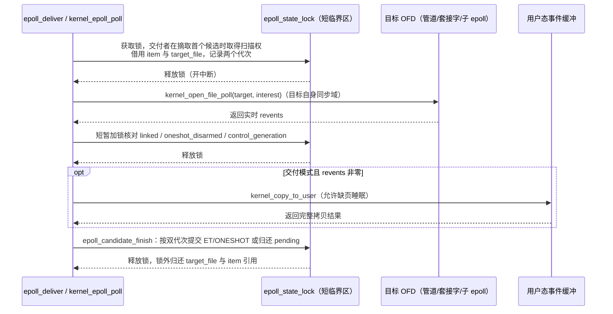

# epoll 并发扫描、事件交付与对象生命周期协议

`epoll` 之所以难以写对，不在于单线程下的增删查改，而在于**多线程并发操作、多层嵌套图、目标析构与用户态拷贝睡眠**四股力量交织在一起：一个线程正在将事件拷回用户态而触发缺页睡眠，另一个线程同时执行 `EPOLL_CTL_MOD` 或 `EPOLL_CTL_DEL`，第三个线程恰好关闭了目标管道的最后一个描述符，第四个线程又在用 `poll()` 观测这个 `epoll` 实例。

本文深入拆解 `fs/files/epoll.c` 与 `fs/files/epoll_state.h` 如何在不引入全局大锁、不发生跨层死锁的前提下，保证上述所有交错场景的内存安全与语义精确。整体子系统结构见 [epoll 事件多路复用子系统设计](epoll-subsystem.md)。

---

## 一、状态锁与延迟唤醒机制（`epoll_state.h`）

`epoll` 内部所有共享元数据——包括侵入式 AVL 平衡树、目标 OFD 的 `ep_items` 反向双链、`ready` 与 `pending` 双向链表、`scan_owner` 以及各登记项的代次字段——均由一把短临界区原始锁 **`epoll_state_lock`**（锁秩 `KERNEL_RAW_RANK_OBJECT`）保护，并通过宏 `EPOLL_STATE(guard)` 自动管理获取与释放。

设计上刻意解决了两个底层同步难题：

1. **同核重入安全**：在单核无锁调试构建（`BOAROS_MAX_CPUS == 1`）中，通过 `epoll_state_active` 指针允许同一调用链内的嵌套辅助函数复用外层中断保护守卫；在多核或开启锁调试的构建中，通过检查 `kernel_cpu_current()->raw_locks` 识别当前核已持有 `epoll_state_lock`，避免嵌套回调重入死锁。
2. **锁外唤醒**：`epoll_state_notify()` 在发布就绪的同时，用 `kernel_wait_notification_prepare()` 记录通知对象。若队列里只有一个普通等待线程，通知持有该线程的等待令牌和任务引用。多个等待者或上层 `epoll` 回调仍由队列游标遍历。最外层守卫释放 `epoll_state_lock` 后，在恢复中断前调用 `kernel_wait_notification_wake()`。等待令牌记录等待代次，线程如果已经结束本次等待，旧通知无法唤醒它的下一次等待。

---

## 二、独占交付扫描与双代次防竞态

事件交付（`epoll_deliver()`）与外层纯观测（`kernel_epoll_poll()`）共享同一套锁外候选刷新逻辑 `epoll_candidate_refresh()`，其核心设计约束是：**绝不持 `epoll_state_lock` 调用目标的 `kernel_open_file_poll()`，也不持锁拷贝用户态内存。**



### 2.1 单项借用与 `ready` / `pending` 双链隔离

- **独占扫描者（`scan_owner`）**：`epoll_candidate_refresh()` 在同一临界区内为交付者取得扫描权、摘取首个候选并借用目标。空队列或扫描权已被占用时立即返回。请求记录自己是否取得扫描权，只有取得扫描权的请求才进入 `epoll_scan_finish()` 的临界区。扫描期间到达的异步通知把尚未在 `ready` 链表中的登记项加入 `pending` 链表。
- **避免 `maxevents` 较小时的整链搬运**：交付循环每次只从 `ready_head` 摘下**唯一一个 `current` 候选**，递增其引用计数并置位 `item->in_scan = 1`。如果 `maxevents` 很小（例如只取 1 条事件），剩余未扫描的项原封不动留在 `ready` 链表上，不会像传统批量摘链实现那样产生冗余的摘取、加引用与重新挂回操作。
- **本轮 LT 去重**：水平触发（LT）项在完成交付后被归还到 `pending` 而非 `ready`，确保同一轮 `epoll_wait` 内不会把同一个 LT 项重复交付多次；直到 `epoll_scan_finish()` 结束本轮扫描时，才把 `pending` 链去重合并回 `ready` 链，并在仍有就绪项时通知等待者。

### 2.2 `control_generation` 与 `notification_generation` 双代次

由于目标查询与用户拷贝都在锁外进行，期间随时可能发生并发 `MOD`、`DEL` 或新的底层通知。BoarOS 通过两个 64 位单调递增代次彻底消除过期快照的误操作：

- **控制代次（`control_generation`）**：每次 `EPOLL_CTL_MOD` 都会递增它。
  - 若锁外查询返回后发现 `control_generation` 已变，本次查询结果视为过期（清零 `events`），不会把旧关注的事件交付给新配置。
  - 在 `epoll_candidate_finish()` 提交时，若旧交付携带有 `EPOLLONESHOT` 但期间已被并发 `MOD` 重装，旧交付因代次不匹配不会错误禁用新注册，同时新代次项会被挂回 `pending` 留给下一轮核验。
- **通知代次（`notification_generation`）**：每次目标回调通知都会递增它。
  - 若一次锁外查询返回空事件，但查询期间恰好又有新通知到达（通知代次递增），那么这笔过期空结果**不能**把该项从 `ready`/`pending` 删掉，而是将其保留在 `pending` 中留待下一轮重新查询。

---

## 三、非阻塞纯观测（`kernel_epoll_poll`）与键序游标

当 `poll()` 或父级 `epoll` 查询某个子 `epoll` 是否可读时，会调用 `kernel_epoll_poll()`。这条路径具有与 `epoll_deliver()` 截然不同的约束：

1. **绝不抢占 `scan_owner`**：即使另一个线程正在执行 `epoll_deliver()` 并在拷贝用户内存时睡眠，纯观测也不能把“交付游标正忙”误判为“没有事件”，更不能互相等待交付者释放游标——否则在 `DEL` 后立刻反向 `ADD` 的嵌套拓扑变化场景下，可能演变为游标互等死锁。
2. **只观测不消费**：纯观测调用 `epoll_candidate_refresh()` 时设置 `request.observing = 1`。它验证到真实有效事件后直接返回 `POLLIN | POLLRDNORM`，**绝不消费 `EPOLLET`、绝不解除 `EPOLLONESHOT`**，也不修改目标排队归属。
3. **主动剪除失效候选**：如果某项经真实查询确认已无有效事件、当前未处于交付扫描中（`!item->in_scan`）且双代次均未变化，纯观测会将其直接从 `ready`/`pending` 摘除。在菱形共享子图拓扑中，失效候选首次被查证后即被剪除，不会反复滞留在 `ready` 链上拖累另一条父路径。

为了在无独占游标的前提下安全遍历所有潜在候选，`epoll_observe_next()` 维护了一个轻量游标 `struct epoll_observe_cursor`，按两种模式自动切换：

- **快路径（直接检查 `ready_head`）**：当没有并发交付者（`!epoll->scan_owner`）且 `pending_head` 为空时，直接取出 `ready_head` 核验。如果该项确实失效被剪除，下一次循环自动看到新的 `ready_head`，无需树遍历。
- **键序游标回退路径（`cursor->indexed = 1`）**：一旦检测到存在并发交付（`scan_owner` 非空）、`pending` 链非空，或某次查询因代次变化未能剪除链头，游标立即切换为按 AVL 树键 **`(target_fd, target_file)`** 严格递增查找下一个候选（满足 `linked && !oneshot_disarmed && (on_ready_list || on_pending_list || in_scan)`），并跳过已观测过的保留项。因为游标只记录键值而非跨锁借用树节点指针，即使查询期间 AVL 树发生任意增删旋转，也完全安全。

注意 `item->in_scan` 在此处的关键作用：它让纯观测能够识别“交付者刚刚从 `ready` 摘下、尚未完成用户拷贝”的当前项并将其纳入观测范围，同时保证纯观测绝不误删交付者正在处理的项或其期间新增的 `pending` 通知。

---

## 四、跨同步域边界与嵌套通知合并

### 4.1 严格解耦目标同步域

`epoll` 绝不维护横跨嵌套图的全局协议大锁，每个目标对象始终使用自身同步域完成状态查询：

- **套接字轮询无协议锁阻塞**：BoarOS 的套接字 `poll` 实现仅在极短的中断保护区间内读取端点接收队列、连接状态与发送接纳额度，不访问底层 `lwIP` 协议控制块（Protocol Control Block，PCB），也不申请网络协议互斥锁。
- **外层 `poll()` 的两阶段令牌协议**：在 `fs/files/poll.c` 中，当 `poll()` 已经通过 `kernel_wait_prepare()` 建立等待令牌后，对于 `epoll` 描述符仅调用 `kernel_epoll_wait_pending()` 读取非阻塞元数据提示（`!epoll->scan_owner && epoll->ready_head`）。若发现潜在就绪候选，先退出并 `kernel_wait_finish()` 结束等待令牌，再在完全无令牌、开中断的环境下调用 `kernel_epoll_poll()` 执行真实目标查询。
- **扫描期间允许次级等待者入睡**：当已有交付扫描者正在运行时，第二个进入 `epoll_pwait()` 的等待者被允许在 `epoll->wait_queue` 上正常睡眠；如果前一个扫描者结束时把剩余或新到的有效候选归并回 `ready`，`epoll_scan_finish()` 会主动调用 `epoll_notify()` 唤醒等待者；若候选已全部清空，则说明确无事件可交付。

### 4.2 嵌套通知按源序号合并

在多层嵌套 `epoll` 图中，单个底层管道或套接字的某一次写事件可能经由多条分支汇聚到同一个顶层 `epoll`。每次底层等待队列触发通知时，等待原语都会分配唯一的全局递增序号 `kernel_wait_notification_sequence()`。`epoll_notify()` 将该序号与 `epoll->notification_sequence` 比对：同一轮源通知内，每个 `epoll` 实例最多只唤醒自己的父队列一次，而每条独立登记项仍然正常递增自己的 `notification_generation` 并更新 `ready`/`pending` 状态。下一次底层事件到来时获得新的全局序号，继续正常传播。

---

## 五、对象寿命、安全解绑与强制退出

并发关闭与热插拔删项是事件多路复用最容易出现“释放后使用（Use-After-Free）”的区域。BoarOS 通过四条不变量守住对象寿命边界：

1. **绝不复活濒死 OFD**：在 `epoll_candidate_refresh()` 中尝试借用 `item->target_file` 时，调用 `kernel_open_file_acquire()` 做非零引用递增。如果该 OFD 的最后一个真实引用已经归零、关闭者正准备获取 `epoll_state_lock` 拆除反向链表，递增会安全失败；刷新逻辑直接跳过该目标，既不复活濒死对象，也不查询正在关闭中的后端。
2. **`POLLFREE` 自摘与同步等待排空**：若目标等待队列在销毁前广播 `KERNEL_WAIT_POLL_FREE` 回调，回调内部直接调用 `kernel_wait_queue_remove(node)` 自行脱离，不产生死锁等待；而 `epoll_item_unlink_and_destroy()` 在状态锁内置 `linked = 0` 后，会先释放状态锁并执行 `kernel_wait_node_remove_sync()`，确保所有已进入目标队列回调的执行路径彻底退出，才真正释放 `item`。
3. **锁外延迟释放后端与堆内存**：无论目标 OFD 是 FIFO、套接字还是子 `epoll`，其最终引用归还（可能触发 VFS 关闭、物理页归还等可睡眠操作）以及 `item` 的堆内存释放，一律发生在 `epoll_state_lock` 中断保护区与协议作用域之外。
4. **任务级借用栈保障强制退出安全**：无论是阻塞中的 `epoll_pwait()`，还是可能多层递归的嵌套 `kernel_epoll_poll()`，每一次进入都会把当前栈上的 `struct kernel_epoll_wait_request` 通过 `previous` 指针压入当前任务的活动请求栈（`kernel_task_epoll_register()`），正常返回时逐层弹出。一旦任务被强制终止，`kernel_epoll_abort_wait()` 会沿栈自顶向下调用 `epoll_request_finish()`，先把 `current` 候选安全归还到 `ready`、合并 `pending`、释放 `scan_owner` 并归还全部 `item` 与 OFD 引用，最后才回收任务内核栈。

---

## 六、验证体系与测试覆盖

`epoll` 子系统具备宿主级内存消毒测试与 RISC-V 实机用户态验证两套可独立重建的回归入口：

```sh
# 宿主侧编译完整 fs/files/epoll.c 并启用 ASan / UBSan 执行并发交错矩阵
make test-epoll-host

# RISC-V 用户态功能与边界测试
make test-epoll-riscv

# 文件层、通用用户态与内核栈用量回归
make test-files-riscv test-userland-riscv test-stack-usage
```

其中，`make test-epoll-host` 直接编译生产源码 `fs/files/epoll.c`，仅桩化用户拷贝、OFD、调度与等待队列边界，并在启用地址消毒器（AddressSanitizer，ASan）与未定义行为消毒器（UndefinedBehaviorSanitizer，UBSan）的前提下，重点验证以下高危交错场景：

- **拷贝与并发修改交错**：用户拷贝缺页重试与中途 `-EFAULT`、拷贝睡眠期间的异步通知重入、`MOD` 修改控制代次与 `DEL` 立即解绑、并发 `close` 释放目标 OFD。
- **索引与拓扑压力**：FD 编号复用、128 个乱序键的 AVL 插入与旋转删除、堆分配窗口期间并发重复 `ADD` 与反向图成环插入。
- **扫描与观测并发**：交付扫描期间接入第二等待者、纯观测与独占交付重叠、解绑后立即反向登记、无序候选的代次变化重试，以及嵌套纯查询强制取消。
- **锁与中断不变量断言**：宿主测试桩严格断言所有目标查询处中断处于开启且可抢占状态（并主动在查询边界注入可睡眠模拟对象以验证锁外查询边界），断言用户拷贝及最终 OFD/堆释放不持有协议作用域，断言 `prepared` 提示路径不触发目标查询，以及全部堆分配与引用计数在测试结束时精确归零。
