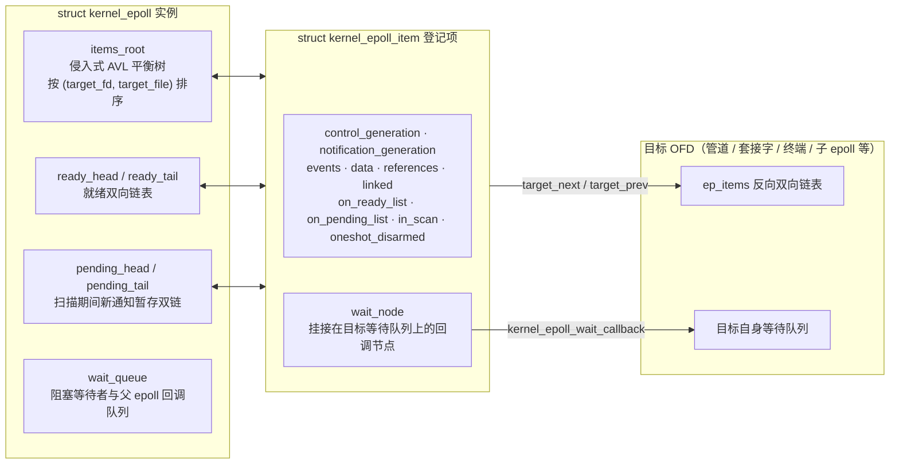

# epoll 事件多路复用子系统设计

在并发 I/O 编程中，程序常常需要同时监听成百上千条管道、套接字或事件描述符。传统的 `poll` 与 `select` 采用**无状态轮询模型**：每次系统调用都需要把整个文件描述符（File Descriptor，FD）集合从用户态重新拷入内核，逐一检查状态；若全部未就绪，还需在本次调用期间临时把等待节点挂到每个目标的等待队列上，返回时再逐个拆除。当监听规模扩大但每次只有少数描述符活跃时，这种 O(N) 的重复搬运与装拆会成为明显瓶颈。

Linux 的 **`epoll`**（事件轮询，Event Poll）机制将“长期关注的集合”沉淀为内核对象，把工作拆解为四个职责清晰的阶段：**登记（`epoll_ctl`）**、**目标通知（回调入队）**、**候选刷新（状态核验）** 与 **事件交付（`epoll_wait` / `epoll_pwait` / `epoll_pwait2`）**。目标状态变化时，只把活跃对象推入就绪链表，等待者无需扫描全部注册项。需要特别注意的是，通知本身只意味着**“该对象值得重新查询”**，并不保证交付瞬间一定仍有可读/可写数据——例如并发线程可能已提前读空管道，或嵌套 `epoll` 下的子对象已恢复静默。

本文基于 `fs/files/epoll.c`、`fs/files/epoll_internal.h` 与 `fs/files/epoll_state.h` 的实际实现，介绍 BoarOS 中 `epoll` 的数据结构、图嵌套校验、触发模式与等待协议。文件资源层总览见 [文件描述符、打开文件对象与通用 I/O 层](../modules/kernel-files.md)，并发扫描与生命周期协议见 [epoll 并发扫描、事件交付与对象生命周期协议](epoll-delivery.md)。

---

## 一、登记身份与核心数据结构

在类 Unix 系统中，进程持有的整数 FD 只是索引表槽位，底层共享状态由内核的**打开文件描述（Open File Description，OFD）**对象承担。`epoll` 在登记关注关系时，采用复合键 **`(target_fd, target_file)`** 作为唯一身份：

- **支持 `dup` 副本独立登记**：通过 `dup` / `dup2` 复制同一 OFD 得到的两个不同 FD，因为 `target_fd` 不同，可以在同一个 `epoll` 实例中分别登记。
- **不随单个 FD 关闭自动消失**：若某进程关闭了登记时使用的 FD，但该 OFD 仍被 `dup` 或 `fork` 后的其他描述符持有，原登记项继续有效。只有当该 OFD 的最后一个引用释放时，内核才会通过 `kernel_epoll_notify_file_release()` 解除其全部反向登记。
- **隔离 FD 编号复用**：即使原 FD 关闭后编号立刻被新打开的 OFD 复用，新旧两者的 `target_file` 指针不同，不会发生身份混淆，两者可以在索引中共存。

BoarOS 对每个 `epoll` 实例（`struct kernel_epoll`）维护以下索引结构：

1. **侵入式 AVL 平衡树（`items_root`）**：直接利用 `struct kernel_epoll_item` 内嵌的 `index_left`、`index_right`、`index_parent` 与 `index_height` 字段组织索引，查找、插入与删除均为 O(log N) 时间复杂度，无需另建冗余节点。删除节点（`epoll_index_remove()`）通过旋转把目标节点自身下沉到叶位置再摘除，而不是与中序后继交换键内容，从而保证正在持有该 `item` 指针的扫描者与反向链表始终指向同一对象。
2. **双链表就绪与暂存队列（`ready` / `pending`）**：均使用可直接 O(1) 摘除的双向链表，删除或清理登记项时无需线性扫描队列。
3. **目标 OFD 反向链表（`target_file->ep_items`）**：登记项只通过反向链表借用目标 OFD，不长期增加目标 OFD 的引用计数，避免 `epoll` 与目标之间形成无法回收的循环引用。目标析构时会主动沿反向链表撤销所有关联登记；实际跨锁查询或交付中的临时操作则额外借用 `item` 与 OFD 引用，确保逻辑解绑后安全延迟释放。

> 整体销毁一个 `epoll` 实例（`kernel_epoll_destroy()`）或释放一个目标 OFD 时，仍需遍历并解绑其实际关联的每一条登记项，整体回收复杂度与关联登记数成正比。

---

## 二、目标约束、嵌套图检查与发布流程

并非所有文件类型都可以加入 `epoll`。只有具备真实等待队列的对象（如管道、命名管道、套接字、终端、事件描述符、`timerfd`、`signalfd`、`inotify`/`fanotify` 以及另一个 `epoll`）满足 `kernel_open_file_supports_epoll()`；尝试将普通文件或目录加入 `epoll` 会直接返回 `-EPERM`（操作不允许）。

当被监听的目标本身也是 `epoll` 时，多个 `epoll` 实例之间会形成有向监听图。`epoll_check_nesting()` 负责维护两项严格约束：

- **禁止自监听**：监听自身对应的 `epoll` 实例（无论是同一 FD 还是经 `dup` 指向同一 OFD）直接返回 `-EINVAL`。
- **禁止成环与过深嵌套**：沿着目标向下遍历子节点（`epoll_check_downward()`），同时沿着当前实例的反向链表向上回溯父节点（`epoll_check_upward()`）。若发现环路，或新增该边后的总嵌套边数 `down_depth + 1 + up_depth` 超过 **`KERNEL_EPOLL_MAX_NESTS = 4`**（即最多允许 5 层 `epoll` 串联，第 6 层触及上限），则拒绝加入并返回 `-ELOOP`。

在 `EPOLL_CTL_ADD` 的并发发布流程中，BoarOS 将可能睡眠的操作与临界区严格分层：

1. **先分配未发布候选**：堆分配（`kernel_heap_allocate_zeroed()`）可能发生阻塞或调度切换，因此先在无锁状态下分配并初始化 `struct kernel_epoll_item`。
2. **图检查与登记发布**：仅嵌套监听通过 `kernel_preempt_disable()` 在保持中断开启的情况下完成图检查。随后在状态锁（`EPOLL_STATE`）内沿 AVL 树查找插入位置。同一次查找识别重复键并返回 `-EEXIST`，或者插入登记项并发布目标反向关联。
3. **先订阅，再查询就绪状态**：套接字的等待队列由目标 OFD 保活，发布后即可在当前保护区间内登记。单核流式套接字在同一保护区间内完成首次就绪查询。其他目标在锁外使用 `kernel_open_file_poll()` 查找等待队列或查询真实就绪状态，查询期间持有一份临时登记引用。需要发现队列的目标在订阅后重新查询一次，覆盖订阅前已就绪的情况。结果仅在登记仍有效且控制代次未被并发 `MOD` 更新时入队。

`EPOLL_CTL_DEL` 在一次状态锁保护内找到登记项，从索引树、反向链表、就绪链表和目标等待队列摘除。尚未归还的通知游标由旧登记引用保活，锁外等待游标归还后再释放该引用。同一个键此时可以建立新登记，旧回调只看到已经撤销的登记。普通撤销在一次取锁内完成摘除和引用转移。

显式撤销持有目标 OFD，因此可以先撤去反向关联。由关闭触发的撤销仍通过该关联协调等待队列的销毁，有旧游标时先从目标等待队列摘除节点并等待游标归还，再拆除反向关联。

---

## 三、通知汇聚与触发模式语义

当底层目标发生状态变化时，等待队列触发 `kernel_epoll_wait_callback()`：

- 递增该登记项的 `notification_generation`（通知代次）。
- 若当前 `epoll` 实例没有正在进行的交付扫描（`scan_owner == NULL`），将 `item` 加入 `ready` 链表；若已有交付扫描正在执行且该项尚未在 `ready` 上，则加入独立的 `pending` 链表，避免干扰扫描者正在遍历的指针。
- 通过 `epoll_notify()` 唤醒当前 `epoll` 自身的等待队列。在多层嵌套 `epoll` 图中，借助全局 `kernel_wait_notification_sequence()` 与实例上的 `notification_sequence` 比较，同一轮源通知对每个父 `epoll` 仅传播唤醒一次，防止菱形拓扑下的唤醒风暴；同时每条登记项仍各自递增通知代次并维护自身的 `ready`/`pending` 状态，不使用长期有效的“就绪状态缓存”替代真实查询。

事件交付统一由 `epoll_deliver()` 执行，每个 `epoll` 实例在同一时刻只允许一个交付扫描者持有 `scan_owner`。内核并不按用户传入的 `maxevents` 预分配大块事件数组，而是在栈上逐条构造 16 字节的 `struct linux_epoll_event`，**只有当整条结构完整拷贝回用户态后，才正式提交该事件的消费状态**：

| 触发模式 / 标志 | 语义与 BoarOS 提交时机 |
| :--- | :--- |
| **水平触发（Level-Triggered，LT，默认）** | 只要目标仍处于就绪状态，下次等待就应继续报告。完整拷贝回用户态后，将未解绑且代次未变的项重新放入 `pending`（扫描结束时归并回 `ready`），供后续调用再次核验。 |
| **边缘触发（Edge-Triggered，ET，`EPOLLET`）** | 仅在目标状态新产生通知时交付一次。完整拷贝后直接消费本次通知不再重新排队；但若在查询或拷贝期间已有新通知到达（`notification_generation` 递增），则保留并转入 `pending` 供下一轮处理。 |
| **单次触发（`EPOLLONESHOT`）** | 交付一次事件后自动禁用该登记项（`oneshot_disarmed = 1`），直到用户显式调用 `EPOLL_CTL_MOD` 重新激活。仅在完整拷贝后才置位禁用；若拷贝期间并发执行了 `MOD`（`control_generation` 改变），旧交付不会误禁用新配置。 |
| **强制上报错误与挂断（`EPOLLERR` / `EPOLLHUP`）** | 无需用户显式订阅，只要目标轮询结果包含错误或挂断位，候选刷新阶段始终将其纳入有效事件掩码。 |

用户态拷贝可能触发缺页中断甚至阻塞睡眠，因此拷贝始终在释放状态锁、开启中断且不持有任何网络协议互斥锁的环境中执行：

- 若**第 1 条事件**拷贝失败，返回 `-EFAULT`（坏地址错误），且不提交 `ET`/`ONESHOT` 消费，保留事件不丢。
- 若**已经完整交付至少 1 条事件**后后续拷贝失败，则立即停止扫描并返回已成功交付的条数，保证用户态看到的事件全部完整有效。

---

## 四、阻塞等待、信号掩码与退出清理

`epoll_pwait`（毫秒级整型超时）与 `epoll_pwait2`（纳秒级 `struct timespec` 超时）统一换算为单调时钟截止点 `target_ns`，收敛到同一套 `epoll_pwait_deadline()` 协议中执行：

1. **临时信号掩码原子切换**：若用户提供 `sigmask` 且 `sigsetsize == 8`，在进入等待循环前通过 `kernel_signal_set_temporary_mask()` 安装临时屏蔽掩码；退出循环时交由 `kernel_signal_restore_temporary_mask()` 按是否被信号中断（`-EINTR`）遵循 Linux 规则恢复原掩码，确保挂起信号在恢复前有机会按临时掩码递送。
2. **四阶段安全阻塞（Prepare → Recheck → Park → Finish）**：
   - 先尝试非阻塞交付 `epoll_deliver()`；若已有事件或请求立即返回（`timeout == 0`），直接结束。
   - 需要睡眠时，获取 `EPOLL_STATE` 保护，调用 `kernel_wait_prepare()` 或 `kernel_wait_prepare_monotonic()` 登记等待令牌（`struct kernel_wait_token`），并在释放锁前**复查非阻塞元数据**（`!epoll->scan_owner && epoll->ready_head`）。
   - 若复查仍无候选，在关闭中断的状态下通过 `epoll_state_unlock_wait()` 释放状态锁并调用 `kernel_wait_park()` 让出处理器；被唤醒、超时或收到信号后调用 `kernel_wait_finish()` 注销令牌并恢复中断状态。
   - 当外层 `poll` 监听一个 `epoll` 描述符时，在已持有等待令牌的阶段也只通过 `kernel_epoll_wait_pending()` 读取非阻塞元数据提示，绝不在等待令牌内调用可能睡眠的目标查询；检测到潜在候选后先结束令牌，再在锁外执行真实刷新（`kernel_epoll_poll()`）。
3. **解绑与强制退出清理**：
   - `EPOLL_CTL_DEL`、实例销毁或目标 OFD 关闭均调用 `epoll_item_unlink_and_destroy()`：先在状态锁内置 `linked = 0` 并发起等待节点摘除，在锁外调用 `kernel_wait_node_remove_sync()` 等待所有并发回调彻底退出，再从 AVL 树、反向链表与 `ready`/`pending` 队列摘除，最后在锁外递减引用并释放堆内存。
   - 每个正在等待或执行嵌套纯查询的调用帧（`struct kernel_epoll_wait_request`）都以栈式链表挂在当前任务上。即使任务被致命信号强制终止，`kernel_epoll_abort_wait()` 也会沿栈逐层归还扫描权、`item` 与 OFD 借用，再安全回收任务内核栈。

---

## 五、参考依据与专题延伸

- **协议规范依据**：Linux 内核 `fs/eventpoll.c` 与 `include/uapi/linux/eventpoll.h`（登记身份、嵌套深度与事件提交边界），以及 musl 1.2.5 `src/select/epoll.c`、`src/select/epoll_pwait.c` 的用户态系统调用封装。
- **并发与生命周期细节**：关于无锁纯查询（`kernel_epoll_poll`）的键序游标、代次防重入竞态与宿主 ASan/UBSan 交错测试矩阵，详见 [epoll 并发扫描、事件交付与对象生命周期协议](epoll-delivery.md)。
