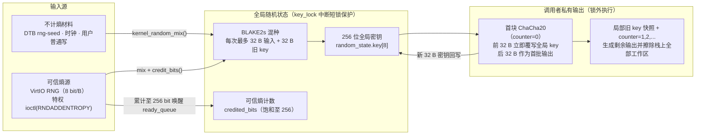

# 内核随机源、可信熵初始化与前向保密设计

操作系统内核中，地址空间布局随机化（Address Space Layout Randomization，ASLR）、可执行文件辅助向量 `AT_RANDOM`、网络序列号、文件描述符比较密钥以及用户态加密库，全部依赖内核提供的随机数服务。一个工程上站得住脚的内核随机子系统必须同时回答三个问题：

1. **前向保密（Forward Secrecy）**：即便某一时刻内核状态意外泄漏，攻击者也不能倒推出此前已经交付出去的随机字节，也不能预测后续请求的新密钥。
2. **可信熵边界**：启动早期从设备树或时钟拿到的“初始材料”，和来自硬件随机数发生器或特权管理员注入的“可信熵”必须严格区分——不能把低熵材料冒充为安全就绪状态。
3. **高并发与可中断性**：多核读取大块随机数时不能长时间关中断占锁，也不能阻塞信号递送或破坏中断现场。

本文基于 `kernel/random.c`、`kernel/blake2s.c`、`kernel/syscall/random.c` 与 `fs/char_device.c` 的实际代码，阐述 BoarOS 随机子系统的密码学构造、熵账本与用户接口实现。硬件随机设备驱动契约见 [VirtIO 随机数设备](../modules/riscv-virtio-rng.md)。

---

## 一、核心密码学管道：ChaCha20 前向擦除与 BLAKE2s 混种

BoarOS 参考 Linux `drivers/char/random.c` 的现代**密码学安全伪随机数生成器（Cryptographically Secure Pseudorandom Number Generator，CSPRNG）**架构，以 **ChaCha20** 流密码输出随机流，以 **BLAKE2s** 密码学哈希函数混入外部熵材料（`kernel/blake2s.c` 保留上游 `GPL-2.0 OR MIT` 来源与版权声明，独立编译于内核树内）。

### 1.1 快速密钥擦除（Fast Key Erasure）

在 `kernel/random.c` 的 `kernel_random_fill()` 中，每次随机输出都采用**单次短锁棘轮推进 + 锁外独立生成**策略：

1. **极短中断临界区**：获取全局中断自旋锁 `key_lock`（锁秩 `KERNEL_RAW_RANK_WAIT_QUEUE`），将 32 字节全局密钥 `random_state.key` 复制到调用者局部栈数组 `key[32]`，以全零 `nonce` 和 `counter = 0` 执行一次 `kernel_random_chacha20_block()` 生成 64 字节首块 `block`，立刻将 `block[0..31]` 写回 `random_state.key` 作为下一次请求的新全局密钥，随即释放 `key_lock`。
2. **锁外无争用流生成**：退出临界区后，前 32 字节输出取自 `block[32..63]`；若调用者还需要更多字节，则完全使用调用者私有的局部 `key` 快照与递增 `counter`（从 `1` 开始，32 位计数器回绕时向 12 字节 `nonce` 进位）持续生成 64 字节块。多核并发读取与中断混种仅在更新 32 字节密钥的瞬间串行，彻底避免大块生成阻塞其他核心或中断。
3. **显式内存擦除**：`kernel_random_erase()` 通过 `memset` 加内联汇编内存屏障（与 Linux `memzero_explicit` 等效）防止编译器消除清零操作。`kernel_random_chacha20_block()` 返回前擦除内部 `state`/`working` 数组，`kernel_random_fill()` 返回前擦除局部 `key`/`block`，`kernel_blake2s()` 同样擦除全部哈希工作数组，确保敏感状态不残留在内核栈上。

> 在 RISC-V 上，`kernel_random_chacha20_block()` 带有 `__attribute__((aligned(2048)))` 对齐属性：由于压缩指令集可能让热点循环跨越 4 KiB 代码页边界，将该函数主体（小于 2 KiB）对齐到同一页内可避免 QEMU 动态二进制翻译器（TCG）反复拆分输出循环。

### 1.2 有界 BLAKE2s 混种

`kernel_random_mix(data, size)` 将任意长度输入按最多 **32 字节** 切块。每处理一块时获取一次 `key_lock`，从全局状态**重新读取当前最新的 32 字节 `random_state.key`**，与当前输入块拼成不超过 64 字节的缓冲区执行一次单块 BLAKE2s 压缩，将 32 字节摘要写回 `random_state.key` 并原子发布 `seeded = 1`。这样单次持锁计算量严格有界，且每块都基于最新密钥迭代，不会覆盖并发中断刚混入的熵。

---

## 二、两级就绪状态：材料可用（`available`）与可信就绪（`ready`）

BoarOS 严格区分两个完全不同的状态谓词，避免早期引导阶段的低熵种子被误认为密码学安全就绪：

| 谓词函数 | 判定条件 | 语义与适用消费者 |
| :--- | :--- | :--- |
| **`kernel_random_available()`** | `random_state.seeded != 0`（已混入任意材料） | 仅表示全局密钥非全零，**不代表已满足安全初始化**。用于决定启动后是否启用用户进程 ASLR 地址随机化（详见 [用户态 ELF 装载](../modules/user-elf.md)）。 |
| **`kernel_random_ready()`** | `random_state.credited_bits == 256` | 表示已累计至少 **256 位可信熵**，单向置位、永不回退。首次达到 256 位时唤醒 `ready_queue` 上的全部阻塞等待者。`getrandom()`（默认模式）与 `/dev/random` 必须等待此状态成立后才返回数据。 |

### 熵源分类与计熵规则

- **不计熵材料（仅调用 `kernel_random_mix()`）**：
  - 固件通过设备树（Device Tree Blob，DTB）传入的 `rng-seed`（`kernel/main.c` 混种后立即擦除 `boot_info.rng_seed` 的临时副本，不修改固件拥有的原始 DTB）；
  - 时钟抖动、测试种子以及普通用户态对 `/dev/random`、`/dev/urandom` 的 `write()` 操作（允许混入材料，但绝不增加 `credited_bits`）。
- **可信熵源（混种后调用 `kernel_random_credit_bits()`）**：
  - **VirtIO RNG 硬件/虚拟设备**：仅对成功完成传输的响应按每字节 `8 bit` 计熵；未完成或发生错误的直接内存访问（Direct Memory Access，DMA）缓冲区绝不计熵，且设备后续故障不会清除已经获得的 `ready` 状态。
  - **特权 `ioctl(RNDADDENTROPY)`**（`fs/char_device.c`）：采用 Linux 原生 `struct rand_pool_info` 布局（两个原生 `int` 字段 `entropy_count` 和 `length`，后接 `length` 字节载荷）。内核先校验调用者持有 **`CAP_SYS_ADMIN`**（缺少返回 `-EPERM`），拒绝负数参数（`entropy_count < 0` 返回 `-EINVAL`，`length < 0` 或地址溢出返回 `-EFAULT`），再按 256 字节栈缓冲分块从用户态拷入并调用 `kernel_random_mix()`；若中途任意块拷贝失败，立即擦除临时缓冲并返回 `-EFAULT`，**不计入任何熵位**；仅在全部载荷成功混入后才累加声明的 `entropy_count` 比特数。

---

## 三、用户接口与内核消费边界

### 3.1 `getrandom` 系统调用（`kernel/syscall/random.c`）

`getrandom(buf, buflen, flags)` 支持三个标准 Linux 标志位：
- `GRND_NONBLOCK`（`1`）：随机源未就绪时立即返回 `-EAGAIN` 而不阻塞；
- `GRND_RANDOM`（`2`）：显式要求来自可信就绪池（行为与默认一致）；
- `GRND_INSECURE`（`4`）：跳过 `ready` 等待，直接从 `kernel_random_fill()` 返回流（即便尚无任何种子材料也显式允许输出，供早期非密码学场景使用）。

参数检查拒绝任何未知标志位（`flags & ~7U`）以及互斥组合 `GRND_RANDOM | GRND_INSECURE`（返回 `-EINVAL`），单次请求上限截断至 `0x7ffff000` 字节，并校验用户地址范围（含非零地址的零长度非法高地址检查）。若在等待就绪期间被信号打断，`kernel_random_wait_ready()` 返回 `-EINTR`，系统调用层记录可重启标记并转换为 `-ERESTARTSYS`。

在数据生成与用户拷贝阶段，`getrandom` 兼顾了性能与响应性：
- 请求长度不超过 **256 字节** 时直接使用栈上缓冲 `small[256]`；超过 256 字节时向页分配器借用一页临时 I/O 工作区（`BOAROS_PAGE_SIZE`，RISC-V 为 4 KiB，LoongArch 为 16 KiB），并按用户缓冲区页边界对齐切分块长。
- 进入生成拷贝循环前临时开启中断，使定时器滴答（tick）与挂起信号能够正常推进；每次生成新块前若已交付至少 1 字节且存在待处理信号，则提前终止循环并返回已成功交付的字节前缀；拷贝触发用户态 fault 时同样返回已交付前缀（首字节即失败则返回 `-EFAULT`）。
- 退出前统一擦除实际使用过的工作区字节，归还页工作区，先关中断再恢复调用入口原有的中断状态。

### 3.2 字符设备 `/dev/random`、`/dev/urandom` 与其他内核消费者

`fs/char_device.c` 注册了 `/dev/random`（主从设备号 `1:8`）与 `/dev/urandom`（`1:9`）：
- **`read`**：`/dev/random` 先调用 `kernel_random_wait_ready(flags & O_NONBLOCK)` 等待可信就绪（被信号打断支持 `-ERESTARTSYS`），就绪后与 `/dev/urandom` 共用 `kernel_random_fill()`；`/dev/urandom` 永不阻塞。两者均标记 `interruptible_bulk = 1` 以支持大块读信号中断。
- **`poll`**：`/dev/random` 未就绪时报告 `POLLOUT | POLLWRNORM`（可写入混种），就绪后报告 `POLLIN | POLLRDNORM` 并绑定 `ready_queue`；`/dev/urandom` 始终可读写。
- **`ioctl`**：支持 `RNDGETENTCNT`（`0x80045200`，返回当前 `credited_bits`）与 `RNDADDENTROPY`（`0x40085203`）；遗留的 `RNDADDTOENTCNT`、`RNDZAPENTCNT`、`RNDCLEARPOOL` 与 `RNDRESEEDCRNG` 返回 `-ENOTSUP`，未知命令返回 `-EINVAL`。
- **内核内部消费者**：每次 `exec` 都调用 `kernel_random_fill()` 生成 16 字节 `AT_RANDOM` 辅助向量；进程地址随机化在 `kernel_random_available()` 为真时启用；`kcmp` 指针混淆密钥与 BPF 随机数辅助函数同样直接消费 `kernel_random_fill()`。

---

## 四、验证体系

随机子系统通过三层独立测试覆盖密码学正确性、设备契约与系统调用 ABI：

- **宿主密码学与状态机验证**：运行 `python3 tests/host/random_vectors.py`，将 `kernel/blake2s.c` 与 Python `hashlib` 独立实现逐字节比对（覆盖空输入、63/64/65、127/128/129 及多块边界），并直接驱动真实字符设备操作表验证快速密钥擦除、不可信混种不置 `ready`、31+1 字节累计达到 256 位触发就绪、`ready` 单向保持、无材料 `GRND_INSECURE` 输出、未就绪 `O_NONBLOCK` / 阻塞信号返回、`poll` 以及 `RNDADDENTROPY` 权限与故障回滚。
- **真实用户态 ABI 差分**：`tests/diff-abi/random.c` 在 BoarOS 与参考 Linux 上运行同一份用户程序，全面对照 `getrandom` 标志组合、长度与地址 fault、`/dev/random` 与 `/dev/urandom` 读写、`pread`/`lseek` 以及 `poll` 行为。
- **在途硬件请求取消测试**：针对 VirtIO RNG，外部执行器先确认客户机已向熵源守护进程（EGD）发出真实请求并进入等待，再在始终不返回熵字节的情况下经串口放行客户机退出，以此确定性地验证已提交 DMA 请求的取消与缓冲区所有权归还。
