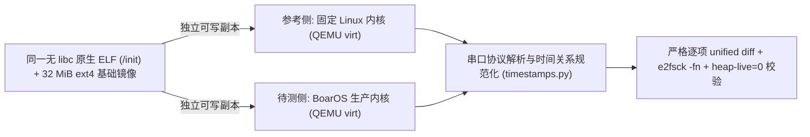

# Linux 双架构差分 ABI 验证体系

操作系统兼容 Linux **应用二进制接口（Application Binary Interface，ABI）**时，最容易出现偏差的往往不是常规路径，而是错误码优先级、部分读写进度、用户地址缺页边界、信号中断行为与元数据时间关系。BoarOS 在 `tests/diff-abi/` 构建了一套**确定性双架构差分 ABI 验证框架**：将**完全相同的无 C 库原生系统调用 ELF 可执行文件**分别送入固定版本的上游 Linux 内核与 BoarOS 生产内核执行，对两条串口记录流进行严格逐项比对。

---

## 一、源码组织与架构覆盖

| 源码路径 | 核心职责 |
| :--- | :--- |
| `tests/diff-abi/harness.py` | 差分测试总控器：固定 Linux 源码校验与缓存构建、ext4 镜像制作、双侧 QEMU 启动、记录流规范化、严格 diff 与磁盘一致性检查 |
| `tests/diff-abi/abi.h`、`start.S` | 无 libc 原生系统调用封装（支持 RV64 与 LA64）、独立子栈跳板（用于 `clone`/`vfork`）、标准结果输出协议与断言工具 |
| `tests/diff-abi/cases.txt` | 主案例清单，包含 **1,744 条**有序 ABI 观测记录（另有 26 份专题聚焦清单，可单独快速回归） |
| `tests/diff-abi/*.c` | 50 余个分领域测试包（文件 I/O、管道、截断、时间、路径、信号、锁、套接字、凭据、能力、大页/SHM、futex、procfs、调度、资源限额、定时器等） |
| `tests/diff-abi/timestamps.py` | 224 字节文件时间戳与 256 字节显式 `utimensat` 观测的关系规范化器（校验时钟区间、纳秒边界与 `MNT_RELATIME` 语义） |
| `tests/diff-abi/linux.config` | 以 `allnoconfig` 为基线的精简参考 Linux 内核配置，确保只启用明确对照所需的子系统 |
| `tests/diff-abi/Makefile.inc` | RISC-V 64 与 LoongArch 64 全量及各专题构建与执行入口 |

---

## 二、执行管线与确定性对比协议



### 2.1 双架构与输入冻结

- **统一参考基线**：参考 Linux 内核严格锁定于 `references/sources.tsv` 中的单一提交（`f4cdf7ca9a1fdcca413157df19753f388a5a224e`）。构建缓存键包含源码提交、输入 `linux.config`、构建脚本及全部交叉/宿主工具链二进制的 SHA-256 校验值；缓存命中时复核 `.config` 与内核镜像哈希，若工作树被修改或 origin 不符则立即报错中止。
- **双架构覆盖**：
  - **RISC-V 64（`make test-diff-abi-riscv`）**：以 RV64GC/LP64D 构建 `/init`（默认 512 MiB 内存），对比参考 Linux 4 KiB 页内核。
  - **LoongArch 64（`make test-diff-abi-loongarch`）**：使用完全相同的 C 源码集以 16 KiB 页对齐构建 `/init`，默认分别在 **512 MiB** 与 **1 GiB** 两种内存配置下对照 16 KiB 页参考 Linux（`CONFIG_16KB_3LEVEL=y`）执行四路比对。
- **输入快照与镜像准备**：运行前将待测内核、ELF、案例清单与参考 Linux 镜像复制到独立输出目录并计算哈希，避免并行构建污染当轮输入。测试夹具通过 `mkfs.ext4` 与 `debugfs` 在无宿主 root 权限下生成 32 MiB ext4 镜像，预置 `/init`、测试数据文件 `/data` 以及 `/dev/{console,null,zero,rtc0}` 字符设备节点。

### 2.2 线缆协议与零容忍校验

每个测试用例通过串口输出一条格式严格的记录：
```text
ABI BEGIN 1
ABI <case_id> <ret> <errno> <size> <offset> <wait_status> <hex_payload_or_->
...
ABI END <total_cases>
```

- **最小规范化原则**：仅剔除引导阶段内核前缀和串口 CRLF 换行；文件描述符编号与成功 `mmap` 地址仅将其非确定性句柄值归零，而所有错误码、部分读写字节数、文件大小、OFD 偏移、字节内容十六进制载荷及子进程 `wait` 状态均原样保留逐字节比对。
- **零容忍失败条件**：任何缺失、重复、未知或乱序记录，`ret` 与 `errno` 冲突，缺少 `ABI END`，QEMU 超时或非零退出均判失败。BoarOS 侧还必须额外满足：PID 1 以退出码 `42` 正常关机、`heap-live=0`（无内核堆泄漏），且运行后的 ext4 磁盘通过 `e2fsck -fn` 检查。
- **相对时间关系验证**：由于两次独立启动的墙钟起点不同，`time.*`（28 个 64 位小端字）与 `utime.*`（32 个 64 位小端字）记录保留操作前后时钟窗口及文件/父目录的完整 `atime`/`mtime`/`ctime`；`timestamps.py` 严格校验纳秒合法性、变更时间落入操作窗口内、创建时三时相等、`MNT_RELATIME` 更新条件以及 `UTIME_NOW`/`UTIME_OMIT` 精确关系。

---

## 三、核心案例覆盖领域与专题矩阵

除包含 **1,744 条**记录的主矩阵 `cases.txt` 外，`tests/diff-abi/` 将高频回归与独立隔离场景拆分为专题清单，支持按单模块秒级验证，部分核心模块如下：

| 专题领域 | 核心源码与清单 | 验证重点 |
| :--- | :--- | :--- |
| **基础 I/O、向量与边界** | `cases.c`、`readv.c`、`boundaries.c`、`common-io-cases.txt`（263 条） | `open`/`read`/`pread`/`writev`/append 0 ～ 65 字节有效前缀跨页故障、1024/1025 向量上限、`MAX_RW_COUNT`、管道环回与非阻塞边界 |
| **内存映射、截断与 `mremap`** | `truncate.c`、`shared_mapping.c`、`mremap.c`（27 条）、`fault_count.c`（3 条） | 稀疏空洞、尾页补零、越界 `SIGBUS`、私有 CoW 隔离、`PROT_NONE`、`mremap` 迁移与缺页记账 |
| **路径、链接与文件系统语义** | `namespace.c`、`path_only.c`（96 条）、`links.c`、`hardlink.c`、`metadata.c`、`statx.c`、`sync.c`（23 条） | `cwd`/`dirfd`、跨目录与 `RENAME_NOREPLACE` 重命名、活覆盖目标、删除 `cwd`、`statx` 掩码与错误优先级、`statfs` 块差量 |
| **tmpfs 与文件锁** | `tmpfs.c`、`tmpfs_options.c`、`file_locks.c` | tmpfs 页/节点配额、空洞、挂载选项边界与 `st_blocks` 单位；POSIX 传统锁与 OFD 锁冲突、分裂合并、信号打断与死锁检测 |
| **进程、等待、信号与会话** | `waitid.c`（58 条）、`signals.c`（31 条）、`sigreturn.c`（3 条）、`session.c`、`child_tid.c` | `waitid` 六字段 `siginfo` 与 `WNOWAIT`、同步信号等待、真实帧恢复、`CLONE_CHILD_SETTID/CLEARTID`、会话与进程组 105 项契约 |
| **凭据、权限与能力** | `credentials.c`（73 条）、`credential_consumers.c`（48 条）、`capability.c`（31 条）、`faccessat2.c`（36 条）、`access.c`、`mode.c`、`ownership.c` | 独立子进程降权、可变 UID/GID 与补充组、`capset`/`prctl`、文件模式与 `set-ID` 清除、`faccessat2` 标志组合 |
| **调度、资源统计与定时器** | `usage.c`（54 条）、`resource-cases.txt`（29 条）、`itimer.c`（36 条）、`fsize.c`（59 条）、`core_limit.c`（19 条）、`rt_controls.c`、`sched_policy.c`、`sched_stat.c`、`cpu_clock.c` | `getrusage`/`proc` 统计、CPU 间隔定时器、`RLIMIT_FSIZE`/`RLIMIT_CORE`/`RLIMIT_NOFILE` 强制执行、FIFO/RR 策略与 RT 带宽控制 |
| **网络、SysV SHM、futex 与设备** | `socket.c`、`shm.c`、`futex_shared.c`、`robust.c`、`devices.c`、`mknod.c`、`random.c`、`coarse.c`、`environment.c` | IPv4/IPv6 loopback TCP/UDP 与 `ppoll`/`epoll`、SysV SHM 生命周期与只读改权、共享 `futex` bitset/requeue 与稳健锁、RTC 与 `klogctl` |
| **procfs 与 ELF 执行边界** | `proc.c`（115 条）、`exec_script.c`、`exec_boundaries.c`（2 条）、`stack-cases.txt`（2 条） | 进程/线程目录、复用隔离、`fd` 重开、`mounts`；shebang 脚本展开、`GNU_STACK`（RWE/RW/无标记）与参数容量原子失败 |
| **串口终端与作业控制** | `make test-tty-diff-riscv`（独立宿主 PTY 驱动） | 27 条 `termios`/行规程读取与 80 条前台进程组/作业控制记录，无全局 CR 归一化 |

---

<details>
<summary>展开查看：参考内核配置要点、已知上游细节与运行命令</summary>

### 参考 Linux `linux.config` 关键配置说明

- 为防止精简参考内核因裁掉功能而返回 `ENOSYS`/`EACCES` 造成“错误一致”的假通过，`linux.config` 显式启用：`CONFIG_TMPFS=y` 与 `CONFIG_SHMEM=y`（避免退化为忽略配额的 `ramfs`）、`CONFIG_FILE_LOCKING=y`、`CONFIG_BINFMT_SCRIPT=y`、`CONFIG_FUTEX=y`、`CONFIG_SYSVIPC=y`、`CONFIG_NET=y` / `CONFIG_INET=y` / `CONFIG_IPV6=y`、`CONFIG_TASKSTATS=y` / `CONFIG_TASK_XACCT=y` / `CONFIG_TASK_IO_ACCOUNTING=y`、`CONFIG_HW_RANDOM_VIRTIO=y`、`CONFIG_RTC_DRV_GOLDFISH=y`、`CONFIG_RISCV_ISA_FALLBACK=y`，并关闭 `CONFIG_COREDUMP=n` 使 `SIGBUS` 等终止状态可严格一致比较。

### 参考 Linux 的跨页用户拷贝边界说明

- 在固定参考 Linux 的 RISC-V 最小配置上，对 128 字节跨页无效用户缓冲区执行 `write` 会触发参考侧自身重试循环超时（源于 `arch/riscv/lib/uaccess.S` 在跨页边界剩余单字节时的搬运与 `generic_perform_write()` 重试交互）。因此测试包统一采用最小跨页故障跨度（有效前缀 0/1/32/63/64/65 字节 + 1 字节 `PROT_NONE`）来精确检验部分写入进度与错误返回契约。

### 常用运行与调试命令

```sh
# 宿主协议与时间戳规范化器反例自测（检验比较器能可靠拦截伪造/缺漏结果）
make test-diff-abi-host

# 仅构建并缓存固定参考 Linux 内核（可通过 DIFF_JOBS 控制并行度）
make build-diff-abi-linux

# 运行 RISC-V / LoongArch 全量 1,744 条差分 ABI 验证
make test-diff-abi-riscv
make test-diff-abi-loongarch

# 独立复跑或自定义超时（如宿主机负载较高时延长至 180 秒）
python3 -B tests/diff-abi/harness.py --kernel kernel-rv --program build/diff-abi/cases-rv --timeout 180

# 常用专题聚焦入口（均提供 -riscv 与 -loongarch 双目标）
make test-waitid-abi-riscv test-usage-abi-riscv test-itimer-abi-riscv
make test-capability-abi-riscv test-fsize-abi-riscv test-core-limit-abi-riscv
make test-elf-boundary-riscv test-abi-boundary-riscv test-tty-diff-riscv
```

- 每次运行结果、双侧原始串口日志、规范化记录、`results.diff` 与完整环境指纹保存在 `build/diff-abi/run/metadata.json`（成功自动清理临时镜像，失败保留三份镜像供排查），核对后可通过 `make prune-build` 清理临时运行目录。

</details>
