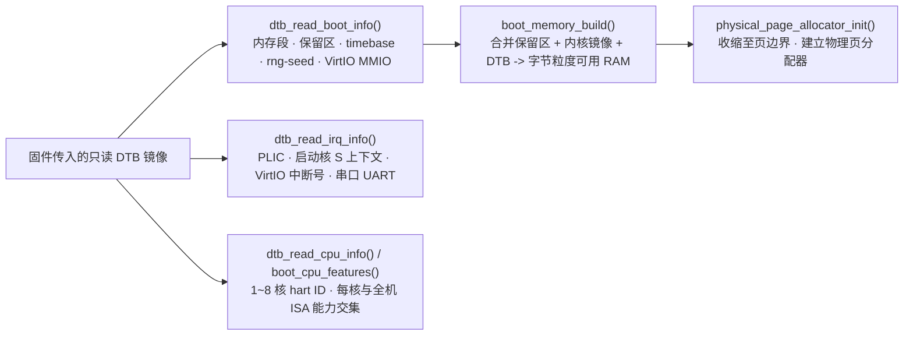

# 设备树（DTB）解析与启动内存布局

引导早期，硬件拓扑尚未固化，内核通过解析固件传入的**扁平设备树（Flattened Device Tree，DTB）**获取物理内存、保留区、时钟频率、处理器能力、中断控制器、串口与 VirtIO 外设信息，并据此构建精确的启动期物理内存布局。本模块坚持**纯只读、无硬件副作用、失败不污染输出**的设计原则，为后续 [物理页分配器](physical-pages.md)、[RISC-V 启动](riscv-boot.md)、[RISC-V 多核启动](riscv-smp.md) 与 [VirtIO 块设备](riscv-virtio-block.md) 提供可信快照。

---

## 一、源码组织

| 源码路径 | 核心职责 |
| :--- | :--- |
| `include/kernel/dtb.h`、`kernel/dtb.c` | FDT v17 格式边界校验，提供引导信息、中断路由与 CPU 能力三组只读快照解析器 |
| `include/kernel/boot_memory.h`、`kernel/boot_memory.c` | 将固件保留区、内核镜像与 DTB 自身范围裁剪合并，从 RAM 中相减生成字节粒度可用内存表 |
| `kernel/main.c` | 在分页开启前依次调用三组解析器与布局构建器，完成随机数种子混入与物理页分配器初始化 |

---

## 二、DTB 解析器的三组独立快照

所有解码均按大端字节序逐字节读取，绝不把可能未对齐的设备树原始内存直接强转为 C 结构体；任何校验失败或超限错误都会直接返回错误码（`DTB_STATUS_INVALID` / `DTB_STATUS_NOT_FOUND` / `DTB_STATUS_UNSUPPORTED`），**保持调用方输出结构体原值不变**。



### 2.1 引导资源快照（`dtb_read_boot_info`）

成功解析时，在 `struct dtb_boot_info` 中发布以下信息：
- **非连续物理内存（RAM）**：遍历根节点直属 `memory` / `memory@*` 节点（要求 `device_type = "memory"`），记录所有非空 `reg` 区间至 `memories[]`（最多 `DTB_MAX_MEMORY_RANGES = 16` 段），同时在兼容字段 `memory` 中保留首段。RISC-V 引导目前使用首段 RAM，而 LoongArch 平台会处理全部非连续内存段而不将平台 MMIO 空洞误作 RAM。
- **平台时基与随机混种材料**：
  - 精确匹配根节点直属 `/cpus/timebase-frequency`（存在时必须为单个非零 32 位 cell；缺失时输出 `0`，由 RISC-V 定时器启动阶段按平台缺失报错）；其他节点中的同名属性不会冒充；
  - 若存在 `/chosen/rng-seed`（长度至少 32 字节），拷贝前 `DTB_RNG_SEED_SIZE`（32）字节供内核启动期混入随机数池，混入后立即擦除临时快照；缺少该属性不影响解析成功（`rng_seed_size = 0`），可信熵初始化详见 [VirtIO RNG 与随机初始化](riscv-virtio-rng.md)。
- **静态保留区**：合并 FDT 头部指向的 Memory Reservation Block 与 `/reserved-memory` 子节点中的静态 `reg` 区间，两者合计最多 `DTB_MAX_RESERVED_RANGES = 16` 项。`/reserved-memory` 必须使用与根节点一致的 `#address-cells`/`#size-cells` 且携带空 `ranges`；动态 `size` 分配形式及相关节点的 `status` 属性明确返回 `DTB_STATUS_UNSUPPORTED`。
- **VirtIO MMIO 传输层发现**：深度遍历全树（最多 16 层），筛选 `compatible` 字符串列表包含 `"virtio,mmio"` 且自身与所有祖先 `status` 均可用（缺失、`"okay"` 或 `"ok"`）的节点。沿每层父总线的 `ranges` 属性逐级将子总线地址翻译至根物理地址，按物理地址升序写入 `virtio_mmio[]`（最多 16 项），拒绝空范围、溢出、无法翻译或区间重叠。发现阶段不访问任何设备 MMIO 寄存器。

### 2.2 中断与串口拓扑快照（`dtb_read_irq_info`）

在复用 `dtb_read_boot_info()` 确认整棵树结构合法后，执行**两遍遍历**（允许中断控制器的 `phandle` 定义晚于引用它的设备节点）：
- **第一遍**：定位启动核（`reg == boot_hart`）的本地中断控制器（`riscv,cpu-intc`）`phandle`，以及唯一启用的平台级中断控制器（PLIC，兼容 `"riscv,plic0"` 或 `"sifive,plic-1.0.0"`）的物理地址、`phandle` 与最大中断源数 `riscv,ndev`。
- **第二遍**：在 PLIC 的 `interrupts-extended` 数组中定位与启动核 `cpu_intc` 匹配且中断号为 **`9`**（监督者外部中断）的条目索引作为启动核的 PLIC S-mode 上下文号 `context`；同时收集全部指向该 PLIC 且源号合法的 `virtio,mmio` 中断路由 `routes[]`。
- **唯一串口 UART 发现**：同时筛选唯一启用的 `"ns16550a"` 或 `"ns16550"` 节点，经父总线 `ranges` 翻译其 `reg`，要求挂接至该 PLIC 且具有非零 `clock-frequency`；`reg-shift` 默认为 `0`（允许 `0..4`），`reg-io-width` 默认为 `1`（允许 `1` 或 4 字节对齐的 `4`，此时要求 `shift >= 2` 且基址 4 字节对齐），范围须覆盖全部 8 个寄存器（`size >= (7 << shift) + width`）。若存在大端标记（`big-endian`/`native-endian`）、布局不合法、缺少时钟或中断路由，或同时启用多个串口，均明确拒绝。

### 2.3 处理器身份与指令集能力快照（`dtb_read_cpu_info`）

- **多核拓扑**：扫描 `/cpus` 下所有启用且 `device_type = "cpu"` 的节点，最多记录 `DTB_MAX_CPUS = 8` 颗核；逻辑编号 `0` 固定为 `boot_hart`，其余从核按物理 hart ID 升序排列。重复 hart ID、缺失启动核或结构损坏返回错误；单核构建通过 `dtb_read_boot_cpu_features()` 仅读取启动核能力，不因设备树包含超过单核容量的从核而拒绝启动。
- **扩展能力交集**：为每颗核记录独立的 `hart_features[i]`，并计算所有启用核的按位与交集存入 `features`（避免依据单颗核的扩展错误推断全机支持）。解析时优先检查 NUL 分隔字符串列表 `riscv,isa-extensions`，仅当其缺失时才解析旧 `riscv,isa` 字符串（支持版本后缀解析）：

| 特征位宏 | 值 | 对应 DTB 扩展与附加条件 |
| :--- | :--- | :--- |
| `DTB_CPU_MMU_SVVPTC` | `1 << 0` | `svvptc`（允许首次建立页表项后免刷 TLB，详见 [虚拟内存管理](kernel-mm.md)） |
| `DTB_CPU_ISA_V` | `1 << 1` | 标准 RVV 1.0 向量扩展 `v`（旧字符串中要求主版本号为 `1`） |
| `DTB_CPU_ZICBOZ_64` | `1 << 2` | `zicboz` 且 `riscv,cboz-block-size == 64` |
| `DTB_CPU_ISA_FD` | `1 << 3` | 同时具备 `f` 与 `d`，或具备 `g` |
| `DTB_CPU_ISA_C` | `1 << 4` | 压缩指令扩展 `c` |
| `DTB_CPU_ZBA` / `ZBB` / `ZBS` | `1 << 5..7` | 位操作扩展 `zba`、`zbb`、`zbs` |

---

## 三、启动内存布局构建器（`boot_memory_build`）

`kernel/boot_memory.c` 接收 `dtb_boot_info`、链接器导出的内核半开物理区间 `[kernel_start, kernel_end)` 与 DTB 物理地址，生成纯净的字节粒度内存分区：

1. **输入与溢出校验**：校验所有 `base + size` 运算不发生 64 位无符号溢出，并强制要求内核镜像区间完整落入所选 RAM 范围 `[memory_base, memory_end)` 之内。
2. **裁剪与合并保留区**：将 DTB 收集的至多 16 项静态保留区，加上内核镜像与 DTB 自身共至多 **18 项**（`BOOT_MEMORY_MAX_RESERVED_RANGES`）候选区间分别裁剪到 RAM 边界内（完全位于 RAM 之外的设备树保留区自动忽略），按起始地址插入排序后合并所有重叠或首尾相邻的区间，得到规范化的 `reserved[]`。
3. **区间相减生成可用 RAM**：以游标从 `memory_base` 扫过已合并的 `reserved[]`，把所有间隙依次输出为按地址排序的 `usable[]`（最多 19 项）。若没有任何剩余可用内存，返回 `BOOT_MEMORY_STATUS_EMPTY` 且不修改输出。

布局构建器刻意保持**字节粒度**，不做页大小假设；向上/向下收缩到架构页边界并丢弃不足一整页的碎边由下游 [物理页分配器](physical-pages.md) 统一负责。

---

<details>
<summary>展开查看：格式校验细节、规范依据与验证入口</summary>

### FDT 格式校验细则

- 仅接受标准魔数 `0xd00dfeed` 且兼容版本号 `17`（`version >= 17 && last_compatible_version <= 17`）的镜像。
- 严格检验头部总长（`>= 40`）、三大块顺序（`reserve_offset <= structure_offset <= strings_offset`）、对齐（`reserve_offset` 8 字节对齐，`structure_offset`/`structure_size` 4 字节对齐）、所有块边界位于 `total_size` 内、保留表全零终止项、节点属性顺序（子节点开始后不允许再出现父节点属性）以及所有字符串以 NUL 结尾。
- 根节点默认 `#address-cells = 2`、`#size-cells = 1`，显式声明值仅允许 `1` 或 `2`。
- 当前不支持动态 `reserved-memory`（`size` 形式）、NUMA 拓扑、内存热插拔或连续内存分配器（CMA）。

### 规范依据

- [Devicetree Specification：扁平设备树格式](https://devicetree-specification.readthedocs.io/en/stable/flattened-format.html) 与 [标准节点定义](https://devicetree-specification.readthedocs.io/en/stable/devicenodes.html)
- OpenSBI `fdt_fixup.c`（将固件/PMP 保护内存写入 `/reserved-memory`）、Linux `drivers/of/fdt.c` 与 QEMU `hw/riscv/virt.c`（`create_fdt_uart` 串口节点描述）

### 定向验证入口

```sh
python3 -B tests/host/dtb_uart_test.py
python3 -B tests/host/smp_dtb_test.py
make test-block-riscv test-io-sleep-riscv
make test-riscv
```

- `dtb_uart_test.py`：在宿主机直接编译 `kernel/dtb.c`，验证内存、保留区、时钟、VirtIO 地址翻译、PLIC 路由、UART 寄存器布局边界及失败时不污染输出。
- `smp_dtb_test.py`：覆盖多核非零/稀疏 hart ID、禁用核、`riscv,isa-extensions` 与旧 `riscv,isa` 解析、能力交集及越界/损坏输入。

</details>
