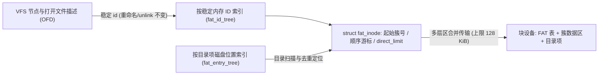

# FAT32 与 VFAT 文件系统

**FAT32（File Allocation Table 32）** 配合 **VFAT（Virtual File Allocation Table）** 长文件名扩展，是嵌入式设备、引导分区与跨平台移动介质最通用的磁盘文件系统格式。BoarOS 在 `fs/fat32.c` 中实现了完整的 FAT32 读写后端，接入统一的**虚拟文件系统（Virtual File System，VFS）**、页缓存与块设备层，支持长短文件名、打开后删除（孤儿簇延迟回收）、只读/读写重挂载（remount）以及普通文件**直接 I/O（`O_DIRECT`）**。

---

## 一、源码组织与架构集成

| 源码路径 | 核心职责 |
| :--- | :--- |
| `fs/fat32.c` | FAT32 完整 VFS 后端实现：BIOS 参数块（BPB）与 FSInfo 解析、簇链管理、VFAT 长短文件名编解码、目录项维护、直接 I/O、刷盘与重挂载 |
| `fs/vfs_*.c` | 通用 VFS 路径解析、目录项缓存、页缓存写回调度与挂载重配置状态机（详见 [VFS 与 ext4](vfs-ext4.md)） |
| `drivers/block/` | 块设备认领（claim）、主引导记录（MBR）分区偏移换算与物理扇区读改写（详见 [VirtIO 块设备](riscv-virtio-block.md)） |

- **挂载入口**：通过 `mount(source, target, "vfat", MS_RDONLY 或 0, NULL)` 按块设备节点的真实设备号（`st_rdev`）绑定整盘或 MBR 主分区，并在挂载期间排他持有块设备认领（claim）。
- **并发与锁层级**：命名空间拓扑由 VFS 的 `namespace_lock`（rank 20）保护，文件系统内部元数据（FAT 表、目录项、簇分配与两棵索引红黑树）由每实例独占互斥锁 `m->metadata`（rank 40）保护。

---

## 二、目录项、长短文件名与独立节点身份

FAT32 在磁盘上没有独立的索引节点（`inode`）表，文件的起始簇号和大小直接存放在父目录项中。如果把目录项磁盘偏移直接当作内存 `inode` 号，文件跨目录重命名后已打开的文件描述符就会丢失身份。BoarOS 通过**双红黑树索引**解耦这一限制：



### 2.1 长短文件名（VFAT）与大小写语义

- **完整编码支持**：同时支持传统 8.3 短文件名与 UTF-8 ↔ UTF-16LE 转换的 VFAT 长文件名（含 UTF-16 代理对、长名槽位序号与 8.3 短名校验和）。
- **查找与别名统一**：名称查找按 FAT 规范折叠 ASCII 大小写，但后端从磁盘返回真实规范拼写；同一目录项的长名、短名及大小写别名共享同一个 VFS 路径对象，避免当前工作目录（`cwd`）、目录文件描述符（`dirfd`）或重命名产生分裂视图。大小写仅变化的原地重命名仍会更新盘上拼写。
- **安全扩展目录**：创建新文件时自动生成无冲突的 8.3 短名；目录扫描跳过已删除标记（`0xE5`）与卷标项。当新目录项覆写原目录结束标记（`0x00`）时，先在新的末尾槽位写入结束标记再发布新条目，防止旧簇残留数据被误解析为有效文件。

### 2.2 孤儿文件与无阻塞节点退休

- **打开后删除与重命名**：支持目录创建、枚举、空目录删除、文件读写/截断以及普通与 `RENAME_NOREPLACE` 重命名（跨目录移动子目录时同步更新其 `..` 项）。删除已打开文件时先摘除目录项名称并从 `fat_entry_tree` 移出，保持已打开描述符、内存映射与页缓存正常工作，直至最后一个使用者释放后才在 `release_unlinked()` 中真正归还磁盘簇链。
- **锁外安全退休**：当内存回收触发末次节点关闭（`close_node`）时，不再反向争抢文件系统锁或等待磁盘，而是通过原子无锁链表 `m->retired_inodes` 交出已死亡的 `fat_inode`，由后续持有 `m->metadata` 锁的元数据操作调用 `collect_retired()` 统一摘树并释放堆内存。
- **属性与时间精度**：文件只读属性映射到 FAT 的 `READONLY` 属性位，所有权固定映射为 `root`（FAT 格式不存储 Unix UID/GID 与细粒度权限位）。热路径读写直接在发起 CPU 上更新访问/修改时间并置位 `times_dirty`，实际目录项刷盘延迟至页缓存写回、`fsync`、文件系统同步或卸载阶段完成；重新挂载后按 FAT 目录项的 2 秒时间戳精度读回。

---

## 三、簇链管理、批量传输与持久化

- **合法性校验与防环检测**：挂载时严格核验 BPB 参数、扇区尺寸（支持 512 ～ 4,096 字节）、合法 FAT32 簇尺寸、卷容量与备份引导扇区，并扫描真实 FAT 表统计空闲簇（FSInfo 仅作为下次分配的搜索起点提示，不盲信其空闲计数）。访问簇链时采用快慢指针校验越界、坏链接与簇环，遇到盘面损坏返回 `-EUCLEAN` 并记录实例错误状态。
- **顺序游标与 128 KiB 合并传输**：
  - 每个 `fat_inode` 保留顺序簇游标（`cursor`、`cursor_index`），连续读写时沿簇链递增推进，避免逐页从文件头重新遍历。
  - 物理上相邻的连续完整扇区合并为单次最高 **`FAT_TRANSFER_BYTES`（128 KiB）** 的批量块设备读写；仅非扇区对齐的首尾片段使用实例级单扇区缓存（`m->sector`）执行读改写。整扇区写入若覆盖缓存扇区范围（即使写中途失败），立即令该扇区缓存失效，防止残留旧数据污染后续部分读取。
- **空间预分配、零填充与盘满回滚**：
  - 缓冲写入接纳前即分配真实磁盘簇并补零，文件稀疏扩展空隙及截断后的保留簇尾部也全部补零。空间耗尽时仅接纳已有物理簇覆盖的前缀并返回短写；扩展截断失败则回滚本次多分配的簇。
- **多副本 FAT、刷盘与重挂载**：
  - 按卷设置维护 FAT 表镜像副本。`fsync` 等待页缓存写回完成、更新目录项文件长度与 FSInfo 并下发真实块设备 `flush`；正常卸载先停止后台工作线程、排空页缓存与孤儿节点，再刷盘并写回 FAT 卷干净（clean）标志。
  - `remount` 支持在运行中安全执行读写/只读切换，复用相同的干净标志与设备刷新路径并保持已有文件与路径身份。一旦发生磁盘损坏或设备 I/O 错误，错误直接回报给 `fsync`/卸载调用者，挂载保留盘上脏标志与设备认领直至用户态显式处置。

---

## 四、普通文件直接 I/O（`O_DIRECT`）

FAT32 普通文件支持在 `open` 时指定 `O_DIRECT` 或通过 `fcntl(F_SETFL)` 动态切换：

- **对齐传输与初始化边界（`direct_limit`）**：每个节点维护已初始化的磁盘分配前沿 `direct_limit`（对应 Linux FAT 的 `mmu_private`）。在已有边界内的读取与覆盖写按逻辑扇区校验用户缓冲区地址、长度与文件偏移，绕过页缓存沿 FAT 簇链直接经块设备传输（使用至多一个架构页的临时内核中转缓冲）。读取触及文件尾时正常返回短读。
- **越界写回退**：直接写入若超出 `direct_limit`（需要扩展文件或初始化空洞），按 Linux `fat_direct_IO` 语义回退到普通缓冲扩展路径（接受非对齐输入），完成后将相交整页立即写回并失效页缓存。
- **与内存映射和截断的严格一致性**：
  - 文件写锁串行化直接 I/O 与截断。
  - 直接写先完成用户数据拷贝并解钉用户页，再临时阻止新映射发布、撤销相交共享映射、等待在途页引用归还并写回相交脏页，随后下发块设备写入、失效旧缓存并恢复映射发布；直接读同样先排空相交脏页，并在恢复映射后再向用户缓冲区拷贝。
  - 将“用户拷贝”与“映射撤销”分离，允许进程把同一文件的 `mmap` 映射区作为自身的 `O_DIRECT` 缓冲区而不死锁；私有写时复制（Copy-on-Write，CoW）页继续归各进程独立持有。

---

<details>
<summary>展开查看：当前范围与定向验证入口</summary>

### 当前格式与特性范围

- 当前介质支持范围为 **FAT32**（含 VFAT 长名与 512 ～ 4,096 字节扇区）；FAT32 格式本身不含事务日志，异常断电后的卷一致性修复依赖外部 `fsck.fat` 工具。
- FAT12/16、exFAT、额外 `mount -o` 扩展选项、符号链接与硬链接等需求见 [演进路线与待完成项](../goals.md)。

### 定向验证入口

```sh
# 宿主生产 VFS + 页缓存 + 块层全量回归（4/16 KiB 页、512/4096 B 簇、直接 I/O、fsck.fat -vn 与设备故障）
make test-fat32-host
sh tests/host/fat32.sh

# RISC-V 真实用户态端到端测试（读写、向量 I/O、共享/COW 映射、O_DIRECT、sendfile/splice、loop 后备与 e2fsck/fsck.fat）
make INIT_CONFIG=config/init.json test-fat32-user-riscv

# LoongArch64 真实用户态端到端测试
python3 -B tests/userland/fat32-user.py --arch loongarch --program <ELF> \
  --kernel kernel-la --qemu <QEMU> --output build/fat32-user-la
```

</details>
