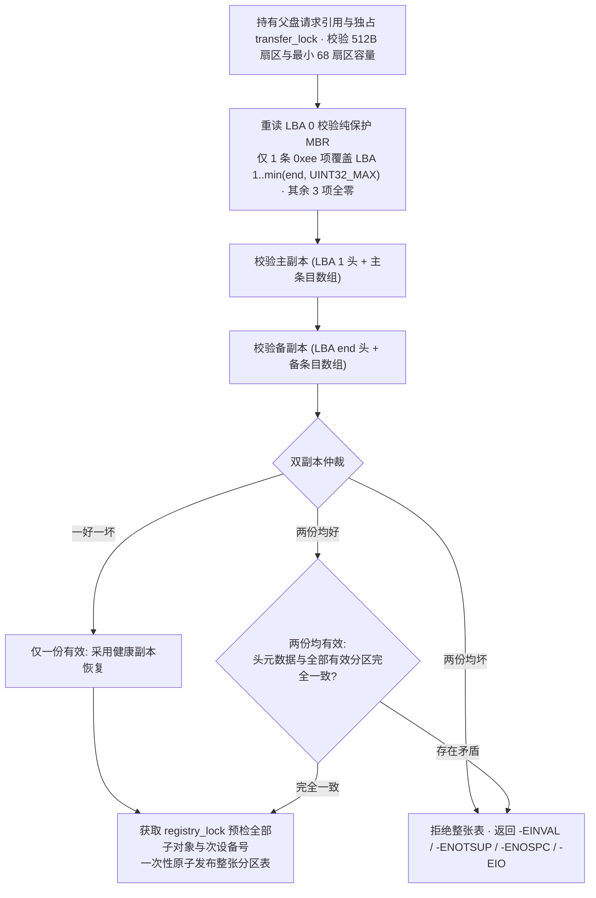

# GPT 分区表发现与原子发布

BoarOS 在 RISC-V（`arch/riscv/root_boot.c`）与 LoongArch（`platform/loongarch_root.c`）两条启动路径中统一使用公共块设备层提供的**全局唯一标识分区表（GUID Partition Table，GPT）**发现机制。登记每块物理磁盘后，系统调用 `kernel_block_scan_partitions()` 自动识别无分区整盘、传统主引导记录（Master Boot Record，MBR）四主分区以及保护性 MBR 引导的 GPT 分区表，并在全量校验通过后将所有有效分区一次性原子发布到块设备登记表。

---

## 一、源码组织

| 源码路径 | 核心职责 |
| :--- | :--- |
| `kernel/block.c`、`include/kernel/block.h` | 分区扫描分派 `kernel_block_scan_partitions()`、GPT 校验与原子发布 `kernel_block_scan_gpt()` 及 MBR 解析 |
| `arch/riscv/root_boot.c`、`platform/loongarch_root.c` | 为每块物理盘静态持有 15 个子分区对象槽位（`KERNEL_BLOCK_GPT_PARTITIONS`），启动时扫描并停机时逆序注销 |

---

## 二、分派规则与设备号编码

`kernel_block_scan_partitions()` 首先读取磁盘 LBA 0（第 0 扇区）：
- 若扇区末尾为 MBR 签名 `0x55 0xaa` 且四条主分区项中存在类型为 `0xee`（保护性 MBR 标识）的条目，则转交 `kernel_block_scan_gpt()` 执行严格的 GPT 校验与发布；
- 否则回退至 `scan_mbr_sector()`：无签名视为整盘文件系统直接保留；有签名则按传统四主分区规则登记 1～4 号分区（拒绝越界、重叠、空长度及扩展分区 `0x05`/`0x0f`/`0x85`）。

每块物理盘在 Linux `new_encode_dev(252, index * 16)` 方案下拥有 16 个连续次设备号（整盘次设备号为 `16` 的倍数），留给子分区的槽位固定为 **`1..15`**（`KERNEL_BLOCK_GPT_PARTITIONS = 15`）：
- **保留稀疏编号**：GPT 分区数组中的第 `k` 项（从 1 开始计，`1 <= k <= 15`）直接映射为 `disk->device_number + k`。例如第二块磁盘（主设备号 `252`、次设备号 `16`）的第 2 个 GPT 分区对应 `252:18`；即使第 1 项为空，第 2 项仍保持次设备号 `18` 而不向前紧凑重排。
- **节点访问与根盘边界**：当内核挂接了设备节点发布器（如 `devtmpfs`）时，原子发布会自动同步创建块设备节点；在无自动设备文件系统的最小环境中，用户态也可以通过 `mknod /dev/vdb2 b 252 18` 建节点后按常规 `open`/块 I/O/`mount` 路径访问。根文件系统仍固定挂载第一块整盘，目前不包含 GPT 根分区自动选择或 `PARTUUID` 解析。

---

## 三、四阶段严格校验与主备副本仲裁

GPT 校验遵循 [UEFI 规范 §5（GPT 磁盘格式）](https://uefi.org/specs/UEFI/2.10_A/05_GUID_Partition_Table_Format.html)，坚持**严格失败关闭（Fail-Closed）**原则，不采纳含糊或自相矛盾的分区表。



### 3.1 各阶段不变量清单

1. **介质与纯保护 MBR（PMBR）**：
   - 仅支持 **512 字节逻辑扇区**、整盘容量为 512 字节整数倍且不少于 **68 个扇区**（1 扇区 PMBR + 1 扇区主头 + 32 扇区主数组 + 32 扇区备数组 + 1 扇区备头 + 至少 1 扇区可用区）；
   - 在 `transfer_lock` 写锁内重新读取 LBA 0 验证 `0x55 0xaa`：必须有且仅有 1 条非零项，类型为 `0xee`、引导标志为 `0`、起始 LBA 为 `1`、扇区数为 `min(end, UINT32_MAX)`；若混杂其他非零分区项（混合 MBR）则返回 `-ENOTSUP`。
2. **GPT 主/备头部（`gpt_copy`）**：
   - 签名必须为 `"EFI PART"`、版本号为 `0x00010000`（GPT 1.0）、偏移 20 保留字为 `0`、头长度在 `[92, 512]` 字节之间，且将偏移 16 的 CRC 字段清零后计算 CRC32（多项式 `0xedb88320`）与记录值一致；
   - `my_lba` 必须等于当前读取位置（主头 `1` / 备头 `end`），`alternate_lba` 必须精确互指对方位置，磁盘 GUID 必须非零；
   - **实现上限与几何隔离**：`entry_count` 须在 `1..128` 之间、`entry_size` 仅接受 `128`/`256`/`512` 字节（超出返回 `-ENOTSUP`）；元数据至少预留 `max(32, array_sectors)` 个扇区（即至少 16 KiB），要求 `first_usable <= last_usable < end`、`first_usable >= 2 + reserved`、`last_usable < end - reserved`，且主条目数组完全位于 `first_usable` 之前、备条目数组完全位于 `last_usable` 之后。
3. **单遍条目数组扫描与防误判机制**：
   - 按扇区顺序**单遍读取**整个条目数组并同步累计数组 CRC32，绝不为单条表项重复发 I/O；
   - 跳过 16 字节 Type GUID 全零的空闲槽位；有效槽位须满足非零 Unique GUID、`first_usable <= first <= last <= last_usable`，且不与任何已解析分区在扇区范围上重叠或共享重复的 Unique GUID；
   - 若第 16 号及之后（`index >= slots`）存在占用项，仅记录标志 `unsupported_slot = 1` 并继续完成整个数组的 CRC32 计算，**仅当整表 CRC32 校验通过后才返回 `-ENOSPC`**，避免一份本身已损坏的副本中某条乱码越界项错误地掩盖另一份健康副本。
4. **双副本仲裁**：
   - 只要任一副本因超出实现上限（`-ENOTSUP`）或第 16+ 槽位被占用（`-ENOSPC`）返回，立即中止并上报该错误，绝不静默截断分区表；
   - 若仅有一份副本因 CRC/几何损坏或 I/O 错误失败，自动采用另一份健康副本；
   - 若两份均失败，有 I/O 错误返回 `-EIO`，否则返回 `-EINVAL`；
   - 若两份均校验通过，强制比对两份头的 `first_usable`、`last_usable`、`entry_count`、`entry_size`、`entries_crc`、`disk_guid` 以及全部 15 个解析槽位，任何不一致均返回 `-EINVAL`。

---

## 四、并发安全、资源预算与原子发布

- **独占扫描与防 TOCTOU**：整个 `kernel_block_scan_gpt()` 持有父盘的在途请求引用（`BLOCK_REQUEST`）与 `transfer_lock` 写锁，彻底排除并发写入与容量变更，并在锁内直接调用底层 `read_backend()` 避免与外层 `kernel_block_read_at()` 递归抢锁。启动分派多一次无锁初探，进入 GPT 后在锁内重读并复核 LBA 0，杜绝锁外陈旧判断。
- **固定栈空间与 I/O 上界**：扫描全程不使用内核堆，仅占用固定栈缓冲区；对于含 `entry_count` 条、每条 `entry_size` 字节的正常 GPT 磁盘，直接调用 `kernel_block_scan_gpt()` 的读取次数严格等于 `3 + 2 * ceil(entry_count * entry_size / 512)` 个扇区（LBA 0 + 主/备头 + 两份数组）。
- **一次性原子发布**：校验全部通过后获取全局 `registry_lock()`，预先检查所有待用子槽位均处于完全干净态（未登记、无引用、无认领）、所有目标次设备号均无冲突、父盘仍处于已登记状态且引用计数不溢出；确认全部满足后才批量挂入 `registered_devices`、递增父盘引用计数并调用 `publish_devices_locked()` 统一暴露。任何预检失败均零副作用返回，绝不留下半张分区表或悬空的父盘引用。

---

<details>
<summary>展开查看：实现边界、与 Linux 策略差异及验证入口</summary>

### 范围边界与策略说明

- 仅执行启动期只读发现，不支持 4Kn（4 KiB 逻辑扇区）、混合 MBR、扩展分区、环回设备分区扫描、`BLKRRPART` 热重扫或磁盘自动修复。
- GPT 分区类型 GUID、名称与属性位不作为自动挂载策略，目前也不向用户态暴露 GUID/名称查询接口。
- 与 Linux 对损坏磁盘的宽容容错策略不同：保护 MBR 长度不符、混合 MBR、分区重叠以及两份有效但互相矛盾的主备副本在 BoarOS 中均严格拒绝，防止把损坏布局暴露给上层文件系统。

### 定向验证入口

```sh
make test-gpt-host
BLOCK_TEST_TRANSPORT=modern BLOCK_TEST_CACHE=writeback make test-block-riscv
make test-block-loongarch
```

- `make test-gpt-host`：在宿主环境验证 GPT 校验、损坏副本主备恢复、双副本冲突拒绝与原子发布，并用 `libblkid` 逐项核对同一镜像的分区号、起始扇区与长度。
- `make test-block-riscv` / `make test-block-loongarch`：在真实 VirtIO 块设备上验证分区偏移、越界拦截与主备恢复。
- `tests/userland/fat32-user.py --gpt`：以整盘 ext4 启动并挂载 GPT 数据盘，在 RV64 与 LA64 生产内核上运行分区建节点、FAT32 挂载、读写、卸载与一致性检查。

</details>
