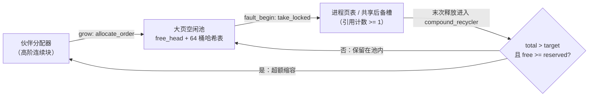

# 原生大页与复合页

原生大页（Huge Page，HugeTLB）使用更高层级的硬件页表项映射连续物理内存，可减少页表占用和转换后备缓冲器（Translation Lookaside Buffer，TLB）未命中次数。BoarOS 从[物理页分配器](physical-pages.md)取得整块连续页面，由一个原生大页池同时供给匿名映射（`MAP_HUGETLB`）、System V 共享内存（`SHM_HUGETLB`）、`hugetlbfs` 文件和 `memfd_create(MFD_HUGETLB)` 创建的匿名文件。

---

## 一、源码组织

| 源码路径 | 核心职责 |
| :--- | :--- |
| `include/kernel/hugetlb.h`、`mm/hugetlb.c` | 原生大页池状态机（`struct kernel_hstate`）、高阶页回收钩子、私有/共享/子代大页映射账本（`struct kernel_hugetlb_map`）、预留配额、两阶段缺页/丢弃协议与子映射撤销协调 |
| `include/kernel/mm_leaf.h` | 跨架构叶表项快照 `struct kernel_mm_leaf`，统一描述基页与大页的虚拟起点、物理块头、阶数、防 ABA `cookie`、有效权限与写时复制状态 |
| `mm/mm.c`、`mm/vma.c` | `HUGETLB_PRIVATE` / `HUGETLB_SHARED` 区域管理、大页边界对齐校验、大页缺页/CoW 提交流程、`MADV_DONTNEED` 预检与用户页整块固定借用 |
| `arch/riscv/sv39.c`、`arch/loongarch/mmu.c` | RISC-V 2 MiB（Level 1）与 LoongArch 32 MiB（PMD）大叶表项的安装、快照、写时复制、保护权限切换与整块退役 |

---

## 二、双架构硬件大叶与复合页契约

BoarOS 按目标体系结构的硬件页表能力固定每种架构的原生大页规格，所有大页物理分配、引用计数与退役均以**高阶复合块（Compound Allocation）**的块头为单位管理，不触碰也不拆分尾页元数据：

| 目标架构 | 基页大小 | 原生大页大小 | 伙伴阶数（`order`） | 硬件页表层级与 refill 机制 |
| :--- | :--- | :--- | :---: | :--- |
| **RISC-V 64（Sv39）** | 4 KiB | **2 MiB**（512 基页） | `9` | Level 1 中间表直接存储有效叶表项，不分配 Level 0 页表 |
| **LoongArch 64** | 16 KiB | **32 MiB**（2048 基页） | `11` | PMD 级大叶表项，硬件 `LDDIR`/`LDPTE` 重填路径原生覆盖两个 16 MiB `EntryLo` 槽位，无需软件特判分支 |

### 2.1 全栈整块语义

- **统一叶快照（`struct kernel_mm_leaf`）**：架构后端在 MM 元数据锁内返回叶表项的虚拟对齐起点、物理块头地址、`order`、`cookie`、有效权限与 CoW 标志。快照本身不持有引用，调用者必须在锁内完成引用获取，并在锁外准备完毕重新入锁后比对 `cookie` 防止 ABA 问题。
- **不静默拆分**：大页映射的虚拟地址、长度、`munmap` 与 `mprotect` 范围均强制按架构大页大小对齐；任何企图修改或撤销单个大页局部子范围的操作都会在准备阶段直接返回参数错误，绝不静默拆分为基页。
- **整块固定借用与退休**：
  - 用户页固定借用（`kernel_mm_pin_user_page`）对大页递增整块块头的物理引用计数，同时向调用者暴露目标虚拟地址所在的基页窗口与精确页内偏移，因此 `futex` 原子等待、管道写借用与指令读取均能安全访问大页内部字节；
  - 虚拟内存驻留与 CoW 统计按基页数量换算（例如 RISC-V 一个 2 MiB 大页计 512 基页），而物理退休批次（`struct kernel_mm_retirement`）记录块头与 `order`，在完成跨核 TLB 失效后通过 `physical_page_release_order_batch()` 整块归还。

---

## 三、物理大页池与回收托管（`struct kernel_hstate`）

每个物理页分配器最多绑定一个原生大页池 `struct kernel_hstate`。由于运行期内存碎片化后很难随时从伙伴系统凑出连续的 2 MiB 或 32 MiB 物理块，大页池通过预分配与托管回收机制将大页与普通小页隔离：

- **托管回收钩子（`compound_recycler`）**：`kernel_hstate_create()` 向物理页分配器注册 `recycle()` 作为 `retain_last` 回调。所有由大页池管理的块都登记在 `HSTATE_BUCKETS = 64` 的哈希表中，并共享 `allocator->lock` 保护账本状态。当某个托管大页的最后一份 PTE/借用引用归零时：
  - 若当前池总量未超出目标值（`total <= target`）或空闲页尚未超过预留需求（`free < reserved`），`recycle()` 返回 `1`，物理页分配器维持其块头引用数为 1 而不拆回伙伴系统，大页块直接回流至 `free_head`；
  - 若管理员已调小容量目标，使得该块成为可退回的超额页，`recycle()` 将其从哈希表移除、把元数据描述符挂入 `retired` 延迟释放链表（在锁外由 `reap()` 归还内核堆），并返回 `0` 让伙伴分配器正常回收合并。
- **容量控制与可观测性**：
  - 用户通过写入 `/proc/sys/vm/nr_hugepages` 调用 `kernel_hstate_resize()` 调整持久容量目标 `target`（默认初始为 `0`）。扩容按可分配的连续物理页尽力增长并即时反映部分进展；缩容仅立即释放未预留的空闲块，仍在使用中的超额块（`surplus = total - min(total, target)`）会在后续释放时自动退出大页池。
  - `kernel_hstate_snapshot()` 向 `/proc/meminfo` 输出大页总量（`HugePages_Total`）、空闲数（`HugePages_Free`）、预留数（`HugePages_Rsvd`）、超额数（`HugePages_Surp`）与单页尺寸（`Hugepagesize`）。

---

## 四、预留配额、写时复制与子映射撤销

创建带预留的匿名大页映射时，内核在发布映射前从大页池扣留所需额度。首次缺页用该额度领取物理块，未使用的额度随映射释放。匿名映射和 System V 共享内存使用 `struct kernel_hugetlb_map` 的连续槽位保存该状态，文件后备的稀疏槽位按实际文件偏移建立。

| 映射模式 | 创建来源 | 预留与共享策略 | 池耗尽时的缺页结果 |
| :--- | :--- | :--- | :--- |
| **`KERNEL_HUGETLB_PRIVATE`** | `mmap(MAP_PRIVATE \| MAP_HUGETLB)` | 创建者分配唯一谱系号 `lineage` 并预留全部槽位（`noreserve` 除外） | 首次装页消耗自身预留必成功；私有 CoW 缺页池空时触发**子映射撤销**，确保预留持有者优先存活 |
| **`KERNEL_HUGETLB_CHILD`** | 私有大页映射经 `fork` 派生 | 继承父映射的 `lineage` 与各槽当前状态，但**不获得额外预留**（强制 `noreserve = 1`） | 首次或 CoW 缺页若无未预留空闲大页，向子进程投递总线错误（`SIGBUS`） |
| **`KERNEL_HUGETLB_SHARED`** | `mmap(MAP_SHARED \| MAP_HUGETLB)`、`SHM_HUGETLB` | 共享映射与其 `fork` 子代共同持有同一 `map` 对象并复用后备槽物理页 | 仅未预留共享映射在池空时触发 `SIGBUS`；所有关联映射共享同一物理页与预留槽 |

### 4.1 两阶段缺页与父进程 CoW 撤销子映射

1. **两阶段装页**：缺页处理先调用 `kernel_hugetlb_fault_begin(map, index, cow, &claim)` 在锁内预占槽位（置为 `SLOT_PREPARING` 并递增 `pending`）及大页块，在锁外清零整张大页（共享槽另递增物理引用），再经 MM 发布硬件大叶后调用 `kernel_hugetlb_fault_finish(&claim, accepted)`。若并发竞争导致发布被拒（`accepted = 0`），自动原子归还物理块并恢复所消耗的预留配额。
2. **预留持有者 CoW 撤销（`kernel_hugetlb_revoke_children`）**：当 `PRIVATE` 预留持有者在 `fork` 后对其私有大页执行写时复制，但池中已无额外空闲大页可供拷贝时，`fault_begin()` 返回 `KERNEL_HUGETLB_REVOKE_CHILDREN`。此时 MM 释放所有地址空间锁，调用 `kernel_hugetlb_revoke_children()`：
   - 获取大页池的序列化互斥锁 `h->mutation`（Rank 20），标记 `closing_lineage = owner->lineage` 并递增全局 `epoch`（阻止并发新挂接绕过遍历）；
   - 通过安全的借用游标（`mapping_borrow` / `mapping_put`，对并发摘除节点沿 `retired_next` 续链）遍历所有同 `lineage` 的 `CHILD` 映射登记，在无锁状态下回调每个子 MM 的 `revoke` 钩子：撤除子进程对应大叶 PTE、排空用户固定借用、完成跨核 TLB 同步，并将子映射该槽标为 `SLOT_REVOKED`（此后子进程再次访问即触发 `SIGBUS`）；
   - 所有子引用退出后，原物理大页的引用计数回落至 1，父进程重新获取 MM 锁、校验 `cookie` 后直接**原地升级**恢复写权限，无需额外物理页即可保住预留承诺。

### 4.2 两阶段 `MADV_DONTNEED` 语义

对于私有大页，`madvise(MADV_DONTNEED)` 既要撤销当前页表项，又要恢复该槽原本享有的预留配额，使进程后续重访该地址时依然能分配到空白零页：

- `kernel_hugetlb_discard_begin()` 在撤销 PTE 前先检查当前大页引用计数：若当前 PTE 持有唯一引用（`exclusive && refs == 1`），撤销后整块直接回流大页空闲池即可覆盖恢复的预留；若仍存在其他子映射别名或临时 pin（`refs > 1`），则必须先从 `h->free - h->reserved` 中预扣一张额外空闲配额（池不足时返回 `BUSY` 拒绝丢弃）。
- PTE 摘除并完成跨核 TLB 失效后，`kernel_hugetlb_discard_finish()` 必定成功完成托管归还或引用递减，并将槽位重置为 `SLOT_AVAILABLE` 且恢复 `slot->reserved = 1`。
- 共享大页的 `MADV_DONTNEED` 仅摘除当前进程地址空间的页表项，不删除共享对象中的后备页；其他进程仍可正常访问，`mincore()` 也可通过 `kernel_hugetlb_map_resident()` 观察到共享槽的物理驻留状态。

---

## 五、`hugetlbfs` 文件与大页 memfd

管理员可通过 `mount -t hugetlbfs none /mnt/huge` 或基于文件描述符的挂载接口创建实例。挂载参数支持原生 `pagesize`、根目录的 `mode`、`uid`、`gid`，以及 `nr_inodes`、`size` 和 `min_size`。未命名的 `MFD_HUGETLB` 文件由内核内部实例承载，创建时长度和预留量都为零。文件封印、关闭时执行标志和执行权限沿用普通 memfd 入口。

- **文件大小、页和预留分别变化。** `ftruncate()` 按大页边界设置长度，扩展出来的空洞可以读取为零。可写映射可扩展文件至映射结束处。共享映射按文件偏移联合预留，第二个描述符映射同一范围时复用已存在的预留和数据。普通 `write()`／`pwrite()` 返回 `EINVAL`，程序可通过共享映射写入，或用 `fallocate()` 建立实际后备页。
- **私有映射按需分离。** 首次读取可直接引用文件已驻留的大页。首次写入取得该私有映射的物理页面，完整复制原内容，再发布新的页表项。后续写入只修改该私有副本。每次映射各自保持打开文件的引用，关闭文件描述符、删除文件名或延迟卸载后，原映射仍可使用。
- **截短和打洞先撤销完整大页的映射。** 虚拟文件系统（Virtual File System，VFS）关闭该文件的缺页发布资格，释放索引节点保护后通知已登记的地址空间。各地址空间撤销对应的页表项，等待其他处理器核确认失效，再归还引用。截短还会释放被截区间尚未使用的预留。完整大页打洞只撤下已装入的文件页，部分大页打洞只对对应字节清零。可写共享映射上的 `MADV_REMOVE` 也使用这条文件打洞路径。
- **挂载容量与全局余量一起结算。** `size` 限制同一文件系统实例中已预留和已分配的大页总数。`min_size` 在挂载时从全局大页池留出保底额度。两个选项接受字节数或挂载时持久大页池容量的百分比，结果向下取整至大页。映射失败退回本次预留，实页一直占用额度到最后一个物理引用归还。随后先补回该实例的保底，再归还全局。绑定挂载和延迟卸载后仍存活的映射继续使用原实例的额度。`statfs()` 可查询设置了上限的实例剩余容量。
- **`mremap()` 搬移页表项和原预留。** 源、目标地址按原生大页对齐，长度向上取整。内核先为目标准备页表，再搬移已驻留的大页项并保留原后备偏移。目标准备失败时源范围仍保有数据，Linux 规定已撤销的固定目标及已裁掉的源尾部不恢复。私有映射分段改变地址顺序后，按仍存活的后备区间保留预留。允许缩小和固定目标搬移，扩大范围或使用 `MREMAP_DONTUNMAP` 返回 `EINVAL`。

展开查看：当前范围边界与定向验证入口

### 当前实现边界

- 每个物理页分配器维护一个原生尺寸的大页池。多尺寸池、透明大页（Transparent Huge Pages，THP）以及直接从大页文件装载可执行与可链接格式（Executable and Linkable Format，ELF）映像待补。
- 共享 `futex` 等待在阻塞期间持有大页映射对象引用，直至等待退出；System V `SHM_HUGETLB` 的段、附加句柄与 VMA 共同维系后备对象寿命（详见 [SysV 共享内存](sysv-shm.md)）。

### 定向验证入口

- **宿主大页池、预留配额与双基页模型**：`make test-hugetlb-host`、`make test-mm-huge-host`
- **双架构硬件大叶测试**：`make test-huge-riscv`、`tests/loongarch/mmu.c`
- **用户态端到端对照（RV64 / LA64）**：`tests/userland/hugetlb.py`（覆盖私有/共享匿名大页、缺页、CoW、边界拒绝、管道页借用、SysV 附加与 `SIGBUS`）
- **文件后备与生命周期**。`tests/userland/api8.py --program huge_files` 验证命名文件和大页 memfd 的共享后备、写时复制、预留失败、封印、截短、打洞和延迟卸载。

