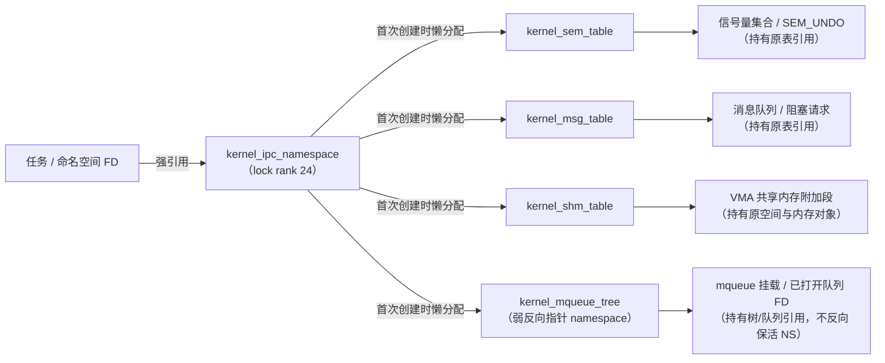

# IPC 命名空间

进程间通信（Inter-Process Communication，IPC）命名空间用于隔离不同容器或进程组之间的经典进程间通信发现空间，涵盖 **System V 共享内存（SHM）**、**System V 信号量（SEM）**、**System V 消息队列（MSG）** 以及 **POSIX 消息队列（`mqueue`）** 四类机制。不同 IPC 命名空间内可以使用完全相同的数字键（`key_t`）、对象标识符或队列名称，彼此互不干扰。

BoarOS 的 IPC 命名空间采用**按需懒分配**与**发现表/对象解耦所有权**设计：空命名空间不消耗大块发现表内存，且已在运行中的共享内存映射、信号量撤销记录或已打开队列描述符可安全活过原命名空间的生命周期。

---

## 一、源码组织

| 源码路径 | 核心职责 |
| :--- | :--- |
| `kernel/ipc_namespace.c`、`include/kernel/ipc_namespace.h` | IPC 命名空间对象（`kernel_ipc_namespace`）、初始命名空间（ID `4026531839`）引导与关机回收、动态空间创建与四类发现表清理 |
| `kernel/namespace.c`、`include/kernel/namespace.h` | 通用引用计数基类（`kernel_namespace`）与 `/proc/<pid>/ns/ipc` 命名空间 FD 生命周期管理 |
| `kernel/sem.c`、`kernel/msg.c`、`mm/shm.c`、`kernel/mqueue.c`、`fs/mqueue.c` | 四类 IPC 各自按命名空间维护的发现表/名称树及销毁回调（详见[System V 信号量](sysv-sem.md)、[System V 消息队列](sysv-msg.md)、[System V 共享内存](sysv-shm.md)与[POSIX 消息队列](posix-mqueue.md)） |

---

## 二、对象模型、创建与切换语义

`struct kernel_ipc_namespace` 内嵌通用 `struct kernel_namespace base`、保护发现表指针的原始锁（rank 24），以及四个初始为空的懒分配指针（`sem`、`msg`、`shm`、`mq`）：

- **创建与继承**：普通 `fork`/`clone` 继承父进程的 IPC 命名空间引用；`clone`/`unshare` 传入 `CLONE_NEWIPC` 创建一个全新空命名空间；`setns` 通过命名空间 FD 或 `pidfd` 切换到指定 IPC 命名空间。
- **与 `SEM_UNDO` 共享组的交互**：进程在切换 IPC 命名空间（`unshare`/`setns`）提交前，会先脱离原有的 System V 信号量自动撤销（`SEM_UNDO`）共享组，再原子替换任务的命名空间引用，防止跨命名空间错误回滚信号量。按 Linux 约束，`clone` 中 `CLONE_NEWIPC | CLONE_SYSVSEM` 组合非法；而在 `unshare` 中传入 `CLONE_SYSVSEM` 表示主动脱离当前共享撤销组。
- **关机收尾**：初始 IPC 命名空间永久持有 1 份启动引用。系统关机在所有用户任务、文件描述符和文件系统挂载卸载完毕后调用 `kernel_ipc_initial_shutdown()`，仅当引用计数恰好回落到 `1` 时回收初始空间的四张发现表并保留启动身份；若仍有外部引用存活则返回 `-EBUSY` 并保持表完整。

---

## 三、发现表懒分配与跨命名空间对象存活

### 3.1 System V IPC（SHM / SEM / MSG）

- **零开销空空间**：对尚未创建任何对象的空命名空间执行查询或 `IPC_INFO` 不会分配整张发现表；只有首次实际创建对象时才分配对应子表。
- **固定视图与独立存活**：普通系统调用从当前调用任务借用 IPC 命名空间；`/proc/sysvipc/{shm,sem,msg}` 在 `open` 时即捕获打开者的 IPC（及 PID）命名空间引用，后续 `read` 与 `lseek` 始终查询同一空间。
- **表与对象的安全回收**：
  - 信号量集合与消息队列对象持有原发现表引用，阻塞中的请求与 `SEM_UNDO` 记录持有原对象。当命名空间的最后外部引用归零时，`ipc_release_tables()` 调用内部销毁入口移除所有发现项、唤醒等待者并释放数据（无需伪造特权调用者），发现表自身则等到最后一个真实集合或队列持有者释放后才真正归还堆内存。
  - 共享内存附加段（attachment）直接持有原命名空间与底层内存对象。任务切换 IPC 命名空间后，旧 VMA 上的 `fork`、分裂、`mremap` 与 `shmdt` 仍精准作用于原附加段，绝不会拿新空间里的同号 `shmid` 张冠李戴；已标记 `IPC_RMID` 的段只要尚存活，仍可凭完整 ID 再次 `shmat`，直至最后一个附加段解除后才销毁。

### 3.2 POSIX 消息队列树（`kernel_mqueue_tree`）

- **树与命名空间解耦**：每个 IPC 命名空间对应一棵独立的 `kernel_mqueue_tree`（维护队列名称表、inode 分配、根目录元数据及队列计数）。同一空间内所有 `mqueue` 挂载与 `mq_open` 共享同一棵树与相同的设备身份（取自命名空间 ID），不同空间的同号 inode 拥有不同设备身份。
- **孤儿挂载与孤儿描述符**：为了不让长期存在的 `mqueue` 挂载或打开文件描述符反向锁死整个 IPC 命名空间，挂载与队列只持有**树引用**，树内仅保存指向命名空间的弱指针。当命名空间最后一个引用消失时，`kernel_mqueue_namespace_destroy()` 在树锁下清空弱指针——旧挂载仍可访问既有队列，但创建新队列会返回 `-EACCES`。直到最后一个挂载和命名空间树所有者都释放时才批量摘除名称，已打开的队列 FD 仍可正常收发、`poll` 和触发通知直至自身关闭。
- **挂载上下文捕获**：传统 `mount` 使用调用时刻的当前 IPC 命名空间；新版文件系统配置接口 `fsopen("mqueue")` 则在打开配置上下文时立即捕获当前 IPC 命名空间，即便调用者在 `FSCONFIG_CMD_CREATE` 前切换了命名空间，最终创建的挂载实例仍归属最初捕获的空间。
- **额度归属**：队列数量上限按 IPC 命名空间独立计数；但 `RLIMIT_MSGQUEUE` 字节配额与 `SHM_LOCK` 锁页配额均记在创建者的**真实 UID 账户**上，不因切换命名空间而清零，也不因 `chown` 而转移。

> **当前范围边界**：运行时动态调整 IPC 上限的 `sysctl`（`/proc/sys/kernel/{shm*,sem,msg*}`）暂不在当前支持范围内。

---

展开查看：宿主单测与用户态验证入口

- **宿主单测（4 KiB / 16 KiB 双页配置）**：
  - `tests/host/sem.sh`、`tests/host/msg.sh`、`tests/host/mqueue.sh`：验证空表不分配、同 key/ID 跨空间隔离、命名空间销毁后旧对象原表回收、POSIX MQ 孤儿挂载与旧 FD 存活，以及通知与 UID 额度归还。
  - `tests/host/shm-lock.sh`：验证共享内存查询与 `SHM_LOCK` 锁页配额。
- **用户态系统调用验收**：
  - `tests/workloads/resource/ipc_namespace.c`：覆盖 `/proc/<pid>/ns/ipc`、`unshare`/`setns`/`clone(CLONE_NEWIPC)`、切换空间后旧 SHM 映射继续操作、多 `mqueue` 挂载与 `fsopen` 空间捕获。

