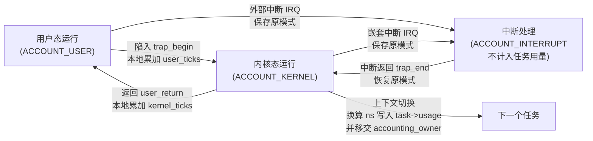

# 任务执行记账、资源限额与 CPU 时钟

准确度量每个线程和进程消耗了多少用户态/内核态 CPU 时间、触发了多少次缺页与块设备 I/O、内存驻留峰值达到多少，并依据用户配置的软硬上限实施配额约束，是操作系统调度公平性、性能分析与多租户隔离的共同基础。

BoarOS 将**热路径无锁硬件计数**、**线程组聚合历史**、**16 项 POSIX/Linux 资源限额（`rlimit`）**以及 **CPU 执行时间时钟**统一构建在同一套单调硬件时间源之上，对外一致服务于 `getrusage(165)`、`wait4`/`waitid`、`times`、`clock_gettime`/`clock_getres`、`/proc/<pid>/{stat,io}` 以及内部公平调度器。

---

## 一、源码组织

| 源码路径 | 核心职责 |
| :--- | :--- |
| `kernel/sched/accounting.c`、`include/kernel/accounting.h` | 每核硬件滴答累计、多核顺序锁（Seqlock）快照、任务切换结算、缺页/I/O/RSS 峰值统计、`getrusage` 格式化与 `PERF_COUNT_SW_CPU_CLOCK` 调度时长 |
| `kernel/sched/cpu_clock.c` | `CLOCK_PROCESS_CPUTIME_ID`、`CLOCK_THREAD_CPUTIME_ID` 及动态 PID/TID `PROF`/`VIRT`/`SCHED` CPU 时钟解析与采样 |
| `kernel/rlimit.c`、`include/kernel/rlimit.h` | 线程组共享 `kernel_resource_limits`（16 项资源限额 + `dead_usage`/`child_usage` 历史归集）与按真实 UID 计费的 `RLIMIT_NPROC` |
| `kernel/sched/proc.c` | `/proc/<pid>` 进程与线程统计快照与权限检查 |

---

## 二、每核时间记账与多核顺序锁快照

如果每次系统调用陷入或返回用户态都去抢占全局调度锁或执行 64 位纳秒除法，会给高频短系统调用带来不可接受的开销。BoarOS 采用**“本地累计硬件滴答 + 切栈/查询时惰性换算纳秒”**策略：

- **三态模式切换**：每个正在执行栈上的任务维护 `accounting_mode`（`ACCOUNT_USER`、`ACCOUNT_KERNEL`、`ACCOUNT_INTERRUPT`）。在常规陷入入口（`kernel_cpu_account_trap_begin`）和最终返回用户态（`kernel_cpu_account_user_return`）的既有本地关中断区间内，当前 CPU 仅读取一次硬件计数器并将差值累加到本核的 `accounting_user_ticks` 或 `accounting_kernel_ticks`，**不获取全局锁、不执行纳秒换算**。硬件中断（IRQ）进入时切入 `ACCOUNT_INTERRUPT`，返回时恢复被打断的模式，从而精准排除中断处理开销。
- **栈归属与切栈交接**：CPU 上的活跃时间片始终归属当前真正运行在该栈上的 `cpu->accounting_owner`。即便调度器已提前选出并发布 `next`，仍要等到物理切栈前的 `scheduler_cpu_time_switch()` 才将本核累计滴答换算为纳秒归入旧任务的 `usage.user_ns`/`usage.kernel_ns`（同时推进公平调度器虚拟运行时间 `scheduler_fair_account()`），并把 `accounting_owner` 移交给新任务。阻塞、排队和睡眠期间均无活跃执行片段；此外 `scheduled_ticks` 另行记录包含中断在内的整段调度占用，供 `kernel_task_scheduled_ns()`（`PERF_COUNT_SW_CPU_CLOCK`）使用。
- **多核无等待读写一致（Seqlock）**：在 `BOAROS_MAX_CPUS > 1` 配置下，每核维护单调递增的 `accounting_sequence`。本地写者在更新计数前将其增为奇数、完成后增为偶数（单核编译时零开销省去），期间只访问常驻结构与硬件计数器，绝不分配或等待。远端查询者先持调度域固定目标任务与 CPU 归属，随后在无锁循环中校验前后偶序列一致并读取快照；RISC-V 多核通过 `arch_time_read_ordered()` 施加时间输入域屏障，确保硬件计数器采样严格落在两次序列读取之间。



---

## 三、全维度用量统计与线程组历史归集

每个任务在 `struct kernel_task_usage` 中独立记录自身指标，而线程组共享的 `struct kernel_resource_limits` 额外保存两份历史汇总：**`dead_usage`**（本组已退出线程的累计用量）和 **`child_usage`**（已回收子进程及其后代的累计用量）。

- **继承与回收规则**：`fork` 复制 16 项限额值并从空的 `dead_usage`/`child_usage` 起步；`clone` 同组线程共享同一份 `kernel_resource_limits`；非组长 `execve` 仅归并原组长尚未合入的自身用量。调用 `waitid(WNOWAIT)` 仅观察退出状态而不归并用量，直到真正消费回收子进程时才计入父组的 `child_usage`。

### 3.1 `getrusage(165)` 与 `/proc/<pid>/io` 字段来源

RV64 与 LA64 均在系统调用 165 提供 `getrusage`，支持 `RUSAGE_SELF(0)`（整组活线程 + `dead_usage`）、`RUSAGE_THREAD(1)`（仅本线程，峰值 RSS 取组内最大）与 `RUSAGE_CHILDREN(-1)`（仅 `child_usage`），原生结构体为 **144 字节**（`wait4`/`waitid` 复用同一快照与格式化逻辑）：

| 统计维度 | 内核采集点与换算口径 |
| :--- | :--- |
| **用户/内核时间**（`ru_utime` / `ru_stime`） | 任务已完成纳秒 + 正在运行 CPU 的未结算片段；`rusage` 换算为微秒，`times`/proc 换算为 100 Hz 用户滴答 |
| **缺页次数**（`ru_minflt` / `ru_majflt`） | 仅记录本线程成功的 MM 缺页（`kernel_task_account_fault`），以原子计数发布 |
| **驻留集峰值**（`ru_maxrss`） | 实际安装用户页表项（含普通页与 `PROT_NONE` 保护页）时更新 MM 高水位，解除映射不回落；MM 释放前与 `exec` 均保留峰值，输出单位为 KiB（`maxrss_pages * (PAGE_SIZE / 1024)`） |
| **块层 I/O**（`ru_inblock` / `ru_oublock`） | 块层提交逻辑读（含分区与 loop 设备）及同步块写按字节记给原调用者；磁盘页缓存首次变脏时记一页写（重复写同一脏页不重复计，tmpfs 不计）；除以 512 换算为扇区数，后台执行沿 `io_context->account_task` 归属 |
| **字符/调用计数**（`/proc/<pid>/io`） | `kernel_task_account_io_return()` 记录 `rchar`/`wchar`/`syscr`/`syscw`；截断已脏页等取消的写入记录于 `cancelled_write_bytes` |
| **上下文切换**（`ru_nvcsw` / `ru_nivcsw`） | 实际切出时计数：因阻塞、停止或退出切出计自愿切换（`voluntary`），处于可运行态被抢占切出计非自愿切换（`involuntary`）；未发生切换的 `yield` 不计数 |

> 注：Linux 规范中固定保留为零的 `ru_ixrss`/`ru_idrss`/`ru_isrss`/`ru_nswap`/`ru_msgsnd`/`ru_msgrcv`/`ru_nsignals` 字段始终输出 `0`。

### 3.2 16 项资源限额默认配额与 `RLIMIT_NPROC`

`kernel_resource_limits_create()` 为初始线程组建立全部 16 项 `RLIMIT_*` 配额：

| 资源项 | 默认软限额（`current`） | 默认硬限额（`maximum`） |
| :--- | :--- | :--- |
| `RLIMIT_STACK` | `8 MiB`（`0x800000`） | `RLIM_INFINITY` |
| `RLIMIT_NOFILE` | `1,024` | `1,024` |
| `RLIMIT_NPROC` | `4,096` | `4,096` |
| `RLIMIT_SIGPENDING` | `4,096` | `4,096` |
| `RLIMIT_MEMLOCK` | `8 MiB` | `8 MiB` |
| `RLIMIT_MSGQUEUE` | `819,200` 字节 | `819,200` 字节 |
| `RLIMIT_CORE` | `0` | `RLIM_INFINITY` |
| `RLIMIT_NICE` / `RLIMIT_RTPRIO` | `0` | `0` |
| 其余项（`CPU`/`FSIZE`/`DATA`/`RSS`/`AS`/`LOCKS`/`RTTIME`） | `RLIM_INFINITY` | `RLIM_INFINITY` |

`RLIMIT_NPROC` 按真实 UID 账户记账：派生新任务前通过 `kernel_nproc_acquire()` 预扣名额（超级用户或具备 `CAP_SYS_RESOURCE`/`CAP_SYS_ADMIN` 不受限）；若调用 `setuid` 切换真实 UID 导致目标账户超限，`setuid` 本身仍成功但打上 `KERNEL_RESOURCE_NPROC_EXCEEDED` 标记，随后在 `execve` 时由 `kernel_nproc_exec()` 拦截并返回 `-EAGAIN`。

---

## 四、进程与线程 CPU 时钟

`clock_gettime` 与 `clock_getres` 直接复用上述执行时间快照，在发起 CPU 本地完成查询（无需触及远端 MM）：

- **支持的时钟类型**：静态时钟 `CLOCK_PROCESS_CPUTIME_ID(2)` 与 `CLOCK_THREAD_CPUTIME_ID(3)`，以及 Linux 负值位编码的动态进程/线程时钟（`PROF`、`VIRT`、`SCHED`）。
- **统计口径与分辨率**：`VIRT` 仅统计用户态时间，`PROF` 与 `SCHED` 统计用户态与内核态时间之和（均排除中断与睡眠）。`SCHED` 分辨率为 `1 ns`，`PROF`/`VIRT` 分辨率为 `100 Hz`（`10 ms`）。间隔定时器（`ITIMER_VIRTUAL`/`ITIMER_PROF`）复用同一统计基础，详见[时钟与定时器](kernel-time.md)。
- **目标解析与并发重查**：`clockid_t` 按 32 位有符号整数解码。PID 0 表示自身；线程时钟限定同线程组内成员；进程时钟接受 TGID（`clock_gettime` 另允许传入调用者自身 TID，`clock_getres` 按 Linux 权限规则仅接受 TGID）。采样前先持 `kernel_pid` 引用并借用目标任务存储，采样完毕后复核角色归属——若期间因非主线程 `execve` 导致 TGID 容器转移，则自动放弃旧容器快照并重试新容器；若目标已被回收则返回 `-EINVAL`。

---

<details>
<summary>展开查看：边界契约与定向验证命令</summary>

### 关键边界语义

- `getrusage` 的 `who` 按 32 位有符号整数解析，非法 `who` 先返回 `-EINVAL` 再检验输出指针；输出拷贝遇页故障返回 `-EFAULT` 并保留已复制前缀。
- `wait4`/`waitid` 在消费退出事件后按固定顺序复制状态、rusage 与 `siginfo`，用户地址拷贝失败不回滚已完成的子进程回收。
- 涉及 MM 驻留峰值（`scheduler_usage_snapshot_mm`）的查询在 CPU0 与关中断保护下分别获取调度域与 MM 锁，不分配内存、不休眠；不涉及 MM 的 CPU 时钟与 `times` 直接在调用核无迁核完成。

### 定向验证命令

```sh
# rusage / wait 资源快照与双架构同 ELF 差分
make test-resource-abi-riscv test-resource-abi-loongarch
make test-resource-smp-riscv QEMU_RISCV_FIRMWARE=/absolute/fw_dynamic.bin
make test-sched-concurrency-host test-user-smp-host

# 进程/线程 CPU 时钟双架构差分与并发回收/非组长 exec 组合测试
make test-usage-abi-riscv test-usage-abi-loongarch TEST_MEMORIES="512M 1G"
make test-usage-smp-riscv test-cpu-clock-process-smp-riscv QEMU_RISCV_FIRMWARE=/absolute/fw_dynamic.bin
```

性能开销实测与复测方法另见[CPU 记账成本](../learning/cpu-accounting-cost.md)。

</details>
