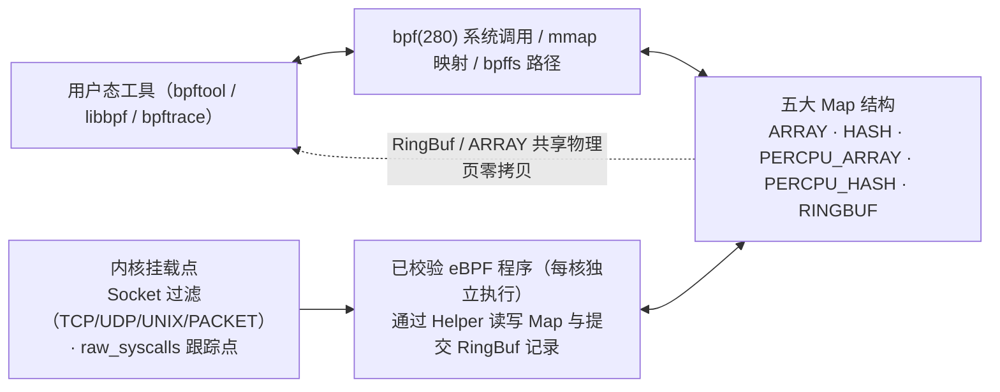

# eBPF 子系统与系统调用跟踪

扩展伯克利包过滤器（Extended Berkeley Packet Filter，eBPF）允许用户态程序在经过内核严格静态安全验证后，以沙箱字节码的形式动态注入内核执行，用于高性能网络包过滤、系统调用追踪与可观测性分析。

BoarOS 在 `kernel/bpf/` 中为 RISC-V 64 与 LoongArch 64 实现了一套**双架构完全共享的 eBPF/cBPF 子系统**，包含静态安全校验器、每核独立解释器、五大标准映射结构（Map）、BPF 文件系统（`bpffs`）、基于内核自身调试信息自动生成的 **BPF 类型格式（BPF Type Format，BTF）**，以及面向 `raw_syscalls` 的跟踪点与软件 CPU 时钟计数器，可直接运行未经修改的上游 **`bpftool`、`libbpf` 与 `bpftrace`**。

---

## 一、源码组织

| 源码路径 | 核心职责 |
| :--- | :--- |
| `kernel/bpf/syscall.c`、`objects.c` | `bpf(280)` 系统调用入口、对象引用计数与全局 ID 索引、冻结（Freeze）与权限校验 |
| `kernel/bpf/verify.c`、`classic.c` | eBPF 路径敏感静态校验器、常量折叠、经典 cBPF DAG 校验与指令翻译 |
| `kernel/bpf/vm.c`、`runtime.c`、`program.c` | 统一 eBPF 字节码解释器、每核预分配无锁执行工作区、辅助函数（Helper）与 `PROG_TEST_RUN` |
| `kernel/bpf/maps.c`、`ringbuf.c` | `ARRAY`、`HASH`、`PERCPU_ARRAY`、`PERCPU_HASH` 与零拷贝共享环形缓冲 `RINGBUF` |
| `kernel/bpf/btf.c`、`tools/embed-btf.py` | BTF v1 解析、类型环路校验、映射/程序绑定以及内核 ELF 的内嵌 `vmlinux` BTF 管线 |
| `kernel/bpf/trace.c`、`fs/bpffs.c` | `perf_event_open(241)` 跟踪点绑定、软件 CPU 时钟计数器与 `bpffs` 对象持久化挂载 |

---

## 二、安全校验器与每核独立解释器

### 2.1 静态校验器（`kernel/bpf/verify.c`）

所有 eBPF 程序在加载发布前必须通过静态校验器验证，确保字节码绝不会越界读写内核内存、解引用空指针、陷入死循环或泄漏未初始化内核栈数据：

- **寄存器与栈精确追踪**：逐指令跟踪全部 11 个通用寄存器与每帧 **512 字节**（`KERNEL_BPF_STACK_SIZE`）栈帧的初始化位图、标量上下界、指针来源与偏移范围、可空 Map 指针判空检查、上下文访问边界以及 RingBuf 预留句柄的配对提交/丢弃。
- **有界复杂度与调用深度**：支持最多 **16 层**子程序调用帧（`KERNEL_BPF_MAX_FRAMES = 16`，拒绝递归），静态验证指令复杂度上限为 **1,000,000** 条（非特权程序指令数上限 `4,096`）；有界循环必须在加载时证明可终止。
- **只读冻结数组常量推导**：当单元素 `ARRAY` Map 具有 `BPF_F_RDONLY_PROG` 标志且已通过 `BPF_MAP_FREEZE` 冻结（且当前无任何用户态可写映射）时，校验器在加载期直接将其读取结果折叠为精确常量标量，满足现代 `libbpf` 全局只读数据段（`.rodata`）的校验需求。
- **经典 cBPF 兼容（`classic.c`）**：传统套接字过滤程序（最多 `4,096` 条指令）先通过有限前向无环图（DAG）与初始化校验，再通过 `kernel_bpf_classic_convert()` 转换为同一套 eBPF 解释器字节码执行。

### 2.2 每核预分配工作区执行

程序加载校验通过后即完成所有 Map 引用绑定，并为每个处理器核预分配独立的执行工作区（`struct execution`，内含虚拟机寄存器上下文、最多 64 项 RingBuf 预留表与运行区）。运行时在禁止抢占上下文中直接调用 `kernel_bpf_vm_execute()`，不持有对象索引锁或跟踪登记锁，保证多核并发执行互不干扰且低延迟。

---

## 三、数据映射（Map）、共享环形缓冲与 `bpffs`



- **支持的 Map 类型**：
  - `ARRAY`（1）与 `PERCPU_ARRAY`（5）：连续索引数组，支持 `BPF_F_MMAPABLE` 连续物理页映射（供全局变量/只读数据段共享）与 `BPF_MAP_FREEZE` 冻结；
  - `HASH`（2）与 `PERCPU_HASH`（6）：预分配哈希表，支持原子 `LOOKUP_AND_DELETE`；并发删除或替换时将仍被运行中程序借用的旧值延迟至执行结束后回收；
  - `RINGBUF`（27）：采用 Linux 标准共享页布局（1 页消费者指针 + 1 页生产者指针 + 连续两次映射的数据页环），通过 `BUSY`/`DISCARD` 头部状态原子发布记录，并接入 `poll`/`epoll` 等待队列，实现内核向用户态的高吞吐零拷贝事件流传输。
- **批量操作与持久化挂载**：普通与 Per-CPU Map 均支持 `*_BATCH` 批量读写/删除；通过 `bpffs`（魔数 `0xcafe4a11`）的 `BPF_OBJ_PIN` / `BPF_OBJ_GET`，可将程序、Map、BTF 与 Link 持久化挂载到文件系统路径，解除对原进程文件描述符的依赖。

---

## 四、真实内核 BTF 管线、套接字过滤与系统调用跟踪

### 4.1 由 BoarOS 自身构建自动生成的 BTF

不同于硬编码伪造一份 Linux 结构体的做法，BoarOS 在构建流程中真正打通了完整的 BTF 工具链：
1. 编译内核生成带完整 DWARF 调试信息的 ELF；
2. 由离线构建或系统安装的 `pahole` 从本次编译出的 BoarOS 内核 ELF 直接提取生成真实二进制 BTF；
3. `tools/embed-btf.py` 将其嵌入最终内核段 `__boaros_btf_start..__boaros_btf_end`；
4. 运行时通过 `sysfs` 以只读共享页暴露于 `/sys/kernel/btf/vmlinux`，同时 `BPF_BTF_LOAD`（上限 16 MiB）支持校验加载用户态 BTF（检查 19 类类型定义、值依赖图无环性与位域边界）并绑定至 Map 和程序。

### 4.2 套接字过滤、跟踪点与线程软件时钟

- **套接字过滤（`BPF_PROG_TYPE_SOCKET_FILTER`）**：支持 `SO_ATTACH_FILTER` / `SO_ATTACH_BPF` / `SO_LOCK_FILTER`（TCP `accept` 自动继承过滤器与锁定状态）。UDP/TCP 在协议状态机变化前执行，直接跨 `pbuf` 链读取报文载荷而无需拼装完整副本；同时支持 `BPF_PROG_TEST_RUN` 离线测试以太网/三层输入。
- **`raw_syscalls` 系统调用跟踪点**：`tracefs` 暴露真实的 `events/raw_syscalls/sys_enter` 与 `sys_exit` 事件 ID 和字段格式。用户通过 `perf_event_open(241)`（`PERF_TYPE_TRACEPOINT`）创建事件，再用 `PERF_EVENT_IOC_SET_BPF` 或现代 `BPF_LINK_CREATE` 挂载最多 64 个 eBPF 程序；钩子分别位于公共分派入口 `kernel_bpf_trace_enter()` 与架构返回边界 `kernel_bpf_trace_exit()`（在信号处理前记录真实返回值，包括 `-ERESTART*`）。
- **单线程软件 CPU 时钟计数器**：`perf_event_open(241)` 同时支持 `PERF_TYPE_SOFTWARE` + `PERF_COUNT_SW_CPU_CLOCK`（`cpu = -1`），利用调度器实际运行权交接记录的线程累计调度纳秒数（`kernel_task_scheduled_ns`），支持启停、清零、`PERF_FORMAT_ID` 读取及跨核迁移跟随，线程退出后仍可读出最终累计值。

---

<details>
<summary>展开查看：权限控制、支持范围边界与定向验证入口</summary>

### 权限、辅助函数与当前边界

| 项目 | 当前实现规则 |
| :--- | :--- |
| **特权与开关** | 加载特权程序与 Map 检查 `CAP_BPF`，跟踪检查 `CAP_PERFMON`（同时兼容 `CAP_SYS_ADMIN`）；`/proc/sys/kernel/unprivileged_bpf_disabled` 默认值 `2`，特权用户可在 `0`/`2` 间切换，置 `1` 后不可逆关闭。 |
| **支持的程序类型** | `SOCKET_FILTER`、`TRACEPOINT`、`RAW_TRACEPOINT` 以及供工具能力探测使用的 `KPROBE` 加载；尚未接入即时编译（JIT）、`XDP`/`TC`、硬件性能监控单元（PMU）以及真实 `kprobe`/`uprobe`/`fentry` 挂载。 |
| **内置 Helper 集合** | Map 查找/更新/删除、单调/启动时间、PID/TID、UID/GID、`comm`、当前 CPU、跨片段报文读取、无缺页内存探测（`nofault`，不触发磁盘 I/O）以及 RingBuf 预留/提交/丢弃/输出/查询。 |

### 定向验证入口

- **宿主校验器、Map、BTF 与执行器验证**：`make test-bpf-host`、`tests/host/bpf-btf.sh`（可直接检验真实生成的 `vmlinux.btf` 及损坏反例）。
- **原版上游工具链验证（`bpftool` / `libbpf` / `bpftrace`）**：
  ```sh
  python3 tests/workloads/bpf/build.py --help
  python3 tests/workloads/bpf/linux.py --help
  ```
- **内核 BTF 离线工具链**：默认由 `tools/build-pahole.py` 静态链接 `libdw`/`libelf`/`libbpf` 构建并缓存于 `build/tools/pahole/`；已有系统 `pahole` 时可传 `PAHOLE=pahole`。

</details>
