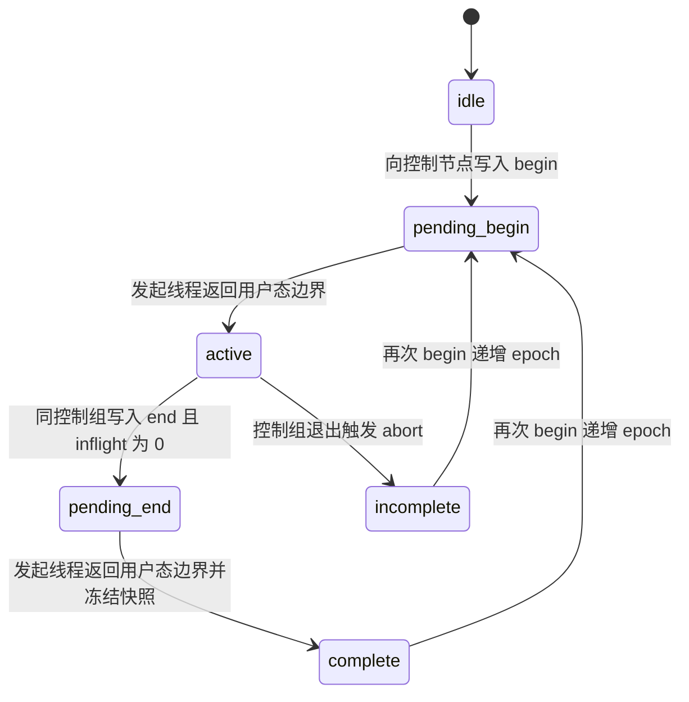

# 内核成本观测框架（`COST_DIAGNOSTICS`）

在优化操作系统吞吐与尾延迟时，单看宏观耗时往往只能看到“慢”，却看不出时间究竟花在系统调用固定开销、锁自旋排队、页表编辑、块设备等待还是跨核唤醒上。BoarOS 内建了一套面向归因分析的内核成本观测框架（通过构建选项 `COST_DIAGNOSTICS=1` 开启，`BOAROS_COST_DIAGNOSTICS` 宏控制）：**默认生产构建完全剔除采样指令与静态存储，零运行期开销**；开启后可在真实工作负载上按业务边界精确记录三通道计数、阶段耗时与 65 桶对数直方图。

> **测量纪律**：成本观测构建用于解释“开销去哪了”；正式的吞吐、延迟与版本前后对比始终使用关闭诊断的生产内核，避免将观测器本身的时间混入最终成绩。

---

## 一、源码组织与内存预算

| 源码路径 | 核心职责 |
| :--- | :--- |
| `include/kernel/cost.h`、`include/kernel/cost.def` | 观测宏（`COST_ADD`/`COST_SAMPLE`/`COST_SCOPE`/`COST_IO_SCOPE`）与全部版本 1 指标清单（名称、单位及是否带直方图） |
| `kernel/cost.c` | 静态聚合表、三通道归属、65 桶 log₂ 直方图、窗口状态机（`idle`/`active`/`complete`/`incomplete`）、多核关中断区间截断与文本快照格式化 |
| `kernel/sched/cost.c` | 与调度器、任务生命周期、系统调用抑制及 `/proc/boaros_cost_control` 控制节点的桥接 |

框架在编译期以 `_Static_assert` 严格锁定诊断自身的内存上限：
- 每任务诊断扩展（含 6 个内联请求守卫及 `USER_SMP` 服务时间戳）：`KERNEL_COST_TASK_BYTES <= 160` 字节；
- 每核边界结构 `struct kernel_cost_cpu`：固定 `136` 字节；
- 全局静态聚合区（三通道全部计数器、直方图桶、元数据表及所有核状态之和）：`cost_storage <= 100 KiB`。

观测结构只存标量代次（`epoch`）与计数，**绝不持有**任务、MM、inode 或 OFD 指针；热路径不分配内存、不打印、不休眠。

---

## 二、观测窗口控制与三通道归属

诊断内核通过两个 `/proc` 接口控制测量窗口并导出结构化快照：

### 2.1 `/proc/boaros_cost_control` 与 `/proc/boaros_cost`

- **精准对齐用户态边界**：写入完整 `begin\n` 或 `end\n`（先完成用户输入拷贝再切换状态，防止半条命令）不会立即在系统调用中途启停，而是延迟到**发起线程自身返回用户态的最后边界**（`kernel_cost_boundary()`）才正式开始或冻结窗口，其他核的用户态返回不会替它触发。
- **控制组归属与校验**：窗口归属发起线程组及其所有后代（`fork`/`clone` 继承 `epoch`，`exec` 保留）。重复 `begin` 返回 `-EBUSY`；非控制组写入 `end` 返回 `-EPERM`；若仍有在途操作（`inflight > 0`），`end` 返回 `-EBUSY`，防止丢弃半截请求伪造完整窗口。控制组提前退出时窗口自动中止并标记 `state=incomplete`。
- **快照读取**：窗口运行期间读取 `/proc/boaros_cost` 返回 `-EBUSY`；结束或中止后返回键值对文本快照（包含时钟频率、分辨率、实际内存占用、`overflow` 标志及各通道完整指标）。

### 2.2 三条归属通道（Lanes）与直方图

所有指标均按执行上下文归入三条互不混淆的通道：

1. **`foreground`（前台业务）**：属于当前窗口控制组及后代线程的直接内核执行；
2. **`background`（后台执行）**：独立内核工作线程（如块回写、TCP 协议工作线程、后台内存回收等），避免把前台写者的 CPU 时间误当成全部内核开销；
3. **`observer`（观测开销）**：观测器自身获取聚合锁与记账耗费的时钟滴答（它是运行时间的一部分，用于自检观测扰动，不可再重复叠加到总运行时间）。

需要分布特征的耗时类指标（`cost.def` 中第 4 列标记为 `1`）自带 **65 桶对数直方图**：第 0 桶独立统计 `0` 值，第 1～64 桶按 2 的幂区间划分；计数发生 64 位溢出时执行饱和并置位 `overflow=1`（存在 `incomplete`、`overflow` 或未排空 `inflight` 的窗口不得用作正式对照）。

---

## 三、核心指标分类与读数约束

完整指标清单及单位以 `include/kernel/cost.def` 为单一事实来源，由 `tests/cost/cost_report.py` 严格按版本 1 Schema 解析。以下归纳主要指标域及解读注意事项：

| 指标域 | 代表性指标 | 含义与解读边界 |
| :--- | :--- | :--- |
| **执行与调度** | `operations`、`run_ticks`、`blocked_ticks`、`ready_ticks`、`wake_to_run`、`idle_ticks`、`sched_ipi_*` | 区分真实 CPU 运行、阻塞等待与唤醒后就绪排队；`operation_ticks` 可含睡眠与嵌套子阶段，不能直接相加成整次墙钟 |
| **中断与锁分层** | `irq_off_ticks`、`raw_wait_ticks`/`raw_hold_ticks`、`lock{10,15,20,21,30,31,32,35,40,45}_*`、`lock_spin_ticks`、`lock_grant_run_ticks` | 按锁等级分开统计尝试、获得、阻塞、唤醒、重阻、等待与持有；多任务累计值可超过墙钟 |
| **内存与缺页** | `mm_fault_ticks`、`mm_cow_copy_ticks`、`mm_page_alloc_ticks`、`mm_sync_ticks`、`mm_activate_instruction_flushes`、`vma_*`、`rfence_calls` | `mm_fault_ticks` 覆盖共同缺页解析含等待；`mm_cow_copy_ticks` 仅计私有页复制；`mm_sync_ticks` 覆盖显式提交与预装同步；`rfence_calls` 为真实 SBI RFENCE 调用次数 |
| **路径、缓存与存储** | `file_query_ticks`、`path_fallback_ticks`、`cache_queue_ns`/`cache_execute_ns`、`block_cache_*`、`journal_*`、`device{0,1}_*` | 区分页缓存入队等待与工作线程执行（后者仍可含锁或设备等待）；日志阶段区分有序数据/日志正文、提交与检查点，设备请求完成不等于全部持久化 |
| **网络与 TCP** | `network_ip_lock_ticks`、`network_tcp_lock_ticks`、`tcp_input_{queue,before_lock,lock,after_lock,process}_ticks`、`tcp_worker_wake_to_run_ticks`、`net_tx_post_done_ticks` | 拆解报文入队到协议处理的三段锁前/取锁/锁后耗时、归属核工作线程唤醒延迟与网卡发送完成耗时；并发请求计时可能重叠 |

---

## 四、基于观测数据的性能归因方法

在实际定位瓶颈与评估优化收益时，结合观测指标可遵循以下分析框架：

1. **按调用链识别放大与复杂度**：以系统调用或缺页为根，对比父子调用次数之比定位嵌套循环放大，结合每次请求遍历的条目数核对算法复杂度——例如有序 VMA 数组编辑拆分为二分定位 `O(log N)`、覆盖检查 `O(K)`、邻域合并与后缀搬移 `O(N)`；缺页预读窗口对比逐页查找 `O(W log N)` 与持锁范围遍历 `O(log N + W + K)`；目录路径查找区分热路径索引比较 `O(D log N · L)` 与冷路径磁盘加载。
2. **区分独占 CPU 与等待时间**：用 `调用次数 × 平均独占 CPU 时间` 估算真实 CPU 消耗，锁争用与设备等待另行归因。对于可睡眠读写锁，将内部短锁（仅保护元数据与等待队列）、自旋时间、业务排队与唤醒到运行的延迟独立计量。
3. **版本前后变化拆解**：对前后两版同类样本，将总开销变化拆分为**次数贡献** `(后版次数 − 前版次数) × 前版均值` 与**单次贡献** `后版次数 × (后版均值 − 前版均值)`。重构路径入口（如将短写锁改为原子快路径）时保持同一逻辑动作的统计口径，最终以生产构建的端到端吞吐、尾延迟与内核 CPU 耗时验收。

---

展开查看：构建产物与实验工具入口

- **观测内核构建产物**：RV64 单核观测内核位于 `build/cost/kernel-rv`；`USER_SMP` 观测内核位于 `build/cost-smp<容量后缀>/`。
- **严格 Schema 解析器**：`tests/cost/cost_report.py` 对快照的字段完整性、唯一性、单位、直方图桶数与窗口状态执行严格校验。
- **专项预算实验脚本**：
  - 存储与 TCP 数据路径实验：`tests/cost/io-budget-experiment.py`、`tests/cost/network-budget-experiment.py`（方法与完成条件见[数据路径实验工具](../learning/data-path-budget-experiments.md)）。
  - CPU 记账、线程与定时器开销测量：`tests/cost/accounting/cost.py`（见[CPU 记账成本](../learning/cpu-accounting-cost.md)）。

