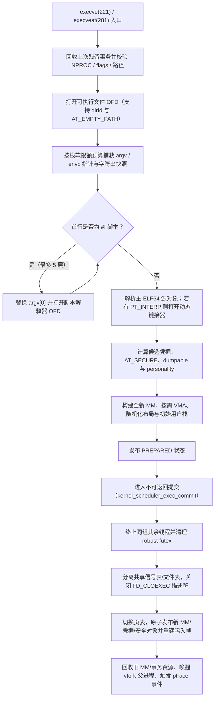

# 进程映像替换（`execve` / `execveat`）

程序装载与进程映像替换是操作系统从静态可执行文件过渡到活跃用户态执行流的关键桥梁。在 POSIX 与 Linux 接口中，`execve(221)` 和 `execveat(281)` 在保留当前进程标识符（Process Identifier，PID）、打开文件状态（非 `FD_CLOEXEC`）与工作目录的前提下，原子地销毁旧的地址空间并替换为全新程序映像。

BoarOS 将整个过程严格划分为**可回滚的准备阶段**与**不可返回的提交阶段**，在 RISC-V 64 位（RV64）和龙芯架构 64 位（LoongArch 64，LA64）上共享同一套事务状态机、脚本展开器、凭据计算器和可执行与可链接格式（Executable and Linkable Format，ELF）装载管线。ELF 只读源对象与按需缺页机制另见[用户 ELF64 装载模块](user-elf.md)，线程组与内存管理对象生命周期见[内核调度与进程生命周期模块](kernel-scheduler.md)。

---

## 一、源码组织

| 源码路径 | 核心职责 |
| :--- | :--- |
| `kernel/exec.c`、`include/kernel/exec.h`、`kernel/exec_internal.h` | 事务容器（`kernel_exec_transaction`）、用户路径与 `argv`/`envp` 捕获、`execveat` 目录描述符解析、`#!` 脚本展开及主程序/解释器打开 |
| `kernel/exec_credentials.c` | 依据最终主 ELF 的属主、模式位与扩展属性计算候选凭据（`setuid`/`setgid`、文件能力）、`AT_SECURE` 与 `dumpable` |
| `kernel/exec_image.c`、`include/kernel/exec_image.h`、`kernel/elf_image.c` | 调用共用 `kernel_elf_image_build()` 构造新内存描述符（Memory Management，MM）、虚拟内存区域（Virtual Memory Area，VMA）、初始用户栈与辅助向量（Auxiliary Vector，auxv） |
| `kernel/sched/exec.c` | 不可返回提交边界：终止同组其他线程、清理健壮互斥锁链表、关闭 `FD_CLOEXEC`、激活新页表、原子发布新 MM 与凭据、重建陷入帧（Trap Frame）并通知 `vfork` 与 `ptrace` |
| `include/arch/elf.h`、`include/arch/task.h` | 构建期绑定的架构常量（如 `ARCH_ELF_MACHINE`）与初始/替换后寄存器初始化 |
| `kernel/syscall/process.c` | 系统调用 221（`execve`）与 281（`execveat`）解码与提交入口 |

---

## 二、两阶段事务流程与多核分工

为确保任何参数拷贝错误、权限不足、文件损坏或内存耗尽都不会破坏调用进程原有的地址空间与文件表，BoarOS 用 `struct kernel_exec_transaction` 管理完整生命周期（`PREPARING` → `PREPARED` → `COMMITTED_CLEANUP` / `ABORTED_CLEANUP` → `EMPTY_CLEANUP`）。在多核（Symmetric Multiprocessing，SMP）环境下，参数捕获、脚本展开、ELF 解析与新 MM 构建均在**调用核本地**并发完成；直到进入不可返回提交阶段才切入受控 CPU0 服务域，协调线程组退出与全局资源切换。



### 2.1 `execveat` 与路径身份

`kernel_execve_prepare()` 是以 `AT_FDCWD`（当前工作目录）和零标志调用 `kernel_execveat_prepare()` 的薄封装。对于 `execveat`：

- **空路径执行（`AT_EMPTY_PATH`）**：允许直接执行一个已打开的普通文件或仅路径描述符（`O_PATH`）。内核直接复用该打开文件描述（Open File Description，OFD）持有的虚拟文件系统（Virtual File System，VFS）路径身份，而不拼接 `/proc/self/fd/...` 重新查找；即使文件在打开后被重命名、删除或挂载点被移动，仍能准确执行原对象，并按**当前执行者凭据**重新校验执行权限与挂载点的 `MS_NOEXEC` 标志。
- **脚本路径命名**：若通过非 `AT_FDCWD` 的相对路径或空路径执行 `#!` 脚本，内核为解释器和 `AT_EXECFN` 生成 `/dev/fd/<dirfd>/<路径>` 或 `/dev/fd/<dirfd>` 名称；若 `dirfd` 带有 `FD_CLOEXEC`（执行时关闭）标记，脚本解释器启动后将无法再按该描述符打开脚本，因此内核直接拒绝并返回 `-ENOENT`，而 ELF 二进制可直接映射已打开文件，不受此限制。

### 2.2 参数与环境变量容量预算

为了避免超长参数耗尽新进程的用户栈空间，BoarOS 遵循 Linux 的动态参数预算公式（`kernel_exec_argument_limit()`）：

$$\text{budget} = \max\left(128\ \text{KiB},\ \min\left(\frac{\text{RLIMIT\_STACK}_{\text{soft}}}{4},\ 6\ \text{MiB}\right)\right)$$

其中默认的栈软限制 `KERNEL_RLIMIT_STACK_DEFAULT` 为 `8 MiB`（对应预算 `2 MiB`），硬上限固定为 `6 MiB`（`KERNEL_RLIMIT_STACK_DEFAULT / 4 * 3`）。单个字符串上限为 `KERNEL_EXEC_STRING_PAGES`（32 个目标架构页），即 RV64（4 KiB 页）为 `128 KiB`、LA64（16 KiB 页）为 `512 KiB`。

捕获阶段先扫描 `argv` 与 `envp` 指针数组并扣除其 64 位指针开销（空 `argv` 仍计 1 个空串指针），再导入字符串正文与 `AT_EXECFN`；`#!` 脚本展开沿用原指针预算并回收被丢弃的旧 `argv[0]` 字节空间。任何越界（`-E2BIG`）、非法地址（`-EFAULT`）或内存不足（`-ENOMEM`）都在进入提交前清理事务并返回错误，旧进程映像毫发无损。

---

## 三、执行凭据、文件能力与安全装载

可执行文件可能携带特权提升属性，例如设置用户标识符（`setuid`，模式位 `04000`）、设置组标识符（`setgid`，需同时具备组执行位 `02010`）以及存储在 ext4 扩展属性 `security.capability` 中的细粒度文件能力（File Capabilities）。

- **身份来源**：只有最终被装载的**主 ELF 文件**决定新凭据。`#!` 脚本自身的 `setuid`/`setgid` 位会被忽略；动态链接器（`PT_INTERP`）仅负责加载，其权限位不会替代主程序。
- **能力计算公式**：`kernel_exec_credentials_prepare()` 支持版本 1（12 字节）、版本 2（20 字节）与版本 3（24 字节，初始命名空间下要求 `rootid == 0`）的扩展属性格式，按以下公式计算新允许能力集（Permitted）：
  $$P_{\text{new}} = (B \mathbin{\&} P_{\text{file}}) \mid (I \mathbin{\&} I_{\text{file}})$$
  其中 $B$ 为能力边界集（Bounding），$I$ 为可继承集（Inheritable）。若文件能力启用了有效标志（Effective）但边界集裁剪了部分 $P_{\text{file}}$，则拒绝执行并返回 `-EPERM`。随后按超级用户兼容规则（受 `SECBIT_NOROOT` 约束）、不安全执行限制及环境能力集（Ambient）收口，并清除 `SECBIT_KEEP_CAPS` 位。
- **不安全执行与特权抑制**：若挂载点带有 `MS_NOSUID`、线程已启用不可提权标记（`no_new_privs`）、文件系统上下文与线程组外进程共享（`CLONE_FS`），或当前正被不具备 `CAP_SYS_PTRACE` 能力的跟踪者调试（`kernel_ptrace_exec_unsafe()`），内核会抑制提权增益。组内共享 `CLONE_FS` 时，事务通过 `kernel_fs_context_exec_begin()` 登记执行锁，阻止准备期间有组外进程新加入共享。
- **`AT_SECURE` 与 `dumpable` 分离**：两者独立计算。`AT_SECURE` 通过辅助向量通知动态链接器开启安全装载模式（忽略 `LD_PRELOAD` 等敏感环境变量）；`dumpable` 则保存在独立的 `kernel_exec_security` 对象中（共享 MM 的线程与 `vfork` 子进程共用，并在进程退出为僵尸后仍保留至最后查询结束），综合考量旧身份关系、主程序与解释器是否可读以及权限是否提升，决定其他进程能否通过 `ptrace` 或 `/proc` 访问该映像。
- **关联属性清理**：当 `setuid`/`setgid` 生效时清除 `personality` 中的受限标志（`KERNEL_PERSONALITY_CLEAR_ON_SETID`）；当 `AT_SECURE` 为真时清除父进程死亡信号（`parent_death_signal`）。

---

## 四、新映像布局与不可返回提交

### 4.1 统一双架构 ELF 装载

`kernel_exec_image_prepare()` 通过构建期绑定的页表分配器调用 `kernel_elf_image_build()`，在 RV64（Sv39，4 KiB 页）与 LA64（16 KiB 页）上统一支持非位置无关可执行文件（`ET_EXEC`，含或不含 `PT_INTERP`）与位置无关可执行文件（Position-Independent Executable，PIE，`ET_DYN`，含或不含 `PT_INTERP`）：

- **按需映射与防检查-使用竞态（TOCTOU）**：程序头表在创建只读 `kernel_elf64_source` 时只解析一次，避免运行中文件内容变化导致不一致。`PT_LOAD` 段不立即拷贝整个文件，而是登记为 `ELF_PRIVATE` VMA，完整文件页复用页缓存与写时复制（Copy-on-Write，COW），文件末尾与未初始化数据段（BSS）按需分配零页。新建可执行页在架构层完成地址转换缓存刷新与指令缓存同步（RV64 执行 `SFENCE.VMA` / `FENCE.I`，LA64 执行 `INVTLB` / `IBAR`）。
- **地址空间随机化与初始栈**：内核为 PIE 基址、解释器基址、`mmap` 基址、用户栈、堆顶（`brk`）与虚拟动态共享对象（Virtual Dynamic Shared Object，vDSO）注入独立随机偏移，在初始 16 字节对齐栈上填入 `argc`、`argv`、`envp` 以及完整的 `AT_PHDR`、`AT_BASE`、`AT_ENTRY`、`AT_HWCAP`、`AT_RANDOM`、`AT_EXECFN`、`AT_SYSINFO_EHDR`、`AT_UID`/`AT_EUID`/`AT_GID`/`AT_EGID` 与 `AT_SECURE`。

### 4.2 不可返回提交边界

当 `kernel_scheduler_exec_commit()` 校验新 MM 上下文、入口可执行 VMA 以及用户栈可读写权限和 16 字节对齐无误后，进入不可返回点：

1. **线程组收敛**：若当前进程是多线程组，先终止其余成员并等待其资源与调用栈回收；若调用者并非原线程组组长，则接管原线程组标识符（Thread Group Identifier，TGID）与父子树位置，并释放旧线程标识符（Thread Identifier，TID）。
2. **解绑旧共享状态**：在旧地址空间上使用原 TID 清理健壮快速用户态互斥锁（Robust Futex）链表，分离与其他进程共享的信号动作表与文件描述符表，随后注销旧 MM 使用者并关闭所有标记为 `FD_CLOEXEC` 的槽位。
3. **原子切换与现场重建**：激活新地址空间页表，在调度域短锁内一次性替换 `thread->mm`、`thread->credentials`、`thread->exec_security` 与 `thread->personality`（继承原有 `coredump_filter`，清除 `fork_no_exec`），更新进程名 `comm`，清零浮点/向量寄存器并重建指向新入口与新栈顶的陷入帧，按 POSIX 规则重置信号处置动作。
4. **收尾与外部通知**：唤醒等待旧地址空间归还的 `vfork` 父进程，尝试清理旧 MM 与事务临时资源（若底层设备关闭失败则保留事务对象延后重试，不影响新映像已成功的事实），最后触发 `kernel_ptrace_exec()` 通知调试器。

---

<details>
<summary>展开查看：边界语义契约与定向验证命令</summary>

### 关键边界与错误优先级

- **`execveat` 参数与错误顺序**：`dirfd` 与 `flags` 按 32 位有符号/无符号整数截断；未知标志（仅允许 `AT_EMPTY_PATH`、`AT_SYMLINK_NOFOLLOW`）返回 `-EINVAL`。`RLIMIT_NPROC` 超限与非法标志错误优先于路径名读取错误返回；未指定 `AT_EMPTY_PATH` 时的空路径返回 `-ENOENT`；路径和文件打开错误优先于 `argv`/`envp` 导入错误。
- **`#!` 脚本解析细则**：首行扫描窗口为 256 字节，遇 NUL 字符停止；以空格或制表符分隔解释器路径，剩余去除尾部空白的内容整体作为一个可选参数（若无换行，解释器路径本身不得被截断，可选参数允许截断；解释器后存在空白紧接 NUL/EOF 时保留一个空串参数）。每次展开剥离原 `argv[0]`，前置 `[解释器, (可选参数), 当前脚本名]`，`AT_EXECFN` 始终保留最初执行名。递归深度最多 5 层（第 6 层若仍是脚本，先报告其自身的格式或解释器打开错误，再次分派时返回 `-ELOOP`）。脚本解释器与 `PT_INTERP` 均相对进程的根与当前工作目录解析，不相对 `dirfd`。
- **ELF 与解释器错误码**：主文件格式或目标架构不匹配返回 `-ENOEXEC`；解释器路径不存在保留路径错误码；解释器头部不足 64 字节返回 `-EIO`，完整头部但格式/架构非法或出现递归 `PT_INTERP` 返回 `-ELIBBAD`。
- **空路径 `comm` 命名**：普通路径取原始路径基名（最多 15 字节）；`AT_EMPTY_PATH` 空路径执行时，从最终可执行文件（经 `#!` 展开后、不含 `PT_INTERP`）的目录项提取名称。

### 定向验证命令

```sh
# 主线进程替换、根盘初始化与 glibc 静态/动态/PIE 验收
make test-exec-riscv
make test-root-init-riscv
make test-glibc-riscv
make test-riscv

# argv/envp 容量边界（128 KiB 下限、栈软限额 1/4、6 MiB 上限与单串 32 页边界）
python3 tests/userland/run.py --workload exec_capacity --arch riscv --cpus 1 --memory 512M --only boaros
python3 tests/userland/run.py --workload exec_capacity --arch loongarch --cpus 1 --memory 512M --only boaros
python3 tests/tools/test-init-config.py

# execveat 与双侧 Linux 差分（含脚本嵌套、CLOEXEC、noexec、set-ID 与 CLONE_FS）
python3 tests/userland/run.py --workload execveat --arch riscv --cpus 1 --memory 512M --kernel <kernel> --output <dir>
make test-diff-abi-riscv

# 凭据与文件能力宿主反例及 ext4 扩展属性样本测试
sh tests/host/credentials.sh
```

</details>
