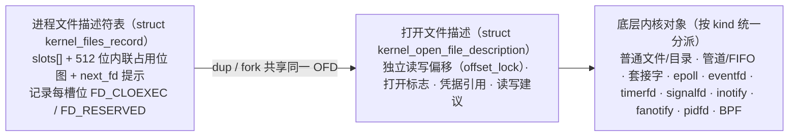

# 文件描述符、打开文件对象与通用 I/O 层

在类 Unix 操作系统中，进程并不直接操作底层磁盘索引节点（`inode`），而是通过整数编号的**文件描述符（File Descriptor，FD）**访问内核的**打开文件描述（Open File Description，OFD）**，进而统一操纵普通文件、目录、管道、套接字、事件队列与监控对象。本文基于 `fs/files/`、`fs/open_file.c`、`fs/pipe.c`、`fs/event_fd.c`、`fs/inotify.c`、`fs/fanotify.c`、`fs/record_lock.c` 与 `fs/flock.c` 的实际代码，阐述 BoarOS 文件资源层的完整机制。

---

## 一、源码组织

| 源码路径 | 核心职责 |
| :--- | :--- |
| `fs/files/table.c`、`fs/open_file.c` | 进程文件描述符表（位图槽分配、`CLOEXEC`、`dup`/`close_range`）与统一 OFD 对象生命周期 |
| `fs/files/io.c`、`fs/files/transfer.c` | 普通与向量读写（`readv`/`writev`/`preadv2`/`pwritev2`）、`sendfile`、`splice`/`tee`/`vmsplice` 与 `copy_file_range` |
| `fs/files/path.c` | 路径相关系统调用（`openat`/`openat2`、`statx`、`access`、`chmod`/`chown`、`renameat2`、文件句柄） |
| `fs/pipe.c`、`fs/pipe_internal.h` | 匿名管道与命名管道（FIFO）环形页缓冲、原子写边界与动态容量调节 |
| `fs/files/poll.c`、`fs/files/epoll.c` | `poll`/`ppoll`、`pselect6` 与红黑/AVL 树驱动的 `epoll` 事件多路复用 |
| `fs/event_fd.c`、`fs/signal_fd.c` | 轻量级事件计数（`eventfd`）、定时器描述符（`timerfd`）与信号描述符（`signalfd`） |
| `fs/inotify.c`、`fs/fanotify.c` | 文件系统事件监视（`inotify`）与支持权限拦截/文件句柄的高级访问通知（`fanotify`） |
| `fs/record_lock.c`、`fs/flock.c` | 区间 AVL 树实现的字节范围记录锁（POSIX / OFD 锁）与整文件协作锁（`flock`） |

---

## 二、文件描述符表与打开文件描述（OFD）

### 2.1 三级映射关系

- **高效槽位管理与锁外阻塞**：`struct kernel_files_record` 初始提供 `32` 个槽位，内置 `512` 位内联占用位图（`KERNEL_FILES_INLINE_BITMAP_CAPACITY`）和 `next_fd` 提示以快速分配最小空闲编号，最大容量受进程 `RLIMIT_NOFILE` 限制。打开或接收新描述符时，先在表短锁（`Rank 25`）内标记 `KERNEL_FILES_FD_RESERVED` 预留槽位，释放锁后再执行可能睡眠的文件打开或用户拷贝，成功则原子发布 OFD，失败则取消预留，避免持表锁睡眠。
- **统一的引用计数与锁外释放**：所有系统调用入口先通过 `fd` 查找并递增 OFD 的引用计数，释放文件表锁后再执行实际 I/O；`close`、`close_range` 或 `exec`（清理带 `FD_CLOEXEC` 的槽位）只摘除槽位并递减引用，只有最后一份引用归还时才在锁外执行后端关闭与资源回收。

---

## 三、文件读写与内核内数据传输

### 3.1 标量、向量与定位读写

`fs/files/io.c` 统一处理 `read`/`write`、`pread64`/`pwrite64`（不改变 OFD 偏移的显式定位读写）、`readv`/`writev` 以及带逐次标志的 `preadv2`/`pwritev2`（最多支持 `1,024` 个 `iovec` 向量段，支持 `RWF_HIPRI`/`DSYNC`/`SYNC`/`APPEND` 等标志）。

- **原子偏移与精确部分完成**：顺序读写在 OFD 级 `offset_lock`（Rank 10）保护下推进文件位置，确保并发读写同一描述符不发生偏移撕裂；如果前段向量成功传输后在后续向量触及无效用户地址，内核返回已完成的字节数，仅在首个字节前出错时返回 `-EFAULT`。
- **异步 I/O 直通路径**：满足扇区对齐且单次不超过 `64 KiB` 的普通文件定位直接读写，可接入内核异步 I/O 后台执行者（见 [系统调用与异步 I/O](kernel-syscall.md)）。

#### 仅使用驻留页的读取与缓存统计

- **`preadv2(RWF_NOWAIT)`** 可读取 ext4、ext3 和 ext2 普通文件中已经可用的缓存页。缓存未命中、相关资格暂不可用，或目标页需要缺页处理时，内核在该处停止。本次已复制数据时返回完成字节数，尚未复制数据时返回 `EAGAIN`。无效的目标地址返回 `EFAULT`。显式偏移读取保留打开文件描述的位置，偏移 `-1` 按成功复制的字节推进共享位置。匹配文件访问权限监听器时返回 `EAGAIN`，由应用选择是否退回可阻塞读取。该路径不发起存储读取。直接输入输出和 `pwritev2` 的 `RWF_NOWAIT` 返回 `EOPNOTSUPP`。
- **`cachestat(451)`** 按字节范围查询上述文件的缓存状态，长度为零表示查询至文件末尾。内核从文件的页缓存索引统计驻留、脏页与写回页。每个页缓存实例保留最近 1024 项压力回收记录，并根据回收序号与当前缓存页数判断哪些记录仍属近期。主动失效、截断和重新装入会清除相关记录。统计单位为架构基本页。遍历分段取得保护，结果反映各段采样时的状态。

### 3.2 内核内数据传输（`sendfile` / `copy_file_range` / `splice`）

为减少数据在“内核态 ↔ 用户态”之间往返拷贝，`fs/files/transfer.c` 实现了四类内核内直接传输通道：

| 接口 | 传输方向 | 内核实现机制 |
| :--- | :--- | :--- |
| **`sendfile`** | 普通文件 → 套接字 / 文件 | 向传输控制协议（Transmission Control Protocol，TCP）套接字发送时，`sendfile_tcp_cached()` 每批借用最多 **32 KiB** 的源文件缓存页，将内容交给协议发送路径，无需经过用户缓冲区 |
| **`copy_file_range`** | 普通文件 → 普通文件 | 对支持批量缓存读取的不同文件，`regular_cached_copy()` 每批借用最多 **8 页**源缓存页，由目标写入路径复制数据 |
| **`splice` / `tee`** | 文件/套接字 ↔ 管道，或管道 → 管道 | 支持共享页的路径传递页引用，其他路径复制数据。`tee` 将管道缓冲区的页引用交给目标管道，源管道仍可读取相同内容 |
| **`vmsplice`** | 用户态缓冲区 → 管道 | 固定用户页或复制数据直接装入管道缓冲槽 |

### 3.3 `copy_file_range` 的文件组合与完成边界

`copy_file_range`（系统调用 285）按照文件系统实例和实际后备文件判断能否复制。绑定挂载提供另一套路径视图，视图中的普通文件仍由原实例管理。

| 源文件与目标文件 | 复制条件 |
| :--- | :--- |
| 同一普通文件系统实例内的两个文件 | 可以复制，包括经过不同绑定挂载打开的文件。 |
| 不同的 ext2、ext4、tmpfs 或 VFAT 实例 | 返回 `EXDEV`，即使两个实例使用相同的文件系统类型。 |
| 两端都通过 OverlayFS 打开 | 两端可以位于不同的 OverlayFS 实例。内核选定源文件的当前后备层和目标文件的可写上层。实际需要搬运数据时，两个后备文件必须属于同一实例，否则返回 `EXDEV`。 |
| 一端为 OverlayFS，另一端为普通文件系统 | 返回 `EXDEV`。从普通路径打开后备文件也属于这一情形。 |

- **来源和实际复制范围**。源文件的打开文件描述保活本次选定的后备文件。复制期间若另一个打开操作为源文件建立了上层副本，当前复制仍从已经选定的层读取。内核先结合源文件末尾、目标文件最大尺寸和 `RLIMIT_FSIZE` 文件大小限额缩短范围。两端指向同一个索引节点时，实际复制范围重叠返回 `EINVAL`，包括不同叠加视图中的名称指向同一个后备索引节点的情形。
- **文件位置与失败处理**。输入描述符须可读，输出描述符须可写且未设置 `O_APPEND`，否则返回 `EBADF`。`flags` 必须为零。每一端都可独立指定位置指针或使用打开文件描述的共享位置。成功复制的数据由两端分别提交位置。若向其中一个位置指针写回失败，调用返回 `EFAULT`，实际复制的数据及另一端的位置更新仍保留。打开标志含 `O_SYNC` 或 `O_DSYNC` 时，本次复制的数据在搬运结束后统一同步，同步失败时返回错误，两端位置仍为调用前的值。

---

## 四、管道（Pipe）与命名管道（FIFO）

`fs/pipe.c` 实现匿名管道（`pipe2`）与文件系统中的命名管道（FIFO），内部使用环形物理页缓冲槽管理数据：

- **容量与内存额度**：默认容量为 **16 页**（RISC-V 为 64 KiB，LoongArch 为 256 KiB），内置 16 个槽位。应用用 `fcntl(F_SETPIPE_SZ / F_GETPIPE_SZ)` 调整或查询容量。管理员用 `/proc/sys/fs/pipe-max-size` 设置普通用户新建管道和扩容的上限，默认 1 MiB。较小的上限保留已存在管道的容量。分配与扩容仍按真实用户的页数额度计费。
- **原子写入保证（`PIPE_BUF`）**：单次写入长度不超过 `4,096` 字节（`KERNEL_PIPE_ATOMIC_WRITE`）时，保证与并发写入者不交错；非阻塞模式下若剩余空间不足 `4,096` 字节则直接返回 `-EAGAIN` 而不写入半截数据。
- **多核本地执行**：已打开的管道与 FIFO 的数据读写与等待队列直接在发起核上并行推进，仅涉及关联 `epoll` 销毁等控制操作交由 CPU0 协调。

---

## 五、事件多路复用（`poll` / `pselect` / `epoll`）与轻量事件描述符

### 5.1 `poll`、`pselect6` 与 `epoll`

- **`poll` / `ppoll` / `pselect6`（`fs/files/poll.c`）**：每次调用扫描监视列表，少量描述符（≤ 4 个）直接使用栈上缓冲 `KERNEL_POLL_STACK_CAPACITY = 4` 免除堆分配；`pselect6` 针对同一位图字中的少量普通文件提供单次加锁批量取引用快路径，若首次扫描已有就绪事件则跳过等待节点初始化直接返回。
- **`epoll`（`fs/files/epoll.c`）**：
  - 登记套接字时，`EPOLL_CTL_ADD` 在持有打开文件描述的引用期间直接订阅套接字自身的等待队列，再查询一次当前就绪状态。订阅之前已发生的状态变化由该查询发现，订阅之后的变化由队列通知。TCP 数据到达和发送额度归还分别通知关注读取和写入的等待者。
  - `epoll_ctl` 在一次文件描述符表保护内同时取得控制文件和被监视文件的引用。事件交付完成后，扫描者在同一段事件状态保护内更新触发状态并归还候选项引用。可能执行后端关闭的最后一次文件引用归还在保护外执行。
  - 单核构建可在事件状态保护内读取流式套接字的就绪快照。该区间关闭中断，能在读取期间保护端点与监视项的状态。交付扫描发现流式套接字已无关注的就绪事件时，在同一次保护内摘下旧候选，后续状态变化仍由原等待队列通知。扫描者释放保护后再写入用户缓冲区，只有完整写入才提交边缘触发和单次触发状态。多核与需要查询后端的对象继续使用跨保护区的文件引用和代次核对。
  - 显式撤销套接字监视后，每个 `epoll` 实例最多保留一个已摘除的监视项。等待队列中在途的通知和事件扫描引用全部结束后，后续登记才能复用这块存储。关闭 `epoll` 实例时归还保留项。
  - 每个 `epoll` 实例（`struct kernel_epoll`）用 **AVL 平衡树 `items_root`** 按 `(target_fd, target_file)` 索引所有注册监视项，通过独立的 `ready_head` 就绪链表实现 O(1) 收集活跃事件，避免随总监视数线性扫描；
  - 完整支持 **水平触发（LT）**、**边缘触发（`EPOLLET`，仅在状态新变就绪时交付一次）**、**单次触发（`EPOLLONESHOT`，交付一次后自动解除激活直至重新 `MOD`）** 与 **防惊群唤醒（`EPOLLEXCLUSIVE`）**；
  - **环形嵌套深度检查（`epoll_check_nesting`）**：当把一个 `epoll` 描述符加入另一个 `epoll` 时，双向遍历上下游有向图，拒绝成环或嵌套深度超过 **4 层**（`KERNEL_EPOLL_MAX_NESTS = 4`）的请求并返回 `-ELOOP`。

### 5.2 `eventfd`、`timerfd` 与 `signalfd`

为了将计数通知、定时器到期和异步信号统一纳入 `epoll`/`poll` 事件循环，BoarOS 实现了三类专用事件文件描述符：
- **`eventfd`（`fs/event_fd.c`）**：维护 64 位无符号内核计数器，`write` 累加计数，`read` 读取并清零（启用 `EFD_SEMAPHORE` 信号量模式时每次只减 1 并返回 1），适合线程间与异步 I/O 完成通知。
- **`timerfd`（`fs/event_fd.c`）**：将高精度单调/实时/闹钟定时器封装为可读描述符，到期时在全局 `timer_root` AVL 树中累计超时次数并唤醒 `epoll` 监视者，`read` 返回 8 字节的累计到期次数。
- **`signalfd`（`fs/signal_fd.c`）**：将发往当前线程的待处理信号转为同步读取的 128 字节 `struct signal_fd_info` 记录，免去异步信号处理函数的重入风险。

---

## 六、文件系统事件监控（`inotify` 与 `fanotify`）

| 机制 | 核心架构与支持能力 |
| :--- | :--- |
| **`inotify`（`fs/inotify.c`）** | 面向单目录/单文件的轻量级变更监控（创建、删除、修改、移动等）。采用 256 桶索引与 64 KiB 事件环形缓冲区（上限 128 个监视组、65,536 个监视标记，单桶链长超 16 自动溢出至红黑树），自动合并相邻重复事件。 |
| **`fanotify`（`fs/fanotify.c`）** | 可监视单个索引节点、一个挂载视图或整个文件系统实例。文件访问和目录项变更产生普通通知，也可以在打开、读取或执行前请求监视进程作出权限决定。 |

- **权限事件与文件身份。** `FAN_CLASS_CONTENT` 和 `FAN_CLASS_PRE_CONTENT` 可拦截文件访问。访问线程等待监视进程向组描述符回复 `FAN_ALLOW` 或 `FAN_DENY`。普通通知组可以选择交付事件文件描述符，也可以使用文件标识（File Identifier，FID）模式交付文件句柄及名称。文件系统标识与 `statfs()` 一致，句柄与 `name_to_handle_at()` 一致。
- **事件来源。** 默认报告触发进程的编号，`FAN_REPORT_TID` 改为报告线程编号。`FAN_REPORT_PIDFD` 随事件交付进程文件描述符，事件队列持有真实进程身份。读取时预留描述符，完整复制该条事件后安装。进程已被回收或对读取者不可见时报告 `FAN_NOPIDFD`，无法取得描述符时报告 `FAN_EPIDFD`。两种来源报告标志均要求管理权限，且互斥。
- **掩码与额度。** 显式对子项生效的忽略掩码参与父目录兴趣索引。修改子项只清除对该事件有效的非持久忽略掩码。默认每个真实用户最多 128 个组和 8,192 个标记，每组最多 16,384 条排队事件。具有管理权限的监视组可以用 `FAN_UNLIMITED_MARKS` 或 `FAN_UNLIMITED_QUEUE` 解除对应上限。
- **文件系统错误。** ext4 的文件系统标记可接收 `FAN_FS_ERROR`。事件携带第一个未读错误的编号、已合并错误数，以及有关文件的句柄。挂载级错误使用空句柄。报告范围包括读取和查找中检测到的损坏，以及显式中止挂载。首个错误标记为监视组预留 32 条记录，错误发生时复用预留记录。

---

## 七、文件锁：字节范围记录锁与 `flock` 协作锁

BoarOS 完整区分 Linux 中的三类文件协作锁，各自维护独立的所有权语义：

1. **传统 POSIX 字节范围锁（`fcntl(F_SETLK / F_SETLKW / F_GETLK)`）**：
   - 使用按区段起点排序、并在每个节点维护子树最大终点 `max_end` 的 **增强区间 AVL 树**（`fs/record_lock.c`），实现 O(log N) 区间重叠查找、自动分裂与相邻合并；
   - 归属于进程文件表（`files->record`）：同一进程关闭指向该 `inode` 的**任意**文件描述符都会释放该进程在该文件上的全部 POSIX 锁；阻塞等锁时自动沿等待图执行深度上限为 10 的**死锁环路检测**，发现成环返回 `-EDEADLK`。
2. **打开文件描述范围锁（OFD 锁，`F_OFD_SETLK / F_OFD_SETLKW / F_OFD_GETLK`）**：
   - 复用同一套增强区间 AVL 树，但锁归属于单个 **OFD 实例**而非整个进程——多线程可各自打开同一文件互相加锁，且仅在对应 OFD 的最后引用关闭时释放锁，不因关闭无关副本描述符误解锁。
3. **整文件协作锁（`flock(32)`，`fs/flock.c`）**：
   - 锁粒度为整个文件，同样绑定于 OFD 生命周期（`dup`/`fork` 共享同一把锁，独立 `open` 互斥），支持共享锁（`LOCK_SH`）、独占锁（`LOCK_EX`）、非阻塞（`LOCK_NB`）与解锁（`LOCK_UN`）。

### 普通文件租约

`fcntl(F_SETLEASE / F_GETLEASE)` 使用按索引节点组织的租约状态，租约本身由打开文件描述（Open File Description，OFD）持有。冲突的打开或截断请求触发 `SIGIO`，持有者可以降级或解除租约。阻塞请求登记后释放租约保护再睡眠，收到通知后重查冲突。非阻塞请求在发出通知后返回 `EAGAIN`。内核按 `/proc/sys/fs/lease-break-time` 处理到期租约。

打开文件描述首次建立租约时，在异步通知对象中准备租约记录。解除或过期时，内核先撤下索引节点上的链接，再将记录留给同一打开文件描述复用。最后一次关闭在撤下活动租约后释放通知对象。

普通打开用同一个原子字登记访问方式和识别租约。租约设置与正在登记的打开操作在该原子字上完成交接。没有租约时无需分配租约对象或取得租约互斥锁。

---

展开查看：路径与异步通知细节及定向验证入口

### 信号驱动 I/O 与路径扩展接口

- **信号驱动异步 I/O（`O_ASYNC` / `F_SETOWN` / `F_SETSIG`）**：在 OFD 上记录目标进程/线程/进程组所有者与自定义实时信号；当管道、终端或套接字变为可读/可写时异步递送 `SIGIO` 或指定信号（附带 `POLL_IN`/`POLL_OUT`/`POLL_ERR`/`POLL_HUP` 详情）。
- **受限路径解析（`openat2`）**：支持 `RESOLVE_BENEATH`（禁止越出起始目录子树）、`RESOLVE_IN_ROOT`（将起始目录视为临时根目录）、`RESOLVE_NO_SYMLINKS`、`RESOLVE_NO_XDEV` 与 `RESOLVE_NO_MAGICLINKS`。
- **批量关闭与属性查询**：支持 `close_range(436)`（含 `CLOSE_RANGE_UNSHARE` 写时复制文件表与 `CLOSE_RANGE_CLOEXEC`）、`fchmodat2(452)` 与 `statx` 扩展元数据。

### 定向验证入口

- **epoll 与多路复用专题**：详见 [epoll 对象与事件通知](../learning/epoll-subsystem.md)、[epoll 事件交付与取消](../learning/epoll-delivery.md)；测试入口 `tests/workloads/epoll/`、`tests/userland/ipc-fds.py`。
- **内核内传输与管道**可用 `python3 tests/userland/run.py --workload sendfile_tcp` 检查套接字发送。构建内核后，用 `python3 tests/userland/api8.py --only boaros --program copy_range --program overlay` 检查文件复制、叠加层选择和跨卷拒绝。进行 Linux 对照时，去掉 `--only boaros`，通过 `--linux-kernel` 指定启用了 `CONFIG_OVERLAY_FS` 的参考内核。管道与向量读写的测试程序位于 `tests/workloads/pipe/` 与 `tests/workloads/io/vectors_v2.c`。
- **记录锁与 `flock`**：`tests/diff-abi/file_locks.c`、`tests/workloads/locks/`、`python3 tests/userland/api8.py`。
- **文件访问通知**：`tests/workloads/fs/`、`tests/workloads/io/file-handles.c`。

