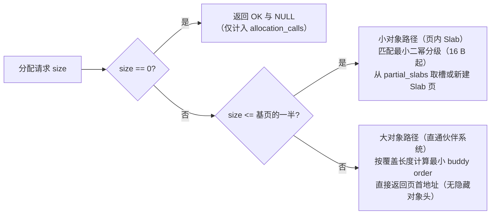

# 内核堆模块

内核堆模块（Kernel Heap）为内核各子系统提供通用动态内存分配能力，涵盖对象申请、清零分配、弹性扩容、批量收发与资源统计。它完全建立在已经切换到伙伴模式的 [物理页分配模块](physical-pages.md) 之上，不依赖固定大小的静态内存池，也不假设物理地址与虚拟地址恒等，在 RISC-V 64（4 KiB 基页）与 LoongArch 64（16 KiB 基页）上共享同一套实现。

---

## 一、源码组织

| 源码路径 | 核心职责 |
| :--- | :--- |
| `include/kernel/heap.h` | 公开堆对象 `struct kernel_heap`、对齐与分级宏、标准/非睡眠/批量分配与释放接口及统计结构 `struct kernel_heap_statistics` |
| `mm/heap.c` | 实现基于每页嵌入式 Slab 的小对象分配器、基于伙伴高阶块的零头开销大对象路径、指针归属校验与并发锁保护 |

---

## 二、内存布局与两级分配策略

内核堆要求所有返回的对象至少 **16 字节对齐**（`KERNEL_HEAP_ALIGNMENT = 16`），并由平台在初始化时传入“堆虚拟地址 → 物理地址”的转换回调 `kernel_heap_physical_address_fn`（通常对应直接映射窗口）。按请求大小，堆自动路由至两条路径：



### 2.1 小对象路径：页内嵌入式 Slab

对于不超过半页的请求，堆按 16 字节（`KERNEL_HEAP_MIN_CLASS_SHIFT = 4`）起的二次幂划分尺寸分级（Size Class），总级数为 `KERNEL_HEAP_SIZE_CLASS_COUNT = BOAROS_PAGE_SHIFT - 4`：

| 构建架构 | 基页大小 | 小对象分级数 | 覆盖对象尺寸 | 位图字数（`uint64_t`） | Slab 页头大小 |
| :--- | :--- | :--- | :--- | :--- | :--- |
| **RISC-V 64** | 4 KiB | 8 级 | 16 B、32 B、64 B、128 B、256 B、512 B、1024 B、2048 B | 4 字（32 B） | 80 B |
| **LoongArch 64** | 16 KiB | 10 级 | 16 B、32 B、64 B、128 B、256 B、512 B、1024 B、2048 B、4096 B、8192 B | 16 字（128 B） | 176 B |

每张 Slab 页是一张普通的 0 阶物理页，布局自页首向页尾依次排列：

1. **页头（`struct kernel_slab`）**：保存魔数 `0x424f4152534c4142`、所属堆指针 `heap`、非满链表双向指针 `next`/`previous`、按位标记已分配槽位的位图 `allocated[]`、空闲槽单向链表头 `free_head`，以及分级编号、总槽数、空闲槽数与槽位起始偏移（静态断言保证 `sizeof(struct kernel_slab)` 为 16 字节的整数倍）。
2. **对象槽数组**：紧跟页头之后，每个空闲槽的前 4 字节侵入式地保存下一个空闲槽索引（`KERNEL_SLAB_INDEX_NONE` 表示链尾），取槽与归还均为 $O(1)$。

- **非满链表与即时回收**：每个尺寸分级仅维护一条包含空闲槽的 `partial_slabs[class]` 双向链表；Slab 填满时从链表摘除，有槽位释放时重新挂回；当最后一个存活对象释放（`free_count == slot_count`）时，清除魔数并立即通过 `physical_page_release_order(..., 0)` 将整页归还给物理页分配器，不长期滞留空闲 Slab 页。

### 2.2 大对象路径：直通伙伴高阶块

凡超过半页（RISC-V > 2048 B，LoongArch > 8192 B）的请求，堆计算能够容纳该字节数的最小伙伴阶 `order`（即 $2^{\text{order}} \times \text{BOAROS\_PAGE\_SIZE} \ge \text{size}$），直接向物理页分配器申请整块连续页并返回页首地址：

- **无隐藏头、天然页对齐**：因为小对象总位于 Slab 页头之后（页内偏移非零），而大对象总是页对齐地址（`pointer & BOAROS_PAGE_MASK == 0`），仅凭指针低位即可区分大小对象，完全不需要在对象前方安放隐藏元信息或维护额外的大对象哈希表。这使得恰好 4 KiB 或 16 KiB 的请求严格只消耗 1 张物理页，同时天然满足直接内存访问（Direct Memory Access，DMA）与页表缓冲区的页对齐要求。
- **单次锁内发现并释放**：大对象释放时调用 `physical_page_release_allocation()`，在物理页分配器的单次临界区内同时验证权威块头、读出阶数并完成归还，无需先查询阶数再二次查找。代价是非二次幂尺寸的大对象存在伙伴系统固有的内部碎片。

---

## 三、并发协议、重入安全与批量收发

### 3.1 锁序与锁外准备

堆元数据（`partial_slabs[]`、Slab 页头与位图、统计计数）由每堆的原始自旋锁 `heap->lock`（锁序等级 `KERNEL_RAW_RANK_HEAP = 10`）保护。该锁在单核下关中断防抢占、在多核下提供原子互斥，与物理页分配器之间严格遵循单向锁序：

```text
heap->lock (Rank 10)  ──▶  physical_page_allocator->lock (Rank 20)
```

为了缩短临界区并允许底层的内存回收安全重入内核堆（例如页缓存回收元数据可能需要短暂使用堆），所有耗时或可能阻塞的操作均被移到 `heap->lock` 之外：

- **小对象快路径**：命中已有非满 Slab 时，仅在单次 `heap->lock` 内摘槽、置位图并更新统计，完全不触碰物理页分配器。
- **新 Slab 私有构造**：无可用非满 Slab 时，先释放 `heap->lock`，在锁外向伙伴分配器申请 0 阶页并初始化页头和空闲槽链表，再重新加锁挂入 `partial_slabs[class]` 并取走首个槽位；若期间其他线程也创建了同类 Slab，两者各自独立存活互不冲突。
- **大对象与清零/复制**：大对象页帧申请、`calloc` 的 `memset` 清零以及 `resize` 的旧数据 `memcpy` 拷贝均在 `heap->lock` 外完成。

### 3.2 防止回收引发脏页 I/O 与非睡眠路径

- **`KERNEL_NO_RECLAIM_IO` 边界**：常规 `kernel_heap_allocate()` 与 `kernel_heap_resize()` 在入口递增任务的分配深度标记，允许底层物理页分配器同步回收**干净且无外部引用**的缓存页，但明确禁止在堆分配内部发起脏页落盘 I/O 或等待后端磁盘线程，防止文件系统/块层持锁申请堆内存时发生死锁。
- **非睡眠与批量接口**：
  - `kernel_heap_allocate_nosleep()` 与 `kernel_heap_allocate_zeroed_nosleep()` 只做单次伙伴尝试，不触发任何回收回调或睡眠，适用于已持有其他可睡眠资源资格或通知上下文的调用者。
  - `kernel_heap_allocate_zeroed_batch_nosleep()` 一次从指定小对象分级最多批量申请并清零 **16 个**独立可释放的对象，在内存紧张时返回已完成的前缀数量。
  - `kernel_heap_release_small_batch()` 在单次 `heap->lock` 保护内最多归还 **16 个**存活小对象，并在遍历中缓存相邻指针所属的同一 Slab 页头与物理地址，避免对同页对象的重复物理地址反查与页头校验。

---

## 四、语义约定、错误处理与资源统计

| 操作 | 边界与语义约定 |
| :--- | :--- |
| **零长度申请** | `size == 0` 返回 `KERNEL_HEAP_STATUS_OK` 并将输出指针置为 `NULL`；`kernel_heap_release(heap, NULL)` 安全空操作返回 `void` |
| **清零乘法溢出** | `kernel_heap_allocate_zeroed()` 在 `count * size` 溢出时递增调用与失败计数，返回 `KERNEL_HEAP_STATUS_OVERFLOW`，不改动输出指针 |
| **弹性扩容（`resize`）** | `old_pointer == NULL` 等价于新分配；`new_size == 0` 释放旧对象并输出 `NULL`；若 `new_size` 不超过当前槽位或高阶块的实际容量，原地直接返回旧指针；扩容时先申请新对象并复制旧容量数据再释放旧对象，申请失败则完整保留旧对象和输出 |
| **归属校验与 fail-stop** | 释放时校验指针位于直接映射域、物理页确为本堆已分配块、Slab 魔数/位图/链表一致且对应槽位确实处于已分配态（区分页内错位指针、外部页与二次释放）。任何堆或底层页分配器不变量损坏均直接触发 fatal trap，绝不把内存损坏降级为可重试错误 |
| **实时统计** | `kernel_heap_get_statistics()` 在锁内输出 `allocation_calls`、`allocation_failures`、`live_allocations`、`current_pages` 和 `peak_pages`，用于内核测试与根启动退出时的零泄漏核验 |

---

<details>
<summary>展开查看：公共内存原语、成本采样与定向验证入口</summary>

### 清零与搬迁原语

`calloc` 清零与 `resize` 数据搬迁复用 `lib/string.c` 的公共内存原语（与虚拟内存清页、写时复制共享实现）：地址同余对齐时按机器字批量复制/填充，首尾按字节精确收口；`memcpy` 与前向 `memmove` 共享内联实现且入口按代码页边界对齐，避免热循环跨页拆裂。

### 成本诊断构建（`BOAROS_COST_DIAGNOSTICS`）

默认关闭的成本诊断构建会在堆分配入口、实际清零和扩容搬迁处记录 `COST_HEAP_CALLS`、`COST_HEAP_REQUESTED`、`COST_HEAP_ACCEPTED`、`COST_HEAP_FAILURES` 及清零/复制的真实字节数与时钟周期（失败路径不计入成功样本；时钟周期包含期间可能发生的中断与调度）。

### 当前架构边界

当前所有小对象分级共用每堆一把全局自旋锁，尚未引入每核本地 Slab 缓存（Per-CPU Magazine/Cache）；在多核高并发小对象分配场景下可通过统一锁接口平滑演进。

### 定向验证入口

- **宿主抢占、释放诊断与多线程并发**：`make test-allocator-preemption-host`、`make test-allocator-release-host`、`make test-allocator-concurrency-host`、`make test-string-host`
- **双架构客机与全量回归**：`make test-page-riscv`、`make test-loongarch`（含 16 KiB 页下 300 个 17 字节对象的位图覆盖与回收校验）

</details>
