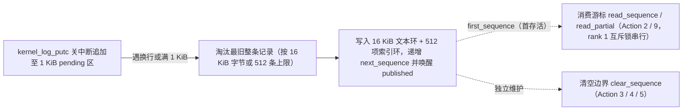

# 内核日志与 `klogctl` / `syslog`

内核环形日志缓冲区（Kernel Ring Buffer）用于在系统早期启动（尚无文件系统和用户态守护进程）以及整个运行周期内持续记录内核诊断消息，并向用户态工具（如 `dmesg`）提供查询、消费与控制台输出过滤接口。

BoarOS 在 `kernel/log.c` 与 `kernel/syscall/log.c` 中实现了固定内存、无分配、中断安全的内核日志环，并通过 RV64 与 LA64 通用的 `syslog(116)`（C 库常封装为 `klogctl`）系统调用向用户态开放完整控制语义。

---

## 一、源码组织与核心数据结构

| 源码路径 | 核心职责 |
| :--- | :--- |
| `kernel/log.c`、`include/kernel/log.h` | 16 KiB 文本环形缓冲区、512 项定长记录索引、1 KiB 行拼接区、双游标读写状态机及控制台日志级别过滤 |
| `kernel/syscall/log.c` | `syslog(116)` 系统调用入口、`CAP_SYSLOG` 权限校验、用户地址合法性检查、1 KiB 临时暂存区分配与信号重启对接 |

内部静态存储不依赖动态堆分配，系统刚完成早期启动即可安全写入：

- **文本环（`ring[16384]`）**：`KERNEL_LOG_CAPACITY = 16,384` 字节（16 KiB），循环存放每条带 `<级别>` 前缀（默认内核消息级别为 `6`，即 `<6>`）的完整消息文本。
- **记录索引环（`records[512]`）**：最多保存 `RECORD_COUNT = 512` 条 `struct log_record { uint64_t start; uint16_t length; }` 元数据。当新消息到来导致文本环空间不足或记录条数达到 512 时，均按**整条记录**推进 `first_sequence` 淘汰最旧消息，绝不残留截断的半条记录。
- **行拼接区（`pending[1024]`）**：单条记录最长 `KERNEL_LOG_RECORD_MAX = 1,024` 字节（1 KiB），遇换行符 `\n` 或满 1 KiB 时自动封口发布并唤醒等待队列 `published`。



---

## 二、无回环打印与双游标读写设计

### 2.1 写路径与串口隔离

`kernel_log_putc()` 在短关中断区内仅完成拼接、整条淘汰、环写入与等待队列唤醒，**不分配内存、不休眠、不执行串口 I/O**，仅向调用者返回当前级别是否低于 `console_level`（默认 `7`，允许设置 `1`～`8`）。实际 UART 串口输出在关中断区之外完成；用户态进程向 `/dev/console` 写入的字节直接绕过内核日志环，因此运行 `dmesg` 将日志打印到控制台时，绝不会把自己读出的消息重新写回环形缓冲区形成无限回环。控制台级别过滤只影响串口回显，不会丢弃日志环中的任何记录。

### 2.2 独立消费游标与清空边界

遵循 Linux `printk` 语义，内核分别维护两套互不干扰的读取位置：

- **消费游标（`read_sequence` + `read_partial`）**：供阻塞消费读（`Action 2`）与未消费字节数查询（`Action 9`）使用。多并发消费读由 `rank 1` 互斥锁 `readers` 串行化；无可读数据时先释放互斥锁，再在关中断保护下挂入 `published` 等待队列，被信号打断时通过统一 `-ERESTARTSYS` 协议支持系统调用自动重启。若期间日志环发生覆盖，游标自动向前对齐至 `first_sequence`。
- **清空边界（`clear_sequence`）**：供非破坏性全量读（`Action 3`）、读取并清空（`Action 4`）以及纯清空（`Action 5`）使用。`Action 3`/`4` 在开始时锁定当前的结束序号 `end = next_sequence`，使期间新产生的消息不会无限拖长本次读取，并从清空边界之后挑选能完整装入用户缓冲区的**最新一批**完整记录。

### 2.3 安全的用户态拷贝与故障语义

每次读操作（`Action 2`/`3`/`4`）在进入 `kernel_log_action()` 前于调用者堆上申请 1 KiB 临时暂存区 `scratch`：在短关中断区内把单条记录（或片段）拷入 `scratch` 后立即开中断，再在锁外执行 `kernel_copy_to_user()`。

- **消费读（`Action 2`）**：按 Linux 约定，在用户拷贝前即推进该段消费游标；若第一条即发生页故障返回 `-EFAULT`，若此前已成功交付部分记录则返回已交付字节数。
- **全量读 / 读并清空（`Action 3`/`4`）**：任意拷贝故障均返回 `-EFAULT`；`Action 4` 仅将 `clear_sequence` 推进到已实际处理完成的序号，不会把失败点之后的新记录误清。

---

## 三、`syslog(116)` 动作码与权限策略

权限检查集中在系统调用入口与日志核心两层，**先于输出地址和长度校验执行**：调用者凭据需具备 `CAP_SYSLOG` 能力；未具备特权时仅放行 **`Action 3`（读取全部）** 与 **`Action 10`（查询缓冲区总容量）**，其余操作一律返回 `-EPERM`。

| 动作码 | Linux 宏名 | 权限要求 | 语义说明 |
| :---: | :--- | :---: | :--- |
| `0` / `1` | `SYSLOG_ACTION_CLOSE` / `OPEN` | `CAP_SYSLOG` | 保持 Linux 控制打开/关闭兼容语义，直接返回 `0` |
| `2` | `SYSLOG_ACTION_READ` | `CAP_SYSLOG` | 阻塞消费读，按字节截断并推进消费游标，支持信号打断重启 |
| `3` | `SYSLOG_ACTION_READ_ALL` | 无特权要求 | 非破坏读取清空边界后能完整装入用户缓冲区的最新记录 |
| `4` | `SYSLOG_ACTION_READ_CLEAR` | `CAP_SYSLOG` | 执行同 `Action 3` 的读取，并将清空边界推进至已读完序号 |
| `5` | `SYSLOG_ACTION_CLEAR` | `CAP_SYSLOG` | 将 `clear_sequence` 推进至 `next_sequence` |
| `6` | `SYSLOG_ACTION_CONSOLE_OFF` | `CAP_SYSLOG` | 若尚未保存旧级别则记录当前 `console_level`，并将其设为 `1` |
| `7` | `SYSLOG_ACTION_CONSOLE_ON` | `CAP_SYSLOG` | 恢复 `Action 6` 保存的 `console_level` 并清除保存状态 |
| `8` | `SYSLOG_ACTION_CONSOLE_LEVEL` | `CAP_SYSLOG` | 将 `console_level` 设为 `length`（有效范围 `1`～`8`，越界返回 `-EINVAL`），同时清除挂起的关闭保存态 |
| `9` | `SYSLOG_ACTION_SIZE_UNREAD` | `CAP_SYSLOG` | 返回消费游标至队尾之间的未读字节总数 |
| `10` | `SYSLOG_ACTION_SIZE_BUFFER` | 无特权要求 | 返回文本环总容量 `16384`（16 KiB） |

---

<details>
<summary>展开查看：边界语义与定向验证命令</summary>

### 边界规则

- 动作码超出 `0..10` 返回 `-EINVAL`；`Action 2`/`3`/`4` 传入空缓冲区指针或负长度返回 `-EINVAL`；地址范围非法返回 `-EFAULT`；地址合法且长度为 `0` 直接返回 `0`。
- `SYSLOG_ACTION_SIZE_BUFFER` 返回的是文本环字节容量（16 KiB），当短记录密集写入触及 512 项索引上限时，同样会按整条淘汰最早记录。

### 定向验证命令

```sh
# 宿主单测（环形覆盖、512 项上限、双游标隔离、并发消费读与页故障边界）
make test-log-host

# 客户机系统调用与同 ELF Linux 差分（含 BusyBox dmesg / -r / -c / -n 行为）
make test-environment-riscv
make test-diff-abi-riscv
```

</details>
