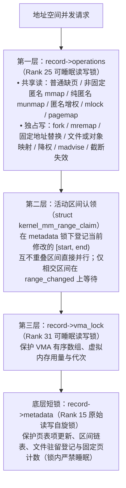

# 虚拟内存管理（VMM）

BoarOS 的虚拟内存管理子系统为每个进程提供独立的虚拟地址空间抽象，在 RISC-V 64（4 KiB 基页 / 2 MiB 大页）与 LoongArch 64（16 KiB 基页 / 32 MiB 大页）上共享核心策略层 `mm/mm.c`，通过编译期契约 `include/arch/mmu.h` 直接绑定各架构页表后端，在热路径上不引入运行期虚表分派开销。

---

## 一、源码组织

| 源码路径 | 核心职责 |
| :--- | :--- |
| `include/kernel/mm.h`、`mm_backend.h` | 跨架构地址空间句柄 `struct kernel_mm`、权限标志与后端契约 |
| `mm/mm.c` | 地址空间生命周期、三层并发协议、缺页解析、批量页表操作、`mmap`/`mremap`/`brk`/`mlock`/`madvise`/`msync` 与远端内存访问 |
| `mm/vma.c`、`include/kernel/vma.h` | 有序虚拟内存区域数组、二分查找、两阶段无分配区间编辑与相邻合并 |
| `mm/memory_object.c` | 共享匿名映射与 System V 共享内存的稀疏页后备对象 |
| `mm/hugetlb.c` | 原生大页物理池、预留配额与私有写时复制撤销机制 |
| `mm/uaccess.c`、`arch/riscv/user_copy.S` | 本核直接用户内存拷贝（异常表恢复）与跨空间页固定借用 |
| `include/arch/mmu.h`、`arch/riscv/sv39.c`、`arch/loongarch/mmu.c` | 双架构页表遍历、权限位编码、大页映射与跨核 TLB 同步实现 |

---

## 二、地址空间结构与三层并发协议

### 2.1 句柄与记录分离

- **`struct kernel_mm`**：轻量级可移动所有权句柄，直接指向地址空间本体 `struct kernel_mm_record`（通过静态断言约束其大小不超过单张基页）。多线程（`CLONE_VM`）或 `vfork` 通过 `kernel_mm_acquire()` 共享同一份记录并递增引用计数；`fork` 则通过 `kernel_mm_fork()` 建立独立记录并克隆虚拟内存区域与写时复制页表；最后一个拥有者退出时销毁页表并释放记录页。
- **`struct kernel_mm_record`**：集中保存架构页表根（`space`）、虚拟内存区域集合（`vmas`）、堆顶与映射布局（`start_brk`、`current_brk`、`mmap_base`、`vdso_address`、`vvar_page`）、活跃处理器位图与 TLB/指令缓存代次，以及用户页固定借用计数（`access_pins` / `write_pins`）。

### 2.2 三层并发协调与区间认领（`range_claim`）

在多核对称多处理（SMP）环境下，为避免多线程对同一地址空间的操作全部串行在一把大锁上，`mm/mm.c` 采用从外到内的三层锁与区间协调机制：

- **局部校验消除假冲突**：私有匿名缺页在最终写入硬件页表前，仅在 `vma_lock` 与 `metadata` 下核对目标地址所属虚拟内存区域（VMA）与 `range_edit_generation` 是否冲突；其他线程在无关地址上的映射增删不会迫使当前缺页白白重试。
- **原子排空固定页（`MM_PIN_CLOSED`）**：在撤销写权限、截断文件或登记懒回收前，修改者设置 `access_pins` 或 `write_pins` 最高位 `MM_PIN_CLOSED`，阻止新的用户页固定借用并等待已有借用归零后再执行页表变更，确保进行中的内核拷贝或直接内存访问（DMA）不会失去页保活。

---

## 三、虚拟内存区域（VMA）与后备类型

`struct kernel_vma_set` 将进程的所有虚拟内存区域按起始地址升序保存在连续动态数组中（初始容量 8，按 2 倍扩容），利用二分查找定位区间，并在 `record->recent_fault_vma` 缓存最近缺页命中的区域以加速连续访问。所有区间修改（分裂、替换、合并、重映射）均采用 **两阶段 `prepare → commit` 模型**：先在准备阶段申请足够容量，确保最终提交阶段绝不分配内存、绝不出现半提交状态。

| VMA 类别 | 对应系统调用与用途 | 后备存储与缺页策略 |
| :--- | :--- | :--- |
| **私有匿名映射** | 堆（`brk`）、主栈、`MAP_PRIVATE \| MAP_ANONYMOUS` | 按需分配零页；支持向下自动扩展栈（`MAP_GROWSDOWN`），默认在其下方预留 **256 页**保护间隔防止与普通映射碰撞 |
| **共享匿名与 SysV 共享内存** | `MAP_SHARED \| MAP_ANONYMOUS`、`shmat` | 由稀疏页后备对象 `struct kernel_memory_object` 维护物理页，`fork` 后父子保持可写共享 |
| **私有 / 共享文件映射** | 普通文件的 `mmap` | 与文件读写共用统一页缓存（Page Cache）；私有映射首次写入触发写时复制，共享映射通过反向别名登记追踪脏页与写回 |
| **ELF 程序段映射** | `execve` 加载可执行文件与动态库 | 使用独立 `kernel_elf64_source`：纯文件页共享页缓存，文件与零填充（BSS）边界页按需私有物化并精确清零尾部 |
| **原生大页映射** | `MAP_HUGETLB`、`SHM_HUGETLB` | 由 `mm/hugetlb.c` 维护连续高阶物理页池与预留配额，直接安装中间级大页表项 |
| **内核对象共享映射** | eBPF Map / RingBuf、`AF_PACKET` 接收环（`TPACKET_V3`） | 映射建立时直接安装固定内核物理页，不参与普通按需装页；解除映射后访问未映射槽位触发总线错误（`SIGBUS`） |
| **vDSO 与 vVAR** | 内核向每个进程注入的快速时钟与信号返回页 | `vDSO` 映射内核内嵌共享代码页，`vVAR` 只读映射共享时钟数据页（默认排除出核心转储） |

---

## 四、缺页解析、批量页表操作与跨核 TLB 同步

### 4.1 按需调页与写时复制（CoW）

- **匿名缺页**。普通私有匿名映射首次读取时，同一地址空间的页表项分别持有一份只读零页引用。首次写入仍分配可写的私有页，RISC-V 可用 `cbo.zero` 清零。在 RISC-V 上，连续的非执行匿名读、写缺页各自从 **8 页**窗口学习访问方向，持续顺序访问可扩至 **16 页**。内核在已有末级页表内，批量引用只读零页或分配独立可写页。需要刷新地址转换缓冲区（Translation Lookaside Buffer，TLB）的处理器按实际发布范围同步。
- **缺页物理页储备**。单核分配器在空闲页充分时最多一次补充 8 个基础页，每次实际缺页只取走所需页并按原路径初始化。后续随机访问仍按需建立页表项。普通分配找不到所需阶的空闲块时，分配器先归还储备，再重试伙伴合并后的空闲链。关机核对物理页归还量前也会清空储备。
- **写时复制（Copy-on-Write，CoW）**：写入只读共享的私有页时，内核在 `metadata` 锁内检查该物理页的引用计数：
  - 引用计数为 **1** 时，复用本次遍历找到的末级页表项，在同一个保护区间清除写时复制标记并恢复写权限。
  - 引用计数大于 **1** 时，持有源页引用，在短锁外准备新页。提交时核对原页表项的值，原页表和复制过程持有的两个旧页引用都在地址转换同步后合批归还。私有文件缺页已经取得地址空间写资格和索引节点读资格时，空闲页充足可沿用这两项资格完成复制和发布。需要回收内存时先释放资格，恢复后重新核对映射和文件范围。

### 4.2 批量页表项发布与 16 项批处理

- **文件映射邻页批量发布**。末级页表已存在时，普通文件只读缺页可同时借用需求页和同一 **64 KiB** 窗口内已就绪的相邻页。发布持有索引节点读资格，地址空间并发发布时在 `metadata` 下复查映射和需求槽。私有磁盘映射连续命中同一虚拟内存区域的相邻完整窗口后，一次缺页最多沿前进方向发布 **4 个窗口**，并同步本次实际发布的地址范围。后续窗口使用已有页表和缓存页，跨映射边界或遇到不完整的窗口时停止。冷页经原读取路径装入，随机访问建议关闭推测装入。
- **私有磁盘映射的页面来源**。页表项的软件位表示该页仍引用文件缓存，保留到 `fork`、地址移动及撤销访问权限后。写时复制提交清除该位。文件打洞和范围清零只撤销对应范围内有文件来源标记的页表项，文件截断仍撤销新文件末尾之外的映射。共享缓存别名和内存后备文件的专用驻留记录沿原路径管理。
- **16 项批处理与合并撤映射**：
  - `fork` 克隆子页表与将父页表标记为写时复制时，按叶表内最多 **16 项**分批获取物理引用和修改表项；
  - RISC-V 在发布一批新页表项前统一编码权限和软件标志，并执行一次发布屏障。物理地址仍逐项写入，对应的页面内容在这些表项对处理器可见前已经准备就绪；
  - RISC-V 的多页 `mprotect` 从当前游标找到下一张有驻留页的末级页表，在同一次短锁保护内检查最多 **16 个槽位**并修改已映射的表项。各页继续根据写时复制和共享文件别名决定实际写权限。下一批按虚拟地址恢复遍历，最后按原地址范围完成转换缓存同步；
  - `munmap` 解除映射时，每段收集最多 **16 个**退役项进 `struct kernel_mm_retirement`（大范围撤映射在多核下可临时申请合并最多 **8 个**批次），统一广播一次跨核 TLB 失效后再批量归还物理页与空页表。
- **虚假缺页（Spurious Fault）处理**：多核并发访问同一未驻留页时，后到的核拿到锁后若发现先到的核已把满足权限的页表项装好，只需就地执行一次本核本地 TLB 刷新即可直接重试指令，不重复发送跨核远程同步。

### 4.3 跨核 TLB 失效与延迟退休协议

每当解除映射、权限降级或替换已有物理页时，`note_tlb_change_locked()` 递增 `tlb_generation`（若涉及可执行页同步递增 `instruction_generation`），并在全内存屏障后读取目标核集合（`active_cpus | borrowed_cpus`）。退出自旋锁后，`finish_tlb_change()` 驱动架构后端完成同步：
- **RISC-V 64**：本地执行 `sfence.vma` / `fence.i`，远端通过 OpenSBI `sbi_remote_sfence` / `sbi_remote_fence_i` 同步（纯新增的非替换普通数据映射无需触发远端刷新）；
- **LoongArch 64**：本地执行 `invtlb` / `ibar 0`，远端通过每核同步槽与核间中断 `LA_IPI_TLB` 确认。

所有目标核确认失效后，内核才调用 `kernel_mm_retirement_release()` 将退休批次中的物理页与页表安全归还给伙伴分配器。

---

## 五、本核直接用户拷贝与软件页表固定借用

内核读写用户空间数据时根据场景采用两条互补路径：

1. **RISC-V 本核直接用户拷贝（`arch/riscv/user_copy.S`）**：当访问当前处理器已激活线程自身的地址空间时，汇编拷贝例程仅在实际访存指令区间开启 `sstatus.SUM`（允许内核态访问用户页），采用 32 字节/8 字节展开循环直接拷贝用户虚拟地址，并将每条访存指令登记到 `.rodata.riscv_uaccess_fixups` 异常恢复表。若拷贝中途触发缺页，陷入入口立即清除 `SUM` 并跳转恢复点，返回精确的已完成字节数与异常原因，随后由外层公共拷贝逻辑在常规内核栈上调用 `kernel_mm_resolve_user_fault()` 按需装页并重试——既免去逐页查软件页表的开销，又避免在嵌套陷入帧下阻塞做磁盘 I/O。
2. **软件页表固定借用（`kernel_mm_pin_user_page`）**：用于跨地址空间访问（如 `process_vm_readv`、`ptrace`）、原子比较交换（`futex`）、DMA 设备缓冲以及 LoongArch 常规拷贝。在 `metadata` 读锁内查询页表项、核对权限、递增物理页引用计数与 `access_pins`/`write_pins`，返回后借用页帧在释放前始终保持存活，读写结束后通过 `kernel_mm_unpin_user_page()` 成对归还。

---

## 六、内存控制接口与跨进程内存访问

BoarOS 完整实现了现代 Linux 进程内存控制接口，各项机制均复用上述核心路径：

- **堆管理（`brk`）与重映射（`mremap`）**：`brk` 维护字节级精确堆顶并按页对齐增删堆区 VMA，受 `RLIMIT_DATA` / `RLIMIT_AS` / `RLIMIT_MEMLOCK` 约束；`mremap` 支持原地缩扩、允许搬移（`MREMAP_MAYMOVE`）、指定目标搬移（`MREMAP_FIXED`）与保留旧区域（`MREMAP_DONTUNMAP`），搬移叶表项时同步迁移文件驻留与懒回收登记。
- **内存锁定与驻留查询（`mlock` / `mlock2` / `mlockall` / `mincore`）**：记录 VMA 锁定标志与未来锁定策略（`MCL_FUTURE`），按线程组 `RLIMIT_MEMLOCK` 软限额计费（拥有 `CAP_IPC_LOCK` 豁免）；`mlock2(MLOCK_ONFAULT)` 允许仅登记锁定策略而推迟至首次缺页装入；`mincore` 每次批量查询最多 16 页的实际物理驻留状态而不触发装页。
- **内存使用建议（`madvise`）与同步（`msync`）**：
  - 访问模式提示：`MADV_NORMAL` / `RANDOM` / `SEQUENTIAL`（控制邻页预装）；`MADV_WILLNEED` 预热最多 16 页文件缓存而不建页表；`MADV_POPULATE_READ` / `POPULATE_WRITE` 主动预装真实页表项。
  - 页面回收与打洞：`MADV_DONTNEED` 立即撤销映射（私有页重读得零，文件/共享页保留后备数据）；`MADV_FREE` 将私有匿名页标记为懒回收候选（通过写保护感知再次写入，仅在物理内存紧张时由 `kernel_mm_reclaim_lazy` 批量回收）；`MADV_REMOVE` 直接删除共享匿名对象页或调用文件系统的打洞路径释放磁盘块。
  - 继承与转储策略：`MADV_DONTFORK` / `DOFORK`（子进程是否继承）、`MADV_WIPEONFORK` / `KEEPONFORK`（子进程继承为空白零页）、`MADV_DONTDUMP` / `DODUMP`。
  - `msync` 支持 `MS_ASYNC`、`MS_SYNC`（按段写回共享文件脏页并同步落盘）与 `MS_INVALIDATE`（遇锁页返回 `EBUSY`）。
- **跨进程内存访问（`kernel_mm_remote_transfer`）**：同时支撑 `process_vm_readv`/`writev`（遵循目标当前权限，保留精确完成前缀）与 `ptrace` 调试读写（`force = 1`，允许依据 VMA 最大允许权限对只读私有代码段/数据段执行写时复制修改，写入完成后广播指令缓存同步）。

---

### 6.1 由用户空间处理匿名缺页

`userfaultfd(282)` 将已登记私有匿名映射中尚未装入的页面交给用户空间处理。应用先协商接口版本，再登记地址范围。缺页线程登记等待并释放地址空间操作资格，处理线程通过 `poll` 观察就绪并通过 `read` 取出事件，用 `UFFDIO_COPY` 或 `UFFDIO_ZEROPAGE` 填入页面。同一页的等待者共享一条待处理事件，填页成功后可立即唤醒，也可用 `DONTWAKE` 保留等待，随后显式调用 `UFFDIO_WAKE`。

登记状态保存在虚拟内存区域（Virtual Memory Area，VMA）中。普通缺页沿用已有的区域查找和页表发布。填页在锁外准备数据，取得地址空间写资格后重新核对登记、虚拟内存区域代次和实际页表。同址重新登记使先前准备的填页返回 `EAGAIN`，调用者可重新尝试。描述符传递保留原地址空间身份。解除登记、覆盖映射、最后关闭和地址空间退出使等待者重新检查映射，新建的子进程地址空间清除登记。当前范围为普通私有匿名映射。向下自动扩展的栈映射、页写保护和次要缺页通知仍属后续扩展。

`UFFDIO_ZEROPAGE` 为同一描述符复用一页只读零数据。每个页表项持有独立引用，首次写入按写时复制（Copy-on-Write，COW）规则分配私有页。关闭描述符时归还它持有的零页引用，已建立的映射仍由各自的页表项保活。处理完毕的缺页记录在归还全部等待借用后可复用，每个描述符留一条空闲记录。

同一页的首个等待线程用直接令牌接收通知，后续线程登记到该页的等待队列。填页或显式唤醒后，硬件缺页可以验证原登记和页表项权限，再返回触发缺页的指令。单核沿用填页者已完成的本地同步，多核在实际恢复的处理器同步。页表项缺失、权限不符或映射已经变化时，重新进入完整缺页处理。

## 七、原生大页与双架构权限差异

- **原生大页（Hugepages）**：RISC-V Sv39 支持 **2 MiB**（`order = 9`）中间级大页，LoongArch 64 支持 **32 MiB**（`order = 11`）大页（硬件 `LDDIR`/`LDPTE` 路径原生覆盖两个 16 MiB `EntryLo`）。大页物理池、`/proc/sys/vm/nr_hugepages` 容量控制、预留配额及父进程 CoW 耗尽时的子映射撤销逻辑集中在 `mm/hugetlb.c`（详见 [原生大页与复合页](hugepages.md)）。
- **只写映射（`PROT_WRITE`）的架构权限差异**：
  - **RISC-V Sv39**：硬件规范禁止 `W=1, R=0` 的页表项编码，因此 `user_vma_permissions()` 与上游 RISC-V Linux 一致，在 VMA 层面即将纯写请求规范化为可读可写（`rw-`）。
  - **LoongArch 64**：VMA 保留用户请求的只写属性（`/proc/<pid>/maps` 显示为 `-w-`），但页表有效权限按架构规范允许读取已驻留页；未驻留的纯执行页仍由 VMA 权限拒绝数据读取。

---

展开查看：核心内部接口清单与定向验证入口

### 公共内存管理入口（`include/kernel/mm.h`）

| 接口函数 | 职责说明 |
| :--- | :--- |
| `kernel_mm_acquire` / `kernel_mm_fork` / `kernel_mm_move` / `kernel_mm_release` | 共享地址空间引用、创建写时复制子空间、转移所有权句柄与最终回收 |
| `kernel_mm_mmap_anonymous` / `kernel_mm_mmap_file_private` / `kernel_mm_mmap_object_shared` / `kernel_mm_mmap_hugetlb` | 建立匿名、私有/共享文件、内核对象及原生大页映射 |
| `kernel_mm_munmap` / `kernel_mm_mprotect` / `kernel_mm_mremap` / `kernel_mm_brk` | 解除映射、修改权限、重映射搬移与堆顶调整 |
| `kernel_mm_resolve_user_fault` / `kernel_mm_pin_user_page` / `kernel_mm_remote_transfer` | 统一缺页解析、用户物理页固定借用与跨进程向量传输 |
| `kernel_mm_mlock` / `kernel_mm_mlockall` / `kernel_mm_madvise` / `kernel_mm_msync` / `kernel_mm_mincore` | 锁页配额控制、内存访问建议、同步落盘与驻留状态查询 |

### 定向验证入口

- **页固定借用、并发与边界（宿主）**：`make test-mm-pin-host`、`tests/host/mm-resource-limits.sh`、`tests/host/madvise-remove.sh`、`tests/host/mm-remote.sh`、`make test-mm-huge-host`、`make test-hugetlb-host`。
- **双架构客机与大页/权限验证**：`tests/riscv/mm.sh`、`tests/riscv/vma.sh`、`make test-huge-riscv`、`make test-permissions-loongarch`、`make test-files-partial-write-riscv`。
- **用户态行为对照**：`tests/userland/run.py --workload madvise`、`tests/userland/growdown.py`、`tests/userland/hugetlb.py`、`tests/workloads/resource/memlock.c`、`tests/workloads/resource/process_memory.c`。

