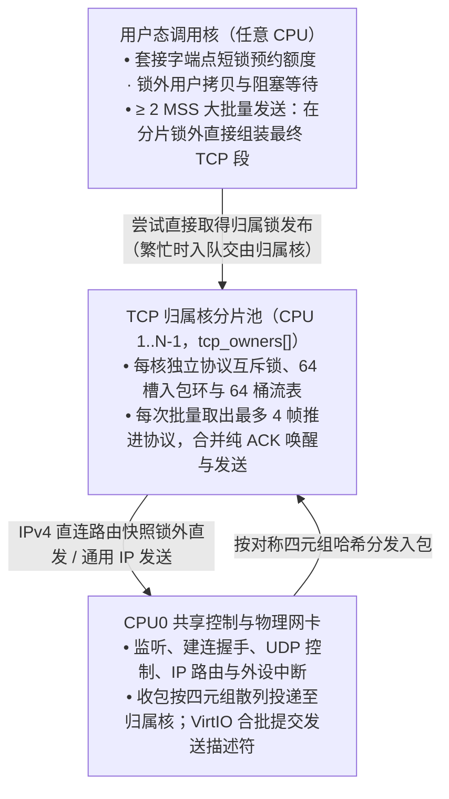

# 多核网络协议栈与套接字

BoarOS 的网络子系统基于 `lwIP`（`STABLE-2_2_1_RELEASE`，`NO_SYS=1`）构建内核协议栈。内核提供 Linux 套接字层，将已建立的传输控制协议（Transmission Control Protocol，TCP）连接分配到不同处理器核，支持批量收发、纯确认报文（Acknowledgment，ACK）合并与直连路由快照复用。套接字层还提供本地域套接字（`AF_UNIX`）、链路层共享内存接收环（`TPACKET_V3`）及运行时路由查询（`rtnetlink`）。

---

## 一、源码组织与协议族覆盖

| 源码路径 | 核心职责 |
| :--- | :--- |
| `kernel/syscall/socket.c`、`fs/files/socket.c` | 套接字系统调用参数导入、文件描述符安装与失败回滚 |
| `net/socket.c`、`net/socket_state.h` | 统一套接字端点、收发队列与额度管理、多核 TCP 归属核调度、回环快路径、`AF_UNIX` 与 `AF_NETLINK` |
| `net/ethernet.c` | 以太网帧收发接入、VirtIO 和 Intel 82576 的协议栈接入、串行纯 ACK 合并与 IPv4 组播/UDP 快速接收 |
| `drivers/net/igb.c` | Intel 82576 原生收发描述符、完成通知、硬件队列停用与目的地址分流 |
| `net/packet_ring.c`、`net/rtnetlink.h` | `AF_PACKET` 第三版共享内存接收环（`TPACKET_V3`）与 `rtnetlink` 接口/地址/路由查询 |
| `net/lwip_port/`、`third_party/lwip/` | lwIP 内核移植层（内存池预算、直连路由快照、IPv4 分片重组所有权与 `TIME_WAIT` 回收钩子） |

### 支持的协议族与套接字类型

| 地址族 | 套接字类型与核心能力 |
| :--- | :--- |
| **`AF_INET`（IPv4）** | `SOCK_STREAM`（TCP）、`SOCK_DGRAM`（用户数据报协议，User Datagram Protocol，UDP）、`SOCK_RAW`（`IPPROTO_ICMP` 原始报文，需 `CAP_NET_RAW`）。支持广播控制（`SO_BROADCAST`）、设备绑定（`SO_BINDTODEVICE`）、IGMPv2 任意源组播（`IP_ADD_MEMBERSHIP` / `MCAST_JOIN_GROUP`，每套接字上限 20 组）与 IPv4 分片重组 |
| **`AF_INET6`（IPv6）** | `SOCK_STREAM`（TCP）、`SOCK_DGRAM`（UDP）、双栈通配监听与 `IPV6_V6ONLY`；支持链路本地地址、静态 IPv6（2 槽）、无状态地址自动配置（SLAAC）、默认路由与 MLDv1 组播（每套接字上限 32 组，全局上限 48 组以保留邻居发现槽位） |
| **`AF_UNIX`（本地域）** | `SOCK_STREAM`、`SOCK_DGRAM`、`SOCK_SEQPACKET`；支持路径名绑定与抽象命名空间（允许含零字节，64 桶散列）、对端凭据（`SO_PEERCRED`/`SO_PASSCRED`）以及经辅助数据传递文件描述符（`SCM_RIGHTS`，内置标记-清除环路垃圾回收器防止相互持有引发泄漏） |
| **`AF_PACKET`（链路层）** | `SOCK_RAW`（含以太网头）与 `SOCK_DGRAM`（剥离或自动构造以太网头），支持 `ETH_P_ALL` 抓包、套接字过滤与 **`TPACKET_V3`** 共享内存接收环（单环上限 64 MiB） |
| **`AF_NETLINK`** | 只读 `NETLINK_ROUTE` 查询（`RTM_GETLINK`、`RTM_GETADDR`、`RTM_GETROUTE`）及 POSIX 消息队列异步线程通知（`mq_notify(SIGEV_THREAD)`） |

---

### Intel 82576 队列与接收缓冲区

QEMU 的 `igb` 设备在未挂接 VirtIO 网卡时接入 `eth0`。接收描述符分别携带报头和载荷的直接内存访问（Direct Memory Access，DMA）地址。驱动批量把描述符提交给网卡。设备回写完成标志后，`net/ethernet.c` 持有两段缓冲区并构造一条 lwIP 报文链。协议栈归还最后一个引用时，接收缓冲区才能进入下一批描述符。发送侧先在短保护内预留队列槽，再把报文复制到该槽的 DMA 缓冲区，最后发布描述符。设备回写完成后才可重用发送槽。

第二个接收队列由虚拟机设备队列（Virtual Machine Device Queues，VMDq）按独立的以太网硬件地址分流。用户可以使用普通网卡配置接口为 `eth1` 分配 IPv4 地址。该接口默认无 IPv4 地址，接收队列由实际的缓冲区提供者启用。主地址、广播和组播流量继续进入 `eth0`。发往次接口 IP 的地址解析协议（Address Resolution Protocol，ARP）报文在内核处理，次接口载荷队列无需接收广播缓冲区。QEMU 的 82576 接收端缩放（Receive Side Scaling，RSS）使用带冲突的散列桶，设备模型也缺少按 TCP 四元组选择目标队列的入口。独立地址是该设备上将用户内存提供给网卡前的隔离条件。

在独立队列上，网卡可把具备完整内核报头的 IPv4 TCP 载荷直接写入提供者提交的页面。单独一段缓冲区中的其他报文在协议解析前转入内核缓冲区。关闭队列先停止硬件，再归还队列尚未完成的缓冲区。已交给协议栈的缓存仍由其实际引用持有，停用失败时保留设备可能仍在使用的页面。

## 二、协议栈资源预算与内存管理

协议栈使用静态对象池与协议堆（`net/lwip_port/include/lwipopts.h`），套接字端点、接收节点与打开文件描述则由通用内核堆管理，两者生命周期分离：

| 资源项 | 默认容量 | 说明 |
| :--- | :--- | :--- |
| **协议堆（`MEM_SIZE`）** | `512 KiB` | 按实际分配块计费。新接纳的 TCP 拷贝数据为确认报文和接收描述预留 8 KiB。网卡 UDP 接收另有 68 KiB 的余量检查。 |
| **协议控制块（Protocol Control Block，PCB）** | TCP 完整控制块最多 `2,048` 个，按需分配。TCP 监听 `16` / UDP `16`。 | 完整控制块从创建到释放计入额度，包含握手和关闭状态。数据与确认报文使用独立额度。 |
| **报文段与缓冲池** | TCP 段 `512` / `pbuf` 头 `256` / `pbuf` 池 `256 × 1536 B` | 发送数据段描述与报文缓冲区合并于同一堆块，减少一半分配与释放 |
| **TCP 窗口与最大报文段（Maximum Segment Size，MSS）** | 外部连接：`MSS = 1,460 B`，默认窗口 `46,720 B`（32 MSS） 内置回环：`MSS = 8,192 B`，默认窗口 `49,152 B` | 支持通过 `SO_RCVBUF` / `SO_SNDBUF` / `SO_SNDBUFFORCE`（需 `CAP_NET_ADMIN`）调节套接字缓冲额度 |
| **UDP 默认接收额度** | `96 KiB` | 端点保留最多一个网卡接收批次的空队列节点复用 |

回环的接收方可以在发出确认报文之后继续持有发送段的数据，直到应用读出数据。共享协议堆没有合适的连续块时，发送方可以从不等待回收的内核堆按需借用一个数据段。同一次向量写入准备两个连续的满长段时，若第一段已借用私有存储且第二段也无法从共享堆取得缓冲，发送方可以在同次操作中再借一个段。每个发送端至多同时保有两个私有段，两段均计入原发送额度。接收方立即确认按序到达的私有段，发送方由此归还相应协议引用。接收队列仍保有各段自己的引用，直到应用读完对应数据。每段在最后一个引用结束时独立释放并发布容量进展。连接关闭时撤下各段到控制块的关联，接收方仍可读完已经收到的数据。

连接结束标志（Finish，FIN）占用一个序号。发送端把该序号计入窗口判断。当最后一段正文恰好用尽发送窗口时，发送端把结束标志拆到独立报文，先发正文，再等对端归还窗口额度。

关闭状态各自记录开始时间。等待本端 FIN 确认的 `LAST_ACK` 和双方结束后的 `TIME_WAIT` 都从进入状态时计时。`FIN_WAIT_2` 只对已经关闭接收方向的端点执行超时回收。应用先关闭发送方向、稍后再关闭接收方向时，接收方向关闭后才开始计时。

---

## 三、多核分片 TCP 架构与收发数据路径

原生 `lwIP` 为单线程协议栈。BoarOS 在多核配置（`BOAROS_USER_SMP`）下，打破“全局一把网络大锁挤在 CPU0”的瓶颈，将网络路径拆分为**调用核本地数据准备**、**按四元组分片的 TCP 归属核**与 **CPU0 控制平面**三层协作：

### 3.1 连接归属核分片与迁移

- **对称散列与负载均衡**：主动连接完成握手、被动连接完成 `accept` 后，通过 `tcp_promote()` 迁出 CPU0。目标归属核由源/目的地址与端口的对称异或哈希 `tcp_flow_hash()` 选定；若首选归属核的活跃连接数已达阈值 **`TCP_OWNER_SPREAD_AT = 4`**，则自动均衡到当前活跃连接最少的核。
- **回环配对同核**：本机回环连接的通信双方自动分配到同一归属核，并在迁入后通过 `tcp_link_loopback_peer()` 建立双向快速指针。
- **连接退出与 `TIME_WAIT` 回收**。套接字创建和监听端握手从内核堆申请完整控制块，申请过程无需睡眠或内存回收。正在分配的对象和已发布的对象共同占用全局额度。压力下可回收已脱离套接字的 `TIME_WAIT` 记录。监听核在跨核回收前释放互联网协议层锁，并尝试取得目标归属核的保护。内核等在途借用结束，撤销流索引和回环对端关联后，才释放对象和额度。仍在握手、传输或等待结束报文确认的连接沿各自的协议状态继续执行。

### 3.2 调用核本地化：预留-拷贝-提交模型

- **零中转接收（`read` / `recvfrom` / `recvmsg` / `recvmmsg`）**：在端点短锁内预留当前可读队列前缀（流式套接字截断至用户缓冲区容量，数据报套接字预留单个报文），释放锁后直接遍历 `pbuf` 链拷贝至用户向量并一次提交消费，随后将 `pbuf` 归还与接收窗口通告（`tcp_recved`）交由协议执行者，确保网卡直接内存访问（DMA）接收借用在拷贝完成前绝不被提前复用。
- **单核短发送**。RISC-V 单核内核使用原生用户地址复制，将不超过 256 字节、位于同一页内的单段发送读入任务已有的临时页，随后把实际接纳的前缀交给 TCP 协议缓冲区。该路径省去用户物理页借用，仍按发送额度和报文顺序提交。临时页的使用范围在归还时清零，覆盖用户缓冲区来自秘密内存映射的情况。较长或跨页的发送沿页借用路径直接写入最终协议缓冲区。
- **大批发送锁外组装（`kernel_socket_stream_preparev`）**：对已迁入归属核的 TCP 连接，当单批发送量处于 `[2 × MSS, 64 KiB]` 区间时，调用核在分片锁外直接按当前 MSS 将用户数据组装为最终协议缓冲区与报文段，归还用户页后再尝试获取归属核互斥锁一次性发布（锁繁忙则入队交由归属核按序接纳）。
- **完整 `MSG_WAITALL` 与批量消息**：TCP 接收支持 `MSG_WAITALL`（分批交付当前可读前缀并立即归还窗口，共享同一次 `SO_RCVTIMEO` 绝对期限等待剩余数据，且支持 `MSG_PEEK | MSG_WAITALL` 推进观察偏移）；支持 `sendmmsg(269)`（上限 1,024 项）与 `recvmmsg(243)`（含 `MSG_WAITFORONE`）。
- **查询可读字节**：IPv4 和 IPv6 的 TCP 套接字通过 `ioctl(FIONREAD)` 返回已进入接收队列、尚未消费的字节数。内核在端点锁下读取现有计数，释放端点锁后复制结果。监听套接字返回 `EINVAL`。

### 3.3 四项关键数据路径加速机制

1. **批量入包与纯 ACK 合并**：
   - 以太网 TCP 连接优先分配给当前连接较少的归属核，连接数相同时优先采用流散列得到的归属核。回环仍保持已配对端点的归属关系。归属核每次在入包环短锁下批量取出最多 **`TCP_RX_BATCH = 4`** 帧（每轮上限 16 帧）。
   - 串行以太网接收路径（`net/ethernet.c`）可将同一已建立连接连续到达的最多 **8 个**无选项、确认号递增且通告窗口不变的纯 ACK 合并为一次确认处理。多核下若物理网卡收包时目标归属核正空闲等待且无积压，可在接收核就地执行 `tcp_try_inline_ack()`。归属核已经取出的同一批报文可合并对应的就绪通知和纯 ACK 回复，批次结束后提交。
   - 串行网卡接收与连接归属核都可合并同一批次内最多 **4 个**连续的 IPv4 TCP 数据段。内核逐段核对校验和，确认连接已建立、序号相邻、确认号和通告窗口相同，再串接已有缓冲区，合并协议处理和套接字队列发布。带选项、有过滤器或需要处理乱序的报文沿普通路径。用户复制遇到故障时，仍按原始数据段边界提交已完成的前缀。
   - 以太网报文遇到已满的归属核入包队列时，接收者放开互联网协议层的保护，尝试取得该归属核的协议资格。成功时先按队列顺序处理最多四个旧报文，再重试当前报文的入队。资格不可用时只重试入队一次，接收者不会等待归属核的协议资格。
   - 多核以太网 TCP 的连续部分读取可以累计接收窗口额度。应用读空接收队列时会发布已消费的额度。单核上，读取线程已将消费前缀从队列摘下且能立即取得协议保护时，直接归还接收缓冲区和窗口额度。若本次读空且连接仍可接收，再用同一次协议保护收取网卡队列中已有的一批报文，避免刚释放缓冲区就睡眠等待网络线程。协议繁忙、接收需要重试或网络正在停止时，仍由原有退休队列处理。缩小 `SO_RCVBUF` 时，设置者持有 TCP 控制块的协议保护，归还按旧阈值累计的额度，避免新阈值跨过已经积欠的额度却遗漏唤醒。
2. **IPv4 直连路由快照复用**：
   - 符合条件的 IPv4 直连 TCP 和 UDP 发送通过 `boaros_path4` 复用已解析的出接口、最大传输单元（Maximum Transmission Unit，MTU）与两端链路地址。地址解析协议（Address Resolution Protocol，ARP）表项或接口配置变化会推进路径代次。对 UDP 而言，调用核复用快照前还要核对目的地址和端口、报文是否超过接口的最大传输单元，以及套接字是否有待合并的数据。满足条件时，调用核可直接构造并提交以太网帧。快照不可用时，按共享协议保护的取得结果在调用核继续处理或将请求交给网络工作线程。
3. **本机回环直交快路径**：
   - 单核回环按原接收批次合并同一 IPv4 连接的连续普通数据段。内核从满足回环默认段长的正文开始合批，要求序号连续、窗口和确认号一致，并按原报文校验。每段保留自己的共享载荷引用和用户复制故障边界。结束报文、需要即时确认的进展段，以及不能合并的报文沿原顺序单独处理。
   - 单核回环 TCP 的读取线程在消费已复制的前缀后，尝试取得串行协议保护并归还报文缓冲和接收窗口额度。协议繁忙、已有接收重试或网络正在停止时，网络线程继续处理退休队列。串行协议执行者结束当前轮次时检查回环队列，只有本轮未处理完的报文才需要唤醒网络线程。超过处理预算的报文和定时器产生的报文仍由该线程接续处理。
   - 串行协议执行者用同一次共享状态检查判断套接字工作队列是否全空。存在工作时按原有轮转顺序检查就绪、容量归还与重试任务。回环报文和到期定时器各自按批次预算处理。
   - 串行协议执行者可为每个回环套接字复用一个已消费报文的接收描述符。当有描述符分配失败的接收者等待时，释放的描述符进入共享堆。报文载荷在每次消费后归还。读取完成时，套接字只在仍有可读数据或已进入终止状态时通知读取等待者，停服等待者由读取请求的结束通知唤醒。
   - 当本机回环 TCP 双方已配对、且无 `AF_PACKET` 抓包器和套接字过滤器时，`tcp_local_output()` 直接共享不可变载荷视图（`pbuf_clone_shared`）投入同一归属核的对端入包环，跳过 IP 和以太网首部编解码。IPv4 连接复用在互联网协议层保护下实际选中的回环接口。接口配置变化时，路径代次使快照失效，下一次按真实配置解析。
   - IPv4 回环报文完成直交时，入包资格已经确认当前接口没有设置有限的最大传输单元。`TCP_INFO` 复用该结果，省去逐报文取得互联网协议层共享锁。修改回环接口的最大传输单元会撤销直交资格，普通输出继续按实际接口配置更新路径值。IPv6 仍查询邻居发现的目的地缓存。
   - 普通 IPv4 回环 UDP 在没有旧报文排队时复用入包的端口匹配函数，将已经复制好的内核载荷直接交给目标套接字。发送口分配、发送次序、接收额度和通知仍由现有机制维护。存在抓包器、原始套接字、目标过滤器或无匹配接收者时，沿完整报文路径处理。单核的接收队列已有积压时也回到普通路径，保留快速交付对请求与响应的收益。
4. **VirtIO 网卡合批与校验和加速**：
   - 接收轮询每批最多收割 **8 帧**（`KERNEL_NETWORK_RECEIVE_BATCH`），采用最多 32 帧零拷贝 DMA 借用（总缓冲池 64 帧）。单核和多核的发送者都可在槽位耗尽时，就地归还最多 **8 个**已完成且仍占槽的发送缓冲区，再尝试一次提交。报文引用在网卡保护外释放，网卡工作线程负责其余完成引用及停止清理。
   - 发送端对连续报文合批最多 **8 帧**后通知设备。多核 IPv4 的 `sendmmsg()` 使用匹配的直连路由快照时，可以延后通知。系统调用记录实际提交的接口，在回退到慢路径、批次结束或清理时提交已接纳的前缀，包括首条 `msg_len` 回写失败的情况。

---

## 四、链路层共享内存接收环（`TPACKET_V3`）与本地域套接字

### 4.1 `AF_PACKET` 与 `TPACKET_V3` 共享内存环（`net/packet_ring.c`）

抓包程序可将 `PACKET_VERSION` 设为 `TPACKET_V3`，再通过 `PACKET_RX_RING` 建立按块交付的共享接收环。

1. **建立映射**。内核检查块大小、帧大小和对齐要求，逐页为接收环分配并清零物理页，单环上限为 **64 MiB**。抓包程序使用 `mmap(MAP_SHARED)` 将整环映射到自己的虚拟地址空间。
2. **复制与发布**。链路层抓包路径先执行套接字过滤，再将保留的报文字节从原报文缓冲区复制到当前环块。`ring_copy_payload()` 按环块跨越的物理页分段复制。当前块放不下下一条记录，或块超时到期（默认为 **64 毫秒**）时，内核先写好报文计数和长度，再以释放语义发布 `TP_STATUS_USER`，通知 `poll` 或 `epoll` 等待者。
3. **读取与归还**。用户程序看到 `TP_STATUS_USER` 后直接读取映射中的报文，从而省去逐包调用 `recvfrom` 以及将报文从内核缓冲区再复制到用户缓冲区的成本。应用处理完一个块后，以释放语义写回 `TP_STATUS_KERNEL`。当接收环绕回尚未由用户归还的块时，内核丢弃当前报文并累计丢包统计。

### 4.2 `AF_UNIX` 就绪通知、文件描述符传递与环路回收

本地域流式套接字在同一端点保护区内借用对端并预约发送额度。发送者可以在这次保护内取回一个已完全消费、没有控制消息的短报文缓冲。每个发送者在 128 和 256 字节两档各保留至多一个空闲缓冲，全系统最多保留 64 个，端点关闭时归还。新分配与正文复制在保护区外完成。报文只需清零头部，入队长度以实际复制完成的字节数为准。一次读取摘下同一发送者的多个报文时，内核在摘队时一次归还额度并通知可写等待者。发送者有异步信号订阅时，内核在归还每个报文的额度时检查可写条件并按条件投递信号。

本地域流式套接字在发布数据时通知可读事件，在归还发送额度时通知可写事件。`poll`、`ppoll` 和 `select` 的等待节点记录请求的事件。单套接字等待在同一次端点保护内查询就绪状态并登记，通知可以在调用者提交睡眠前完成。多个文件描述符仍逐个登记并复查。队列只有一个匹配的任务等待者时，发布者可取得带代次的等待令牌，在端点保护区外直接通知该任务。需要遍历多个订阅或调用回调时，由队列游标保活。端点错误和挂断仍按各自语义发送通知。

本地域套接字支持 `sendmsg`/`recvmsg` 通过控制消息 `SCM_RIGHTS` 在进程间传递打开的文件描述符（单条消息受 `KERNEL_SOCKET_SCM_MAX_FD` 与进程 `RLIMIT_NOFILE` 限制）。如果两个未关闭的 UNIX 套接字互相把对方的描述符发进彼此的接收队列，随后进程关闭了外部句柄，普通引用计数会形成无法释放的引用环。BoarOS 内置了基于图可达性的**标记-清除环路垃圾回收器**（`kernel_socket_rights_service()`），在关闭清理时自动识别并打破孤立的套接字互引环，归还所有内存与文件对象。

---

展开查看：IPv4 重组规则、错误处理契约与定向验证入口

### 关键协议边界与安全契约

| 机制 | 规则说明 |
| :--- | :--- |
| **IPv4 分片重组（本地加固）** | 重组键包含源/目的 IP、IP ID、协议号与输入接口身份；完全重叠的重复片直接丢弃（即使改变 `MF` 位也不提前触发交付），部分重叠或越界终点整组丢弃；判重先于资源淘汰，防止重复报文驱逐有效分片；接口移除前自动清理该接口全部重组引用。 |
| **低端口与特权权限** | 绑定 `< 1024` 的非零端口需 `CAP_NET_BIND_SERVICE`；创建 `AF_INET/SOCK_RAW` 与 `AF_PACKET` 需 `CAP_NET_RAW`；`AF_NETLINK` 原始套接字无需 `CAP_NET_RAW`；`SO_BINDTODEVICE` 首次绑定免特权，修改或解除需 `CAP_NET_RAW`。 |
| **IPv4 `0.0.0.0` 本地目标语义** | `connect` 与 UDP `sendto` 将目的 `0.0.0.0` 按 Linux 语义转为 `127.0.0.1`；`bind` 的 `0.0.0.0` 仍表示通配监听。 |
| **资源耗尽重试与唤醒** | TCP `POLLOUT` 同时核对发送缓冲、段队列与协议池容量代次；遭遇 `ERR_MEM` 时登记协议池或网卡容量重试队列，仅在真实资源归还推进代次后唤醒等待者，消除忙等。 |

### 定向验证入口

- **协议所有权、重组与 `netlink`（宿主）**：`make test-lwip-host`、`make test-lwip-reassembly-host`、`python3 -B tests/host/network_owner.py --sanitize`、`sh tests/host/tcp-waitall.sh`、`sh tests/host/netlink-notify.sh`。
- **双架构客机与外部网络验证**：`tests/userland/network-external.py`、`tests/userland/ipv6-external.py`、`tests/userland/ipv6-multicast.py`、`tests/userland/rtnetlink.py`、`tests/userland/tcp-waitall.py`、`tests/userland/tcp-cork.py`、`tests/userland/tcp-keepalive.py`、`tests/userland/tcp-info.py`、`tests/workloads/network/packet_ring.c`。
- **固定工作量吞吐与延迟对照**：`python3 -B tests/cost/network-budget-experiment.py --help`。

