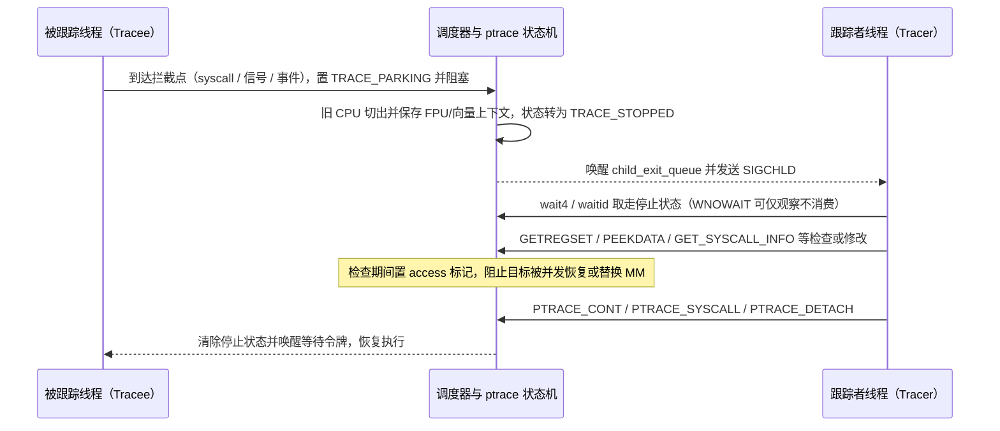

# 进程跟踪（`ptrace`）

进程跟踪（Process Trace，`ptrace`）是调试器（如 GDB）与系统调用追踪工具（如 `strace`）赖以工作的内核基础设施。它允许一个“跟踪者”（Tracer）线程附加到另一个“被跟踪者”（Tracee）线程上，在其进入系统调用、收到信号、派生子进程或替换映像等关键节点将其暂停，读取或改写其寄存器与内存，并决定如何恢复执行。

BoarOS 在 RV64 与 LA64 上实现了 Linux `ptrace(117)` 系统调用，完整支持附加/接管、系统调用拦截、事件跟踪、寄存器集与远端内存读写以及安全计算模式（Secure Computing Mode，seccomp）协同。

---

## 一、源码组织

| 源码路径 | 核心职责 |
| :--- | :--- |
| `kernel/sched/ptrace.c`、`kernel/sched/ptrace_internal.h`、`include/kernel/ptrace.h` | 跟踪关系链表、状态机（`RUNNING` / `PARKING` / `STOPPED` / `LISTENING` / `FINAL`）、附加权限校验、停止/恢复协调、`wait` 事件筛选及退出清理 |
| `arch/riscv/ptrace.c`、`arch/riscv/vector.c` | RV64 整数（`NT_PRSTATUS`）、浮点（`NT_PRFPREG`）与向量（`NT_RISCV_VECTOR`）寄存器集编解码，以及系统调用信息提取 |
| `arch/loongarch/ptrace.c` | LA64 整数（含原始 `a0`、`ERA`、`BADV`）、基础浮点寄存器集编解码，以及 `PEEKUSER`/`POKEUSER` 索引访问 |
| `kernel/syscall/process.c` | `ptrace(117)` 系统调用入口分派 |

---

## 二、跟踪关系、附加方式与状态机

### 2.1 线程级跟踪与双亲回收语义

在 Linux 模型中，跟踪关系绑定在**单个线程**上而非整个进程：

- 被跟踪线程在逻辑上保留其真实父进程；`/proc/<tid>/status` 中的 `TracerPid` 反映当前跟踪者的 TID。
- 跟踪者通过自己维护的被跟踪者链表（`ptrace->first` / `next` / `previous`）经 `wait4`/`waitid` 获取停止或退出事件；真实父进程仍通过子进程列表等待最终回收。
- 若跟踪者与真实父进程分属不同线程组，目标线程终止后先进入 `TRACE_FINAL` 阶段，由跟踪者优先读走退出状态并解除跟踪，随后真实父进程才能收到退出通知并完成僵尸回收。
- 跟踪者退出时自动解除所有跟踪关系；若对某被跟踪者设置了 `PTRACE_O_EXITKILL`，则同时向其投递 `SIGKILL`。

### 2.2 附加与权限校验

BoarOS 支持三种建立跟踪关系的方式：

- **`PTRACE_TRACEME`**：由被跟踪线程主动发起，将创建它的真实父线程设为跟踪者（若目标拥有的能力超过父线程且父线程缺少 `CAP_SYS_PTRACE`，则拒绝）。
- **`PTRACE_ATTACH`**：由跟踪者主动附加目标线程，并立即投递一个暂停停止请求（`SIGSTOP`），使目标尽快停下。
- **`PTRACE_SEIZE`**：现代无侵入式附加模式。附加时**不自动发送 `SIGSTOP`**，允许直接指定初始事件选项，后续通过 `PTRACE_INTERRUPT` 在不干扰用户信号队列的前提下触发 `PTRACE_EVENT_STOP` 暂停，并支持 `PTRACE_LISTEN` 监听作业控制组停止状态变化。

`ATTACH` 与 `SEIZE` 均按跟踪者的真实 UID/GID、能力集合（或 `CAP_SYS_PTRACE`）及目标的 `dumpable` 属性核对权限。若目标正处于 `execve` 准备事务中，附加请求会在等待队列上休眠直至 `exec` 提交或中止，唤醒后再重新核对目标线程身份与新凭据，避免越权竞态。

### 2.3 停止与恢复协同流程

被跟踪线程在系统调用出入口、信号递送前、作业控制停止或已启用的生命周期事件点，均在**自身内核栈**上准备等待令牌并让出 CPU。只有当旧 CPU 真正切出并保存完浮点/向量现场后，调度器才通过 `kernel_ptrace_switch_finish_locked()` 将其正式发布为 `TRACE_STOPPED` 状态，并唤醒跟踪者的 `wait` 队列、投递 `SIGCHLD`。



---

## 三、系统调用拦截、事件跟踪与 `seccomp` 协同

### 3.1 系统调用与事件选项

通过 `PTRACE_SETOPTIONS`（或 `PTRACE_SEIZE` 初始参数）可按位启用以下事件：

| 选项 | 触发时机与效果 |
| :--- | :--- |
| `PTRACE_O_TRACESYSGOOD` | 系统调用入口/出口停止携带 `SIGTRAP \| 0x80`（`133`），方便与普通 `SIGTRAP` 区分 |
| `PTRACE_O_TRACEFORK` / `TRACEVFORK` / `TRACECLONE` | 派生子任务时自动继承跟踪关系并暂停新任务；父任务收到对应事件停止，消息为子任务在跟踪者视图中的新 TID |
| `PTRACE_O_TRACEVFORKDONE` | `vfork` 子进程执行 `exec` 或退出、归还共享地址空间时通知父任务 |
| `PTRACE_O_TRACEEXEC` | 成功完成 `execve` 后触发事件停止，消息为执行线程原先的 TID（未启用且非 `SEIZE` 模式时按传统发送 `SIGTRAP`） |
| `PTRACE_O_TRACEEXIT` | 线程即将退出时触发事件停止，消息为退出状态码 |
| `PTRACE_O_TRACESECCOMP` | `seccomp` 过滤器返回 `SECCOMP_RET_TRACE` 时触发事件 7，消息为规则附带的 16 位策略数据 |
| `PTRACE_O_EXITKILL` | 跟踪者退出时自动向被跟踪者发送 `SIGKILL` |

不同停止类型对恢复命令附带信号号的处理遵循 Linux 语义：
- **信号递送停止**：按附带信号号投递原信号、替换为新信号，或传 `0` 抑制该信号；停住期间可用 `PTRACE_GETSIGINFO`/`PTRACE_SETSIGINFO` 与 `PTRACE_GETSIGMASK`/`PTRACE_SETSIGMASK` 读写信号负载与屏蔽掩码。
- **系统调用停止（`PTRACE_SYSCALL`）**：附带非零信号时会额外向该线程排入一条异步信号（可能引发新的信号递送停止）。
- **生命周期事件停止（`fork`/`exec`/`exit` 等）**：忽略恢复命令附带的信号号。

### 3.2 `PTRACE_GET_SYSCALL_INFO` 与系统调用重启交互

`PTRACE_GET_SYSCALL_INFO`（`0x420e`）以统一结构体向调试器报告当前停止处的系统调用上下文，其中架构标识 `arch` 在 RV64 为 `0xc00000f3`（`AUDIT_ARCH_RISCV64`）、LA64 为 `0xc0000102`（`AUDIT_ARCH_LOONGARCH64`）：

- `op = 0`（无系统调用信息）：24 字节；
- `op = 1`（系统调用入口）：80 字节，含调用号与 6 个参数（`args[0]` 始终反映原始 `a0` 槽）；
- `op = 2`（系统调用出口）：33 字节，含返回值与错误标志；
- `op = 3`（`SECCOMP` 跟踪停止）：84 字节，额外附带策略数据 `ret_data`，不依赖 `TRACESYSGOOD`。

当跟踪者在普通系统调用入口或 `seccomp` 停止中，将处于自动重启状态的 `restart_syscall(128)` 替换为其他完整 64 位调用号时，内核通过 `kernel_signal_retire_replaced_restart()` 丢弃旧的重启状态（超时与负载）；若未改号则完整保留。在 `seccomp` 停止中将调用号改为负值可跳过实际系统调用执行，直接以当前普通 `a0` 作为用户态返回值。相关过滤规则见[系统调用分派](kernel-syscall.md)。

---

## 四、寄存器集与远端内存访问

### 4.1 寄存器集（`GETREGSET` / `SETREGSET`）与 `PEEKUSER` / `POKEUSER`

| 架构 | 寄存器集类型 | 布局与大小 | 关键细节 |
| :--- | :--- | :--- | :--- |
| **RV64** | `NT_PRSTATUS`（1） | `32 × 8 = 256` 字节：`sepc` 后接 `x1`～`x31` | 整数集不暴露独立 `orig_a0` 槽；入口停止时改普通 `a0` 不替换实际首参，出口停止可改 `a0` 返回值 |
| **RV64** | `NT_PRFPREG`（2） | `33 × 8 = 264` 字节：32 个浮点寄存器 + `fcsr` | 写入时自动标记浮点状态已保存 |
| **RV64** | `NT_RISCV_VECTOR`（`0x900`） | 动态长度：5 字控制头（`vstart`/`vl`/`vtype`/`vcsr`/`vlenb`）+ 向量寄存器体 | 由 `riscv_vector_ptrace()` 校验 CSR 合法性并读写 |
| **LA64** | `NT_PRSTATUS`（1） | `45 × 8 = 360` 字节：32 个通用寄存器 + `orig_a0` + `ERA` + `BADV` + 10 字保留区 | 支持单独修改槽 32（`orig_a0`）以改写系统调用首参 |
| **LA64** | `NT_PRFPREG`（2） | `34 × 8 = 272` 字节：32 个基础浮点低 64 位 + `fcc` + `fcsr` | 写入仅更新低 64 位，完整保留 LSX/LASX 向量寄存器高位 |

对于传统的单字访问接口 `PEEKUSER`/`POKEUSER`，LA64 支持原生索引 `0`～`34`（对应通用寄存器、`orig_a0`、`ERA`、`BADV`），RV64 按 Linux 约定返回 `-EIO`。

### 4.2 目标地址空间读写（`PEEKTEXT`/`POKETEXT`/`PEEKDATA`/`POKEDATA`）

- 原始系统调用 `PEEKTEXT`/`PEEKDATA` 读取一个 64 位机器字写入 `data` 指针并返回 `0`（C 库包装层再将其作为返回值交付给程序）；`POKETEXT`/`POKEDATA` 直接写入传入的机器字。
- 访问期间通过 `s->access` 标记固定目标线程的停止状态，防止目标在拷贝中途被唤醒或替换地址空间；若目标经 `execve` 变为不可转储（`dumpable != 1`）且附加时的凭据不具备 `CAP_SYS_PTRACE`，则拒绝访问并返回 `-EIO`。
- 写入由 `kernel_mm_remote_transfer()` 执行：对私有只读映射（如代码段插桩断点）自动触发写时复制，写入可执行页后执行指令缓存同步。地址空间与页所有权细节见[内存管理](kernel-mm.md)。

> **当前范围边界**：单步执行（`PTRACE_SINGLESTEP`）与硬件断点寄存器暂不在当前支持范围内。

---

<details>
<summary>展开查看：定向验证入口与工具</summary>

- **综合行为与原版 `strace` 7.3 验收**：
  ```sh
  python3 tests/userland/api8.py --program ptrace --program ptrace_signal --program ptrace_tools
  ```
  其中 `ptrace_tools` 使用静态 musl 构建的上游 `strace` 7.3，验证 `-f` 多线程跟踪、`fork`/`vfork`、非组长 `exec`、信号记录与运行时 `attach`；构建脚本为 `tools/build-strace.py --arch riscv` 或 `--arch loongarch`（来源说明见[第三方组件](../third-party.md)）。
- **系统调用入口改号与 `restart_syscall` 交互验证**：
  `tests/workloads/seccomp/ptrace_restart.c`（由 `tests/userland/seccomp.py` 在 RV64/LA64 上运行）验证在 `nanosleep`/`FUTEX_WAIT` 停止后改写调用号、改写高位非零非法号与不改号三种对照下的恢复语义。

</details>
