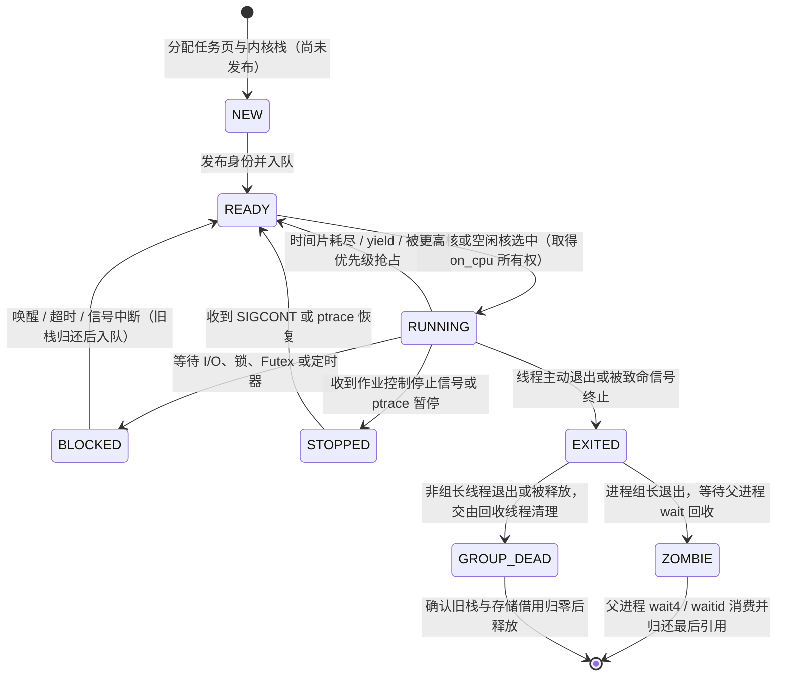
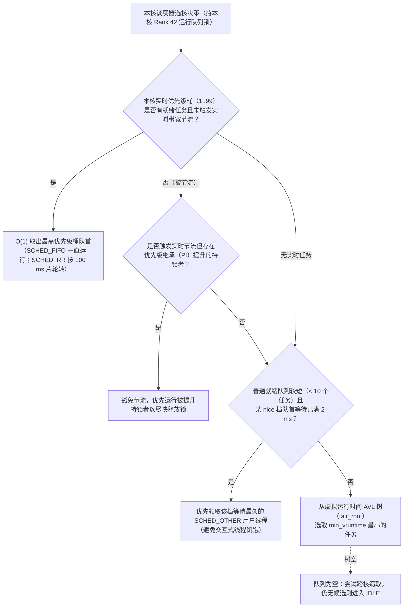
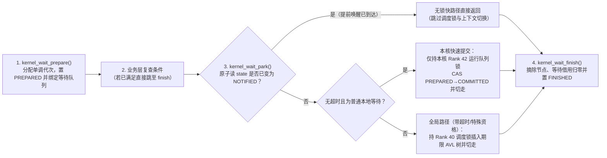

# 进程模型、SMP 调度与同步原语

BoarOS 的调度与同步子系统在 RISC-V 64 与 LoongArch 64 上共享同一套实现，负责管理任务生命周期、1～8 核对称多处理（Symmetric Multiprocessing，SMP）就绪队列、公平与实时调度策略、底层等待与锁原语、快速用户空间互斥锁（Fast Userspace Mutex，Futex）以及进程身份与权限凭据。

---

## 一、源码组织

| 源码路径 | 核心职责 |
| :--- | :--- |
| `include/kernel/task_state.h`、`kernel/sched/private.h` | `struct kernel_task` 统一任务布局、调度器全局状态与队列成员定义 |
| `kernel/sched/core.c`、`lifetime.c` | 任务创建、上下文切换入口、带保护页的内核栈缓存与安全延迟回收 |
| `kernel/sched/policy.c`、`runqueue.c` | 调度策略状态机、40 档 `nice` 权重表、公平虚拟运行时间平衡树与实时优先级桶 |
| `kernel/sched/scheduling.c`、`kernel/syscall/sched.c` | 运行时间记账、跨核窃取与负载均衡、CPU0 服务交接、策略与亲和性系统调用 |
| `kernel/sched/process.c`、`exec.c` | `fork`/`clone`/`clone3`、线程组/父子树、`wait4`/`waitid`、退出与 `exec` 提交 |
| `kernel/sched/park.c`、`wait.c` | 代次原子等待令牌、本地/全局阻塞提交、期限平衡树与退役游标 |
| `kernel/raw_lock.c`、`kernel/sched/sync.c` | 静态分层原始自旋锁（`kernel_raw_lock`）与自适应自旋可睡眠读写锁（`kernel_rwlock`） |
| `kernel/sched/futex.c`、`futex_waitv.c`、`futex_pi.c` | 256 桶 Futex、多地址等待（`futex_waitv`）、健壮锁退出清理与优先级继承（PI） |
| `kernel/pid.c`、`kernel/sched/identity.c` | 统一 `kernel_pid` 身份对象、四类角色挂接与多级 PID 命名空间绑定 |
| `kernel/credentials.c`、`kernel/rlimit.c` | 不可变用户凭据、能力集（Capabilities）与按 UID 计费的资源限额 |
| `include/arch/task.h`、`arch/{riscv,loongarch}/` | 构建期绑定的架构上下文切换、异常帧初始化与中断屏蔽接口 |

---

## 二、任务模型、状态流转与内核栈缓存

### 2.1 任务控制块与状态机

内核中每个线程（以及单线程进程）由一个占据单张基页的 `struct kernel_task` 描述，架构寄存器上下文位于结构体偏移 0，紧接着存放当前处理器编号（供陷入汇编快速定位）。任务在其生命周期内沿 9 种状态（`enum kernel_thread_state`）严格流转：

**旧执行栈的安全交接**：在多核环境下，任务切出处理器（无论是阻塞、抢占还是退出）时，旧任务仍运行在自己的内核栈上，直到新栈执行至统一完成点 `kernel_scheduler_switch_finish()` 后，内核才正式释放旧任务的执行权（`on_cpu`）。在此之前，即使唤醒已经到达，也只标记待就绪状态而不允许其他核抢先运行或回收旧栈，彻底避免双核踩踏同一内核栈。

### 2.2 带防溢出保护页的每核内核栈缓存

每个用户任务的内核栈占 2 个连续物理页（`KERNEL_STACK_ORDER = 1`），映射在一个 3 页宽的虚拟槽位（`ARCH_KERNEL_STACK_SLOT_SIZE`）中——底部 1 页刻意保持未映射作为**硬件防溢出保护页（Guard Page）**，栈底还写入哨兵校验值 `KERNEL_STACK_CANARY`（`0x535441434b4f4b21`）。同时，虚拟槽位分配采用页缓存别名着色公式分散槽位地址，减轻相同组相联缓存行冲突。

高频创建与销毁线程时，反复建立/撤销内核栈页表并广播跨核转换后备缓冲器（Translation Lookaside Buffer，TLB）失效代价很高。为此，BoarOS 在 `kernel/sched/core.c` 中维护了每核 1 项的栈缓存 `kernel_stack_cache[BOAROS_MAX_CPUS]`：
- 用户任务彻底退出且旧执行权、等待节点借用全部归零后，回收路径将该栈的物理地址与曾经触及过的最小脏区起点存入栈顶元数据，通过原子交换发布到当前核的栈缓存中；
- 下次创建用户线程调用 `allocate_task_pages()` 时，原子取出缓存栈并仅清零可能被写过的区间，完全省去页表编辑与跨核 TLB 同步；
- 当物理内存紧张时，`kernel_stack_cache_reclaim()` 可由分配器压力钩子调用，安全撤除缓存映射、完成 TLB 确认后归还物理页。

---

## 三、每核独立就绪队列与调度策略

每个处理器核拥有独立的就绪队列 `struct kernel_sched_runqueue`（受本核 `Rank 42` 运行队列锁保护）。每个就绪任务仅持有一个内嵌节点 `ready_node`（复用于实时链表或公平平衡树），由 `ready_cpu` 唯一标识其归属队列，不维护全局冗余就绪表。

### 3.1 普通任务的公平调度（`SCHED_OTHER` / `SCHED_BATCH` / `SCHED_IDLE`）

- **虚拟运行时间（Virtual Runtime，vruntime）**：内核将所有普通就绪任务按 `vruntime` 组织在每核的 AVL 平衡树 `fair_root` 中。系统沿用 Linux 40 档 `nice`（`-20` 至 `+19`）静态权重表（`nice -20` 权重为 `88761`，`nice 0` 为 `1024`，`nice +19` 为 `15`；后台空闲策略 `SCHED_IDLE` 固定权重为 `3`）。任务实际占用 CPU 的纳秒数按 `Δt × 1024 / weight` 折算为 `vruntime` 增量（保留除法余数避免精度漂移），从而使高权重任务获得成比例的更多 CPU 份额。
- **单调基准与唤醒补偿**：每核维护单调递增的 `min_vruntime`。任务跨核迁移或经由 CPU0 服务往返时，相对源/目标队列的 `min_vruntime` 平移进度；长期睡眠后被唤醒的任务最多获得一个默认基准量子（`10 ms`）的进度补偿，既响应及时又不至于长期霸占处理器。
- **可调请求时间片与唤醒抢占**：普通线程默认请求量子为 `KERNEL_SCHED_FAIR_NS = 10 ms`，可通过 `sched_setattr()` 的 `runtime` 字段在 `0.1 ms ～ 100 ms` 之间定制。对于 `SCHED_OTHER`，唤醒任务若领先当前运行者超过 `KERNEL_SCHED_WAKE_NS = 1 ms` 可触发唤醒抢占；面向批处理的 `SCHED_BATCH` 不会因刚唤醒而抢占他人。
- **短队列防饥饿老化**：每核按 40 个 `nice` 档额外维护就绪用户线程的先入先出链表 `ready_wait_first[40]`。当本核排队任务数少于 10（即 `10 ms / 1 ms`）且某档队首等待满 `2 ms` 时，可优先领取运行（若需抢占同档运行者，要求后者本轮已至少运行 `1 ms`），不额外赠送虚拟时间份额，且入队/摘队/查询均为 O(1)。

### 3.2 实时调度（`SCHED_FIFO` / `SCHED_RR`）与带宽限流

- **常数时间优先级桶**：支持 1～99 级实时优先级（数值越大越优先），就绪队列使用 `heads[100]` / `tails[100]` 维护各优先级双向链表，同级插入、删除与最高级选取均在 O(1) 内完成。
  - `SCHED_FIFO`（先入先出实时策略）不因时钟滴答主动让出同级处理器，仅在阻塞、退出、主动 `sched_yield` 或被更高优先级抢占时离开；
  - `SCHED_RR`（轮转实时策略）按实际在 CPU 上运行的纳秒数扣减时间片（默认 `100 ms`，可通过 `/proc/sys/kernel/sched_rr_timeslice_ms` 动态调整），被高优先级抢占或中途阻塞不重新赠送剩余时间片，耗尽后才重装并排到同级队尾。
- **实时带宽限流**：为防止失控的实时死循环饿死普通系统服务，全局实时带宽默认配置为 `period_ns = 1 s`、`runtime_ns = 950 ms`（可通过 `/proc/sys/kernel/sched_rt_period_us` 与 `sched_rt_runtime_us` 调整，写 `-1` 关闭节流）。各核独立记录本周期的实时消费量，耗尽后本核节流，只允许普通任务或空闲任务运行，直到下一周期自动补充。若本核存在经优先级继承临时提升的持锁者（`boosted > 0`），自动豁免节流以防死锁。

### 3.3 多核亲和性感知窃取与负载均衡

- **O(log N) 亲和性剪枝窃取**：多核编译时，普通任务 AVL 树的每个节点同时记录自身 `fair_affinity` 与整棵子树的按位或汇总 `fair_subtree_affinity`；实时可迁移索引树 `rt_remote` 则维护 32 位三通道资格位图（普通迁移掩码、内核线程掩码、PI 豁免节流掩码）。当空闲核或低优先级核跨核窃取任务时，若整棵子树与当前核无交集则直接剪枝跳过，无需线性扫描对方队列。
- **周期性公平负载均衡（`balance_ordinary`）**：在 `USER_SMP` 模式下，每个来源核每 `20 ms`（`FAIR_BALANCE_NS`）最多迁移一个已经归还旧栈的就绪普通任务。系统从允许跨核迁移的候选链表中每轮取出至多 8 个候选（`FAIR_BALANCE_BATCH = 8`），按处理器编号顺序锁定源/目标队列，仅当迁移能使两核加权负载差**至少缩小 25%** 时才执行迁移，避免任务在多核间无意义抖动。

---

## 四、等待原语、两级锁与 Futex 同步

### 4.1 基于原子代次令牌的等待机制（`park.c` / `wait.c`）

在并发内核中，睡眠原语必须解决经典的“丢失唤醒”竞态（线程检查条件不满足后、尚未挂入睡眠状态前，唤醒方就已经发出通知）。BoarOS 采用 **`prepare → 复查条件 → park → finish`** 四步协议，并在多核构建中将 58 位全局单调递增代次（`generation`）、2 位等待阶段、2 位唤醒原因与 2 位可中断标志打包进 `struct kernel_wait_record::state` 单个 64 位原子字中：

- **单次仲裁与旧代次免疫**：唤醒、超时到期与信号中断三类事件通过原子比较交换（CAS）竞争决定唯一完成原因；单调不回退的 58 位代次保证即使任务结构体被复用，迟到的旧唤醒也绝不会误伤新一次等待。
- **有界退役游标**：并发遍历等待队列执行回调时，被摘除的节点保留带引用计数的退役后继指针，确保锁外执行回调不访问悬空内存；归还操作（`put_batch_locked`）每次加锁最多迭代释放 **16 项**，避免长队列回收拉长关中断时间。

### 4.2 静态分层原始锁与自适应可睡眠读写锁

- **原始自旋锁（`kernel_raw_lock` / `kernel_raw_rwlock`）**：共定义 11 个严格递增的静态等级（`HEAP=10`、`MM=15`、`CACHE_INDEX=18`、`PAGE=20`、`TASK_FILES=25`、`OBJECT=30`、`DIRECTORY_NAMES=31`、`FILE_MAPPING=35`、`SCHEDULER=40`、`RUNQUEUE=42`、`WAIT_QUEUE=45`）。单核构建自动退化为关抢占/关中断，零原子总线开销；`LOCK_DEBUG=1` 时实时检查持锁等级逆序、递归加锁与上下文合法性。
- **任务级可睡眠读写锁（`kernel_rwlock` / `kernel_mutex`）**：
  - 内部由一把 `Rank 30` 原始锁保护状态与先入先出等待链表，严格防止读者无限插队饿死写者；
  - **多核自适应自旋（`queued_spin_budget`）**：实际在线核数 ≥ 2 时，如果等待者排在等待队首且独占写者正在另一颗核上处于运行态（`RUNNING` + `on_cpu`），在锁外恢复中断并进行最长 **`1 ms`** 的有界自旋（其余符合条件的等待者上限 **`50 µs`**）；排在其他等待者之后的写者直接进入 `park` 不空转；
  - **分段先入先出交接**：释放写锁唤醒一批连续读者时，先授予资格再通知，每段最多授予 **16 个**等待者并释放一次内部原始锁，保留中断响应窗口，由 `handoff_owner` 覆盖分段间隙防止新来者破坏公平顺序。

### 4.3 快速用户空间互斥锁（Futex）

`kernel/sched/futex*.c` 实现标准 Linux `futex` 及其扩展语义，为 `glibc` / `musl` 的 `pthread_mutex`、`pthread_cond` 与 `pthread_rwlock` 提供底层支撑：

- **两级散列结构**：全局维护 **256 个桶**（`futex_buckets[256]`，每桶持有一把 `Rank 26` 互斥锁保护比较-入队原子性）与 **1,024 条底层等待队列**（`FUTEX_WAIT_QUEUES`）；短链唤醒（登记数 ≤ 16）直接批量摘取令牌在锁外通知，避免构造游标开销。
- **多地址复合等待（`futex_waitv`）**：支持单次系统调用同时监视最多 **128 个**独立的 32 位 Futex 地址（适用于多线程游戏引擎与事件循环），任一地址被唤醒立即返回最小就绪下标。
- **优先级继承（Priority Inheritance，PI）**：实现 `FUTEX_LOCK_PI` / `UNLOCK_PI` / `TRYLOCK_PI` / `LOCK_PI2` 及 `WAIT_REQUEUE_PI` / `CMP_REQUEUE_PI`。当高优先级线程阻塞在低优先级线程持有的 PI 锁上时，`kernel_futex_pi_recalculate_locked()` 沿锁依赖链（最大深度 1,024，成环立即返回 `EDEADLK`）向上传递最高有效优先级，防止优先级反转；多核下 PI 队首等待者在持锁者活跃运行于远核时同样支持最长 `50 µs` 短自旋。
- **健壮互斥锁（Robust List）退出清理**：线程退出时，`kernel_futex_release_robust()` 自动遍历用户态登记的健壮锁链表（上限 2,048 项），为尚未释放的普通锁写入 `FUTEX_OWNER_DIED` 标志并唤醒等待者，为 PI 锁安全移交所有权，防止持锁线程意外崩溃导致其他线程永久死锁。

---

### 4.4 定时器宽限

`prctl(PR_SET_TIMERSLACK)` 设置调用线程的当前定时器宽限，写入零恢复默认值。新线程继承创建者的当前值作为自己的当前值和默认值，映像替换保留两者。管理员可以通过 `/proc/<pid>/timerslack_ns` 查看或修改。

可合并的睡眠、轮询和快速用户空间互斥锁（Fast Userspace Mutex，Futex）等待在许可区间内选择实际唤醒时刻。信号中断、剩余时间和重启仍使用原请求期限。实时线程使用精确期限。

## 五、统一 PID 身份对象与不可变用户凭据

### 5.1 统一 PID 身份对象（`struct kernel_pid`）

Linux 中进程号（TGID）、线程号（TID）、进程组号（PGID）与会话号（SID）共享同一编号空间。BoarOS 使用单一的 **`struct kernel_pid`** 对象（RV64 上紧凑对齐为 **64 字节**）统一承载这四类角色，支持上限 `32,768` 个编号与最多 32 层 PID 命名空间嵌套（详见 [PID 命名空间](pid-namespace.md)）：

- **四态生命周期**：`0`（私有预留）→ `1`（已发布索引，挂入 256 桶哈希表）→ `2`（已撤号，编号归还位图但存储仍被 `pidfd`/定时器/排队信号引用保活）→ `3`（退休等待锁外释放）。
- **防复用错认（62 位代次）**：每个 `kernel_pid` 携带不可回退的 62 位单调代次。即使旧进程退出后同一数字编号被新进程复用，旧的 `/proc/<pid>` 节点或 `pidfd` 也能凭对象与代次精准区分，绝不会把信号或操作误发给新进程。

### 5.2 不可变用户凭据与按 UID 账户计费

每个线程持有指向不可变 `struct kernel_credentials` 的引用，记录四组用户/组标识（real / effective / saved / filesystem UID & GID）、排序后的补充组数组（上限 65,536 项）、五组 41 位 Linux 能力集掩码（Effective / Permitted / Inheritable / Bounding / Ambient）以及 `securebits`。

- **无锁本核读取与原子发布**：凭据发布后永不原地修改；调用 `setuid` / `capset` 等修改权限时，先在锁外构造完整新对象，再在调度锁内原子替换 `task->credentials`（权限提升或身份变化时同步清除 `parent_death_signal` 并将 `dumpable` 置零以保护敏感内存），旧对象在锁外释放。
- **统一 UID 账户资源计费**：`struct kernel_uid_account` 按真实用户标识集中统计并限制用户线程数 **`RLIMIT_NPROC`**（默认软/硬限额 4,096）与排队信号数 **`RLIMIT_SIGPENDING`**（默认 4,096）；`setuid` 切换真实用户时原子转移账户占用，超限时按 Linux 规则延迟至下一次 `exec` 复查拒绝。

### 5.3 内核密钥环与进程记账

`add_key`、`request_key` 和 `keyctl` 提供线程、进程、会话和真实用户范围的密钥环。密钥按序列号索引，环内索引按类型与描述查询。内部引用跟随凭据和环之间的链接。访问同时受密钥权限、可搜索路径和实际凭据约束。仅在使用密钥功能时分配对象。支持 `keyring`、`user`、`logon` 和内核内查找。

`/proc/sys/kernel/keys/` 提供运行时密钥配额。普通用户的默认上限为 200 项和 20,000 字节，由 `maxkeys`、`maxbytes` 控制。用户标识为 0 的账户默认可使用 1,000,000 项和 25,000,000 字节，由 `root_maxkeys`、`root_maxbytes` 控制。管理员可写入 1 至 2,147,483,647 的整数。配额发布和资源接纳受同一密钥锁保护，写入完成后，新增密钥、扩大载荷和为密钥环增加链接等操作按新限额计费。降低限额保留已有密钥，超额的新增计费请求返回 `EDQUOT`。

`acct(89)` 为进程编号命名空间设置记账文件。线程组退出时，清理执行者汇总同组线程的用户态时间、内核态时间和缺页次数，按目标命名空间的可见身份写出 Linux v3 记录。未启用记账时不分配记录也不执行文件写入。文件空间压力采用 2% 暂停、4% 恢复的阈值，检查间隔为 30 秒。

---

展开查看：关键接口契约、资源限额细节与定向验证入口

### 关键接口边界与行为契约

| 接口 / 机制 | 行为约定与边界 |
| :--- | :--- |
| **`sched_setattr` / `sched_getattr`** | 原生结构 56 字节（兼容 48 字节与 `size=0`），支持 `SCHED_FLAG_RESET_ON_FORK`、`KEEP_POLICY`、`KEEP_PARAMS`；`OTHER`/`BATCH`/`IDLE` 可用 `runtime` 设置请求量子（`0.1 ms ～ 100 ms`）；不支持的 `SCHED_DEADLINE` / `SCHED_EXT` 明确返回错误。 |
| **`setpriority` / `getpriority`** | 维护每线程 `nice`（`-20 ～ 19`），支持按 `PRIO_PROCESS` / `PRIO_PGRP` / `PRIO_USER` 批量查询或设置；降低 `nice` 值检查目标组 `RLIMIT_NICE` 软限额或 `CAP_SYS_NICE`。 |
| **`RLIMIT_RTPRIO` / `RLIMIT_RTTIME`** | 线程组共享限额。普通任务零开销跳过看门狗；有效实时线程按 100 Hz 向上取整统计连续运行微秒数（跨核去重），超软限发 `SIGXCPU` 并步进 1 秒，超硬限发 `SIGKILL`；仅在任务真正以 `BLOCKED`/`STOPPED` 离开 CPU 时清零连续计数。 |
| **`no_new_privs`** | 线程独立标志，置 1 后不可清除，`clone` 继承且 `exec` 保留；不更换凭据对象指针，不影响空路径 `linkat` 的打开凭据身份比对。 |
| **`getcpu`** | 在调用核直接返回逻辑 CPU 编号与单 NUMA 节点号 `0`，输出指针分别拷贝，忽略已废弃的第三参数。 |

### 定向验证入口

- **锁原语与可睡眠读写锁**：`make test-sync-host`、`make test-sleep-lock-host`（覆盖单核/多核与 `LOCK_DEBUG` 组合、1/8/32 争用者、分段授资格与中断恢复）。
- **等待原语与调度交接**：`make test-wait-host test-wait-riscv test-wait-loongarch`、`make test-scheduler-handoff-host`、`make test-sched-policy-host`、`make test-sched-concurrency-host`。
- **PID 身份与实时带宽**：`make test-pid-object-host`、`tests/riscv/sched-bandwidth.sh`、`python3 -B tests/userland/api8.py --program sched_control`。
- **多核实时与公平均衡**：`make test-user-smp-rt-host`、`make test-user-smp-rt-riscv`、`make test-user-smp-fair-host`、`make test-user-smp-fair-riscv`。

