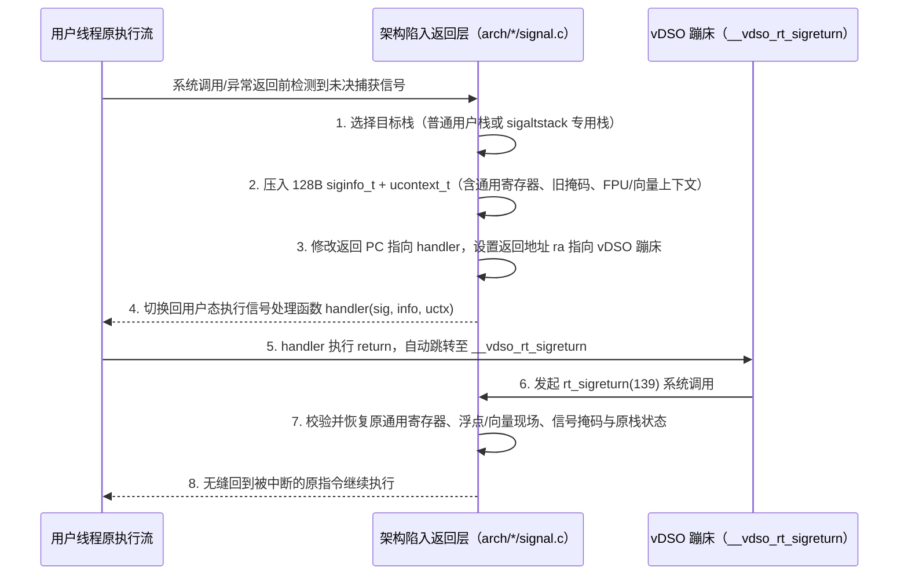

# POSIX 信号机制

POSIX 信号是操作系统向进程或线程异步通知异常（如非法访存 `SIGSEGV`、算术异常 `SIGFPE`）、作业控制（停止/继续）以及外部事件的经典机制。BoarOS 在 `kernel/sched/signal.c`、`kernel/signal_pending.c`、`kernel/signal_stack.c` 与双架构陷入层中，完整实现了标准信号与实时信号队列、信号屏蔽掩码、专用信号栈、虚拟动态共享对象（vDSO）返回蹦床以及系统调用自动重启协议。

---

## 一、源码组织

| 源码路径 | 核心职责 |
| :--- | :--- |
| `kernel/sched/signal.c`、`kernel/syscall/signal.c` | 信号发送、处置动作表（`sigaction`）、屏蔽掩码、作业控制停止/继续与自动重启决策 |
| `kernel/signal_pending.c` | 经典信号位图合并、实时信号队列（`slots[64]`）与按 UID 计费的 `RLIMIT_SIGPENDING` |
| `kernel/signal_stack.c` | 线程专用信号栈（`sigaltstack`，`SS_ONSTACK` / `SS_DISABLE` / `SS_AUTODISARM`） |
| `arch/riscv/signal.c`、`arch/loongarch/signal.c` | 用户态信号帧（`siginfo_t` + `ucontext_t` + 浮点/向量扩展上下文）构造与 `rt_sigreturn` 恢复 |
| `vdso/sigreturn.S` | 内嵌于 vDSO 的统一用户态信号返回蹦床（`__vdso_rt_sigreturn`） |

---

## 二、信号排队、屏蔽掩码与投递优先级

### 2.1 标准信号与实时信号队列

内核为每个线程维护私有待处理集合（`signal_pending`），为整个线程组维护进程共享待处理集合（`group_pending`），统一支持 1～64 号信号：

- **标准信号（1～31）**：未携带扩展负载时直接按 64 位位图合并（同号未决信号只保留一次）；若来自显式负载接口（如 `sigqueue`）或携带非零发件人身份，则分配独立队列记录以保留 `siginfo_t` 上下文。
- **实时信号（32～64）**：严格按先入先出顺序排队在 `kernel_signal_queue.slots[64]` 中（每个队列常驻一个预分配备用槽 `spare`），不合并重复信号，并受发件人真实 UID 账户的 `RLIMIT_SIGPENDING` 配额（默认 4,096）约束，超限时用户态发送返回 `-EAGAIN`；POSIX 定时器则在创建时提前预留队列额度，确保到期投递不会因内存不足丢失。
- **同步异常优先投递**：当返回用户态同时存在多个未决信号时，`signal_first_set()` 优先挑选硬件/同步异常类信号（`SIGILL=4`、`SIGTRAP=5`、`SIGBUS=7`、`SIGFPE=8`、`SIGSEGV=11`、`SIGSYS=31`），防止异步定时器信号掩盖刚刚发生的指令故障。

### 2.2 屏蔽掩码与临时掩码切换

- 每个线程持有 64 位 `signal_blocked` 屏蔽掩码，但 `SIGKILL(9)` 与 `SIGSTOP(19)` 永远不可阻塞或捕获（由 `KERNEL_SIGNAL_UNBLOCKABLE_MASK` 强制放行）。
- 支持两类原子临时掩码机制：`sigsuspend` 使用 `MASK_RESTORE_ON_HANDLER`（调用信号处理函数后在返回现场自动恢复旧掩码）；`ppoll`、`pselect6`、`epoll_pwait` 与 `io_pgetevents` 使用 `MASK_RESTORE_AFTER_WAIT`（等待返回或进入信号帧时精确恢复原掩码，杜绝“先改掩码再阻塞”的竞态窗口）。

---

## 三、用户态信号帧、专用栈与 vDSO 返回蹦床

当线程从系统调用或异常返回用户态前检测到可递送的捕获型信号，架构层完成**“构帧 → 跳转用户处理函数 → 蹦床触发 `rt_sigreturn` → 完整恢复现场”**闭环：

- **专用信号栈（`sigaltstack`）**：允许进程为信号处理函数预先注册独立栈区（RISC-V 最小栈要求 `2,048` 字节，LoongArch 最小 `4,096` 字节），即使主线程栈溢出触发 `SIGSEGV`，依然能安全在备用栈上执行崩溃处理；支持 `SS_AUTODISARM` 在进入信号处理时自动解除备用栈激活状态。
- **浮点与向量扩展现场保全**：RISC-V 信号帧保存 F/D 浮点与 `RISCV_VECTOR_MAGIC` 向量状态；LoongArch 信号帧使用标准扩展块魔数分别保存 FPU（`0x46505501`）、LSX（`0x53580001`）与 LASX（`0x41535801`）上下文，确保信号处理函数内使用浮点/SIMD 指令不会破坏主程序计算结果。

---

## 四、系统调用自动重启（`ERESTART*`）与多核执行边界

- **系统调用自动重启**：当阻塞在慢速系统调用（如 `read`、`futex`、`nanosleep`）的线程被信号打断时，系统调用层向陷入边界登记内部重启类型（通用重启 `GENERIC`、无处理函数重启 `NOHAND`、`nanosleep` 重启或带超时 `futex` 重启）。在信号递送决策点，`kernel_signal_restart_decide()` 按以下规则处理：
  - 若触发了带 `SA_RESTART` 的处理函数或未执行用户处理函数（如作业控制停止后恢复），则按类型选择**回退原 `PC` 重试**（`RESTART_RETRY`）或将系统调用号改为 `restart_syscall(128)` 继续等待剩余超时（`RESTART_BLOCK`）；
  - 否则按常规返回 `-EINTR` 并推进 `PC += 4`。
- **多核执行分工（SMP）**：信号队列、屏蔽掩码与动作表受 `kernel_wait_domain` 保护。在 `USER_SMP` 模式下，**普通私有信号选择、用户态信号帧构造与 `rt_sigreturn` 恢复直接在当前执行核本地完成**，无需迁回 CPU0；涉及整个线程组同步的作业控制停止（`SIGSTOP`/`SIGTSTP`）与 `sigsuspend` 协调则沿受控 CPU0 服务域推进。

---

展开查看：定向验证入口

- **同 ELF Linux 信号与返回帧差分**：`tests/diff-abi/signals.c`、`tests/diff-abi/sigreturn.c`、`make test-diff-abi-riscv`。
- **专用栈、自动重启与浮点/向量信号现场**：`tests/workloads/signal/`、`tests/userland/riscv-vector.py`。
- **多核并发信号与组停止**：`make test-user-smp-riscv`、`make test-user-smp-composition-riscv`。

