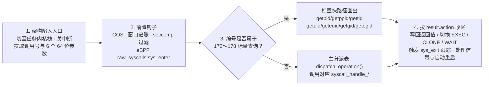

# Linux 系统调用统一分派与通用系统接口

系统调用是用户空间程序向操作系统内核请求服务的受控入口。RISC-V 64 的 `ECALL` 使用 `a7` 传递调用号、`a0..a5` 传递参数，LoongArch 64 的 `SYSCALL` 使用 `$a7`（`regs[11]`）传递调用号。两种架构的陷入入口将请求封装为 `struct kernel_syscall_request`，交给 `kernel/syscall/` 的共享分派器处理。当前接入 **RISC-V 286 个**、**LoongArch 282 个** Linux 系统调用编号。

---

## 一、源码组织与执行管线

| 源码路径 | 核心职责 |
| :--- | :--- |
| `include/kernel/syscall.h`、`kernel/syscall/dispatch.c` | 公共请求/结果契约、高频标量快路径（172～178）与全表主分派器 `dispatch_operation()` |
| `kernel/syscall/{file,mount,memory,process,sched,signal,time,socket,credentials,capability}.c` | 按子系统划分的 Linux ABI 参数导入、校验与业务转发 |
| `kernel/syscall/io_uring.c`、`kernel/syscall/io_uring_files.c` | 共享提交与完成环、资源登记及请求分派（`io_uring_setup`、`io_uring_enter`、`io_uring_register`） |
| `kernel/syscall/aio.c` | 原生 Linux 异步输入输出（Asynchronous I/O，AIO：`io_setup` 至 `io_pgetevents`） |
| `kernel/syscall/membarrier.c` | 跨核内存屏障同步（`membarrier(283)`） |
| `kernel/syscall/rseq.c` | 可重启序列（Restartable Sequences，rseq）登记、提交区间检查及用户态返回处理（`rseq(293)`） |
| `kernel/syscall/process_vm.c`、`kernel/seccomp.c` | 跨进程向量内存读写（`process_vm_readv/writev`）与 `seccomp` 系统调用过滤 |
| `arch/riscv/hwprobe.c` | RISC-V 硬件能力探测（`riscv_hwprobe(258)`） |

### 一次系统调用的完整生命周期

- **高频标量快路径（编号 172～178）**：`getpid`、`getppid`、`gettid`、`getuid`、`geteuid`、`getgid`、`getegid` 这 7 个极高频无副作用查询在 `kernel_syscall_dispatch()` 中直接读取当前任务身份或不可变凭据指针返回，跳过大型主分派表路由。
- **线程控制与用户返回**。`prctl` 经过系统调用过滤和入口追踪后直接进入线程控制分派。RISC-V 对当前线程的定时器宽限查询和设置提供简化入口，启用过滤或追踪时使用完整系统调用分派。返回用户空间时，调度器先处理退役资源和需要重新调度的任务，再从待处理位判断是否进入信号交付。同步系统调用持续计入内核执行时间，只有中断处理需要保存并恢复前一记账状态。
- **架构解耦的动作返回机制（`enum kernel_syscall_action`）**：分派器不直接操作底层寄存器帧，而是返回明确的动作码指导架构陷入层完成收尾——包括 `RETURN`（普通写回返回值）、`RETURN_FINAL`、`EXIT` / `EXIT_GROUP`（终止线程或进程组）、`EXEC`（装载新地址空间且不推进旧程序计数器）、`CLONE` / `CLONE3`（传递完整寄存器快照构造子任务）、`WAIT4` / `WAITID`、`YIELD` 与 `SIGNAL_RETURN`。
- **双架构共用 282 个系统调用编号**。RISC-V 另提供 `163`（`getrlimit`）、`164`（`setrlimit`）、`258`（`riscv_hwprobe`）和 `259`（`riscv_flush_icache`）。LoongArch 通过 `prlimit64` 查询和修改资源限额。

---

## 二、原生异步 I/O（AIO）、跨核内存屏障与硬件探测

除分派至调度、内存、文件、网络和 eBPF 子系统的常规接口外，系统调用层还提供以下通用 Linux 接口：

### 2.1 原生异步输入输出（`io_setup` ～ `io_pgetevents`）

`kernel/syscall/aio.c` 实现了 Linux 原生 AIO 接口（编号 `0`～`4` 与 `292`），允许应用程序批量提交非阻塞文件读写和同步请求，并通过用户空间共享完成环收割结果：
- **地址空间共享完成环**：`io_setup` 在进程地址空间内映射一个共享完成环（`aio_ring`，魔数 `0xa10a10a1`，单上下文上限 `65,536` 事件），并随进程 `munmap`/`mremap`/退出自动管理生命周期；全系统上下文事件上限受 `/proc/sys/fs/aio-max-nr` 与 `aio-nr` 约束。
- **支持的操作与后台执行**：支持 `IOCB_CMD_PREAD`、`PWRITE`、`PREADV`、`PWRITEV`、`FSYNC`、`FDSYNC` 与 `POLL`，并支持通过 `eventfd`（`resfd`）向 `epoll` 推送完成通知。满足扇区对齐且单次不超过 `64 KiB` 的普通文件直接读写交由懒启动的后台工作线程异步推进；其余需要特殊标志或额外页缓存借用的请求沿提交路径安全完成。
- **原子信号掩码等待（`io_pgetevents(292)`）**：等待完成事件期间原子替换临时信号掩码；被信号打断时优先返回已交付的完成事件，若尚无事件且未执行用户信号处理函数，则通过 `NOHAND` 重启机制恢复掩码后自动重试。

### 2.2 共享提交与完成环（`io_uring`）

`io_uring_setup(425)` 创建环文件。应用程序可以通过 `mmap` 取得提交环、完成环和提交条目数组，也可以设置 `IORING_SETUP_NO_MMAP` 并提供已分配的页。提交条目（Submission Queue Entry，SQE）描述一次操作。应用程序写完条目后发布尾索引，内核取得条目时读取尾索引并保存内核快照。内核完成操作后写入完成条目（Completion Queue Entry，CQE），再发布完成环尾索引。两边使用获取和释放内存序核对索引与条目内容的可见性。

- **提交与完成。** `io_uring_enter(426)` 导入请求，也可等待指定数量的完成条目。空操作在一次完成环保护中处理至多 16 条，避免逐条分配。普通文件读写沿已有输入输出入口推进，轮询和定时器由按需创建的执行线程推进。完成环满时保留待发布的结果，应用释放槽位后继续交付。文件描述符或映射仍在使用时，共享环页保留原引用。
- **注册与取消。** `io_uring_register(427)` 支持查询操作能力、固定文件、固定缓冲区、事件通知描述符、提交身份和限制规则。固定文件保留已打开文件本身。固定缓冲区提前取得物理页引用并计入锁页额度，修改映射后原注册仍指向同一组页，私有映射派生时为子进程保持写时复制隔离。退出清理归还尚未完成条目的文件、缓冲区与完成记录。
- **操作范围。** 包括普通文件的标量和向量读写、范围同步、部分路径和元数据操作、可用套接字的立即发送和接收，以及配套的定时、取消和就绪通知。设备命令 `IORING_OP_URING_CMD` 可向高速非易失性存储设备（Non-Volatile Memory Express，NVMe）命名空间和控制器提交相应命令，内核检查身份、操作范围及传输缓冲区。固定文件表支持稀疏登记、选择空槽以及从固定槽安装普通文件描述符。
- **专用网络接收。** 应用程序可登记 Intel 82576 的独立接收队列及其缓冲区，使用 `IORING_OP_RECV_ZC` 收取传输控制协议（Transmission Control Protocol，TCP）载荷。网卡直接将载荷写入登记的用户页，完成条目交付偏移和长度。应用回填后，页也要等协议栈归还引用才能重新提交给网卡。队列的地址隔离与配置见[网络模块说明](kernel-network.md)。
- **接口边界。** 提交队列轮询（`IORING_SETUP_SQPOLL`）、直接输入输出完成轮询（`IORING_SETUP_IOPOLL`）、`IOSQE_IO_DRAIN` 和通用阻塞请求的异步执行仍待补齐。套接字发送、接收和接纳在当次没有进展时返回非阻塞结果。常规套接字多次完成、现代缓冲区环、向网卡零复制发送及设备状态转移操作仍待补齐。

### 2.3 跨核内存屏障（`membarrier(283)`）

在无锁数据结构（如 RCU 读侧）中，写者极少执行，但读者每次读取都插入昂贵的硬件全内存屏障代价过高。`membarrier(283)`（`kernel/syscall/membarrier.c`）允许写者显式向其他正在运行相关线程的处理器核发送核间中断（`KERNEL_IPI_MEMBARRIER`），迫使远端核执行串行化内存屏障，从而让高频读侧只需廉价的编译器屏障即可保证跨核内存可见性。
- 支持命令：`GLOBAL`、`GLOBAL_EXPEDITED`、`REGISTER_GLOBAL_EXPEDITED`、`PRIVATE_EXPEDITED`（按活动地址空间筛选目标核）、`REGISTER_PRIVATE_EXPEDITED` 与 `GET_REGISTRATIONS`。
- 多核下通过每核邮箱 `mailboxes[BOAROS_MAX_CPUS]` 发起 `rendezvous()` 同步握手，并在等待期间持续响应其他核发来的屏障请求，防止双核同时调用 `membarrier` 形成互等死锁。

### 2.4 可重启序列（`rseq(293)`）

用户库可以用可重启序列访问每核数据。线程登记对齐的 32 字节用户态区域，并在进入序列前写入描述符地址。描述符给出序列起点、提交后地址与中止入口。线程切出、迁移或收到信号后，内核在返回用户态前检查原用户态指令地址。如果线程尚未越过提交边界，内核清除活动描述符并将执行位置转到应用的中止入口。递送信号时，信号帧保存修正后的地址。

可执行和可链接格式（Executable and Linkable Format，ELF）的辅助向量通过 `AT_RSEQ_FEATURE_SIZE` 和 `AT_RSEQ_ALIGN` 公布经典接口布局，供 `glibc` 自动登记。共享地址空间的新线程独立登记，普通 `fork` 继承父线程的登记，成功执行 `execve` 或退出时清除登记。应用可用 `MEMBARRIER_CMD_PRIVATE_EXPEDITED_RSEQ` 请求同一地址空间的其他活动线程中止尚未提交的序列，也可限定目标逻辑处理器。

### 2.5 RISC-V 硬件能力探测（`riscv_hwprobe(258)`）

`arch/riscv/hwprobe.c` 为用户态动态库（如 `glibc` 的字符串/向量多版本函数分发 `IFUNC`）提供标准硬件特性查询：
- 返回 OpenSBI 厂商/架构/实现标识（Key `0`～`2`）、基础指令集 `IMA`（Key `3`）、扩展特性位掩码（`F/D`、`C`、`V` 向量、`Zba`/`Zbb`/`Zbs` 位操作与受 `senvcfg` 门控的 `Zicboz` 零块指令，Key `4`）、`Zicboz` 块大小 `64` 字节（Key `6`）、最高用户虚拟地址（Key `7`）与时钟频率（Key `8`）；
- 键 `5`（旧性能字段）和键 `9`（标量非对齐访存性能）返回同一项启动测量结果。每个处理器上线前，在一段可回收的普通内存中分别用非对齐机器字和逐字节指令复制相同数据，比较各自最短用时。按机器字复制更快时报告 `FAST`，否则报告 `SLOW`。若机器字指令的非对齐或访问异常交给 BoarOS，探测从指定的汇编指令区间退出并报告 `UNSUPPORTED`。缺少工作区或有效计时样本时报告 `UNKNOWN`。查询多个处理器时，分类不同时返回 `UNKNOWN`。
- `RISCV_HWPROBE_WHICH_CPUS` 返回满足全部查询条件的逻辑处理器掩码。基础能力、扩展位图和旧性能字段按请求的位是否全部存在来匹配。键 `9` 按分类值匹配。向量非对齐性能（键 `10`）当前报告 `UNKNOWN`。键 `11`～`16` 按未知查询项处理。
- 启动探测捕获的是内核自己执行的探测指令。普通用户指令触发非对齐异常并交给 BoarOS 时，内核向进程投递 `SIGBUS`，原因码为 `BUS_ADRALN`。

---

## 三、主要系统调用族索引

| 功能域 | 代表性系统调用 | 所属子系统文档 |
| :--- | :--- | :--- |
| **进程、线程与调度** | `clone` / `clone3` / `execve` / `wait4` / `waitid` / `sched_setattr` / `setpriority` / `futex` / `futex_waitv` / `ptrace` / `rseq` | [调度与同步](kernel-scheduler.md) · [映像替换](kernel-exec.md) · [进程跟踪](kernel-ptrace.md) |
| **虚拟内存** | `brk` / `mmap` / `munmap` / `mprotect` / `mremap` / `mlock*` / `madvise` / `msync` / `mincore` / `process_vm_readv/writev` / `userfaultfd` / `memfd_secret` | [虚拟内存管理](kernel-mm.md) · [原生大页](hugepages.md) |
| **文件、路径与挂载** | `openat` / `openat2` / `readv` / `writev` / `sendfile` / `splice` / `copy_file_range` / `fallocate` / `io_uring_*` / `statx` / `cachestat` / `fsopen`～`move_mount` / `pivot_root` / `statmount` / `listmount` | [VFS 与 ext4](vfs-ext4.md) · [文件资源与 I/O](kernel-files.md) |
| **事件、锁与通知** | `epoll_*` / `ppoll` / `pselect6` / `pipe2` / `eventfd2` / `timerfd_*` / `signalfd4` / `inotify_*` / `fanotify_*` / `flock` / `fcntl` | [文件资源与 I/O](kernel-files.md) |
| **网络与套接字** | `socket` / `socketpair` / `bind` / `listen` / `accept4` / `connect` / `sendmsg` / `sendmmsg` / `recvmmsg` / `setsockopt` | [多核网络协议栈](kernel-network.md) · [rtnetlink](../network-rtnetlink.md) |
| **信号、时钟与 IPC** | `rt_sigaction` / `rt_sigprocmask` / `rt_sigreturn` / `sigaltstack` / `clock_gettime` / `clock_nanosleep` / `timer_*` / `adjtimex` / SysV & POSIX IPC | [信号](kernel-signal.md) · [时钟与定时器](kernel-time.md) |
| **安全、命名空间与观测** | `setuid*` / `capset` / `add_key` / `request_key` / `keyctl` / `acct` / `prctl` / `seccomp` / `unshare` / `setns` / `bpf` / `perf_event_open` / `membarrier` | [进程与凭据](kernel-scheduler.md) · [BPF 过滤与跟踪](kernel-bpf.md) |

---

展开查看：系统调用重启、UTS 命名空间与定向验证入口

### 关键通用语义约定

- **系统调用自动重启（`ERESTART*`）**：阻塞中的系统调用被可捕获信号打断时，返回内部重启码交由陷入层决策——若信号处理函数设置了 `SA_RESTART` 且操作支持透明重试，自动回退程序计数器重新执行或转入 `restart_syscall(128)` 继续等待剩余超时；否则向用户态返回 `-EINTR`。
- **UTS 命名空间与命名空间 FD**：支持 `CLONE_NEWUTS` 隔离主机名（`sethostname`）与域名（`setdomainname`），并可通过 `/proc/<pid>/ns/{mnt,pid,ipc,uts}` 或 `pidfd` 配合 `setns` 动态加入目标命名空间。
- **`sync_file_range(84)`**：支持按指定页范围异步发起写回（`WRITE`）及等待区间数据落盘（`WAIT_BEFORE` / `WAIT_AFTER`），仅负责数据范围写回而不替代 `fsync` 的元数据与设备 `FLUSH` 屏障。

### 定向验证入口

- **全量同 ELF Linux 差分验证**：`make test-diff-abi-riscv`（主清单 1,744 项系统调用行为对照）。
- **新增接口族对照消费者**：`python3 tests/userland/api8.py`、`tests/userland/seccomp.py`、`tests/userland/native_aio.c`。
- **边界与参数错误序专项**：`make test-abi-boundary-riscv`、`make test-abi-boundary-loongarch`。

