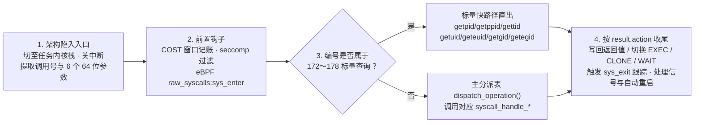

# Linux 系统调用统一分派与通用系统接口

系统调用是用户空间程序向操作系统内核请求服务的唯一受控入口。BoarOS 通过 `kernel/syscall/` 将**架构相关的寄存器约定**与**架构无关的系统调用语义**彻底解耦：RISC-V 64（`ECALL`，`a7` 传号、`a0..a5` 传参）与 LoongArch 64（`SYSCALL`，`$a7`/`regs[11]` 传号）的陷入代码将请求统一封装为 `struct kernel_syscall_request`，交由共享分派器执行，当前共覆盖 **RISC-V 278 个**、**LoongArch 274 个** Linux 系统调用编号。

---

## 一、源码组织与执行管线

| 源码路径 | 核心职责 |
| :--- | :--- |
| `include/kernel/syscall.h`、`kernel/syscall/dispatch.c` | 公共请求/结果契约、高频标量快路径（172～178）与全表主分派器 `dispatch_operation()` |
| `kernel/syscall/{file,mount,memory,process,sched,signal,time,socket,credentials,capability}.c` | 按子系统划分的 Linux ABI 参数导入、校验与业务转发 |
| `kernel/syscall/aio.c` | 原生 Linux 异步输入输出（Asynchronous I/O，AIO：`io_setup` 至 `io_pgetevents`） |
| `kernel/syscall/membarrier.c` | 跨核内存屏障同步（`membarrier(283)`） |
| `kernel/syscall/process_vm.c`、`kernel/seccomp.c` | 跨进程向量内存读写（`process_vm_readv/writev`）与 `seccomp` 系统调用过滤 |
| `arch/riscv/hwprobe.c` | RISC-V 硬件能力探测（`riscv_hwprobe(258)`） |

### 一次系统调用的完整生命周期

- **高频标量快路径（编号 172～178）**：`getpid`、`getppid`、`gettid`、`getuid`、`geteuid`、`getgid`、`getegid` 这 7 个极高频无副作用查询在 `kernel_syscall_dispatch()` 中直接读取当前任务身份或不可变凭据指针返回，跳过大型主分派表路由。
- **架构解耦的动作返回机制（`enum kernel_syscall_action`）**：分派器不直接操作底层寄存器帧，而是返回明确的动作码指导架构陷入层完成收尾——包括 `RETURN`（普通写回返回值）、`RETURN_FINAL`、`EXIT` / `EXIT_GROUP`（终止线程或进程组）、`EXEC`（装载新地址空间且不推进旧程序计数器）、`CLONE` / `CLONE3`（传递完整寄存器快照构造子任务）、`WAIT4` / `WAITID`、`YIELD` 与 `SIGNAL_RETURN`。
- **双架构差异的 4 个系统调用**：RISC-V 额外提供 `163`（`getrlimit`）、`164`（`setrlimit`）、`258`（`riscv_hwprobe`）与 `259`（`riscv_flush_icache`）；其余 274 个编号两架构完全共享（LoongArch 统一使用现代 `prlimit64` 查询和修改资源限额）。

---

## 二、原生异步 I/O（AIO）、跨核内存屏障与硬件探测

除分派至调度、内存、文件、网络和 eBPF 子系统的常规接口外，系统调用层还直接实现了三项关键的现代 Linux 机制：

### 2.1 原生异步输入输出（`io_setup` ～ `io_pgetevents`）

`kernel/syscall/aio.c` 实现了 Linux 原生 AIO 接口（编号 `0`～`4` 与 `292`），允许应用程序批量提交非阻塞文件读写和同步请求，并通过用户空间共享完成环收割结果：
- **地址空间共享完成环**：`io_setup` 在进程地址空间内映射一个共享完成环（`aio_ring`，魔数 `0xa10a10a1`，单上下文上限 `65,536` 事件），并随进程 `munmap`/`mremap`/退出自动管理生命周期；全系统上下文事件上限受 `/proc/sys/fs/aio-max-nr` 与 `aio-nr` 约束。
- **支持的操作与后台执行**：支持 `IOCB_CMD_PREAD`、`PWRITE`、`PREADV`、`PWRITEV`、`FSYNC`、`FDSYNC` 与 `POLL`，并支持通过 `eventfd`（`resfd`）向 `epoll` 推送完成通知。满足扇区对齐且单次不超过 `64 KiB` 的普通文件直接读写交由懒启动的后台工作线程异步推进；其余需要特殊标志或额外页缓存借用的请求沿提交路径安全完成。
- **原子信号掩码等待（`io_pgetevents(292)`）**：等待完成事件期间原子替换临时信号掩码；被信号打断时优先返回已交付的完成事件，若尚无事件且未执行用户信号处理函数，则通过 `NOHAND` 重启机制恢复掩码后自动重试。

### 2.2 跨核内存屏障（`membarrier(283)`）

在无锁数据结构（如 RCU 读侧）中，写者极少执行，但读者每次读取都插入昂贵的硬件全内存屏障代价过高。`membarrier(283)`（`kernel/syscall/membarrier.c`）允许写者显式向其他正在运行相关线程的处理器核发送核间中断（`KERNEL_IPI_MEMBARRIER`），迫使远端核执行串行化内存屏障，从而让高频读侧只需廉价的编译器屏障即可保证跨核内存可见性。
- 支持命令：`GLOBAL`、`GLOBAL_EXPEDITED`、`REGISTER_GLOBAL_EXPEDITED`、`PRIVATE_EXPEDITED`（按活动地址空间筛选目标核）、`REGISTER_PRIVATE_EXPEDITED` 与 `GET_REGISTRATIONS`。
- 多核下通过每核邮箱 `mailboxes[BOAROS_MAX_CPUS]` 发起 `rendezvous()` 同步握手，并在等待期间持续响应其他核发来的屏障请求，防止双核同时调用 `membarrier` 形成互等死锁。

### 2.3 RISC-V 硬件能力探测（`riscv_hwprobe(258)`）

`arch/riscv/hwprobe.c` 为用户态动态库（如 `glibc` 的字符串/向量多版本函数分发 `IFUNC`）提供标准硬件特性查询：
- 返回 OpenSBI 厂商/架构/实现标识（Key `0`～`2`）、基础指令集 `IMA`（Key `3`）、扩展特性位掩码（`F/D`、`C`、`V` 向量、`Zba`/`Zbb`/`Zbs` 位操作与受 `senvcfg` 门控的 `Zicboz` 零块指令，Key `4`）、`Zicboz` 块大小 `64` 字节（Key `6`）、最高用户虚拟地址（Key `7`）与时钟频率（Key `8`）；
- 支持 `RISCV_HWPROBE_WHICH_CPUS` 按能力集反查满足条件的逻辑处理器掩码。

---

## 三、主要系统调用族索引

| 功能域 | 代表性系统调用 | 所属子系统文档 |
| :--- | :--- | :--- |
| **进程、线程与调度** | `clone` / `clone3` / `execve` / `wait4` / `waitid` / `sched_setattr` / `setpriority` / `futex` / `futex_waitv` / `ptrace` | [调度与同步](kernel-scheduler.md) · [映像替换](kernel-exec.md) · [进程跟踪](kernel-ptrace.md) |
| **虚拟内存** | `brk` / `mmap` / `munmap` / `mprotect` / `mremap` / `mlock*` / `madvise` / `msync` / `mincore` / `process_vm_readv/writev` / `userfaultfd` | [虚拟内存管理](kernel-mm.md) · [原生大页](hugepages.md) |
| **文件、路径与挂载** | `openat` / `openat2` / `readv` / `writev` / `sendfile` / `splice` / `copy_file_range` / `fallocate` / `statx` / `fsopen`～`move_mount` / `pivot_root` | [VFS 与 ext4](vfs-ext4.md) · [文件资源与 I/O](kernel-files.md) |
| **事件、锁与通知** | `epoll_*` / `ppoll` / `pselect6` / `pipe2` / `eventfd2` / `timerfd_*` / `signalfd4` / `inotify_*` / `fanotify_*` / `flock` / `fcntl` | [文件资源与 I/O](kernel-files.md) |
| **网络与套接字** | `socket` / `socketpair` / `bind` / `listen` / `accept4` / `connect` / `sendmsg` / `sendmmsg` / `recvmmsg` / `setsockopt` | [多核网络协议栈](kernel-network.md) · [rtnetlink](../network-rtnetlink.md) |
| **信号、时钟与 IPC** | `rt_sigaction` / `rt_sigprocmask` / `rt_sigreturn` / `sigaltstack` / `clock_gettime` / `clock_nanosleep` / `timer_*` / `adjtimex` / SysV & POSIX IPC | [信号](kernel-signal.md) · [时钟与定时器](kernel-time.md) |
| **安全、命名空间与观测** | `setuid*` / `capset` / `add_key` / `request_key` / `keyctl` / `acct` / `prctl` / `seccomp` / `unshare` / `setns` / `bpf` / `perf_event_open` / `membarrier` | [进程与凭据](kernel-scheduler.md) · [BPF 过滤与跟踪](kernel-bpf.md) |

---

展开查看：系统调用重启、UTS 命名空间与定向验证入口

### 关键通用语义约定

- **系统调用自动重启（`ERESTART*`）**：阻塞中的系统调用被可捕获信号打断时，返回内部重启码交由陷入层决策——若信号处理函数设置了 `SA_RESTART` 且操作支持透明重试，自动回退程序计数器重新执行或转入 `restart_syscall(128)` 继续等待剩余超时；否则向用户态返回 `-EINTR`。
- **UTS 命名空间与命名空间 FD**：支持 `CLONE_NEWUTS` 隔离主机名（`sethostname`）与域名（`setdomainname`），并可通过 `/proc/<pid>/ns/{mnt,pid,ipc,uts}` 或 `pidfd` 配合 `setns` 动态加入目标命名空间。
- **`sync_file_range(84)`**：支持按指定页范围异步发起写回（`WRITE`）及等待区间数据落盘（`WAIT_BEFORE` / `WAIT_AFTER`），仅负责数据范围写回而不替代 `fsync` 的元数据与设备 `FLUSH` 屏障。

### 定向验证入口

- **全量同 ELF Linux 差分验证**：`make test-diff-abi-riscv`（主清单 1,744 项系统调用行为对照）。
- **新增接口族对照消费者**：`python3 tests/userland/api8.py`、`tests/userland/seccomp.py`、`tests/userland/native_aio.c`。
- **边界与参数错误序专项**：`make test-abi-boundary-riscv`、`make test-abi-boundary-loongarch`。

