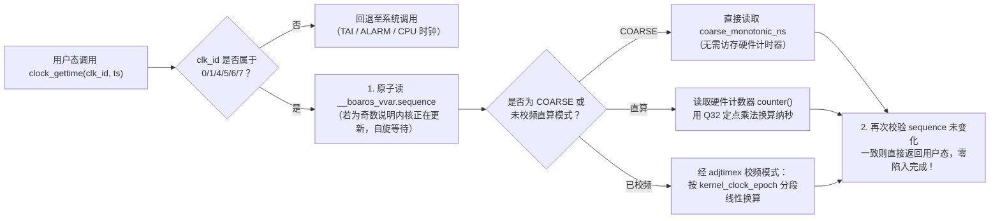

# 时钟、高精度定时器与 vDSO 时间加速

时间管理子系统为操作系统调度、文件时间戳、网络超时与用户态高精度计时提供统一的时间基准。BoarOS 在 `kernel/time.c`、`vdso/time.c`、`kernel/sched/posix_timer.c`、`kernel/sched/cpu_clock.c` 与 `fs/event_fd.c` 中实现了完整的 Linux 多时钟域模型、用户态无陷入快速读时钟（vDSO）、高精度睡眠、POSIX 定时器与时钟频率校时（`adjtimex`）。

---

## 一、源码组织与多时钟域

| 源码路径 | 核心职责 |
| :--- | :--- |
| `kernel/time.c`、`kernel/syscall/time.c` | 全局时钟纪元（`time_epoch`）、`clock_gettime` / `clock_settime` / `adjtimex` 与高精度睡眠 |
| `vdso/time.c`、`include/kernel/vdso.h` | 映射到用户空间的只读时钟数据页（`__boaros_vvar`）与无锁序列读（Seqlock）快路径 |
| `kernel/sched/posix_timer.c` | POSIX 进程/线程定时器（`timer_create` ～ `timer_delete`）、墙钟/TAI/CPU 定时器平衡树 |
| `kernel/sched/cpu_clock.c` | 进程与线程级动态 CPU 时间时钟编码与高精度 CPU 睡眠 |
| `fs/event_fd.c` | 面向事件循环的定时器文件描述符（`timerfd_create` / `settime` / `gettime`） |

### 支持的时钟源一览

| 时钟标识（Clock ID） | 语义说明 | 读取路径 |
| :--- | :--- | :--- |
| **`CLOCK_REALTIME`（0）** | 挂钟时间（自 1970-01-01 起的 UTC 时间），可被 `clock_settime`/`adjtimex` 校准或跳变 | **vDSO 快路径** |
| **`CLOCK_MONOTONIC`（1）** | 单调递增时钟，永不向后跳变，受频率微调（`adjtimex`）校频 | **vDSO 快路径** |
| **`CLOCK_MONOTONIC_RAW`（4）** | 纯硬件原始恒频计数，不受任何校频影响 | **vDSO 快路径** |
| **`CLOCK_REALTIME_COARSE`（5） / `MONOTONIC_COARSE`（6）** | 粗粒度滴答缓存时钟，无需读硬件计数器，极低延迟 | **vDSO 快路径** |
| **`CLOCK_BOOTTIME`（7）** | 自系统启动以来的单调时间（当前与 `MONOTONIC` 一致） | **vDSO 快路径** |
| **`CLOCK_REALTIME_ALARM`（8） / `BOOTTIME_ALARM`（9）** | 依赖平台硬件实时时钟（RTC）的闹钟域，设置定时需 `CAP_WAKE_ALARM` | 系统调用 |
| **`CLOCK_TAI`（11）** | 国际原子时（UTC 叠加闰秒偏移，可通过 `adjtimex` 动态调整 TAI 偏移） | 系统调用 |
| **`PROCESS_CPUTIME_ID` / `THREAD_CPUTIME_ID` 及动态编码时钟** | 统计指定进程组或线程实际消耗的 CPU 执行时间 | 系统调用 |

---

## 二、vDSO 用户态无锁时钟快路径

高频日志、数据库事务和性能采样每秒可能调用数十万次 `clock_gettime`。为了省去“陷入内核 → 保存现场 → 恢复返回”的开销，BoarOS 将一块内核只读共享页（`vVAR`）与内嵌代码页（`vDSO`）自动映射进每个用户进程的地址空间：

- **无锁序列同步（Seqlock）**：内核更新系统滴答或执行 `adjtimex` 校时时，先将 `__boaros_vvar.sequence` 递增为奇数，写完新纪元后再递增为偶数；用户态读者完全无需加锁，仅在读前后比对版本号即可保证读到一致快照。

---

## 三、高精度睡眠、POSIX 定时器与时钟校时

### 3.1 `nanosleep` 与 `clock_nanosleep`

- `nanosleep(101)` 与 `clock_nanosleep(115)` 由 `syscall_handle_sleep_for()` 统一处理：相对时间的 `REALTIME` 睡眠按单调时钟计时以防挂钟跳变引发早醒或长睡；绝对时间则精确锚定对应时钟域，并挂入调度器的全局期限 AVL 树等待到期；
- 若睡眠期间被可捕获信号打断，内核精确计算并写回剩余时间 `rem`，并登记 `KERNEL_SYSCALL_RESTART_NANOSLEEP` 重启块，配合信号系统支持透明续睡；对进程/线程 CPU 时钟的睡眠则直接由 `kernel_posix_cpu_sleep()` 接入 CPU 记账引擎。

### 3.2 POSIX 定时器与 `timerfd`

- **POSIX 定时器（`timer_create` ～ `timer_delete`，107～111）**：每个线程组持有 64 桶定时器注册表 `kernel_posix_timer_registry`，分别按挂钟（`wall_root`）、国际原子时（`tai_root`）与 CPU 时间（`cpu_root`）组织平衡树；支持 `SIGEV_NONE`、`SIGEV_SIGNAL` 与 `SIGEV_THREAD_ID` 通知，创建时预留 `RLIMIT_SIGPENDING` 信号队列槽位，并准确统计溢出次数（`overrun`）。
- **`timerfd`（85～87）**：支持 `TFD_TIMER_ABSTIME`（绝对期限）与 `TFD_TIMER_CANCEL_ON_SET`（当挂钟被外部显式修改跳变时立即唤醒读者并返回 `-ECANCELED`），可无缝接入 `epoll`/`poll` 事件循环。

### 3.3 实时时钟校时与频率驯服（`adjtimex` / `clock_adjtime`）

`kernel_time_adjust()` 支持 `ADJ_OFFSET`、`ADJ_FREQUENCY`、`ADJ_MAXERROR`、`ADJ_ESTERROR`、`ADJ_TIMECONST`、`ADJ_STATUS`（`PLL`/`FLL`/`FREQHOLD`/`NANO`/`MICRO`）、`ADJ_TAI`、`ADJ_SETOFFSET`、`ADJ_TICK`（`9,000～11,000 µs`）以及渐进校时 `ADJ_OFFSET_SINGLESHOT`（500 µs/s 速率平滑调整）。

每当挂钟跳变、TAI 偏移变化或时钟频率系数更新时，内核在 `clock_control` 与 `vvar_lock` 保护下原子切换 `time_epoch` 与用户态 `vVAR` 页，并同步触发 `reindex_wall_timers()` 重新排定所有受影响的 POSIX 定时器与 `timerfd`，必要时向 CPU0 发送 `ARCH_IPI_DEADLINE` 核间中断提前重装硬件定时器。

---

展开查看：定向验证入口

- **时钟驯服与 vDSO 一致性**：`tests/userland/clock-discipline.c`、`tests/diff-abi/`（coarse clock 与时间边界用例）。
- **POSIX 定时器、`timerfd` 与信号超时**：`tests/workloads/event/`、`tests/userland/ipc-fds.py`。
- **CPU 记账与定时器迟到测量**：详见 [CPU 记账测量](../learning/cpu-accounting-cost.md) 与 `tests/cost/accounting/cost.py`。

