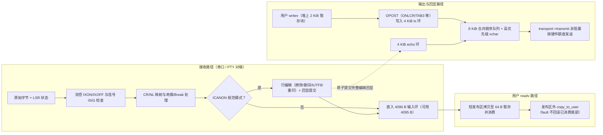

# 终端子系统（TTY）、伪终端（PTY）与作业控制

终端（Teletype，TTY）子系统在操作系统中负责将原始字节流（来自物理串口或伪终端对端）转化为面向交互式会话的编辑行、回显输出与作业控制信号（如 `Ctrl-C` 触发 `SIGINT`、`Ctrl-Z` 触发 `SIGTSTP`）。

BoarOS 实现了统一的软件行规程核心（Line Discipline，`N_TTY`）、面向会话与进程组的作业控制层，以及支持多实例隔离的 Unix 98 伪终端（Pseudo-Terminal，PTY）和 `devpts` 虚拟文件系统。底层 16550 通用异步收发器（Universal Asynchronous Receiver-Transmitter，UART）串口驱动见[共用 ns16550 串口传输](riscv-uart-tty.md)。

---

## 一、源码组织

| 源码路径 | 核心职责 |
| :--- | :--- |
| `fs/tty.c`、`include/kernel/tty.h` | `N_TTY` 软件行规程：输入/输出/回显环形缓冲区、规范与原始模式处理、`termios`/`termios2` 配置、`ioctl`、轮询与异步 I/O（`O_ASYNC`）事件 |
| `kernel/sched/tty.c`、`include/kernel/tty_task.h` | 控制终端（Controlling TTY，ctty）与线程组绑定、会话/前台进程组身份查询、作业控制信号投递与 `/proc/<pid>/stat` 快照 |
| `fs/pty.c`、`fs/pty_internal.h` | Unix 98 PTY 主从端配对管理、双向 4 KiB 先进先出队列（FIFO）、后台转发工作线程与包模式（`TIOCPKT`） |
| `fs/devpts.c`、`fs/devpts_internal.h`、`include/kernel/devpts.h` | `devpts` 文件系统实现、动态从端编号分配、挂载选项解析及 `/dev/ptmx` 入口绑定 |

---

## 二、设备身份、控制终端与会话生命周期

### 2.1 字符设备分类与所有权

系统在启动建立标准描述符前初始化并发布根串口终端（默认规范模式、回显开启、`ISIG` 开启、115200 8N1、`CREAD`，窗口尺寸初始为 `0`）。固定终端设备按 `st_rdev` 主次设备号识别，而伪终端从端严格依赖 `devpts` 节点的内部绑定指针（防止因设备号复用而错绑）：

| 设备路径 | 主次设备号 | 语义说明 |
| :--- | :--- | :--- |
| `/dev/ttyS0` | `4:64`（`0x440`） | 根串口终端；会话组长在未设 `O_NOCTTY` 且可读打开时可自动取得控制终端 |
| `/dev/console` | `5:1`（`0x501`） | 系统控制台；不自动取得控制终端，其重定向写实例在 `vhangup` 后保持有效直到真实关机 |
| `/dev/tty` | `5:0`（`0x500`） | 当前线程组的控制终端别名；无控制终端时打开返回 `-ENXIO` |
| `/dev/ptmx` | `5:2` | Unix 98 伪终端多路复用入口，打开时在关联的 `devpts` 实例中分配一对全新主从 PTY |
| `/dev/pts/<N>` | `136:N`（`0x8800 + N`） | 动态创建的伪终端从端节点 |

所有权模型避免任何循环引用：
- 底层传输层（串口或 PTY 对）持有 `struct kernel_tty` 的基础引用；每个打开文件描述（OFD）创建一个 `tty_instance` 并持有内核 TTY 的外部引用；每个关联了控制终端的线程组也通过组长持有一次外部引用（同组其他线程借用组长）。
- `struct kernel_tty` 保存的会话（`session`）与前台进程组（`foreground`）是指向稳定 `struct kernel_pid` 对象的引用计数指针，即使原组长进程退出，只要前台组内仍有存活成员或引用，身份依然准确有效。
- `fork` 继承控制终端，`clone` 线程共享组长关联，`setsid` 清除关联，普通 `exec` 保留关联，非组长 `exec` 则接管原组长的控制终端引用。

### 2.2 控制终端获取、挂断与 `vhangup`

- **获取与释放**：会话组长可通过 `TIOCSCTTY` 绑定控制终端（传入参数 `1` 强夺其他会话的控制终端需要 `CAP_SYS_ADMIN`）。`TIOCNOTTY` 对会话组长会解除整个会话的绑定并向前台进程组发送 `SIGHUP`/`SIGCONT`；对普通进程仅撤销自身关联。
- **挂断代数（Generation）隔离**：每次会话组长最后成员退出导致的串行挂断，或由具备 `CAP_SYS_TTY_CONFIG` 的进程调用 `vhangup()` 时，都会递增 TTY 的 `generation` 计数器并撤销会话关联。既有普通 OFD 因代数过期立即失效（读返回 EOF、写与多数 `ioctl` 返回 `-EIO`、`TIOCSPGRP` 返回 `-ENOTTY`、`poll` 返回 `POLLIN | POLLOUT | POLLERR | POLLHUP`），此后重新打开才会获得新代数，绝不会让旧描述符“复活”到新会话中。

---

## 三、行规程核心与 I/O 数据通路

`struct kernel_tty` 内部维护独立的输入环形缓冲区（`input[4096]`）、用户输出缓冲区（`tx[4096]`）、回显缓冲区（`echo[4096]`）以及 8 KiB 的合并顺序输出队列（`order[8192]`），确保用户输入、软件回显与程序输出在并发场景下严格保序且互不死锁。



### 3.1 规范模式、原始模式与读延续（Read Continuation）

- **容量与行编辑**：规范模式（`ICANON`）下每行最多保留 4,095 个普通字节加 1 个定界符（`\n`、`EOF`、`EOL`、`EOL2`），超长行丢弃多余普通字符但继续响应控制字符；支持 `VERASE`（含 `IUTF8` 多字节字符回删）、`VKILL`、`VWERASE`、`VLNEXT`、`VREPRINT` 以及 `PARMRK` 错误标记（整条 3 字节序列原子入队，不截断）。流控与 `ISIG` 信号判定在 CR/NL 映射前完成，行编辑在映射后完成。
- **单请求语义**：一次 `readv` 在请求对象（`struct kernel_tty_request`，栈占用编译期约束不超过 160 字节）内统一维护初次资格检查、读串行化、模式保护锁（`mode_owner`）、绝对超时期限与延续状态。在短发布区内将最多 64 字节拷贝到暂存并立即消费，随后在发布区外执行用户拷贝；即使中途发生页故障（`-EFAULT`），已交付的前缀保留且不回滚已消费字节。原始模式完整支持四种 `VMIN`/`VTIME` 组合、`O_NONBLOCK` 与信号打断重启语义，虚假唤醒不刷新已开始的绝对超时期限。
- **并发与强制退出安全**：修改 `termios` 或执行 `TCFLSH` 与读延续互斥，但读线程在等待新输入时会释放模式锁，允许配置变更与串口接收推进。阻塞中的 `readv`/`writev`/`ioctl` 将 OFD 引用与堆上向量数组移交给请求对象托管；若线程被 `SIGKILL` 强制终止，回收器在释放任务内核栈前先执行请求中止，精准归还所有资源。

### 3.2 后台作业控制与输出处理

- **前台保护**：后台进程组尝试读取控制终端时收到 `SIGTTIN`；若设置了 `TOSTOP`，后台写入或修改型 `ioctl` 收到 `SIGTTOU`。信号被阻塞、忽略或属于孤儿进程组时，严格遵循 POSIX 放行或返回 `-EIO` 规则。
- **非阻塞传输与回显策略**：用户 `writev` 先在堆上复制最多 2 KiB 暂存块（不占用 8 KiB 内核栈），再按 `OPOST`（`ONLCR`/`OCRNL`/`ONOCR`/`ONLRET`/`TAB3`）写入 `tx` 环。回显以完整字符/编辑操作为单位原子提交，若 `echo` 环已满则直接丢弃该次操作，确保接收路径永不阻塞等待回显空间。软件流控字符（`xchar`）优先级最高且不受输出暂停状态阻挡。

### 3.3 `termios` ABI 与异步事件

- **精确结构大小**：`TCGETS`/`TCSETS`/`TCSETSW`/`TCSETSF` 使用 RV64/LA64 通用的 **36 字节**内核 `struct kernel_tty_termios`（而非 C 库扩展结构）；`TCGETS2`/`TCSETS2`/`TCSETSW2`/`TCSETSF2` 使用独立的 **44 字节** `struct kernel_tty_termios2`（附带自定义 `ispeed`/`ospeed`）。
- **异步通知（`O_ASYNC`）**：维护独立于普通 `poll` 的异步订阅队列，仅在真正产生规范行/EOF、原始输入字节或输出空间恢复时分别派发 `POLL_IN`/`POLL_OUT`；首次启用时默认属主为 TTY 前台进程组（无前台组时取调用者 TGID），挂断时自动摘除旧代数的异步订阅。

---

## 四、Unix 98 伪终端（PTY）与 `devpts`

PTY 由一对互联的 `struct kernel_tty` 构成（主端 `PTY_MASTER` 默认原始模式，从端 `PTY_SLAVE` 默认规范模式/回显/`ISIG`，初始 `cflag` 为 `B38400 | CS8 | CREAD`），两端各自拥有 4 KiB 出向 FIFO，由所属 `devpts` 挂载的独立内核工作线程批量转发（每批 `PTY_BATCH = 256` 字节），同时在 `read`/`poll` 路径提供有界同步推进，避免无谓忙等。

- **隔离与配额**：每个 `devpts` 挂载实例独立维护从端编号位图（默认单挂载上限 `KERNEL_DEVPTS_DEFAULT_MAX = 32`，硬上限 `KERNEL_DEVPTS_LIMIT = 64`；挂载参数 `max=` 语法接受至多 `1,048,576`，分配时取 `min(max, 64)`），全局同时存活的 PTY 对上限由 `BOAROS_PTY_MAX`（默认 `64`）约束。支持 `newinstance`、`uid`、`gid`、`mode`（默认 `0600`）、`ptmxmode`、`max` 等标准挂载选项。
- **主从控制与 `ioctl` 语义**：
  - 在主端调用 `TCGETS`/`TCSETS` 系列时，按 Linux 规则实际查询/修改的是**从端**的行规程配置，不改变主端自身的原始输入模式；窗口尺寸（`TIOCGWINSZ`/`TIOCSWINSZ`）在主从两端同步，尺寸真正变化时向对应前台进程组发送 `SIGWINCH`。
  - 支持 `TIOCGPTN`（获取从端编号）、`TIOCSPTLCK`/`TIOCGPTLCK`（加锁/查询从端锁定状态，新分配 PTY 默认锁定直到 `unlockpt`）、`TIOCGPTPEER`（沿主端当前挂载视图直接打开从端 FD，免去路径竞态）及 `TIOCSIG`（由主端直接向从端前台组投递 `SIGINT`/`SIGQUIT`/`SIGTSTP`）。
- **包模式（`TIOCPKT`）与 `EXTPROC`**：开启 `TIOCPKT` 后，主端读取的每段常规数据前附加 1 字节 `0x00` 前缀；发生流控切换（`STOP`/`START`、`DOSTOP`/`NOSTOP`）、队列清空（`FLUSHREAD`/`FLUSHWRITE`）或 `EXTPROC` 下 `termios` 变更时，合并最新控制状态字节并优先通过 `POLLPRI` 交付给主端。

---

<details>
<summary>展开查看：支持的 ioctl 清单、细节契约与验证命令</summary>

### 支持的 `ioctl` 总览

- **通用终端**：`TCGETS`/`TCSETS`/`TCSETSW`/`TCSETSF`、`TCGETS2`/`TCSETS2`/`TCSETSW2`/`TCSETSF2`、`TCSBRK`（非零参数执行真实排空；参数 0 返回 `-ENOTSUP`）、`TCXONC`（`TCOOFF`/`TCOON`/`TCIOFF`/`TCION`）、`TCFLSH`、`TIOCSCTTY`、`TIOCNOTTY`、`TIOCGPGRP`、`TIOCSPGRP`、`TIOCGSID`、`TIOCGWINSZ`、`TIOCSWINSZ`、`FIONREAD`、`TIOCOUTQ`、`TIOCGETD`/`TIOCSETD`（仅支持 `N_TTY = 0`）。
- **伪终端专属**：`TIOCGPTN`、`TIOCSPTLCK`、`TIOCGPTLCK`、`TIOCGPTPEER`、`TIOCPKT`、`TIOCGPKT`、`TIOCSIG`。

### 关键细节契约

- `TIOCSPGRP` 查找目标进程组时，若数字身份不存在返回 `-ESRCH`；若无 `PGID` 成员则按 Linux `session_of_pgrp` 规则检查同号 `PID` 成员的会话，跨会话或无活成员均返回 `-EPERM`。
- 串口非阻塞接收接口 `kernel_tty_receive_nonblocking()` 返回实际已消费的字节前缀：原始模式缓冲区满时保留后缀交由传输层背压；若正在等待读延续释放模式锁，触发 `ISIG` 时立即投递组信号并将输入清空（flush）延后至模式锁归还时执行，且不会误删后续新到达的未处理输入。
- 仅有 `136:N` 主次设备号但未绑定真实 `devpts` 条目的普通字符节点无法作为从端打开，返回 `-EIO`（`O_PATH` 打开除外）。

### 定向验证命令

```sh
# 宿主核心单测（行规程标志、原子回显、超时延续、页故障前缀与强制终止清理）
make test-tty-host

# 双侧同 ELF 客户机差分（真实原始 PTY 通道与作业控制握手）
make all
build/riscv/musl-root/bin/musl-gcc -fno-link-libatomic -static -pthread -O2 \
  -Wall -Wextra -Werror tests/workloads/tty/probe.c -o build/tty/probe-rv
python3 -B tests/userland/tty/riscv.py --only both --kernel kernel-rv --probe build/tty/probe-rv
```

</details>
