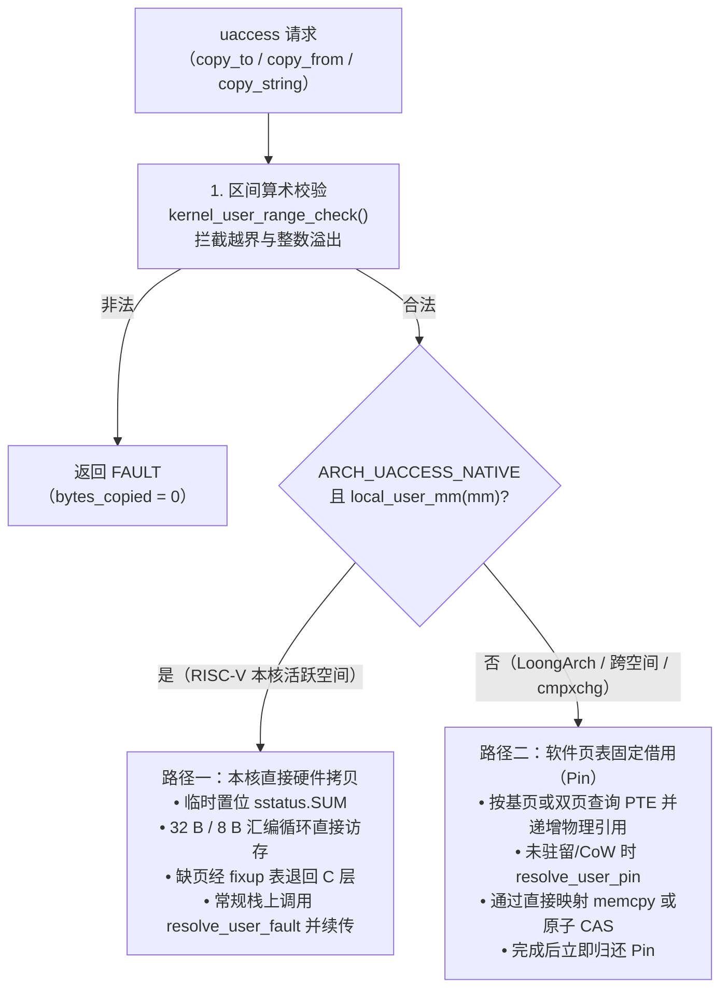

# 用户内存访问模块

内核在执行系统调用（如 `read`/`write`、`uname`、`execve` 读取参数向量与路径名）以及同步原语（如 `futex`）时，必须安全地读写用户态虚拟地址空间。用户传入的指针可能指向非法内核地址、未映射空洞、只读页面，或尚未触发按需装页与写时复制（Copy-on-Write，CoW）的合法映射。用户内存访问模块（User Access，简称 uaccess）为内核提供统一的安全拷贝与用户态原子操作边界，自动完成范围校验、按需缺页修复与精确部分完成回报，绝不允许一个错误的用户指针导致内核崩溃。

页表与地址空间机制见 [RISC-V Sv39 分页模块](riscv-sv39.md) 与 [虚拟内存管理（VMM）](kernel-mm.md)，主要消费者见 [系统调用模块](kernel-syscall.md) 与 [进程文件资源模块](kernel-files.md)。

---

## 一、源码组织

| 源码路径 | 核心职责 |
| :--- | :--- |
| `include/kernel/uaccess.h` | 公开跨架构安全访问接口：`kernel_user_range_check`、`kernel_copy_to_user`、`kernel_copy_from_user`、`kernel_copy_string_from_user` 与 `kernel_user_cmpxchg_u32` |
| `include/arch/uaccess.h`、`include/arch/riscv/uaccess.h` | 编译期路由开关 `ARCH_UACCESS_NATIVE`（RISC-V 为 `1`，LoongArch 与宿主测试模型为 `0`），零虚表开销选择本核原生快路径或软件页表路径 |
| `mm/uaccess.c`、`mm/uaccess_internal.h` | 公共范围校验、本核直接拷贝重试循环、软件页表固定借用（Pin）拷贝、双页批借用与跨页写游标 `struct kernel_uaccess_write_cursor` |
| `arch/riscv/user_copy.S`、`arch/riscv/uaccess.c` | RISC-V 64 汇编直接用户拷贝例程、`sstatus.SUM` 区间控制、`.rodata.riscv_uaccess_fixups` 异常恢复表与陷入恢复分派 `riscv_uaccess_fault()` |

---

## 二、双路径执行架构

BoarOS 根据目标体系结构以及“被访问的地址空间是否为当前处理器正在运行的用户线程空间”，自动路由至两条互补路径：

### 2.1 路径一：RISC-V 本核直接拷贝与异常恢复表

当处理器处于 RISC-V 64 且目标 `mm` 正是当前核激活的用户地址空间（`active_mm_record == mm->record` 且当前任务携带用户上下文）时，`mm/uaccess.c` 直接调用 `arch/riscv/user_copy.S` 的汇编例程，免去逐页软件查表与频繁引用计数的开销：

- **最小化 `sstatus.SUM` 窗口**：RISC-V 监管态默认禁止直接访问带 `U` 位的用户页（防止内核意外解引用用户指针）。汇编例程仅在实际拷贝区间首尾通过 `csrs`/`csrc sstatus, 0x40000`（`SUM` 位，bit 18）开闭权限。
- **高吞吐展开与对齐策略**：
  - 当源地址与目标地址对 8 字节同余时，先逐字节对齐到 8 字节和 32 字节边界，随后进入每轮 **32 字节**（四条 64 位 `ld`/`sd`）的展开循环。写入用户空间（`riscv_copy_to_user`）时，先一口气读齐本轮的四个内核机器字（`t0, t2, t3, t4`），再连续写入用户地址，减少内核页与用户页地址转换交替竞争。
  - 当源和目标的 8 字节页内偏移不同时：写入用户空间先将用户目标对齐到 8 字节，再从请求范围内的对齐内核字移位拼装出对齐的 64 位写入（`.Lshift_words`）；从用户空间读取（`riscv_copy_from_user`）则退回逐字节循环，避免为了拼装一个机器字而提前越界读取后续不可读页面、导致丢失原本合法的前缀。
- **精确异常表恢复（`.rodata.riscv_uaccess_fixups`）**：
  - 汇编宏 `recover` 仅将**访问用户地址的访存指令**及其对应的恢复标签（`.Lfail`、`.Lfail8`、`.Lfail16`、`.Lfail24`）成对登记在只读节 `.rodata.riscv_uaccess_fixups` 中；访问内核缓冲区的指令绝不登记，因此内核自身的野指针仍会直接触发致命陷入。
  - 若某条用户访存触发异常，陷入处理器调用 `riscv_uaccess_fault()`：核对 `sstatus.SUM` 为 1、`stval < RISCV_SV39_USER_LIMIT` 且 `scause` 为加载/存储缺页（13 / 15）或加载/存储访问异常（5 / 7），检索到匹配 `sepc` 后把 `scause` 存入 `t5`、将 `sepc` 改写为恢复点并立刻清除 `sstatus.SUM`，然后干净地退出陷入帧。
  - 恢复点扣除当前批次已完成的偏移，将精确剩余字节数与异常原因返回给 C 层的 `local_copy()` / `local_string()`。此时已完全脱离嵌套陷入栈帧：若是页故障（`cause == 13 || 15`），外层在常规可睡眠内核栈上调用 `kernel_mm_resolve_user_fault()` 完成按需零页、文件读盘或 CoW，随后从已完成前缀之后继续重试；若是访问故障（`cause == 5 || 7`），则立即终止并返回 `FAULT`。

### 2.2 路径二：软件页表固定借用（Pin）与直接映射访问

在 LoongArch 64、宿主测试模型、跨进程/非当前激活地址空间拷贝，以及 `kernel_user_cmpxchg_u32()` 原子操作中，内核经由软件页表固定协议访问用户物理页：

- **固定借用与缺页修复**：每个基页片段先尝试 `kernel_mm_pin_user_page()`——在 MM 的 `metadata` 读锁（`KERNEL_RAW_RANK_MM = 15`）内查表、校验 `USER|READ` 或 `USER|WRITE` 权限、递增物理页引用计数及地址空间的 `access_pins`/`write_pins`，返回直接映射指针。若目标页尚未驻留或需要写时复制，则自动调用 `kernel_mm_resolve_user_pin()` 装页并重新固定。实际 `memcpy` 与原子指令全部在锁外完成，结束后立即归还借用令牌（`kernel_mm_unpin_user_page`）。
- **两项热路径优化**：
  - **写游标缓存（`struct kernel_uaccess_write_cursor`）**：供文件读等连续分片写入同一用户页的场景复用当前已固定的页句柄，直到跨页或结束前才归还（在 RISC-V 本核空间上仍自动切入 `local_copy`）；
  - **跨双页批量固定（`copy_to_user_pair`）**：对于恰好跨越两张相邻基页的写入，通过 `kernel_uaccess_pin_user_pair()` 尝试一次借用两页并成对归还（仅首页触发缺页，次页通过 `kernel_mm_try_pin_user_page()` 就地借用已驻留页），减少锁往返。
- **用户态 32 位原子比较交换（`kernel_user_cmpxchg_u32`）**：要求 4 字节对齐且位于用户地址空间内，以写权限固定目标页（完成必要的按需装页与 CoW）后，在直接映射地址上执行 `__atomic_compare_exchange_n(..., __ATOMIC_SEQ_CST, __ATOMIC_SEQ_CST)` 并返回旧值，支撑 `futex` 等待与唤醒的原子语义。

---

## 三、范围校验、部分复制与错误语义

| 规则维度 | 具体约定 |
| :--- | :--- |
| **用户地址上界** | `kernel_user_range_check()` 在触碰页表前检查整个半开区间 `[addr, addr + size)` 不溢出且不超过 `ARCH_MMU_USER_LIMIT`（RISC-V Sv39 为 $2^{38}$，LoongArch 64 为 $2^{47}$）；零长度固定拷贝直接返回 `OK` 且报告 `0` 字节 |
| **非事务性前缀语义** | 固定长度拷贝不是全有或全无事务：若前若干字节或页面已成功传输、后续页遇到未映射或权限不足，函数保留已写入的连续前缀并通过 `bytes_copied` 精确报告已完成量。文件 `read`/`write`/`writev` 依此推进打开文件偏移量，符合 Linux 用户拷贝与短读写语义 |
| **有界字符串读取** | `kernel_copy_string_from_user()` 拒绝 `capacity == 0`；最多扫描 `capacity` 字节，遇到 `'\0'` 时将终止符一并复制到内核缓冲区，`string_length` 返回不含 `'\0'` 的长度；若容限内无终止符返回 `KERNEL_UACCESS_STATUS_TOO_LONG`；遇未映射页或越界返回 `FAULT` 并保留已复制前缀 |
| **错误隔离原则** | VMA 之外、`PROT_NONE`、权限不足、文件越过末尾（`BUS_FAULT`）或按需装页内存耗尽（`NO_MEMORY`）统一映射为 `KERNEL_UACCESS_STATUS_FAULT`（系统调用层转为用户态 `-EFAULT`）；而 MM 状态损坏、页表结构异常或物理页解析失败返回 `KERNEL_UACCESS_STATUS_STATE`，交由内核判定为致命错误，绝不把内核自身损坏伪装成普通 `-EFAULT` |

---

## 四、并发安全与页固定（Pin）边界

- **Pin 保障物理存活而非内容互斥**：`pin` 通过物理页引用计数与 MM 的 `access_pins` / `write_pins` 计数（配合排空机制 `MM_PIN_CLOSED`），确保正在拷贝或执行 `futex` 的物理页不会被并发 `munmap` 或 CoW 释放后重新分配给他人；对于可写共享文件映射，写固定还同步持有页缓存写借用，确保回写快照排空在途写者。但它不替代用户态多线程之间的数据同步。
- **禁止持旧 Pin 睡眠或重入**：调用者在换页、发起缺页或进入磁盘 I/O 等待前必须先归还已有 Pin；若同一调用链持有 Pin 时试图再向正在排空 Pin 的操作申请新固定，MM 返回冲突以避免自锁死锁。
- **令牌所有权**：固定令牌 `struct kernel_mm_user_pin` 记录本次登记节点位置，归还为 $O(1)$ 且支持任意顺序释放；令牌不可复制、不可跨任务归还，重复归还直接触发 fatal trap。

---

展开查看：公共内存原语、成本采样与定向验证入口

### 公共内存原语与成本诊断

- 软件固定路径的页内拷贝复用 `lib/string.c` 的对齐展开 `memcpy` 原语（同余时机器字与四字展开，不同偏移时从片段内对齐字移位合成，不越过页片段边界）。
- 开启 `BOAROS_COST_DIAGNOSTICS` 构建时，在 RISC-V 直接拷贝与软件固定页拷贝处统一记录 `COST_UACCESS_COPY_BYTES`、`COST_UACCESS_COPY_TICKS`、`COST_COPY_TO_USER`、`COST_COPY_FROM_USER` 与 `COST_USER_RESOLUTIONS`；默认发布构建零额外采样开销。

### 定向验证入口

- **宿主字符串原语、页固定与并发协议**：`make test-string-host`、`make test-mm-pin-host`、`make test-mm-concurrency-host`
- **RISC-V 客机直接拷贝、多核与部分写边界**：`make test-uaccess-riscv`、`make test-mm-smp-riscv`、`make test-files-partial-write-riscv`、`make test-userland-riscv`、`make test-riscv`
- **LoongArch 跨页拷贝与真实 ELF 验证**：`make test-loongarch`（详见 [LoongArch 启动模块](loongarch-boot.md)）

