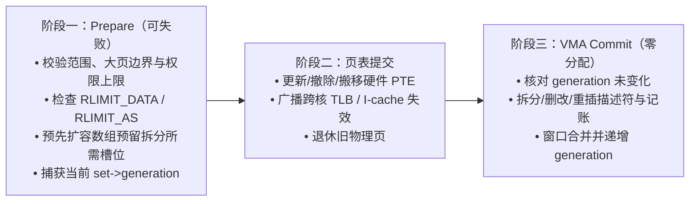

# 虚拟内存区域（VMA）模块

虚拟内存区域（Virtual Memory Area，VMA）模块维护进程用户地址空间的逻辑区间视图。在现代操作系统的虚拟内存分层中，**硬件页表（PTE）只描述当前已经装入物理内存的页面**，而 **VMA 集合描述进程合法拥有哪些虚拟地址段、每段允许什么权限、对应哪种后备存储以及缺页时如何按需加载**——没有页表项不代表地址非法，可能是尚未触发缺页的懒分配区域；而落入 VMA 之外空洞的访问则直接触发段错误（`SIGSEGV`）。

硬件页表编码见 [RISC-V Sv39 分页模块](riscv-sv39.md)，并发锁协议与缺页执行流程见 [虚拟内存管理（VMM）](kernel-mm.md)。

---

## 一、源码组织

| 源码路径 | 核心职责 |
| :--- | :--- |
| `include/kernel/vma.h` | 定义 VMA 描述符 `struct kernel_vma`、类别/角色/缺页策略/标志位枚举、两阶段编辑句柄 `struct kernel_vma_edit` / `struct kernel_vma_remap` 与集合操作契约 |
| `mm/vma.c` | 实现基于有序动态数组的 VMA 集合、最近命中槽缓存、自顶向下选址、两阶段无分配区间编辑、窗口局部合并与虚拟内存用量记账 |
| `mm/mm.c` | 面向系统调用与内核消费者的上层入口，串联锁保护、页表提交与 VMA 集合提交，实现 `mmap`、`munmap`、`mprotect`、`mremap`、`brk`、`mlock`、`madvise`、`msync` 与 `shmat`/`shmdt` |
| `kernel/elf_image.c` | 进程装载阶段初始化初始栈、vDSO、ELF 程序段 VMA、堆边界与随机 `mmap` 上界 |

---

## 二、VMA 描述符与分类体系

每个 `struct kernel_vma` 以半开区间 `[start, end)` 表示一段连续且属性一致的逻辑映射，核心字段如下：

- **区间与后备偏移**：`start`、`end` 与 `backing_offset`（私有匿名映射恒为 0；文件、ELF、共享匿名对象和大页映射记录页对齐或大页对齐的后备字节偏移）。
- **双轨权限**：`permissions` 记录当前生效的读/写/执行位（`PROT_NONE` 记为 `0`），`maximum_permissions` 记录该映射生命周期内的最高允许权限（例如以只读文件描述符建立的共享文件映射或 `SHM_RDONLY` 附加的共享内存段均不含写上限）。`mprotect` 允许在降权后再升权，但不得突破 `maximum_permissions`；`split` 与 `fork` 完整继承该上限。
- **后备与所有权指针**：`backing` 指向后备对象（打开文件描述 OFD、不可变 ELF source、稀疏内存对象或大页映射），`backing_owner` 指向 MM 登记表中的来源记录或 SysV 共享内存附加句柄（`struct kernel_shm_attachment`），`shared_mapping_bytes` 可选指向可写共享映射字节原子计数器（用于文件写封存 `F_SEAL_WRITE` 等场景的并发准入控制）。

### 2.1 类别（`kind`）、角色（`role`）与缺页策略（`fault_policy`）

| VMA 类别（`KERNEL_VMA_KIND_*`） | 默认缺页策略（`KERNEL_VMA_FAULT_*`） | 典型角色（`KERNEL_VMA_ROLE_*`）与用途 |
| :--- | :--- | :--- |
| `ANONYMOUS` | `DEMAND_ZERO` / `RESIDENT_REQUIRED` | 堆（`HEAP`）、主栈（`STACK`）、私有匿名 `mmap`（`MMAP`）、常驻 `vDSO`/`vVAR` |
| `FILE_PRIVATE` | `FILE_PRIVATE` | 普通文件的私有映射（`MAP_PRIVATE`），首次写入触发写时复制 |
| `ELF_PRIVATE` | `ELF` | 可执行文件与动态链接器装载段（`ROLE_ELF`），由不可变 `kernel_elf64_source` 按需装页 |
| `ANON_SHARED` | `ANON_SHARED` | 共享匿名映射（`MAP_SHARED \| MAP_ANONYMOUS`），由 `kernel_memory_object` 维护跨 `fork` 共享页 |
| `FILE_SHARED` | `FILE_SHARED` | 普通文件的共享映射（`MAP_SHARED`），写回同步至页缓存与底层文件 |
| `SYSV_SHM` | `ANON_SHARED` | System V 共享内存（`ROLE_SYSV_SHM`），绑定 `shm_attachment` 且禁止与其他 VMA 合并，详见 [SysV 共享内存](sysv-shm.md) |
| `OBJECT_SHARED` | `OBJECT_SHARED` | eBPF Map / RingBuf 与报文接收环等内核对象共享映射；映射建立时预装固定内核页，撤销后访问触发 `SIGBUS` |
| `HUGETLB_PRIVATE` / `HUGETLB_SHARED` | `HUGETLB` | 私有与共享原生大页映射（`MAP_HUGETLB`、`SHM_HUGETLB`），起止地址与后备偏移必须按 `ARCH_MMU_HUGE_SIZE` 对齐 |

### 2.2 VMA 行为标志位（`flags`）

| 标志宏 | 含义与生命周期语义 |
| :--- | :--- |
| `KERNEL_VMA_LOCKED` / `LOCK_ONFAULT` | 内存锁定（`mlock`/`mlock2`）；`LOCK_ONFAULT` 仅可与 `LOCKED` 组合设置，`fork` 时子进程自动清除锁定标志 |
| `KERNEL_VMA_DONTFORK` / `WIPEONFORK` | 控制 `fork` 继承行为：`DONTFORK` 区间不复制到子进程；`WIPEONFORK` 在子进程中呈现空白零页并清除 `ANON_HISTORY` |
| `KERNEL_VMA_DONTDUMP` | 核心转储时排除该区域（如 `vVAR`） |
| `KERNEL_VMA_RANDOM_READ` | 由 `madvise(MADV_RANDOM)` 设置，关闭文件/ELF 缺页时的 64 KiB 邻页推测预装 |
| `KERNEL_VMA_GROWSDOWN` | 标记向下自动扩展区域（栈风格，与 `ROLE_STACK` 均受 `kernel_vma_grows_down()` 识别） |
| `KERNEL_VMA_ANON_HISTORY` | 记录私有映射已建立过匿名后备（即使经历 `MADV_DONTNEED` 仍保留），用于区分 `fork` 归属来源；修改该标志不递增集合 `generation` |
| `KERNEL_VMA_ANON_SOURCE` / `AIO_RING` | 分别标识 ELF 懒零填充区间与异步 I/O 环形缓冲区映射 |

---

## 三、存储结构、查找选址与合并策略

### 3.1 连续有序数组与最近命中缓存

`struct kernel_vma_set` 将进程的所有 VMA 按 `start` 升序保存在一块由内核堆管理的连续数组中（初始容量 `KERNEL_VMA_INITIAL_CAPACITY = 8`，扩容按 2 倍增长）：

- **单次命中热路径**：`kernel_vma_set_lookup_recent()` 先以原子方式读取地址空间维护的最近命中槽位 `recent_fault_vma`，若目标地址仍落在该槽区间内则 $O(1)$ 直接返回描述符快照与当前 `generation`；未命中时再调用 `lower_bound()` 执行 $O(\log n)$ 二分查找并刷新缓存槽。
- **持续虚拟内存记账**：`struct vma_usage` 随每次提交同步维护三项精确字节总量——`total`（总映射虚拟字节，对照 `RLIMIT_AS`）、`data`（可写且非向下扩展的私有数据段字节，对照 `RLIMIT_DATA`）和 `locked`（锁定字节，对照 `RLIMIT_MEMLOCK`），避免系统调用检查资源限额时反复全表扫描。

### 3.2 自顶向下选址与栈保护间隔

非固定地址 `mmap` 通过 `kernel_vma_set_find_topdown_gap()` 寻找空闲虚拟区间：

1. **优先尝试提示地址（`hint`）**：若页对齐的 `hint` 位于 `[lower, upper]` 内、不与任何现有 VMA 重叠，且没有侵入紧邻高地址向下扩展区的保护间隔，则直接采用 `hint`。
2. **自顶向下扫描空洞**：否则从 `upper`（每进程随机化后的 `mmap_base`）向下遍历有序数组，跳过所有 VMA 及其下方保护间隔，返回最高的足够大空洞。
3. **256 页栈保护间隔**：对任何满足 `kernel_vma_grows_down()` 的区间（主栈或 `MAP_GROWSDOWN` 映射），`unmapped_start()` 自动将其下沿向下扩展 `KERNEL_VMA_STACK_GUARD_PAGES`（**256 页**，RISC-V 为 1 MiB，LoongArch 为 4 MiB），防止普通 `mmap` 紧贴栈底分配而阻断后续栈增长。

### 3.3 邻接合并与延迟合并

两个相邻 VMA（`left->end == right->start`）只有在 `permissions`、`maximum_permissions`、`kind`、`role`、`fault_policy`、`flags`、`backing`、`backing_owner`、`shared_mapping_bytes` 全部相等，且非匿名映射的后备偏移连续（`left->backing_offset + left_size == right->backing_offset`）时才允许合并；携带 `shm_attachment` 的 SysV 共享内存与共享大页映射显式禁止合并，确保按段统计附加计数准确无误。

普通编辑仅调用 `merge_window()` 扫描受影响区间及左右各一条邻接项；当仅设置 `ANON_HISTORY` 或 `fork` 重绑定后备（`rebind_backing`）导致原本不相邻属性的新合并机会出现时，置位 `deferred_merge` 延迟到下一次结构性编辑提交时统一收拢。

---

## 四、两阶段无分配区间编辑事务

`munmap`、`MAP_FIXED` 覆盖替换、`mprotect`、`mlock`/`madvise` 改标志以及 `mremap` 都可能在区间两端将一条已有 VMA 拆分为两段甚至三段。如果先修改硬件页表、再在更新 VMA 数组时遭遇内核堆内存耗尽，就会造成硬件映射与软件逻辑视图永久撕裂。为此，VMA 集合强制采用 **准备—页表提交—集合提交** 的两阶段事务协议：

- **精准预留与单次搬移**：
  - `kernel_vma_set_prepare_replace()` 覆盖 `munmap`（`replacement == NULL`）与 `MAP_FIXED` 覆盖。纯删除场景下，只有“从单条 VMA 正中间打洞”会使条目数加 1，其余情况零扩容；提交时 `remove_range()` 将两端可能保留的切片与未受影响的后缀合并为一次 `move_entries()` 完成。
  - `kernel_vma_set_prepare_mprotect()` 严格按虚拟地址顺序逐段检验覆盖无洞、权限上限（超限返回 `ACCESS` / `EACCES`）以及可写私有数据段对 `RLIMIT_DATA` 的增量约束；若在跨越多个 VMA 的范围中途出错，支持按 Linux 语义保留并提交已完成校验的合法前缀，避免回滚破坏已改权限。
  - `kernel_vma_set_prepare_remap()` 与 `prepare_duplicate()` 为 `mremap`（搬移或 `MREMAP_DONTUNMAP` 保留源映射）一次性预留最多 **3 个**额外槽位，确保硬件页表搬移完成后 `commit_remap()` 绝不失败；搬移可写共享映射时采用“先加新计费再减旧计费”的顺序，防止瞬间归零诱发并发文件写封存误判。
  - **大页边界约束**：`huge_edit_aligned()` 在所有 `prepare` 入口拦截落在大页内部、未按 `ARCH_MMU_HUGE_SIZE` 对齐的部分撤映射或改权请求，拒绝拆分原生大页。

---

## 五、典型操作串联：`brk`、`fork` 与跨 I/O 缺页

- **堆顶管理（`brk`）**：MM 记录字节级精确堆顶 `current_brk`，仅在跨页边界时编辑 VMA。扩容插入可读写的 `ANONYMOUS` + `HEAP` + `DEMAND_ZERO` 区间；缩容直接复用通用范围删除逻辑，即使程序此前在堆区中间执行过 `munmap`、`mprotect` 或 `MAP_FIXED` 替换，也能正确撤销 `[page_end(new), page_end(old))` 内的全部残留映射。
- **地址空间克隆（`kernel_vma_set_fork`）**：一次性按源集合条数预留容量，跳过 `DONTFORK` 区间、清除锁页位、对 `WIPEONFORK` 清除 `ANON_HISTORY`，并通过 `rebind` 回调为文件/ELF/对象来源建立子地址空间独立登记，为 SysV 共享内存递增附加引用计数。若中途失败，父集合原封不动，已复制前缀交由调用方统一清理。
- **文件与 ELF 缺页跨 I/O 并发**：每条文件或 ELF VMA 的 `backing_owner` 直接指向 MM 的来源登记节点。缺页或 `msync` 在进入阻塞磁盘 I/O 前借用该来源的在途操作固定计数（pin）并记录当前 `vma_generation`；即使其他线程在 I/O 期间并发 `munmap` 撤除了最后一条关联 VMA，来源登记也仅从活动链表移入退休链表，等待在途操作全部归还后才真正关闭 OFD。I/O 完成后重查当前 VMA 与目标 PTE，若映射已被撤销或替换则丢弃结果而不发布过期页表项。

---

展开查看：核心内部接口清单与定向验证入口

### VMA 集合核心接口（`include/kernel/vma.h`）

| 接口函数 | 职责说明 |
| :--- | :--- |
| `kernel_vma_set_create` / `kernel_vma_set_fork` / `kernel_vma_set_destroy` | 创建空集合、按继承标志与重绑定回调克隆子集合、释放集合并关闭 SysV 附加计数 |
| `kernel_vma_set_lookup` / `kernel_vma_set_lookup_recent` / `next` / `previous` | 二分定位、带槽位缓存的热路径查找及前后邻接区域查询 |
| `kernel_vma_set_find_topdown_gap` / `overlaps` / `has_shm` / `range_is_anonymous` / `permission_addition` | 自顶向下选址、重叠判定与供并发读写锁快路径使用的区间性质判定 |
| `kernel_vma_set_prepare_replace` / `prepare_protect` / `prepare_mprotect` / `prepare_flags` / `commit_edit` | 两阶段无分配的删除、固定替换、权限与标志修改事务 |
| `kernel_vma_set_prepare_remap` / `prepare_duplicate` / `commit_remap` / `trim_end` | `mremap` 搬移/保留源重映射与高精度末尾收缩 |
| `kernel_vma_set_mark_anonymous` / `rebind_backing` / `backing_in_use` / `clear_locks` | 并发标记私有匿名历史、子空间来源重绑定、冷清理复用检查与全空间解锁（`munlockall`） |

### 定向验证入口

- **VMA 区间语义、事务与并发**：`make test-vma-riscv`、`make test-mmap-riscv`、`make test-brk-riscv`、`make test-io-sleep-riscv`
- **资源限额与系统调用对照**：`tests/host/mm-resource-limits.sh`、`make test-root-init-riscv`、`make test-diff-abi-riscv`、`make test-sqlite-wal-riscv`、`make test-riscv`

