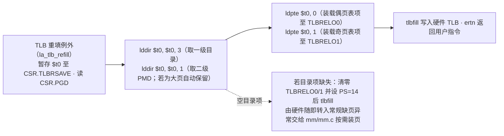

# LoongArch 64 引导、16 KiB 分页与多核执行

BoarOS 完整支持龙芯 **LoongArch 64（LA464 处理器模型）** 架构，运行于内核特权级 **PLV0**，支持 **1～8 核对称多处理（SMP）**、**16 KiB 基页 / 32 MiB 原生大页**三级页表、软件转换后备缓冲器（Translation Lookaside Buffer，TLB）重填、PCI/PCIe 现代 VirtIO 设备以及浮点/LSX/LASX 向量上下文，与 RISC-V 64 共享全部上层内核子系统。

---

## 一、源码组织

| 源码路径 | 核心职责 |
| :--- | :--- |
| `arch/loongarch/boot.S`、`main.c`、`linker.ld` | 物理入口、引导页表、高半区切换与根盘启动 |
| `arch/loongarch/mmu.c`、`tlb_refill.S` | 16 KiB 三级页表、32 MiB 原生大页、硬件辅助 `LDDIR`/`LDPTE` 软件 TLB 重填 |
| `arch/loongarch/smp.c`、`secondary.S` | 片上 IOCSR 邮箱从核唤醒、IPI 事件分发与跨核 `INVTLB` 同步协议 |
| `arch/loongarch/trap.c`、`trap_entry.S`、`context.c`、`fpu.c` | 陷入与中断分发、上下文切换、浮点与 LSX/LASX 向量扩展现场切换 |
| `platform/loongarch_pci.c`、`loongarch_root.c`、`kernel/pci.c` | PCIe ECAM 配置空间扫描、BAR 资源分配、VirtIO-PCI 探测与 EIOINTC 中断初始化 |

---

## 二、早期引导与内核物理内存映射

LoongArch 64 从物理入口开始执行，使用硬件直接映射窗口（Direct Mapping Window，DMW）过渡。`arch/loongarch/boot.S` 通过临时缓存和非缓存窗口清除静态内存、读取引导信息和准备高半区目录。

1. 主核在共享高半区页表中建立一条 32 MiB 启动映射，配置 `CSR.PGDH` 与物理重填入口，再从页表映射中的内核地址调用 `la_kernel_main()`。
2. `la_mmu_direct_map_initialize()` 依据引导内存范围建立缓存物理内存映射，并为设备寄存器和 PCI 地址窗建立分离的非缓存映射。物理内存使用 `LA_DIRECT_BASE = 0xffff900000000000`，设备地址使用 `LA_UNCACHED_BASE = 0xffffa00000000000`。普通完整范围优先用 32 MiB 大页。
3. 主核改用页表映射中的串口和电源寄存器，关闭所有硬件直接映射窗口，并清除地址转换缓存。各任务共用同一个高半区根。切换进程页表或批量撤销用户映射时仅清除非全局项，保留全局的普通内存与设备地址转换。

`memfd_secret` 首次装页时，在内核页表中撤除相应物理页的直接映射。首次触及大页时只拆分这一条 32 MiB 映射，锁外准备末级表，发布后等待各在线核完成地址转换失效。后续同一区间的操作直接编辑 16 KiB 叶项。最后一个秘密页归还时恢复原大页映射，确认各在线核已经失效再释放拆分表。秘密内存对象清零并归还各数据页。

当系统调用以调用进程中的秘密映射作为输入或输出缓冲区时，`kernel_mm_copy_local_secret()` 核对当前页表和访问权限，在页表读保护内通过原用户虚拟地址复制一个短片段。撤销映射需要取得同一页表的写保护。复制过程沿用原用户页表。远程内存读写和要求借用物理页的接口仍拒绝秘密页。

---

## 三、16 KiB 三级页表与软件 TLB 重填

### 3.1 页表几何与 32 MiB 原生大页

与 RISC-V Sv39 的 4 KiB 硬件页表遍历不同，BoarOS 在 LoongArch 64 上采用 **16 KiB 基页**（`BOAROS_PAGE_SHIFT = 14`），每张页表恰好容纳 `2,048` 项 8 字节页表项（每级索引 11 位），构建经典的三级页表（索引位偏移 `14 / 25 / 36`，分别编程至 `CSR.PWCL` 与 `CSR.PWCH`）：
- **用户页表根**存于 `CSR.PGDL`（`0x19`），**内核的高半区页表根**存于 `CSR.PGDH`（`0x1a`），供普通物理内存、设备和任务内核栈映射共用；
- **32 MiB 原生大页**：直接由中间目录级（PMD）大叶表示（`ARCH_MMU_HUGE_ORDER = 11`，页表项置 `PTE_HUGE = 1 << 6`），单条 32 MiB PMD 恰好覆盖龙芯硬件一对 16 MiB `EntryLo` 表项；
- **软件权限编码**：`arch/loongarch/mmu.c` 使用 `PTE_VALID`（`1`）、`PTE_DIRTY`（`2`）、`PTE_PRESENT`（`1<<7`）、`PTE_WRITE`（`1<<8`）、`PTE_COW`（`1<<9`）、`PTE_NONE`（`1<<10`）、`PTE_NR`（`1<<61`）与 `PTE_NX`（`1<<62`），`PROT_NONE` 保留 `PTE_PRESENT | PTE_NONE`（清除 `PTE_VALID`）而不丢弃物理页所有权与 CoW 标记。

### 3.2 基于 `LDDIR` / `LDPTE` 的超短软件 TLB 重填

LoongArch 发生 TLB 缺失时跳转到 `CSR.TLBREBASE` 指向的物理地址例外入口 `la_tlb_refill`（`arch/loongarch/tlb_refill.S`）。BoarOS 利用龙芯硬件页表遍历辅助指令，仅需极少指令即可同时处理 16 KiB 基页与 32 MiB 大页重填：

---

## 四、PCIe 设备枚举、VirtIO-PCI 与扩展中断控制器（EIOINTC）

- **PCIe 总线与 VirtIO-PCI（`platform/loongarch_pci.c`、`loongarch_root.c`）**：平台通过 `LA_UNCACHED_BASE` 映射 128 MiB ECAM 配置空间（物理基址 `0x20000000`）与内存 BAR 地址窗（`0x40000000`～`0x80000000`）；启动时扫描 BDF `0..255`，自动识别现代 VirtIO-PCI 块设备（ID `2`）、硬件随机数（ID `4`）与网卡（ID `1`），解析标准 VirtIO PCI Capability 1～4 并由 `pci_function_assign()` 分配内存 BAR 资源，对接与 RISC-V 完全一致的公共 VirtIO 驱动层。
- **7A1000 PCH-PIC 与 EIOINTC 中断路由**：`la_virt_irq_initialize()` 初始化桥片中断控制器并通过 IOCSR `0x420` 启用扩展 I/O 中断控制器（EIOINTC），将外部中断源 `0..63` 路由至逻辑 CPU0（PCI INTx 按 `16 + (((bdf >> 3) + pin - 1) & 3)` 映射），由 CPU0 的 `la_virt_irq_dispatch()` 统一分发外设中断；每核本地恒频定时器（`ECFG` bit 11）与核间中断（`ECFG` bit 12）则由各处理器核独立响应。

---

## 五、基于 IOCSR 邮箱的多核引导与跨核 TLB 同步

### 5.1 从核唤醒与上线（`arch/loongarch/smp.c` / `secondary.S`）

LoongArch 不依赖外部固件启核，而是通过片上 **IOCSR 邮箱与核间中断寄存器**直接引导从核：
1. CPU0 将从核上下文虚拟指针写入目标核 `MBUF1`，将 `la_secondary_entry` 物理入口地址写入 `MBUF0`（经 IOCSR `0x1048` 邮寄），再向 `0x1040` 发送唤醒 IPI；
2. 从核以临时直接窗口进入，加载共享 `CSR.PGDH`，跳到页表映射后关闭所有硬件直接映射窗口。随后从 `MBUF1`（`0x1028`）取回栈指针 `$sp` 与任务指针 `$tp`，配置异常入口，使能本地 IPI 与恒频定时器；
3. 与 CPU0 完成 `LA_IPI_HANDSHAKE` 握手并观察到首次本地时钟中断后，正式发布 `KERNEL_CPU_ONLINE` 加入多核调度。

### 5.2 无死锁的跨核 `INVTLB` 同步协议

在 LoongArch 上，解除映射或降权时由 `la_smp_sync_user()` / `la_smp_sync_kernel()` 驱动跨核 TLB 失效确认：
- 发起核将本次失效请求 `(generation, address, size, instructions, targets, pending)` 写入自己的每核槽 `fences[self]`，向目标核的 `incoming_fences[target].sources` 置位并发送 `LA_IPI_TLB`；
- 目标核在 IPI 中按地址范围执行失效。用户单页使用 `invtlb 0x5`，用户大范围使用 `invtlb 0x3`。内核单页使用包含全局项的 `invtlb 0x6`，内核大范围使用 `invtlb 0x0`。涉及可执行页时追加 `ibar 0` 指令屏障，核对代次后清除 `pending` 对应位；
- **防互等死锁机制**：发起核在自旋等待全部 `pending` 位清零期间，持续主动调用 `consume(0)` 消费发给自己的远端 TLB 失效请求，确保即使两颗核同时在关中断上下文发起跨核刷页，也能各自推进而绝不互等死锁。

---

展开查看：LoongArch 构建与多核验证入口

### 构建配置

| 配置 | 命令 / 参数 | 说明 |
| :--- | :--- | :--- |
| 默认单核内核 | `make kernel-la` | 生成单核生产内核 `kernel-la` |
| 交互式 Shell | `make shell-loongarch QEMU_LOONGARCH64=qemu-system-loongarch64` | 自动制作 ext4 根盘并启动进入 `/ #` |
| 多核 SMP 内核 | `LA_SMP=1 LA_SMP_CPUS=4`（支持 `2`/`4`/`8`） | 配合 `-smp 4` 启动龙芯多核虚拟机 |

### 定向验证入口

- **基础启动、页表、大页与驱动回归**：`make test-loongarch`、`make test-permissions-loongarch`、`tests/loongarch/mmu.c`（覆盖 32 MiB 大页两半访问、末字节、CoW 与退役）。
- **龙芯多核执行与压力验证**：`tests/loongarch/smp.py`。
- **工具与参考内核准备**：`make prepare-la-tools`（RTC 补丁 QEMU）、`make prepare-la-userland`（16 KiB 对齐 LP64S 用户态工具链）。

