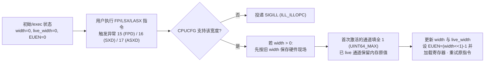

# LoongArch 64 浮点（FPU）与 LSX / LASX 向量状态

BoarOS 在龙芯 **LoongArch 64（LA464 处理器模型）** 上完整支持 64 位标量浮点（**FPU**）、128 位单指令多数据向量扩展（LoongArch SIMD Extension，**LSX**）以及 256 位高级向量扩展（LoongArch Advanced SIMD Extension，**LASX**），运行于单核与 1～8 核对称多处理（SMP）配置下。内核 C 代码始终保持纯整数 ABI（LP64S），仅在专用汇编例程中触碰浮点与向量寄存器，而用户态可直接运行标准硬浮点 LP64D 程序。龙芯引导、分页与多核框架见 [LoongArch 64 引导与多核执行](loongarch-boot.md)，信号机制见 [内核信号](kernel-signal.md)。

---

## 一、源码组织

| 源码路径 | 核心职责 |
| :--- | :--- |
| `include/arch/loongarch/task.h`、`fpu.h` | 定义内嵌于任务的 1056 字节、32 字节对齐 `struct arch_fpu_state` 及字段偏移常量 |
| `arch/loongarch/fpu.c` | `CPUCFG` 扩展探测、`AT_HWCAP` 生成、首次使用与宽度升级处理（`la_fpu_first_use`）及浮点异常解码（`la_fpu_take_exception`） |
| `arch/loongarch/fpu_state.S` | 按需切换 `CSR.EUEN` 并执行标量（`fst.d`/`fld.d`）、LSX（`vst`/`vld`）或 LASX（`xvst`/`xvld`）寄存器与 `fcc0..7`/`fcsr0` 搬移 |
| `arch/loongarch/context.c`、`trap.c` | 上下文切换中的现场保存/恢复（`arch_fpu_switch`）、`clone`/`exec` 状态规则与异常 15/16/17/18 分发 |
| `arch/loongarch/signal.c`、`ptrace.c` | 构造与校验 FPU/LSX/LASX 可扩展信号帧，以及 `NT_PRFPREG` 标量浮点调试接口 |

---

## 二、硬件能力探测与三档宽度状态模型

### 2.1 `CPUCFG` 探测与 `CSR.EUEN` 宽度映射

`arch/loongarch/fpu.c` 通过 `cpucfg` 指令读取配置字 2（索引 `2`）：
- 第 6 位（`0x40`）标识硬件支持 **LSX**（128 位，2 × 64 位通道）；
- 第 7 位（`0x80`）标识硬件支持 **LASX**（256 位，4 × 64 位通道）。

`la_user_hwcap()` 据此向用户态辅助向量 `AT_HWCAP` 发布的位图包含基础能力与标量浮点（`0x0b`），并在硬件实际具备时依次置入 LSX（`0x10`）与 LASX（`0x20`）。在 QEMU 中关闭 LASX 或同时关闭 LSX/LASX 的处理器配置时，内核不会发布对应能力位，且用户越权指令会可靠触发 `SIGILL`。

硬件通过扩展部件使能寄存器 **`CSR.EUEN`（`0x2`）** 的低三位分别控制 FPU（bit 0，`FPE`）、LSX（bit 1，`SXE`）与 LASX（bit 2，`ASXE`）。软件用数值 `width` 表示当前启用宽度（`0` = 全关闭，`1` = FPU 64 位，`2` = LSX 128 位，`4` = LASX 256 位），对应写入 `CSR.EUEN` 的位掩码恰好满足简洁公式 `(width << 1) - 1`：
- `width = 1` → `0b001`（仅开启 FPU）；
- `width = 2` → `0b011`（开启 FPU + LSX）；
- `width = 4` → `0b111`（开启 FPU + LSX + LASX）。

### 2.2 任务内嵌映像与三个关键状态字段

每个任务控制块直接内嵌一个 **1056 字节**、按 **32 字节对齐**的 `struct arch_fpu_state`（首次激活无需动态分配内存）：

| 字段 | 偏移 | 大小 | 语义说明 |
| :--- | :--- | :--- | :--- |
| `regs[32][4]` | `0` | 1024 字节 | 32 个最大 256 位寄存器，每个寄存器占 4 个 64 位通道（lane 0..3） |
| `fcc` | `1024` | 8 字节 | 8 个浮点条件码寄存器 `fcc0..fcc7`，按字节打包存放 |
| `fcsr` | `1032` | 4 字节 | 浮点控制与状态寄存器 `$fcsr0`（含舍入模式、使能位、异常原因与标志位） |
| `width` | `1036` | 4 字节 | **当前硬件活动宽度**（`0`/`1`/`2`/`4`），决定 `CSR.EUEN` 状态及上下文切换搬移宽度 |
| `saved` | `1040` | 8 字节 | 对应 Linux `used_math` / `SC_USED_FP`，标记用户是否已发布有效浮点/向量上下文 |
| `live_width` | `1048` | 4 字节 | **历史已初始化的最高宽度**（`0`/`1`/`2`/`4`），始终满足 `width <= live_width` |

之所以严格区分 `width`、`live_width` 与 `saved`，是因为用户态可以在 `rt_sigreturn` 中手动清除 `SC_USED_FP` 标记（使 `saved = 0`、`width = 0`），同时保留此前已经初始化过的高位向量通道（`live_width` 不变）；随后当任务再次执行向量指令时，内核能依据 `live_width` 精确还原既有高位通道，而不是错误地把它们重新覆写为全 1。

---

## 三、首次使用、宽度升级与任务切换



### 3.1 惰性首用与逐级升级（`la_fpu_first_use`）

当用户态在对应扩展关闭时执行指令，处理器依次触发同步异常 `15`（FPU 不可用）、`16`（LSX 不可用）或 `17`（LASX 不可用），陷入分发器分别以目标宽度 `1`、`2`、`4` 调用 `la_fpu_first_use(width)`：
1. 若处理器 `CPUCFG` 不支持目标宽度，返回失败并由陷入分发器向用户投递 `SIGILL`；
2. 若当前任务已经启用了较窄宽度（例如正处于 FPU 态又首次执行 LSX/LASX 指令），必须先按当前 `width` 将硬件低位寄存器保存到内存，再升级宽度（若目标宽度不大于当前活动宽度则属于状态损坏，立即触发内核致命报错）；
3. 对于从未初始化过的标量低位（`!saved && (width == 1 || live_width < 2)`），将 32 个寄存器的 lane 0 填入全 1（`UINT64_MAX`，符合 Linux 龙芯初始化 NaN 语义）并清零 `fcc`、置 `saved = 1`；对于从旧 `live_width` 扩展到目标 `width` 的新增高位通道（lane `old..width-1`），同样填入 `UINT64_MAX`，而已经处于 `live` 状态的通道保持内存映像原值；
4. 更新 `width` 与 `live_width`，调用 `la_fpu_restore()` 启用对应 `CSR.EUEN` 位并加载寄存器，保持 `era` 不变返回用户态重新执行触发异常的指令。

### 3.2 上下文切换、`clone` 与 `exec`

- **调度切换（`arch_fpu_switch`）**：在关中断的切换点，若前任任务 `width != 0` 则按其当前活动宽度保存硬件寄存器至内存；若后继任务 `width != 0` 则恢复后继寄存器，否则直接将 `CSR.EUEN` 清零，保证纯整数任务和内核线程全程关闭浮点/向量部件。由于每次切出均就地落盘保存，不存在跨核延迟借用，单核与 1～8 核 SMP 下语义完全一致。
- **进程克隆（`clone`/`fork`）**：先保存父进程当前硬件现场，复制 `struct arch_fpu_state` 后遵循 Linux `copy_thread` 语义撤销子任务的 SIMD 活动宽度：若父进程已使用浮点（`saved != 0`），子进程保留标量浮点值（`width = 1, live_width = 1`），向量高位通道待子进程首次执行 LSX/LASX 时重新按全 1 初始化；若父进程尚未使用浮点，子进程 `width = live_width = 0`。
- **程序替换（`exec`）**：`arch_process_prepare_exec()` 完整清零 `task->fpu` 并执行 `csrwr $zero, 2` 立即关闭 `CSR.EUEN`，杜绝旧程序浮点与向量数据残留。

---

## 四、浮点异常、信号帧与 `ptrace` 接口

### 4.1 浮点算术异常（异常码 `18`）

与 RISC-V 不同，LoongArch 支持在 `$fcsr0` 中通过低 5 位（`Enable`，bits 4:0）使能精确浮点异常陷阱，触发异常码 `18`（FPE）。`la_fpu_take_exception()` 读取 `$fcsr0` 后：
1. 计算被使能的挂起原因位 `pending = csr & ((csr & 0x1f) << 24)`，从 `$fcsr0` 中仅清除这组相交位并写回硬件，避免返回后重复陷入；
2. 依据 Linux 龙芯约定，按**原始全部 Cause 位**（bits 28:24）的固定优先级映射为 POSIX `SIGFPE` 的 `si_code`（`si_addr` 设为故障指令地址 `era`）：
   - Invalid（bit 28）→ `FPE_FLTINV`（`7`）
   - Divide-by-zero（bit 27）→ `FPE_FLTDIV`（`3`）
   - Overflow（bit 26）→ `FPE_FLTOVF`（`4`）
   - Underflow（bit 25）→ `FPE_FLTUND`（`5`）
   - Inexact（bit 24）→ `FPE_FLTRES`（`6`）
   - 无上述位命中时兜底返回 `FPE_FLTUNK`（`14`）。

因此，即便用户程序仅使能了 Inexact 陷阱，一次同时引发 Overflow 与 Inexact 的运算仍会准确上报更高优先级的 `FPE_FLTOVF`。

### 4.2 可扩展信号帧与 `rt_sigreturn`（`arch/loongarch/signal.c`）

龙芯信号帧由 **576 字节固定前缀**（128 字节 `siginfo` + 448 字节 `ucontext`）、可选的**扩展上下文记录**和 **16 字节 `END` 终止块**组成（整帧最大 **1664 字节**）：

| 扩展记录类型 | Magic 魔数 | 有效负载字节 | ABI 最小记录总长（含 16B 头与尾对齐） | Payload 对齐要求 |
| :--- | :--- | :--- | :--- | :--- |
| FPU（64 位） | `0x46505501` | `268`（`32×8 + 8 + 4`） | `288` | 16 字节 |
| LSX（128 位） | `0x53580001` | `524`（`32×16 + 8 + 4`） | `544` | 16 字节 |
| LASX（256 位） | `0x41535801` | `1036`（`32×32 + 8 + 4`） | `1056` | 32 字节 |

- **构帧交付**：当 `task->fpu.saved == 0` 时仅交付 592 字节整数帧；否则保存当前硬件现场，按最高 `live_width` 从用户栈顶向下依次排布 `END`、对齐后的扩展 payload、16 字节 `la_context_info` 与 576 字节前缀，并在 `mcontext.flags` 置 `SC_USED_FP`（bit 0）。
- **宽容且安全的 `sigreturn` 恢复**：
  - 恢复时仅读取 `END` 头的前 8 字节（`magic`/`size`），且不强求用户态搬迁后的帧对齐或尾部填充字节可读；
  - 遍历整条扩展链：未知魔数或尺寸过短视为坏帧（强制 `SIGSEGV`）；同类重复记录取最后一条；混合多种记录时始终按 **`LASX > LSX > FPU`** 优先级择优生效，不受排列顺序影响；
  - 若选中记录的 `fcsr` 含有已使能的挂起异常位，先在内存中清除这些位并写回用户栈上的 `fcsr` 槽位（写回只读/非法页视为坏帧），随后投递 `SIGFPE`（`SI_KERNEL`）；
  - 恢复不会仅因用户提供了更宽的记录就凭空升级未启用的硬件扩展；若用户清除了 `SC_USED_FP`，则丢弃信号处理函数期间的硬件改动，保留任务原有的内存映像及 `live_width`，并关闭 `CSR.EUEN`；
  - 特权状态寄存器 `PRMD` 与内核 `tp` 始终保留自可信陷入帧，绝不采信用户帧中的提权字段。

### 4.3 `ptrace` 调试接口（`arch/loongarch/ptrace.c`）

支持通过 `NT_PRFPREG`（note `2`，固定 `34 * 8 = 272` 字节）读写已停止目标任务的标量浮点状态（32 个 64 位标量浮点寄存器 + `fcc` + `fcsr`）；写入时若目标尚未初始化浮点，会自动将 `width`/`live_width` 提升至 `1` 并置 `saved = 1`。

---

<details>
<summary>展开查看：实现边界与定向验证入口</summary>

### 当前实现边界

- 目标硬件为 LoongArch 64（LA464 模型）FPU/LSX/LASX 扩展；龙芯二进制翻译扩展（LBT）当前不在实现范围内。
- `ptrace` 目前提供标量 `NT_PRFPREG` 读写，尚未暴露独立的 LSX/LASX 向量 regset note。

### 定向验证入口

```sh
make test-fpu-loongarch
make test-simd-loongarch
```

- `test-fpu-loongarch`：验证标量浮点算术与 `fenv`、全部 32 个 FR/`fcc`/`fcsr` 跨时钟抢占保持、`fork`/`exec` 语义、真实浮点异常陷阱 `SIGFPE`（含优先级与 pending 写回）以及不可读填充与跨页 `END` 边界。
- `test-simd-loongarch`：在 Linux 参考内核与 BoarOS 上运行同一 ELF，覆盖 LSX/LASX 全通道数据、纯计算时钟抢占、信号帧修改与硬件破坏、宽度首用升级、`clone` 标量继承与高位重初始化、`exec` 清零、畸形/重复/混合扩展记录、嵌套信号、清除 `SC_USED_FP`、pending 写回失败，以及关闭 LASX 或同时关闭 LSX/LASX 配置下的 `AT_HWCAP` 与 `SIGILL` 验收。

</details>
