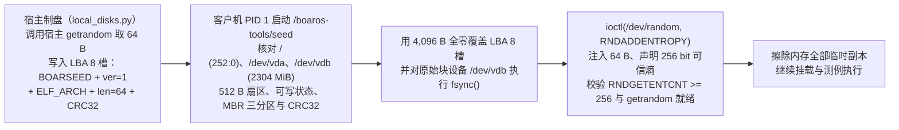

# OSComp 双架构评测环境适配

`oscomp-compat` 分支在通用 BoarOS 内核之上，构建了一套面向 RISC-V 64 与 LoongArch 64 双架构的离线交付与自动化评测适配层，覆盖初赛镜像（`pre-20250615`）与决赛公开镜像（`final-2026`）的启动引导、双盘管理、启动熵注入、单项测例监督以及官方判分采集。所有已知发布盘、C 标准库与判分脚本问题详见 [OSComp 测例与环境问题](../learning/oscomp-test-issues.md)。

---

## 一、原始测试镜像与评测框架目录

两套原始发布镜像统一解压存放在主工作区下（已被 Git 忽略）的 `sdcard/` 目录中，镜像与判分上游来源均为 [testsuits-for-oskernel](https://github.com/oscomp/testsuits-for-oskernel)：

| 评测阶段 | 上游版本来源 | 本地解压路径 |
| :--- | :--- | :--- |
| **初赛** | [`pre-2025` 分支](https://github.com/oscomp/testsuits-for-oskernel/tree/pre-2025) / [`pre-20250615` 发布](https://github.com/oscomp/testsuits-for-oskernel/releases/tag/pre-20250615) | `sdcard/pre-20250615/sdcard-rv.img`<br>`sdcard/pre-20250615/sdcard-la.img` |
| **决赛** | [`final-2026` 分支](https://github.com/oscomp/testsuits-for-oskernel/tree/final-2026) | `sdcard/final-2026/sdcard-rv-pub.img`<br>`sdcard/final-2026/sdcard-la-pub.img` |

评测框架与判分脚本的本地存放约定：
- 初赛官方框架检出至 `references/oscomp-autotest/`；
- 决赛判分仓库检出 `final-2026` 分支至 `references/oscomp-testsuits/`；
- 如镜像位于其他目录，可通过运行参数 `--images-dir` 指定。

### 原盘只读保护与构建配置隔离

- **绝不就地修改原始发布盘**：普通本地诊断从原盘复制出可写运行副本；官方初赛本地复现入口 `make test-oscomp-pre`（`tests/oscomp/pre.py`）以只读方式挂载原盘，并为每台虚拟机创建独立的 **QEMU 写时复制镜像（QEMU Copy-On-Write version 2，QCOW2）** 承载运行期间的脏块写入，同时完全沿用原框架的构建流程、测试顺序与判分逻辑。
- **双架构独立构建配置**：默认 `make all` 离线生成 `kernel-rv`、`kernel-la`、`disk.img` 与 `disk-la.img`。RISC-V 与 LoongArch 分别独立生成各自的原始系统调用监督器（`case`）、启动配置 `init.json` 与内嵌头文件。`INIT_CONFIG_RV` 与 `INIT_CONFIG_LA` 可分别独立覆盖单侧启动配置；显式传入公共变量 `INIT_CONFIG=config/init.json` 时同时覆盖双侧以恢复通用测试配置。执行多次不同配置的测试时，应先构建并复制出独立的内核与构建清单再运行，避免后续构建覆盖仍在使用的内核产物。

---

## 二、官方双盘布局、离线工具链与启动熵注入

### 2.1 双盘分区布局（2,304 MiB MBR）

默认 `make all` 在固定官方容器（`zhouzhouyi/os-contest:20260510`）内完全离线构建两块 2,304 MiB（`2,415,919,104` 字节）的主引导记录（Master Boot Record，MBR）辅助盘：RISC-V 交付 `disk.img`（平台评测流程中会被复制为 `disk-rv.img`，本地容器直接使用本次生成的 `disk.img`），LoongArch 交付 `disk-la.img`。固定几何布局由 [tests/oscomp/inputs.json](../../tests/oscomp/inputs.json) 统一维护：

| 设备节点 | 起始偏移 / 容量 | 文件系统与用途 |
| :--- | :--- | :--- |
| `/dev/vdb` LBA 8（偏移 4,096 B） | 4,096 字节保留槽 | 一次性主机启动熵种子记录（`BOARSEED`），模板镜像中恒为全零 |
| `/dev/vdb1`（分区类型 `0x83`） | 1 MiB / 128 MiB | 1 KiB 块大小 ext4，只读挂载至 `/boaros-tools`，存放工具、脚本与监督器 |
| `/dev/vdb2`（分区类型 `0x0c`） | 129 MiB / 64 MiB | FAT32（512 字节簇），启动脚本为其建立 `/dev/vda2` 别名供测例使用 |
| `/dev/vdb3`（分区类型 `0x83`） | 193 MiB / 2,048 MiB | 4 KiB 块大小 ext4，作为 Linux 测试项目（Linux Test Project，LTP）可反复格式化的暂存盘 |

### 2.2 离线工具分区与哈希缓存

工具分区携带的所有第三方工具源码归档均随仓库保存在 `third_party/sources/`（来源与校验见 [第三方组件](../third-party.md)），完全离线交叉编译、不访问网络：

- **`e2fsprogs 1.47.2`**：使用官方容器内置的 RISC-V / LoongArch `musl` 交叉编译器生成静态 ELF 可执行文件（LP64D 调用约定，LoongArch 装载段满足 16 KiB 页对齐）；宿主侧制盘用的 `mke2fs` 与 `e2fsck` 由同一份源码构建。仅施加最小移植补丁 `tests/oscomp/e2fsprogs-boaros-uname.patch`，让 `is_before_linux_ver()` 将 UTS 版本字符串 `#1 BoarOS` 识别为未知 Linux 年代，避免 `mke2fs` 把内核发布号误判为早期 Linux 而生成 `revision 0` 镜像（真实 Linux 仍走原有版本判断）。客户机内 `/bin/mke2fs`、`mkfs.ext2`、`mkfs.ext3`、`mkfs.ext4` 均链接至上游原版二进制并使用原版 `mke2fs.conf`。
- **`GNU Coreutils 9.5` 与 `Dash 0.5.12`**：离线交叉编译 `stat` 与 `df`（仅在执行 `df01.sh` 时优先放入 `PATH`），并为 LoongArch 交叉编译 `Dash` 作为部分脚本解释器。FAT32 分区由固定容器内的 `dosfstools 4.2`（`/usr/sbin/mkfs.fat`）创建。
- **确定性缓存复用**：工具与模板盘缓存存放在 `build/tools/oscomp-local/`（可通过 `OSCOMP_LOCAL_CACHE` 重定向）。复用前校验编译器、C 库、源码、编译参数与工具哈希；若当前宿主机缺少对应交叉工具链，本地准备脚本会以 `--pull=never --network none` 及宿主 UID/GID 自动拉起固定容器执行同一准备逻辑。`make prune-build` 默认保留该工具缓存。

### 2.3 一次性启动熵注入协议（`tests/oscomp/seed.c`）

官方初赛 QEMU 启动命令不含 VirtIO 随机数设备，若无外部可信熵，早期用户程序（如静态 glibc `malloc` 初始化阶段调用 `getrandom`）会陷入阻塞或返回 `EAGAIN`。为此，BoarOS 实现了一套严格遵循**“先持久擦除磁盘副本、后注入内核可信熵”**的一次性种子传递协议：



- 缓存模板中的 LBA 8 槽始终为全零；每次执行 `make all` 或 `tests/oscomp/local_disks.py` 准备运行盘时，宿主都会为各架构单独调用 `getrandom` 写入全新的 64 字节一次性种子。
- 已启动并消费过种子的辅助盘不能重复当作新盘启动；即使启动中途失败，重试前也必须重新准备辅助盘以生成新种子。`seed` 在任一校验、擦除、刷盘或注入步骤失败时均输出具体阶段与 `errno`，以退出码 125 中止启动。

### 2.4 本地运行盘准备与手动 QEMU 启动示例

`make run-riscv`、`make debug-riscv`、`make run-loongarch` 与 `tests/oscomp/run.py` 均共用 `tests/oscomp/local_disks.py`。根盘通过 `cp --reflink=never --sparse=never` 原样复制并 `fsync` 完成宿主块分配后再进入客户机计时，从不通过宿主 `debugfs` 修改根盘镜像。手动启动 RISC-V 双盘示例如下：

```sh
make all
python3 -B tests/oscomp/local_disks.py --arch riscv --output build/oscomp-manual-rv
qemu-system-riscv64 -machine virt -bios default -kernel kernel-rv -m 1G -smp 1 -nographic -no-reboot \
  -drive file=build/oscomp-manual-rv/root.img,if=none,format=raw,id=x0 \
  -device virtio-blk-device,drive=x0,bus=virtio-mmio-bus.0 \
  -drive file=build/oscomp-manual-rv/scratch.img,if=none,format=raw,id=x1 \
  -device virtio-blk-device,drive=x1,bus=virtio-mmio-bus.1
```

LoongArch 手动启动改为 `--arch loongarch` 与独立输出目录，QEMU 使用 `-cpu la464 -kernel kernel-la`、移除 `-bios default`，两块盘均挂载为 `virtio-blk-pci`。

---

## 三、初赛用户态引导、脚本适配与单项监督器

### 3.1 PID 1 用户态引导流程（`tests/oscomp/init.sh`）

内核挂载初赛根盘后，首个用户进程（PID 1）直接执行原盘上的 `/musl/busybox sh -c`，脚本主体来自 `tests/oscomp/init.sh`，由 `tests/oscomp/prepare.py` 注入目标架构的设备节点、动态链接器软链接与工具分区挂载命令后编译入启动配置：

1. **基础目录与设备节点**：创建 `/bin`、`busybox --install -s /bin`、各类字符与块设备节点（根盘 `252:0`、第二整盘 `252:16`、分区 `252:17..19` 及 loop 节点），并挂载 `/proc`、`/sys` 与 `/dev/shm`。
2. **动态链接器路径对齐**：按 `tests/oscomp/inputs.json` 为两个架构的 `glibc` 与 `musl` 创建实际 `PT_INTERP` 解释器链接（LoongArch 涵盖 `/lib`、`/lib64`、`/usr/lib64`，RISC-V 涵盖普通与软浮点 `musl` 名称）。
3. **工具分区与启动熵**：将 `/dev/vdb1` 只读挂载至 `/boaros-tools`，运行 `seed` 完成熵注入并建立 `/dev/vda2` 别名（若已有同名节点则视为冲突报错），随后导出 `LTP_DEV=/dev/vdb3`、`LTP_DEV_FS_TYPE=ext4` 与 `LTP_SINGLE_FS_TYPE=ext4`。
4. **测试组遍历与环境隔离**：默认按 `basic`、`busybox`、`cyclictest`、`iozone`、`iperf`、`libcbench`、`libctest`、`lmbench`、`lua`、`netperf`、`ltp` 顺序运行，每组均先 `glibc` 后 `musl`，分别设置独立工作目录与 `LD_LIBRARY_PATH`。
   - 对 `basic/run-all.sh` 仅补齐执行权限（原发布镜像为 `0644`）；
   - 对 `lmbench` 在 `/code/lmbench_src/bin/build/lmbench_all` 建立指向当前 C 库原二进制的链接；
   - 进入 `ltp` 组前，仅在可写根盘缺少 `nobody` 账户时向 `/etc/passwd` 追加 `nobody:x:65534:65534:nobody:/:/bin/false`，并确保 `$LTPROOT/testcases/bin` 排在 `/$libc` 之前，避免与同名 Lua 驱动脚本 `test.sh` 冲突。
   - `/dev/vdb3` 的挂载与卸载由各原测试程序自行完成；针对 `df01.sh` 使用的预置外部分区，适配后的 `ltp-device.sh` 释放入口先按设备号核查当前挂载表，确认已卸载后结束租用，真实回环设备则继续交由上游 `tst_device` 处理。

### 3.2 最小化临时脚本适配与单项监督器（`tests/oscomp/case.c`）

- **`libctest` 解释器适配（`libctest-hook.sh`）**：原盘 `run-static.sh` 与 `run-dynamic.sh` 缺少 `#!/bin/sh` 声明行，LoongArch `musl` BusyBox 在参考 Linux 上也会拒绝直接执行。适配脚本仅在 `/tmp` 临时外层脚本副本中将这两行改写为由当前 C 库自带的 `busybox sh` 显式调用，内层脚本、测例参数与判分逻辑一字不改；若模板形状发生变化导致匹配次数不等于 1，则直接返回 `125` 报错。启用状态与脚本哈希均记入报告的 `script_adaptations` 字段。
- **LTP 单项监督器（`case.c`）**：`ltp-hook.sh` 在临时脚本副本的单项执行点接入静态无库监督程序 `case`。其运行机制如下：
  1. **进程组隔离与信号范围**。监督器以自身的进程标识符（Process ID，PID）建立测试进程组。子进程通过 `fork` 继承该组，在管道上等到监督器回到原进程组后才执行测例。因此，测试进程组标识符（Process Group ID，PGID）等于监督器的 PID，而直接子进程可以用 `setsid()` 建立自己的会话。超时时，监督器向原测试进程组发送信号，并单独向尚未回收的直接子进程发送同一信号。自行离开测试组的其他后代超出本次监督范围，由首个用户进程退出时的系统清理处理。
  2. **轮询、超时与测量口径**。监督器用 `wait4(child, &status, WNOHANG, NULL)` 检查直接子进程是否已经退出。未检测到退出时，`nanosleep` 请求休眠 **20 毫秒**。这是轮询间隔，实际发现退出还受监督器何时恢复运行影响。`BOAROS-CASE START` 到 `END` 的 `elapsed_ms` 是监督器按单调时钟测得的经过时间，包含启动、发现退出和清理的时间。默认单项限时为 **120 秒**（`BOAROS_LTP_CASE_TIMEOUT`）。监督器发现超时时先发送 `SIGTERM`，**2 秒**宽限后如果直接子进程仍未退出，再发送 `SIGKILL`。回收直接子进程后，监督器也会向原测试组发送 `SIGKILL` 以清理该组的残留进程。超时返回 **124**，准备或计时错误返回 **125**。
  3. **跳过表过滤**：通过共享 [ltp-skips.tsv](../../tests/oscomp/ltp-skips.tsv) 跳过无参直接调用缺少外部控制器/输入的辅助程序以及按时间预算排除的单项，输出跳过原因并返回 125（逐项依据见 [OSComp 测例与环境问题](../learning/oscomp-test-issues.md)）；诊断时另可通过 `--diagnostic-exclude` 显式记录 `EXCLUDE`。脚本语法兼容 LoongArch BusyBox `hush` 的实际子集。

---

## 四、调度环境适配

初赛发布盘的 LoongArch `musl` 将 `sched_setparam`、`sched_setscheduler`、`sched_getscheduler` 和 `sched_getparam` 实现为直接返回 `ENOSYS` 的函数，调用到此结束。兼容分支通过动态共享对象（Dynamic Shared Object，DSO）`linux-sched.so` 为这些函数补上通往内核的调用路径。

1. **构建并装入辅助盘**。`make all` 使用 LoongArch 交叉编译器将 [`sched_compat.c`](../../tests/oscomp/sched_compat.c) 编译成 `build/loongarch/oscomp/linux-sched.so`。该共享库采用 LoongArch 的 64 位双精度浮点调用约定（LP64D），装载段按 16 KiB 对齐。[`local_disks.py`](../../tests/oscomp/local_disks.py) 将它放入 LoongArch 辅助盘 `disk-la.img` 的第一个 ext4 分区，文件名为 `linux-sched.so`。
2. **挂载工具分区并传入路径**。[`prepare.py`](../../tests/oscomp/prepare.py) 把 `BOAROS_LINUX_SCHED_PRELOAD=/boaros-tools/linux-sched.so` 写入 LoongArch 初赛启动配置的环境变量列表 `envp`。内核启动首个用户进程后，启动脚本将 `/dev/vdb1` 只读挂载到 `/boaros-tools`。此时配置中的路径指向辅助盘上的共享库。
3. **限定预加载范围**。每个测试组的 C 库子环境由 [`init.sh`](../../tests/oscomp/init.sh) 单独设置。在 LoongArch 的 `musl` 子环境中，脚本把上述路径导出为 `LD_PRELOAD`，随后启动该组原有的测试脚本。子进程继承变量，动态链接的 `musl` 程序由其动态加载器预加载这个共享库，解析这四个外部函数时优先使用库中的实现。四个包装函数分别借用同一进程原有 `musl` 的 `syscall()` 发起编号 118、119、120、121 的系统调用，由 C 库按原约定设置当前线程的 `errno`。静态链接程序不会处理 `LD_PRELOAD`，其他架构或 C 库子环境会清除该变量。

---

## 五、`final-2026` 决赛公开镜像入口

`final-2026` 使用公开的 Debian 根文件系统运行 **CAgent** 与 **BuildStorm** 两道赛题。入口脚本 `tests/oscomp/final.py` 与 `make test-oscomp-final` 自动完成多核内核构建、独立磁盘副本运行、上游判分与一致性检查：

```sh
make test-oscomp-final

# 自定义架构、测试组、镜像路径与宿主核绑定
python3 -B tests/oscomp/final.py --arch both \
  --groups all \
  --images-dir /path/to/images \
  --host-vcpu-cpus 8,9,10,11,12,13,14,15 --host-io-cpu 0
```

关键运行特性：
- **8 核 SMP 与 8 GiB 内存配置**：通过 `INIT_CONFIG_RV` / `INIT_CONFIG_LA` 独立构建 8 核 SMP 内核（`build/riscv-user-smp8/kernel-rv` 与 `build/loongarch-smp8/kernel-la`），不覆盖默认单核初赛交付物。虚拟机配置 8 核、8 GiB 内存、VirtIO 块设备、VirtIO 随机数设备与用户态网络设备。
- **原生态 Debian 启动（`tests/oscomp/final-2026-init.sh`）**：直接复制公开原盘并由 BoarOS 内核自行完成 ext4 日志重放；用户态经原盘 `/glibc/busybox` 挂载 `/proc`、`/sys`、`/dev/shm`、`/dev/pts` 并拉起回环接口 `lo`，随后调用盘内 `/bin/bash` 与 `/bin/sh` 执行原测试脚本，保留原 Debian 加载器与全部运行库，不注入任何初赛 DSO 或工具分区。
- **超时与核绑定**：双架构串行执行；`--groups cagent` 或 `--groups buildstorm` 可单选一题；提供 `--host-vcpu-cpus` 时必须给出 8 颗互不相同的宿主核心并与 `--host-io-cpu` 成对使用。默认不施加外层强杀时限，完全尊重原脚本内部超时（CAgent 单项 20–35 秒，BuildStorm 正式编译 14,400 秒，工具链检查、小项目编译与 `tg-xtask` 预构建不计入该 14,400 秒）；仅在排查卡死时通过 `--diagnostic-timeout` 指定外层秒数（被外层截断记为 `incomplete`）。
- **产物回收**：原始串口日志、上游判分 JSON、脚本退出状态与构建身份保存在 `build/` 下；正常退出且通过只读 `e2fsck -fn` 检查后默认自动删除体积较大的运行磁盘副本（传入 `--keep-disks` 可保留），失败或未完成的磁盘副本自动留存以便排障。

---

## 六、统一验证入口与报告判读

```sh
make all                  # 离线生成双架构交付内核与辅助盘
make test-oscomp-host     # 宿主单元测试（引导、双盘、脚本适配、容器与报告采集）
make test-oscomp-compat   # 本地 QEMU 双架构初赛诊断
make test-oscomp-pre      # 官方容器 + QCOW2 写时复制层完整初赛复现
make test-oscomp-final    # 8 核 / 8 GiB 决赛公开镜像复现
```

单架构单组快速诊断示例：

```sh
python3 -B tests/oscomp/run.py --arch loongarch --groups ltp \
  --output build/oscomp-la-ltp-check
```

### 报告采集与状态判读要点

- **官方容器快照语义**：`make test-oscomp-pre` 通过 `git archive HEAD` 打包已提交代码进入容器，工作区未提交的临时修改不会被混入官方容器评测。官方框架配置为每台虚拟机单核、1 GiB 内存、**3,600 秒**单机总时限（单项 120 秒监督在客户机内部生效，切换测试组不会重置整机 3,600 秒时限）。
- **分维度核对结束证据**：汇总报告同时记录上游原始判分、各测试组状态、单项退出码、脚本适配信息以及虚拟机生命周期停止原因（`qemu-exit`、`total-budget-timeout`、`guest-boot-error`、`kernel-runtime-error` 或 `unknown-lifecycle`）。测试组外层退出码为 0 或串口出现 `BOAROS-EVAL COMPLETE` 仅表示脚本完成了遍历，还需结合内核关机收口标记与资源释放检查确认客户机完整退出。
- **离线重算报告**：若报告采集逻辑更新，无需重跑虚拟机，可直接执行以下命令从既有运行目录的固定输入身份、原始串口与生命周期采样重建报告：

```sh
python3 -B tests/oscomp/pre.py --collect-existing build/<某次运行目录>
```
