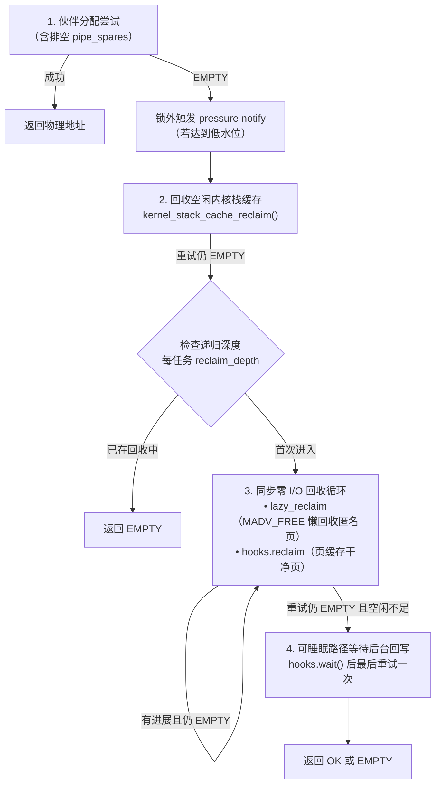

# 物理页分配模块

物理页分配器（Physical Page Allocator）是 BoarOS 内存管理体系的底层页帧供应者。它接管启动阶段解析得到的可用物理内存区间 `boot_memory_layout.usable[]`，在分页开启前提供轻量级的引导期单页分配，在直接映射（Direct Map）就绪后一次性切换为基于伙伴系统（Buddy System）的运行期连续页帧分配器，支撑内核堆、用户页表、页缓存（Page Cache）、匿名内存及原生大页等全部上层消费者。

---

## 一、源码组织

| 源码路径 | 核心职责 |
| :--- | :--- |
| `include/kernel/page.h` | 依据构建目标导出页位移 `BOAROS_PAGE_SHIFT`（RISC-V 64 为 12 / 4 KiB，LoongArch 64 为 14 / 16 KiB）、页大小 `BOAROS_PAGE_SIZE` 与页内掩码 `BOAROS_PAGE_MASK` |
| `include/kernel/physical_page.h` | 公开分配器对象 `struct physical_page_allocator`、状态码、回收/大页钩子契约、批量分配与引用计数接口及内存统计快照结构 |
| `kernel/physical_page.c` | 实现引导期线性分配与回收链、向伙伴系统的一次性迁移（`finalize`）、隐式三比特伙伴树、高阶整块引用、管道备用页池、压力回收编排与不变量审计 |

---

## 二、两阶段生命周期：从引导期到伙伴模式

操作系统在刚进入内核主函数时，硬件页表尚未建立，直接映射窗口还不可用，内核无法把整个物理内存都映射出来存放大型管理数组；但建立正式页表本身又需要申请物理页帧。为此，分配器设计了清晰的两阶段状态机：

### 2.1 初始化与引导期（Bootstrap 模式）

- **区间收敛与校验**：`physical_page_allocator_init()` 遍历 `boot_memory_layout.usable[]`，将每个字节粒度的可用内存段向内对齐到完整页边界，忽略不足一页的零碎边缘；若输入存在地址溢出、乱序或重叠则直接拒绝，且不破坏调用方原有对象。
- **线性分配与临时回收链**：引导模式下，`physical_page_allocate()` 优先从 `recycled_head` 回收链表取出曾被归还的单页（链表下一跳指针直接存放在空闲页的前 8 字节中），若回收链为空则从地址最低的未耗尽区间按页顺序推进。在调用 `physical_page_allocator_bind_access()` 绑定物理地址到内核虚拟地址的映射回调之前，只允许从未分配过的区间顺序发放页帧，且不允许执行释放操作。

### 2.2 一次性迁移至伙伴模式（`finalize`）

当内核完成最终页表切换并绑定直接映射访问回调后，`physical_page_allocator_finalize()` 执行原子性的模式切换：

1. **划分元数据区**：统计各可用区间能拆出的自然对齐最大二幂块（根块）总数 $R$ 与总树节点数，按公式计算所需元数据字节数并向上取整到页，从某个尚未发放的连续区间尾部切出一整段物理与虚拟地址均连续的内存区域。
2. **状态导入**：将所有页帧先标记为已分配，再将元数据自身标记为内部保留（`INTERNAL`），随后遍历引导期回收链与各区间剩余未发放页，标记为可合并的空闲候选（`CANDIDATE`），并核对总数与 `available_pages - metadata_pages` 精确吻合。
3. **建树与发布**：对每个自然对齐根块自底向上构建隐式伙伴树（`build_tree()`），将相邻同为空闲或同为内部保留的子块向上归并，随后将所有空闲块挂入 `free_heads[0..31]` 双向链表，执行一次完整的 `physical_page_allocator_audit()` 一致性自检，全部通过后一次性发布 `finalized` 状态。

迁移仅允许成功一次；若找不到足够大的连续未发放空间返回 `PHYSICAL_PAGE_STATUS_EMPTY`，若引导期回收链损坏或计数失配返回 `PHYSICAL_PAGE_STATUS_INVALID`，失败不会覆盖原分配器状态。

---

## 三、隐式伙伴树与紧凑元数据布局

为了在支持大内存容量的同时尽量压低常驻内存开销，并确保每一次运行期操作都能做低成本的权威性校验，伙伴模式的元数据由三段紧邻的区域组成，全部存放在 `finalize` 保留的连续内部页中：

| 元数据段 | 结构与大小 | 核心作用 |
| :--- | :--- | :--- |
| **每页载荷数组**（`metadata[]`） | `struct physical_page_metadata`，静态断言严格 **16 字节/页** | 仅活跃块头有效：保存双向空闲链表索引（`next` / `previous`）、32 位共享引用计数（`reference_count`）、阶数（`order`）、块状态（`state`）及页缓存标志（`cache_state`） |
| **有序根目录**（`roots[]`） | `struct physical_page_root`，**32 字节/根** | 按物理地址和页索引升序记录每个自然对齐最大伙伴根块的起始地址、页索引、阶数与树偏移；支持 $O(\log R)$ 二分定位 |
| **3 比特隐式完全二叉树**（`tree[]`） | 每个节点占 **3 bit** | 存储整棵伙伴树的权威归属状态：`0 = INACTIVE`、`1 = FREE`、`2 = SPLIT`、`3 = ALLOCATED`、`4 = INTERNAL`（编码 5–7 视为元数据损坏） |

令总受管页数为 $P$、自然对齐根块数为 $R$，元数据总字节预算为：

$$
\text{Bytes} = 16P + 32R + \left\lceil \frac{3(2P - R)}{8} \right\rceil
$$

按页取整后，4 KiB 基页架构下元数据主体约占物理内存的 **0.409%**，16 KiB 基页架构下约占 **0.102%**。

### 3.1 分裂、合并与快速所有权判定

- **分配与分裂**：`allocate_order_locked()` 从目标阶 `order` 向上扫描 `free_heads[order..31]`（`PHYSICAL_PAGE_MAX_ORDER = 31`），取出首个可用空闲块并沿左子树逐层分裂：先将左右子节点标为 `BUDDY_FREE`，再将父节点发布为 `BUDDY_SPLIT`，把右半伙伴挂入对应阶的空闲链表，最终将目标节点发布为 `BUDDY_ALLOCATED` 并初始化块头（引用计数置 1）。
- **释放与合并**：末次引用归零时，先将当前块标为 `BUDDY_FREE`，再沿同一根块内通过局部偏移异或计算兄弟块位置（绝不跨物理内存区间合并）。若兄弟块处于 `BUDDY_FREE`，则先将其从空闲链表摘除、把两个子节点同时置为 `BUDDY_INACTIVE`（防止旧尾页载荷残留被误认为活块头），再将父节点发布为 `BUDDY_FREE` 并继续向上尝试合并。
- **快路径优化**：
  - 对常见的 0 阶（单页）非末引用释放（如用户内存拷贝结束归还临时借用），直接在分配器锁内验证 `ALLOCATED_HEAD` 并递减 `reference_count`，跳过完整祖先树遍历；
  - `owner_at_address()` 查询页归属时，先读该页的 `metadata` 提示，直接核对对应树节点是否为 `BUDDY_ALLOCATED`（仅 $O(\log R)$），连续块内部尾页或过期提示才回退至从根向下的 `owner_walk()`；
  - 生产构建在空闲链表摘插时按已知阶直接定位树节点并校验相邻链边，`LOCK_DEBUG=1` 额外逐层验证全部祖先处于 `BUDDY_SPLIT`。

---

## 四、所有权模型、批量接口与专用缓存

上层内核模块对物理页的持有方式各不相同，分配器将它们清晰地划分为几组互补契约：

| 接口组 | 语义与典型消费者 |
| :--- | :--- |
| **单页与高阶整块分配**（`allocate` / `allocate_order` / `allocate_order_nosleep`） | 分配 $2^{\text{order}}$ 个物理连续且按块大小自然对齐的页帧；`nosleep` 变体只做单次伙伴尝试，绝不触发回收或睡眠。内核线程栈（order-1，8 KiB）、内核大对象堆和原生大页均使用高阶接口 |
| **已拆分的连续页**（`allocate_contiguous`） | 先申请 $2^{\text{order}}$ 连续页，再在同一次锁保护内将私有子树拆成独立的 0 阶页帧（`split_allocated_pages`），调用者可逐页共享或释放，不能按高阶整块释放 |
| **批量分配与批量引用**（`allocate_batch` / `acquire_batch` / `release_batch` / `release_order_batch`） | 单次分配器锁内最多处理 **16 项**（`PHYSICAL_PAGE_ALLOCATION_BATCH_MAX` / `PHYSICAL_PAGE_REFERENCE_BATCH_MAX`）。`allocate_batch` 自动将合适的大块拆成独立 0 阶页，不要求整批物理连续；`release_order_batch` 供虚拟内存退休批次在跨核 TLB 失效后一次归还混合阶数的页帧与页表 |
| **共享引用与写时复制借用**（`acquire` / `acquire_order` / `cow_borrow` / `cow_borrow_order`） | 32 位引用计数保护共享页（页缓存、写时复制、用户页固定借用）。`cow_borrow` 在同一次持锁内返回原引用数，仅当原引用数大于 1 时原子递增临时借用引用；引用数为 1 时直接原地恢复写权限，避免两次取锁。高阶整块引用仅维护块头计数，不触碰尾页元数据 |
| **自动发现阶数释放**（`release_allocation`） | 供内核堆释放大对象使用：在单次持锁和完整祖先树验证中直接发现块阶并完成释放，免去“先查阶再释放”的二次寻址 |
| **零锁开销管道备用页池**（`pipe_allocate` / `pipe_release` / `pipe_drain`） | `pipe_spares[2]` 是两个无锁原子槽位，专门缓存已读空且独占的 0 阶管道页帧（最低位 `bit 0` 用于区分物理地址 0 与空槽），减少高频管道读写对全局伙伴锁的争用；伙伴池耗尽或管道关闭时自动清空归还 |
| **地址解析快慢路径**（`resolve` / `map_owned`） | `resolve` 在锁内校验页帧确实处于已分配权威块后再映射指针；`map_owned` 供已明确持有页引用或页表所有权的内部热路径直接调用绑定的映射函数，省去重复取锁 |

### 4.1 复合页回收钩子与页缓存状态发布

- **原生大页托管移交（`struct physical_page_compound_recycler`）**：原生大页池通过 `physical_page_allocator_set_compound_recycler()` 注册 `retain_last` 回调。当高阶块的最后一份引用归零时，分配器仍在 `allocator->lock` 保护内调用该回调：若大页池决定接管（返回 1），该高阶块保持 `ALLOCATED` 且引用数维持为 1，直接回到大页空闲链而不被打碎进入伙伴系统；若大页池正在缩容（返回 0），则正常退回伙伴系统合并。
- **页缓存状态位（`/proc/kpageflags`）**：页缓存通过 `physical_page_publish_cache_state()` 以原子方式向 0 阶块头的 `cache_state` 发布脏页（`PAGE_FLAG_DIRTY = 1 << 4`）与回写中（`PAGE_FLAG_WRITEBACK = 1 << 8`）状态；`physical_page_flags_snapshot()` 一次在锁内采样最多 16 个页帧，结合伙伴树状态补充 `PAGE_FLAG_BUDDY = 1 << 10`，供 [procfs](procfs.md) 的逐页诊断接口读取。末次释放会自动清零 `cache_state`，避免旧状态泄漏给后续分配者。

---

## 五、并发保护、内存压力回收与统计快照

### 5.1 并发与锁序

伙伴模式的全部元数据修改受每分配器的原始自旋锁 `allocator->lock`（锁序等级 `KERNEL_RAW_RANK_PAGE = 20`）保护。加锁期间保存并关闭本地处理器中断、禁止内核抢占，在多核对称多处理（Symmetric Multiprocessing，SMP）环境下同时通过原子锁字互斥，避免时钟中断抢占、异步日志工作线程或远端核心交错破坏伙伴树和空闲链表。引导期的回收链访问同样在本地关中断作用域（`KERNEL_IRQ_SCOPE`）内完成。

所有可能睡眠或重入分配器的外部动作——压力通知回调、干净页回收、懒回收与后台回写等待——全部在释放 `allocator->lock` 并恢复调用者中断状态后执行，严禁在持有伙伴锁期间睡眠或发起 I/O。

### 5.2 内存耗尽时的分级回收编排

当 `physical_page_allocate_order()` 首次尝试伙伴分配返回 `PHYSICAL_PAGE_STATUS_EMPTY`（在此之前已先尝试排空 `pipe_spares[2]`）时，分配器按代价由低到高依次触发四级回收，并在每次产生实际释放进展后立即重试目标阶分配（因为单页归还不一定能立刻拼出高阶连续块）：

- **按任务防递归**：通过 `hooks.depth()` 维护每任务的回收递归深度（无钩子时退化为分配器原子标志），确保某个任务睡眠在回收等待期间不会误伤其他并发任务的回收资格，同时阻止回收器自身的辅助分配无限重入。
- **多磁盘共享回调组**：多个块设备页缓存实例登记到共同的回调组对象，按引用计数管理生命周期。每次分配仅在原有持锁范围内借用一次回调组引用，注销实例不阻塞在途回调，直到最后一份引用归还才释放组结构。

### 5.3 只读内存快照（`kernel_memory_snapshot`）

`kernel_memory_snapshot()` 为 `/proc/meminfo` 与 `sysinfo` 系统调用输出字节单位的 `struct kernel_memory_statistics`，全程不分配、不回收、不发起磁盘 I/O：

- `total`、`free` 来自伙伴分配器总页数与可用页数；
- `shared` 统计 `mm/memory_object.c` 维护的共享匿名与 `tmpfs` 后备页数（`fork` 或多处映射不重复计费）；
- `buffers` 通过 `buffer_bytes` 回调读取文件系统块缓冲的实际载荷字节数，不与内核堆重复统计；
- `cached`、`dirty`、`writeback` 与 `reclaimable` 通过回调组的 `snapshot` 钩子汇总各磁盘页缓存实例的驻留状态，并按公式估算可用内存：

$$
\text{MemAvailable} = \text{clamp}_{[0, \text{total}]}\!\left(\max(\text{free} - \text{low}, 0) + \text{reclaimable} - \min\!\left(\frac{\text{reclaimable}}{2}, \text{low}\right)\right)
$$

其中低水位余量 `low` 至少为一页。该值是面向容量估算的近似指标，不承诺任意高阶连续物理块一定能立即可用。

---

展开查看：不变量失败诊断契约与定向验证入口

### 释放不变量与 fail-stop 诊断

合法释放不会产生可重试的错误码；凡违反所有权不变量（错误阶数 `wrong-order`、释放非块头尾页或内部元数据页 `not-allocated-head`、重复释放 `already-free`、非对齐地址 `unaligned-address`、地址越界 `address-range`、引用计数溢出或清零异常、空闲链或伙伴树节点损坏），分配器立即进入 `physical_page_release_fatal()` 并触发 `SIGILL` / 硬件 trap：

- 先通过同步原始串口输出 `kernel_console_putc()`（经可选 `kernel_console_emergency_begin()` 接管，绝不分配内存、不睡眠、不唤醒日志等待者）打印触发原因 `reason`、调用者地址、请求阶数、当前 `available/total`；
- 仅当分配器已处于 `finalized` 且物理地址能通过受检查找时，才附加打印对应页的 `page_index`、`state`、`stored_order`、`references`、`next`、`previous` 和 `cache_state`，避免解引用损坏指针；
- 正常释放路径零诊断输出。

### 成本诊断高水位

启用 `BOAROS_COST_DIAGNOSTICS` 构建时，分配器额外维护 `allocated_peak_pages`，在每次引导期/伙伴模式成功分配以及 `finalize` 扣除元数据页后，按 `total_pages - available_pages` 更新自初始化以来的历史最大受管占用页数（共享引用递增不重复计次，释放不降低高水位）；默认发布构建将其完全编译裁剪。

### 当前设计边界

- `finalize` 要求能够在一个未发放的连续可用区间尾部容纳完整元数据区；若早期引导分配过于分散导致连续尾段不足，将返回 `PHYSICAL_PAGE_STATUS_EMPTY`。
- 当前实现聚焦统一物理内存池，不包含 NUMA 节点分区、内存热插拔、连续内存分配器（CMA）或每核热页缓存（Per-CPU Page Cache，仅管道提供 2 槽无锁备用页）。

### 定向验证入口

- **宿主抢占、非法释放诊断与多线程并发**：`make test-allocator-preemption-host`、`make test-allocator-release-host`、`make test-allocator-concurrency-host`
- **RISC-V 客机聚焦与压力回归**：`make test-page-riscv`、`make test-vma-riscv`、`make test-io-sleep-riscv`、`make test-riscv`

