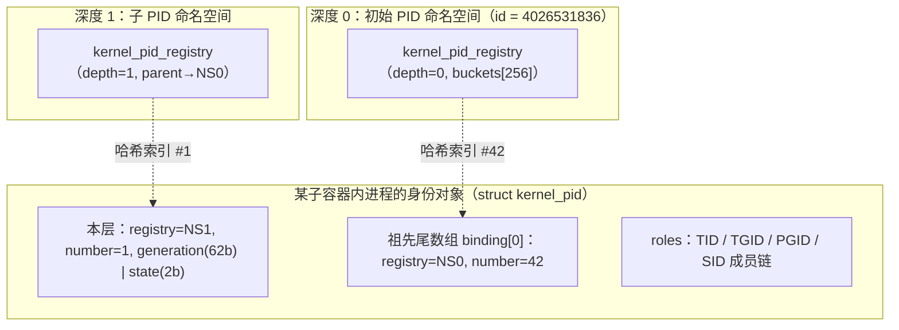

# PID 命名空间

进程标识符（Process Identifier，PID）命名空间是 Linux 容器隔离体系的基石之一：它允许一组进程拥有彼此独立的编号空间，新命名空间的第一个进程在内部看到自己是 **PID 1**（承担容器内 `init` 与孤儿进程回收职责），同时在父命名空间乃至初始根命名空间中仍拥有各自的可见编号，便于宿主机管理员从外层统一观测与管理。

BoarOS 在 `kernel/pid.c` 与调度器身份层实现了最多 **32 层嵌套**的 PID 命名空间、多视图身份转换、精确 `clone3(set_tid)` 预留、命名空间 `init` 退出级联回收以及命名空间文件描述符（`nsfs`）支持。

---

## 一、源码组织

| 源码路径 | 核心职责 |
| :--- | :--- |
| `kernel/pid.c`、`include/kernel/pid.h` | 位图编号分配器（`kernel_pid_allocator`）、分层注册表（`kernel_pid_registry`）、多视图身份对象（`kernel_pid` 与 `kernel_pid_binding`）及四角色成员链管理 |
| `kernel/namespace.c`、`include/kernel/namespace.h` | 通用命名空间基类（`kernel_namespace`，初始 PID 命名空间 ID 为 `4026531836`）、命名空间文件描述符打开与释放 |
| `kernel/sched/identity.c`、`kernel/sched/process.c`、`kernel/sched/lifetime.c` | `clone`/`clone3`/`unshare`/`setns` 的命名空间切换、视图解析、PID 1 信号免疫与命名空间关闭回收 |
| `fs/procfs.c`、`kernel/sched/proc.c` | 挂载期固定的 `/proc` 视图、`/proc/<pid>/ns/{pid,pid_for_children}` 与跨视图转换 |

---

## 二、多视图身份模型与分层编号

在单层系统中，一个整数 PID 就足以标识任务；但在嵌套 PID 命名空间中，同一个进程在“自身所在层”与“每个祖先层”都有不同的数字编号。BoarOS 将**稳定的内核身份对象**（`struct kernel_pid`）与**随视图变化的整数编号**彻底解耦：

- **紧凑存储与祖先绑定尾数组**：每个 `struct kernel_pid` 保存其所在最内层注册表指针 `registry`、本层编号 `number`、256 桶哈希链指针 `hash_next`，以及打包在同一机器字内的 **62 位全局单调代次（`generation`）与 2 位状态机（`0=reserved`、`1=indexed`、`2=detached`、`3=retired`）**。对于深度 `depth > 0` 的非初始命名空间身份，结构体尾部紧跟 `depth` 个 `struct kernel_pid_binding` 元素（按祖先深度 `0 .. depth-1` 索引），记录该身份在每一祖先层中的编号与哈希链。
- **四角色统一管理**：每个 `kernel_pid` 通过 `members[4]` 分别挂载线程（`TID`）、线程组（`TGID`）、进程组（`PGID`）和会话（`SID`）四类角色成员链。祖先命名空间共享同一个身份对象。
- **O(1) 视图转换**：`kernel_pid_number_in(id, registry)` 直接比对目标视图深度 `registry->depth` 与 `id->registry->depth`，按深度下标一步取出对应层编号；若目标视图与身份无祖先关系则返回 `0`（绝不泄露初始层编号）。任务结构缓存的内部 `tid` 仅作初始层内部索引，永不直接暴露给用户态。



### 2.1 创建、切换与 `clone3(set_tid)`

- **创建与权限**：`clone`/`clone3` 传入 `CLONE_NEWPID` 直接创建子命名空间（需要 `CAP_SYS_ADMIN`），首个子进程在内部为 PID 1，返回给父进程的是父视图编号。`unshare(CLONE_NEWPID)` 仅改变调用线程未来子进程的“目标命名空间”（`pid_for_children`），调用线程自身仍停留在原活动视图中；一旦设定了不同的子进程目标，便不可再次创建 PID 命名空间或用 `CLONE_THREAD` 派生同组线程。
- **`setns` 与组合发布**：`setns` 接受命名空间 FD 或 `pidfd`，仅允许将未来子进程视图切换到调用者当前视图或其后代视图；若同时指定挂载、主机名（UTS）或进程间通信（IPC）命名空间，内核先完成全部前置校验，再一次性原子发布。
- **两阶段编号预留**：`clone3` 的 `set_tid` 数组一次性复制到内核，按**由内向外（子层 → 祖先层）**的顺序指定精确 PID，未指定的层由位图自动分配。身份对象与子命名空间内存在调度器身份锁外预先分配，在锁内逐层预留编号（`reserved`），与任务及父子关系一同发布为 `indexed`。若遇编号冲突（`-EEXIST`）、权限不足、用户输出失败或目标命名空间已关闭（`accepting == 0`），所有已预留编号自动回滚。
- **防 PID 复用错指**：当四个角色成员全部脱离后，身份立即从各层哈希表与位图中摘除（转为 `detached`），释放出的数字可供新进程复用；但旧 `pidfd`、待投递信号或异步通知仍持有旧 `kernel_pid` 引用，绝不会因数字重用而误指新任务。

---

## 三、PID 1 退出与命名空间关闭

子 PID 命名空间内的首个线程组充当该命名空间的 `child_reaper`（即 PID 1），其生命周期决定整个子命名空间的存亡：

1. **拒绝新建**：一旦 PID 1 的线程组开始关闭（最后 `TGID` 成员脱离或进入组退出），`kernel_pid_registry_disable()` 将该层置为 `accepting = 0`，本层及所有后代命名空间立即禁止创建新任务（返回 `-ENOMEM`）。
2. **级联清理**：当 PID 1 的最后一个存活线程退出时，内核向命名空间内所有残余进程强制发送 `SIGKILL` 并回收已退出子进程。非组长线程执行 `execve` 时会无缝接管组长身份，继续保持为同一个命名空间 `init`。
3. **延迟发布最终退出**：若外层调试器（`ptrace` tracer）仍持有某内部进程的最终 `wait` 事件，或某层尚有未释放的预留编号，回收器会推迟发布 PID 1 的最终退出状态，待最后一个内部任务与编号归还后，再向外层父进程与 `pidfd` 递交退出通知。
4. **信号免疫与子空间 `reboot`**：命名空间 `init` 默认免疫未显式安装处理函数的外部普通信号，但来自祖先命名空间的 `SIGKILL` 与 `SIGSTOP` 仍按 Linux 规则强制生效。在子 PID 命名空间内调用 `reboot()` 不会重启物理机，而是终止整个子命名空间，并在 PID 1 的最终退出状态中向外层报告 `SIGHUP`（重启类命令）或 `SIGINT`（关机/停机类命令）。

---

## 四、各子系统 ABI 视图映射

| 子系统 / 接口 | PID 编号解析与输出规则 |
| :--- | :--- |
| `getpid` / `gettid` / `getppid` 及按 PID 查询的系统调用 | 全部使用调用者的**活动 PID 视图** |
| `clone` 返回值、`PARENT_SETTID`、`CHILD_SETTID` | 依次使用父视图、父视图、子视图 |
| 信号、`wait`、`ptrace` | 输入按调用者视图解析；内核生成的 `si_pid`、事件消息等按**接收者 / 等待者 / 跟踪者**各自视图输出 |
| `/proc/<pid>`、`status`、`fdinfo`、`ns/pid` | 固定采用 **`/proc` 挂载时捕获的视图**；重新挂载 `/proc` 可查看子空间；`pid_for_children` 在尚无 PID 1 前不可打开 |
| `cgroup.procs`、`cgroup.threads` | 按读取者当前视图输出，不可见成员输出 `0` |
| System V IPC 控制调用与 `/proc/sysvipc` | 控制调用使用调用者当前视图；`/proc/sysvipc` 表文件在打开时固定打开者的 IPC 与 PID 视图 |
| 套接字 `SCM_CREDENTIALS` / `SO_PEERCRED` 与 Netlink | 凭据按接收者视图转换；Netlink 自动绑定以发送者本地 TGID 作为初始端口候选 |
| 核心转储（Core Dump）`NT_PRSTATUS` | 输出转储者活动视图中的 TID、父 PID、PGID 与 SID |

此外，进程组（`PGID`）与会话（`SID`）相等性始终按真实 `kernel_pid` 对象指针比较，即使进入新命名空间后无法显示继承自外层的组号，其作业控制归属依然保持正确；优先级继承互斥锁（PI Futex）与健壮互斥锁同样区分内核真实任务身份与用户态可见 TID。`nsfs` 支持通过 `NS_GET_PARENT` 获取可见父命名空间，以及通过 `kernel_pidns_translate()` 在命名空间 FD 与调用者视图间互译 TID/TGID。

> **当前范围边界**：独立用户命名空间（User Namespace）、cgroup 命名空间以及其余未列出的命名空间类型暂不在当前范围内；克隆标志支持矩阵见[内核调度与进程生命周期模块](kernel-scheduler.md)。

---

<details>
<summary>展开查看：宿主单测与用户态定向验证命令</summary>

```sh
# 宿主单测：逐层编号冲突/回收、角色归属、关闭态拦截、clone3 一次性参数导入与延迟 tracer 归还
make test-pid-namespace-host test-pid-namespace-concurrency-host \
     test-pid-namespace-lifecycle-host test-clone3-import-host
make test-sched-concurrency-host

# 客户机用户态综合验收（三层嵌套、多 proc 挂载、cgroup、PID 1 退出、nsfs、reboot、IPC 与 socket）
python3 tests/userland/api8.py --only boaros --program pid_namespace_creation
python3 tests/userland/api8.py --only boaros --program pid_namespace \
  --program nsfs_pid --program pid_namespace_reboot \
  --program pid_namespace_cgroup --program pid_namespace_ipc \
  --program pid_namespace_socket
```

</details>
