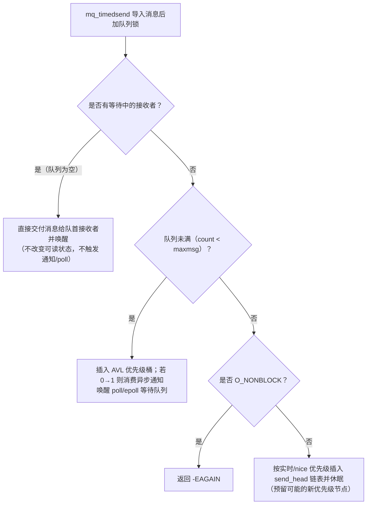

# POSIX 消息队列（`mqueue`）

POSIX 消息队列提供了一种面向消息边界、支持优先级排序、支持阻塞超时与异步事件通知的进程间通信机制，并同时以内核虚拟文件系统（`mqueue`）的形式暴露为普通文件视图，使队列天然可以接入 `poll`/`epoll` 事件循环、`stat`/`chmod`/`chown` 权限管理与 `/proc/<pid>/fd` 观测。

BoarOS 在 RV64 与 LA64 上实现了完整的 asm-generic 系统调用族 `mq_open(180)`～`mq_getsetattr(185)` 与 `mqueue` 文件系统后端，采用**按优先级平衡树索引 + 分段零重复拷贝 + 同步直接交付 + 严格分层无睡眠原始锁**设计，并与[IPC 命名空间](ipc-namespace.md)完全集成。

---

## 一、源码组织与锁层次

| 源码路径 | 核心职责 |
| :--- | :--- |
| `kernel/mqueue.c`、`include/kernel/mqueue.h` | 命名空间队列树（`kernel_mqueue_tree`）、队列对象（`kernel_mqueue`）、AVL 优先级索引、分段载荷管理、同步收发等待队列、`SIGEV_*` 异步通知与 UID 配额计费 |
| `fs/mqueue.c` | `mqueue` 虚拟文件系统（魔数 `0x19800202`）：挂载生命周期、目录枚举、80 字节状态文本读取及元数据权限修改 |
| `kernel/syscall/mqueue.c` | 系统调用 180～185 分派与 `-ERESTARTSYS` 自动重启标记 |

为了保证收发路径可由调用者所在核直接并发执行、绝不产生锁序反转或持锁睡眠，子系统遵守严格的原始锁等级层次：

`kernel_mqueue_tree.lock`（rank 25）→ `kernel_mqueue.lock`（rank 30）→ 调度器/PID 域（rank 40）

所有内存分配、用户态拷贝、线程阻塞停车以及信号/Netlink 通知发送均在名称树锁与队列锁**之外**执行。

---

## 二、名称空间、权限模型与配额计费

### 2.1 名称表、描述符与文件视图统一

- **共享名称树**：同一 IPC 命名空间内的所有 `mqueue` 挂载与 `mq_open` 系统调用共享同一棵 `kernel_mqueue_tree`（详见[IPC 命名空间](ipc-namespace.md)）。系统调用接收不带前导 `/` 的单段名称（C 库负责剥离前导斜杠），最长 255 字节，禁止内嵌 `/`、`.` 或 `..`。
- **根目录与权限语义**：名称树统一维护共享根目录的属主、模式（初始 `root:root`、`01777` sticky 目录）与时间戳；任意挂载对根目录的 `chmod`/`chown` 对同一空间内所有挂载和后续操作立即可见。新建队列需要根目录写与搜索权限，删除需额外满足 sticky 目录属主校验；创建时队列属主直接取调用者的 `fsuid`/`fsgid`（按 Linux `mqueue_get_inode` 实现，不继承根目录 SGID）。而 `mq_open` 打开已有队列时直接查名并校验队列自身权限，不检查父目录权限。
- **引用解耦**：名称表、每个 OFD 和每个 VFS inode 句柄各自持有一次 `kernel_mqueue` 引用。`mq_unlink` 仅摘除名称，已打开的描述符可继续正常收发，此时重名新建会得到全新的 inode，原队列直到最后一个持有者释放时才回收消息、通知和创建配额。`mq_open` 安装的描述符默认带有 `FD_CLOEXEC` 标志；`dup`/`fork` 共享同一 OFD 的 `O_NONBLOCK` 状态，再次 `mq_open` 则获得独立 OFD。

### 2.2 容量上限与 `RLIMIT_MSGQUEUE` 计费

| 约束维度 | 普通调用者上限 | 具备 `CAP_SYS_RESOURCE` 上限 |
| :--- | :--- | :--- |
| 单 IPC 命名空间存活队列数 | `256`（超限返回 `-ENOSPC`） | 无硬数量上限 |
| 单队列消息条数（`mq_maxmsg`） | 默认 `10`，上限 `10` | 上限 `65,536` |
| 单条消息字节数（`mq_msgsize`） | 默认 `8,192` B，上限 `8,192` B | 上限 `16 MiB`（`16,777,216` B） |
| 消息优先级（`msg_prio`） | `0` ～ `32,767`（`MQ_PRIO_MAX = 32768`） | 同左 |

新建队列时（打开已有队列不重复计费），内核向**创建者的真实 UID 账户**收取与 Linux 64 位一致的字节配额（默认 `RLIMIT_MSGQUEUE = 819,200` 字节，超限返回 `-EMFILE`）：

$$\text{charge} = \text{maxmsg} \times (\text{msgsize} + 48) + \min(\text{maxmsg},\ 32768) \times 48$$

该配额与队列对象绑定直至队列最终销毁，不因进程随后修改 UID、`chown` 或 `mq_unlink` 而提前退还或转移。属性仅声明容量上限，实际消息载荷在发送时按需动态分配。

---

## 三、优先级索引、分段载荷与直接交付

### 3.1 分段零重复拷贝与 AVL 优先级队列

- **内联首段 + 溢出链**：发送前在队列锁外先将用户载荷导入不可变内核消息对象。消息头 `struct mq_message` 与首段正文共用一次堆分配（合计不超过 4,096 字节，`MQ_INLINE_DATA = 4096 - sizeof(struct mq_message)`），超过部分挂载 4 KiB 溢出段链表（每段有效载荷 `MQ_SEGMENT_DATA = 4096 - sizeof(void *)`）。短消息仅需一次分配与释放，入队或直接交付均只移交指针所有权，**绝不二次拷贝内核载荷**。
- **优先级与 FIFO**：队列内部用自平衡二叉搜索树（AVL 树，`q->priorities`）按优先级键值索引，每个优先级节点维护一条先入先出（FIFO）消息链表。接收端总是通过 `kernel_avl_last()` 以 `O(log P)` 取出最高优先级的最早消息，在释放队列锁后再拷贝至用户缓冲区（若输出地址故障返回 `-EFAULT`，已出队消息按 POSIX 语义不再放回）。

### 3.2 同步直接交付、优先级等待与异常退出清理



- **对称的满队列接纳**：与空队列直接交付对称，接收者在取走一条消息后若发现有阻塞中的发送者（`send_head`），会立即在锁内将其已导入的消息入队并唤醒该发送者；由于队列消息数未变，同样无需多余唤醒 `poll`/`epoll`。
- **优先级排序等待与实时时钟超时**：等待发送者与接收者均按任务当前有效实时/优先级继承等级与普通 `nice` 值的原子快照降序排队（同级 FIFO）。阻塞等待支持基于 `CLOCK_REALTIME` 的绝对超时（调钟时自动重排到期索引，能立即完成的操作不因已过期时间戳失败）。
- **请求栈托管与强杀安全**：`struct kernel_mqueue_request` 分配在当前系统调用内核栈上并登记在 `task->mqueue_request`。若任务在拷贝、阻塞等待或通知准备期间被强制终止，调度器先结束等待令牌借用，再在回收任务内核栈前调用 `kernel_mqueue_abort()` 精准摘除链表项并释放所有持有的消息、优先级节点、OFD 引用及未发布 Netlink cookie。

---

## 四、异步通知（`mq_notify`）与虚拟文件系统视图

### 4.1 单一异步通知登记

每个队列同一时刻最多允许一个进程登记通知（重复登记返回 `-EBUSY`，传入空指针由原登记线程组取消），支持三种模式（`sigevent` 结构体 64 字节，`sigval` 保留完整 64 位）：

- **`SIGEV_NONE`**：仅占坑消费，不产生回调。
- **`SIGEV_SIGNAL`**：登记时固定线程组的 `kernel_pid` 身份与 `kernel_exec_security` 执行安全对象。触发时在队列锁外校验身份并投递 `SI_MESGQ` 信号，携带发送者真实 UID、在登记者 PID 命名空间中转换后的发送者 TGID 及完整 64 位 `sigval`。
- **`SIGEV_THREAD`**：实现 C 库依赖的 `AF_NETLINK` 32 字节 cookie 协议（`sigev_signo` 传入 Netlink 套接字 FD，`sigev_value` 指向 32 字节 cookie 缓冲）。在队列锁外完成预留，触发时发送原因 `1`（`NOTIFY_WOKENUP`），登记被显式取消或因关闭描述符移除时发送原因 `2`（`NOTIFY_REMOVED`）。

通知仅在**无等待接收者且队列消息数由 `0` 变为 `1`** 时触发并自动注销（登记到已非空的队列不立即触发，直接交付给等待接收者时保留登记）。登记者所在线程组关闭任意一个指向该队列的已安装 FD（包括 `close`/`dup2`/`CLOEXEC`/组退出）都会自动撤销该登记；其他进程关闭或内核临时 OFD 借用归还不影响登记。

### 4.2 `mqueue` 文件系统视图

挂载类型为 `mqueue`（`statfs` 魔数 `0x19800202`）的虚拟文件系统直接映射到所属 IPC 命名空间的队列树：

- 普通 `open` 队列文件获得同类 MQ 描述符并固定底层 VFS 路径与挂载（因此活动路径 FD 会阻止 `umount` 并返回 `-EBUSY`），而 `mq_open` 创建的描述符独立于可见挂载。
- 队列文件固定报告大小为 **80 字节**；对其执行 `read`/`readv`/`pread` 不会消费消息，而是返回标准 Linux 状态文本（`QSIZE:<字节数> NOTIFY:<类型> SIGNO:<号> NOTIFY_PID:<读取者视图 PID>`），支持 `lseek` 重读。`write`/`pwrite` 返回 `-EINVAL`，`mmap` 返回 `-ENODEV`。
- `poll`/`epoll` 在有消息时报告 `POLLIN | POLLRDNORM`，未满时报告 `POLLOUT | POLLWRNORM`。时间戳遵循 Linux `mqueue` 的 1 秒粒度，同时支持 `futimens` 与 `/proc/<pid>/fd` 路径展示（已取消名称的队列显示 ` (deleted)`）。

---

<details>
<summary>展开查看：系统调用号、关机收尾与验证入口</summary>

### 系统调用一览（RV64 / LA64）

| 调用号 | 系统调用 | 关键 ABI 细节 |
| :---: | :--- | :--- |
| `180` | `mq_open` | `struct mq_attr` 为 64 字节；返回默认带 `FD_CLOEXEC` 的描述符 |
| `181` | `mq_unlink` | 仅摘除名称，不中断既有 OFD 收发 |
| `182` | `mq_timedsend` | 超时采用 `CLOCK_REALTIME` 绝对 `timespec`；`size > mq_msgsize` 返回 `-EMSGSIZE` |
| `183` | `mq_timedreceive` | 缓冲长度小于 `mq_msgsize` 返回 `-EMSGSIZE`；可选输出 32 位消息优先级 |
| `184` | `mq_notify` | `sigevent` 为 64 字节，支持 `SIGEV_NONE` / `SIGEV_SIGNAL` / `SIGEV_THREAD` |
| `185` | `mq_getsetattr` | 仅允许修改 `O_NONBLOCK`，原子返回旧属性与当前消息数 `mq_curmsgs` |

### 关机清理与参考资料

- 关机路径通过 `kernel_mqueue_shutdown()` 先摘除初始命名空间全部队列名称，待所有活动 FD 与 VFS 挂载释放后再次确认 `tree->queues == 0`，再释放队列树与堆。
- Linux 参考实现版本索引见[参考资料说明](../../references/README.md)。

### 定向验证命令

```sh
# 宿主单测（直接交付、满队列接纳、优先级/FIFO、分段载荷、通知竞态、强制退出栈清理与配额回收）
sh tests/host/mqueue.sh

# 客户机用户态综合测试（ABI、poll/epoll、SIGEV_SIGNAL/SIGEV_THREAD、额度、文件视图与多挂载共享）
# 源码位于 tests/workloads/ipc/posix_mqueue.c
```

</details>
