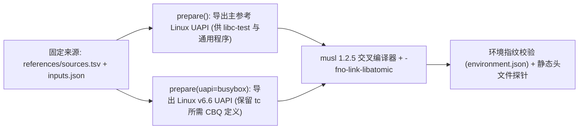

# 用户程序构建环境与真实软件验证体系

除了无 C 库的原生系统调用测试外，操作系统内核的工程成熟度最终必须接受**未经修改的上游真实用户态软件**检验——包括完整工具箱（BusyBox）、标准 C 库测试集（`libc-test`）、双架构 `glibc` 动态链接生态、客体内原生编译器（GCC + GNU Make 编译完整 Lua 工程）以及数据库事务与断电恢复（SQLite）。本文基于 `tests/userland/inventory/`、`tests/workloads/toolchain/offline_c.c`、`tests/userland/glibc/` 与 `references/sources.tsv` 的实际配置，介绍 BoarOS 的确定性用户程序构建环境与全栈软件验证矩阵。

---

## 一、源码组织与固定输入

| 路径 | 核心职责 |
| :--- | :--- |
| `tests/userland/inventory/environment.py` | 导出固定版本 RISC-V Linux **用户空间应用程序接口（UAPI）**头文件，校验 musl 1.2.5 工具链并构建完整 BusyBox |
| `tests/userland/inventory/inputs.json` | 锁定 `oscomp/testsuits-for-oskernel` 提交、BusyBox 配置、`pre-2025` `libc-test` 修订及 BusyBox 专用 Linux v6.6 UAPI |
| `tests/userland/inventory/{libc_build,run,suites,reports}.py` | 双架构（RV64 / LA64）完整 `libc-test` 与 BusyBox 构建、双侧（Linux vs BoarOS）隔离执行与契约校验 |
| `tests/userland/glibc/inputs*.json` | 锁定 RV64（GCC 16.2.1 + glibc 2.44）与 LA64（GCC 15.1.0 + glibc 2.42）交叉工具链与动态运行时二进制身份 |
| `tests/workloads/toolchain/offline_c.c` | 客体内离线 C 编译五阶段探针（支持 ext4 与 tmpfs 工作目录），驱动 Alpine 原生 GCC/binutils 与完整 Lua 5.4.3 构建 |
| `tests/host/{nbd_fault,block_fault}.c` | 面向 SQLite 3.53.4 回滚日志与预写日志（WAL）的宿主 NBD 易失写与断电故障注入服务器 |
| `references/sources.tsv` | 所有上游源码仓库、发布包与 Alpine APK 闭包的固定 URL、提交哈希与 SHA-256 清单 |

---

## 二、可复现工具链与双 UAPI 头文件环境

`environment.py` 严格隔离宿主环境变量（清除 `CPATH`、`C_INCLUDE_PATH`、`LIBRARY_PATH` 等，固定 `LC_ALL=C`、`TZ=UTC`），绝不将宿主 glibc 头文件混入交叉编译路径，并通过 `-idirafter` 确保 musl 1.2.5 自带头文件优先于 Linux UAPI：



- **为何单独维护 Linux v6.6 UAPI**：较新的 Linux 主线 UAPI 已移除旧版流量控制队列规则（CBQ）定义，而上游固定版本 BusyBox 1.33.1 的 `tc` 小工具仍引用该定义。为坚持**零修改源码、零裁剪 applet**（保留全部 398 个 applet）原则，编译 BusyBox 时使用经 SHA-256 校验的完整 Linux v6.6 归档导出 UAPI，而运行时对比内核仍统一使用固定参考 Linux 提交。
- **确定性缓存与失败阻断**：每次导出都会计算整个头文件目录树的 SHA-256 并编译运行静态探针，将工具链、源码与头文件哈希写入 `environment.json`。若源码 HEAD 不符、压缩包哈希错误或 `oldconfig` 意外改变了任何 BusyBox 功能开关，构建立即报错终止，绝不静默降级。

---

## 三、双架构真实程序清单（BusyBox + `libc-test`）

`tests/userland/inventory/run.py` 在 **RISC-V 64** 与 **LoongArch 64** 上共用同一套上游用例、包装脚本与校验器，共覆盖 **229 个独立案例**：
- **`libc-test`（219 项）**：完整编译上游 `pre-2025` 清单中的 **107 个静态链接**入口、**110 个动态链接**入口（RV64 解释器 `/lib/ld-musl-riscv64.so.1`，LA64 解释器 `/lib/ld-musl-loongarch64.so.1` 且链接 16 KiB 页对齐）以及静态/动态两份官方包装器。
- **BusyBox（10 项）**：包含 `true`/`false`/`echo`/`cat`/`ls`/`sh`/`od`/`hexdump` 8 项基础调用、核对真实 RTC/内核日志/挂载容量的 `busybox.environment`，以及执行完整上游命令列表的 `busybox.official`。

### 执行隔离与判定规则

- **双侧同镜像隔离**：每个案例从同一基础 ext4 夹具克隆独立磁盘分别交由固定 Linux 与 BoarOS 运行；LA64 默认在 **512 MiB** 与 **1 GiB** 两种内存配置下执行完整矩阵，RV64 另支持 `--execution-profile rv-user-smp` 多核矩阵。
- **监督驱动与输出判定**：客体内 `/init` 驱动挂载 `proc`、`sysfs`、`tmpfs`、`mqueue` 并配置 loopback，独立捕获子程序的 `stdout`/`stderr`、退出码、终止信号与超时。`reports.py` 对 `libc-test` 与基础命令执行严格逐字节一致比对；对包含真实时间戳/PID/磁盘容量的 `busybox.official` 则逐条解析全部命令契约与退出码，同时仍保留原始输出记录。
- **磁盘回收策略**：每个案例的结果、日志完成 `fsync` 落盘后，通过案例自动删除三份可重建磁盘以节省空间，失败案例的磁盘与日志原样保留供排查（诊断时可加 `--keep-pass-images` 保留全部磁盘）。

---

## 四、双架构 glibc 动态运行时矩阵

除 musl 外，BoarOS 还通过 `tests/userland/glibc/` 独立验证标准 GNU 工具链与完整 **glibc** 动态装载、**线程局部存储（Thread-Local Storage，TLS）**、`dlopen`、POSIX 线程取消与堆栈展开（`libgcc_s.so.1`）：

| 架构 | 锁定工具链与运行时 | 动态加载器与页尺寸 | 验证程序形态（512 MiB / 1 GiB 双内存） |
| :--- | :--- | :--- | :--- |
| **RISC-V 64** | GCC 16.2.1 + glibc 2.44（`inputs.json`） | `/lib/ld-linux-riscv64-lp64d.so.1`（4 KiB 页） | 静态 `ET_EXEC`、动态 `ET_EXEC`、动态 `PIE`、静态 `PIE`、动态 `pthread PIE` + 独立 TLS 共享库 |
| **LoongArch 64** | GCC 15.1.0 + glibc 2.42（`inputs-loongarch.json`） | `/usr/lib64/ld-linux-loongarch-lp64d.so.1`（16 KiB 页） | 同上五种 ELF 形态 + 独立 TLS 共享库（含完整的 `constructor`、`atexit`、阻塞取消清理与内核资源全归还检查） |

---

## 五、客体内原生离线编译、Lua 工程与 SQLite 断电恢复

### 5.1 客体内原生 C 编译与完整 Lua 5.4.3 构建

- **五阶段离线编译探针（`tests/workloads/toolchain/offline_c.c`）**：固定 Linux 与 BoarOS 运行同一静态 `/init`，解包来自官方 **Alpine Linux v3.22 `riscv64`** 的 16 个原生 APK 闭包（GCC 14.2.0-r6、binutils 2.44-r3、GNU Make 4.4.1-r3、musl 1.2.5-r12 及完整依赖库），在客体内依次执行：
  1. `-E` 预处理（生成 `.i`）
  2. `-S -O2` 编译（生成 `.s`）
  3. `as` 汇编（生成 `.o`）
  4. `-static -no-pie` 链接（生成可执行 ELF）
  5. 运行新生成的可执行文件并捕获输出
  - 每阶段将结果写入 `/work/stages.tsv` 并对产物和目录执行 `fsync`。宿主机在重放 ext4 日志后提取双侧全部产物，要求五阶段均以退出码 0 完成、全部中间/最终产物 **SHA-256 逐项一致**且文件系统检查通过。该探针同时支持 `tmpfs` 工作目录模式（将 `/work` 挂载为 64 MiB `tmpfs` 执行编译，结束后把产物拷贝至 `/offline-evidence` 供宿主核验）。
- **原版 Lua 5.4.3 工程构建（`make test-offline-project-riscv`）**：在客体内直接调用原生 GNU Make 与 GCC 编译未修改的 Lua 5.4.3，覆盖干净 `-j1` 构建、无变化增量构建、单源文件增量编译、`clean` 重建、语法错误恢复、基于默认 **FIFO 令牌槽（jobserver）**的 `-j2` 并行构建、递归 jobserver 令牌回收及运行产出的 `lua`/`luac` 与 C 共享模块。

### 5.2 SQLite 3.53.4 事务日志与 NBD 断电故障矩阵

- **官方源码无修改构建**：直接解包官方 SQLite 3.53.4 合并源码（`sqlite-amalgamation-3530400.zip`），以 musl 1.2.5 编译静态与动态 CLI 及测试负载，启用 `THREADSAFE=1`、原生 Unix VFS 与 WAL 支持。
- **常规多进程事务与恢复**：验证回滚日志（`journal_mode=DELETE`）与预写日志（`journal_mode=WAL`）模式下的多进程写者竞争、未提交大事务引发的临时目录探测（`faccessat`）与日志溢出（journal spill）、异常终止后的热日志（hot journal）恢复，以及跨重启的 `PRAGMA integrity_check`。
- **NBD 逐事件写故障与断电注入**：宿主通过 `tests/host/nbd_fault.c` 与 `tests/host/block_fault.c` 向 QEMU 暴露符合 512 字节原子写、易失写缓冲与仅在 `FLUSH` 后落盘模型的 **网络块设备（Network Block Device，NBD）** 服务。测试框架对 SQLite 事务内的每一次写和刷盘事件精确编号，逐点注入写/刷盘错误或冻结磁盘模拟掉电，随后从持久化镜像重启客体恢复两次并运行 `e2fsck -fn`，严格验证未确认事务只能呈现完整旧值或完整新值、已确认提交绝不丢失且数据库与 ext4 均无损坏。

---

<details>
<summary>展开查看：Alpine 原生编译闭包清单、产物清理与验证命令</summary>

### 客体内离线编译 Alpine v3.22 `riscv64` 固定包清单

| APK 包名 | 固定版本 | `.PKGINFO` 许可证 |
| :--- | :--- | :--- |
| `make` | `4.4.1-r3` | GPL-3.0-or-later |
| `binutils` | `2.44-r3` | GPL-2.0-or-later AND LGPL-2.1-or-later AND BSD-3-Clause |
| `gcc` | `14.2.0-r6` | GPL-2.0-or-later AND LGPL-2.1-or-later |
| `gmp` | `6.3.0-r3` | LGPL-3.0-or-later OR GPL-2.0-or-later |
| `isl26` | `0.26-r1` | MIT |
| `jansson` | `2.14.1-r0` | MIT |
| `libatomic` | `14.2.0-r6` | GPL-2.0-or-later AND LGPL-2.1-or-later |
| `libgcc` | `14.2.0-r6` | GPL-2.0-or-later AND LGPL-2.1-or-later |
| `libgomp` | `14.2.0-r6` | GPL-2.0-or-later AND LGPL-2.1-or-later |
| `libstdc++` | `14.2.0-r6` | GPL-2.0-or-later AND LGPL-2.1-or-later |
| `mpc1` | `1.3.1-r1` | LGPL-3.0-or-later |
| `mpfr4` | `4.2.1_p1-r0` | LGPL-3.0-or-later |
| `musl` / `musl-dev` | `1.2.5-r12` | MIT |
| `zlib` | `1.3.2-r1` | Zlib |
| `zstd-libs` | `1.5.7-r0` | BSD-3-Clause OR GPL-2.0-or-later |

### 常用构建、验证与清理命令

```sh
# 1. 环境准备与完整 BusyBox 构建
make test-program-environment-host
make prepare-program-environment
make build-competition-busybox

# 2. 双架构 229 项真实程序清单（BusyBox + libc-test）
make inventory-userland-riscv
python3 -B tests/userland/inventory/run.py --arch loongarch --reuse-builds --require-pass \
  --output build/loongarch/inventory-check

# 单例快速验收（例如 libc-test 静态与动态 socket）
python3 tests/userland/inventory/run.py --suite libc \
  --case libc.static.socket --case libc.dynamic.socket --require-pass --output build/socket-check

# 3. 双架构 glibc 五形态矩阵
make test-glibc-riscv
make test-glibc-loongarch

# 4. 客体内离线 C 编译探针与原版 Lua 5.4.3 工程
make prepare-offline-c-toolchain
make test-offline-c-baseline-riscv   # 诊断基线：故意不装编译器，验证停在 preprocess:exec:2
make test-offline-c-riscv            # 严格五阶段编译与 SHA-256 双侧一致校验
make test-offline-c-tmpfs-riscv      # tmpfs 工作目录编译校验
make test-offline-project-riscv      # 原版 Lua 5.4.3 多场景与 -j2 FIFO jobserver 构建

# 5. SQLite 3.53.4 回滚 / WAL 与 NBD 断电故障矩阵
make test-nbd-host
make test-sqlite-rollback-riscv test-sqlite-wal-riscv
make test-sqlite-recovery-riscv test-sqlite-recovery-matrix-riscv
make test-sqlite-wal-recovery-riscv test-sqlite-wal-recovery-matrix-riscv

# 6. 预览并清理一次性运行目录与临时镜像（保留工具链、SDK 与活动 worktree）
python3 tests/tools/prune-build.py
make prune-build
```

</details>
