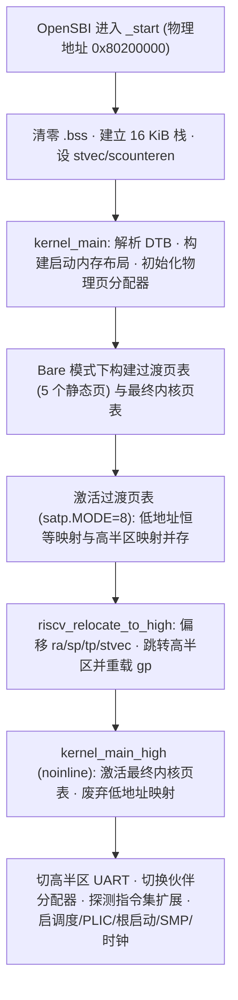

# RISC-V 64 引导、高半区切换与系统启动

BoarOS 在 **RISC-V 64（RV64）** 架构上运行于**监督者模式（Supervisor Mode，S-mode）**，支持 **1～8 核对称多处理（Symmetric Multiprocessing，SMP）**、**Sv39 三级分页（4 KiB 基页与 2 MiB 大页）**、高半区内核地址空间以及完整的设备发现与根文件系统启动流程。异常入口与返回契约见 [RISC-V Trap 模块](riscv-trap.md)，设备树与启动内存布局见 [DTB 与启动内存布局](dtb-memory.md)，分页实现见 [RISC-V Sv39 分页](riscv-sv39.md)，定时与调度节拍见 [RISC-V 定时器与内核节拍](riscv-timer.md)。

---

## 一、源码组织

| 源码路径 | 核心职责 |
| :--- | :--- |
| `arch/riscv/linker.ld` | 定义内核物理装载基址、高半区虚拟基址、段权限对齐、缓存行隔离的 `.bss` 布局与 16 KiB 启动栈 |
| `arch/riscv/boot.S` | 裸机入口 `_start`、最小 C 运行环境建立、陷入入口安装与高半区地址重定位 `riscv_relocate_to_high` |
| `arch/riscv/secondary.S`、`smp.c` | 多核配置下的从核启动入口、核本地初始化、核间中断（IPI）与跨核 TLB 同步 |
| `arch/riscv/direct_map.c` | 物理内存直接映射区与内核镜像区之间的物理/虚拟地址换算和边界校验 |
| `arch/riscv/sv39.c` | 构建 Sv39 三级页表（4 KiB/2 MiB 叶子）并写入 `satp` 寄存器切换地址空间 |
| `arch/riscv/sbi.c` | 封装监督者二进制接口（Supervisor Binary Interface，SBI）的 Base、TIME、HSM、IPI、RFENCE 与 SRST 调用 |
| `arch/riscv/virt_uart.c`、`virt_rtc.c` | QEMU `virt` 平台的 NS16550A 早期轮询串口、高半区映射切换与 Goldfish 实时时钟（RTC）读取 |
| `kernel/main.c` | 串联设备树解析、物理页分配器初始化、两阶段页表切换、调度器、外设中断、根启动、从核上线与时钟启动 |
| `arch/riscv/root_boot.c` | 扫描 VirtIO 块设备、挂载 ext4 根文件系统、装载并启动 PID 1 及协调最终关机回收 |

---

## 二、裸机入口与链接布局

使用 `make all` 编译后，根目录生成可执行与可链接格式（Executable and Linkable Format，ELF）镜像 `kernel-rv`。在 QEMU `virt` 平台上，OpenSBI 固件完成机器模式（Machine Mode，M-mode）初始化后，以 S-mode 跳转至入口符号 `_start`，此时寄存器 `a0` 存放启动硬件线程号（Boot Hart ID），`a1` 存放扁平设备树（Flattened Device Tree，DTB）的客户机物理地址。

### 2.1 段布局与内存隔离（`arch/riscv/linker.ld`）

链接脚本将内核的虚拟基址（VMA）定在 `0xffffffff80000000`，同时将首个加载段（`PT_LOAD`）的物理装载地址（LMA）与 ELF 入口点定在 `0x80200000`（位于 QEMU `virt` 自 `0x80000000` 起始的物理内存内）。开启分页前，由于编译选项采用 `-mcmodel=medany`，编译器生成基于程序计数器（PC）相对寻址的指令，因此代码可以直接在低物理地址正确执行。

内核镜像划分为三个独立权限的 `PT_LOAD` 段，且段间均按 4 KiB 页对齐，以便启用分页后赋予严格的最小权限：
- `.text`（读 + 执行，R+X）：包含放置在最前端的 `.text.boot` 启动代码与常规内核代码；
- `.rodata`（只读，R）：只读数据与常量表；
- `.data` 与 `.bss`（读 + 写，R+W）：可写全局数据与零初始化区。`.bss` 开头将 `.bss.scheduler.cpu`、`.bss.scheduler.wait` 与 `.bss.scheduler.state` 按 64 字节缓存行（Cache Line）对齐分隔，避免多核并发访问热状态时产生伪共享（False Sharing）；`.bss` 末尾预留 **16 KiB**、16 字节对齐的静态启动栈（`__boot_stack_bottom` 到 `__boot_stack_top`）。

### 2.2 最小运行环境建立（`arch/riscv/boot.S`）

`_start` 不依赖也不继承固件留下的栈空间，依次完成以下初始化：
1. 保存 `a0`（boot hart ID）与 `a1`（DTB 物理地址）至被调用者保存寄存器 `s0`、`s1`，将线程指针 `tp` 清零，并禁用链接器松弛（`.option norelax`）装载全局指针 `gp`（`__global_pointer$`）；
2. 清零中断使能寄存器 `sie` 并清除 `sstatus.SIE`（bit 1），确保早期引导全程关中断；同时写 `scounteren = 2`，仅向用户态开放 `time` 计数器供虚拟动态共享对象（Virtual Dynamic Shared Object，vDSO）无陷入读取时间，不暴露 `cycle` 与 `instret`；
3. 按 8 字节步长清零 `[__bss_start, __bss_end)`，然后将栈指针 `sp` 指向 16 字节对齐的 `__boot_stack_top`；
4. 清零 `sscratch`（内核态运行期间恒为 0，用于陷入入口区分用户态与内核态），并将 `riscv_trap_entry` 写入直接模式（Direct Mode）的 `stvec`；
5. 先调用 `kernel_cpu_boot_initialize(hart_id)` 初始化启动核的每核控制块，随后以 `(hart_id, dtb)` 参数进入 `kernel_main`。

---

## 三、两阶段分页与高半区地址空间

开启分页后，正在执行的指令流会瞬间从物理地址切换到虚拟地址。为了平稳完成从物理低地址到高半区虚拟地址的过渡，BoarOS 在关闭分页（Bare 模式）阶段构建**两张页表**，通过一次“过渡切换 + 高半区重定位 + 最终切换”的两步跳转彻底告别低地址恒等映射。



### 3.1 过渡页表与高半区重定位

1. **过渡页表（`build_transition_page_table`）**：页表页取自内核镜像内的 5 个静态 4 KiB 页（`transition_table_pages`），不占用正式物理页分配器。它将覆盖整个内核镜像的 2 MiB 对齐物理包络同时映射到**低地址恒等区间**与**高半区区间**（仅在关中断的切换窗口内临时使用 RWX 权限），并恒等映射 QEMU 串口物理地址 `0x10000000`。
2. **最终内核页表（`build_kernel_page_table`）**：页表页取自正式物理页分配器，不再包含任何低地址用户区间映射，而是按最小权限原则建立完整的高半区布局：

| 高半区虚拟地址区间 | 大小 / 基址宏 | 权限 | 用途说明 |
| :--- | :--- | :--- | :--- |
| `0xffffffc000000000` 起 | `128 GiB`（`RISCV_DIRECT_MAP_BASE`） | 全局不可执行（NX）；镜像 `.text`/`.rodata` 对应区为 R，其余 RAM 为 RW | 物理内存线性直接映射区，物理地址 `PA` 对应虚拟地址 `PA + 0xffffffc000000000` |
| `0xffffffe000000000` 起 | 至 `0xffffffff80000000`（`RISCV_KERNEL_MMIO_BASE`） | RW（仅监督者模式） | 外设内存映射 I/O（MMIO）高半区别名区；早期 UART 位于 `0xffffffe010000000`，Goldfish RTC 位于 `0xffffffe000101000`，同时映射 DTB 发现的 UART、PLIC 与全部 VirtIO MMIO 区域 |
| `0xffffffff80000000` 起 | 内核镜像长度（`RISCV_KERNEL_VIRTUAL_BASE`） | `.text` 为 RX，`.rodata` 为 R，`.data`/`.bss` 为 RW | 高半区内核代码与静态数据段 |
| `0xffffffffc0000000` 起 | `128 MiB`（`RISCV_KERNEL_STACK_WINDOW_BASE`） | 预留空顶层页表子树，运行时按需插入 RW 叶子 | 内核任务栈窗口，每个槽位 `0x3000`（12 KiB）= 4 KiB 未映射保护页（Guard Page） + 8 KiB 内核栈；在任何用户进程复制内核根页表项前预留，保证所有地址空间共享同一内核栈窗口 |

3. **地址切换与栈帧隔离**：`kernel_main` 先激活过渡页表，随即调用 `riscv_relocate_to_high(offset)` 将 `ra`、`sp`、`tp` 以及 `stvec` 统一加上高半区偏移量 `KERNEL_VIRTUAL_BASE - physical_start`，跳往高半区地址并重新装载高半区 `gp`。之后调用标记为 `__attribute__((noinline, noreturn))` 的 `kernel_main_high()`，确保切换前栈帧中可能残留的低地址局部指针不会跨入最终页表阶段。`kernel_main_high()` 激活最终页表后，低地址映射立即失效，随即调用 `virt_uart_use_kernel_mapping()` 将串口基址切换至高半区 `0xffffffe010000000`。

---

## 四、高半区子系统编排与启动完成

进入 `kernel_main_high()` 并激活最终页表后，启动核在关中断状态下按严格的依赖顺序完成剩余初始化：

1. **每核状态与硬件能力探测**：
   - `kernel_cpu_boot_rebind()` 重新绑定高半区每核指针；
   - `riscv_vector_boot(boot_features)` 检测标准 RVV 1.0 向量长度 `VLENB`，`riscv_hwprobe_initialize()` 记录硬件厂商/架构 ID 与指令集扩展；
   - 根据 DTB 特征交集发布 `riscv_mmu_svvptc`（支持 `Svvptc` 免首次装页刷 TLB）与 `riscv_mmu_cboz64`（64 字节 `Zicboz` 零页指令）。
2. **伙伴物理页分配器与直接映射验证**：
   - 将物理页分配器的页访问回调绑定为 `direct_map_page_access`，随后调用 `physical_page_allocator_finalize()` 从引导期简单链表切换为正式伙伴分配器（Buddy Allocator）；
   - 更新 `kernel_page_table.allocator` 指针，并通过 `verify_direct_map_runtime()` 实测一次物理页分配、直接映射读写、释放与复用，确保页表回收与堆管理全部走高半区直接映射路径。
3. **调度器、中断控制器与根文件系统启动**：
   - 调用 `kernel_scheduler_init()` 将当前启动上下文注册为 CPU0 空闲任务（Idle Task）；若探测到 VirtIO 块设备，提前创建专用的可调度存储清理线程 `storage_cleanup_worker`；
   - 根据 DTB 发现的基址与上下文初始化平台级中断控制器（Platform-Level Interrupt Controller，PLIC）；
   - 调用 `riscv_root_boot_start_with_irq()` 尝试挂载 ext4 根盘并建立 PID 1（详见 [RISC-V 根文件系统启动](riscv-root-boot.md)）。若存在根盘，则依次启动页缓存执行线程、块设备 PLIC 中断、可选的 VirtIO 随机数发生器（RNG）与 VirtIO 网卡。
4. **时间子系统、浮点初态与多核上线**：
   - 采样 Goldfish RTC 墙钟并调用 `kernel_time_init()` 初始化内核时间系统；
   - **收敛 `sstatus.FS` 状态**：OpenSBI 移交控制权时可能遗留 `sstatus.FS = Dirty`，内核在此主动将其置为 `Clean`，防止纯内核执行在上下文切换时触发无意义的浮点寄存器保存；
   - 若启用了多核编译选项（`BOAROS_MAX_CPUS > 1`），调用 `riscv_smp_start()` 通过 SBI 硬件线程状态管理扩展（Hart State Management，HSM）依次唤醒从核，并在从核全部上线后发布网络 TCP 所有者与日志后台线程（详见 [RISC-V 多核启动与同步](riscv-smp.md)）。
5. **启动定时器与进入空闲循环**：
   - 调用 `riscv_timer_start()` 设置首个未来时钟期限，随后依次开启 `sie.STIE` 与全局 `sstatus.SIE`，正式开放中断与多任务抢占；
   - 启动核退化为空闲循环：在无根盘模式下原地回收已退出的内核测试线程，每次循环主动让出调度（`kernel_scheduler_yield_current`）后开中断执行 `wfi` 休眠等待下一次中断。

---

## 五、电源与系统复位控制

`arch/riscv/sbi.c` 通过 SBI 系统复位扩展（System Reset Extension，SRST，扩展号 `0x53525354`，功能号 `0`）向固件请求关机或冷重启：
- **关机（`sbi_shutdown`）**：传入复位类型 `0`（`SBI_SRST_SHUTDOWN`）、原因 `0`；
- **冷重启（`sbi_cold_reboot`）**：传入复位类型 `1`（`SBI_SRST_COLD_REBOOT`）、原因 `0`；
- **停机（`sbi_halt`）**：不向固件请求断电，直接关闭本核中断并进入永久 `wfi` 循环。若 `sbi_system_reset` 异常返回，内核会打印真实 SBI 错误码后转入 `sbi_halt()`。

用户态发起的关机/重启请求由 `storage_cleanup_worker` 先终止用户进程、排空日志与卸载文件系统，确认全部资源归还后再调用上述 SBI 接口，完整流程见 [进程调度与生命周期](kernel-scheduler.md)。

---

<details>
<summary>展开查看：启动边界契约、平台约束与验证入口</summary>

### 关键边界与不变量

- **DTB 与随机种子**：内核不假设 DTB 位于固定物理地址。`kernel_main` 在构建内存布局前先将 `/chosen/rng-seed` 混入内核随机数池并立即擦除临时缓冲区，随后把 `[__kernel_start, __kernel_end)` 与 DTB 自身区间加入保留区，再交由 `boot_memory_build()` 生成可用物理内存段。
- **物理装载地址绑定**：在重定位到高半区前，`kernel_main` 通过 `riscv_image_bind_load_offset()` 记录 `RISCV_KERNEL_VIRTUAL_BASE - (uintptr_t)__kernel_start`，使后续需要查询内核镜像物理地址的直接内存访问（DMA）路径无需依赖绝对链接符号。
- **串口紧急输出路径**：当启动期或运行期进入致命错误处理时，内核调用 `virt_uart_emergency_begin()` 立即关中断并切回同步轮询模式（轮询 LSR bit 5 后写 THR），避免后台 TTY 工作线程或日志缓冲与崩溃现场交错。多核配置下同时由 `claim_fatal()` 争抢唯一输出权，确保崩溃日志完整可读。
- **平台常量约束**：当前镜像物理装载基址 `0x80200000` 针对 QEMU `virt` 平台；若移植至 VisionFive 2 等实板，需由板级适配提供对应的物理装载地址、固件入口与存储驱动。

### 验证入口

```sh
make run-riscv
make test-riscv
make test-sv39-riscv
make test-sv39-fault-riscv
make debug-riscv
```

- `make test-riscv`：覆盖物理页分配、VirtIO 块设备、VFS/ext4、Sv39 页表、MM/VMA、用户空间拷贝、生产根启动及调度生命周期回归。
- `make debug-riscv`：在第一条客户机指令前暂停 QEMU，并在宿主 TCP 端口 `1234` 等待 GDB 连接。

</details>
