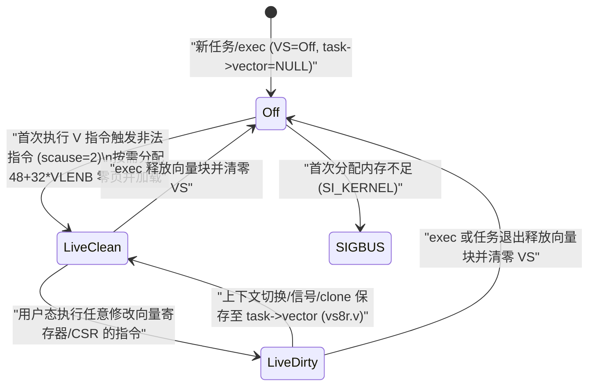

# RISC-V 浮点（F/D）与 RVV 1.0 向量扩展状态

BoarOS 在 RISC-V 64 架构上为每个用户任务独立管理**双精度浮点（F/D 扩展）**与 **RISC-V 向量扩展 1.0（RVV 1.0）**硬件现场。内核 C 代码与常规汇编始终按纯整数指令集（RV64IMAC）编译，仅在受控的专用汇编模块中触碰浮点与向量寄存器，避免普通整数陷入支付不必要的保存与恢复开销。整数陷入帧与返回尾契约见 [RISC-V Trap 模块](riscv-trap.md)，信号处理与调试接口分别见 [内核信号](kernel-signal.md) 和 [进程追踪（ptrace）](kernel-ptrace.md)。

---

## 一、源码组织

| 源码路径 | 核心职责 |
| :--- | :--- |
| `include/arch/riscv/fpu.h`、`arch/riscv/fpu.S` | 定义每任务 272 字节 `struct riscv_fpu_state` 及唯一触碰 F/D 寄存器的保存、恢复、切换与重置汇编例程 |
| `include/arch/riscv/vector.h`、`arch/riscv/vector.c`、`vector_state.S` | RVV 1.0 硬件 `VLENB` 探测、按需堆分配、全寄存器搬移、`prctl` 控制与 `ptrace` 向量 regset |
| `arch/riscv/process.c`、`arch/riscv/trap.c` | 新进程初态、`clone`/`exec` 状态迁移、非法指令懒激活入口与返回尾合并实时 `FS`/`VS` 位 |
| `arch/riscv/signal.c`、`arch/riscv/ptrace.c` | 构造/恢复含 F/D 与 RVV 扩展链的信号帧，以及 `NT_PRFPREG` 标量浮点调试读写 |
| `arch/riscv/hwprobe.c` | 实现 `riscv_hwprobe` 系统调用，向用户态安全暴露每核指令集扩展、向量支持与硬件属性 |

---

## 二、标量浮点（F/D）状态机与生命周期

每个用户任务内嵌一个 **272 字节**、16 字节对齐的 `struct riscv_fpu_state`，依次存放 32 个 64 位双精度视图浮点寄存器（`regs[32]`）、浮点控制状态寄存器（`fcsr`，偏移 `256`）与权威映像标志（`saved`，偏移 `264`）。288 字节的整数 Trap Frame 不包含任何浮点字段，使纯整数系统调用与短陷入零浮点开销。

### 2.1 基于 `sstatus.FS` 的惰性保存与上下文切换

RISC-V 硬件通过 `sstatus.FS`（bits 14:13）自动追踪浮点寄存器是否被用户指令修改（`Off=0`、`Initial=1`、`Clean=2`、`Dirty=3`）。上下文切换在关闭中断的临界区内、整数寄存器切换之前调用 `riscv_fpu_switch(previous, next)`：

1. **按需保存前任**：若 `previous != NULL` 且硬件 `sstatus.FS == Dirty`，说明前任用户任务在本次时间片内修改过浮点寄存器；此时执行 `riscv_fpu_state_save()` 将 32 个浮点寄存器与 `fcsr` 写入 `previous`，置 `saved = 1`，并将硬件 `FS` 收敛为 `Clean`。内核线程与未触碰浮点的用户任务直接跳过保存。
2. **按需加载后继**：若 `next->saved != 0`，调用 `riscv_fpu_state_restore()` 从内存装载 32 个浮点寄存器与 `fcsr`，恢复完毕后同样将 `FS` 置为 `Clean`，以便硬件重新侦测后继任务接下来的浮点写入。内核线程的 `saved` 恒为 0，永远不触发加载；任务退出路径传入 `previous = NULL` 直接丢弃自身现场。
3. **返回尾实时合并 `FS`**：陷入期间可能发生调度切换、信号恢复或 `exec`，它们都会改写实时 `sstatus.FS`。因此 `riscv_trap_return_prepare()` 在离开内核前必须读取实时 `sstatus`，将其中的 `FS`（及 `VS`）位合并覆盖到 `frame->sstatus`，确保不把陷入入口时过时的 `Dirty`/`Clean` 快照写回硬件。
4. **多核所有权模型**：在 SMP 配置下，任务移出当前核前已在关中断上下文完成保存，目标核仅在旧核完成交接（`on_cpu` 释放）后才加载映像，不存在跨核延迟借用（Lazy Cross-Hart Ownership）的复杂竞态。

### 2.2 进程创建、`clone` 与 `exec` 边界

- **初始进程**：`riscv_process_prepare_initial()` 将初始 Trap Frame 的 `sstatus.FS` 置为 `Initial` 并置 `task->fpu.saved = 1`，首次切入时加载全零浮点映像。
- **克隆（`clone`/`fork`）**：`riscv_process_prepare_clone()` 先调用 `riscv_fpu_state_save(&parent->fpu)` 把父进程最新的硬件寄存器同步到内存，再整块拷贝给子进程，确保子进程精确继承父进程当前浮点状态。
- **程序替换（`exec`）**：`riscv_process_prepare_exec()` 调用 `riscv_fpu_reset_current(&task->fpu)`，将硬件 32 个寄存器、`fcsr` 以及内存映像全部清零，并把 `sstatus.FS` 设为 `Initial`，杜绝旧程序寄存器值向新程序泄漏。

---

## 三、RVV 1.0 向量扩展：硬件探测与按需所有权

与固定内嵌的标量浮点不同，RVV 1.0 寄存器组长度 `32 * VLENB` 随硬件配置动态变化（从 512 字节到 256 KiB 不等）。BoarOS 为向量状态采用**完全按需分配、首次执行触发**的独立所有权模型。



### 3.1 硬件探测与多核一致性校验

- **设备树特征交集**：`kernel/dtb.c` 对所有启用核的指令集扩展取交集，优先读取 `riscv,isa-extensions`，缺失时回退解析 `riscv,isa`（详见 [DTB 与启动内存布局](dtb-memory.md)）。若任一启用核缺少标准 `v` 扩展（或仅为 Zve 子集/旧版 XTheadVector），内核绝不访问向量 CSR，也不在 `AT_HWCAP` 与 `riscv_hwprobe` 中宣告 `V`，用户执行向量指令直接按非法指令交付 `SIGILL`。
- **同构 `VLENB` 约束**：启动核通过 `riscv_vector_boot()` 临时开启 `sstatus.VS` 读取 `vlenb`（CSR `0xc22`）后立即关闭 `VS`，仅接受 `16..8192` 字节内的 2 的幂。多核启动时，每个从核上线前都必须通过 `riscv_vector_check_hart()` 核验其 `vlenb` 与启动核严格一致；异构长度的从核在进入用户调度前即被拒绝上线，绝不允许任务迁移时静默截断向量寄存器。

### 3.2 按需分配、全寄存器搬移与 `prctl` 策略

- **数据结构**：`struct riscv_vector_state` 前 40 字节与 Linux 向量 regset 头部完全对齐（依次为 64 位 `vstart`、`vl`、`vtype`、`vcsr`、`vlenb`），紧接堆指针 `heap`，从偏移 `48` 字节起为 16 字节对齐的柔性数组 `regs[]`，总计分配 `48 + 32 * VLENB` 字节。
- **首次使用懒激活**：进程初始时 `task->vector == NULL` 且硬件 `sstatus.VS == Off`，普通整数任务间切换完全不触碰任何向量 CSR。当用户首次执行向量指令或访问向量 CSR（`0x008..0x00f`、`0xc20..0xc22`）触发非法指令异常（`scause = 2`）时，`riscv_vector_first_use()` 解码故障指令（操作码 `0x57`、向量加载/存储宽度 `0x07`/`0x27` 或向量 CSR 读写）：
  - 若当前策略允许且指令合法，以无睡眠方式分配并清零 `struct riscv_vector_state`，加载到硬件并保持 `sepc` 不变重试原指令；
  - 若内存不足，不开启 `VS`，直接强制投递 `SIGBUS`（`si_code = SI_KERNEL = 128`）。
- **无策略依赖的全寄存器搬移（`arch/riscv/vector_state.S`）**：保存与恢复分别使用 `vs8r.v` 与 `vl8re8.v` 四组 8 寄存器整体访存指令，完全不受用户当前 `vl`、`vtype`、尾部或掩码策略影响。搬移前将 `vstart` 清零，恢复时再通过 `vsetvl zero, t1, t0` 恢复 `vl`/`vtype`，最后恢复 `vcsr` 与 `vstart` 并将 `sstatus.VS` 收敛为 `Clean`（`0x400`）。
- **策略控制与能力查询**：
  - `prctl` 的 `PR_RISCV_V_SET_CONTROL`（`69`）与 `PR_RISCV_V_GET_CONTROL`（`70`）支持配置当前映像与下一次 `exec` 的向量启用/禁用/默认与继承标记（`inherit`）；已经开启向量权限的当前映像不允许运行中转为禁用（返回 `-EPERM`），默认策略允许使用 `V`。
  - `arch/riscv/hwprobe.c` 实现了 `riscv_hwprobe` 系统调用，支持按 CPU 掩码查询硬件 ID（`mvendorid`/`marchid`/`mimpid`）、基础 ISA、扩展位图（包含 `FD`/`C`/`V`/`Zba`/`Zbb`/`Zbs`/`Zicboz`）、`Zicboz` 块大小、用户虚拟地址上限与时钟频率，以及 `WHICH_CPUS` 反查过滤。

---

## 四、信号帧布局与 `ptrace` 二进制接口

### 4.1 信号帧与 `rt_sigreturn` 原子恢复（`arch/riscv/signal.c`）

- **基础浮点信号帧**：无向量状态时，信号帧保持标准的 **1088 字节**（128 字节 `siginfo` + 960 字节 `ucontext`），其中 `mcontext` 的浮点联合体按 Q 扩展规范预留 512 字节寄存器区加 `fcsr` 及 3 个 32 位 `reserved` 字段。交付时保存当前任务的 32 个双精度寄存器与 `fcsr`；`AT_MINSIGSTKSZ` 已计入最大向量信号帧所需空间。
- **RVV 扩展记录链**：当任务拥有活动向量状态（`task->vector != NULL`）时，信号帧按 16 字节对齐向下扩展 `64 + 32 * VLENB` 字节：
  - 在 `mcontext.fp.reserved[1..2]` 写入扩展记录头：魔数 `RISCV_VECTOR_MAGIC = 0x53465457`、记录长度 `56 + 32 * VLENB`；
  - 紧接 6 个 64 位字段：`vstart`、`vl`、`vtype`、`vcsr`、`vlenb` 与指向寄存器数据的用户态指针 `datap`；随后存放 `32 * VLENB` 字节寄存器内容与 8 字节全零 `END` 终止头。
- **两阶段校验恢复**：`rt_sigreturn` 校验 `reserved[0] == 0` 及整条扩展链表，允许用户态独立迁移 `datap` 或重复放置已知记录（以最后一条生效），且始终以硬件 `riscv_vector_vlenb` 为权威拷贝长度，绝不信任用户传入的 `vlenb` 作为拷贝尺寸。新向量映像会先完整读入临时堆缓冲区，全部校验通过后再原子替换 `task->vector` 并立即加载至硬件，避免拷贝中途缺页或调度泄露半成品状态；任何畸形或不可读帧均强制投递 `SIGSEGV`。

### 4.2 `ptrace` 寄存器集接口

| 寄存器集 Note | 编号 | 数据布局与语义 |
| :--- | :--- | :--- |
| `NT_PRFPREG` | `2` | 固定 `33 * 8` 字节（32 个 64 位浮点寄存器 + `fcsr` 低 8 位） |
| `NT_RISCV_VECTOR` | `0x900` | `40 + 32 * VLENB` 字节：5 个 64 位 CSR 字段（`vstart/vl/vtype/vcsr/vlenb`）后紧跟**内联**寄存器字节（不含 `datap`）。若目标任务尚未首次使用向量，返回 `-ENODATA` |

读取 `NT_RISCV_VECTOR` 时直接从已停止且被独占借用的目标映像拷贝至用户空间，无需分配第二份大块缓冲区；写入时支持部分长度覆盖，先在完整快照上通过 `riscv_vector_csr_valid()` 严格检验 `vlenb` 匹配、`vcsr` 保留位、`vtype` 合法性（`vill=0`、`sew <= 3`、`lmul != 4`）以及 `vl <= VLMAX`（先除后乘防整数溢出），校验通过后原子提交。

---

<details>
<summary>展开查看：实现边界与定向验证入口</summary>

### 当前实现边界

- 标量浮点采用 64 位 D 扩展寄存器视图，未实现用户态浮点异常陷阱信号（RISC-V 架构本身不产生硬件浮点陷入异常）与跨核延迟借用。
- RVV 1.0 不包含独立启用的 Zve 子集或旧版厂商扩展 XTheadVector；ELF core dump 文件当前沿用通用整数寄存器 note，尚未新增向量 core note，也未提供修改系统级默认向量策略的 `sysctl` 节点。

### 定向验证入口

```sh
make test-userland-riscv
make test-smp-fpu-setup-riscv
make test-riscv-vector-host
make test-riscv
```

- **RVV 1.0 客户机全量测试**（支持 `--vlen 0/128/256/1024`，多核加 `--cpus 2`）：

```sh
$RVCC -O2 -static -march=rv64gc -mabi=lp64d \
  tests/userland/riscv-vector.c tests/userland/riscv-vector.S -o build/riscv-vector-user
python3 tests/userland/riscv-vector.py --kernel kernel-rv \
  --program build/riscv-vector-user --vlen 128
```

- `test-smp-fpu-setup-riscv`：在多核四个任务间验证返回尾准确保留实时 `Off`/`Initial`/`Clean`/`Dirty` 状态、时钟抢占、跨核迁移与退出回收。
- `test-riscv-vector-host`：在宿主 4 KiB/16 KiB 页模型下覆盖全部合法 `VLENB`（16..8192）、异构核拒绝、首次使用/clone/ptrace 内存耗尽与非法 CSR 输入校验。
- `RISCV_VECTOR_OOM_FIXTURE=1` 与 `-DVECTOR_OOM_FIXTURE` 配合 `--clone-oom`：在真实客户机首次使用与 `clone` 分配点注入 OOM，验收 `SIGBUS`（`SI_KERNEL`）、重试成功、`fork` 返回 `ENOMEM` 与最终堆归零。

</details>
