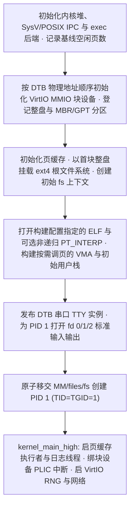

# RISC-V 根文件系统启动与 PID 1 生命周期

当 Sv39 高半区页表、伙伴物理页分配器、调度器与中断控制器全部就绪后，BoarOS 通过根启动模块（`arch/riscv/root_boot.c`）将内核从早期裸机状态推进到完整的用户态系统：探测并登记所有 VirtIO 块设备、挂载 ext4 根文件系统、装载并启动首个用户进程 **PID 1**，并在 PID 1 退出或收到关机/重启请求时逆序撤销全部子系统并核验内存零泄漏。各底层子系统细节分别见 [RISC-V VirtIO MMIO 块设备](riscv-virtio-block.md)、[VFS 与 ext4](vfs-ext4.md) 和 [用户 ELF64 装载](user-elf.md)。

---

## 一、源码组织

| 源码路径 | 核心职责 |
| :--- | :--- |
| `arch/riscv/root_boot.c`、`include/arch/riscv/root_boot.h` | 管理 `struct riscv_root_boot` 根所有权对象，编排块/串口/RNG/网络设备启停、根挂载、PID 1 构建与两阶段清理 |
| `kernel/main.c` | 调度根启动入口、启动后台页缓存与日志工作线程、绑定块设备 PLIC 中断、并在 `storage_cleanup_worker` 中驱动收尾关机 |
| `config/init.json`、`tools/init-config.py` | 构建期校验并生成 PID 1 的只读启动配置（可执行路径、`argv`、`envp`） |
| `kernel/block.c`、`include/kernel/block.h` | 块设备号编码、设备登记表、MBR/GPT 分区发现及独占认领（Claim）机制 |

---

## 二、根启动流程与子系统挂载

生产内核调用 `riscv_root_boot_start_with_irq()` 启动根环境（模块级测试夹具仍可调用 `riscv_root_boot_start()` 仅保留早期轮询控制台）。若未发现任何 VirtIO 块设备，函数返回 `RISCV_ROOT_BOOT_STATUS_NO_DEVICE`，内核平滑退化为无盘定时器空闲模式；一旦存在块设备，后续任何挂载、可执行文件或 ELF 格式错误均视为明确的根启动失败，不会跳过损坏的首盘去盲目尝试后续磁盘。



### 2.1 设备发现、挂载与 ELF 装载

1. **内核堆、IPC 与基线采样**：依次初始化页支持的内核堆（`kernel_heap_init`）、System V 共享内存/信号量/消息队列、POSIX 消息队列，并将 `riscv_exec_init` 绑定到同一物理页分配器与内核根页表。随后快照当前可用物理页数存入 `root->baseline_pages`，作为最终关机零泄漏核验的基准。
2. **块设备与分区登记**：按 DTB 物理地址升序遍历全部 `virtio,mmio` 区域，初始化所有版本 1（Legacy）或版本 2（Modern）的 VirtIO 块设备，登记整盘对象并调用 `kernel_block_scan_partitions()` 扫描主引导记录（Master Boot Record，MBR）或全局唯一标识分区表（GUID Partition Table，GPT）。首个成功初始化的整盘作为根盘。
3. **根挂载与按需装载 ELF**：初始化全局页缓存，以根盘挂载 raw whole-disk ext4（按设备只读属性自动选择读写或只读模式），创建根目录为 `/` 的文件系统上下文。通过公共可执行权限检查打开构建配置指定的初始程序（必须为普通文件且具备至少一个执行权限位），解析 RISC-V `ET_EXEC`/`ET_DYN` 程序头。若存在动态链接器段（`PT_INTERP`），同步解析并校验解释器 ELF（禁止解释器再次递归指定 `PT_INTERP`），将各 `PT_LOAD` 段登记为文件后备的虚拟内存区域（Virtual Memory Area，VMA），由首次访存缺页按需物化物理页。
4. **串口 TTY 与 PID 1 标准输入输出**：若 DTB 提供了带 PLIC 中断路由的串口，先通过 `riscv_uart_tty_start()` 发布运行期串口终端实例（详见 [RISC-V 串口 TTY](riscv-uart-tty.md)），再向 PID 1 的文件描述符表依次打开 `fd 0`、`1`、`2` 绑定控制台，使整个用户态进程树在 `fork`/`exec` 链上自然继承标准输入、标准输出与标准错误（`CLOEXEC` 规则详见 [进程文件资源](kernel-files.md)）。
5. **后台服务与可选外设**：`riscv_root_boot_start_with_irq()` 发布 PID 1 后，生产 `kernel/main.c` 在开启定时器中断之前依次完成：启动 CPU0 页缓存执行者、为每块已登记磁盘注册各自独立的 PLIC 外部中断源并切换为运行期中断睡眠模式、以及按需启动 [VirtIO RNG](riscv-virtio-rng.md) 与 [VirtIO 网卡与协议栈](riscv-virtio-net.md)。调度开始后，由 `storage_cleanup_worker` 接手启动页缓存预读/写回辅助线程，并在多核环境下待从核全部上线后发布日志与网络后台线程。

---

## 三、块设备号编码与独占认领机制

根启动对象在本次启动周期内一直持有全部物理块设备及其子分区对象，直到 PID 1 与全部后代完整收尾：

- **设备号编码**：遵循 Linux `new_encode_dev(252, index * 16)` 布局（主设备号 `252`），其中 `index` 为按 DTB 物理地址顺序初始化成功的物理盘序号：首盘为 `0xfc00`（次设备号 `0`），第二盘为 `0xfc10`（次设备号 `16`）。每块物理盘预留 15 个分区槽位（`KERNEL_BLOCK_GPT_PARTITIONS = 15`），分区设备号为整盘号加 `1..15`（MBR 主分区占用 `1..4`，GPT 分区保留原始稀疏编号 `1..15`；GPT 解析规则见 [GPT 分区发现](gpt.md)）。
- **引用计数与独占认领（Claim）**：`kernel_block_get()` 在登记表保护内增加引用计数，覆盖打开文件描述符、挂载与在途 I/O 等所有可能睡眠的操作。文件系统挂载与带 `O_EXCL` 标志的块设备打开通过 `kernel_block_claim()` 竞争同一块设备的独占所有者，普通读写打开则可与挂载并存；同一分区的不同路径节点指向同一内核对象。
- **父盘与子分区冲突规则**：整盘认领与任意子分区的认领互斥；而同一物理盘上的不同兄弟分区之间相互独立（例如分区 1 已挂载时，仍可独占打开分区 3）。每个子分区登记期间持有一份父盘引用，注销阶段必须先注销全部子分区，待所有挂载、打开描述符和在途请求归零后，再注销并销毁父盘。

---

## 四、PID 1 构建期配置

内核不内置复杂的用户态 init 查找策略或脚本猜测逻辑，PID 1 的入口路径与参数完全由构建期 JSON 配置决定：

- **默认与自定义配置**：默认使用 `config/init.json`（`path="/init"`、`argv=["/init"]`、空 `envp`），编译时可通过 `make INIT_CONFIG=/absolute/profile.json` 替换为自定义配置。
- **构建期校验**：`tools/init-config.py` 在每次构建时校验 JSON 合法性（`path` 必须为绝对路径、`argv` 至少包含一项、禁止嵌入 NUL 字节或超长字符串），并在构建目录生成只读 C 数据表供 `root_boot.o` 编译依赖；若配置内容未变更则保持文件时间戳，避免无谓重编。
- **辅助向量语义**：`AT_EXECFN` 始终取自配置的 `path`，允许 `argv[0]` 与 `path` 不同；根启动仅直接装载 ELF 二进制，脚本需通过显式指定用户态解释器启动。

---

## 五、失败回滚与 PID 1 退出回收

### 5.1 启动失败时的持久回滚状态机

一旦启动中途失败（例如文件缺失、内存不足或 I/O 异常），`cleanup_start_failure()` 不会把资源释放寄托于局部栈变量，而是将全部尚未发布的对象（`cleanup_image`、ELF source、文件描述符、`cleanup_files`、`cleanup_fs` 及已初始化的块设备）统一移交至 `struct riscv_root_boot`，使状态进入 `RISCV_ROOT_BOOT_CLEANUP` 并调用 `riscv_root_boot_cleanup()`。若真实底层块 I/O 或日志卸载暂时失败，清理函数会保留尚未释放的所有者并返回 `RISCV_ROOT_BOOT_STATUS_CLEANUP`；`kernel/main.c` 最多重试 3 次（`RISCV_ROOT_BOOT_CLEANUP_ATTEMPTS`），避免提前卸载仍被借用的根挂载或重复释放已回收对象。

### 5.2 PID 1 生命周期、孤儿排空与基线核验

PID 1 可通过 `clone`/`clone3` 创建子进程并使用 `wait4`/`waitid` 回收。当中间父进程先退出时，其尚未结束的后代会重新托管（Reparent）给仍存活的 PID 1；当 PID 1 自身退出或系统收到显式 `reboot`/`poweroff`/`halt` 请求时，内核在专用线程 `storage_cleanup_worker` 中按严格顺序完成收尾：

1. **停止用户态并排空退出队列**：捕获 PID 1 的退出快照后，继续排空同轮退出队列中因 PID 1 退出而失去父进程的孤儿僵尸任务，确保没有任何任务页或文件引用残留；
2. **逆序关闭子系统（`riscv_root_boot_finish`）**：
   - 排空并停止串口 TTY 工作线程，保证用户态最后输出的字符完整落盘/输出；
   - 关闭 POSIX 消息队列、停止网络协议栈与 VirtIO 网卡、停止并 join VirtIO RNG 工作线程；
   - 释放残留的 ELF 源引用，同步并卸载环回设备（Loop）挂载，停止页缓存后台线程，卸载根 ext4 文件系统，随后关闭 BPF、Cgroup、消息队列与初始 IPC 命名空间；
   - 销毁页缓存，逆序注销全部分区与 VirtIO 块设备并复位其 DMA；
   - 排空各核借用的页表根（多核调用 `riscv_smp_drain_roots()`），关闭大页池（`kernel_hstate_shutdown()`）；
3. **零泄漏基线核验**：检查内核堆活跃分配数 `live_allocations == 0`、堆占用页数 `current_pages == 0`，且物理空闲页数精确等于启动前快照的 `root->baseline_pages`；全部通过后停止从核，打印任务栈水位统计，最后通过 SBI 执行关机、冷重启或停机。

---

<details>
<summary>展开查看：收尾失败位掩码与验证入口</summary>

### `riscv_root_boot_finish()` 失败阶段标识（`enum riscv_root_finish_failure`）

| 宏定义 | 位掩码 | 含义 |
| :--- | :--- | :--- |
| `RISCV_ROOT_FINISH_INTERPRETER_SOURCE` | `1 << 0` | 释放动态链接器 ELF 源失败 |
| `RISCV_ROOT_FINISH_EXECUTABLE_SOURCE` | `1 << 1` | 释放主程序 ELF 源失败 |
| `RISCV_ROOT_FINISH_UNMOUNT` | `1 << 2` | 卸载根挂载、环回挂载、BPF/Cgroup 或 IPC 清理失败 |
| `RISCV_ROOT_FINISH_PAGE_CACHE` | `1 << 3` | 页缓存销毁失败 |
| `RISCV_ROOT_FINISH_DEVICE` | `1 << 4` | 块设备/分区注销或硬件复位失败（如仍存在未释放的 Claim） |
| `RISCV_ROOT_FINISH_HEAP_BASELINE` | `1 << 5` | 收尾后堆活跃分配/页数未归零，或大页池关闭失败 |
| `RISCV_ROOT_FINISH_PAGE_BASELINE` | `1 << 6` | 收尾后物理空闲页数与 `baseline_pages` 不一致 |
| `RISCV_ROOT_FINISH_RNG` | `1 << 7` | VirtIO RNG 线程停止或设备复位失败 |
| `RISCV_ROOT_FINISH_NETWORK` | `1 << 8` | 网络协议栈或 VirtIO 网卡停止失败 |
| `RISCV_ROOT_FINISH_UART` | `1 << 9` | 串口 TTY 排空超时（此时保留端口所有者并切回紧急轮询输出） |

### 定向验证入口

```sh
make test-root-init-riscv
make test-exec-riscv
make test-root-orphan-riscv
make test-root-boot-cleanup-riscv
make test-init-config-riscv
make test-root-multi-block-riscv
QEMU_MEMORY=1G make test-root-init-riscv
QEMU_MEMORY=16G make test-exec-riscv
```

- `test-root-init-riscv` / `test-exec-riscv`：在真实 ext4 根盘中验证静态/动态 ELF、多阶段 `exec`、`brk`、父子 `clone`/`wait`、孙进程托管、资源基线归零与 SBI 关机。
- `test-root-orphan-riscv`：PID 1 留下未等待僵尸子进程直接退出，验证收尾阶段排空孤儿队列且不泄漏任务元数据页。
- `test-root-boot-cleanup-riscv`：注入 `fs_context` 创建失败与日志卸载写错误，验证最多三次清理重试期间所有者一致且不触发二次破坏。
- `test-init-config-riscv`：在同一构建目录交替默认与自定义 `INIT_CONFIG`，验证 `path`/`argv`/`envp`/`AT_EXECFN` 传递与缺失入口报错。
- `test-root-multi-block-riscv`：在 Legacy/Modern 两种传输层下运行双盘读写与只读重挂校验，验证设备号别名互斥认领、`e2fsck -fn` 一致性与退出基线恢复。

</details>
