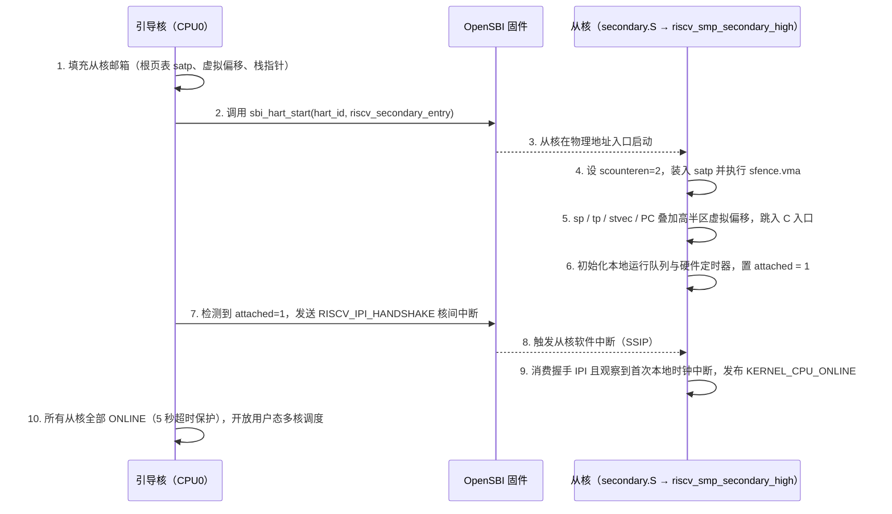

# RISC-V 64 多核执行与跨核服务边界

BoarOS 在 RISC-V 64 平台上支持 **1～8 核对称多处理（Symmetric Multiprocessing，SMP）**（由构建宏 `BOAROS_MAX_CPUS` 配置为 `1`、`2`、`4` 或 `8`）。本文结合 `arch/riscv/smp.c`、`arch/riscv/smp_sync.c`、`arch/riscv/secondary.S` 与 `kernel/sched/scheduling.c` 的实际实现，说明从核引导流程、每核状态布局、多核业务分工与跨核同步协议。

---

## 一、从核启动与停机握手（OpenSBI HSM）

### 1.1 设备树处理器拓扑探测

启动阶段，主核（逻辑 CPU0）调用 `dtb_read_cpu_info()`（位于 `kernel/dtb.c`）解析扁平设备树（Flattened Device Tree，DTB）中的 `/cpus/cpu@*` 节点：
- 仅纳入 `device_type = "cpu"` 且 `status = "okay"` 的有效处理器核，最多记录 `DTB_MAX_CPUS = 8` 颗；
- 固定将引导核（`boot_hart`）放在逻辑编号 `0`，其余核按物理 Hart ID 升序排列，并计算所有核指令集扩展（如浮点、向量）的交集作为系统共同特性；
- 验证后的启动 CPU 数量在首次挂载根文件系统之前一次性发布，使 ext4 等子系统在初始化时即可确定启用单核串行模式还是多核目录并行模式。

### 1.2 从核引导与上线握手流程

每颗从核（`secondaries[BOAROS_MAX_CPUS - 1]`）拥有独立的处理器控制记录、`idle` 任务、16 KiB 静态引导栈与启动邮箱（`struct secondary_launch`）。`riscv_smp_start()` 依次探测 OpenSBI 的 **HSM（Hart State Management）**、**IPI（核间中断）** 与 **RFENCE（远程页表同步）** 扩展，随后按逻辑编号逐核启动并完成双向确认：



**安全停机顺序**：关机前，CPU0 先禁止自身抢占，逐一确认所有从核均已回到静态 `idle` 状态、无正在切换的前驱任务、无就绪队列成员且活动地址空间借用归零，随后通过 `RISCV_IPI_STOP` 与 OpenSBI `HSM stop` 逐核确认进入 `STOPPED` 状态。

---

## 二、每核本地状态与核间通信（IPI / RFENCE）

- **单页热点排布与缓存行隔离**：静态控制对象 `boot_cpu`、`kernel_wait_domain` 与调度器控制结构按序排布在静态 BSS 首页，不同核的本地状态与共享锁按 **64 字节缓存行边界**隔离，既减少伪共享（False Sharing），又让高频陷入与返回路径只需触达单张静态控制页。
- **每核定时器与全局时钟分工**：每个处理器核独立编程自己的本地硬件定时器，维护本核的 `SCHED_RR` 时间片与实时预算到期；CPU0 额外负责推进全局系统滴答（tick）、粗粒度时钟与全局等待期限树——任意从核登记了更早的等待期限时，通过 `RISCV_IPI_DEADLINE` 通知 CPU0 提前重装定时器。
- **事件位合并的核间中断（IPI）**：跨核通知不直接重复陷入固件，而是先通过原子位或写入目标核的 `cpu->events` 事件字（包含 `SCHEDULE`、`DEADLINE`、`HANDSHAKE`、`STOP`、`DROP_ROOT` 与 `MEMBARRIER`），在最外层原始锁释放后再调用 `sbi_send_ipi()` 合并投递，接收核先清除 `SSIP` 再用原子交换（`exchange`）一次性消费全部事件。
- **跨核地址转换与指令同步（`arch/riscv/smp_sync.c`）**：`sync_remote()` 以 64-hart 对齐窗口分批调用 `sbi_remote_sfence`（刷远程 TLB）和 `sbi_remote_fence_i`（刷远程指令缓存）。内核栈映射修改同步全部在线远端核；用户地址空间映射撤权或退页仅同步当前活跃使用该地址空间的目标核，确认完成后才归还退役物理页与页表。

---

## 三、用户态多核执行分工与 CPU0 服务交接

在真实用户态多核配置（`SMP=1 USER_SMP=1`）下，用户进程与线程的系统调用首先在**当前执行核**就地分派，绝大多数数据密集型与独立对象操作直接在调用核并行完成，仅少数涉及全局拓扑或外设中断的控制操作受控交接至 CPU0。

### 3.1 各子系统多核执行边界

| 子系统 | 在调用核 / 归属核直接并行执行 | 仍由 CPU0 协调或串行保护的范围 |
| :--- | :--- | :--- |
| **陷入、信号与定时器** | 系统调用分派、标量身份查询、普通信号构帧与 `sigreturn`、每核本地定时器与 IPI | 外设硬件中断（PLIC 路由至 CPU0）、进程组停止/退出、全局 `ITIMER_REAL` 重装 |
| **虚拟内存（`mm/`）** | 匿名/写时复制/ELF/ext4 冷读缺页、本核直接用户拷贝（`uaccess`）、互不重叠区间的 `mmap`/`munmap`/`mlock` | 同一地址空间的全局布局改写（如 `fork`、固定地址覆盖）使用该 MM 独占写锁；跨核撤权需等远核 TLB 确认 |
| **文件与存储（`fs/`）** | ext4 缓存读写、冷页装入与块请求提交、多核目录级并行查找与修改、管道/`eventfd`/`futex` 同步、同组线程栈准备 | 文件系统挂载/卸载拓扑变更、全局 `sync`、页缓存后台写回线程（ext4 日志与检查点线程按挂载选核） |
| **网络协议栈（`net/`）** | 用户数据拷贝、收发额度预约与阻塞等待、已建立 TCP 连接在各自归属核推进协议与收发、IPv4 直连路由快照发送 | 监听套接字、`accept` 建连控制、UDP 控制路径、网络接口启停与地址路由配置 |
| **进程生命周期** | 同组线程创建与内核栈映射、`fork`/`exec` 私有资源与新映像准备 | 子进程发布、`exec` 共享状态切换、线程组退出与最终任务回收、TTY 作业控制 |

### 3.2 受控的 CPU0 服务交接与实时资格保留

当运行在从核上的用户任务需要执行上述由 CPU0 协调的全局操作时，调用 `kernel_scheduler_enter_user_service()` 完成受控交接：

1. **前置安全检查**：断言调用者未持有任何业务锁、用户页固定借用、缓存写借用或原始锁，防止带着局部锁迁移导致死锁。
2. **迁移调用现场**：在调度控制锁内将任务的 `user_service` 标志置 1，将其有效亲和性临时收敛至 CPU0（用户态 `sched_getaffinity` 观察到的仍是原始请求亲和性），若当前位于从核则触发一次调度，将**原任务连同其内核栈和调用现场**完整迁移至 CPU0 执行，无需额外创建代理内核线程。
3. **来源核的实时资格保留（`reserve_user_locked`）**：如果发起交接的是实时（`SCHED_FIFO` / `SCHED_RR`）用户任务，内核会在来源核的 `cpu->user_reservations` 队列中为其保留逻辑实时资格——在服务完成前，来源核不允许被同级或更低优先级的普通/实时用户任务“趁机抢占”；同时该任务在 CPU0 进入专用的实时服务队列 `scheduler.rt_services`，避免被 CPU0 本地的高优先级计算线程饿死。
4. **交接返回**：调用 `kernel_scheduler_leave_user_service()` 清除服务标志并恢复原始亲和性，重新评估目标核并放行来源核保留资格。

---

<details>
<summary>展开查看：多核构建配置、内存矩阵与验证入口</summary>

### 独立多核构建配置

不同核心容量的构建输出各自保存在独立目录中，互不覆盖单核默认产物：

| 配置参数 | 构建输出目录 | 说明 |
| :--- | :--- | :--- |
| 默认单核（`SMP=0`） | `build/` | 默认交付单核内核 `kernel-rv` |
| `SMP=1 USER_SMP=1`（默认 2 核） | `build/riscv-user-smp/` | 2 核真实用户态多核内核 |
| `SMP=1 USER_SMP=1 SMP_CPUS=4` | `build/riscv-user-smp4/` | 4 核真实用户态多核内核 |
| `SMP=1 USER_SMP=1 SMP_CPUS=8` | `build/riscv-user-smp8/` | 8 核真实用户态多核内核 |

### 关键并发回归与验证命令

```sh
# 编译 2 核用户态多核内核
make kernel-rv-user-smp

# 宿主并发与负载均衡单元测试
make test-user-smp-host
make test-user-smp-fair-host
make test-user-smp-rt-host

# 真实多核客机验证（调度、运行时、公平/实时均衡、多子系统压力组合）
make test-user-smp-riscv INIT_CONFIG=config/init.json
make test-user-smp-runtime-riscv INIT_CONFIG=config/init.json
make test-user-smp-fair-riscv
make test-user-smp-rt-riscv
make test-user-smp-composition-host test-user-smp-composition-riscv
make test-wait-process-smp-riscv
```

**多核组合压力验证（`test-user-smp-composition-riscv`）** 覆盖了共享匿名/文件映射并发首缺页（含虚假缺页 `spurious fault` 去重与单次页级同步校验）、远端撤权、管道/`futex` 阻塞取消、普通读写的发起核本地化以及 SQLite DELETE/WAL 事务与重启恢复。

</details>
