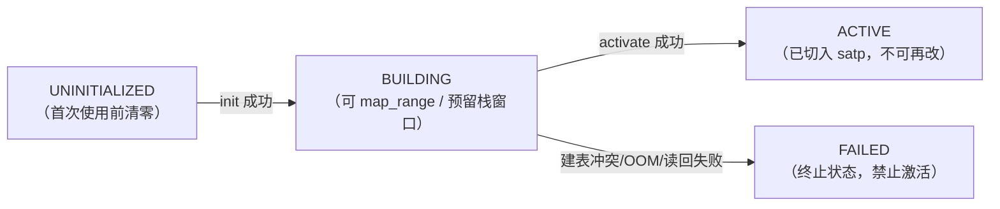
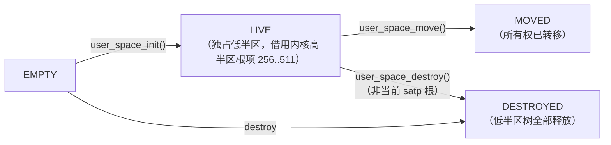

# RISC-V Sv39 分页模块

RISC-V Sv39 分页模块负责 BoarOS 在 64 位 RISC-V 处理器上的三级硬件页表管理，涵盖启动期从裸机模式（Bare）向高半区内核地址空间的过渡切换、内核直接映射窗口与动态内核栈窗口维护，以及运行期用户进程地址空间的创建、按需装页、写时复制（Copy-on-Write，CoW）、2 MiB 原生大页、批量页表摘除与空表回收。上层策略由跨架构的 [虚拟内存管理（VMM）](kernel-mm.md) 统一编排，启动流程衔接见 [RISC-V 启动模块](riscv-boot.md)。

---

## 一、源码组织

| 源码路径 | 核心职责 |
| :--- | :--- |
| `include/arch/riscv/memory_layout.h`、`arch/riscv/linker.ld` | 固定高半区内核虚拟地址常量、直接映射窗口、内存映射 I/O（MMIO）窗口、内核栈窗口与链接段边界 |
| `include/arch/riscv/direct_map.h`、`arch/riscv/direct_map.c` | 直接映射窗口内的 PA↔VA 范围转换，以及内核镜像高半区地址到物理地址的换算 |
| `include/arch/riscv/sv39.h`、`arch/riscv/sv39.c` | 启动期页表状态机、内核栈共享窗口、用户三级页表生命周期、2 MiB 大叶、写时复制、批量发布与空表退休回收 |
| `kernel/main.c` | 依据设备树（DTB）内存范围、内核镜像段边界与平台外设列表构造过渡页表与最终内核页表并完成两次 `satp` 切换 |
| `arch/riscv/mm.c`、`arch/riscv/elf_image.c` | 薄兼容封装，将原有 RISC-V 接口直接转发至跨架构核心 `mm/mm.c` 与 `kernel/elf_image.c` |

---

## 二、Sv39 地址空间布局与页表项编码

RISC-V Sv39 采用 39 位规范（Canonical）虚拟地址（第 38 位向高 25 位符号扩展）和 56 位物理地址（44 位物理页号，Physical Page Number，PPN），每张页表占 1 张 4 KiB 基页、含 512 条 64 位页表项（Page Table Entry，PTE），按 `VA[38:30]`（Level 2 根表）、`VA[29:21]`（Level 1 中间表，可直接映射 **2 MiB 大页**）、`VA[20:12]`（Level 0 末级表，映射 **4 KiB 基页**）三级索引：

| 虚拟地址区间 | 跨度 | 用途与权限 |
| :--- | :--- | :--- |
| `0x0000000000000000` .. `0x0000003fffffffff` | 256 GiB（根项 0..255） | 用户态低半区空间（`RISCV_SV39_USER_LIMIT = 2^38`），各进程独立拥有；`0x0000..0x0fff` 零页永不映射 |
| `0xffffffc000000000` .. `0xffffffdfffffffff` | 128 GiB（`RISCV_DIRECT_MAP_BASE`） | 物理内存直接映射窗口：`VA = 0xffffffc000000000 + PA`；镜像 `.text`/`.rodata` 对应别名只读且不可执行，其余物理内存为可读写不可执行 |
| `0xffffffe000000000` .. `0xffffffff7fffffff` | 126 GiB（`RISCV_KERNEL_MMIO_BASE`） | 平台外设 MMIO 高半区窗口：`VA = 0xffffffe000000000 + PA`（覆盖 UART、RTC、PLIC 与 VirtIO MMIO，仅内核态可读写） |
| `0xffffffff80000000` .. 镜像末端 | 按内核镜像大小 | 内核高半区执行别名（`RISCV_KERNEL_VIRTUAL_BASE`）：`.text` 为 RX、`.rodata` 为 R、`.data`/`.bss`/启动栈为 RW |
| `0xffffffffc0000000` .. `0xffffffffc7ffffff` | 128 MiB（`RISCV_KERNEL_STACK_WINDOW_BASE`） | 动态内核栈窗口：每槽 `0x3000`（12 KiB = 4 KiB 未映射保护页 + 8 KiB 内核栈），在根表中预留共享 Level 1 子树 |

### 2.1 页表项（PTE）软件与硬件位约定

Sv39 硬件规范禁止 `W=1, R=0` 的编码组合，模块在所有建表与改权入口严格拒绝该非法组合。除标准硬件位外，BoarOS 复用页表项保留供软件使用的两位（RSW bit 8 与 bit 9）编码写时复制与 `PROT_NONE` 状态：

| PTE 类型 | 有效位 `V` | 硬件权限位 `R/W/X/U/A/D` | `RSW[8]`（`COW`） | `RSW[9]`（`PROTECTED`） | 语义说明 |
| :--- | :---: | :--- | :---: | :---: | :--- |
| **非叶指针项** | `1` | 全 `0` | `0` | `0` | 指向下一级页表物理地址（Level 2 → Level 1 或 Level 1 → Level 0） |
| **内核叶项** | `1` | `A=1`，可写时 `D=1`，`U=0`，`G=0` | `0` | `0` | 仅监管态（S-mode）可访问，覆盖内核镜像、直接映射、MMIO 与内核栈 |
| **普通用户叶项** | `1` | `U=1, A=1`，可写时 `D=1`，合法 `R/W/X` | `0` | `0` | 4 KiB（Level 0）或 2 MiB（Level 1）可访问用户页 |
| **活跃 CoW 叶项** | `1` | `U=1, A=1, W=0`，保留 `R`/`X` | `1` | `0` | 共享私有页；首次写入触发缺页，按引用计数决定原地升级或拷贝替换 |
| **`PROT_NONE` 保留项** | `0` | 全 `0` | `0` 或 `1` | `1` | 不可访问但仍保留物理页所有权与原有 CoW 属性（`0x200` 独占 / `0x300` CoW），恢复权限时内容不丢失 |
| **瞬时失效标记** | `0` | 全 `0` | `1` | `0` | 仅用于旧单步撤映射流程中区分“已失效但待刷 TLB 后释放”的叶项，不留存至调用返回后 |

---

## 三、启动期页表与内核栈共享窗口

### 3.1 启动页表状态机与两次 `satp` 切换

启动页表 `struct riscv_sv39_page_table` 在分页启用前构造，此时处理器处于 Bare 模式，直接通过物理地址清零和填写页表页。其生命周期为严格单向状态机：

- **两张启动页表**：
  1. **过渡页表（`transition_page_table`）**：使用内核镜像内静态预留的 **5 张** 4 KiB 页（不消耗正式物理页分配器），将覆盖内核镜像的 2 MiB 对齐包络同时做低地址恒等映射与高半区映射（临时 RWX），并将 QEMU `virt` 的 UART 物理地址 `0x10000000` 恒等映射为 RW。首次切入后，汇编代码把 `ra`/`sp`/`gp`/`stvec` 与指令流重定位到高半区。
  2. **最终内核页表（`kernel_page_table`）**：页表页来自正式物理页分配器，按精细权限分别建立内核高半区段映射、DTB 物理 RAM 的直接映射、全部外设的 MMIO 高半区映射（`RISCV_KERNEL_MMIO_BASE + PA`），并调用 `riscv_sv39_kernel_window_reserve()` 预留内核栈窗口；彻底撤除低地址映射。切入最终页表后，内核立即切换 UART 驱动至高半区地址并绑定直接映射回调，随后把物理页分配器切换至伙伴模式。
- **贪心 2 MiB 大叶**：`riscv_sv39_map_range()` 递增扫描待映射区间，凡当前虚拟地址、物理地址与剩余长度同时满足 2 MiB 对齐与长度条件，自动建立 Level 1 大页表项以减少页表层级与转换后备缓冲器（Translation Lookaside Buffer，TLB）压力，否则建立 Level 0 的 4 KiB 叶表项。

### 3.2 内核栈窗口（跨地址空间共享骨架）

所有用户进程页表在初始化时都会按值复制最终内核页表的高半区根项（索引 `256..511`）。为了让运行期动态创建或回收的内核栈自动对所有进程页表可见，启动阶段在 `kernel_page_table` 仍处于 `BUILDING` 时调用 `riscv_sv39_kernel_window_reserve()`，在栈窗口对应的单个根表槽内预先分配并挂入一张空的 Level 1 页表。

运行期映射或撤销栈页（`riscv_sv39_kernel_window_map_pages` / `unmap_pages`，单次最多 2 页即 8 KiB 内核栈）：
- 缺失的 Level 0 页表由调用核在锁外私有分配清零，获取 `kernel_window_lock`（`KERNEL_RAW_RANK_MM`）后二次复核并原子发布；
- 数组 `mapped_leaves[512]` 追踪每张 Level 0 表的活跃叶数，归零时摘除对应的 Level 1 项；
- 释放锁后执行跨核同步：仅改叶表项时按栈页地址刷新，发布或摘除非叶项时广播全地址范围刷新，确保所有在线核确认失效后再将空 Level 0 表归还物理页分配器。

---

## 四、运行期用户地址空间与页表操作

用户地址空间由 `struct riscv_sv39_user_space` 表示，缓存了根表直接映射指针 `root_entries` 以及页表页、驻留页、受保护页、写时复制页和峰值驻留页统计，其生命周期遵循显式所有权状态机：

### 4.1 锁外准备与无分配提交

为了与 [虚拟内存管理（VMM）](kernel-mm.md) 的短自旋锁并发协议配合，`arch/riscv/sv39.c` 将可能触发内存分配的步骤与实际写 PTE 的临界区解耦：

- **预备页表路径（`prepared` 族接口）**：缺页处理先在短锁内调用 `riscv_sv39_user_leaf_probe()` 或 `user_leaf_missing_order()` 探测缺失的中间表位掩码（`bit 0` 表示缺 Level 1，`bit 1` 表示缺 Level 0；2 MiB 大页仅需 Level 1），在锁外向伙伴分配器备好空表放入 `struct kernel_mm_leaf_preparation`，再重入短锁通过 `riscv_sv39_user_map_prepared_order()` 原子发布叶表项与上级表项（顺序保证先写叶再连父表，使并发读核绝不看到半成品）。
- **页内窗口批量发布**：针对文件页缓存预装与连续匿名写缺页，`riscv_sv39_user_map_owned_window()` 与 `riscv_sv39_user_map_zero_window()` 在单次页表遍历中将同一 Level 0 页表内的多条叶项按位掩码一次性发布（后者仅在目标需求槽仍为空时提交），大幅摊薄遍历与加锁开销。
- **稀疏跳空遍历**：`next_table_entry()` 每次以 8 条 PTE 为步长做位或快速跳过空洞，贯穿 `fork`、稀疏叶枚举（`user_next_owned`）、范围摘除与销毁全过程。

### 4.2 写时复制、权限变更与两阶段 `fork`

- **写时复制（CoW）**：`user_cow_snapshot()` 在短锁内捕获当前 PTE 作为防 ABA 的 `cookie` 与物理地址；若引用数大于 1，外层在锁外分配并拷贝新页（4 KiB 或 2 MiB），再经 `user_cow_commit_order()` 核对 `cookie` 未变后替换 PTE 并把旧页加入退休批次；若引用数为 1（传入 `KERNEL_MM_NO_PAGE`），直接原地清掉 CoW 标志并恢复写权限。
- **权限变更（`protect`）**：`user_protect_owned_page()` / `user_protect_owned_range()` 原地更新已有叶项（支持 4 KiB 与 2 MiB 大叶）。切换到 `PROT_NONE` 时保留 PPN 与 CoW 标志，改写为 `V=0` 的 `PROTECTED` 软件 PTE；单页修改仅刷新该虚拟地址，多页范围执行全局失效；新增或恢复执行权限时同步指令缓存（`fence.i`）。
- **两阶段 `fork`**：
  1. **子空间构造（`user_space_fork_prepare`）**：遍历父进程低半区树，由回调 `fork_leaf` 决定每页策略（`PRIVATE` 转 CoW、`SHARED` 保持共享、`SKIP` 跳过）。对 4 KiB 叶表按最多 **16 项**分批调用 `physical_page_acquire_batch()` 获取引用并填充私有子表；对 2 MiB 大叶调用整块高阶引用。中途发生内存不足只需销毁私有子空间，父页表毫发无损。
  2. **父空间分段提交（`user_fork_commit_window`）**：子空间就绪后，以已构造的子树为索引，每次在父地址空间短锁内最多将 16 条普通叶或 1 条大叶标记为 CoW，确保单次持锁工作量有严格上界，且全程不再分配内存。

### 4.3 批量摘除、空页表回收与销毁

- **运行期空页表回收（`riscv_sv39_user_detach_range`）**：解除映射时，函数先通过 `validate_leaf_boundaries()` 拒绝只切分 2 MiB 大叶一部分的非法区间，随后在单次短锁内受限于 `MAX_DETACH_VISITS = 16`、`MAX_EMPTY_LEAVES = 64` 与退休批次容量推进游标，摘除数据叶（4 KiB 或 2 MiB）并把物理页加入 `struct kernel_mm_retirement`。当一整张 Level 0 页表或跨越 1 GiB 边界后的 Level 1 页表变空（`runtime_table_empty()`）时，立即从父表摘除并将空页表一并送入退休批次，待上层完成本地与跨核 TLB 失效后再统一归还物理页分配器。
- **地址空间销毁（`riscv_sv39_user_space_destroy`）**：拒绝销毁当前 `satp` 正在使用的根表。销毁时仅回收低半区（根项 `0..255`），每次最多摘除 16 个根项；若根页引用数大于 1（表明其他内核任务正借用该根页运行），先同步广播全核 TLB 失效，再按“数据叶 → Level 0 → Level 1 → 根表”的后序顺序成批归还所有页帧。高半区借用的内核根项（`256..511`）绝不被触碰。
- 摘除后的叶表已无法通过根表访问。销毁遍历对每个有效项只判定一次映射类型，按整张叶表汇总计数，直接归还数据页和叶表页。物理页分配器在同一批归还中复用已解析的伙伴树根区间，每个物理页的引用和末引用合并规则继续独立处理。
- 在单核构建中，文件写入批量借用用户缓冲区时，只在进入新叶表时解析上层页表。地址空间元数据锁保证叶表存活直到物理页引用取得。遇到不可读页、未映射页或大页时，返回已经取得的前缀，剩余范围由常规用户访问处理。
- 单核向用户缓冲区复制整页时，如果源和目标的虚拟页号具有相同的低六位，内核尝试借用已驻留的可写目标页，再用索引不同的内核映射完成复制。这个条件针对直接映射的地址转换缓存（Translation Lookaside Buffer，TLB）可能反复替换同一项的情形。缺页、写权限不足、共享文件写入以及内核映射仍可能冲突时，继续使用原有的本地用户访问路径。

### 4.4 硬件扩展感知与 `satp` 切换

- **硬件特性交集**：启动阶段检测全部将运行用户态的处理器的扩展交集并发布全局标志：`riscv_mmu_svvptc`（支持 `Svvptc` 扩展时，首次为未映射槽位安装有效 PTE 可省去冗余的本地 `sfence.vma`）与 `riscv_mmu_cboz64`（用于零页加速）。
- **`satp` 切换**：`riscv_sv39_switch_satp()` 仅接受 Bare 模式（`0`）或 `MODE=8, ASID=0` 的 Sv39 值；若与当前 `satp` 相同则立即返回，否则写入寄存器、执行全局 `sfence.vma` 并读回校验硬件是否接受该配置，异常时恢复旧值。跨核远程 `sfence.vma` / `fence.i` 同步见 [RISC-V 多核模块](riscv-smp.md)。

---

展开查看：离线填充、页表边界细节与定向验证入口

### 未激活用户空间的离线填充

`riscv_sv39_user_space_populate()` 通过直接映射访问函数跨页向尚未激活的 `LIVE` 用户空间写入字节（拒绝写入当前 `satp` 指向的活跃空间）。它只检查映射存在而不要求 PTE 带有 `W` 权限，因此 ELF 装载器与初始栈构造器可以直接填充最终权限为只读可执行（`RX`）的 vDSO 代码页和初始参数栈，无需建立临时可写可执行（`RWX`）映射或切换硬件页表根。

### 当前架构边界

- 用户态与内核态当前均固定使用 `ASID = 0`，未启用硬件地址空间标识符（ASID）分配器；
- 未实现 1 GiB（Level 2）巨页叶子映射；
- 直接映射窗口仅映射 DTB 报告的物理 RAM，且最大窗口跨度为 128 GiB（`0x2000000000`）。

### 定向验证入口

- **Sv39 页表单元与故障验证**：`make test-sv39-riscv`、`make test-sv39-fault-riscv`
- **大页、按需调页、堆与映射回归**：`make test-huge-riscv`、`make test-demand-page-riscv`、`make test-brk-riscv`、`make test-mmap-riscv`
- **指令缓存同步与全量回归**：`make test-instruction-sync-host`、`tests/workloads/resource/icache.c`、`make test-riscv`

