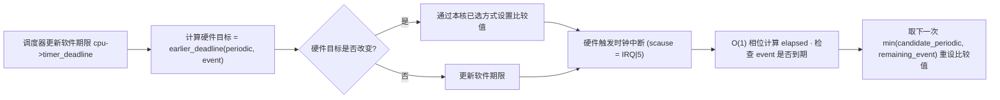

# RISC-V 定时器、调度期限与内核节拍

BoarOS 的 RISC-V 时间驱动层由三部分组成：架构无关的 **100 Hz 全局节拍计数器**（`kernel/tick.c`）、**每核硬件定时器状态机**（`arch/riscv/timer.c`），以及将周期节拍与高精度单次调度期限融合的**时钟中断分发路径**（`arch/riscv/trap.c`）。陷入入口与返回契约见 [RISC-V Trap 模块](riscv-trap.md)，高精度墙钟与 POSIX 时钟系统调用见 [内核时间子系统](kernel-time.md)，多核协同详见 [RISC-V 多核启动与同步](riscv-smp.md)。

支持监督者模式定时器中断扩展（Supervisor-mode Timer Interrupts，Sstc）的处理器可通过控制和状态寄存器（Control and Status Register，CSR）`stimecmp` 设置本核比较值。处理器或固件未向内核开放该寄存器时，本核通过监督者二进制接口（Supervisor Binary Interface，SBI）的 TIME 扩展设置同一个 64 位绝对比较值。

---

## 一、源码组织

| 源码路径 | 核心职责 |
| :--- | :--- |
| `kernel/dtb.c`、`include/kernel/dtb.h` | 从设备树根节点直属 `/cpus` 节点读取平台原始计数频率 `timebase-frequency` |
| `arch/riscv/sbi.c`、`include/arch/riscv/sbi.h` | 探测 SBI TIME 扩展（`0x54494d45`）并调用 `sbi_set_timer()` 设置 64 位绝对硬件比较值 |
| `arch/riscv/timer.c`、`include/arch/riscv/timer.h` | 选择每核比较器编程方式、有序读取 `time`、计算无漂移周期相位与融合单次调度期限 |
| `arch/riscv/virt_rtc.c`、`include/arch/riscv/virt_rtc.h` | 读取 QEMU `virt` Goldfish 实时时钟（RTC）墙钟时间，供启动期锚定真实纪元时间 |
| `kernel/tick.c`、`include/kernel/tick.h` | 维护 100 Hz 策略驱动的 64 位无符号全局累计节拍计数（多核下使用 Release/Acquire 原子语义） |
| `arch/riscv/trap.c` | 响应监督者时钟中断（`scause = IRQ | 5`），推进节拍、更新粗粒度时钟、唤醒到期任务并驱动调度抢占 |

---

## 二、核心接口与时间读取语义

### 2.1 架构无关节拍接口（`kernel/tick.c`）

```c
#define KERNEL_TICKS_PER_SECOND 100U

void kernel_tick_advance(uint64_t elapsed_ticks);
uint64_t kernel_tick_count(void);
```

全局节拍采用无符号 64 位计数，允许单次调用推进多个迟到的周期。在多核构建（`BOAROS_MAX_CPUS > 1`）中，仅由逻辑 CPU0 推进 `tick_count`，并分别以 `__ATOMIC_RELEASE` 写入、`__ATOMIC_ACQUIRE` 读取，保证跨核可见性且无锁开销。

### 2.2 RISC-V 定时器与有序时间采样（`arch/riscv/timer.c`）

```c
enum riscv_timer_status riscv_timer_start(uint32_t timebase_frequency,
                                          uint32_t ticks_per_second);
enum riscv_timer_status riscv_timer_stop(void);
enum riscv_timer_status riscv_timer_handle_interrupt(uint64_t *elapsed_ticks);
enum riscv_timer_status riscv_timer_set_scheduler_deadline(uint64_t deadline);
uint64_t riscv_time_read(void);
uint64_t riscv_time_read_ordered(void);
```

- **单核与多核状态隔离**：单核构建使用静态全局 `timer_state`；多核构建（支持 2/4/8 核）将 `{period, next_deadline, armed, direct}` 存放在每核控制块 `kernel_cpu_current()->timer` 中，同时每核独立保存软件调度期限 `cpu->timer_deadline`，各核自主响应本地时钟中断。
- **有序采样 `riscv_time_read_ordered()`**：根据 RISC-V `Zicsr` 与内存模型规范，读取 `time` CSR 在硬件内存序中归类为 **I/O 输入（`I`）** 而非普通内存读（`R`），常规的 Acquire/Release 内存屏障无法约束它与普通读写之间的重排。因此，当内核在顺序锁（SeqLock）或跨核快照中需要把 `time` 采样严格夹在普通内存访存之间时，使用 `riscv_time_read_ordered()` 插入 `fence rw, i` 与 `fence i, r` 双向屏障。
- **启动墙钟采样（`arch/riscv/virt_rtc.c`）**：Goldfish RTC 要求先读低 32 位 `TIME_LOW`（锁存高 32 位）再读 `TIME_HIGH`。`riscv_virt_rtc_read_ns()` 连续采样两次，确认时间晚于 2020-01-01 且两次间隔在 1 秒以内、单调不回退后才采纳，否则返回不可用并由时间子系统安全降级。

---

## 三、原子启动、无漂移相位与期限融合

### 3.1 原子启动序列（`riscv_timer_start`）

在最终 Sv39 页表、陷入入口、直接映射和调度器就绪后，各核启动自己的定时器。

1. 校验 `timebase_frequency` 与 `ticks_per_second`，确认当前核定时器尚未启动。
2. 计算周期 `period = timebase_frequency / ticks_per_second`，读取 `time` 并计算首个周期期限。
3. 试写一次 `stimecmp`。若该指令触发监督者模式非法指令异常，陷入处理器仅修复探测指令的返回地址，直接恢复定时器启动过程。当前核重新读取 `time`，通过 `sbi_probe_extension(0x54494d45)` 确认 TIME 扩展可用，再调用 `sbi_set_timer()` 设置比较值。
4. 首个比较值写入成功后，本核记录编程方式、周期相位和启动状态，再置位 `sie.STIE` 与 `sstatus.SIE`，开放时钟中断。

从核关机时先关闭中断，再调用 `riscv_timer_stop()`。该函数沿用本核启动时选定的编程方式，将比较值设为 `UINT64_MAX`，成功后清除软件期限与启动状态。固件负责完成从核停机。

### 3.2 O(1) 无漂移周期推进与软件调度期限融合

为了同时满足 100 Hz 固定周期节拍与高精度单次调度事件（如实时预算到期、时间片尾部与睡眠唤醒期限），内核在同一硬件定时器上维护两条逻辑轨道：**周期节拍期限 `next_deadline`** 与 **独立软件期限 `cpu->timer_deadline`**（为 `0` 表示无待触发事件）。



- **按需重设比较值**。`riscv_timer_set_scheduler_deadline(deadline)` 在关中断状态下比较新旧目标 `earlier_deadline(periodic, deadline)`。最早期限改变时，本核通过选定的方式重设比较值。若比较值相同，例如新期限晚于下一周期节拍，仅更新软件期限。固件编程失败时，保留原软件期限。
- **相位锁定（无累积漂移）**：中断到来时，内核不以 `now + period` 重算下一次节拍，而是相对上一次计划相位 `previous_deadline` 做 O(1) 计算：
  - `delta = now - previous_deadline`
  - `elapsed = delta / period + 1`
  - `next = previous_deadline + elapsed * period`
  即使某次关中断窗口导致跨过多个周期，也能一次汇报全部逝去节拍，既不会因处理耗时逐次累加成时钟漂移，也不会陷入追赶中断风暴。
- **早到中断容忍与原子提交**：根据 [RISC-V Sstc 规范](https://docs.riscv.org/reference/isa/v20250508/priv/sstc.html)，取消或推迟一次较早的调度期限后，旧的 `STIP` 挂起位可能延迟撤销，导致中断在当前所有有效期限之前进入。`riscv_timer_event_advance()` 识别出 64 位有符号差值为负（`RISCV_TIMER_STATUS_EARLY_INTERRUPT`）时，原样保留下一周期相位并返回 `elapsed_ticks = 0`，随后重装当前最早期限，绝不误扣任务时间片或打乱周期相位。所有候选值均先算在局部变量中，仅在硬件比较值写入成功后才提交到 `timer_state`、`cpu->timer_deadline` 与输出参数。

---

## 四、时钟中断在内核中的执行顺序

陷入分发器捕获 `scause = RISCV_SCAUSE_INTERRUPT | 5` 后，全程在关中断状态下按严格顺序执行以下动作（不修改 `sepc`）：

1. 调用 `riscv_timer_handle_interrupt(&elapsed_ticks)` 重设下一次硬件比较值并清除已到期的软件事件；若失败则输出诊断信息并关机。
2. 当 `elapsed_ticks > 0` 时：
   - 仅逻辑 CPU0 推进全局节拍 `kernel_tick_advance(elapsed_ticks)` 并更新粗粒度时钟 `kernel_time_update_coarse()`；
   - **每个核**都调用 `kernel_scheduler_charge_ticks(elapsed_ticks, from_user)` 为当前运行任务计账运行时间与实时看门狗预算。
3. 仅逻辑 CPU0 执行 `kernel_scheduler_expire_deadlines(riscv_time_read())` 唤醒所有到期睡眠任务（必须先于调度抢占，使刚唤醒的高优先级任务能在同一轮切换中被立即选中），并调用 `kernel_console_poll_input()` 轮询早期控制台输入。
4. **每个核**调用 `kernel_scheduler_on_tick(elapsed_ticks)` 决策是否发生任务切换：无更优就绪竞争者时通过 `sret` 直接回到被中断指令；发生切换时切入目标地址空间并恢复目标任务执行链。

多核配置下，当远端核新增一个早于当前期限的睡眠任务时，通过核间中断（IPI）通知 CPU0 重新评估并装载本地硬件比较值。

---

<details>
<summary>展开查看：错误状态码、回绕假设与验证入口</summary>

### 定时器状态码（`enum riscv_timer_status`）

| 状态码 | 含义 |
| :--- | :--- |
| `RISCV_TIMER_STATUS_OK` | 操作成功 |
| `RISCV_TIMER_STATUS_INVALID_ARGUMENT` | 传入空指针或零周期等非法参数 |
| `RISCV_TIMER_STATUS_INVALID_FREQUENCY` | `timebase_frequency` 或 `ticks_per_second` 为零，或前者小于后者 |
| `RISCV_TIMER_STATUS_ALREADY_STARTED` | 当前核定时器已处于启动状态 |
| `RISCV_TIMER_STATUS_SBI_PROBE_FAILED` | SBI Base 探测调用返回错误 |
| `RISCV_TIMER_STATUS_SBI_TIME_UNAVAILABLE` | 固件不支持 SBI TIME 扩展 |
| `RISCV_TIMER_STATUS_SBI_SET_FAILED` | `sbi_set_timer()` 返回非零错误码 |
| `RISCV_TIMER_STATUS_NOT_STARTED` | 尚未启动定时器即尝试停止、处理中断或设置调度期限 |
| `RISCV_TIMER_STATUS_EARLY_INTERRUPT` | `now` 仍在 `previous_deadline` 之前（由 `riscv_timer_event_advance()` 内部吸收为 0 tick） |

### 边界假设与后端说明

- **64 位模运算比较**：时间先后按 64 位无符号减法最高位（等价于有符号 `int64_t` 差值）判断，要求任意两次有效处理或期限跨度小于 $2^{63}$ 个 `timebase` 计数。
RISC-V 的两种编程方式共用 100 Hz 基础周期和单次调度事件融合策略。LoongArch 的单次恒频定时器见 [LoongArch 64 引导与多核执行](loongarch-boot.md)。

### 定向验证入口

```sh
make test-riscv-timer-host
make test-riscv
```

- `test-riscv-timer-host`：在宿主环境中直接编译真实 `arch/riscv/timer.c`，通过模拟计数器、比较寄存器、固件调用和中断，验证两种方式的选取、各核独立编程、停止、早到中断、周期相位及固件失败时的软件状态。
- `make test-riscv`：在 QEMU 客户机中端到端验证真实时钟中断、睡眠唤醒与抢占调度。

</details>
