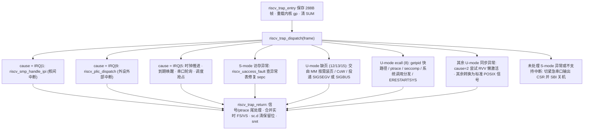

# RISC-V 陷入（Trap）、异常分发与返回契约

BoarOS 在 RISC-V 64 架构上采用直接模式（Direct Mode）的监督者陷入向量 `stvec`，所有异步中断与同步异常均通过统一汇编入口 `riscv_trap_entry` 保存整数现场并进入 C 语言分发器 `riscv_trap_dispatch`。模块完整支持核间中断、外部设备中断、定时器抢占、内核态用户访存异常修复、用户态按需缺页、系统调用（含 `ptrace`/`seccomp`/BPF 追踪）、信号投递与返回，以及按需懒激活的浮点（F/D）与向量（RVV 1.0）扩展上下文。相关子系统见 [RISC-V 定时器](riscv-timer.md)、[进程调度](kernel-scheduler.md)、[内核信号](kernel-signal.md)、[RISC-V 浮点与向量状态](riscv-fpu.md) 和 [用户空间拷贝](kernel-uaccess.md)。

---

## 一、源码组织

| 源码路径 | 核心职责 |
| :--- | :--- |
| `include/arch/riscv/trap.h` | 定义汇编与 C 共享的 `struct riscv_trap_frame` 字段偏移、CSR 位掩码与异常原因码，并由 `_Static_assert` 编译期强校验 |
| `arch/riscv/trap_entry.S` | 陷入入口 `riscv_trap_entry`、统一返回路径 `riscv_trap_return` 与新用户线程首次进入跳板 `riscv_user_thread_trampoline` |
| `arch/riscv/trap.c` | 中断与同步异常分发 `riscv_trap_dispatch`、公共返回尾准备 `riscv_trap_return_prepare` 及非法返回/致命错误诊断 |
| `arch/riscv/uaccess.c` | 内核访问用户空间时发生缺页的异常表查表修复（`riscv_uaccess_fault`） |
| `arch/riscv/signal.c`、`fpu.S`、`vector.c` | 公共返回尾中的信号构帧与重启决策、浮点与 RVV 1.0 硬件状态维护 |

---

## 二、陷入帧（Trap Frame）与入口切换协议

发生陷入时，汇编入口在当前内核栈上向低地址分配 **288 字节**、16 字节对齐的 `struct riscv_trap_frame`：
- 偏移 `0..240`：按寄存器编号顺序保存 `x1`（`ra`）至 `x31`（`t6`）共 31 个通用整数寄存器（`x0` 恒为零，不保存）；
- 偏移 `248..272`：依次保存硬件陷入快照 `sstatus`、`sepc`、`scause`、`stval`；
- 偏移 `280`：保存可信的内核线程指针 `kernel_tp`（用户态陷入时记录当前 `struct kernel_task *`，内核态陷入时置 0）。

### 2.1 `sscratch` 栈切换与内核隔离保护

内核遵循严格的 `sscratch` 不变量：**内核态运行时 `sscratch` 恒为 0；用户态运行时 `sscratch` 保存当前线程控制块指针（`tp`）**。陷入发生后的入口序列按以下安全步骤建立可信内核上下文：

1. **区分来源与切栈**：执行 `csrrw tp, sscratch, tp` 原子交换。若交换后 `tp != 0`，说明来自用户态（U-mode）：暂存用户 `sp` 到线程前缀，加载可信的 `kernel_sp`，随后在栈帧中记录用户 `sp`、用户 `tp`（从 `sscratch` 读回）与 `kernel_tp`，并立即将 `sscratch` 清零。若交换后 `tp == 0`，说明来自内核态（S-mode）：立即再次 `csrrw` 恢复内核 `tp`，并在当前内核栈上直接开辟 Trap Frame。
2. **重载内核全局指针**：保存用户态可能任意改写的 `gp` 后，立即在禁止松弛状态下重载内核 `__global_pointer$`，确保 C 代码的全局数据寻址不受用户态污染。
3. **强制清除 `sstatus.SUM`**：将硬件 `sstatus` 存入帧后，若其中 `SUM` 位（bit 18，`0x40000`，允许内核访问用户页）被置位（仅当陷入恰好打断一段受控的用户内存拷贝窗口时才可能为 1），入口立即执行 `csrc sstatus, t1` 将硬件 `SUM` 清零，防止后续 C 异常处理路径意外解引用用户虚拟地址。
4. **保持中断关闭并移交分发器**：硬件陷入时已自动将旧的 `SIE` 压入 `SPIE` 并清零 `SIE`。入口在完成全部保存后，以 `a0 = sp` 调用 `riscv_trap_dispatch(frame)`。

---

## 三、中断与同步异常分发

`riscv_trap_dispatch()` 根据 `scause` 最高位（中断标志位 `0x8000000000000000`）与原因码，并结合 `sstatus.SPP` 判断陷入来源（`SPP == 0` 为用户态，`SPP == 1` 为内核态），按如下路径分发：



### 3.1 异步中断路径

- **监督者软件中断（`scause = IRQ | 1`）**：多核构建下调用 `riscv_smp_handle_ipi()` 处理跨核调度唤醒、TLB 同步与核间事件。
- **监督者外部中断（`scause = IRQ | 9`）**：调用 `riscv_plic_dispatch()` 向 PLIC 认领并分发外设（块设备、串口、RNG、网卡）中断。
- **监督者时钟中断（`scause = IRQ | 5`）**：调用 `riscv_timer_handle_interrupt()` 重设下一硬件期限并获取逝去节拍数，随后由 CPU0 推进全局 tick、更新粗粒度时钟、唤醒超时睡眠任务并轮询控制台输入，各核则各自计账当前任务时间片并调用 `kernel_scheduler_on_tick()` 执行抢占调度。

### 3.2 内核态异常与用户态缺页

- **受控用户拷贝修复**：若内核态在开启 `SUM` 的用户拷贝指令处触发加载/存储缺页或访问故障（`scause` 为 `5`/`7`/`13`/`15` 且 `stval` 位于用户地址空间内），`riscv_uaccess_fault()` 在异常修复表 `[riscv_uaccess_fixups_start, riscv_uaccess_fixups_end)` 中查找匹配的 `sepc`，将恢复地址写入 `sepc`、清除 `frame->sstatus` 中的 `SUM` 位并在 `t5` 记录原因码后安全返回，使拷贝函数向调用者返回 `-EFAULT` 而非触发内核崩溃。
- **用户态缺页（`scause = 12 / 13 / 15`）**：分别映射为 `KERNEL_MM_EXECUTE`、`KERNEL_MM_READ`、`KERNEL_MM_WRITE`，交由 `kernel_scheduler_resolve_current_user_fault()` 处理（详见 [虚拟内存管理](kernel-mm.md)）：
  - 按需零页、文件私有映射或写时复制（Copy-on-Write，CoW）补页成功时，保持 `sepc` 不变直接返回，让处理器重新执行触发缺页的原指令；
  - 地址未映射或越权访问强制投递 `SIGSEGV`（`SEGV_MAPERR=1` / `SEGV_ACCERR=2`）；
  - 文件映射整页越过文件末尾（EOF）投递 `SIGBUS`（`BUS_ADRERR=2`）；
  - 物理内存耗尽时以 `KERNEL_THREAD_EXIT_RESOURCE`（`NO_MEMORY`）终止线程；内核自身 MM 不变量损坏则触发致命停机。

### 3.3 用户态系统调用（`scause = 8`）与其余同步异常

- **系统调用分发**：先核对 `caller == frame->kernel_tp == cpu->current` 确认执行者未被破坏；若被调试器跟踪则执行 `kernel_ptrace_syscall_enter()`。对于无参且高频的 `getpid`，在无 `ptrace`、无 `seccomp` 过滤且未开启 BPF 追踪与成本诊断时直接走快速路径写回 `a0` 并推进 `sepc += 4`。其余调用打包 `a7` 与 `a0..a5` 进入 `kernel_syscall_dispatch()`，在返回点按结果动作处理 `exit`/`exit_group`、`exec` 提交、`clone`/`clone3`、`wait4`/`waitid`、`sched_yield` 以及 `rt_sigreturn` 恢复；若阻塞系统调用被信号打断并返回内部码 `-KERNEL_ERESTARTSYS`，则保持 `sepc` 不推进，交由返回尾依据 `SA_RESTART` 决定重放原指令或转换为 `-EINTR`。
- **其余用户态同步异常映射**：

| `scause` 值 | 硬件异常类型 | 内核处理动作 |
| :--- | :--- | :--- |
| `0`、`4`、`6` | 取指 / 加载 / 存储地址未对齐 | 强制投递 `SIGBUS`（`si_code = 1`，`BUS_ADRALN`） |
| `1`、`5`、`7` | 取指 / 加载 / 存储访问故障 | 强制投递 `SIGSEGV`（`si_code = 2`，`SEGV_ACCERR`） |
| `2` | 非法指令 | 优先调用 `riscv_vector_first_use(frame)` 尝试 RVV 1.0 首次使用懒激活（成功则重试原指令，分配失败投递 `SIGBUS`）；非向量指令则投递 `SIGILL`（`si_code = 1`，`ILL_ILLOPC`） |
| `3` | 断点指令（`ebreak`） | 强制投递 `SIGTRAP`（`si_code = 1`，`TRAP_BRKPT`） |
| `18` | 软件检查异常 | 当 `stval` 为 `2` 或 `3` 时投递 `SIGSEGV`（`si_code = 10`），否则按未知异常投递 `SIGILL` |
| `19` | 硬件错误异常 | 强制投递 `SIGBUS`（`si_code = 4`） |
| 其他值 | 未分类用户同步异常 | 强制投递 `SIGILL`（`si_code = 4`，`ILL_ILLTRP`） |

---

## 四、统一返回尾与安全恢复契约

无论经由普通陷入返回，还是新创建用户线程经由首次运行跳板 `riscv_user_thread_trampoline`（先调用 `kernel_scheduler_switch_finish()` 与 `riscv_bpf_first_return()`），最终都汇入 `riscv_trap_return`：

1. **C 返回尾准备（`riscv_trap_return_prepare`）**：
   - 返回用户态时，依次执行待办工作检查、信号选择与用户信号帧构造（`riscv_signal_prepare_user_return`，多核配置下以循环收敛处理 `BOAROS_USER_SMP` 服务切换）以及 `ptrace` 返回拦截；返回内核态时调用空闲返回准备。
   - **合并实时扩展状态位**：由于陷入期间的上下文切换、信号恢复或 `exec` 可能已经改变了处理器当前的浮点（`FS`）或向量（`VS`）硬件状态，返回尾读取实时 CSR `sstatus`，将最新的 `FS` 与 `VS` 位（`RISCV_SSTATUS_FS_MASK | RISCV_SSTATUS_VS_MASK`）合并覆盖进 `frame->sstatus`，避免旧快照将已保存的扩展误标为 `Dirty` 或覆盖掉刚恢复的硬件状态。
2. **汇编安全校验与 `sscratch` 切换**：
   - 强制校验 `frame->sstatus` 中的 `SIE` 位必须为 `0`（防止寄存器尚未恢复完毕时提前接受中断）；
   - 若返回内核态（`SPP == 1`），保持 `sscratch = 0`；
   - 若返回用户态（`SPP == 0`），必须同时满足 `frame->kernel_tp != 0`、`tp == frame->kernel_tp` 且线程前缀标记 `USER_MODE != 0`，才将当前线程指针写回 `sscratch`；任一条件不满足则直接跳转 `riscv_trap_bad_return` 报错关机，杜绝伪造用户态返回或误解引用内核指针。
3. **原子保留位清除与 `sret`**：
   - 对帧内自然对齐的 `sepc` 槽位执行一次无害条件存储 `sc.d zero, t0, (t1)`，显式清除可能跨越特权级残留的加载保留/条件存储（LR/SC）硬件保留状态；
   - 写回 `sepc` 与 `sstatus`，依次恢复全部 31 个通用寄存器（最后恢复 `sp`），执行 `sret` 原子切换特权级并根据 `SPIE` 恢复中断使能。

---

<details>
<summary>展开查看：中断恢复纪律、栈保护与验证入口</summary>

### 中断开关与内核栈边界

- **`riscv_interrupt_restore()` 使用纪律**：与底层单指令实现一致，`riscv_interrupt_restore(old)` 仅在 `old & RISCV_SSTATUS_SIE` 非零时重新开启 `SIE`，默认调用前中断已经关闭。若某耗时 C 路径（如 `getrandom`）在内核态临时开启了中断，结束时必须先显式关中断再恢复入口状态，严禁在中断仍开启状态下直接写 `sscratch` 或进入 `riscv_trap_return`，否则窗口期到达的异步中断会将半恢复的内核现场误判为用户陷入。
- **内核栈布局与保护**：CPU0 启动/空闲任务使用 `.bss` 末尾的 16 KiB 静态启动栈（无保护页）；所有普通内核线程与用户任务的内核栈均分配在 `RISCV_KERNEL_STACK_WINDOW_BASE`（`0xffffffffc0000000`）高半区窗口内，每个 `0x3000`（12 KiB）槽位由低地址 **4 KiB 未映射保护页（Guard Page）** 加高地址 **8 KiB 物理栈**组成。目前尚无独立的每核 IRQ 栈，陷入复用当前任务的内核栈。
- **成本观测插桩（默认关闭）**：开启 `BOAROS_COST_DIAGNOSTICS` 时，汇编入口在保存 `t0`/`t1` 后采样 `rdtime` 时间戳，返回尾在恢复 `t0`/`t1` 前发布结束时间戳，不改变 288 字节 Trap Frame 布局；采样盲区与口径见 [内核成本观测](kernel-cost.md)。

### 定向验证入口

```sh
make test-userland-riscv
make test-demand-page-riscv
make test-riscv
```

- `test-demand-page-riscv`：在真实磁盘装载的 PID 1 中越过初始栈已提交区域，验证加载/存储缺页按需建立匿名零页并重试原指令、在子进程缺页路径注入内存耗尽（`NO_MEMORY`）得到预期退出状态，以及常规权限/保护页违例保持严格拦截。

</details>
