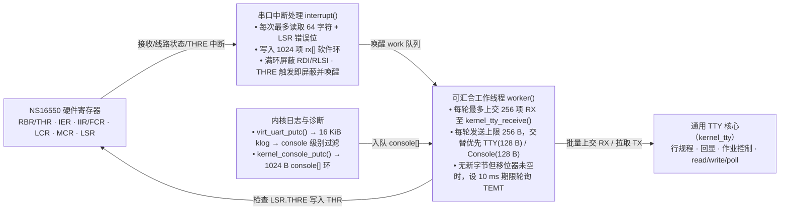

# 通用 NS16550 串口传输与终端接入

通用异步收发器（Universal Asynchronous Receiver-Transmitter，UART）既是操作系统的早期调试控制台，也是面向用户态交互式终端（`/dev/console`、`/dev/ttyS0`）的物理字符通道。BoarOS 将经典的 **NS16550** 串口控制器驱动抽离为跨架构共用的硬件传输层（`drivers/serial/ns16550.c`），同时服务于 RISC-V 与 LoongArch 平台；上层行规程、信号与作业控制、打开文件描述（OFD）生命周期则交由通用终端核心完成（见[TTY 与 PTY 终端子系统](kernel-tty.md)）。

---

## 一、源码组织与跨架构平台参数

| 源码路径 | 核心职责 |
| :--- | :--- |
| `drivers/serial/ns16550.c`、`include/kernel/ns16550.h` | 共用 NS16550 驱动：中断接收、有界工作线程收发、内核控制台与用户 TTY 公平调度、线路与 `termios2` 波特率配置、排空与优雅关闭 |
| `arch/riscv/uart_tty.c` | RISC-V 薄适配层：将设备树（DTB）解析的串口信息绑定至 PLIC 中断控制器，并合并早期控制台与 DTB 串口的页映射范围 |
| `arch/riscv/virt_uart.c` | RISC-V 早期与紧急轮询输出通道：衔接内核日志环（`klog`）与运行时控制台队列，在致命异常时接管为同步轮询输出 |
| `platform/loongarch_virt.c` | LoongArch 平台适配：构造 QEMU `virt` 固定串口（基址 `0x1fe001e0/0x100`，1 字节宽度，`shift = 0`，时钟 `1,843,200 Hz` = `115200 × 16`，PCH-PIC 引脚 `2`）并绑定中断 |

在 RISC-V 生产启动路径中，内核先调用 `riscv_uart_tty_mapping_ranges()` 将早期固定串口页与设备树发现的串口页取并集（相交时合并为一段），避免页表重复映射冲突；随后初始化中断控制器，并通过 `ns16550_start()` 构造端口与内核 TTY 实例，发布后标准输入/输出/错误文件描述符才正式绑定到该串口终端。

---

## 二、中断处理、工作线程与双源公平发送

串口硬件字节率远低于 CPU 速度，若在中断处理函数或系统调用中忙等发送寄存器空，会严重拖垮系统响应；若放任用户输出或内核日志单方面占满串口，则会导致另一方长时间饥饿。为此，NS16550 驱动采用**短中断 + 有界异步工作线程 + 轮换双源配额**的三段式流水线：

### 2.1 中断边界与接收流控

- **有界中断处理**：每次进入 `interrupt()` 最多处理 **64** 次硬件事件，读取中断识别寄存器（IIR，偏移 2）。若是发送保持寄存器空中断（THRE，`(iir & 14) == 2`），立即关闭 `IER` 中的 THRE 中断位（bit 1）并唤醒工作线程；若是接收事件，则读取线路状态寄存器（LSR，偏移 5）和数据寄存器（RBR，偏移 0），将字符连同真实硬件错误位（`OE` 溢出、`PE` 奇偶、`FE` 帧错、`BI` 中断，掩码 `0x1e`）写入 `1024` 项软件环形队列 `rx[]`。
- **软件满环背压**：中断处理函数**绝不分配内存、绝不睡眠、也不调用 TTY 行规程**。当 1024 项软件接收环满时，驱动关闭接收数据就绪与线路状态中断（`RX_INTERRUPTS = 0x5`），待工作线程消费腾出空间后再恢复开启；只有硬件 LSR 报告真实 `OE` 时才计入 `overruns`，软件满环本身不伪造硬件溢出错误。

### 2.2 双源公平发送与 THRE / TEMT 两级排空

- **轮换发送配额**：工作线程每轮最多向 TTY 上交 **256** 项接收记录，发送总预算为 **256 字节**。通过奇偶轮次标志 `p->turn++ & 1` 交替决定先服务用户 TTY 输出还是先服务 1024 字节内核控制台队列——首源最多取 128 字节，剩余配额（至多补足到 256 字节）全部让给次源，既防止持续内核日志饿死用户终端，也防止高频用户输出阻塞关键控制台信息。
- **THRE 中断与 TEMT 10 ms 观察**：NS16550 硬件区分两个发送就绪位：
  - **THRE（Transmitter Holding Register Empty，LSR bit 5）**：发送保持寄存器/FIFO 可接受新字节。当软件仍有待发数据但 `THRE == 0` 时，工作线程开启 THRE 中断后睡眠，硬件就绪触发中断再唤醒。
  - **TEMT（Transmitter Empty，LSR bit 6）**：发送移位寄存器也已彻底把最后一位送上物理线路。`tcdrain(3)` 与停机排空必须等待 `TEMT == 1` 且软件队列清空。由于 NS16550 硬件**不提供 TEMT 中断**，工作线程在 `tx_active` 或 `stopping` 期间会以 **10 ms**（`(frequency + 99) / 100`）为睡眠期限周期观察 `LSR.TEMT`，确认物理发送完毕后调用 `kernel_tty_transport_ready()` 唤醒排空等待者。

---

## 三、控制台输出分级与紧急故障直通路径

BoarOS 清晰区分三类字符输出，确保正常运行时高吞吐不阻塞、致命错误时不丢失任何现场字节：

| 输出入口 | 路径与行为 |
| :--- | :--- |
| **用户态 TTY 与回显** | 经 `kernel_tty` 行规程缓冲，由串口工作线程按 256 B 配额写入硬件，**不进入内核日志环 `klog`** |
| **普通内核日志（`virt_uart_putc`）** | 先以级别 6（`KERN_INFO`）写入 `16 KiB` 内核日志环（见[内核日志模块](kernel-log.md)）；若低于当前控制台日志级别，再转交 `kernel_console_putc()` |
| **诊断输出（`kernel_console_putc`）** | 不写 `klog`，直接入队串口 `1024 B` 控制台环 `console[]`（满时丢弃并递增 `console_dropped`，在中断内永不阻塞）；在串口工作线程启动前或停止后自动退回直接轮询发送 |
| **紧急故障直通（`virt_uart_emergency_begin`）** | 致命异常或页分配器严重错误触发时，立即关闭本地中断并置 `emergency = 1`，**完全绕过日志级别过滤与异步控制台队列**，直接轮询 `LSR.THRE` 将故障信息同步刷出硬件 |

---

## 四、线路配置、`termios2` 波特率与生命周期管理

### 4.1 线路参数与 `termios2` 数字波特率

NS16550 支持传统的 36 字节 `termios` 与现代 44 字节 `termios2`（含独立 `ispeed`/`ospeed` 字段与 `BOTHER` 任意数字速率）：
- **先校验后发布**：`configure_line()` 按串口输入时钟四舍五入计算 16 位分频系数 `divisor = (clock + 8 × rate) / (16 × rate)`，校验 `1 ≤ divisor ≤ 65535`；`configure2()` 进一步限制名义速率不超过 `(clock + clock / 100) / 16`（允许 1% 时钟量化余量），超界返回 `-EINVAL` 且不触碰任何硬件寄存器。校验通过后在关中断短区内原子更新 `DLL`/`DLH`、`LCR`（数据位 CS5–CS8、停止位、奇偶校验）、`MCR` 与 `IER`。
- **单时钟归一与调制解调器控制**：由于 NS16550 收发共用同一波特率发生器，驱动始终将输入速率 `ispeed` 归一为输出速率 `ospeed`，并在 2% 误差范围内匹配标准波特率编码（否则标记 `BOTHER` `0x1000`）；未实现的硬件流控（`CRTSCTS`）与固定奇偶（`CMSPAR`）标志会被清除，不向用户态虚报支持。设置 `B0` 时保留旧分频系数、撤销调制解调器控制信号（`MCR = 0`，拉低 DTR/RTS）并关闭接收；配置 `HUPCL`（`0x400`）则在最后一个句柄关闭时经 `last_close()` 撤销调制解调器输出。

### 4.2 启动回滚与停机排空所有权

- **未发布阶段的快速回滚（`setup_rollback`）**：`ns16550_start()` 在关中断区内依次创建 TTY、记录早期硬件移位器是否仍在发送尾字节（`tx_active = !(LSR & 64)`）、注册中断和创建工作线程，最后才发布全局 `console_port` 与公开串口 TTY。如果准备中途失败，由于尚无外部客户也未接受任何运行期 TX，硬件中可能残留的早期原始轮询字节并不借用任何软件内存，驱动置位 `setup_rollback = 1`，注销中断并销毁未发布对象，无需等待硬件移位器排空。
- **优雅停机与超时保留（`ns16550_stop_report`）**：停机首先置 `stopping = 1`、关闭 TTY 新输入与接收中断，设置 **1 秒排空期限**（`stop_deadline = now + frequency`），等待工作线程将用户未发完的尾字节与控制台队列彻底刷完并观测到 `TEMT == 1` 后才汇合退出。之后冻结最终统计快照、关闭全部中断、注销中断处理函数、销毁 TTY 并释放端口堆内存。若超过 1 秒硬件仍未排空（返回 `-EIO`）或 TTY 仍被外部引用占用，驱动保留端口与中断所有权，允许后续再次调用 `stop` 重建工作线程完成收尾。

---

展开查看：内存占用快照、驱动统计与定向验证入口

### 固定内存占用参考（RISC-V 64 位、关闭成本诊断）

- **串口端口对象（`struct ns16550_port`）**：约 `3,296 B`（伙伴堆占 1 个 `4 KiB` 页）。
- **TTY 核心对象（`struct kernel_tty`）**：约 `29,032 B`（伙伴堆向上取整占 8 个 `4 KiB` 页）。
- **工作线程资源**：调度器标准内核栈（RISC-V `8 KiB` 含守卫区占 2 页；LoongArch `32 KiB`）加任务控制块 1 页。RISC-V 固定直接所有权合计 12 页（`48 KiB`）。

### 统计字段（`struct ns16550_statistics`）

`ns16550_stop_report()` 在排空汇合后、释放前冻结五项计数：`interrupts`（中断次数）、`received`（接收字符数）、`overruns`（硬件 LSR 溢出次数）、`console_dropped`（控制台满环丢弃字节数）与 `transmitted`（硬件实际接收发送的字节数）。

### 定向验证入口

- **宿主传输与行规程模型**：`make test-uart-host`（使用真实 `drivers/serial/ns16550.c` 与 `fs/tty.c`，覆盖 64 字符中断预算、1024 环满背压与恢复、LSR 错误位、THRE/TEMT 排空、44 字节 `termios2` 分频与 `B0`、启动回滚、停机 1 秒超时保留与重试、紧急轮询直通）。
- **双架构客机与交互终端验证**：
  - RISC-V：`make test-tty-termios2-riscv`、`tests/userland/tty/riscv.py`、`tests/userland/tty/pty_riscv.py`。
  - LoongArch：`make test-tty-diff-loongarch test-tty-termios2-loongarch test-tty-loongarch test-pty-loongarch test-pty-apps-loongarch test-uart-failures-loongarch`。

