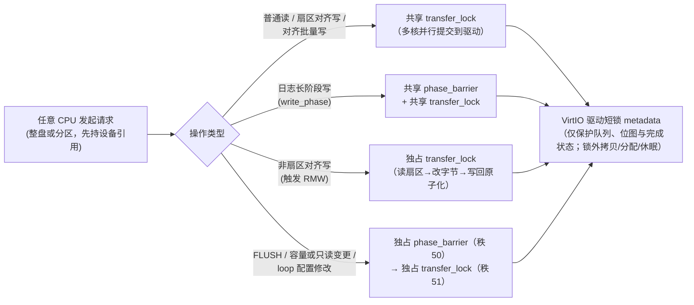

# VirtIO 块设备与通用块层

BoarOS 的存储栈分为上下两层：下层是跨架构共用的 VirtIO 块设备驱动（`drivers/virtio/block.c`），依托[共用 VirtIO 框架](virtio-framework.md)统一驱动 RISC-V MMIO 与 LoongArch PCI 磁盘；上层是通用块设备层（`kernel/block.c`）与块设备文件接口（`fs/block_file.c`），负责整盘与分区管理、读写锁排序、裸设备字节与直接 I/O（Direct I/O，DIO）、`ioctl` 控制及统计导出。设备树发现详见[DTB 与启动内存布局](dtb-memory.md)，文件系统语义见[VFS 与 ext4 模块](vfs-ext4.md)。

---

## 一、架构分层与多核并发模型

| 源码路径 | 核心职责 |
| :--- | :--- |
| `kernel/block.c`、`include/kernel/block.h` | 通用块设备注册表、MBR/GPT 分区扫描、两级读写锁（`phase_barrier` / `transfer_lock`）、批量与阶段写入入口、17 列块统计 |
| `fs/block_file.c` | 裸块设备节点打开/独占声明（`O_EXCL`）、非对齐字节读写、`O_DIRECT` 与 `BLK*` 系列 `ioctl` |
| `drivers/virtio/block.c`、`include/kernel/virtio_block.h` | VirtIO 块核心：8 请求槽、64 描述符散列-聚集（Scatter-Gather，SG）、中转区读-改-写（RMW）、`FLUSH` 屏障、优先级预留与故障诊断 |
| `arch/riscv/virtio_mmio_block.c`、`drivers/virtio/pci_block.c` | 平台薄适配层：RISC-V PLIC 中断与 MMIO 绑定、LoongArch 现代 PCI 绑定与所有权跟踪 |

在多核（SMP）配置下，**任意 CPU 上的任务都可以直接调用块层的读、写、批量读写、日志阶段写入和 `FLUSH` 接口**，而设备初始化、中断处理与最终销毁由 CPU0 执行。为了兼顾高并发对齐读写与非对齐读-改-写（Read-Modify-Write，RMW）的数据一致性，通用块层在物理父盘上维护两把固定加锁顺序的可睡眠读写锁：

- **分区与父盘共享锁**：主分区与 GPT 分区（每盘最多 15 个，设备号主号 `252`，名称 `vd[a..][1..15]`；回环设备主号 `7`，名称 `loopN`）保存不可变的父盘引用、起始偏移和容量。入口先按分区容量校验，再将偏移平移一次到物理父盘，并根据**平移后的物理偏移和物理父盘逻辑扇区大小**决定是否需要 RMW。
- **动态升级无死锁**：对齐判断在持有共享 `transfer_lock` 时读取可配置的逻辑扇区大小；若发现包含任意非空非对齐区间，先释放共享锁再获取独占 `transfer_lock`，随后重新核对容量与只读状态，确保独占前不产生设备 I/O。

---

## 二、VirtIO 块驱动核心设计

### 2.1 设备发现、特性协商与内存布局

- **发现与传输**：RISC-V 平台从设备树（DTB）收集所有 `compatible = "virtio,mmio"` 节点，按物理地址排序并拒绝重叠，成功初始化的块设备全部登记（首个为根盘）。同时支持 Legacy v1 与 Modern v2 MMIO，LoongArch 平台经 Modern v2 PCI 接入。
- **特性协商**：尝试协商只读 `VIRTIO_BLK_F_RO`（bit 5）、持久化刷新 `VIRTIO_BLK_F_FLUSH`（bit 9）、单段上限 `VIRTIO_BLK_F_SIZE_MAX`（bit 1）与最大段数 `VIRTIO_BLK_F_SEG_MAX`（bit 2）。若设备声明只读，则将写回调全部置空。驱动不协商 `CONFIG_WCE`，因此 `VIRTIO_BLK_F_FLUSH` 存在即视为回写模式（`KERNEL_BLOCK_CACHE_WRITEBACK`），缺失即视为直写模式（`KERNEL_BLOCK_CACHE_WRITETHROUGH`）。
- **队列与请求槽布局**：

| 资源项 | 规格说明 |
| :--- | :--- |
| **分裂队列容量** | 默认 `VIRTIO_QUEUE_SIZE = 64` 项描述符；若设备 `QueueNumMax` 更小，则按 2 的幂向下取整（最小要求 4 项） |
| **在途请求槽** | 最多 **`VIRTIO_BLOCK_REQUEST_SLOTS = 8`** 槽（`slot_count = min(queue_size / 3, 8)`），每槽步长 `768 B`，独立包含 16 字节请求头、1 字节状态、512 字节中转缓冲区（Bounce Buffer）、任务归属和私有完成等待队列 |
| **队列物理页** | **Modern v2**：分配连续 2 页（RV `8 KiB`、LA `32 KiB`），请求槽从偏移 `2048 B` 开始避开 64 项环形队列 **Legacy v1**：分配连续 4 页（RV `16 KiB`），已用环按协议 `4 KiB` 页对齐，请求槽位于 `8 KiB` 处 |
| **批量工作区池** | 每请求槽预留一份 **`2048 B`** 非 DMA 工作区（8 槽在 4 KiB 页架构占 4 页、16 KiB 页架构占 1 页），在设备初始化时一次性分配。耗尽时在 `workspaces` 队列等待归还，**绝不在写回或内存回收路径临时分配页** |

### 2.2 零拷贝散列-聚集（SG）、中转 RMW 与流式阶段写

驱动将“准备描述符、发布、通知设备、等待完成和收割结果”彻底解耦，数据路径按请求形态自动选择最优策略：

1. **单段直接 DMA 快路径**：在 `virtio_block_read_batch()` 中，如果仅包含 1 个扇区对齐、位于内核直接映射区且不超过单段上限（`max_segment_size`）的读区间，驱动直接申请高优先级请求槽并复用请求自身的完成队列，完全跳过批量工作区分配与二次状态封装。
2. **多段散列-聚集（Scatter-Gather，SG）**：批量接口（`kernel_block_read_batch` / `kernel_block_write_batch`，单批上限 **`KERNEL_BLOCK_BATCH_MAX = 32`** 项）将磁盘连续、扇区对齐且支持直接 DMA 的多个离散内存页（例如 32 个物理不连续的 4 KiB 页）拼成**单条最多 128 KiB（`VIRTIO_BLOCK_TRANSFER_BYTES`）的 SG 请求**——包含 1 个请求头描述符、最多 32 个数据描述符和 1 个状态描述符（共 34 项）——无需内存拷贝，也不必等待整批凑齐资源即可边释放边补发。磁盘不连续的多条请求可在同一轮全部入队后仅通知设备一次。
3. **非对齐中转读-改-写（RMW）**：若写入偏移或长度未按 512 字节扇区对齐，驱动利用槽内 512 字节中转缓冲区先读出完整扇区、合入修改字节再写回。同一批次中若多个区间落入同一物理扇区，按输入顺序串行推进 RMW，避免并发快照相互覆盖；其余不冲突区间照常并发。
4. **日志流式阶段写（`kernel_block_write_phase()`）**：文件系统日志层向驱动提供一个无副作用、可重入的不可变生产者游标，驱动在共享 `transfer_lock` 保护下按设备队列与段上限持续拉取并流水线化提交请求——每完成一条即刻补发后续数据，消除每 128 KiB 等待整批 DMA 排空的停顿。对于仅实现同步写回调的后端（如 `loop` 设备），通用块层自动拆分为不超过 32 项 / 128 KiB 的窗口并在窗口间归还 `transfer_lock`，避免饿死并发读。

### 2.3 优先级预留、中断与等待语义

- **前台保护（优先级预留）**：后台脏页写回使用低优先级（`KERNEL_BLOCK_PRIO_LOW`）。当槽总数 `> 4` 时为前台保留 2 个请求槽（`total > 1` 时保留 1 个，`total == 1` 时不保留），且当普通等待队列 `slots` 或 `descriptors` 非空时让行；队列容量 `≥ 12` 时，低优先级批量请求至少要求 12 个空闲描述符才启动提交（小队列降为 3 个）。
- **轮询与中断协作**：启动早期采用显式轮询；启用外部中断控制器（RISC-V PLIC / LoongArch PCH-PIC）后，任务在等待前会先轻量检查 `used->index`（无进展时不访问中断寄存器），登记等待后再次检查，若 DMA 已就绪则不进入睡眠。真实中断总是**先确认设备中断再收割完成环**，确保确认期间新到达的完成项不会丢失通知。
- **细粒度等待队列**：驱动内部划分 6 条独立等待队列（`admission` 入场、`idle` 刷新排空、`slots` 普通槽、`slots_low` 低优先级槽、`descriptors` 描述符、`workspaces` 批量工作区），加上每槽独立的完成队列 `done`。DMA 完成立即归还描述符并唤醒对应完成队列；请求槽则保留到原调用者消费完结果（如完成中转区拷贝）后才归还并唤醒槽位等待者。
- **持久化屏障（`FLUSH`）与超时策略**：
  - `FLUSH` 先置 `barrier_waiters` 阻断新逻辑调用，待所有已入场调用排空（`active == 0`）后发送类型 4 请求（仅头 + 状态共 2 个描述符；已入场的批量调用仍允许补发余下分片，避免互锁）。直写设备同样经过软件排空屏障但不下发硬件 `FLUSH`。
  - **普通读写 30 秒超时**：从发布时刻起以平台时钟频率计算 30 秒期限；到期重查仍无进展时输出故障现场并执行同步复位，确认 DMA 停止后向所有在途请求交付 `TIMEOUT`，设备进入失败态。
  - **`FLUSH` 持久等待**：后端同步无固定时间上界，因此 `FLUSH` 每 30 秒检查一次；若仍未完成，打印等待提示并顺延 30 秒期限，**不重发、不复位，也不虚报持久化成功**。

---

## 三、用户态裸块设备、直接 I/O 与 sysfs 导出

用户态进程可通过设备临时文件系统（`devtmpfs`）打开裸块设备节点（如 `/dev/vda`、`/dev/vda1`、`/dev/loop0`），独立建立块打开文件描述（Open File Description，OFD），不经过普通文件页缓存：

- **字节与定位 I/O**：`read`/`write`/`readv`/`writev`/`pread`/`pwrite` 支持任意非扇区对齐范围（内部经通用块层字节读写与临时单扇区暂存区完成）。读取盘尾返回 `0`，跨盘尾写截断至剩余容量，盘尾处非空写返回 `-ENOSPC`。`O_EXCL` 与文件系统挂载竞争同一个独占声明所有权（`claim_owner`）。
- **直接输入输出（`O_DIRECT`）**：可在打开时指定或经 `fcntl(F_SETFL)` 动态切换。要求偏移、总长度及每个非空向量的地址与长度均按设备逻辑扇区对齐，单次最多借用一个架构页完成用户态拷贝与块设备传输；若用户源地址缺页，仅提交已成功拷贝的完整扇区前缀。
- **设备控制（`ioctl`）**：支持 `BLKGETSIZE`（512 字节扇区数）、`BLKGETSIZE64`（字节容量）、`BLKSSZGET`（逻辑扇区大小）、`BLKROGET`/`BLKROSET`（读写状态）、`BLKBSZGET`/`BLKBSZSET`（软件块大小，须为 `[逻辑扇区, 架构页大小]` 内的 2 的幂）与 `BLKFLSBUF`（先同步该设备上的已挂载文件系统再执行设备刷新）。修改类 `ioctl` 要求调用者具备 `CAP_SYS_ADMIN` 权能，否则返回 `-EACCES`；`DISCARD`/`SECURE_DISCARD`/`ZEROOUT` 明确返回 `-EOPNOTSUPP`。
- **回环设备（`loop`）**：每个文件后备 `loop` 绑定拥有独立后台工作线程，避免上层文件系统持锁时在同一调用栈重入后备文件锁；支持标量、批量与日志阶段写，解绑与自动清理在所有引用与在途请求归还后推进。
- **sysfs 与 `statx` 导出**：
  - `/sys/block/<整盘>/queue/` 导出 `logical_block_size` 与 `dma_alignment`（对齐掩码 `逻辑扇区 - 1`）；`statx(STATX_DIOALIGN)` 据此报告精确的内存与偏移对齐。
  - `/sys/block/<整盘>/stat` 与 `/sys/block/<整盘>/<分区>/stat` 按 Linux 17 列格式输出实时统计（含读写完成次数、512 字节扇区数、毫秒耗时、在途数、忙时长与 `FLUSH` 计数；整盘包含分区请求，刷新只记入整盘），通过设备号与登记代次防止旧句柄延长已注销设备寿命。

---

展开查看：故障诊断快照、完成校验边界与定向验证入口

### 队列故障诊断与现代短完成规则

发生队列损坏或普通读写超时时，驱动在执行复位前会输出 `BoarOS: block queue fault` 冷路径诊断（仅读取驱动自有标量和最多 8 个固定槽位，不解引用外部指针、不分配内存），错误原因分为五类：

| 原因分类 | 触发条件与处理 |
| :--- | :--- |
| `used-overflow` | `used->index - last_used` 超过请求槽上限 |
| `used-element` | 完成头描述符越界、指向数据/状态描述符，或 Legacy 出现 0 字节完成 |
| `used-length` | 完成长度超出该请求允许区间（读为 `数据总长 + 1`，写/刷新为 `1`） |
| `slot-state` | 头描述符指向未发布槽位、重复完成或槽状态非 `submitted` |
| `device-status` | 设备写回的状态字节超出 `OK(0)` / `IOERR(1)` / `UNSUPP(2)` |
| `timeout` | 普通读写超过 30 秒无完成（不附带非法完成项，仅保存复位前现场） |

- **Modern IN 短完成保护**：现代传输下读请求的状态字节紧跟全部数据之后；若设备返回的 `used` 长度小于 `data_length + 1`（含 0 字节），驱动不读取未覆盖的状态字节也不补零，仅将该单条请求判定为 I/O 错误，但因为合法 `used` 项已结束该请求的 DMA，不会复位整台设备，其他请求继续正常执行。
- **分区栈帧控制**：通用块层在分区偏移平移时区分小批量（`1..4` 项，独立小栈帧）与大批量（`5..32` 项，独立大栈帧），避免小请求占用最大数组栈空间。
- **成本诊断统计**：默认构建仅累计请求数、最大在途数、中断/睡眠/唤醒/队列等待与错误；开启 `BOAROS_COST_DIAGNOSTICS=1` 后额外累计在途深度积分（`inflight-ticks`）、忙时及槽位/描述符/工作区全满时间与峰值，详见[成本观测模块](kernel-cost.md)与[数据路径预算实验](../learning/data-path-budget-experiments.md)。

### 定向验证入口

- **宿主模型与边界检查**：`make test-block-host`、`make test-virtio-block-host`、`python3 -B tests/host/virtio_block_diagnostics.py`、`FILE_IO_HOST_TCP=0 FILE_IO_BLOCK_ONLY=1 sh tests/host/file-io-concurrency.sh`。
- **双架构客机与真实 NBD 控序门禁**：`make test-block-riscv`、`make test-block-loongarch`、`make test-io-sleep-riscv`（覆盖 legacy/modern × writeback/writethrough 四组合）、`make test-multi-disk-rt-riscv`、`tests/userland/direct-block.py`。

