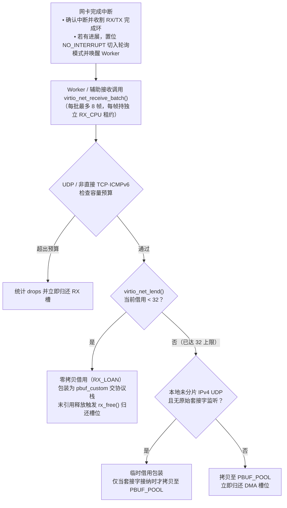

# VirtIO 网卡与以太网数据路径

BoarOS 的物理网络接入由共用的 VirtIO 网卡驱动（`drivers/virtio/net.c`）与以太网协议适配层（`net/ethernet.c`）组成。下层依托[共用 VirtIO 框架](virtio-framework.md)在 RISC-V MMIO 与 LoongArch PCI 上实现统一硬件抽象，提供**接收缓冲区零拷贝借用**、**发送间接描述符零拷贝散列-聚集**、**发送合批通知**与**类 NAPI 中断抑制轮询**；上层则通过独立的可汇合内核工作线程将以太网帧接入多核 `lwIP` 协议栈（见[多核网络协议栈与套接字](kernel-network.md)）。

---

## 一、源码组织与内存布局

| 源码路径 | 核心职责 |
| :--- | :--- |
| `drivers/virtio/net.c`、`include/kernel/virtio_net.h` | VirtIO 网卡驱动核心：RX/TX 分裂队列管理、64 槽缓冲池、接收借用计数、间接表零拷贝发送、发送合批与 5 秒看门狗 |
| `arch/riscv/virtio_mmio_net.c`、`drivers/virtio/pci_net.c` | 平台薄适配层：按设备 ID `1` 发现并绑定 RISC-V MMIO/PLIC 或 LoongArch Modern PCI |
| `net/ethernet.c`、`include/kernel/network.h` | 以太网 `netif` 注册、自定义 `pbuf` 零拷贝接收包装、UDP 预算接纳、工作线程有界轮询与无网卡定时器工作线程 |

### 队列与 DMA 缓冲池规格

驱动协商网卡硬件地址 `VIRTIO_NET_F_MAC`（bit 5，必需）、链路状态 `VIRTIO_NET_F_STATUS`（bit 16）与间接描述符 `VIRTIO_RING_F_INDIRECT_DESC`（bit 28）；不协商可合并接收缓冲区、校验和/分段卸载（Checksum/GSO）、压缩环或多队列。

| 资源项 | 规格与对齐 |
| :--- | :--- |
| **RX / TX 队列深度** | 各 **`VIRTIO_NET_QUEUE_SIZE = 32`** 个描述符 |
| **RX / TX 数据缓冲池** | 各预分配 **`VIRTIO_NET_BUFFERS = 64`** 个槽位，每槽 **`2048 B`**（各占 `128 KiB` 连续物理内存，合 `256 KiB`） |
| **队列控制页开销** | RISC-V Legacy：`16 KiB`（DMA 总计 `272 KiB`） RISC-V Modern：`8 KiB`（DMA 总计 `264 KiB`） LoongArch Modern：`16 KiB`（单 16 KiB 页，DMA 总计 `272 KiB`） |
| **帧头与槽内对齐** | Legacy 网卡头 `10 B`、Modern 网卡头 `12 B`；槽内前置填充 `16 - header` 字节，使**以太网帧起点统一对齐在槽偏移 16 字节处** |

---

## 二、接收路径：零拷贝借用与预算接纳

网卡接收路径将“硬件描述符归还”与“帧缓冲区归还”分离：一旦设备写入完成，32 个硬件描述符槽立即可以重新投递其他空闲缓冲区，而装载着数据的 2 KiB 缓冲区则通过自定义协议缓冲区（`pbuf_custom`）直接借给上层协议栈，避免在收包热路径逐包复制以太网载荷。

- **32 槽借用上限与备用池保护**：64 个接收槽中最多同时借出 **32 个**（`loaned == 32`）给协议栈，保留其余 32 个随时补充到硬件 RX 队列以保持满深度接收。`rx_free()` 回调仅将缓冲区归还空闲队列，且仅当此前无空闲缓冲区可补发且当前存在空闲 RX 描述符时才唤醒工作线程，避免冗余唤醒。
- **UDP 接纳预算与控制余量**：对于 IPv4 UDP 及可能落入 UDP 的 IPv6 扩展头流量，`udp_capacity_after()` 同时统计已用 `PBUF_POOL`、协议堆和当前 DMA 借用（每槽按 2048 字节计），强制保留至少 **16 个 `PBUF_POOL` 缓冲区**与 **`68 KiB`**（`65536 + 4096`）协议堆余量给 TCP 与控制报文；超出预算直接丢弃。
- **本地 UDP 延迟拷贝**：即使 32 个 DMA 借用已满，对于目的地址为本机且无分片的 IPv4 UDP 帧（且无原始套接字观察者），驱动仍先以临时借用视图递交协议栈，仅在目标套接字实际接收时通过 `boaros_lwip_udp_copy_borrowed()` 拷贝至 `PBUF_POOL`，减少无主数据报的无效拷贝。

---

## 三、发送路径：间接表零拷贝、合批通知与异步退休

网卡发送端同样围绕“减少数据拷贝”与“减少虚拟机退出通知”两条主线优化：

1. **间接描述符零拷贝（`virtio_net_send_segments`）**：当设备协商了 `VIRTIO_RING_F_INDIRECT_DESC`（bit 28），且待发送 `pbuf` 链不超过 **`VIRTIO_NET_TX_SEGMENTS = 2`** 段、无需拷贝（非 `PBUF_NEEDS_COPY`）且所有段均落在内核直接映射区时，`submit_link_frame()` 通过 `pbuf_ref()` 增加引用计数，在对应发送槽的偏移 `64 B`（`VIRTIO_NET_TX_TABLE_OFFSET`）处原地构造间接描述符表（第 0 项指向 10/12 字节 VirtIO 头，后续 1~2 项直指 `pbuf` 物理载荷），零拷贝直交硬件。若条件不满足则无缝回退至拷贝路径（`virtio_net_send_copy`），两者分别由 `tx-sg` 与 `tx-copy` 统计。
2. **64 位空闲槽位图与按需回收**：驱动在设备状态短锁内用 64 位位图 `tx_available` 分配发送槽，避免热路径遍历数组；仅当发送槽全部耗尽时，提交者才在返回 `-EAGAIN`（向上转为 `ERR_MEM`）前主动扫描一次完成环，尽快腾出刚完成的槽位。
3. **发送合批与统一通知**：独立发送报文立即提交并通知硬件；TCP 在单次 `tcp_output()` 连续输出多个段时传入 `more = 1`，驱动按序放入 `tx_pending` 队列，待批次结束（`!more`）、积攒满 **8 个待发包**（`tx_count >= 8`）或空闲槽耗尽时调用 `flush_tx()`，通过 `virtio_split_stage()` 批量写入描述符，再一次性推进可用环索引并发出单次设备通知。协议层退出发送循环时也会显式调用 `virtio_net_tx_flush()` 兜底刷新。
4. **锁外批量退休引用**：硬件完成零拷贝发送后，中断或轮询不能在持有设备原始自旋锁期间调用协议栈 `pbuf_free()`。收割逻辑将已完成载荷指针迅速摘入 32 槽退休环 `tx_retired` 并立即释放发送槽、递增容量代次 `tx_capacity_generation`（若退休环已满则退回 `tx_done` 暂留原槽），随后由网络工作线程通过 `virtio_net_tx_release()` 在设备锁外成批释放 `pbuf` 引用，既缩短临界区又避免重复锁开销。

---

## 四、中断抑制轮询、工作线程与停止回收

### 4.1 中断抑制与有界服务轮询

为降低高吞吐下的中断风暴，网卡实现了类似 Linux NAPI（New API）的中断-轮询切换：
- **进入轮询**：硬件中断处理函数 `interrupt()` 先确认中断（若是配置变更中断，还检查 `DEVICE_NEEDS_RESET` 并刷新链路状态），再收割 RX/TX 完成环。只要发现实际完成项，就向两条队列的 `available->flags` 写入 `VIRTIO_AVAIL_NO_INTERRUPT`（置 `polling = 1`），请求设备暂缓中断，并唤醒工作线程。
- **有界工作轮次**：工作线程（`worker`）每轮依次执行：释放 UNIX 权能环路、调用 `virtio_net_poll_service()`（收割、5 秒发送超时检测、补充 RX 与刷新 TX）、锁外批量释放已完成发送引用、在协议执行资格内通告发送容量变化并处理最多 **8 帧** RX（`KERNEL_NETWORK_RECEIVE_BATCH`），再服务最多 **8 个回环包**、**8 个套接字工作项**与 **1 个协议定时器**。
- **退出轮询防丢包**：本轮末调用 `virtio_net_service()` 清除 `available->flags` 重新开启中断，**紧接着执行 DMA 屏障并再次收割完成环**——确保屏蔽期间到达的报文由轮询者收走，之后的报文则恢复由中断唤醒。睡眠前重查工作链、容量代次、待释放引用、可取 RX 项及 `polling` 标志；睡眠期限取协议下一超时与最早在途 TX 5 秒看门狗的较小值（队列为空时最迟 5 秒唤醒一次）。
- **无物理网卡模式**：若平台未挂载 VirtIO 网卡，`kernel_network_start()` 以 `device == NULL` 启动轻量级的 `timer_worker`，保留相同的有界回环与协议定时推进能力，确保套接字定时器与资源回收不依赖用户态重新陷入系统调用。

### 4.2 故障隔离与严谨的停止顺序

设备出现非法完成、`DEVICE_NEEDS_RESET`、未协商的卸载标志或已发布发送超时（5 秒）时，驱动冻结并打印槽级冷路径快照（仅由工作线程在锁外输出），停止新发布并向协议栈报告链路断开，但**不提前回收在途发送引用或借出接收槽**——因为设备故障不等于硬件 DMA 已停止，且协议栈的回环与定时器仍需继续推进。

系统退出或网络关闭时遵循严格的所有权清理顺序：
1. `virtio_net_begin_stop()` 阻断新提交，注销网络回调挂钩并唤醒工作线程。
2. 在协议锁和关中断区外 `kernel_thread_join()` 汇合工作线程，并停止多核 TCP 归属核（SMP）。
3. `virtio_net_quiesce()` 复位硬件并确认 DMA 停止，随后注销硬件中断；若设备拒绝确认复位，返回 `-EIO` 并保留全部 DMA/中断所有权供后续重试。
4. 取得协议资格清理 IPv4 分片重组表、ARP 缓存与链路层抓包器，卸载 `netif`（同步中止仍关联旧本地地址的活跃/孤儿 TCP 控制块，归还其乱序队列中借用的 RX `pbuf`）。
5. 此时硬件 DMA 已确认停止，调用 `virtio_net_tx_release(..., abandon = 1)` 回收全部残留发送引用；确认所有接收借用与发送所有者归零后，`virtio_net_stop()` 释放队列与 RX/TX 物理页，平台最后销毁 PCI 传输并归还 BAR。若仍有未归还引用，返回 `-EBUSY` 绝不提前释放物理页。

---

## 五、网络接口配置与用户态控制

默认网卡接口 `eth0` 的静态 IPv4 地址由构建参数 `BOAROS_NET_IPV4` / `BOAROS_NET_NETMASK`（默认 `10.77.0.2/24`）生成，MTU 固定上限 `1500`（回环接口 `lo` 范围 `68..65536`，协议栈内部 MTU `0` 对外映射为 `65536`），同时自动按 MAC 派生 IPv6 链路本地地址并执行重复地址检测（DAD）。

用户态接口控制如下：
- **查询接口**：`SIOCGIFFLAGS`、`SIOCGIFADDR`、`SIOCGIFNETMASK`、`SIOCGIFHWADDR`、`SIOCGIFMTU`、`SIOCGIFINDEX`、`SIOCGIFNAME`、`SIOCGIFCONF`（64 位下 `ifreq` 为 40 字节、`ifconf` 为 16 字节），以及只读 `NETLINK_ROUTE` 查询（见[只读 rtnetlink 路由接口](../network-rtnetlink.md)）。
- **修改接口与路由**：`SIOCSIFFLAGS`（UP/DOWN）、`SIOCSIFADDR`、`SIOCSIFNETMASK`、`SIOCSIFMTU`、`SIOCADDRT`/`SIOCDELRT`（管理一条带网关的 IPv4 默认路由，导出至 `/proc/net/route`），修改操作均要求 `CAP_NET_ADMIN` 权能。

---

展开查看：生命周期存储前提、成本诊断指标与定向验证入口

### 存储生命周期与诊断统计

- **冷启动对象前提**：`virtio_net_init()` 要求传入全新的零初始化 `struct virtio_net_device`。仅在 `virtio_net_stop()` 返回 `0` 归还全部借用、发送引用、DMA 页和中断所有权后，调用方才可清零并复用该存储；若复位失败返回 `-EIO`，必须保留原对象继续完成停止流程。
- **成本诊断指标**：开启 `BOAROS_COST_DIAGNOSTICS=1` 时，退出统计额外报告 `tx-done-free-*`（从软件收割完成到槽位归还）与 `tx-free-post-*`（同一槽归还至下次发布）的次数、总 tick、最大值、时钟频率及溢出标记；发布构建不引入额外时钟读取开销。
- **串行纯 ACK 合并**：单核或串行接收路径下，`receive_inline()` 在观察到 `frames[0].more_ready` 时自动开启纯 ACK 批次合并，遇到非纯 ACK 以太网帧时先冲刷当前批次再递交。

### 定向验证入口

- **宿主驱动与所有权模型**：`make test-virtio-net-host`、`make test-lwip-reassembly-host`、`make test-ethernet-worker-host`、`python3 -B tests/host/virtio_net.py --sanitize`、`python3 -B tests/host/network_owner.py --sanitize`。
- **双架构客机与真实 TAP 外部网络验证**：
  - `python3 -B tests/userland/network-external.py --transport both`（RISC-V legacy/modern MMIO）
  - `python3 -B tests/userland/network-external.py --arch loongarch`（LoongArch modern PCI）
  - `make test-net-failures-loongarch`（9 类分配/IRQ/复位失败注入与资源基线回收）
  - `python3 -B tests/userland/run.py --only boaros --workload interface`

