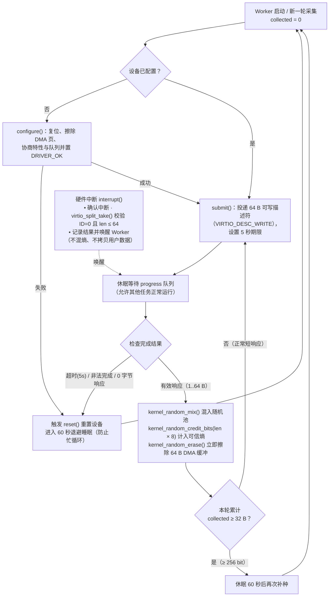

# VirtIO 硬件随机数与熵源初始化

操作系统的密码学随机数子系统（如 `getrandom(2)` 与 `/dev/urandom`）在启动早期必须收集足够的可信熵，才能避免生成可预测密钥。BoarOS 通过跨架构共用的 VirtIO 硬件随机数生成器（Random Number Generator，RNG）驱动，依托[共用 VirtIO 框架](virtio-framework.md)统一接入 RISC-V 内存映射 I/O（MMIO）与 LoongArch 现代 PCI 熵设备，由独立的内核后台线程持续为内核随机池注熵并周期性补种。随机核心与用户态语义可配合阅读[随机源设计说明](../learning/random-source.md)。

---

## 一、源码组织与资源布局

| 源码路径 | 核心职责 |
| :--- | :--- |
| `drivers/virtio/rng.c`、`include/kernel/virtio_rng.h` | 共用 RNG 驱动核心：单描述符分裂队列、可汇合注熵线程、超时与退避策略、熵缓冲即时擦除与复位回收 |
| `arch/riscv/virtio_mmio_rng.c` | RISC-V 平台适配：按 VirtIO 设备 ID `4` 探测 MMIO 设备并绑定平台级中断控制器（PLIC） |
| `drivers/virtio/pci_rng.c` | LoongArch 平台适配：按设备 ID `4`（无需设备配置区，`config_size = 0`）探测现代 PCI 设备并管理 BAR 生命周期 |

### 队列与 DMA 内存规格

RNG 是最精简的 VirtIO 设备之一，没有设备配置区，也不需要协商任何设备专属特性位：

| 参数 | Legacy v1（MMIO） | Modern v2（MMIO / PCI） |
| :--- | :--- | :--- |
| **物理页分配** | `order = 1`（连续 2 页，RV 占 `8 KiB`） | `order = 0`（单物理页，RV 占 `4 KiB`，LA 占 `16 KiB`） |
| **队列深度** | `1` 项描述符（描述符表位于偏移 `0`，可用环位于偏移 `16`） | `1` 项描述符（描述符表位于偏移 `0`，可用环位于偏移 `16`） |
| **已用环偏移** | `BOAROS_PAGE_SIZE`（协议要求页对齐） | `32 B` |
| **熵数据缓冲区** | 紧随已用环后偏移 `+64 B`，长度 `64 B` | 紧随已用环后偏移 `+64 B`，长度 `64 B` |

每个 RNG 实例拥有独立的队列物理页、中断所有权和等待队列，与块设备、网卡完全隔离，互不争用队列槽或等待资源。

---

## 二、异步采集、熵信用累计与故障退避

RNG 驱动不在中断上下文或用户态系统调用中同步等待硬件，而是通过独立的可汇合内核工作线程 `worker` 与中断处理函数 `interrupt` 异步协作：

关键安全与稳定性策略如下：
- **可信熵累计与不可逆就绪**：只有经过硬件 RNG 返回的非零字节才会按 `response_length × 8` 位调用 `kernel_random_credit_bits()` 计入可信熵；设备树（DTB）启动种子与用户态写入仅参与混合，不计入可信熵。一旦随机池达到就绪阈值并唤醒等待中的 `getrandom(2)` 调用者，后续即使硬件 RNG 发生超时或故障，也**绝不撤销已就绪状态**。
- **即时擦除敏感材料**：每次将设备写入的随机字节混入熵池后，工作线程立即调用 `kernel_random_erase(data, 64)` 清零 DMA 缓冲区；在重新配置队列和停止释放物理页前，同样整块擦除 DMA 内存，防止熵材料残留在空闲页中。
- **区分正常短响应与故障退避**：硬件后端允许返回少于 64 字节的有效熵（例如每次 16 字节），驱动对此立即继续请求，直至本轮累计达到 **32 字节（256 位）** 后休眠 60 秒。但若出现 **5 秒超时**、**非法完成**（错误描述符 ID 或越界长度）或 **0 字节响应**，驱动则立即复位设备并退避 **60 秒**后再重新协商，彻底避免在熵源枯竭或后端故障时陷入忙循环。

---

## 三、启动生命周期与复位失败所有权保护

1. **启动与原子回滚（`virtio_rng_start`）**：依次执行初始复位、分配物理页并解析内核虚拟地址、调用 `configure()` 完成协议协商与队列就绪、注册中断处理函数、创建可汇合内核线程 `worker`。任一步骤失败都统一调用 `virtio_rng_stop()` 按实际已获资源逆序回滚。若平台不存在 RNG 设备（或初始化失败但清理成功），系统仍可正常启动用户态进程，只是未就绪前的非阻塞 `getrandom(GRND_NONBLOCK)` 会保持返回 `-EAGAIN`。
2. **停止与确认复位（`virtio_rng_stop`）**：设置 `stopping = 1` 并唤醒、汇合 `worker` 线程（回收线程栈），随后执行 `virtio_transport_reset()`。**只有在硬件确认复位成功（DMA 彻底停止）后**，才允许注销中断、擦除并释放 DMA 物理页、清空 `transport.context`。
3. **复位拒绝时的所有权保留**：如果硬件拒绝确认复位，`virtio_rng_stop()` 返回 `-EIO`，此时工作线程虽已汇合，但驱动**保留 `transport.context`、DMA 物理页与中断注册所有权**，绝不释放可能仍被硬件访问的物理页，允许上层稍后显式重试 `stop()`；PCI 包装层（`virtio_pci_rng_stop()`）同样只有在核心停止成功后才归还 PCI function 与 BAR，防止半成品泄漏或覆盖设备所有权。

---

展开查看：宿主模型与双架构 EGD 控序验证入口

### 统计字段（`struct virtio_rng_device`）

驱动维护五项生命周期计数：`requests`（已提交请求数）、`bytes`（已采集有效字节数）、`zero_responses`（零长度响应次数）、`errors`（配置/完成非法错误次数）与 `timeouts`（5 秒超时次数）。

### 定向验证入口

- **宿主驱动与边界模型**：`python3 -B tests/host/virtio_rng.py`（覆盖 Legacy/Modern 与 4 KiB/16 KiB 页模型下的 16+16 短响应拼接、零长度退避、非法长度/ID、5 秒超时、60 秒补种、就绪后故障保持、启动失败回滚、在途停止与复位拒绝重试恢复）。
- **双架构客机与真实 EGD（Entropy Gathering Daemon）握手验证**：
  - RISC-V MMIO：`python3 -B tests/userland/rng.py`（覆盖无设备、正常注熵、后端暂扣延迟就绪、在途退出与根资源基线核对）。
  - LoongArch PCI 与故障注入：`make test-rng-loongarch`、`make test-rng-failures-loongarch`（覆盖 DMA/任务页/栈页内存耗尽与中断注册失败注入，以及未就绪等待被信号中断）。

