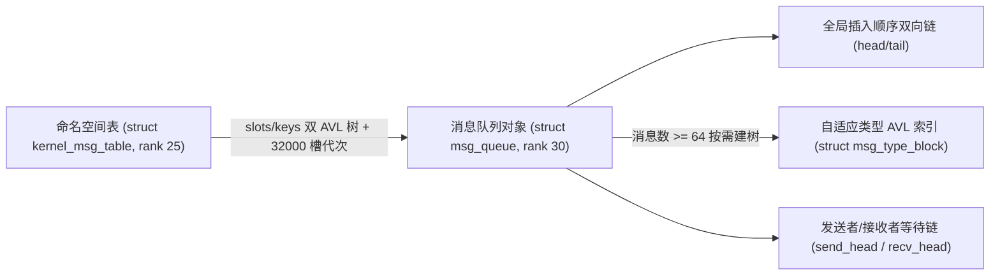

# System V 消息队列（SysV MSG）

**System V 消息队列（System V Message Queue，SysV MSG）**是一种面向**带类型离散消息**的内核缓冲通道：发送方把带有正 64 位整数类型标签（`mtype`）和定长正文的消息投入队列，接收方既可以按**先进先出（First In, First Out，FIFO）**顺序取队首，也可以按精确类型、排除类型或最小类型优先级筛选消费。本文基于 `include/kernel/msg.h` 与 `kernel/msg.c` 的实际代码，介绍 BoarOS 消息队列的并发架构、自适应类型索引、直达交付与 `MSG_COPY` 快照机制。

---

## 一、源码组织

| 源码路径 | 核心职责 |
| :--- | :--- |
| `include/kernel/ipc.h` | 通用 `struct kernel_ipc64_perm`（48 字节）、IPC 常量与基于有效身份/创建者的权限规则 |
| `include/kernel/msg.h` | `kernel_msqid64_ds`（120 字节）、`kernel_msginfo`（32 字节）布局、限额宏与内核接口 |
| `kernel/msg.c` | AVL 命名空间索引、每队列独立自旋锁、自适应消息类型索引、直接交付（pipelined send）、`MSG_COPY` 与 `/proc/sysvipc/msg` 枚举 |
| `kernel/syscall/dispatch.c` | 原生 Linux 系统调用号分派：`msgget(186)`、`msgctl(187)`、`msgrcv(188)`、`msgsnd(189)` |

---

## 二、执行模型、数据结构与默认限额

BoarOS 的 SysV 消息队列全路径在**调用核本地执行**，无需 CPU0 业务转发。锁层级严格遵循 `命名空间索引锁 (rank 25) -> 队列状态锁 (rank 30) -> 调度器/PID 域锁 (rank 40)`：



- **标识编码与统计**：队列标识采用 `id = (seq << 15) | slot`；每个命名空间以原子计数实时维护总消息数与总字节数，`MSG_INFO` 直接读取无需遍历全部队列。
- **默认限额**（定义于 `include/kernel/msg.h`）：
  - `KERNEL_MSGMNI = 32,000`：单命名空间最大队列数；
  - `KERNEL_MSGMAX = 8,192`：单条消息正文最大字节数（不含 8 字节 `mtype`）；
  - `KERNEL_MSGMNB = 16,384`：新建队列默认字节容量上限（通过 `IPC_SET` 调高超过此值需要 `CAP_SYS_RESOURCE` 能力）。

---

## 三、消息选择策略与自适应类型索引

### 3.1 五种接收筛选模式

`msgrcv(188)` 根据 `msgtyp` 与标志位决定如何挑选目标消息：

| 条件 | 筛选规则 |
| :--- | :--- |
| `msgtyp == 0` | 取队列中最早到达的消息（纯 FIFO） |
| `msgtyp > 0`（默认） | 取类型等于 `msgtyp` 的最早消息 |
| `msgtyp > 0` 且带 `MSG_EXCEPT` | 取类型**不等于** `msgtyp` 的最早消息 |
| `msgtyp < 0` | 取所有 `type <= |msgtyp|` 消息中**类型值最小**者的最早消息（`LONG_MIN` 按 `LONG_MAX` 上限处理） |
| 带 `MSG_COPY`（必须配 `IPC_NOWAIT`，禁配 `MSG_EXCEPT`） | 非破坏性地按从 0 开始的队列序号复制指定消息，不摘链、不改元数据 |

若选中的消息正文长度大于调用者缓冲区：默认返回 `-E2BIG` 并保留消息在队中；若指定 `MSG_NOERROR` 则截断为缓冲区长度并消费整条消息（`MSG_COPY` 模式下若无法完整复制仍返回 `-EINVAL`）。若当前无匹配消息，带 `IPC_NOWAIT` 时返回 `-ENOMSG`，否则入队阻塞等待。

### 3.2 大队列自适应类型索引

当队列积压大量不同类型消息时，每次按类型接收都从队首线性扫描会退化为 O(N)。`kernel/msg.c` 内置了一套**按需构建、自动退化的平衡树索引**：
- **触发阈值与增量构建**：当队列中消息数达到 `MSG_TYPE_INDEX_START`（64 条），且调用者发起按相同类型或最小类型接收（且队首未能直接命中）时，接收者在队列锁外分配 `struct msg_type_block`（每块含 `MSG_TYPE_BLOCK_NODES = 96` 个类型节点），随后在单次持锁期间沿插入顺序最多补建 `MSG_TYPE_INDEX_STEP`（64 条）消息到 AVL 树中；每个类型节点下挂该类型的环形 FIFO 链。
- **混合查询与弹性退化**：按相同类型查找直接命中已建前缀的首条消息，未命中再扫描剩余未索引尾部；按最小类型查找则将 AVL 树最小键与未索引尾部联合取小。若内存紧张导致索引块分配失败，自动退回线性扫描而不阻塞正常业务。
- **自动回收**：当队列消息数降至 `MSG_TYPE_INDEX_STOP`（32 条）、队列被 `IPC_RMID` 删除，或连续完成 `MSG_TYPE_INDEX_FIFO_IDLE`（64 次）纯 FIFO（`msgtyp == 0`）接收后，摘下全部索引块并在锁外释放。

---

## 四、容量记账、直接交付与安全拷贝

1. **双重容量约束**：`fits(q, size)` 同时校验两项条件——总字节数 `q->bytes + size <= q->limit` 且总条数 `q->count < q->limit`。因此即使发送 0 字节空正文消息，每条也占用 1 条配额，防止无界堆积。
2. **发送直接交付（Pipelined Send）**：
   - `msgsnd` 在队列锁外先从用户态读取 `mtype`（必须大于 0）并完整导入不可变消息体 `struct msg_message`，确保输入地址异常时不向队列发布残缺消息。
   - 满足容量条件后，先遍历当前阻塞中的接收者：若某接收者类型匹配但缓冲区过小（且未设 `MSG_NOERROR`），直接以 `-E2BIG` 完成该接收者并继续向后寻找；找到合适接收者则直接将消息转交给其请求并唤醒，更新收发时间与 PID 而不增加队列驻留计数。按 Linux 原生语义，直接交付记录接收线程的 **TID**，普通摘队接收记录 **TGID**，发送一律记录 **TGID**。
   - 若无匹配接收者，消息入队尾并递增字节与条数计数。
3. **锁外零锁拷贝与 `MSG_COPY` 准备**：
   - 普通接收在队列锁内摘下不可变消息并转移所有权给请求，释放队列锁后使用 `kernel_uaccess_write_cursor` 向用户缓冲区依次写入 8 字节 `mtype` 与正文（同一物理页复用 pin，两段分别校验范围；若正文拷贝触发缺页故障则保留已写入的类型并返回 `-EFAULT`，消息已消费）。
   - `MSG_COPY` 严格遵循 Linux 准备顺序：查询队列前先分配至多 `KERNEL_MSGMAX`（8,192 字节）准备缓冲并探测用户输出区域，再取目标消息的不可变引用并在锁外拷贝；即使拷贝期间并发删除或被其他接收者消费，仍能安全读出一致内容。

---

## 五、等待唤醒、控制命令与退出回收

- **等待与唤醒**：发送者因容量不足阻塞时挂入 `send_head`；每次出队、直接交付或 `IPC_SET` 调大容量时调用 `wake_senders()` 仅唤醒当前容量已可容纳的发送者，由发送者自行重检权限和容量后提交。`IPC_SET` 修改权限后也会唤醒等待中的接收者重检读权限。收到信号统一返回 `-EINTR`（即使注册了 `SA_RESTART` 也不自动重启），但已抢先完成交付的结果优先于并发信号。
- **高效 PID 身份缓存**：队列直接持有 `spid`/`rpid` 的规范内核 PID 引用，只要同一发送者或接收者连续操作同一队列，直接比较指针即可跳过全局 PID 域锁；身份变更时将旧引用移交当前请求，在调用结束或退出清理时于锁外归还。
- **`IPC_RMID` 与请求清理**：`queue_remove()` 摘除索引、递增槽代次、以 `-EIDRM` 终结所有等待者，并将全部在队消息与类型索引移交至锁外释放；队列对象本身等到所有在途请求归还引用后才释放内存。任何处于导入、阻塞、直达交付或输出阶段的任务被强制终止时，`kernel_msg_abort()` 自动清理 `task->msg_request` 持有的消息、拷贝缓冲、类型块与队列引用。
- **控制命令与 procfs**：`msgctl(187)` 原生 64 位直通命令字（不剥离 `IPC_64`），支持 `IPC_SET/STAT/RMID/INFO` 与 `MSG_STAT/INFO/STAT_ANY`，其中 `IPC_SET` 对 `msg_qbytes` 沿用 Linux 的有符号 32 位转换逻辑。`/proc/sysvipc/msg` 通过 `kernel_msg_proc_next()` 逐槽快照，命名空间隔离语义见 [IPC 命名空间](ipc-namespace.md) 与 [procfs 模块](procfs.md)。

---

<details>
<summary>展开查看：通知时序与定向验证入口</summary>

### 唤醒通知与锁序安全

- `request_complete()` 在队列自旋锁内摘链、写回结果并调用 `kernel_wait_notify()` 更新任务调度状态；跨核中断（IPI）延迟至最外层自旋锁释放后投递。
- 因为等待者苏醒读取结果以及任务强制终止（`kernel_msg_abort`）都必须先获取同一个队列锁，所以在通知返回前请求与任务存储必然有效，无需额外通知借用链表。
- 所有堆分配、最后引用释放与用户内存拷贝均严格位于自旋锁之外。

### 定向验证入口

```sh
# 宿主 4/16 KiB 页配置 + ASan/UBSan 并发、容量等待、E2BIG 接力、RMID 与 32,000 队列配额回归
sh tests/host/msg.sh

# 4 核用户态 ABI、消息筛选顺序、MSG_COPY、跨进程与非特权 UID 1001 权限验证
python3 tests/userland/run.py --workload sysv_msg --only boaros --cpus 4 --memory 512M \
  --kernel /path/to/kernel-rv --output build/msg-rv4
```

- 真实用户态源码：`tests/workloads/network/sysv_msg.c`、`tests/workloads/ipc/proc_sysvipc.c`。

</details>
